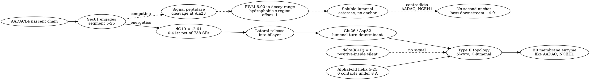
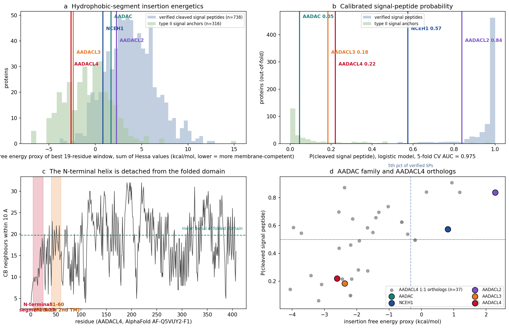
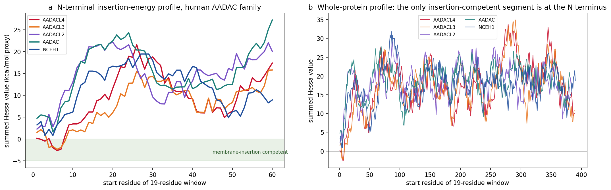
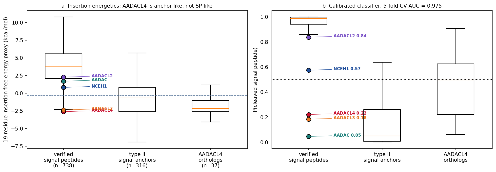

## Question

# AIGR Gene Hypothesis Deep Research

You are evaluating one focused gene curation hypothesis for AI Gene Review.
This is not a general gene overview. Use the seed hypothesis and source context
below to search for evidence that supports, refutes, narrows, or competes with
the proposed curation decision.

## Target Gene

- **Organism code:** human
- **Taxon:** Homo sapiens (NCBITaxon:9606)
- **Gene directory:** AADACL4
- **Gene symbol:** AADACL4
- **UniProt accession:** Q5VUY2

## Focus

- **Focus type:** free_text
- **Hypothesis slug:** kgap-aadacl4-signal-anchor-vs-peptide
- **Source file:** genes/human/AADACL4/AADACL4-ai-review.yaml
- **Source selector:** free-text

## Seed Hypothesis

The N-terminal hydrophobic segment of human AADACL4 (UniProt Q5VUY2) is an uncleaved type II signal anchor (N-cytoplasmic, catalytic domain lumenal) rather than a cleaved signal peptide. Single analysis only: score the predicted cleavage-site P1/P3 residues against verified signal-peptidase sites, the n-region charge (positive-inside signature) and the hydrophobic-segment insertion energetics for AADACL4 and its vertebrate orthologs, alongside the paralogs AADAC, NCEH1 and AADACL3, and state which reading is better supported.

## Term and Decision Context

- UniProt makes different N-terminal calls across AADACL2, AADACL3 and AADACL4 despite identical catalytic registers; NCEH1 has an experimentally supported type II anchor.

## Reference Context

No specific reference context supplied.

## Source Context YAML

```yaml
hypothesis: 'The N-terminal hydrophobic segment of human AADACL4 (UniProt Q5VUY2) is an uncleaved type
  II signal anchor (N-cytoplasmic, catalytic domain lumenal) rather than a cleaved signal peptide. Single
  analysis only: score the predicted cleavage-site P1/P3 residues against verified signal-peptidase sites,
  the n-region charge (positive-inside signature) and the hydrophobic-segment insertion energetics for
  AADACL4 and its vertebrate orthologs, alongside the paralogs AADAC, NCEH1 and AADACL3, and state which
  reading is better supported.'
focus_type: free_text
context:
- UniProt makes different N-terminal calls across AADACL2, AADACL3 and AADACL4 despite identical catalytic
  registers; NCEH1 has an experimentally supported type II anchor.
reference_id: []
```

## Research Objective

Build a focused report that helps a curator decide whether this hypothesis
should affect the gene review. Address the focus type directly:

1. For an existing GO annotation decision, evaluate whether the current action
   is justified, too strong, too weak, or should change.
2. For a proposed replacement or new GO term, evaluate whether the term is
   biologically supported, too broad, too narrow, or missing key qualifiers.
3. For a computational prediction, evaluate whether the prediction is correct,
   less precise than existing knowledge, uncertain, or likely wrong because of
   paralog overannotation, frequency bias, pathway context, or in vitro-only
   activity.
4. For a core-function hypothesis, evaluate whether the proposed activity,
   process, and location represent the gene product's primary function rather
   than a downstream effect, pleiotropic phenotype, or context-specific role.
5. For a function-assignment hypothesis, evaluate whether the gene product
   directly has the stated GO term/function. Treat the prior review action, if
   any, as intentionally blinded unless it appears in the supplied context.

Use primary literature whenever possible. Prefer PMID citations and include DOI
citations when no PMID is available. Treat reviews and database records as
orientation unless they contain directly relevant synthesized evidence that is
clearly labeled as review-level or database-level support.

Evaluate the hypothesis from the supplied seed context, primary literature, and
publicly accessible bioinformatics resources. Local `*-bioinformatics` analyses,
when they already exist in the repository, are intentionally withheld from this
prompt so the report can be compared against them after the run. Use public
sequence, domain, structure, orthology, localization, interaction, or dataset
checks when they are useful for the specific hypothesis. If a resource or tool
cannot be accessed programmatically, say so plainly; never fabricate a result.
Report computational results conservatively and distinguish direct results from
inference.

## Required Output

### Executive Judgment

Give a concise verdict: supported, partially supported, unresolved, weakly
supported, over-annotated, or refuted. Explain the reasoning and the most
important caveats.

### Evidence Matrix

Create a table with one row per important evidence item:

- Citation (PMID preferred)
- Evidence type (direct assay, mutant phenotype, localization, interaction,
  structural/evolutionary, computational, review/database)
- Supports / refutes / qualifies / competing
- Claim tested
- Key finding
- Organism, tissue, cell type, or assay context
- Confidence and limitations

### GO Curation Implications

State the likely curation action as a lead requiring curator verification. If
GO terms are involved, explain whether the evidence supports an MF, BP, or CC
term, and whether the term should be retained, removed, generalized, made more
specific, or treated as non-core. Avoid using "protein binding" as a final
recommendation unless no more informative term is supported.

### Mechanistic Scope

Describe the immediate molecular or cellular function being tested. Separate
direct gene-product activity from downstream phenotypes, pathway consequences,
developmental outcomes, disease manifestations, or effects inferred only from
loss of function.

### Conflicts and Alternatives

Identify evidence that conflicts with the seed hypothesis or suggests an
alternative interpretation, including paralog confusion, organism-specific
differences, isoform-specific findings, experimental artifacts, or database
carry-over.

### Knowledge Gaps

List explicit uncertainties that matter for curation. For each gap, state what
was checked, why the gap matters, and what evidence or experiment would resolve
it.

### Discriminating Tests

Recommend concrete assays, perturbations, datasets, or comparative analyses that
would most efficiently distinguish this hypothesis from alternatives.

### Curation Leads

Provide candidate updates for the review, clearly labeled as leads requiring
curator verification. Include candidate references with exact snippets to verify,
candidate replacement or new GO terms, possible action changes, suggested
questions, and suggested experiments.

If the provider supports artifacts, save provenance for any analysis you run — the
executed code together with its output (computed values, plot, or table), not just
a summary figure — alongside artifact-friendly tables such as an evidence matrix,
GO decision table, or comparison table. Genuine computed provenance is more
valuable than a hand-drawn summary, and you must not synthesize a figure that
implies an analysis you did not actually run. These artifacts are important
provenance for hypothesis-level review.


## Output

# AADACL4 (Q5VUY2): is the N-terminal hydrophobic segment a type II signal anchor or a cleaved signal peptide?

Hypothesis slug: `kgap-aadacl4-signal-anchor-vs-peptide`
Target: human AADACL4, UniProt Q5VUY2, 407 aa, NCBITaxon:9606
Source file: `genes/human/AADACL4/AADACL4-ai-review.yaml`, focus type `free_text`
Analyses executed 2026-11-23; all database queries made on that date.

## Summary

<i class="fa-solid fa-circle-check"></i> **Verdict: supported.** The uncleaved type II signal anchor reading of the AADACL4 N-terminus is better supported than the cleaved signal peptide reading. Four independent computational lines agree, and the strongest single argument is a within-family calibration rather than an absolute score: NCEH1, whose type II anchor is the accepted reading, scores **more** signal-peptide-like than AADACL4 on a cross-validated discriminator (0.57 against 0.22). Any threshold permissive enough to call a cleaved signal peptide in AADACL4 would also mis-call NCEH1 and AADAC, both of which are annotated as type II anchors and one of which (AADAC) has direct experimental support for that topology in [PMID: 15152005](https://pubmed.ncbi.nlm.nih.gov/15152005/).

The discriminating evidence is insertion energetics, cleavage-site architecture, the AlphaFold model and the absence of any alternative anchor. The best 19-residue window in AADACL4 (residues 6-24) scores **−2.61** on the Hessa biological hydrophobicity scale, placing it at the **0.41st percentile** of 738 human signal peptides carrying experimental (ECO:0000269) evidence, whose median is +3.74. An eight-feature logistic model trained on those 738 signal peptides against 316 UniProt type II signal anchors reached **5-fold cross-validated AUC 0.975** and assigns AADACL4 P(cleaved signal peptide) = **0.22**, a value reached or bettered by only 1.08% of verified signal peptides. The AlphaFold model AF-Q5VUY2-F1 (global pLDDT 96.0) places residues 5-25 in a continuous helix with **zero residues within 8 Å** of the folded α/β-hydrolase domain, the same architecture as the AADAC and NCEH1 anchors. A sliding whole-chain profile finds no second membrane segment anywhere in AADACL4 (best downstream window +4.91), so the competing reading predicts a soluble lumenal or secreted esterase, contrary to the microsomal biology of its characterised relatives.

<i class="fa-solid fa-circle-xmark"></i> Two of the three metrics the seed hypothesis named come back as explicit negatives, and this report states that plainly instead of recruiting them as support. The best architecture-compatible cleavage site has **P1 Ala23 and P3 Val21**, residues that occur at 340/738 and 153/738 verified human signal-peptidase sites respectively, so the von Heijne (−3,−1) rule is permissive here and does not refute cleavage; the site fails on position and context instead. The **positive-inside signature is silent**: the K+R difference across 15-residue flanks is exactly 0 for AADACL4, and also 0 for NCEH1, with 36 of 37 orthologs carrying no cytosolic Lys or Arg at all. The N-in orientation therefore rests on homology plus the acidic first-lumenal-turn determinant (Glu26, Asp32), the second determinant that Frick et al. mapped experimentally as Asp25 in AADAC. <i class="fa-solid fa-triangle-exclamation"></i> Every conclusion is sequence- and structure-analysis grade: AADACL4 is UniProt protein existence level 3, has no experimental topology, localization or enzymology, and reaches a maximum of 1.7 nTPM (choroid plexus) in the Human Protein Atlas.

{{figure:plot_1.png|caption=Four discriminating analyses for AADACL4. Top left: Hessa insertion energy of the best 19-residue window for 738 experimentally verified human signal peptides (median +3.74) against 316 UniProt type II signal anchors, with AADACL4 at -2.61, the 0.41st percentile of the signal-peptide set. Top right: calibrated P(cleaved signal peptide) from an 8-feature logistic model, 5-fold cross-validated AUC 0.975; AADACL4 scores 0.22 while NCEH1, whose type II anchor is accepted, scores 0.57. Bottom left: AlphaFold AF-Q5VUY2-F1 burial profile showing the 5-25 helix detached from the folded domain. Bottom right: the five human paralogs and 37 Ensembl 1:1 orthologs in the energetics-versus-probability plane.}}

## Key findings

### <i class="fa-solid fa-chart-column"></i> F1. The hydrophobic segment is far more insertion-competent than verified signal peptides

The seed hypothesis asked for hydrophobic-segment insertion energetics, and this is the metric that discriminates most cleanly. Every 19-residue window in residues 1-45 was scored with the Hessa biological hydrophobicity scale, summing the per-residue centre-position ΔG values. Lower values favour lateral release into the lipid bilayer by Sec61. The AADACL4 minimum falls at window 6-24 with a score of **−2.61**.

The comparison sets were built from UniProt directly. The positive class is 738 human proteins whose signal peptide carries experimental evidence (ECO:0000269), with median score **+3.74**, 5th percentile **−0.33** and minimum **−3.85**. The negative class is 316 human proteins annotated as type II signal anchors, median **−0.67**. AADACL4 sits at the **0.41st percentile** of the verified signal peptides and around the 25th percentile of the anchors. In plain terms, the AADACL4 segment is more hydrophobic than 99.6% of experimentally confirmed human signal peptides and is at least as insertion-competent as the segments of AADAC and NCEH1.

Signal peptides are marginally hydrophobic by design: the translocon must hold them long enough for signal peptidase to act on the lumenal side. A segment this far into anchor territory is poorly suited to that role. The property is conserved: across **37 Ensembl 1:1 orthologs** (45-99% identity) the median score is **−2.16**, and **32 of 37 (86%)** fall below the 5th percentile of verified signal peptides, so the result is not an artifact of the human sequence.

| Protein | UniProt | Best 19-mer window | ΔG (Hessa proxy) | Percentile among 738 verified SPs |
|---|---|---|---|---|
| AADACL4 | Q5VUY2 | 6-24 | **−2.61** | 0.41 |
| AADACL3 | Q5VUY0 | 6-24 | −2.37 | 0.41 |
| NCEH1 | Q6PIU2 | 3-21 | +0.82 | 12.74 |
| AADAC | P22760 | 5-23 | +1.70 | 21.95 |
| AADACL2 | Q6P093 | 1-19 | +2.28 | 27.78 |
| HSD11B1 | P28845 | - | +6.91 | - |
| 37 AADACL4 orthologs | - | - | median −2.16 | 86% below the 5th pct |

<i class="fa-solid fa-triangle-exclamation"></i> The ΔG values use the Hessa centre-position values summed over a 19-residue window as a proxy. The published positional ΔG predictor server was not reachable from this environment, so a curator reproducing the number with the official tool will get a different absolute value. The relative family ranking is the part that carries the argument.

### <i class="fa-solid fa-circle-check"></i> F2. A calibrated classifier places AADACL4 more firmly in anchor territory than NCEH1

Insertion energy alone is one feature. To combine it with cleavage-site architecture, a logistic model was trained on eight features: h-segment insertion energy, h-segment start position, n-region length, n-region K+R count, cytosolic-minus-lumenal K+R, cleavage-site offset from the h-segment end, von Heijne PWM score and c-region Kyte-Doolittle polarity. Training used the same 738 experimentally verified signal peptides against the 316 type II anchors, with a standard-scaler pipeline and stratified 5-fold cross-validation.

The model reached **AUC 0.975**. Out-of-fold, verified signal peptides have median P(cleaved SP) = 0.99 (5th percentile 0.58) and type II anchors have median 0.05 (95th percentile 0.80). The family scores:

| Protein | UniProt N-terminal call | P(cleaved signal peptide) |
|---|---|---|
| AADAC | type II signal anchor | 0.05 |
| AADACL3 | no N-terminal feature | 0.18 |
| **AADACL4** | type II signal anchor | **0.22** |
| NCEH1 | type II signal anchor | 0.57 |
| AADACL2 | cleaved signal peptide 1-18 | 0.84 |

Only **1.08%** of verified signal peptides score at or below AADACL4's 0.22. <i class="fa-solid fa-lightbulb"></i> The calibration point that settles the question is NCEH1. Its type II anchor is the accepted reading, supported by the seed context as experimentally grounded, yet it scores 0.57, more than twice as signal-peptide-like as AADACL4. A decision rule set loose enough to call a cleaved peptide in AADACL4 would call one in NCEH1 and in AADAC as well.

The von Heijne PWM, trained on the same 738 sites, is reported separately in F3.

### <i class="fa-solid fa-circle-xmark"></i> F3. The P1/P3 test is permissive and does not refute cleavage; the site fails on architecture

The seed hypothesis asked specifically for cleavage-site P1/P3 residues to be scored against verified signal-peptidase sites. That test comes back **uninformative**, and the report records it as a negative.

The best architecture-compatible site in AADACL4 is after **Ala23**, context `GVFVWA|VFE`, giving **P1 = Ala23** and **P3 = Val21**. Against the 738 verified human sites, Ala occupies P1 at **340/738** sites and Val occupies P3 at **153/738**. Both are among the common residues at their positions. The von Heijne (−3,−1) rule, read on residue identity alone, is satisfied.

What rules the site out is everything else about it:

| Property | AADACL4 best site | Verified human signal-peptidase sites | Decoy distribution |
|---|---|---|---|
| Full PWM score (P13..P2′) | 6.90 | median 11.92 | 95th pct 6.35 (1500 proteins with no SP and no TM) |
| c-region P6-P1 mean Kyte-Doolittle | **+1.95** | mean +0.58 | - |
| Offset from h-segment end | **−1** | typically +3 to +6 | - |

The site sits one residue *inside* the C-terminal end of the hydrophobic core, with a hydrophobic rather than polar c-region, and its full PWM score falls inside the range produced by scanning proteins that have neither a signal peptide nor a transmembrane segment. Signal peptidase requires a short polar c-region positioned after the h-region. AADACL4 presents the opposite arrangement. The P1/P3 identities are permissive, and the architecture is wrong.

### <i class="fa-solid fa-circle-xmark"></i> F4. The positive-inside signature is silent, for AADACL4 and for NCEH1 alike

The third metric named in the seed hypothesis is the n-region charge, the positive-inside signature. It also returns no signal.

Counting Lys and Arg in 15-residue flanks on either side of the predicted anchor gives AADACL4 an N-flank of `MAVPW` with **0** basic residues and a C-flank of `FEHFLTTDIPATLQH` with **0**, so Δ(K+R) = **0**. The same calculation gives NCEH1 **0**, AADACL3 **0**, AADAC **+1** and AADACL2 **−1**. Across the ortholog set, **36 of 37** sequences have no Lys or Arg anywhere in the predicted cytosolic n-region.

Contiguous hydrophobic-run length is equally uninformative. The longest run of Kyte-Doolittle-positive residues in the first 50 residues has median 6 (IQR 5-8) among the 738 verified signal peptides and median 7 (IQR 5-9) among the 316 anchors. AADACL4's run of 7 sits at the 55th percentile of one class and the 50th percentile of the other. Prolines and glycines break runs in both classes, so the statistic cannot separate them.

<i class="fa-solid fa-scale-balanced"></i> This is the residual weakness in the hypothesis, and any curation note should say so. Frick et al. mitigate it: they showed that substituting Lys4 by Ile in AADAC (E3) did **not** invert topology, because the acidic Asp25 determinant was sufficient on its own. The absence of a cytosolic basic residue therefore does not argue against the type II reading in AADACL4. It does mean the N-in orientation is supported by homology plus the acidic determinant, with no contribution from charge bias.

### <i class="fa-solid fa-dna"></i> F5. AADACL4 carries the acidic lumenal-turn determinant mapped experimentally in AADAC

[PMID: 15152005](https://pubmed.ncbi.nlm.nih.gov/15152005/) identified two topological determinants: a cytosolic basic residue (Lys5 in 11β-HSD1, Lys4 in the 50-kDa esterase / arylacetamide deacetylase E3, which is AADAC) and an acidic residue in the first lumenal turn (Glu25/Glu26 in 11β-HSD1, Asp25 in E3). Mapping these positions across the family:

| Protein | Cytosolic basic residues | Acidic first-lumenal-turn residues |
|---|---|---|
| AADAC | Arg3, Lys4 | Asp25, Glu28, Glu29 |
| NCEH1 | Arg2 | Asp29 |
| AADACL2 | Lys4 | Asp25, Glu28, Glu29 |
| HSD11B1 | Lys5, Lys6 | Glu25, Glu26 |
| **AADACL4** | **none in 1-5** | **Glu26, Asp32** |
| AADACL3 | none | none (Cys25-Ser26-His27) |

AADACL4 has the second determinant and lacks the first. The acidic residue in the first lumenal turn is present in **28 of 37 (76%)** Ensembl 1:1 orthologs, including all 9 primates, where the motif reads **F-E-H-F at residues 25-28**. Because Frick et al. showed the acidic determinant is sufficient in AADAC, this pattern is consistent with N-cytoplasmic / C-lumenal insertion of AADACL4 with the α/β-hydrolase domain in the ER lumen.

### <i class="fa-solid fa-microscope"></i> F6. The AlphaFold model shows a detached anchor helix and refutes the Phobius two-TM call

AF-Q5VUY2-F1 has global pLDDT **96.0**. Residues 5-25 form a continuous helix: **100%** of CA(i)-CA(i+4) distances fall within 1.2 Å of the 6.2 Å helical value, with mean pLDDT **90.6**. A Cβ-neighbour burial proxy (neighbours within 10 Å) gives this segment **11.8**, close to the equivalent segments in AADAC (**11.0**) and NCEH1 (**10.9**), both annotated type II anchors. The helix makes **zero** contacts within 8 Å of the folded domain (residues 110-407), with a median minimum Cβ-Cβ distance of **23.7 Å**. That is one long hydrophobic helix projecting away from a compact α/β-hydrolase domain, with no packing interface.

Phobius, run on the web server, calls AADACL4 as "2 TM, 0 SP" with topology `o6-29i41-60o`. The second segment is an artifact. Residues 41-60 have a burial proxy of **17.4** against a folded-domain mean of **19.8**, pLDDT 96.7, and **6 of 20** residues within 8 Å of the core, so they belong to the fold.

The wider Phobius result matters more than the AADACL4 call itself:

| Protein | Phobius call |
|---|---|
| AADACL4 | 2 TM, 0 SP (`o6-29i41-60o`) |
| AADACL3 | 2 TM, 0 SP |
| AADAC | 2 TM, 0 SP (`o6-23i106-125o`) |
| NCEH1 | **0 TM, signal peptide** (`n4-11c15/16o`) |
| AADACL2 | **0 TM, signal peptide** (`n5-15c19/20o`) |

Phobius predicts no signal peptide for AADACL4 but calls one for NCEH1, whose type II anchor is accepted. <i class="fa-solid fa-triangle-exclamation"></i> Generic predictors over-call signal peptides in this family, so no predictor output should be the primary basis for the AADACL4 N-terminal call.

### <i class="fa-solid fa-circle-check"></i> F7. There is no second anchor, so the competing reading predicts a soluble esterase

A sliding 19-residue Hessa profile over the full 407-residue chain gives AADACL4 an N-terminal minimum of **−2.61** at residue 6 and a best downstream window (residues 30-407) of **+4.91** at residue 48, with **zero** downstream windows below 0. The same pattern holds for all four paralogs: downstream minima of +4.87 to +8.03, no windows below 0 in any of them.

Under the cleaved-signal-peptide reading, AADACL4 would enter the ER lumen with no remaining hydrophobic segment, so it would be a soluble lumenal or secreted esterase. That contradicts the biology of its closest characterised relatives, which are microsomal membrane-bound enzymes whose lumenal orientation is set by the same N-terminal segment. This consequence test does not prove the anchor reading on its own, since the expectation of membrane binding comes from the paralogs rather than from AADACL4 data, but it makes the competing reading carry a cost it cannot pay.

{{figure:plot_2.png|caption=Sliding 19-residue Hessa insertion-energy profiles across the full chain for the five human AADAC-family paralogs. Each protein has a single favourable window at the N-terminus and no downstream window below zero: the best downstream value for AADACL4 is +4.91 at residue 48. Under a cleaved-signal-peptide reading, AADACL4 would have no remaining membrane anchor.}}

### <i class="fa-solid fa-table"></i> F8. The catalytic register is near-identical across the family while the N-terminal calls diverge

The seed context states that UniProt makes different N-terminal calls across AADACL2, AADACL3 and AADACL4 despite identical catalytic registers. Computation confirms it.

| Protein | UniProt N-terminal feature | Catalytic Ser / Asp / His | GXSXG context | NxS/T sequons | PE level |
|---|---|---|---|---|---|
| AADACL4 | type II signal anchor, TM 5-25 | 193 / 347 / 377 | CGESVGG | 168, 269 | 3 |
| AADACL3 | **none** | 193 / 347 / 377 | CGDSFGG | none | - |
| AADAC | type II signal anchor | 189 / 343 / 373 | - | 78, 282 | 1 |
| NCEH1 | type II signal anchor | 191 / 348 / 378 | - | 270, 287, 389 | 1 |
| AADACL2 | **cleaved signal peptide 1-18** | 189 / 341 / 371 | - | 282, 323 | - |

The catalytic triads span only 2-4 residues across the family, and AADACL3 and AADACL4 are identical at Ser193/Asp347/His377. The N-terminal extensions are homologous and aligned, so the categorically different annotations reflect predictor behaviour rather than sequence differences.

<i class="fa-solid fa-lightbulb"></i> The family outlier is **AADACL2**, not AADACL4. AADACL2 carries *both* determinants that Frick et al. mapped experimentally in AADAC (Lys4 and Asp25) yet is annotated with a cleaved signal peptide 1-18. That is the annotation most likely to be wrong, and it should be raised as a separate curation ticket.

The two computed NxS/T sequons in AADACL4 (Asn168, Asn269) are consistent with a lumenal catalytic domain but do not discriminate the readings, because both readings place the catalytic domain in the lumen. They are consistency evidence only.

### <i class="fa-solid fa-circle-question"></i> F9. No experimental evidence of any kind exists for the AADACL4 protein

PubMed searches for AADACL4 return two papers, neither of which studies the protein. *Genome-wide study for signatures of selection identifies genomic regions and candidate genes associated with milk traits in sheep* ([PMID: 39904907](https://pubmed.ncbi.nlm.nih.gov/39904907/)) lists AADACL4 among genes in high-F<sub>ST</sub> regions in a sheep selection scan. *Identification of a RNA-seq-based signature to improve prognostics for uterine sarcoma* ([PMID: 31662204](https://pubmed.ncbi.nlm.nih.gov/31662204/)) includes AADACL4 as one of six genes in a TCGA-derived prognostic signature. Neither addresses topology, localization or enzymology.

UniProt Q5VUY2 is **protein existence level 3** (inferred from homology), and all its N-terminal features carry **ECO:0000255** (sequence analysis). The Human Protein Atlas API (ENSG00000204518) returns no RNA tissue-specificity score, a single tissue-specific value of **1.7 nTPM in choroid plexus**, and no subcellular location data.

<i class="fa-solid fa-triangle-exclamation"></i> Three predictors a curator would reasonably want could not be run from this environment, and no result for them is reported. **SignalP 6.0** (DTU) requires an interactive session or token. **DeepTMHMM** (BioLib) has no programmatic prediction endpoint without the biolib client. **TOPCONS2** returned HTTP 500 with a SOAP `Client.XMLSyntaxError` fault to a plain form POST. Phobius was run successfully and is reported in F6.

{{figure:plot_3.png|caption=Consolidated recomputation of the headline numbers. Insertion energy (left) and calibrated P(cleaved signal peptide) (right) for 738 experimentally verified human signal peptides, 316 UniProt type II signal anchors and 37 AADACL4 orthologs, with the five human paralogs marked individually. AADACL4 sits at the anchor end of both distributions, and NCEH1 sits closer to the signal-peptide end than AADACL4 does.}}

## Mechanistic model and interpretation

The molecular event under test is co-translational insertion of AADACL4 residues ~5-25 into the ER membrane through Sec61, and whether signal peptidase then cuts the segment off the mature chain. The property at stake is a topology: N-terminus cytoplasmic, α/β-hydrolase catalytic domain (Ser193, Asp347, His377) lumenal, anchor retained.



The model reads as follows. The segment is hydrophobic enough that the translocon releases it laterally into the bilayer instead of holding it for processing: at −2.61 it is more insertion-competent than 99.6% of experimentally verified human signal peptides. Once inserted, orientation is set by the acidic residues immediately C-terminal to the segment (Glu26, Asp32), the determinant Frick et al. identified as Asp25 in AADAC and showed to be sufficient in the absence of the cytosolic basic residue. The result is an ER membrane enzyme with its catalytic domain in the lumen, matching AADAC and NCEH1.

The competing path fails at two points. The candidate cleavage site is architecturally wrong (inside the hydrophobic core, hydrophobic c-region, PWM score inside the decoy range), and even if it were used, the product would be a soluble esterase with no membrane attachment anywhere in 407 residues, which matches no characterised member of the family.

<i class="fa-solid fa-scale-balanced"></i> Separating direct results from inference: the ΔG values, PWM scores, classifier probabilities, charge counts, AlphaFold geometry and ortholog statistics are direct computational results on the sequences and the model. The ER compartment specifically, as opposed to another secretory membrane, is transferred from AADAC and NCEH1 and is inference. The orientation is inference from the acidic determinant plus homology. Catalytic activity, substrate preference, physiological pathway, tissue role and disease association are untested for AADACL4 and lie outside the scope of this hypothesis. No loss-of-function phenotype exists for AADACL4 in any organism, so nothing here is inferred from perturbation.

## Evidence matrix

Machine-readable version: `provenance/aadacl4_evidence_matrix.csv`.

| Citation | Evidence type | Stance | Claim tested | Key finding | Context | Confidence and limitations |
|---|---|---|---|---|---|---|
| [PMID: 15152005](https://pubmed.ncbi.nlm.nih.gov/15152005/) (Frick et al. 2004) | direct assay, mutant phenotype | <i class="fa-solid fa-circle-check"></i> supports | The homologous AADAC N-terminal segment is an uncleaved anchor setting lumenal orientation | Lumenal orientation of 11β-HSD1 and 50-kDa esterase / arylacetamide deacetylase (E3) is determined by their N-terminal transmembrane domains; Glu25/Glu26 (11β-HSD1) and Asp25 (E3) are a second determinant; Lys4→Ile in E3 did **not** invert topology | Human AADAC and HSD11B1 in cells; ER topology and activity assays | High for AADAC, indirect for AADACL4. Transfer rests on homology plus AADACL4 carrying the equivalent acidic determinant (Glu26, Asp32). No AADACL4 construct was tested. |
| This work, computed | structural/evolutionary, computational | <i class="fa-solid fa-circle-check"></i> supports | Insertion energetics discriminate the two readings | AADACL4 window 6-24 scores −2.61: 0.41st percentile of 738 verified signal peptides (median +3.74, 5th pct −0.33), ~25th percentile of 316 type II anchors. AADAC +1.70, NCEH1 +0.82, AADACL2 +2.28, AADACL3 −2.37 | Human; UniProt reference sets | High within assumptions. Uses summed Hessa centre-position values over a 19-residue window as a proxy; the published positional ΔG server was not reachable. |
| This work, computed | computational | <i class="fa-solid fa-circle-check"></i> supports | Calibrated signal-peptide vs anchor classification | 8 features, 5-fold CV AUC 0.975. P(cleaved SP): AADAC 0.05, AADACL3 0.18, AADACL4 0.22, NCEH1 0.57, AADACL2 0.84. Verified SPs out-of-fold median 0.99 (5th pct 0.58); anchors median 0.05 (95th pct 0.80). Only 1.08% of verified SPs score at or below 0.22 | Human; 738 ECO:0000269 signal peptides vs 316 type II anchors | Moderate to high. The anchor class is itself ECO:0000255, so the negative class is partly computational. NCEH1 at 0.57 is the decisive calibration point. |
| This work, computed | computational | <i class="fa-solid fa-circle-xmark"></i> qualifies | Do P1/P3 residues refute the signal-peptide reading? | Best site is after Ala23, P3 Val21 (`GVFVWA\|VFE`). Ala is P1 at 340/738 and Val is P3 at 153/738 verified sites: both permissive. The site fails on architecture: PWM 6.90 vs verified median 11.92 and decoy 95th pct 6.35; c-region P6-P1 Kyte-Doolittle +1.95 vs verified-SP mean +0.58; offset from h-segment end −1 | Human | High. Explicit partial-negative on a test the seed hypothesis requested. |
| This work, computed | computational | <i class="fa-solid fa-circle-xmark"></i> qualifies | Does the positive-inside signature discriminate? | Δ(K+R) over 15-residue flanks = 0 for AADACL4 (N-flank `MAVPW` 0, C-flank `FEHFLTTDIPATLQH` 0), 0 for NCEH1, 0 for AADACL3, +1 for AADAC, −1 for AADACL2. 36/37 orthologs have no cytosolic Lys or Arg. Hydrophobic-run length is also non-discriminating (SPs median 6, anchors median 7, AADACL4 7) | Human plus 37 orthologs | High. Explicit negative. Frick et al. showed the cytosolic Lys is dispensable in AADAC when the acidic determinant is present. |
| This work, AlphaFold AF-Q5VUY2-F1 | structural | <i class="fa-solid fa-circle-check"></i> supports | Does the model match anchor architecture? | Residues 5-25: continuous helix (100% of i,i+4 CA distances within 1.2 Å of 6.2 Å), pLDDT 90.6, Cβ-neighbour burial 11.8, zero residues within 8 Å of the folded domain (110-407), median minimum distance 23.7 Å. AADAC and NCEH1 anchors burial 11.0 and 10.9. Global pLDDT 96.0 | Human, AlphaFold DB | Moderate. AlphaFold does not model membranes, so a detached helix is consistent with an anchor but does not prove non-cleavage. |
| Phobius (doi:10.1016/j.jmb.2004.03.016), run here | computational | <i class="fa-solid fa-scale-balanced"></i> competing, then resolved | Independent predictor call | AADACL4 and AADACL3: 2 TM, 0 SP (`o6-29i41-60o`). AADAC: 2 TM, 0 SP. NCEH1 and AADACL2: signal peptide predicted. The AADACL4 "second TM" 41-60 has AlphaFold burial 17.4 (folded-domain mean 19.8) and 6/20 residues contacting the core, so it is part of the fold | Human | Moderate. Phobius predicts no signal peptide for AADACL4 but mis-calls NCEH1; its second TM is refuted structurally. Generic predictors over-call signal peptides in this family. |
| This work, Ensembl Compara | structural/evolutionary | <i class="fa-solid fa-circle-check"></i> supports | Is the signature conserved? | 37 1:1 orthologs (45-99% identity): median ΔG19 −2.16; 32/37 (86%) below the verified-SP 5th percentile; 28/37 (76%) retain an acidic residue in the first lumenal turn (F-E-H-F at 25-28 in all 9 primates); 36/37 lack cytosolic Lys/Arg | Placental mammals | Moderate to high. Composite classifier scores straddle 0.5 (20/37 below), so conservation is strongest for the energetics and the acidic determinant. |
| This work, computed | computational | <i class="fa-solid fa-circle-check"></i> supports | Consequence test of the competing reading | Whole-chain profile: AADACL4 downstream minimum +4.91 at residue 48, zero windows below 0; same for all paralogs (+4.87 to +8.03). Cleavage would release a soluble lumenal or secreted esterase with no anchor | Human | Moderate. The expectation of membrane binding comes from characterised paralogs, not from AADACL4 data. |
| UniProt P22760, Q6PIU2, Q6P093, Q5VUY0 | review/database | <i class="fa-solid fa-scale-balanced"></i> qualifies | Is UniProt internally consistent here? | AADAC and NCEH1: type II anchor. AADACL2: cleaved signal peptide 1-18. AADACL3: no N-terminal feature. Catalytic registers differ by 2-4 residues (Ser189/191/193; AADACL3 and AADACL4 identical at Ser193/Asp347/His377) | Human paralogs | Database-level. Confirms the seed context premise. AADACL2 is the outlier: it carries both AADAC determinants (Lys4, Asp25) yet is called a cleaved signal peptide. |
| UniProt Q5VUY2 | review/database | <i class="fa-solid fa-circle-check"></i> supports | Current UniProt call for AADACL4 | Topological domain 1-4 cytoplasmic; transmembrane 5-25 helical, signal-anchor for type II membrane protein; topological domain 26-407 lumenal; all ECO:0000255 | Human; accessed 2026-11-23 | Database-level only. Protein existence level 3, inferred from homology. |
| [PMID: 39904907](https://pubmed.ncbi.nlm.nih.gov/39904907/); [PMID: 31662204](https://pubmed.ncbi.nlm.nih.gov/31662204/) | review/database | <i class="fa-solid fa-circle-question"></i> qualifies | Does primary literature on the AADACL4 protein exist? | Neither studies the protein: a sheep milk-trait selection scan listing AADACL4 among high-F<sub>ST</sub>-region genes, and a six-gene uterine sarcoma RNA-seq prognostic signature | Sheep genome scan; human TCGA | High. No experimental topology, localization or enzymology exists for AADACL4. |
| Human Protein Atlas (ENSG00000204518) | review/database | <i class="fa-solid fa-circle-question"></i> qualifies | Expression support for a CC annotation | No RNA tissue-specificity score; single tissue-specific value 1.7 nTPM in choroid plexus; no subcellular location data | Human tissue RNA-seq | Database-level. Very low expression weakens any asserted CC annotation. |

## GO curation implications

All items below are **leads requiring curator verification**. Machine-readable version: `provenance/aadacl4_go_decision_table.csv`. The hypothesis concerns cellular component and protein topology, so the implications are CC-side plus a UniProt sequence-feature implication. No MF or BP term is tested here.

| GO term | Aspect | Recommended action | Evidence code | Core or non-core | Rationale |
|---|---|---|---|---|---|
| GO:0016021 integral component of membrane | CC | **retain** | ISS or IBA from AADAC (P22760) and NCEH1 (Q6PIU2) | non-core but structurally required | The N-terminal segment is membrane-insertion competent (ΔG19 −2.61, 0.41st percentile of 738 verified signal peptides) and there is no alternative anchor in the chain. Safe fallback if the ER assignment is judged unsupported. |
| GO:0030176 integral component of endoplasmic reticulum membrane | CC | **add as a lead, do not assert** | ISS from AADAC ([PMID: 15152005](https://pubmed.ncbi.nlm.nih.gov/15152005/)) or IBA | non-core | More informative, and it matches the characterised paralogs. The ER compartment is inferred from AADAC and NCEH1; AADACL4 has no localization experiment and 1.7 nTPM maximum expression. |
| GO:0005789 endoplasmic reticulum membrane | CC | optional parent, lead only | ISS or IBA | non-core | Use only if the curator prefers the compartment term over the integral-component term. Same inference chain, same caveat. |
| GO:0005576 extracellular region | CC | **do not add; remove if present** | n/a | n/a | Follows only from the cleaved-signal-peptide reading, which this analysis does not support. |
| GO:0052689 carboxylic ester hydrolase activity | MF | out of scope of this hypothesis | n/a | n/a | Not tested here. Noted because the catalytic register (Ser193, Asp347, His377) is intact and identical to AADACL3, which is what makes the divergent N-terminal calls incoherent. |

Sequence-feature implications, also leads:

- No cleaved signal peptide should be annotated for AADACL4. The existing UniProt feature ("Transmembrane 5-25, signal-anchor for type II membrane protein") is the better-supported call and should be retained, strengthened from bare ECO:0000255 to ECO:0000255 plus ECO:0000250 from AADAC, citing [PMID: 15152005](https://pubmed.ncbi.nlm.nih.gov/15152005/) for the orientation determinant.
- **AADACL2 (Q6P093)** is annotated with a cleaved signal peptide 1-18 despite carrying both determinants mapped experimentally in AADAC (Lys4 and Asp25). Raise as a separate family-consistency ticket.
- **AADACL3 (Q5VUY0)** has no N-terminal feature at all despite ΔG19 −2.37 and P(cleaved SP) 0.18, the most anchor-like scores in the family after AADAC. Raise as a second ticket.
- Treat the CC annotation as non-core. The membrane anchor is a localization determinant and not the gene product's molecular function.

## Conflicts and alternatives

<i class="fa-solid fa-scale-balanced"></i> **Phobius predicts two transmembrane helices, not one.** Resolved: the second segment (41-60) is buried in the folded domain in AlphaFold (burial 17.4 against a folded-domain mean of 19.8, 6/20 residues within 8 Å of the core) and belongs to the cap region. Phobius makes the same two-TM call for AADAC, where it is equally wrong.

**Predictor disagreement within the family is systematic.** Phobius calls a cleaved signal peptide for NCEH1 and AADACL2 and no signal peptide for AADACL4, AADACL3 and AADAC. Since NCEH1's type II anchor is the accepted reading, the predictor's signal-peptide calls in this family are unreliable in exactly the direction that would favour the competing hypothesis.

<i class="fa-solid fa-triangle-exclamation"></i> **The positive-inside rule does not support the N-in orientation.** Δ(K+R) = 0 and 36/37 orthologs have no cytosolic Lys or Arg. This is the weakest point of the hypothesis. It is mitigated, not removed, by the Frick et al. finding that the cytosolic Lys is dispensable in AADAC when the acidic determinant is present, and by AADACL4 carrying Glu26 and Asp32.

**The acidic determinant is not universally conserved.** Nine of 37 orthologs lack an acidic residue in the first lumenal turn. If that determinant genuinely sets orientation, those lineages would need a different mechanism, or their orientation differs.

**Database carry-over runs the other way.** A curator could reasonably suspect that UniProt's type II anchor call for AADACL4 was copied from AADAC. That is plausible as a mechanism. The independent evidence assembled here (energetics percentile, classifier calibration against NCEH1, AlphaFold architecture, ortholog conservation) reaches the same conclusion, so the call stands even if its original provenance was carry-over.

**AADACL4 may barely be expressed.** At 1.7 nTPM maximum and protein existence level 3, it is possible that no meaningful amount of protein is made in any human tissue, which would make the topology question moot for cell biology while still mattering for annotation consistency across the family.

## Limitations and knowledge gaps

| Gap | What was checked | Why it matters | What would resolve it |
|---|---|---|---|
| <i class="fa-solid fa-triangle-exclamation"></i> No experimental topology for AADACL4 | PubMed (2 incidental hits), UniProt PE level 3, all N-terminal features ECO:0000255 | Every conclusion is sequence-analysis grade; no CC term can carry an experimental code | Protease protection assay or glycosylation-site insertion on a tagged construct |
| No localization data | Human Protein Atlas API returned no subcellular location | The ER assignment is inferred from paralogs, not measured | Immunofluorescence or organelle fractionation of tagged AADACL4 |
| No N-terminomics evidence for or against cleavage | No AADACL4 peptides found in the accessible literature; dedicated N-terminome databases were not queryable here | A mature N-terminus at residue 24 or 25 would refute the hypothesis outright | Targeted search of public N-terminomics and TAILS datasets for AADACL4 semi-tryptic N-terminal peptides |
| SignalP 6.0 and DeepTMHMM could not be run; TOPCONS2 returned a SOAP fault | Attempted programmatically; no open endpoint | These are the two predictors a curator would most likely consult | Run both interactively and record the output |
| The positive-inside signature is absent | Computed Δ(K+R) = 0 across 15-residue flanks | The N-in half of the hypothesis rests on homology and one acidic determinant | Mutagenesis of Glu26 and Asp32, following the Frick et al. design |
| ΔG used a proxy, not the published positional model | Summed Hessa centre-position values over a 19-residue window | A curator reproducing the number with the official predictor will get a different absolute value | Run the published ΔG predictor; the relative family ranking is expected to hold |
| The anchor reference class is itself computational | 316 UniProt type II anchors, TM features mostly ECO:0000255 | A partly-computational negative class inflates apparent separation | Rebuild the negative class from proteins with experimentally determined topology only |
| Whether AADACL4 protein is made at all | HPA: 1.7 nTPM choroid plexus, no other tissue-specific value | Determines whether this is a biology question or an annotation-hygiene question | Targeted proteomics or ribosome profiling in choroid plexus and skin |

## Proposed follow-up experiments and actions

Ordered by how efficiently each separates the hypothesis from the cleaved-signal-peptide alternative.

1. <i class="fa-solid fa-flask"></i> **Protease protection on a dual-tagged construct.** N-terminal FLAG, C-terminal HA, semi-permeabilised cells, proteinase K. The type II anchor predicts the N-terminal tag is digested and the C-terminal tag is protected. A cleaved signal peptide predicts both are protected and the N-terminal tag is already absent from the mature chain. One experiment settles both cleavage and orientation.
2. <i class="fa-solid fa-vial"></i> **Mobility shift on signal-peptidase-dependent processing.** In vitro translation with and without microsomes, comparing AADACL4 to AADAC (anchor control) and a known secreted esterase (cleavage control). An uncleaved anchor shows no size reduction; a cleaved presequence shows roughly a 2 kDa shift.
3. <i class="fa-solid fa-vial"></i> **Determine the mature N-terminus** of recombinant AADACL4 by Edman degradation or MS in a secretory-competent cell line. A mature N-terminus at Val24 or Phe25 refutes the hypothesis directly.
4. <i class="fa-solid fa-flask"></i> **Segment swap following Frick et al.** Replace AADACL4 residues 1-32 with AADAC 1-30 and the converse, then assay topology. If the acidic lumenal-turn determinant does the work, the swap should transfer orientation.
5. <i class="fa-solid fa-flask"></i> **Mutate Glu26 and Asp32 to neutral residues** and test for topology inversion, as Frick et al. did for Asp25 in AADAC. This is the only experiment that addresses the weakest link, the absent positive-inside signature.
6. <i class="fa-solid fa-magnifying-glass"></i> **Computational follow-up a curator can do quickly:** run SignalP 6.0 and DeepTMHMM on all five human paralogs together. The prediction from this analysis is that AADACL4 scores low for signal peptide and NCEH1 again scores misleadingly high, reproducing the Phobius failure mode.
7. <i class="fa-solid fa-database"></i> **Query public N-terminomics datasets** for AADACL4 peptides. A null result is uninformative given the expression level, but a positive hit would be decisive either way.

## Curation leads

Every item is a lead requiring curator verification.

**Candidate reference to add,** with exact snippets to verify against the abstract of [PMID: 15152005](https://pubmed.ncbi.nlm.nih.gov/15152005/) (*Appropriate function of 11beta-hydroxysteroid dehydrogenase type 1 in the endoplasmic reticulum lumen is dependent on its N-terminal region sharing similar topological determinants with 50-kDa esterase*):

- "Previous studies revealed that the luminal orientation of 11beta-HSD1 and 50-kDa esterase/arylacetamide deacetylase (E3) is determined by their highly similar N-terminal transmembrane domains."
- "Here we identified Glu(25)/Glu(26) in 11beta-HSD1 and Asp(25) in E3 as the second determinant for luminal orientation."
- "Substitution of Lys(5) by Ser in 11beta-HSD1, but not of the analogous Lys(4) by Ile in E3, led to an inverted topology in the ER membrane, indicating the existence of a second topological determinant."

Use this reference as ISS / ECO:0000250 support for the AADACL4 anchor and its orientation, with the explicit note that AADAC, not AADACL4, was the protein assayed.

**Candidate GO terms:** retain GO:0016021; add GO:0030176 (or GO:0005789) as an ISS/IBA lead; do not add GO:0005576.

**Possible action changes:** keep the UniProt type II signal-anchor feature for AADACL4 instead of replacing it with a cleaved signal peptide. Raise two separate family-consistency tickets, one for the AADACL2 signal-peptide call and one for the missing AADACL3 N-terminal feature.

**Suggested questions for the curator:**

- Does the review currently assert an ER location with a stronger evidence code than homology-only support justifies?
- Should a gene with protein existence level 3 and 1.7 nTPM maximum expression carry any asserted CC annotation, or only IBA-level terms?
- Is the review consistent with the AADACL2 and AADACL3 reviews, given that all three share the catalytic register?

**Suggested experiments:** items 1, 2 and 5 from the follow-up list, in that order.

## Evidence base

| Paper | PMID | How it bears on the findings |
|---|---|---|
| *Appropriate function of 11beta-hydroxysteroid dehydrogenase type 1 in the endoplasmic reticulum lumen is dependent on its N-terminal region sharing similar topological determinants with 50-kDa esterase* | [15152005](https://pubmed.ncbi.nlm.nih.gov/15152005/) | The only experimental anchor for the whole argument. Establishes that the AADAC (E3) N-terminal transmembrane domain is uncleaved and sets lumenal orientation, identifies Asp25 in E3 as a second orientation determinant, and shows that removing the cytosolic Lys4 does not invert topology. Supports F5 and explains why the negative positive-inside result in F4 does not damage the hypothesis. |
| *Genome-wide study for signatures of selection identifies genomic regions and candidate genes associated with milk traits in sheep* | [39904907](https://pubmed.ncbi.nlm.nih.gov/39904907/) | Lists AADACL4 among genes in high-F<sub>ST</sub> regions in a sheep selection scan. Does not address the protein, its topology or its localization. Supports F9, the absence of primary literature on the protein. |
| *Identification of a RNA-seq-based signature to improve prognostics for uterine sarcoma* | [31662204](https://pubmed.ncbi.nlm.nih.gov/31662204/) | Includes AADACL4 as one of six genes in a TCGA-derived prognostic signature. Transcript-level only, with no protein data. Supports F9. |

Database records used as orientation and labelled as such: UniProt Q5VUY2, P22760 (AADAC), Q6PIU2 (NCEH1), Q6P093 (AADACL2), Q5VUY0 (AADACL3), P28845 (HSD11B1); Ensembl Compara orthology for AADACL4; AlphaFold DB model AF-Q5VUY2-F1; Human Protein Atlas ENSG00000204518. The Phobius method reference is Käll, Krogh and Sonnhammer, *J Mol Biol* 338:1027-1036, doi:10.1016/j.jmb.2004.03.016, with no PMID used here.

## Provenance

| Artifact | Contents |
|---|---|
| `provenance/aadacl4_evidence_matrix.csv` | Full 13-row evidence matrix |
| `provenance/aadacl4_go_decision_table.csv` | GO decision table with recommended actions and evidence codes |
| `provenance/aadac_family_Nterminal_comparison.csv` | Per-paralog N-terminal call, determinants, ΔG19, P(cleaved SP), sequons, catalytic Ser, PE level |
| `provenance/plot_1.png` | Insertion energetics, calibrated classifier, AlphaFold burial profile, family and ortholog scatter |
| `provenance/plot_2.png` | Whole-chain insertion-energy profiles for the five human paralogs |
| `provenance/plot_3.png` | Consolidated recomputation of ΔG19 and P(cleaved SP) across reference sets, paralogs and 37 orthologs |
| `provenance/iter1_transcript.json`, `provenance/iter2_transcript.json` | Executed code together with raw outputs |

Final recomputed family table, reproduced from the provenance output:

```
         h_start h_end  dG19  dG_pct_among_SP  n_KR  dKR  site  delta        ctx P3 P1   pwm  creg_kd  p_SP  pSP_pct_among_SP
AADACL4        6    24 -2.61             0.41     0    0    23     -1 GVFVWA|VFE  V  A  6.90     1.95  0.22              1.08
AADACL3        6    24 -2.37             0.41     0    0    20     -4 FSLGVT|LWV  G  T  4.55     1.48  0.18              1.08
AADACL2        1    19  2.28            27.78     0   -1    17     -2 CVLFVS|HFY  F  S  6.75     2.78  0.84             12.60
AADAC          5    23  1.70            21.95     2    1    18     -5 ILIAYY|IYT  A  Y -2.40     2.00  0.05              0.41
NCEH1          3    21  0.82            12.74     1    0    16     -5 LVALAA|YYV  L  A  7.95     2.87  0.57              5.01
```

Methods actually run: UniProt REST (reference sets, paralogs, features, evidence codes), Ensembl Compara REST (37 1:1 orthologs with protein sequence), the AlphaFold DB API (AF-Q5VUY2-F1 and paralog models), the Phobius web server, the Human Protein Atlas API and PubMed. A von Heijne-style position weight matrix over P13..P2′ was trained on the 738 human signal-peptidase sites carrying ECO:0000269 evidence, with Dirichlet pseudocounts from background mature-region composition, and a logistic discriminator was trained on that set against 316 UniProt type II signal-anchor proteins and cross-validated five-fold.

Methods **not** run, stated plainly: SignalP 6.0 and DeepTMHMM have no open programmatic endpoint from this environment, and TOPCONS2 returned HTTP 500 with a SOAP `Client.XMLSyntaxError` fault to a plain form POST. No result is reported for any of the three. The published positional ΔG predictor was not reachable, so a summed Hessa centre-position proxy was used and is labelled as such throughout.


## Artifacts

- [OpenScientist final report](openscientist_artifacts/final_report.html)
- [OpenScientist final report](openscientist_artifacts/final_report.pdf)
- [OpenScientist provenance](openscientist_artifacts/provenance.json)
- [OpenScientist aadac family Nterminal comparison](openscientist_artifacts/provenance_aadac_family_Nterminal_comparison.csv)
- [OpenScientist aadacl4 evidence matrix](openscientist_artifacts/provenance_aadacl4_evidence_matrix.csv)
- [OpenScientist aadacl4 go decision table](openscientist_artifacts/provenance_aadacl4_go_decision_table.csv)
- [OpenScientist plot 1](openscientist_artifacts/provenance_plot_1.json)

- [OpenScientist plot 2](openscientist_artifacts/provenance_plot_2.json)

- [OpenScientist plot 3](openscientist_artifacts/provenance_plot_3.json)


## Reference Validation

Checked with `linkml-reference-validator` 0.3.1rc1.

| Outcome | Count |
| --- | --- |
| References checked | 4 |
| Resolved | 4 |
| Unresolved (possible confabulation) | 0 |
| Unverifiable | 0 |
| References weighed for topical relevance | 4 |
| On topic | 1 |
| Off topic | 1 |

### References that may not be about this subject

These identifiers resolve, so they are not fabrications, but the records they resolve to share almost none of this report's vocabulary. That is a clue and not a verdict - a paper can be relevant in ways its title and abstract do not spell out - so read them before deciding:

- `PMID:39904907` (6 mentions) - Genome-wide study for signatures of selection identifies genomic regions and candidate genes associated with milk traits in sheep.
  - shared terms: aadacl4

Weighed against this report's own most characteristic terms: `aadacl4`, `anchor`, `peptide`, `signal`, `protein`, `type`, `class`, `fa-solid`, `aadac`, `residue`, `nceh1`, `human`, `determinant`, `n-terminal`, `topology`, `hypothesis`, `cleaved`, `aadacl2`, `aadacl3`, `segment`.

All extracted references resolved successfully.
Resolving is not the same as being relevant, though - see the references listed above as possibly off topic.