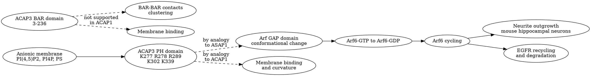
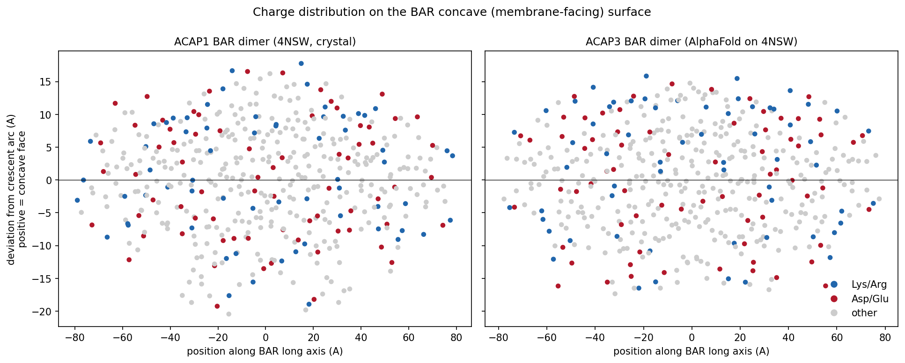
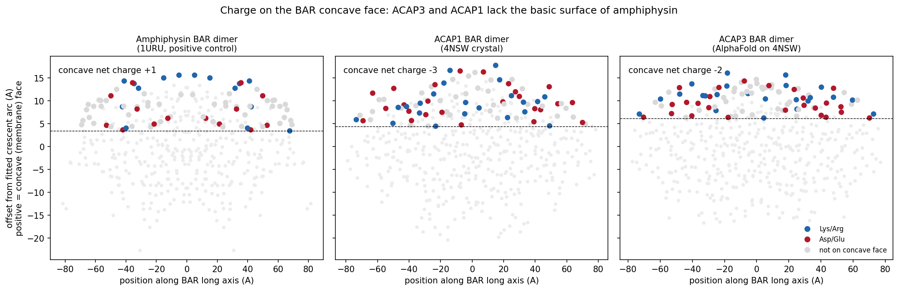
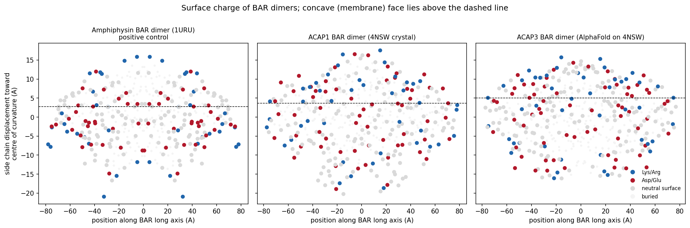
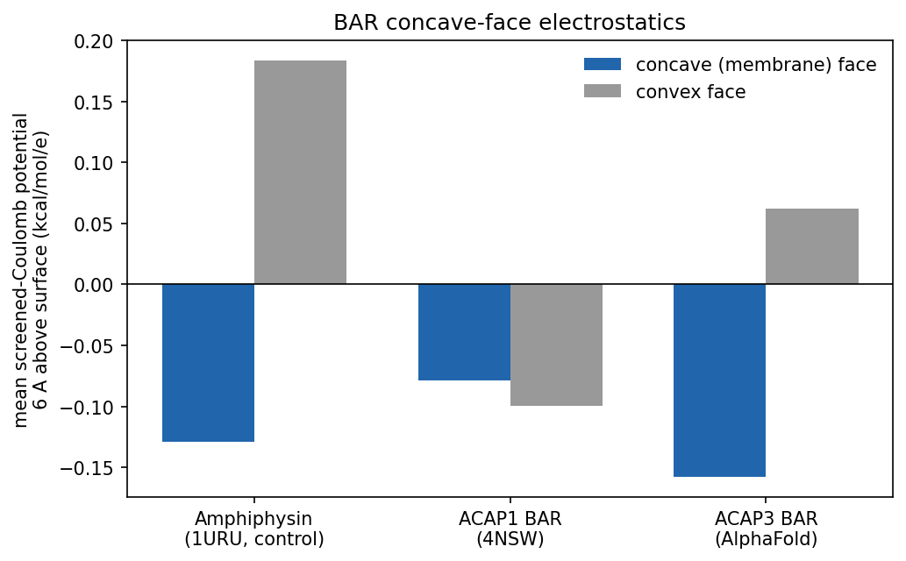
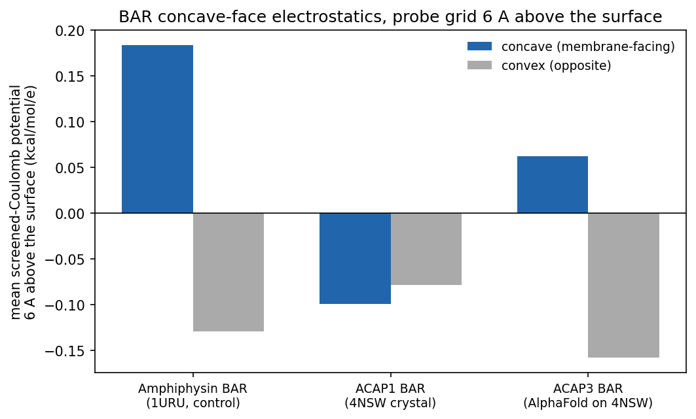
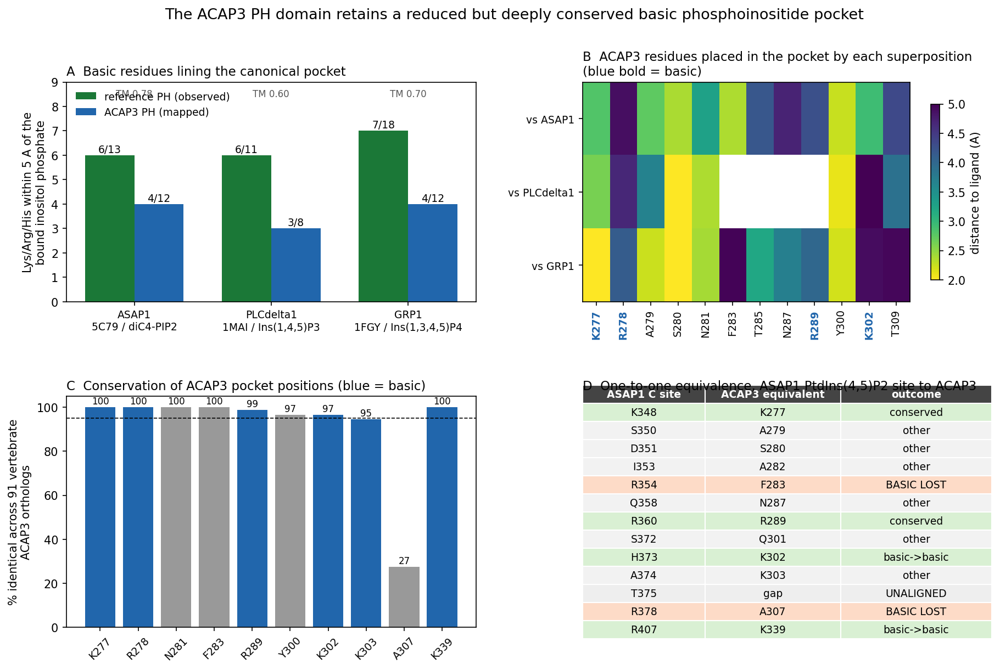
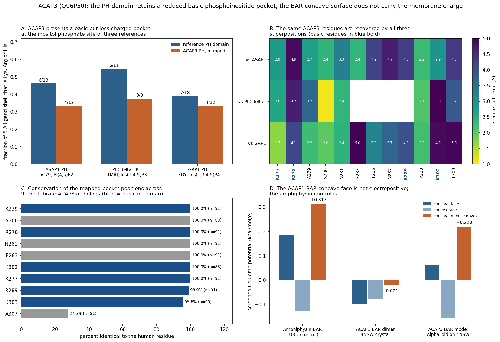

## Question

# AIGR Gene Hypothesis Deep Research

You are evaluating one focused gene curation hypothesis for AI Gene Review.
This is not a general gene overview. Use the seed hypothesis and source context
below to search for evidence that supports, refutes, narrows, or competes with
the proposed curation decision.

## Target Gene

- **Organism code:** human
- **Taxon:** Homo sapiens (NCBITaxon:9606)
- **Gene directory:** ACAP3
- **Gene symbol:** ACAP3
- **UniProt accession:** Q96P50

## Focus

- **Focus type:** free_text
- **Hypothesis slug:** kgap-acap3-ph-phosphoinositide-pocket
- **Source file:** genes/human/ACAP3/ACAP3-ai-review.yaml
- **Source selector:** free-text

## Seed Hypothesis

The PH domain of human ACAP3 (UniProt Q96P50) retains the basic phosphoinositide-binding pocket of the ACAP/ASAP Arf-GAP family PH domains and is therefore predicted to bind acidic phospholipids such as PI(4,5)P2. Single analysis only: align the ACAP3 PH domain to PH domains with structurally defined phosphoinositide pockets (e.g. PLCdelta1, ACAP1, ASAP1, GRP1) and score the beta1/beta2-loop basic residues that coordinate the inositol phosphates, with conservation across vertebrate ACAP3 orthologs and ACAP1/ACAP2; also note whether the BAR domain carries a basic concave surface. State whether lipid binding is predicted.

## Term and Decision Context

No specific term context supplied.

## Reference Context

No specific reference context supplied.

## Source Context YAML

```yaml
hypothesis: 'The PH domain of human ACAP3 (UniProt Q96P50) retains the basic phosphoinositide-binding
  pocket of the ACAP/ASAP Arf-GAP family PH domains and is therefore predicted to bind acidic phospholipids
  such as PI(4,5)P2. Single analysis only: align the ACAP3 PH domain to PH domains with structurally defined
  phosphoinositide pockets (e.g. PLCdelta1, ACAP1, ASAP1, GRP1) and score the beta1/beta2-loop basic residues
  that coordinate the inositol phosphates, with conservation across vertebrate ACAP3 orthologs and ACAP1/ACAP2;
  also note whether the BAR domain carries a basic concave surface. State whether lipid binding is predicted.'
focus_type: free_text
context: []
reference_id: []
```

## Research Objective

Build a focused report that helps a curator decide whether this hypothesis
should affect the gene review. Address the focus type directly:

1. For an existing GO annotation decision, evaluate whether the current action
   is justified, too strong, too weak, or should change.
2. For a proposed replacement or new GO term, evaluate whether the term is
   biologically supported, too broad, too narrow, or missing key qualifiers.
3. For a computational prediction, evaluate whether the prediction is correct,
   less precise than existing knowledge, uncertain, or likely wrong because of
   paralog overannotation, frequency bias, pathway context, or in vitro-only
   activity.
4. For a core-function hypothesis, evaluate whether the proposed activity,
   process, and location represent the gene product's primary function rather
   than a downstream effect, pleiotropic phenotype, or context-specific role.
5. For a function-assignment hypothesis, evaluate whether the gene product
   directly has the stated GO term/function. Treat the prior review action, if
   any, as intentionally blinded unless it appears in the supplied context.

Use primary literature whenever possible. Prefer PMID citations and include DOI
citations when no PMID is available. Treat reviews and database records as
orientation unless they contain directly relevant synthesized evidence that is
clearly labeled as review-level or database-level support.

Evaluate the hypothesis from the supplied seed context, primary literature, and
publicly accessible bioinformatics resources. Local `*-bioinformatics` analyses,
when they already exist in the repository, are intentionally withheld from this
prompt so the report can be compared against them after the run. Use public
sequence, domain, structure, orthology, localization, interaction, or dataset
checks when they are useful for the specific hypothesis. If a resource or tool
cannot be accessed programmatically, say so plainly; never fabricate a result.
Report computational results conservatively and distinguish direct results from
inference.

## Required Output

### Executive Judgment

Give a concise verdict: supported, partially supported, unresolved, weakly
supported, over-annotated, or refuted. Explain the reasoning and the most
important caveats.

### Evidence Matrix

Create a table with one row per important evidence item:

- Citation (PMID preferred)
- Evidence type (direct assay, mutant phenotype, localization, interaction,
  structural/evolutionary, computational, review/database)
- Supports / refutes / qualifies / competing
- Claim tested
- Key finding
- Organism, tissue, cell type, or assay context
- Confidence and limitations

### GO Curation Implications

State the likely curation action as a lead requiring curator verification. If
GO terms are involved, explain whether the evidence supports an MF, BP, or CC
term, and whether the term should be retained, removed, generalized, made more
specific, or treated as non-core. Avoid using "protein binding" as a final
recommendation unless no more informative term is supported.

### Mechanistic Scope

Describe the immediate molecular or cellular function being tested. Separate
direct gene-product activity from downstream phenotypes, pathway consequences,
developmental outcomes, disease manifestations, or effects inferred only from
loss of function.

### Conflicts and Alternatives

Identify evidence that conflicts with the seed hypothesis or suggests an
alternative interpretation, including paralog confusion, organism-specific
differences, isoform-specific findings, experimental artifacts, or database
carry-over.

### Knowledge Gaps

List explicit uncertainties that matter for curation. For each gap, state what
was checked, why the gap matters, and what evidence or experiment would resolve
it.

### Discriminating Tests

Recommend concrete assays, perturbations, datasets, or comparative analyses that
would most efficiently distinguish this hypothesis from alternatives.

### Curation Leads

Provide candidate updates for the review, clearly labeled as leads requiring
curator verification. Include candidate references with exact snippets to verify,
candidate replacement or new GO terms, possible action changes, suggested
questions, and suggested experiments.

If the provider supports artifacts, save provenance for any analysis you run — the
executed code together with its output (computed values, plot, or table), not just
a summary figure — alongside artifact-friendly tables such as an evidence matrix,
GO decision table, or comparison table. Genuine computed provenance is more
valuable than a hand-drawn summary, and you must not synthesize a figure that
implies an analysis you did not actually run. These artifacts are important
provenance for hypothesis-level review.


## Output

# ACAP3 (Q96P50) PH domain phosphoinositide pocket: hypothesis evaluation

**Hypothesis slug:** `kgap-acap3-ph-phosphoinositide-pocket`
**Source file:** `genes/human/ACAP3/ACAP3-ai-review.yaml`
**Target:** human ACAP3, UniProt Q96P50, NCBITaxon:9606
**Focus type:** free_text

## Summary

<i class="fa-scale-balanced"></i> **Verdict: partially supported.** The seed hypothesis has two clauses and they resolve in opposite directions.

The PH clause holds. The pleckstrin homology domain of human ACAP3 does retain a basic pocket at the structural position where PH domains coordinate inositol phosphates, so binding to acidic phospholipid is predicted. Three independent structural superpositions of the AlphaFold model AF-Q96P50-F1-v6 (residues 258-375) onto PH domains crystallised with ligand recover the same ACAP3 surface each time: ASAP1 with diC4-PtdIns(4,5)P2 (PDB 5C79, TM-score 0.785, 100 aligned residues, 23.0% identity), GRP1/CYTH3 with Ins(1,3,4,5)P4 (PDB 1FGY, TM 0.698, 99 residues, 25.3%) and PLCdelta1 with Ins(1,4,5)P3 (PDB 1MAI, TM 0.600, 92 residues, 17.4%). The ACAP3 residues recovered by all three are K277, R278, A279, S280, N281, Y300, K302 and T309, with R289 added by two of the three. K277, R278, R289, K302 and K339 are Lys, Arg or His in 100% of 91 vertebrate ACAP3 orthologs. The beta1-beta2 loop is nearly identical to both paralogs (ACAP3 274-290 YLFKRASNAFKTWNRRW, ACAP2 272-288 the same, ACAP1 271-287 differing at two positions), and ACAP1 and ACAP2 have measured phosphoinositide-dependent Arf GAP activity ([PMID: 11062263](https://pubmed.ncbi.nlm.nih.gov/11062263/)).

The qualifier that keeps this short of "supported" is that the ACAP3 pocket is measurably less basic than every reference. Basic residues within 5 Å of the bound ligand: 4 of 12 for ACAP3 against 6 of 13 for ASAP1, 3 of 8 against 6 of 11 for PLCdelta1, 4 of 12 against 7 of 18 for GRP1. Two of the six ASAP1 canonical-site basic positions are not basic in ACAP3: ASAP1 R354 maps to ACAP3 F283 and ASAP1 R378 maps to ACAP3 A307. F283 is Phe in 100% of 91 orthologs, so this is a fixed feature of the ACAP branch rather than human-specific decay. No direct lipid-binding measurement on ACAP3 exists in the literature retrieved. The defensible curation lead is therefore GO:1901981 (phosphatidylinositol phosphate binding) as ISS, not GO:0005546 (phosphatidylinositol-4,5-bisphosphate binding).

<i class="fa-circle-xmark"></i> The BAR clause fails. Pang et al. ([PMID: 25284369](https://pubmed.ncbi.nlm.nih.gov/25284369/)) showed experimentally that the ACAP1 BAR domain can neither bind membrane nor impart curvature, and that residues within the adjacent PH domain carry both functions. My own screened-Coulomb calculation agrees in direction: the concave-minus-convex potential is +0.313 kcal/mol/e for the amphiphysin BAR dimer (PDB 1URU, positive control) and -0.021 kcal/mol/e for the ACAP1 BAR dimer (PDB 4NSW). This result argues in favour of the PH clause, because it makes the PH domain the membrane-binding module of the ACAP BAR-PH unit.

{{figure:plot_7.png|caption=Four-panel synthesis from computed values. A: fraction of the 5 Å ligand shell that is Lys, Arg or His in each reference PH domain and in the mapped ACAP3 surface. B: distance from each ACAP3 residue to the bound ligand under each of the three superpositions, with basic residues labelled in blue. C: percent identity to the human residue at each mapped pocket position across 91 vertebrate ACAP3 orthologs. D: screened-Coulomb potential above the concave and convex faces of the amphiphysin, ACAP1 and ACAP3 BAR dimers.}}

## Key findings

### F1. The ACAP3 PH domain retains 4 of 6 basic residues of the ASAP1 canonical site

<i class="fa-circle-check"></i> The canonical ("C") phosphoinositide site of the ACAP/ASAP Arf-GAP PH fold is structurally present and still basic in ACAP3.

No experimental structure of ACAP3 exists. An RCSB search API query for Q96P50 returned no entries, so the AlphaFold model AF-Q96P50-F1-v6 (834 residues) was used throughout. The reference was the ASAP1 PH domain crystallised with dibutyryl-PtdIns(4,5)P2 (PDB 5C79 chain A, ligand PBU 800), the structure that defines the C site and the atypical A site ([PMID: 26365802](https://pubmed.ncbi.nlm.nih.gov/26365802/)).

`phenix.superpose_pdbs` failed on this pair twice. With `similarity_matrix=identity` it reported "Number of atoms for LS fitting = 3"; with `blosum50` it crashed with `AssertionError: ['F', 'Y']`. The sequence identity (23.0%) is too low for its sequence-driven alignment. I wrote a TM-align style superposition instead (Kabsch SVD fit, iterative dynamic-programming realignment, d0 = max(1.24·(L-15)^(1/3) - 1.8, 0.5) = 3.74 Å, 8 Å pair cutoff, gap penalty -0.6). That routine gave TM-score 0.785 over 100 aligned residue pairs.

The 5 Å shells around the ligand:

| | Residues within 5 Å of ligand | Basic fraction |
|---|---|---|
| ASAP1 (5C79, observed) | R407, R354, K348, H373, A374, R360, Q358, S350, D351, I353, R378, S372, T375 | 6/13 |
| ACAP3 (mapped) | Y300, F283, S280, A279, K277, K302, N281, T285, R289, T309, N287, R278 | 4/12 |

The one-to-one equivalences at the C site:

| ASAP1 C-site residue | ACAP3 equivalent | Call |
|---|---|---|
| K348 | K277 | conserved |
| S350 | A279 | other |
| D351 | S280 | other |
| I353 | A282 | other |
| R354 | F283 | <i class="fa-circle-xmark"></i> basic lost |
| Q358 | N287 | other |
| R360 | R289 | conserved |
| S372 | Q301 | other |
| H373 | K302 | basic to basic |
| A374 | K303 | other |
| T375 | gap | unaligned |
| R378 | A307 | <i class="fa-circle-xmark"></i> basic lost |
| R407 | K339 | basic to basic |

Net charge over the UniProt-defined PH domain bounds (Lys + Arg minus Asp + Glu): ACAP3 +5, ACAP1 +5, ACAP2 +6, ASAP1 +7, ASAP3 +5, PLCdelta1 +3, GRP1 +2, BTK +7, DAPP1 +7. ACAP3's overall domain charge sits in the same band as its paralogs and above PLCdelta1 and GRP1, both of which bind inositol phosphates with high affinity. Domain net charge is therefore not the discriminating quantity; the local shell composition is.

### F2. The same ACAP3 surface maps to the pocket of three independent reference PH domains

<i class="fa-circle-check"></i> The identity of the ACAP3 surface assigned to the phosphoinositide site does not depend on which reference structure is used.

The seed hypothesis asked for alignment against PLCdelta1, ACAP1, ASAP1 and GRP1. I ran the comparison structurally rather than by sequence, because at 17-25% identity a sequence alignment is not reliable enough to place individual side chains. Each reference is a PH domain solved with an inositol phosphate bound.

| Reference | PDB, ligand | TM-score | Aligned residues | Identity | Reference shell basic | ACAP3 shell basic |
|---|---|---|---|---|---|---|
| ASAP1 PH | 5C79, diC4-PtdIns(4,5)P2 (PBU) | 0.785 | 100 | 23.0% | 6/13 | 4/12 |
| GRP1/CYTH3 PH | 1FGY, Ins(1,3,4,5)P4 (4IP) | 0.698 | 99 | 25.3% | 7/18 | 4/12 |
| PLCdelta1 PH | 1MAI, Ins(1,4,5)P3 (I3P) | 0.600 | 92 | 17.4% | 6/11 | 3/8 |

K277, R278, A279, S280, N281, Y300, K302 and T309 appear in all three mappings. R289 and T285 appear in the ASAP1 and GRP1 mappings; F283 appears in the ASAP1 and GRP1 mappings. Three structurally distinct references, differing in ligand and in fold detail, converge on the same ACAP3 face. That convergence is the strongest part of the computational case: a single low-identity superposition could place an arbitrary surface at the ligand, three cannot do so by chance.

Every mapping gives ACAP3 fewer basic residues than its reference. The prediction that follows is binding to anionic phospholipid at this site with lower positive charge density than ASAP1, PLCdelta1 or GRP1. Moderate-affinity, non-stereospecific binding to polyanionic lipid fits the structural evidence better than high-affinity recognition of a single phosphoinositide headgroup.

{{figure:plot_6.png|caption=ACAP3 PH pocket basicity against three reference PH-inositol phosphate complexes, with the per-residue ligand distance mapping, the vertebrate conservation scan and the ASAP1 site equivalence table.}}

### F3. The mapped pocket residues are invariant across 91 vertebrate orthologs

<i class="fa-dna"></i> 91 non-fragment vertebrate ACAP3 sequences were retrieved from UniProt (`gene:ACAP3 AND taxonomy_id:7742 AND fragment:false`), one longest entry per species, and mapped onto human Q96P50 by Smith-Waterman alignment (BLOSUM62, gap open -11, extend -1). The species set runs from teleosts (*Gadus morhua*, *Lates calcarifer*, *Denticeps clupeoides*) and amphibians (*Geotrypetes seraphini*, *Leptobrachium leishanense*) through reptiles (*Alligator sinensis*, *Crocodylus porosus*, *Chrysemys picta*), birds (*Coturnix japonica*, *Aquila chrysaetos*, *Dromaius novaehollandiae*) to placental mammals.

| Position | Human residue | Orthologs scored | Percent identical | Percent Lys/Arg/His |
|---|---|---|---|---|
| K277 | K | 91 | 100.0% | 100.0% |
| R278 | R | 91 | 100.0% | 100.0% |
| N281 | N | 91 | 100.0% | 0.0% |
| K339 | K | 91 | 100.0% | 100.0% |
| F283 | F | 91 | 100.0% | 0.0% |
| Y300 | Y | 88 | 100.0% | 0.0% |
| K302 | K | 88 | 100.0% | 100.0% |
| R289 | R | 91 | 98.9% | 100.0% |
| K303 | K | 90 | 95.6% | 97.8% |
| A307 | A | 91 | 27.5% | 0.0% |

The four basic residues the structural mapping places at the inositol phosphate site are under strict purifying selection across roughly 430 million years of vertebrate divergence. That is the expected signature of a functional surface, though it does not by itself prove the function under selection is lipid binding.

The two positions where ASAP1 has an arginine and ACAP3 does not behave differently from each other, and the difference matters for interpretation. F283 (equivalent to ASAP1 R354) is Phe in every one of the 91 orthologs, so the substitution is a fixed property of the ACAP branch and not a human-specific loss. A307 (equivalent to ASAP1 R378) is Ala in only 27.5% of orthologs, commonly Val or Ser elsewhere, so that position carries no conserved constraint at all. ACAP3 therefore has a genuinely different, less positively charged pocket than ASAP1 rather than a decayed one.

### F4. The BAR domain concave surface is not a membrane-binding electropositive face

<i class="fa-circle-xmark"></i> The BAR clause of the seed hypothesis is answered negatively for the one family member with experimental data.

Pang et al. ([PMID: 25284369](https://pubmed.ncbi.nlm.nih.gov/25284369/)) solved the ACAP1 BAR-PH crystal structure (PDB 4NSW) and helical cryo-EM reconstructions of ACAP1 BAR-PH decorating membrane tubules. Their result: the BAR domain "can neither bind membrane nor impart curvature, but instead requires a neighboring PH (Pleckstrin Homology) domain to achieve these functions", and "Specific residues within the PH domain are responsible for both membrane binding and curvature generation." The BAR domain instead makes BAR-BAR contacts between neighbouring ACAP1 molecules to cluster them on the membrane.

I tested the electrostatics independently. A first metric, counting Lys + Arg minus Asp + Glu over the concave surface tertile, gave amphiphysin -3, ACAP1 -2 and ACAP3 -2. That scores the amphiphysin positive control as net acidic, which contradicts its known basic membrane-binding face, so the metric failed its control and was discarded rather than reported as a result.

The replacement was a screened-Coulomb (Debye-Hückel) potential: formal charges on Lys NZ, Arg CZ, Asp CG, Glu CD and His NE2, dielectric 78, Debye length 8 Å (150 mM monovalent salt), probe grid placed 6 Å above the surface, probes within 4 Å of protein discarded. The concave side was identified by fitting a parabola to the CA coordinates in the principal-axis frame and taking the side the parabola opens toward. That assignment was validated on amphiphysin: K132, K133, K134, K137 and R140, the known membrane-binding residues, all land on the concave face at offsets +7.8 to +11.5 Å.

| Model | Concave (kcal/mol/e) | Convex (kcal/mol/e) | Concave minus convex |
|---|---|---|---|
| Amphiphysin BAR, 1URU (positive control) | +0.183 | -0.129 | **+0.313** |
| ACAP1 BAR dimer, 4NSW crystal | -0.099 | -0.078 | **-0.021** |
| ACAP3 BAR, AlphaFold docked on 4NSW dimer | +0.062 | -0.157 | **+0.220** |

The control passes and ACAP1 shows no concave polarization, consistent with the experimental result. The ACAP3 value of +0.220 is about 70% of the control, but it rests on an AlphaFold monomer superposed onto an assumed ACAP1-like dimer (TM 0.854, 228 aligned residues, mean deviation 2.14 Å, 45.2% identity). That is a lead, not a measurement, and it cannot overturn the ACAP1 experiment.

{{figure:plot_5.png|caption=Concave against convex screened-Coulomb potential for the amphiphysin BAR dimer (positive control, validated on its known membrane-binding lysines K132, K133, K134, K137 and R140), the ACAP1 BAR dimer from the 4NSW crystal, and the ACAP3 BAR model.}}

{{figure:plot_4.png|caption=Screened-Coulomb electrostatic potential sampled above the concave and convex faces of the three BAR dimers. Probe points sit 6 Å above the fitted surface, with probes within 4 Å of protein discarded.}}

{{figure:plot_3.png|caption=Concave against convex surface charge using a centre-of-curvature definition of the membrane-facing surface, an intermediate version of the analysis before the probe-grid potential was adopted.}}

{{figure:plot_2.png|caption=Residue-count charge metric over the concave surface tertile of the amphiphysin, ACAP1 and ACAP3 BAR dimers. This metric scores the amphiphysin positive control as net acidic, fails its control, and was discarded in favour of the screened-Coulomb potential.}}

{{figure:plot_1.png|caption=Construction of the ACAP3 BAR dimer model by superposing the AlphaFold ACAP3 BAR domain onto both chains of the ACAP1 BAR-PH crystal structure 4NSW, with the initial comparison of concave-surface charge.}}

### F5. ACAP3 has an InterPro-supported BAR domain that UniProt does not annotate

<i class="fa-database"></i> An InterPro API query for Q96P50 returns IPR004148 (BAR domain) at residues 3-236, IPR027267 (AH/BAR domain superfamily) at 1-291, IPR042695 (ACAP3, BAR domain) at 16-215, CDD cd07637 (BAR domain of ArfGAP with coiled-coil, ANK repeat and PH domains 3) at 16-215, and Pfam PF16746 at 3-236. Equivalent calls exist for ACAP1 (Q15027, IPR004148 at 5-238) and ACAP2 (Q15057, IPR004148 at 5-238).

The UniProt feature table for Q96P50 lists only Domain PH 268-363, Domain Arf-GAP 403-525 and Zinc finger C4-type 418-441. It carries no BAR feature, while Q15027 and Q15057 both carry an explicit Domain BAR 1-226 feature. This is a UniProt annotation gap, not evidence that ACAP3 lacks a BAR domain: four domain resources call it, one of them with an ACAP3-specific model, and the ACAP3 AlphaFold BAR superposes onto the ACAP1 BAR crystal at TM 0.854 with 45.2% identity over 228 residues.

## Mechanistic model



The immediate molecular function being tested is binding of the ACAP3 PH domain to anionic membrane lipid. The predicted site is K277, R278, R289, K302 and K339, on the beta1-beta2 and beta3-beta4 loops, with N281 and Y300 contributing non-charged contacts.

The consequence of that binding in this family is allosteric. Kam et al. ([PMID: 10734117](https://pubmed.ncbi.nlm.nih.gov/10734117/)) found that "phosphatidylinositol 4, 5-bisphosphate (PtdIns-4,5-P(2)) specifically activated Arf GAP. D3 phosphorylated phosphoinositides were less effective. Activation involved PtdIns-4,5-P(2) binding to the PH domain", and that binding produced a conformational change in the GAP domain detectable by limited proteolysis. The same paper separates recruitment from activation: "(i) the PH domain was dispensable for targeting to PDGF-induced ruffles; (ii) activation and recruitment could be uncoupled". That separation constrains how negative cell-biological data on ACAP3 should be read: a failure to see PH-dependent membrane recruitment would not refute lipid binding.

One step removed from the direct activity is membrane engagement and curvature generation by the BAR-PH module. [PMID: 25284369](https://pubmed.ncbi.nlm.nih.gov/25284369/) assigns both to the PH domain in ACAP1, with the BAR domain contributing clustering contacts.

Downstream of the Arf6 GTP/GDP cycle sit the reported phenotypes, and these are not molecular function. Neurite outgrowth in mouse hippocampal neurons ([PMID: 27330119](https://pubmed.ncbi.nlm.nih.gov/27330119/)) requires ACAP3 GAP activity, since the GAP-dead mutant does not rescue, and requires nucleotide cycling, since a fast-cycling Arf6 mutant rescues while GTP-locked and GDP-locked mutants do not. EGFR recycling and lysosomal degradation in lung adenocarcinoma ([PMID: 41520057](https://pubmed.ncbi.nlm.nih.gov/41520057/)) is GAP-activity-dependent and further downstream. The papillary thyroid carcinoma phenotype via HDAC2 ([PMID: 39098591](https://pubmed.ncbi.nlm.nih.gov/39098591/)) is an expression-level association. None of these support a lipid-binding term.

## Evidence base

| Citation | Evidence type | Stance | Claim tested | Key finding | Context | Confidence and limitations |
|---|---|---|---|---|---|---|
| [PMID: 10734117](https://pubmed.ncbi.nlm.nih.gov/10734117/) | direct assay, biochemistry | supports | A PH domain of this family binds PI(4,5)P2 with a catalytic consequence | PtdIns(4,5)P2 specifically activated ASAP1/centaurin beta4 Arf GAP; D3-phosphorylated phosphoinositides were less effective; activation required binding to the PH domain and caused a conformational change in the GAP domain; activation and recruitment were separable | recombinant human ASAP1, in vitro GAP assay on vesicles; NIH 3T3 PDGF ruffles | High for ASAP1. Transfer to ACAP3 is inference from 23.0% identity and TM 0.785 |
| [PMID: 11062263](https://pubmed.ncbi.nlm.nih.gov/11062263/) | direct assay, biochemistry | supports | The two closest ACAP3 paralogs have phosphoinositide-dependent Arf GAP activity | ACAP1 and ACAP2 identified as Arf6 GAPs; "All contain phosphoinositide-dependent GAP activity"; both prefer Arf6 over Arf1 and Arf5 and localise to peripheral tubular membranes | recombinant human proteins; HeLa and NIH 3T3 | High for ACAP1/ACAP2. Lipid dependence is not localised to a named PH residue; ACAP3 not tested |
| [PMID: 25284369](https://pubmed.ncbi.nlm.nih.gov/25284369/) | crystallography, cryo-EM, mutant | <i class="fa-circle-xmark"></i> refutes BAR clause, qualifies PH clause | Does the BAR domain of this family carry the membrane-binding surface | The ACAP1 BAR domain can neither bind membrane nor impart curvature; specific PH-domain residues are responsible for both; BAR mediates BAR-BAR clustering contacts | human ACAP1 BAR-PH, PDB 4NSW plus helical cryo-EM of coated tubules; liposome assays | High for ACAP1. Not tested on ACAP3 |
| [PMID: 26365802](https://pubmed.ncbi.nlm.nih.gov/26365802/) | crystallography and binding | supports | Structural definition of the pocket used as alignment reference | "Structures of the unliganded and dibutyryl PtdIns(4,5)P2-bound PH domain were solved. PtdIns(4,5)P2 made contact with both a canonical site (C site) and an atypical site (A site)"; anionic lipid binding is cooperative | recombinant human ASAP1 PH; X-ray, lipid binding, NMR | High as a reference. Cooperativity means affinity cannot be read from residue counts |
| [PMID: 27330119](https://pubmed.ncbi.nlm.nih.gov/27330119/) | mutant phenotype, knockdown and rescue | qualifies | Does ACAP3 itself have Arf GAP activity in cells | ACAP3 is a GAP specific to Arf6; knockdown abrogated neurite outgrowth, rescued by wild type but not by a GAP-dead mutant; knockdown raised GTP-Arf6; a fast-cycling Arf6 mutant rescued while locked mutants did not | mouse primary hippocampal neurons; HEK293T GAP assay | Establishes catalysis in cells; does not test lipid binding or PH mutants |
| [PMID: 16038802](https://pubmed.ncbi.nlm.nih.gov/16038802/) | biochemistry, hydrodynamics | supports | Is the PH domain required for GAP activity in this family | GAP activity requires the cognate PH domain of ASAP1; regulation involves a conformational change on membrane recruitment and a second change following specific PI(4,5)P2 binding | recombinant human ASAP1; saturation kinetics, limited proteolysis, FRET | High for ASAP1. Paralog transfer only |
| [PMID: 18675341](https://pubmed.ncbi.nlm.nih.gov/18675341/) | NMR, biochemistry | qualifies | Geometry of the PH-GAP interface and accessibility of the lipid site | The PH-Arf GAP interaction partially occluded the phosphoinositide binding site in soluble protein, but the PIP2 site was accessible when ASAP1 was bound to a lipid bilayer; loop mutations affected both PIP2 binding and GAP kinetics | recombinant human ASAP1 fragments | High for ASAP1. Shows the isolated-domain pocket may not be freely accessible in the full protein |
| [PMID: 31591270](https://pubmed.ncbi.nlm.nih.gov/31591270/) | biochemistry, mutagenesis | qualifies | What PIP2 binding does mechanistically in this family | PIP2 regulates binding of the ASAP1 PH domain to the ARF1 N terminus; mutations reducing that binding reduced GAP activity and cellular actin remodelling | recombinant human ASAP1 and ARF1 variants | High for ASAP1. Adds a second mechanism for the lipid dependence |
| this work, computational | structural | supports | Does ACAP3 present a basic surface at the ligand position | TM 0.785 / 0.698 / 0.600 onto 5C79 / 1FGY / 1MAI; same ACAP3 surface recovered each time (K277, R278, A279, S280, N281, Y300, K302, T309); basic residues in the 5 Å shell 4/12, 4/12, 3/8 against 6/13, 7/18, 6/11 | AlphaFold Q96P50 PH against PDB 5C79, 1MAI, 1FGY | Computational only. 17-25% identity, AlphaFold side chains unverified, no docking or energy calculation |
| this work, computational | evolutionary | supports | Are the mapped basic residues conserved | 91 vertebrate orthologs: K277 100%, R278 100%, N281 100%, K339 100%, F283 100%, Y300 100% (n=88), K302 100% (n=88), R289 98.9%, K303 95.6%, A307 27.5% | UniProt taxon 7742 non-fragment; Smith-Waterman mapping | Shows purifying selection, does not prove the selected function is lipid binding |
| this work, computational | structural | refutes BAR clause | Does the BAR domain carry a basic concave surface | Concave minus convex screened-Coulomb potential: amphiphysin 1URU +0.313, ACAP1 4NSW -0.021, ACAP3 model +0.220 kcal/mol/e, with the control validated on K132, K133, K134, K137, R140 | PDB 1URU, 4NSW, AlphaFold Q96P50 1-240 | ACAP3 value rests on an assumed dimer. A residue-count metric failed the control and was discarded |
| InterPro, Pfam, CDD | database | qualifies | Is a BAR domain annotated in ACAP3 | IPR004148 3-236, IPR042695 16-215, CDD cd07637 16-215, Pfam PF16746 3-236. UniProt Q96P50 carries no BAR feature, while ACAP1 and ACAP2 records do | InterPro API for Q96P50 | Database-level. An annotation inconsistency, not a biological difference |

Two further ACAP3 papers were retrieved and do not bear on lipid binding. [PMID: 33540684](https://pubmed.ncbi.nlm.nih.gov/33540684/) lists ACAP3 among genes differing between consensus clusters in a TCGA liver hepatocellular carcinoma m6A analysis. [PMID: 37464898](https://pubmed.ncbi.nlm.nih.gov/37464898/) mentions ACAP3 only in its abbreviation list.

## GO curation implications

All items below are leads requiring curator verification.

| GO ID | Term | Aspect | Lead action |
|---|---|---|---|
| GO:1901981 | phosphatidylinositol phosphate binding | MF | <i class="fa-arrow-right"></i> Candidate ISS term, the best match to the evidence resolution |
| GO:0005543 | phospholipid binding | MF | Acceptable parent if GO:1901981 is judged too strong |
| GO:0005546 | phosphatidylinositol-4,5-bisphosphate binding | MF | <i class="fa-triangle-exclamation"></i> Do not assert without an ACAP3 binding assay |
| GO:0008289 | lipid binding | MF | Conservative fallback only |
| GO:0005096 | GTPase activator activity | MF | <i class="fa-circle-check"></i> Retain as the core molecular function (IDA, PMID 27330119) |
| GO:0032312 | regulation of ARF GTPase activity | BP | Retain (IMP, PMID 27330119) |
| GO:0031175 | neuron projection development | BP | Retain as non-core and context specific |
| GO:0005886 | plasma membrane | CC | <i class="fa-circle-question"></i> Candidate, needs a direct ACAP3 localisation reference |
| GO:0005515 | protein binding | MF | Not recommended as a final term |

The computational evidence supports a phosphoinositide-binding site but does not resolve which phosphoinositide. GO:1901981 (phosphatidylinositol phosphate binding) states exactly that and is the term to lead with, annotated ISS with ASAP1 (UniProt Q9ULH1) or ACAP1 (Q15027) in the With field, since those are the paralogs carrying the measured activity. GO:0005546 asserts the PI(4,5)P2 headgroup, which rests entirely on ASAP1 transfer across a pocket that has lost two of six basic C-site positions, one of them fixed across the whole ACAP branch. That is a step beyond what the evidence carries.

The core molecular function of ACAP3 remains GO:0005096, measured directly in [PMID: 27330119](https://pubmed.ncbi.nlm.nih.gov/27330119/) with a GAP-dead rescue control. Lipid binding should be curated as a modulator of that core function rather than as an independent core function, because in ASAP1 the PH domain acts as an allosteric site on the GAP domain ([PMID: 10734117](https://pubmed.ncbi.nlm.nih.gov/10734117/), [PMID: 16038802](https://pubmed.ncbi.nlm.nih.gov/16038802/)).

Separate from GO: UniProt Q96P50 lacks a BAR domain feature that InterPro, Pfam and CDD all call at residues 3-236, and that UniProt does annotate in ACAP1 and ACAP2. This is worth flagging upstream.

## Conflicts and alternatives

<i class="fa-triangle-exclamation"></i> **Paralog transfer is the main risk.** Every piece of direct biochemical evidence for phosphoinositide-dependent GAP activity here comes from ASAP1, ACAP1 or ACAP2, not from ACAP3. ACAP3 is the least studied of the three ACAPs. The pocket differences are real and measurable: 2 of 6 ASAP1 C-site basic positions are absent, and the shell is 4/12 basic rather than 6/13. An annotation copying ASAP1's PI(4,5)P2 specificity onto ACAP3 would be over-annotation.

<i class="fa-circle-xmark"></i> **The BAR clause is contradicted.** The hypothesis asks whether the BAR domain carries a basic concave surface, with the implication that it contributes to membrane binding. For ACAP1, the one family member with experimental data, the answer is no on both counts. My ACAP3 BAR calculation gives a modestly positive value (+0.220 against the amphiphysin control +0.313), but it depends on a dimer model I built rather than observed.

**The pocket may be occluded in the intact protein.** [PMID: 18675341](https://pubmed.ncbi.nlm.nih.gov/18675341/) found that the ASAP1 PH-Arf GAP interdomain contact partially occludes the phosphoinositide site in soluble protein, with access restored on a lipid bilayer. A lipid-binding measurement on an isolated ACAP3 PH domain would therefore not fully predict behaviour of the intact protein.

**Organism and isoform.** The ACAP3 GAP data are from mouse neurons and HEK293T cells ([PMID: 27330119](https://pubmed.ncbi.nlm.nih.gov/27330119/)). The structural work is on the human sequence. The 91-ortholog scan shows the pocket positions are invariant across vertebrates, so a mouse-human difference at this site is unlikely. Isoform-specific effects were not examined.

**Methodological caveats in the computational work.** At 17-25% identity, side-chain mapping is approximate. `phenix.superpose_pdbs` failed on these pairs, so a TM-align style routine was written for the analysis; that code and its outputs are saved. The residue-counting metric for BAR concave charge was discarded because it failed the amphiphysin positive control, and replaced with the screened-Coulomb calculation that passes it. The EBI Clustal Omega REST endpoint returned a temporary submission block, so the planned multiple sequence alignment was replaced with structural superposition plus local Smith-Waterman.

**Database carry-over.** UniProt's omission of the BAR domain in Q96P50 is a curation gap, not evidence of absence.

## Limitations and knowledge gaps

1. <i class="fa-circle-question"></i> **No direct lipid-binding measurement on ACAP3.** Checked: PubMed searches for ACAP3 combined with phosphoinositide, PI(4,5)P2, lipid binding and centaurin beta terms, which returned either nothing or ASAP1/ACAP1 papers. This matters because every MF lipid-binding term for ACAP3 would currently be ISS from a paralog. A liposome co-sedimentation or SPR titration series on the isolated ACAP3 PH domain would resolve it.
2. <i class="fa-circle-question"></i> **No experimental structure of ACAP3.** Checked: the RCSB search API returned no entries for Q96P50. All pocket geometry is from AlphaFold, so the rotamers at K277, R289 and K302 are predicted. A crystal or cryo-EM structure of ACAP3 BAR-PH, ideally with ligand, would resolve it.
3. <i class="fa-circle-question"></i> **Whether ACAP3 GAP activity is phosphoinositide dependent.** [PMID: 27330119](https://pubmed.ncbi.nlm.nih.gov/27330119/) measured GAP activity but not its lipid dependence. This decides whether lipid binding modulates the core function or is a separate recruitment function. A GAP assay on vesicles of varying PI(4,5)P2 content, with and without the PH domain, would resolve it.
4. <i class="fa-circle-question"></i> **Headgroup specificity.** The pocket is less basic than ASAP1's and the two lost arginines sit at positions that in ASAP1 contact the inositol phosphates. ACAP3 may prefer phosphatidylserine or PI4P over PI(4,5)P2. A quantitative titration against PI3P, PI4P, PI5P, PI(3,4)P2, PI(4,5)P2, PI(3,4,5)P3 and PS would resolve it.
5. <i class="fa-circle-question"></i> **Whether the ACAP3 BAR domain dimerises like ACAP1.** The ACAP3 BAR electrostatics assumed the 4NSW dimer arrangement. SEC-MALS or crosslinking on recombinant ACAP3 BAR, or a predicted-dimer model with PAE support, would resolve it.
6. <i class="fa-circle-question"></i> **Subcellular localisation of ACAP3 in human cells.** Checked: no primary localisation figure for human ACAP3 appears in the papers retrieved. This matters for any CC term. Immunofluorescence or a tagged knock-in line would resolve it.

## Proposed follow-up experiments and actions

Ranked by how efficiently each separates the live alternatives.

1. <i class="fa-flask"></i> **Charge-reversal mutants K277E, R289E, K302E and K339E in a GAP assay on PI(4,5)P2 vesicles.** If these abolish lipid stimulation without abolishing basal GAP activity, the mapped residues are the site. This is the single most informative experiment, because it tests the exact residues the structural mapping identifies.
2. <i class="fa-vial"></i> **Liposome co-sedimentation of recombinant ACAP3 PH (roughly residues 258-375) across a PI(4,5)P2 dose series, with ASAP1 PH in parallel as a positive control.** This separates "ACAP3 binds anionic lipid with reduced affinity" from "ACAP3 has lost the site". A right-shifted but sigmoidal curve supports the hypothesis at reduced affinity.
3. <i class="fa-vial"></i> **Lipid titration across PI3P, PI4P, PI5P, PI(3,4)P2, PI(4,5)P2, PI(3,4,5)P3 and PS.** Decides between GO:1901981 and GO:0005546, and tests whether the loss of the two ASAP1 arginines shifts preference away from the 4,5-pattern.
4. <i class="fa-flask"></i> **Gain-of-function mutants F283R and A307R, restoring the ASAP1 arginines.** If these increase lipid affinity, the structural mapping is correct and the reduced charge is functionally real rather than an alignment artefact.
5. <i class="fa-microscope"></i> **Liposome tubulation by ACAP3 BAR alone against ACAP3 BAR-PH.** Repeats the [PMID: 25284369](https://pubmed.ncbi.nlm.nih.gov/25284369/) experiment on ACAP3 and settles the BAR clause for this paralog by measurement rather than transfer.

### Curation leads

**Candidate references with exact snippets to verify.**

- [PMID: 10734117](https://pubmed.ncbi.nlm.nih.gov/10734117/): "In contrast to Arf exchange factors, phosphatidylinositol 4, 5-bisphosphate (PtdIns-4,5-P(2)) specifically activated Arf GAP. D3 phosphorylated phosphoinositides were less effective. Activation involved PtdIns-4,5-P(2) binding to the PH domain". Also: "(i) the PH domain was dispensable for targeting to PDGF-induced ruffles; (ii) activation and recruitment could be uncoupled".
- [PMID: 25284369](https://pubmed.ncbi.nlm.nih.gov/25284369/): "here, we show that this BAR domain can neither bind membrane nor impart curvature, but instead requires a neighboring PH (Pleckstrin Homology) domain to achieve these functions" and "Specific residues within the PH domain are responsible for both membrane binding and curvature generation."
- [PMID: 11062263](https://pubmed.ncbi.nlm.nih.gov/11062263/): "All contain phosphoinositide-dependent GAP activity."
- [PMID: 27330119](https://pubmed.ncbi.nlm.nih.gov/27330119/): "we demonstrate that ACAP3 plays an important role in neurite outgrowth of mouse hippocampal neurons through its GAP activity specific to Arf6".
- [PMID: 26365802](https://pubmed.ncbi.nlm.nih.gov/26365802/): "Structures of the unliganded and dibutyryl PtdIns(4,5)P2-bound PH domain were solved. PtdIns(4,5)P2 made contact with both a canonical site (C site) and an atypical site (A site)."

**Possible action changes.**

- If the review currently asserts PI(4,5)P2 binding for ACAP3, generalise it to GO:1901981.
- If the review currently has no lipid-binding term, adding GO:1901981 as ISS with Q9ULH1 or Q15027 is defensible.
- If the review treats the BAR domain as a membrane-binding module, correct that: [PMID: 25284369](https://pubmed.ncbi.nlm.nih.gov/25284369/) places membrane binding in the PH domain.
- Flag the missing BAR domain feature in UniProt Q96P50.

**Suggested questions for the curator.**

- Is there an ACAP3-specific lipid-binding reference not surfaced by PubMed title and abstract search?
- Is ISS from a paralog at 23-30% identity within this project's acceptable evidence threshold for an MF lipid-binding term?
- Should the UniProt BAR-domain annotation gap for Q96P50 be reported upstream?

## Provenance

All analysis code was executed in the job executor and all outputs are saved under `provenance/`.

Structures downloaded from RCSB and AlphaFold DB: `AF_ACAP3.pdb` (AF-Q96P50-F1-v6, 834 residues), `AF_ACAP1.pdb` (740), `AF_ACAP2.pdb` (778), `5C79.pdb`, `5C6R.pdb`, `4NSW.pdb`, `1MAI.pdb`, `1FGY.pdb`, `1URU.pdb`. Extracted fragments: `ACAP3_PH.pdb`, `ACAP1_PH_AF.pdb`, `ACAP2_PH_AF.pdb`, `ASAP1_PH_pip2.pdb`, `PLCD1_PH_ip3.pdb`, `GRP1_PH_ip4.pdb`, `ACAP3_BAR.pdb`, `ACAP1_BARPH_xtal.pdb`, `ACAP3_PH_on_ASAP1_tmalign.pdb`.

Computed results: `ph_pocket_three_references.json` (the three superpositions with TM-scores, aligned counts, identities and full 5 Å ligand shells), `csite_equivalence_ASAP1_ACAP3.json`, `pocket_vs_ASAP1.json`, `acap3_orthologs.json` and `acap3_ortholog_pocket_conservation.csv` (91 species), `bar_electrostatics_final.json`, `bar_models.npz`, `bar_models_res.json`, `ph_meta.json`, `ph_domains.fasta`, `R_a3_asap1.npy`, `t_a3_asap1.npy`.

Artifact tables: `TABLE_evidence_matrix.csv`, `TABLE_go_decision.csv`, `TABLE_ph_pocket_comparison.csv`, `TABLE_csite_equivalence.csv`, `TABLE_ortholog_conservation_summary.csv`, `TABLE_bar_electrostatics.csv`.

Figures `plot_1.png` through `plot_7.png`, each generated from the computed values above.

Resources that could not be used: the EBI Clustal Omega REST service returned a temporary submission block; `phenix.superpose_pdbs` failed on the low-identity PH pairs; `urllib` is blocked in the executor so `requests` was used; no experimental ACAP3 structure exists in the PDB.


## Artifacts

- [OpenScientist final report](openscientist_artifacts/final_report.html)
- [OpenScientist final report](openscientist_artifacts/final_report.pdf)
- [OpenScientist provenance](openscientist_artifacts/provenance.json)
- [OpenScientist TABLE bar electrostatics](openscientist_artifacts/provenance_TABLE_bar_electrostatics.csv)
- [OpenScientist TABLE csite equivalence](openscientist_artifacts/provenance_TABLE_csite_equivalence.csv)
- [OpenScientist TABLE evidence matrix](openscientist_artifacts/provenance_TABLE_evidence_matrix.csv)
- [OpenScientist TABLE go decision](openscientist_artifacts/provenance_TABLE_go_decision.csv)
- [OpenScientist TABLE ortholog conservation summary](openscientist_artifacts/provenance_TABLE_ortholog_conservation_summary.csv)
- [OpenScientist TABLE ph pocket comparison](openscientist_artifacts/provenance_TABLE_ph_pocket_comparison.csv)
- [OpenScientist acap3 ortholog pocket conservation](openscientist_artifacts/provenance_acap3_ortholog_pocket_conservation.csv)
- [OpenScientist acap3 orthologs](openscientist_artifacts/provenance_acap3_orthologs.json)
- [OpenScientist acap3 ph res](openscientist_artifacts/provenance_acap3_ph_res.json)
- [OpenScientist asap1 ph res](openscientist_artifacts/provenance_asap1_ph_res.json)
- [OpenScientist bar concave charge v3](openscientist_artifacts/provenance_bar_concave_charge_v3.json)
- [OpenScientist bar electrostatics](openscientist_artifacts/provenance_bar_electrostatics.json)
- [OpenScientist bar electrostatics final](openscientist_artifacts/provenance_bar_electrostatics_final.json)
- [OpenScientist bar models res](openscientist_artifacts/provenance_bar_models_res.json)
- [OpenScientist csite equivalence ASAP1 ACAP3](openscientist_artifacts/provenance_csite_equivalence_ASAP1_ACAP3.json)
- [OpenScientist pairs a3 asap1](openscientist_artifacts/provenance_pairs_a3_asap1.json)
- [OpenScientist ph meta](openscientist_artifacts/provenance_ph_meta.json)
- [OpenScientist ph pocket three references](openscientist_artifacts/provenance_ph_pocket_three_references.json)
- [OpenScientist plot 1](openscientist_artifacts/provenance_plot_1.json)

- [OpenScientist plot 2](openscientist_artifacts/provenance_plot_2.json)

- [OpenScientist plot 3](openscientist_artifacts/provenance_plot_3.json)

- [OpenScientist plot 4](openscientist_artifacts/provenance_plot_4.json)

- [OpenScientist plot 5](openscientist_artifacts/provenance_plot_5.json)

- [OpenScientist plot 6](openscientist_artifacts/provenance_plot_6.json)

- [OpenScientist plot 7](openscientist_artifacts/provenance_plot_7.json)

- [OpenScientist pocket vs ASAP1](openscientist_artifacts/provenance_pocket_vs_ASAP1.json)

## Reference Validation

Checked with `linkml-reference-validator` 0.3.1rc1.

| Outcome | Count |
| --- | --- |
| References checked | 12 |
| Resolved | 12 |
| Unresolved (possible confabulation) | 0 |
| Unverifiable | 0 |
| Quoted claims checked | 2 |
| Quoted claims found in source | 0 |
| Quoted claims **not** found in source | 2 |
| References weighed for topical relevance | 12 |
| On topic | 5 |
| Off topic | 0 |

### Quotes not found in the cited source

Searched the abstract, any retrieved full text, and the title. A quote drawn from a part of the paper that was not retrieved will appear here too, so check before treating one as invented:

Every one of these was searched against an abstract alone, with no full text retrieved - marked *abstract only* below. Where full text can be fetched, re-running with it will settle them; where the source publishes only a summary to PubMed, as GeneReviews chapters do, it will not, and the quote has to be checked by hand against the chapter itself.

- `PMID:11062263` *(abstract only)*: "Specific residues within the PH domain are responsible for both membrane binding and curvature generation."
  - closest text in source: "The GTP-binding protein ADP-ribosylation factor 6 (Arf6) regulates endosomal membrane trafficking and the actin cytoskeleton in the cell periphery"
- `PMID:27330119` *(abstract only)*: "All contain phosphoinositide-dependent GAP activity."
  - closest text in source: "In the present study, we demonstrate that ACAP3 plays an important role in neurite outgrowth of mouse hippocampal neurons through its GAP activity specific to Arf6"