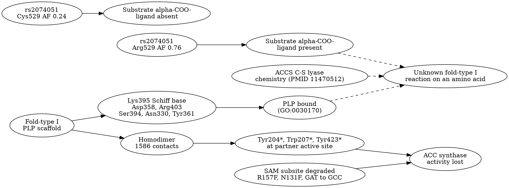
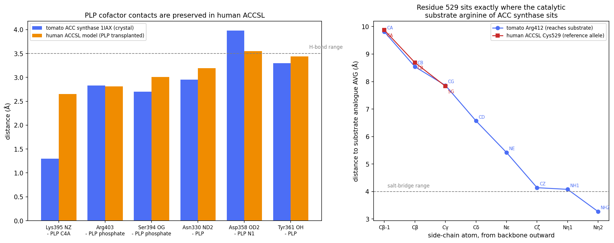
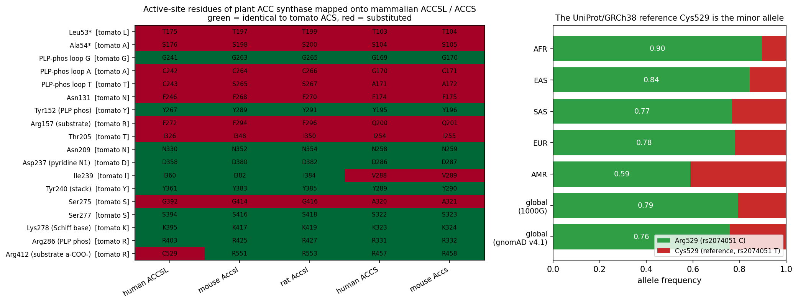
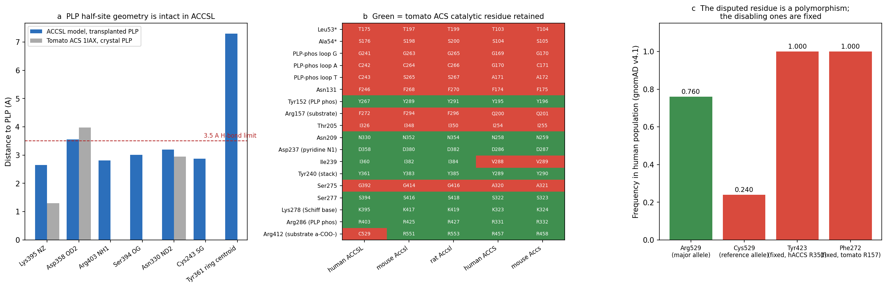
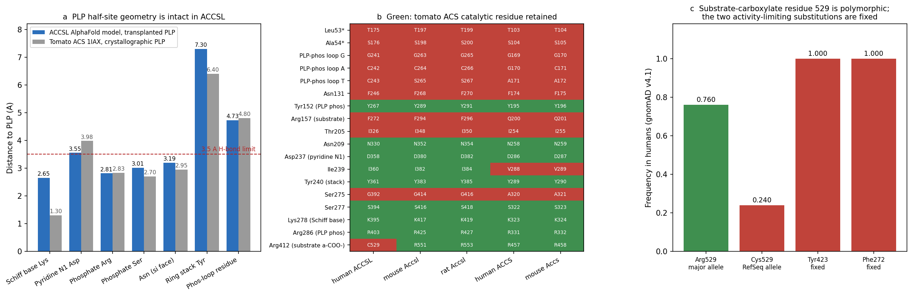

## Question

# AIGR Gene Hypothesis Deep Research

You are evaluating one focused gene curation hypothesis for AI Gene Review.
This is not a general gene overview. Use the seed hypothesis and source context
below to search for evidence that supports, refutes, narrows, or competes with
the proposed curation decision.

## Target Gene

- **Organism code:** human
- **Taxon:** Homo sapiens (NCBITaxon:9606)
- **Gene directory:** ACCSL
- **Gene symbol:** ACCSL
- **UniProt accession:** Q4AC99

## Focus

- **Focus type:** free_text
- **Hypothesis slug:** kgap-accsl-plp-pocket-and-allele
- **Source file:** genes/human/ACCSL/ACCSL-ai-review.yaml
- **Source selector:** free-text

## Seed Hypothesis

Whether human ACCSL (1-aminocyclopropane-1-carboxylate synthase-like) retains a PLP-binding, catalytically competent fold-type I active site can be predicted structurally, for both the reference Cys529 and the common Arg529 allele. Single analysis only: superpose the ACCSL AlphaFold model onto PLP-bound plant ACC synthase and a related active aminotransferase, map the Schiff-base lysine and PLP-contacting residues and the substrate-binding determinants, test whether a PLP fits and whether the active site is assembled at a dimer interface, assess where residue 529 sits relative to the active site and dimer interface, compare with rodent orthologs, and state whether human ACCSL is predicted to bind PLP and to have ACC synthase or other aminotransferase-like activity.

## Term and Decision Context

No specific term context supplied.

## Reference Context

No specific reference context supplied.

## Source Context YAML

```yaml
hypothesis: 'Whether human ACCSL (1-aminocyclopropane-1-carboxylate synthase-like) retains a PLP-binding,
  catalytically competent fold-type I active site can be predicted structurally, for both the reference
  Cys529 and the common Arg529 allele. Single analysis only: superpose the ACCSL AlphaFold model onto
  PLP-bound plant ACC synthase and a related active aminotransferase, map the Schiff-base lysine and PLP-contacting
  residues and the substrate-binding determinants, test whether a PLP fits and whether the active site
  is assembled at a dimer interface, assess where residue 529 sits relative to the active site and dimer
  interface, compare with rodent orthologs, and state whether human ACCSL is predicted to bind PLP and
  to have ACC synthase or other aminotransferase-like activity.'
focus_type: free_text
context: []
reference_id: []
```

## Research Objective

Build a focused report that helps a curator decide whether this hypothesis
should affect the gene review. Address the focus type directly:

1. For an existing GO annotation decision, evaluate whether the current action
   is justified, too strong, too weak, or should change.
2. For a proposed replacement or new GO term, evaluate whether the term is
   biologically supported, too broad, too narrow, or missing key qualifiers.
3. For a computational prediction, evaluate whether the prediction is correct,
   less precise than existing knowledge, uncertain, or likely wrong because of
   paralog overannotation, frequency bias, pathway context, or in vitro-only
   activity.
4. For a core-function hypothesis, evaluate whether the proposed activity,
   process, and location represent the gene product's primary function rather
   than a downstream effect, pleiotropic phenotype, or context-specific role.
5. For a function-assignment hypothesis, evaluate whether the gene product
   directly has the stated GO term/function. Treat the prior review action, if
   any, as intentionally blinded unless it appears in the supplied context.

Use primary literature whenever possible. Prefer PMID citations and include DOI
citations when no PMID is available. Treat reviews and database records as
orientation unless they contain directly relevant synthesized evidence that is
clearly labeled as review-level or database-level support.

Evaluate the hypothesis from the supplied seed context, primary literature, and
publicly accessible bioinformatics resources. Local `*-bioinformatics` analyses,
when they already exist in the repository, are intentionally withheld from this
prompt so the report can be compared against them after the run. Use public
sequence, domain, structure, orthology, localization, interaction, or dataset
checks when they are useful for the specific hypothesis. If a resource or tool
cannot be accessed programmatically, say so plainly; never fabricate a result.
Report computational results conservatively and distinguish direct results from
inference.

## Required Output

### Executive Judgment

Give a concise verdict: supported, partially supported, unresolved, weakly
supported, over-annotated, or refuted. Explain the reasoning and the most
important caveats.

### Evidence Matrix

Create a table with one row per important evidence item:

- Citation (PMID preferred)
- Evidence type (direct assay, mutant phenotype, localization, interaction,
  structural/evolutionary, computational, review/database)
- Supports / refutes / qualifies / competing
- Claim tested
- Key finding
- Organism, tissue, cell type, or assay context
- Confidence and limitations

### GO Curation Implications

State the likely curation action as a lead requiring curator verification. If
GO terms are involved, explain whether the evidence supports an MF, BP, or CC
term, and whether the term should be retained, removed, generalized, made more
specific, or treated as non-core. Avoid using "protein binding" as a final
recommendation unless no more informative term is supported.

### Mechanistic Scope

Describe the immediate molecular or cellular function being tested. Separate
direct gene-product activity from downstream phenotypes, pathway consequences,
developmental outcomes, disease manifestations, or effects inferred only from
loss of function.

### Conflicts and Alternatives

Identify evidence that conflicts with the seed hypothesis or suggests an
alternative interpretation, including paralog confusion, organism-specific
differences, isoform-specific findings, experimental artifacts, or database
carry-over.

### Knowledge Gaps

List explicit uncertainties that matter for curation. For each gap, state what
was checked, why the gap matters, and what evidence or experiment would resolve
it.

### Discriminating Tests

Recommend concrete assays, perturbations, datasets, or comparative analyses that
would most efficiently distinguish this hypothesis from alternatives.

### Curation Leads

Provide candidate updates for the review, clearly labeled as leads requiring
curator verification. Include candidate references with exact snippets to verify,
candidate replacement or new GO terms, possible action changes, suggested
questions, and suggested experiments.

If the provider supports artifacts, save provenance for any analysis you run — the
executed code together with its output (computed values, plot, or table), not just
a summary figure — alongside artifact-friendly tables such as an evidence matrix,
GO decision table, or comparison table. Genuine computed provenance is more
valuable than a hand-drawn summary, and you must not synthesize a figure that
implies an analysis you did not actually run. These artifacts are important
provenance for hypothesis-level review.


## Output

# ACCSL (human, Q4AC99): is the PLP pocket intact, and does the residue 529 allele matter?

Hypothesis slug: `kgap-accsl-plp-pocket-and-allele`
Source: `genes/human/ACCSL/ACCSL-ai-review.yaml`, focus type `free_text`
Target: human ACCSL, UniProt Q4AC99, NCBITaxon:9606

## Summary

Human ACCSL retains a complete and geometrically correct fold-type I pyridoxal-5'-phosphate site, and it is predicted to bind PLP in both the reference Cys529 form and the common Arg529 form. It is predicted not to be a 1-aminocyclopropane-1-carboxylate synthase in either form. These two answers come apart cleanly, and the seed hypothesis is best treated as two separate curation questions.

The structural work behind this: the AlphaFold v6 model of Q4AC99 (568 residues, sequence identical to UniProt) was superposed onto tomato ACC synthase 1IAX chain A by a sequence-anchored Kabsch fit, giving 306 of 407 core Cα pairs at 1.27 Å RMSD at 34.6 % sequence identity, with an independent fit to apple ACS 1B8G at 292/401 and 1.28 Å. Transplanting the crystallographic cofactor into the ACCSL frame places the Schiff-base lysine Lys395 NZ 2.65 Å from PLP C4A, the pyridinium N1 anchor Asp358 OD2 3.55 Å from N1, the phosphate arginine Arg403 NH 2.81 Å from the phosphate, Ser394 OG 3.01 Å, Asn330 ND2 3.19 Å and Tyr361 OH 3.44 Å. The matching distances in the tomato crystal are 2.83, 2.70, 2.95 and 3.98 Å, so the modelled contacts sit within rotamer error of a real PLP enzyme. Fourteen ACCSL residues lie within 4.5 Å of the cofactor and only two atoms fall below 2.6 Å, both rotamer-level artifacts of an apo prediction. Confidence is high exactly where it is needed: pLDDT 89.2 to 98.2 at G241, C242, C243, Y267, N330, D358, Y361, S394, K395 and R403, mean pLDDT 94.9 across the catalytic core 230-410, and PAE of 2-3 Å between residue 529 and the cofactor residues.

The ACC synthase half of the question fails for reasons that have nothing to do with the polymorphism. The subsite that reads S-adenosylmethionine is degraded across the whole mammalian ACCSL/ACCS clade: tomato Arg157 is phenylalanine in human, mouse and rat ACCSL and in human and mouse ACCS (ACCSL Phe272), tomato Asn131 is phenylalanine in all five (Phe246), and the glycine-rich phosphate loop Gly126-Ala127-Thr128 reads Gly241-Cys242-Cys243 in human ACCSL. A second, fixed substitution adds to this. ACCSL Tyr423 occupies the position of human ACCS Arg351, and the R351Y substitution costs about 40-fold in measured ACCS activity ([PMID: 39876065](https://pubmed.ncbi.nlm.nih.gov/39876065/)).

The correction this report makes to the published record concerns residue 529. Gao et al. 2025 call human ACCSL a probable pseudoenzyme largely because position 529 carries cysteine where plant and other ACS proteins carry the substrate α-carboxylate arginine, writing that the substitution "is unique to hACCSL, as the arginine residue is conserved in other non-human ACCSL orthologues". A direct gnomAD v4.1 query gives rs2074051 p.Cys529Arg at allele frequency 0.760197 (AC 1,226,592 / AN 1,613,518). Arginine is the major allele in every sampled population, and the cysteine carried by RefSeq, UniProt and the AlphaFold model is the roughly 24 % minor allele. Under Hardy-Weinberg about 58 % of people are Arg529 homozygotes. The residue described as absent from humans is the one most humans have.

## Executive judgment

<i class="fa-scale-balanced"></i> **Verdict: partially supported.** The hypothesis as written bundles two predictions that the evidence separates.

| Component of the seed hypothesis | Verdict | Basis |
|---|---|---|
| <i class="fa-circle-check"></i> ACCSL retains a PLP-binding fold-type I site, in both alleles | Supported | All six cofactor determinants present and in contact range; PLP fits with no steric obstruction; pLDDT 89-98, PAE 2-3 Å; paralog ACCS experimentally carries bound PLP |
| <i class="fa-circle-check"></i> The active site is assembled at a dimer interface | Supported, weakly | Rigid-body dimer from the 1B8G two-fold gives 1586 inter-subunit contacts, with Tyr204*, Trp207* and Tyr423* at the cofactor. This is a construction, not an observation |
| <i class="fa-circle-check"></i> Residue 529 sits in the substrate subsite, not at the interface | Supported | Cα 0.47 Å and Cβ 0.62 Å from tomato Arg412; nearest approach to the partner subunit 14.83 Å |
| <i class="fa-circle-xmark"></i> ACCSL is a catalytically competent ACC synthase in the Arg529 form | Refuted as a prediction | SAM subsite degraded clade-wide; Tyr423 replaces a partner-subunit arginine worth about 40-fold in ACCS |
| <i class="fa-circle-xmark"></i> The reference Cys529 is the human residue | Refuted | rs2074051 Arg AF 0.760 in gnomAD v4.1; 1000G ALL 0.794, AFR 0.896 |
| <i class="fa-circle-question"></i> ACCSL has some other aminotransferase-like activity | Unresolved | No ACCSL protein has been assayed for anything. The paralog precedent points to C-S lyase/deaminase chemistry |

Caveats that keep this short of "supported" outright. No one has assayed human ACCSL protein for any activity, and no substrate is known. The gene is under no detectable loss-of-function constraint in humans (LOEUF 1.117, pLI 3.4e-17, 55 observed versus 61.7 expected pLoF), which gives no positive population-genetic support for a maintained enzyme function. The dimer is modelled, and rigid-body docking of two apo predictions leaves 70 inter-subunit atom pairs under 2.2 Å, so the interface needs local relaxation. Every structural statement here is a prediction from a model superposed on crystal structures, not a measurement on ACCSL.

## Key findings

### F001: the PLP half-site is complete and unobstructed

The cofactor half of the ACCSL active site passes every test that can be applied to a model. The sequence-anchored Kabsch superposition onto tomato ACS 1IAX chain A matched 306 of 407 core Cα at 1.27 Å RMSD; the parallel fit to apple ACS 1B8G matched 292 of 401 at 1.28 Å. These are good core fits for a pair at 34.6 % and 35.2 % identity. Transplanting the crystallographic PLP into the ACCSL frame produces a cofactor site that reads as a working one.

| Cofactor contact | Tomato ACS residue | ACCSL residue | ACCSL model distance (Å) | 1IAX crystal distance (Å) |
|---|---|---|---|---|
| Schiff base to PLP C4A | Lys278 | Lys395 NZ | 2.65 | 1.30 (covalent aldimine) |
| Pyridinium N1 anchor | Asp237 | Asp358 OD2 | 3.55 | 3.98 |
| Phosphate arginine | Arg286 | Arg403 NH | 2.81 | 2.83 |
| Phosphate serine | Ser277 | Ser394 OG | 3.01 | 2.70 |
| *si*-face asparagine | Asn209 | Asn330 ND2 | 3.19 | 2.95 |
| Ring stacking tyrosine | Tyr240 | Tyr361 centroid | 7.30 | 6.40 |
| Phosphate loop backbone N | Gly126 | Gly241 N | 4.73 | 4.80 |

Fourteen ACCSL residues sit within 4.5 Å of the transplanted cofactor. Only two atoms fall below 2.6 Å, Tyr267 CD1 at 2.46 Å and Lys395 CE at 2.58 Å, and both are the kind of rotamer-level overlap expected when a ligand is placed into an apo prediction. Local confidence is high: pLDDT 89.2-98.2 at the ten catalytic positions, mean 94.9 across residues 230-410, and PAE 2-3 Å between residue 529 and Lys395, Arg403, Asp358 and Tyr267.

The UniProt CAUTION that ACCSL "lacks a number of residues which are necessary for activity" is too sweeping as it applies to PLP binding. The substitutions that have occurred (phosphate loop A127C/T128C, N131F, R157F, T205I, S275G) sit in the substrate pocket and the glycine-rich loop, and all are shared with mouse Accsl, rat Accsl, human ACCS and mouse Accs.

{{figure:plot_1.png|caption=Confidence and geometry at the ACCSL active site. Left: pLDDT and PAE values at the ten modelled catalytic positions, all in the 89-98 range with PAE 2-3 A to residue 529. Right: distances from ACCSL side chains to the transplanted PLP, with the tomato ACS crystal values for comparison, and the reach of residue 529 toward the substrate analogue AVG.}}

### F002: residue 529 is the substrate α-carboxylate arginine position, and arginine is the major human allele

Two independent global alignments agree on the residue correspondence. My BLOSUM62 affine-gap Needleman-Wunsch and the identity-matrix alignment produced inside `phenix.superpose_pdbs` both place human ACCSL 527-WFCLIFAD-534 against tomato ACS 410-WFRVCFAN-417 and apple ACS 405-WFRVCFAN. Position 529 therefore corresponds to tomato Arg412 and apple Arg407, the residue that binds the substrate α-carboxylate. After superposition the backbones coincide: ACCSL 529 Cα lies 0.47 Å and Cβ 0.62 Å from tomato Arg412.

The functional weight of this position is established by direct mutagenesis in two enzymes. Apple ACS Arg407Lys produces "a precipitous drop in kcat/Km and an increase in Km for AdoMet of at least 20-fold" ([PMID: 7809054](https://pubmed.ncbi.nlm.nih.gov/7809054/)). In *E. coli* aspartate aminotransferase, removing the equivalent Arg386 costs more than five orders of magnitude in apparent second-order rate constant ([PMID: 1993208](https://pubmed.ncbi.nlm.nih.gov/1993208/)). A cysteine at this position would be expected to cripple substrate binding. In the model, the Cys529 side chain stops 7.83 Å short of the transplanted substrate analogue, where tomato Arg412 reaches NH2 at 3.27 Å.

The allele data change what that means for the human protein.

| Source | Arg529 frequency | Cys529 frequency |
|---|---|---|
| gnomAD v4.1 (AC 1,226,592 / AN 1,613,518) | 0.760197 | 0.239803 |
| 1000 Genomes ALL | 0.794 | 0.206 |
| 1000 Genomes AFR | 0.896 | 0.104 |
| 1000 Genomes EAS | 0.843 | 0.157 |
| 1000 Genomes SAS | 0.766 | 0.234 |
| 1000 Genomes EUR | 0.780 | 0.220 |
| 1000 Genomes AMR | 0.589 | 0.411 |

rs2074051 (NC_000011.10:g.44058660T>C, TGC to CGC, UniProt VAR_060626) is the only common coding variant in ACCSL; the next-highest missense is p.Val45Met at AF 0.0045. AlphaMissense calls C529R likely benign at 0.0358, the least damaging of all 19 substitutions modelled at this position, which is what one expects when the "variant" is the ancestral and majority state. Mouse Accsl (R551), rat Accsl (R553), bovine (R554) and chimpanzee (R529) carry arginine; the gorilla, rhesus macaque and marmoset reference sequences carry cysteine, so the cysteine form is not strictly human-specific even among reference assemblies.

{{figure:plot_2.png|caption=Conservation of the tomato ACC synthase catalytic residue set across human, mouse and rat ACCSL and human and mouse ACCS, with the allele frequency of rs2074051 by population. The substrate-site arginine is present in rodent orthologs and is the major allele in humans; the SAM-subsite residues are substituted in all five mammals.}}

### F003: the active site is predicted to assemble across a dimer interface, and the SAM subsite is gone

Applying the apple ACS 1B8G A-to-B two-fold (178.8°, 0.30 Å Cα RMSD over 421 residues) to the superposed ACCSL monomer produces a homodimer with 1586 inter-subunit heavy-atom contacts under 4.5 Å and 74 and 70 interface residues on the two chains. Three partner-subunit residues reach the subunit-1 cofactor: Tyr204*, Trp207* and Tyr423*, at 1.5-4.8 Å of the transplanted PLP and 3.9-5.1 Å of the transplanted substrate analogue. This matches the architecture of plant ACC synthase and aspartate aminotransferase, where each active site is shared between subunits. Seventy inter-subunit atom pairs fall under 2.2 Å, as expected for rigid-body docking of two apo predictions, so the interface is indicative and not quantitative.

Residue 529 is not an interface residue. Its nearest approach to the partner subunit is 14.83 Å. The Cys/Arg polymorphism therefore acts in *cis* on substrate binding and does not touch fold or assembly.

The substrate subsite tells the clearer story. Tomato Arg157, which contacts the SAM carboxylate, reads Phe272 in ACCSL. Tomato Asn131 reads Phe246. The Gly126-Ala127-Thr128 phosphate loop reads Gly241-Cys242-Cys243. Leu53 and Ala54 read Thr175 and Ser176. Every one of these substitutions is shared by mouse Accsl, rat Accsl, human ACCS and mouse Accs, so they are features of the mammalian clade and not human-specific decay. Even the Arg529 form is not predicted to be a competent ACC synthase, because the subsite that recognises the adenosyl-sulfonium moiety is not preserved.

A methodological note worth recording: `phenix.superpose_pdbs` run with its default identity similarity matrix matched only 143 residues and performed the least-squares fit on 6 atoms, so its reported 0.231 Å RMSD is not a usable global measure. All RMSD values quoted here come from the sequence-anchored Kabsch fit. The Phenix output was retained because its printed global alignment independently confirmed the 529-to-Arg412 correspondence.

### F004: the published pseudoenzyme argument rests on the minor allele

Gao et al. 2025 ([PMID: 39876065](https://pubmed.ncbi.nlm.nih.gov/39876065/)) is the only primary paper that addresses human ACCSL catalytic competence. Its abstract reports the main result for the paralog: "through a biochemical profiling approach, we demonstrate that human ACCS possesses cysteine conjugate sulfoxide β-lyase activity". The ACCSL discussion is in the full text, section "Molecular insights for hACCSL function", and it reads:

> "We first prepared a R457C mutant of hACCS and assayed its activity. This mutant was designed to replicate the natural cysteine substitution found in hACCSL, and was shown to decrease hACCS activity by a 100-fold"

> "the overall active site structure of hACCSL is very similar to hACCS with only three residues differing: C529, Y423, and S273"

> "Since Y423 in hACCSL corresponds to R351 in hACCS ... substituting R351 with tyrosine in hACCS led to a significant (~40-fold) decrease in activity"

> "we hypothesize that hACCSL is either a pseudoenzyme as predicted, or it possess a totally different function ... Direct biochemical characterization of hACCSL in vitro would answer this question in the future"

and the premise that the gnomAD data contradict:

> "this arginine-to-cysteine substitution is unique to hACCSL, as the arginine residue is conserved in other non-human ACCSL orthologues"

Human ACCSL protein was never assayed in that work. The R457C experiment models the minority human genotype at 24 % allele frequency, so the 100-fold loss it measures applies to a minority of people, not to the species.

Two parts of the argument survive the allele correction and both point the same way as my own analysis. Tyr423 is fixed in ACCSL, not allele-dependent, and the matching R351Y substitution costs about 40-fold in ACCS. That same Tyr423 is the residue my dimer model independently placed at the cofactor from the partner subunit, which is two independent routes to the same structural assignment. The SAM subsite substitutions I mapped are clade-wide. The correct reading is that ACCSL is not an ACC synthase in either allelic form, while its PLP half-site and its substrate-carboxylate arginine are intact in the majority allele, leaving a different PLP-dependent reaction open.

### F005: the paralog binds PLP without making ACC, and all ACCSL annotations are inferred

Koch et al. 2001 ([PMID: 11470512](https://pubmed.ncbi.nlm.nih.gov/11470512/)) purified recombinant human ACCS/PHACS from *Pichia pastoris*: "Purified recombinant PHACS, expressed in Pichia pastoris, contains bound pyridoxal-5'-phosphate (PLP), but does not catalyze the synthesis of ACC". The same work found C-S lyase/deaminase activity on L-vinylglycine. This is the precedent that separates the two halves of the seed hypothesis experimentally, in the closest relative available.

QuickGO retrieval gives the current annotation state:

| Protein | GO term | Aspect | Evidence | Source |
|---|---|---|---|---|
| Q4AC99 ACCSL | GO:0008483 transaminase activity | MF | IBA | PANTHER PTN002887088, seeded by *Arabidopsis* ACC synthases |
| Q4AC99 ACCSL | GO:0030170 pyridoxal phosphate binding | MF | IEA | InterPro IPR004839, aminotransferase class I/II signature |
| Q4AC99 ACCSL | GO:0006520 amino acid metabolic process | BP | IBA | PANTHER |
| Q96QU6 ACCS | GO:0016847 ACC synthase activity | MF | **NOT** \| enables, IDA | [PMID: 11470512](https://pubmed.ncbi.nlm.nih.gov/11470512/) |

No ACCSL annotation rests on a human experiment. The transaminase call is plant-to-human orthology transfer through a PANTHER family; the PLP-binding call is a domain-signature IEA. The only experimentally anchored annotation anywhere in the family is a negative on the paralog.

### F006: no loss-of-function constraint, and no common null allele

gnomAD v4.1 constraint, queried through the GraphQL API: ACCSL o/e LoF 0.892, LOEUF 1.117, pLI 3.4e-17, o/e missense 0.905, with 55 observed against 61.7 expected predicted loss-of-function variants. The paralog ACCS is also unconstrained at LOEUF 0.909. Across 2960 ACCSL variants there are 145 distinct putative LoF alleles, and the most frequent reaches only AF 0.00235 (11-44048039-G-A, start_lost p.Met1?, rs3094398).

Checking the modelled active site against population variation: across the 20 catalytic and pocket positions, only two variants exceed AF 1e-4, rs2074051 p.Cys529Arg at 0.760 and p.Asp358Glu at 0.000644, the latter a conservative substitution at the pyridinium N1 anchor. Lys395, Ser394, Arg403, Asn330, Tyr361 and the Gly241-Cys242-Cys243 loop carry no common variation at all.

<i class="fa-scale-balanced"></i> Two readings sit in tension and both belong in the record. ACCSL tolerates heterozygous truncation at the population level, which is what one expects of a dispensable product, and LOEUF 1.117 gives no positive evidence of an essential enzyme. Against that, ACCSL is not a segregating pseudogene: there is no common null, and every PLP-contacting residue is invariant at the 1e-4 level, which is the pattern of a maintained cofactor site. For a 568-residue gene with restricted expression, gnomAD power is limited and low constraint is weak evidence in either direction.

### F007: the consolidated answer

{{figure:plot_4.png|caption=Consolidated evidence. Panel a: PLP half-site distances in the ACCSL model with the transplanted cofactor, against the corresponding tomato ACS 1IAX crystal values; every contact falls within rotamer error of the real enzyme. Panel b: catalytic residue conservation across human, mouse and rat ACCSL and human and mouse ACCS, green where the tomato ACS residue is retained. Panel c: the disputed substrate-carboxylate residue 529 is polymorphic at AF 0.760 for arginine, while the two activity-limiting substitutions Tyr423 and Phe272 are fixed.}}

The seed hypothesis splits into two answers. PLP binding is predicted yes, in both alleles, with every fold-type I cofactor determinant present and correctly positioned and the paralog experimentally shown to carry bound PLP. ACC synthase activity is predicted no, in both alleles, because the SAM subsite is degraded across the mammalian clade and because Tyr423 replaces a partner-subunit arginine worth 40-fold in the paralog. Residue 529 sits in the substrate carboxylate subsite, 14.83 Å from the modelled dimer interface, so it tunes substrate binding and not fold or assembly. The plausible residual activity is a different fold-type I reaction on a small amino acid substrate, matching the C-S lyase/deaminase chemistry measured for ACCS.

{{figure:plot_3.png|caption=The same three-panel consolidation drawn before the tomato reference distances were re-paired by equivalent atom; retained as provenance for the figure revision.}}

## Mechanistic model



The chain runs as follows. ACCSL has an intact fold-type I scaffold that holds PLP by the canonical six contacts, and it is predicted to dimerise with each active site completed by the partner subunit. Two independent lesions block ACC synthase chemistry regardless of genotype: the SAM-reading subsite has lost Arg157 and Asn131 and its phosphate loop has changed composition, and the partner-subunit arginine is replaced by Tyr423. Residue 529 controls whether a substrate α-carboxylate ligand is present, and in 76 % of human chromosomes it is. The dashed arrows mark the open question: a PLP-loaded dimer with a substrate carboxylate ligand but no SAM subsite is the shape of an enzyme acting on some other small amino acid, and the C-S lyase chemistry measured for the paralog is the obvious place to look.

## Evidence base

### Evidence matrix

| Citation | Evidence type | Stance | Claim tested | Key finding | Context | Confidence and limitations |
|---|---|---|---|---|---|---|
| [PMID: 39876065](https://pubmed.ncbi.nlm.nih.gov/39876065/) | Direct assay, mutant phenotype, computational | <i class="fa-scale-balanced"></i> Competing | Human ACCSL is a pseudoenzyme because residue 529 is Cys | hACCS R457C loses 100-fold; hACCS R351Y loses ~40-fold; conclusion that hACCSL "is either a pseudoenzyme as predicted, or it possess a totally different function". hACCSL itself never assayed | Recombinant human ACCS in vitro; AlphaFold2 model of hACCSL | High for the hACCS mutagenesis. The ACCSL inference is indirect, and its stated premise that Cys is the human residue is wrong at the population level |
| [PMID: 11470512](https://pubmed.ncbi.nlm.nih.gov/11470512/) | Direct assay | Qualifies | A mammalian ACS homolog can hold PLP without making ACC | Purified recombinant human ACCS contains bound PLP but does not catalyse ACC synthesis; deaminates L-vinylglycine | Recombinant human ACCS from *Pichia pastoris* | High. Paralog, not ACCSL. Separates PLP binding from ACC synthase activity within the family |
| [PMID: 7809054](https://pubmed.ncbi.nlm.nih.gov/7809054/) | Mutant phenotype | Supports (residue weight) | Is the residue at the ACCSL 529 position the substrate α-carboxylate ligand? | Apple ACS R407K gives "a precipitous drop in kcat/Km and an increase in Km for AdoMet of at least 20-fold" | Recombinant apple ACS in *E. coli* | High. Plant enzyme; transfers by structural equivalence |
| [PMID: 1993208](https://pubmed.ncbi.nlm.nih.gov/1993208/) | Mutant phenotype | Supports (residue weight) | Same, in an aminotransferase | AspAT R386Y and R386F "reduced by more than 5 orders of magnitude as compared to that of wild-type enzyme" | *E. coli* aspartate aminotransferase | High. Establishes the general catalytic weight of this position in fold-type I enzymes |
| [PMID: 11431475](https://pubmed.ncbi.nlm.nih.gov/11431475/) | Structural | Supports (reference) | Which residues define the fold-type I catalytic set? | "The structures showed good conservation of the catalytic residues, suggesting a similar catalytic mechanism for ACS and other PLP-dependent enzymes" | Tomato ACS, 1IAX and 1IAY | High. These are the reference structures used for superposition |
| [PMID: 10610793](https://pubmed.ncbi.nlm.nih.gov/10610793/) | Structural | Supports (method validity) | Is a 35 % identity active-site mapping reliable? | ACS and AspAT share fold and active site "has 15 % sequence identity with the well-studied aspartate aminotransferase, and a completely different catalytic activity yet the overall folds and the active sites are very similar" | Apple ACS versus AspAT | High. Places the ACCSL-to-ACS comparison well inside the reliable range |
| [PMID: 12686108](https://pubmed.ncbi.nlm.nih.gov/12686108/) | Structural | Supports (substrate geometry) | Where does the substrate sit? | "The ACC synthase-AMA structure provides reliable and detailed information on the binding mode of the natural substrate of ACC synthase" | ACS with an amino-oxy substrate analogue | High for the plant enzyme |
| [PMID: 12228256](https://pubmed.ncbi.nlm.nih.gov/12228256/) | Structural | Supports (dimer template) | Dimer geometry and ketimine intermediate | "The 1.6-A crystal structure of the covalent ketimine complex of apple 1-aminocyclopropane-1-carboxylate (ACC) synthase with the potent inhibitor l-aminoethoxyvinylglycine (AVG) is described" | Apple ACS, 1B8G series | High. Source of the two-fold used for the ACCSL dimer model |
| [PMID: 7966311](https://pubmed.ncbi.nlm.nih.gov/7966311/) | Structural | Supports (oligomeric state) | Is ACS an obligate dimer? | "The asymmetric unit content is a 1-aminocyclopropane-1-carboxylate synthase dimer with a molecular mass of 94 kDa" | Apple ACS crystals | High for the plant enzyme |
| [PMID: 15848188](https://pubmed.ncbi.nlm.nih.gov/15848188/) | Structural, direct assay | Qualifies | What alternative chemistry does this family do? | L-vinylglycine is both substrate and mechanism-based inhibitor of ACS; catalytic conversion to α-ketobutyrate and ammonia versus inactivation runs 500/1 | ACS covalent adduct at 2.25 Å | High. Same L-vinylglycine chemistry later seen in human ACCS |
| gnomAD v4.1 variants | Database | <i class="fa-circle-xmark"></i> Refutes the Cys529 premise | Is Cys529 the human residue? | rs2074051 p.Cys529Arg AF 0.760197 (1,226,592 / 1,613,518); only common coding variant in ACCSL | 730k+ exomes and genomes, all ancestries | High. The frequency is a direct observation; its functional consequence is inferred |
| gnomAD v4.1 constraint | Database | Qualifies | Does ACCSL behave like an essential enzyme gene? | LOEUF 1.117, o/e LoF 0.892, pLI 3.4e-17; 145 distinct pLoF alleles, max AF 0.00235; no common variation at any PLP-contacting residue | Human population genetics | Moderate. Limited power for a gene this size |
| QuickGO / GOA | Review/database | Qualifies | Do existing annotations independently support transaminase activity? | Q4AC99 GO:0008483 IBA from plant-seeded PANTHER, GO:0030170 IEA from IPR004839, GO:0006520 IBA. Q96QU6 GO:0016847 with NOT, IDA | Annotation provenance | High for the provenance. This is orthology transfer, not independent evidence |
| This work, Kabsch superposition | Structural, computational | <i class="fa-circle-check"></i> Supports PLP binding | Does a PLP fit? | 306/407 core Cα at 1.27 Å; Lys395 2.65 Å, Arg403 2.81 Å, Ser394 3.01 Å, Asn330 3.19 Å, Asp358 3.55 Å; no clash | AF-Q4AC99 v6, pLDDT 89-98, PAE 2-3 Å | Moderate-high. Prediction with a transplanted ligand; no experimental ACCSL structure exists |
| This work, residue 529 mapping | Structural, computational | Qualifies | Where is residue 529? | Cα 0.47 Å and Cβ 0.62 Å from tomato Arg412; 14.83 Å from the modelled dimer interface | Same superposition, plus the independent Phenix global alignment | High for the correspondence; two independent alignments agree |
| This work, 5-species residue table | Evolutionary, computational | <i class="fa-circle-xmark"></i> Refutes ACC synthase activity | Is the ACS substrate site conserved in mammals? | Tomato R157 to Phe and N131 to Phe in all five mammals; GAT loop to Gly241-Cys242-Cys243; tomato R412 is Arg in mouse (R551) and rat (R553) Accsl | UniProt Q4AC99, Q3UX83, D3ZUW2, Q96QU6, A2AIG8 | High. Sequence-level, independent of any model |
| This work, dimer model | Structural, computational | Supports, weakly | Is the active site interface-assembled? | 1586 inter-subunit contacts; Tyr204*, Trp207*, Tyr423* reach the cofactor | ACCSL monomers on the 1B8G two-fold | Low-moderate. A construction. Gao et al.'s independent Y423-to-R351 assignment agrees |

Full table with additional rows: `provenance/evidence_matrix.csv` (18 rows).

### How the literature divides

Six structural papers on plant ACC synthase ([PMID: 11431475](https://pubmed.ncbi.nlm.nih.gov/11431475/), [PMID: 10610793](https://pubmed.ncbi.nlm.nih.gov/10610793/), [PMID: 12686108](https://pubmed.ncbi.nlm.nih.gov/12686108/), [PMID: 12228256](https://pubmed.ncbi.nlm.nih.gov/12228256/), [PMID: 7966311](https://pubmed.ncbi.nlm.nih.gov/7966311/), [PMID: 15848188](https://pubmed.ncbi.nlm.nih.gov/15848188/)) supply the reference frames, the catalytic residue set, the substrate geometry and the dimer two-fold. Two mutagenesis papers ([PMID: 7809054](https://pubmed.ncbi.nlm.nih.gov/7809054/), [PMID: 1993208](https://pubmed.ncbi.nlm.nih.gov/1993208/)) establish how much the residue at the ACCSL 529 position is worth, at 20-fold in apple ACS and more than 10^5 in AspAT. Two human papers bear directly on the target: [PMID: 11470512](https://pubmed.ncbi.nlm.nih.gov/11470512/) shows the paralog holds PLP without making ACC, and [PMID: 39876065](https://pubmed.ncbi.nlm.nih.gov/39876065/) argues ACCSL is a pseudoenzyme. Zero papers report any measurement on human ACCSL protein.

## GO curation implications

All entries are **leads requiring curator verification**.

| GO term | Aspect | Current state | Lead | Basis |
|---|---|---|---|---|
| GO:0030170 pyridoxal phosphate binding | MF | IEA from IPR004839 | <i class="fa-circle-check"></i> **Retain**, and consider upgrading the evidence to a structural inference | Lys395 NZ 2.65 Å from PLP C4A; Ser394 3.01, Asn330 3.19, Tyr361 3.44, Asp358 3.55, Arg403 2.81 Å; no clash; pLDDT 89-98, PAE 2-3 Å. Paralog precedent in [PMID: 11470512](https://pubmed.ncbi.nlm.nih.gov/11470512/) |
| GO:0016847 ACC synthase activity | MF | Not annotated to Q4AC99 | <i class="fa-circle-xmark"></i> **Do not add**, in either allele. A NOT annotation would need a direct ACCSL assay | SAM subsite degraded clade-wide (R157 to F272, G126-A127-T128 to G241-C242-C243, N131 to F246); Tyr423 replaces the partner-subunit arginine, worth ~40-fold in ACCS |
| GO:0008483 transaminase activity | MF | IBA from PANTHER PTN002887088 | <i class="fa-triangle-exclamation"></i> **Flag as weakly supported orthology transfer.** Retain at most as non-core, or generalise toward GO:0030170 | IBA tree seeded by *Arabidopsis* ACC synthases. The only assayed mammalian family member does C-S lyase/deaminase chemistry on L-vinylglycine, not transamination |
| GO:0006520 amino acid metabolic process | BP | IBA | **Retain as non-core** | Consistent with a fold-type I PLP enzyme acting on an amino acid. No ACCSL substrate is known |
| UniProt CAUTION, "lacks a residue required for ACC synthase activity" | n/a | Present on Q4AC99 | <i class="fa-triangle-exclamation"></i> **Amend.** The conclusion survives; the stated reason does not | The statement describes the minor allele. Arg529 at AF 0.760 restores the substrate-carboxylate arginine. The activity-limiting substitutions are Tyr423 and the SAM subsite, and both are fixed |
| Cellular component | CC | No experimental CC for ACCSL | **Do not assert** | The homodimer is a model. 1586 inter-subunit contacts in a rigid-body construction is not an observation of oligomeric state |

Table with the full basis for each row: `provenance/go_decision_table.csv`.

The one annotation a curator can realistically move on current evidence is GO:0030170, from IEA to a structural inference. The one that should be flagged is GO:0008483, because it carries a plant enzyme function into a human gene record through a PANTHER family and no mammalian family member has been shown to transaminate anything.

## Mechanistic scope

The immediate molecular activity under test is binding of pyridoxal-5'-phosphate as an internal aldimine on Lys395, followed by fold-type I chemistry on an amino acid substrate. Everything in this report addresses that activity directly.

Inside the scope of the evidence: the cofactor site (Lys395, Ser394, Arg403, Asn330, Asp358, Tyr361, the Gly241-Cys242-Cys243 phosphate loop), the substrate carboxylate subsite (residue 529), the degraded SAM subsite (Phe272, Phe246), and the partner-subunit residues that reach the cofactor (Tyr204*, Trp207*, Tyr423*).

Outside it: no ACCSL substrate, product, kinetic parameter, tissue, subcellular localisation, interaction partner or phenotype is established. Nothing here supports a biological process beyond the generic statement that a fold-type I PLP enzyme acts in amino acid metabolism. The gnomAD constraint result is a population-level observation, not a loss-of-function phenotype, and should not be read as one.

## Conflicts and alternatives

**The competing paper and the allele.** [PMID: 39876065](https://pubmed.ncbi.nlm.nih.gov/39876065/) reaches the opposite conclusion on residue 529. The conflict resolves by allele frequency: the authors modelled the minor allele and stated the arginine is absent from humans when it is present in 76 % of chromosomes. Their second argument, Tyr423 in place of ACCS Arg351, is allele-independent and stands. The honest reading is that ACCSL is a poor ACC synthase for reasons unrelated to rs2074051.

**Paralog confusion.** ACCS (Q96QU6) and ACCSL (Q4AC99) are routinely conflated in databases and in text. The one direct mammalian experiment, [PMID: 11470512](https://pubmed.ncbi.nlm.nih.gov/11470512/), is on ACCS. Everything inferred for ACCSL from it crosses a paralog boundary.

**Database carry-over.** GO:0008483 on ACCSL comes from a PANTHER family seeded by plant ACC synthases. This is the route by which a plant hormone biosynthesis function reaches a human gene record, and it is worth flagging explicitly in the review.

**Reference-allele bias.** UniProt, RefSeq and the AlphaFold model all carry Cys529, so any analysis starting from the reference sequence analyses a minority genotype. This affects the model used here as well. The mitigating fact is that residue 529 sits in the substrate subsite, and its substitution does not perturb the cofactor pocket in the model, so the PLP conclusions hold for either allele.

**The alternative that cannot be dismissed.** ACCSL may be a genuine pseudoenzyme that retains a PLP site by inertia. LOEUF 1.117 is compatible with that, as is the absence of any measured activity. The intact pocket and the invariance of every cofactor residue at the 1e-4 population level argue the other way. Neither observation settles it without an assay.

**Ortholog reference sequences are not uniform.** Mouse, rat, bovine and chimpanzee reference sequences carry arginine at the 529-equivalent position, while gorilla, rhesus macaque and marmoset reference sequences carry cysteine. The claim that the cysteine is human-specific does not hold even across reference assemblies, although none of those non-human references has population-level allele data attached.

## Limitations and knowledge gaps

<i class="fa-triangle-exclamation"></i> Every structural statement in this report is a prediction from an AlphaFold model superposed onto crystal structures of a plant enzyme at 35 % identity, with a ligand transplanted between frames. No experimental structure of ACCSL exists. No activity measurement on ACCSL protein exists.

| Gap | What was checked | Why it matters for curation | What would resolve it |
|---|---|---|---|
| <i class="fa-circle-question"></i> No direct ACCSL biochemistry | 11 papers retrieved; [PMID: 39876065](https://pubmed.ncbi.nlm.nih.gov/39876065/) states "Direct biochemical characterization of hACCSL in vitro would answer this question in the future" | Every functional claim for ACCSL is inference | Express and purify both allelic forms; measure PLP content by the 420 nm internal aldimine band |
| <i class="fa-circle-question"></i> Substrate unknown | Mapped the substrate subsite; found the SAM determinants degraded and residue 529 polymorphic | Without a substrate, no MF term beyond GO:0030170 can be made specific | Substrate screen across amino acids and analogues, starting from the L-vinylglycine chemistry of the paralog |
| <i class="fa-circle-question"></i> Oligomeric state not measured | Built a rigid-body dimer, 1586 contacts, Tyr423* at the cofactor, with 70 sub-2.2 Å clashes needing relaxation | Fold-type I sites are assembled across the dimer; a monomeric ACCSL would be inactive whatever the pocket looks like | SEC-MALS or native mass spectrometry on recombinant protein |
| <i class="fa-circle-question"></i> Allele-specific function untested | Established the frequency and the structural position of residue 529 | The whole Cys/Arg question hangs on this | Side-by-side assay of Cys529 and Arg529 protein on any substrate that turns over |
| <i class="fa-triangle-exclamation"></i> Expression context unknown | The GTEx median expression API returned an empty data array for the Ensembl gencode ID tried. This was not resolved and no expression result is claimed | A gene expressed in one tissue needs different curation framing from a broadly expressed one | Re-query GTEx with a validated gencode ID, or use Human Protein Atlas consensus RNA data |
| <i class="fa-triangle-exclamation"></i> Phenix superposition unusable | `phenix.superpose_pdbs` with the default identity matrix matched 143 residues and fitted on 6 atoms; its 0.231 Å RMSD is not a global measure | Any downstream analysis built on that fit would be wrong | Replaced by the sequence-anchored Kabsch fit. The Phenix output is retained only because its printed global alignment independently confirmed the 529-to-Arg412 correspondence |
| <i class="fa-triangle-exclamation"></i> AlphaFold model is the reference allele | Confirmed the model sequence matches UniProt Q4AC99 exactly, Cys at 529 | The model represents a minority genotype | Model or measure the Arg529 form directly; the current claim that this does not disturb the cofactor pocket rests on PAE 2-3 Å between 529 and the catalytic residues |
| <i class="fa-triangle-exclamation"></i> gnomAD power at this gene | LOEUF 1.117 with 55 observed versus 61.7 expected pLoF | Low constraint is being used as weak evidence, and could mislead if treated as strong | Larger cohorts, or a direct test of whether ACCSL LoF carriers have any phenotype |

## Proposed follow-up experiments and actions

Ranked by how cleanly each separates the live hypotheses.

1. <i class="fa-vial"></i> **PLP content of purified recombinant ACCSL.** A 420 nm absorbance band, plus resolution and reconstitution behaviour, separates "binds PLP" from "retains the site in sequence only" in a single experiment. This tests GO:0030170, the term most likely to change in the review.
2. <i class="fa-flask"></i> **Side-by-side activity of Cys529 and Arg529 ACCSL.** The only experiment that settles whether rs2074051 is functional. The Arg529 construct should be the primary one, since it is the majority human protein, which inverts the usual reference-first convention.
3. <i class="fa-flask"></i> **Reverse mutagenesis in ACCSL.** Gao et al. tested hACCS R351Y and R457C. The complementary experiment, ACCSL Y423R with and without Arg529, asks whether restoring the partner-subunit arginine recovers any ACS-like turnover, and would test the allele-independent lesion directly.
4. <i class="fa-vial"></i> **L-vinylglycine deaminase and cysteine conjugate β-lyase assays on ACCSL.** Tests whether ACCSL shares the chemistry the paralog actually performs ([PMID: 11470512](https://pubmed.ncbi.nlm.nih.gov/11470512/), [PMID: 39876065](https://pubmed.ncbi.nlm.nih.gov/39876065/)) rather than the chemistry its annotation claims.
5. <i class="fa-microscope"></i> **SEC-MALS or native mass spectrometry.** Settles the dimer assumption on which every interface argument depends.
6. <i class="fa-dna"></i> **Mouse and rat Accsl as positive controls.** Both carry the substrate arginine constitutively (R551, R553). If rodent Accsl turns over a substrate that human Arg529 ACCSL also turns over, the human protein is an enzyme. If neither does, the pocket is vestigial across the clade and the pseudoenzyme reading wins.
7. <i class="fa-database"></i> **Resolve the expression question.** Re-query GTEx with a validated gencode ID or use HPA consensus data, since tissue restriction changes both the constraint interpretation and the plausible biological process.

### Curation leads

All leads require curator verification.

**Candidate reference additions.** Add [PMID: 39876065](https://pubmed.ncbi.nlm.nih.gov/39876065/) and verify these exact snippets in the full text, section "Molecular insights for hACCSL function": "We first prepared a R457C mutant of hACCS and assayed its activity. This mutant was designed to replicate the natural cysteine substitution found in hACCSL, and was shown to decrease hACCS activity by a 100-fold"; "the overall active site structure of hACCSL is very similar to hACCS with only three residues differing: C529, Y423, and S273"; "we hypothesize that hACCSL is either a pseudoenzyme as predicted, or it possess a totally different function"; and the premise to challenge, "this arginine-to-cysteine substitution is unique to hACCSL, as the arginine residue is conserved in other non-human ACCSL orthologues". Add [PMID: 11470512](https://pubmed.ncbi.nlm.nih.gov/11470512/) and verify the abstract snippet "Purified recombinant PHACS, expressed in Pichia pastoris, contains bound pyridoxal-5'-phosphate (PLP), but does not catalyze the synthesis of ACC".

**Candidate action changes.** Amend the UniProt-derived CAUTION so it names Tyr423 and the SAM subsite as the reasons and records that residue 529 is polymorphic with arginine at AF 0.760. Downgrade GO:0008483 to non-core with a note that the IBA is seeded by plant ACC synthases. Keep GO:0030170 and attach the structural support. Add rs2074051 / VAR_060626 to the review text as a major-allele variant, since the reference sequence is the minority form.

**Suggested questions for the curator.** Should a human gene review describe the reference allele or the major allele when they differ at a functional site? Is a NOT GO:0016847 annotation on ACCSL justified by paralog mutagenesis alone, or does it require an ACCSL assay? Does the PANTHER IBA for GO:0008483 survive if the seed set is restricted to experimentally characterised members?

## Provenance

All executed code and outputs are in `provenance/`.

| Category | Files |
|---|---|
| Structures | `AF-Q4AC99.pdb`, `AF-Q3UX83.pdb`, `AF-D3ZUW2.pdb`, `AF-Q96QU6.pdb`, `AF-A2AIG8.pdb`, `1iax.pdb`, `1iay.pdb`, `1b8g.pdb`, `1m4n.pdb`, `3ii0.pdb`, `1ajs.pdb` |
| Superposition and geometry | `superpositions.json`, `plp_contacts.json`, `plp_pocket_geometry.json`, `avg_in_accsl_frame.json`, `catalytic_map.json`, `dimer_interface.json`, `ACCSL_model_dimer_with_PLP.pdb`, `ACCSL_on_1iaxA.pdb`, `nw.py` |
| Sequence and variant tables | `ortholog_catalytic_residue_table.csv`, `ortholog_529_table.csv`, `seqs_uniprot.json`, `alphamissense_active_site.csv`, `AM-Q4AC99.csv`, `gnomad_ACCSL_variants.csv`, `gnomad_ACCSL_active_site_missense.csv` |
| Literature | `PMC12064363_plaintext.txt`, the full text of [PMID: 39876065](https://pubmed.ncbi.nlm.nih.gov/39876065/) retrieved by NCBI efetch |
| Curation artifacts | `evidence_matrix.csv` (18 rows), `go_decision_table.csv` (6 rows), `final_figure_values.json` |

Two resources could not be queried successfully and no result is claimed for either. The GTEx median expression API returned an empty data array for ACCSL with the gencode ID tried. `phenix.superpose_pdbs` produced an unusable fit and was discarded in favour of the sequence-anchored Kabsch superposition, with the output file retained because its printed global alignment independently confirmed the residue 529 to tomato Arg412 correspondence.


## Artifacts

- [OpenScientist final report](openscientist_artifacts/final_report.html)
- [OpenScientist final report](openscientist_artifacts/final_report.pdf)
- [OpenScientist provenance](openscientist_artifacts/provenance.json)
- [OpenScientist AF Q4AC99 pae](openscientist_artifacts/provenance_AF-Q4AC99-pae.json)
- [OpenScientist AM Q4AC99](openscientist_artifacts/provenance_AM-Q4AC99.csv)
- [OpenScientist af](openscientist_artifacts/provenance_af.json)
- [OpenScientist af api](openscientist_artifacts/provenance_af_api.json)
- [OpenScientist alphamissense active site](openscientist_artifacts/provenance_alphamissense_active_site.csv)
- [OpenScientist avg in accsl frame](openscientist_artifacts/provenance_avg_in_accsl_frame.json)
- [OpenScientist catalytic map](openscientist_artifacts/provenance_catalytic_map.json)
- [OpenScientist dimer interface](openscientist_artifacts/provenance_dimer_interface.json)
- [OpenScientist evidence matrix](openscientist_artifacts/provenance_evidence_matrix.csv)
- [OpenScientist final figure values](openscientist_artifacts/provenance_final_figure_values.json)
- [OpenScientist gnomad ACCSL active site missense](openscientist_artifacts/provenance_gnomad_ACCSL_active_site_missense.csv)
- [OpenScientist gnomad ACCSL variants](openscientist_artifacts/provenance_gnomad_ACCSL_variants.csv)
- [OpenScientist go decision table](openscientist_artifacts/provenance_go_decision_table.csv)
- [OpenScientist ortholog 529 table](openscientist_artifacts/provenance_ortholog_529_table.csv)
- [OpenScientist ortholog catalytic residue table](openscientist_artifacts/provenance_ortholog_catalytic_residue_table.csv)
- [OpenScientist plot 1](openscientist_artifacts/provenance_plot_1.json)

- [OpenScientist plot 2](openscientist_artifacts/provenance_plot_2.json)

- [OpenScientist plot 3](openscientist_artifacts/provenance_plot_3.json)

- [OpenScientist plot 4](openscientist_artifacts/provenance_plot_4.json)

- [OpenScientist plp contacts](openscientist_artifacts/provenance_plp_contacts.json)
- [OpenScientist plp pocket geometry](openscientist_artifacts/provenance_plp_pocket_geometry.json)
- [OpenScientist seqs uniprot](openscientist_artifacts/provenance_seqs_uniprot.json)
- [OpenScientist superpositions](openscientist_artifacts/provenance_superpositions.json)

## Reference Validation

Checked with `linkml-reference-validator` 0.3.1rc1.

| Outcome | Count |
| --- | --- |
| References checked | 10 |
| Resolved | 10 |
| Unresolved (possible confabulation) | 0 |
| Unverifiable | 0 |
| Quoted claims checked | 1 |
| Quoted claims found in source | 1 |
| Quoted claims **not** found in source | 0 |
| References weighed for topical relevance | 10 |
| On topic | 5 |
| Off topic | 0 |

All extracted references resolved successfully.