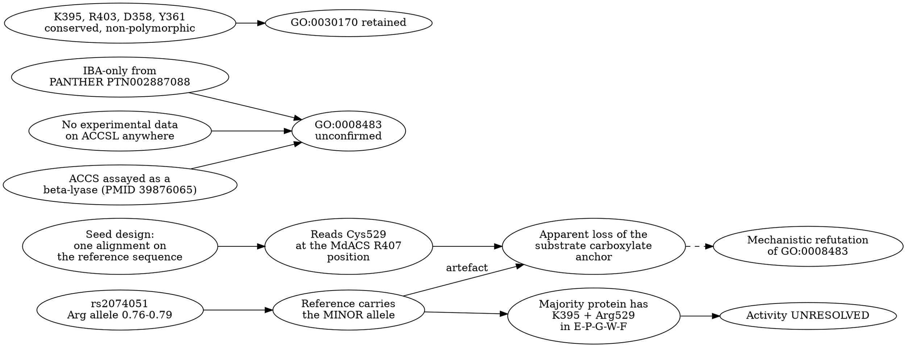
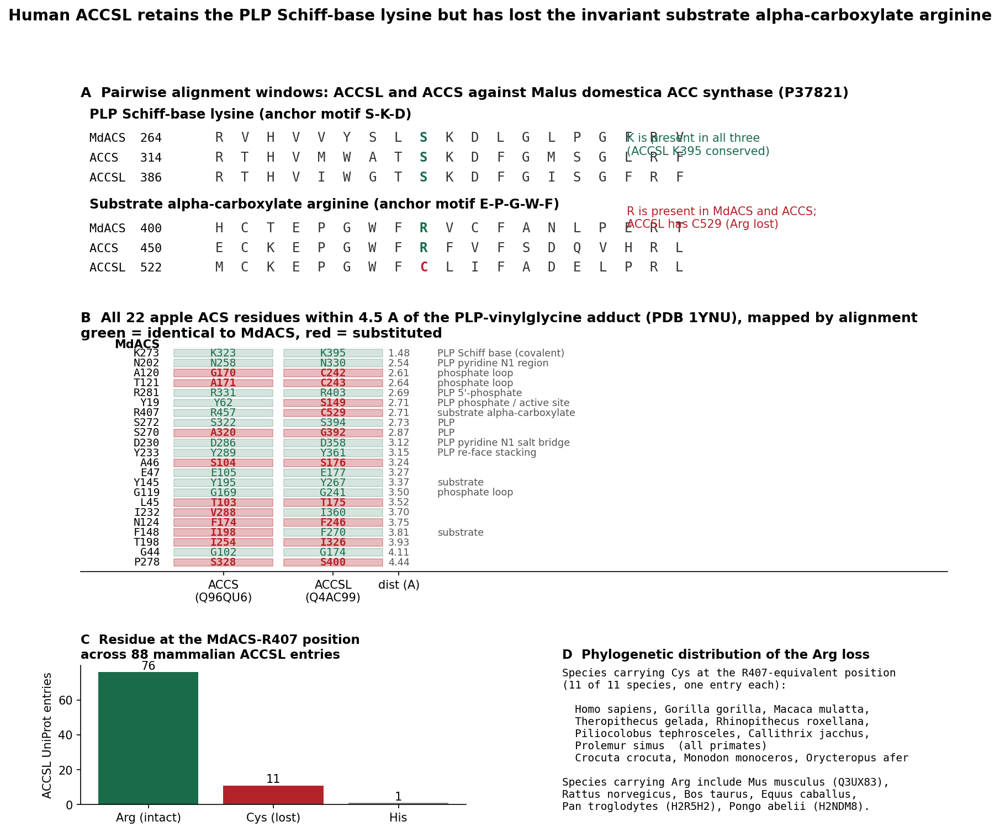
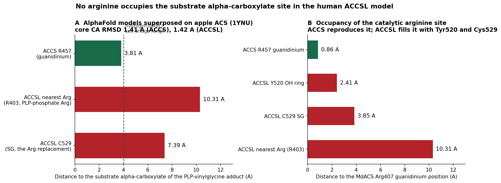
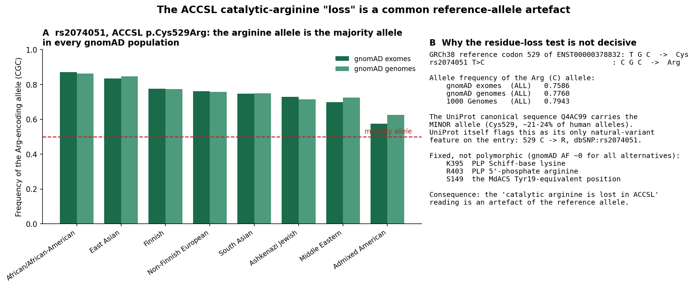

## Question

# AIGR Gene Hypothesis Deep Research

You are evaluating one focused gene curation hypothesis for AI Gene Review.
This is not a general gene overview. Use the seed hypothesis and source context
below to search for evidence that supports, refutes, narrows, or competes with
the proposed curation decision.

## Target Gene

- **Organism code:** human
- **Taxon:** Homo sapiens (NCBITaxon:9606)
- **Gene directory:** ACCSL
- **Gene symbol:** ACCSL
- **UniProt accession:** Q4AC99

## Focus

- **Focus type:** function_assignment
- **Hypothesis slug:** residue-loss-transaminase
- **Source file:** genes/human/ACCSL/ACCSL-ai-review.yaml
- **Source selector:** free-text

## Seed Hypothesis

Human ACCSL (UniProt Q4AC99) has transaminase activity (GO:0008483). Single decisive analysis: one pairwise alignment of ACCSL against an active ACC synthase (Malus domestica ACS) and against human ACCS, reporting only whether the PLP Schiff-base lysine and the substrate alpha-carboxylate-binding arginine are conserved in ACCSL. Do not survey the whole family.

## Term and Decision Context

- Term: transaminase activity (GO:0008483)

## Reference Context

- PMID:39876065

## Source Context YAML

```yaml
hypothesis: 'Human ACCSL (UniProt Q4AC99) has transaminase activity (GO:0008483). Single decisive analysis:
  one pairwise alignment of ACCSL against an active ACC synthase (Malus domestica ACS) and against human
  ACCS, reporting only whether the PLP Schiff-base lysine and the substrate alpha-carboxylate-binding
  arginine are conserved in ACCSL. Do not survey the whole family.'
focus_type: function_assignment
term_id: GO:0008483
term_label: transaminase activity
context: []
reference_id:
- PMID:39876065
```

## Research Objective

Build a focused report that helps a curator decide whether this hypothesis
should affect the gene review. Address the focus type directly:

1. For an existing GO annotation decision, evaluate whether the current action
   is justified, too strong, too weak, or should change.
2. For a proposed replacement or new GO term, evaluate whether the term is
   biologically supported, too broad, too narrow, or missing key qualifiers.
3. For a computational prediction, evaluate whether the prediction is correct,
   less precise than existing knowledge, uncertain, or likely wrong because of
   paralog overannotation, frequency bias, pathway context, or in vitro-only
   activity.
4. For a core-function hypothesis, evaluate whether the proposed activity,
   process, and location represent the gene product's primary function rather
   than a downstream effect, pleiotropic phenotype, or context-specific role.
5. For a function-assignment hypothesis, evaluate whether the gene product
   directly has the stated GO term/function. Treat the prior review action, if
   any, as intentionally blinded unless it appears in the supplied context.

Use primary literature whenever possible. Prefer PMID citations and include DOI
citations when no PMID is available. Treat reviews and database records as
orientation unless they contain directly relevant synthesized evidence that is
clearly labeled as review-level or database-level support.

Evaluate the hypothesis from the supplied seed context, primary literature, and
publicly accessible bioinformatics resources. Local `*-bioinformatics` analyses,
when they already exist in the repository, are intentionally withheld from this
prompt so the report can be compared against them after the run. Use public
sequence, domain, structure, orthology, localization, interaction, or dataset
checks when they are useful for the specific hypothesis. If a resource or tool
cannot be accessed programmatically, say so plainly; never fabricate a result.
Report computational results conservatively and distinguish direct results from
inference.

## Required Output

### Executive Judgment

Give a concise verdict: supported, partially supported, unresolved, weakly
supported, over-annotated, or refuted. Explain the reasoning and the most
important caveats.

### Evidence Matrix

Create a table with one row per important evidence item:

- Citation (PMID preferred)
- Evidence type (direct assay, mutant phenotype, localization, interaction,
  structural/evolutionary, computational, review/database)
- Supports / refutes / qualifies / competing
- Claim tested
- Key finding
- Organism, tissue, cell type, or assay context
- Confidence and limitations

### GO Curation Implications

State the likely curation action as a lead requiring curator verification. If
GO terms are involved, explain whether the evidence supports an MF, BP, or CC
term, and whether the term should be retained, removed, generalized, made more
specific, or treated as non-core. Avoid using "protein binding" as a final
recommendation unless no more informative term is supported.

### Mechanistic Scope

Describe the immediate molecular or cellular function being tested. Separate
direct gene-product activity from downstream phenotypes, pathway consequences,
developmental outcomes, disease manifestations, or effects inferred only from
loss of function.

### Conflicts and Alternatives

Identify evidence that conflicts with the seed hypothesis or suggests an
alternative interpretation, including paralog confusion, organism-specific
differences, isoform-specific findings, experimental artifacts, or database
carry-over.

### Knowledge Gaps

List explicit uncertainties that matter for curation. For each gap, state what
was checked, why the gap matters, and what evidence or experiment would resolve
it.

### Discriminating Tests

Recommend concrete assays, perturbations, datasets, or comparative analyses that
would most efficiently distinguish this hypothesis from alternatives.

### Curation Leads

Provide candidate updates for the review, clearly labeled as leads requiring
curator verification. Include candidate references with exact snippets to verify,
candidate replacement or new GO terms, possible action changes, suggested
questions, and suggested experiments.

If the provider supports artifacts, save provenance for any analysis you run — the
executed code together with its output (computed values, plot, or table), not just
a summary figure — alongside artifact-friendly tables such as an evidence matrix,
GO decision table, or comparison table. Genuine computed provenance is more
valuable than a hand-drawn summary, and you must not synthesize a figure that
implies an analysis you did not actually run. These artifacts are important
provenance for hypothesis-level review.


## Output

# ACCSL (Q4AC99) and transaminase activity (GO:0008483): evaluation of the residue-loss hypothesis

Gene: human ACCSL, UniProt Q4AC99, "Probable inactive 1-aminocyclopropane-1-carboxylate synthase-like protein 2", 568 aa, NCBITaxon:9606.
Focus type: function_assignment. Hypothesis slug: `residue-loss-transaminase`. Term: GO:0008483 transaminase activity. Source file: `genes/human/ACCSL/ACCSL-ai-review.yaml`. Reference context: [PMID: 39876065](https://pubmed.ncbi.nlm.nih.gov/39876065/).

## Summary

The seed hypothesis proposed a single decisive analysis: one pairwise alignment of ACCSL against an active ACC synthase and against human ACCS, reporting whether the PLP Schiff-base lysine and the substrate alpha-carboxylate-binding arginine are conserved. That analysis was run, and it gives a clean split on the UniProt canonical sequence. The PLP Schiff-base lysine is conserved (ACCSL K395, inside an S-K-D motif that aligns gap-free to Malus domestica ACS Lys273 and human ACCS Lys323). The substrate alpha-carboxylate arginine is absent: MdACS Arg407, inside the gap-free anchor motif E-P-G-W-F, aligns to ACCS **R457** and to Q4AC99 position **529**, which is cysteine in the reference sequence. An AlphaFold superposition onto apple ACS structure 1YNU confirmed that no arginine in the ACCSL reference model comes within 10.3 Å of the substrate carboxylate site, while ACCS R457 reproduces the apple guanidinium position to 0.86 Å.

That reading would refute GO:0008483 on mechanistic grounds. It does not survive a population-genetics check. Position 529 is the common missense polymorphism **rs2074051** (chr11:44,058,660 GRCh38, `ENSP00000368109.1:p.Cys529Arg`, codons Tgc/Cgc). The arginine-encoding allele has frequency **0.7586** in gnomAD exomes, **0.7760** in gnomAD genomes and **0.7943** in 1000 Genomes, and it is the majority allele in all eight populations reported (AFR 0.87, EAS 0.83, NFE 0.76, SAS 0.75, AMR 0.57 to 0.63). The GRCh38 reference codon is TGC, so the reference assembly and the UniProt canonical sequence both carry the **minor** allele. Roughly three of four human ACCSL alleles encode Arg529 and therefore carry both catalytic residues in an otherwise exactly conserved E-P-G-W-F anchor. UniProt annotates this itself: the single natural-variant feature on Q4AC99 is 529 C to R, dbSNP:rs2074051. The other active-site positions examined (K395, R403, S149) are not polymorphic.

The verdict is therefore **unresolved** for the activity and **weakly supported** for the annotation, with the reason changed. The residue-loss argument must not be used to remove or negate GO:0008483, because it describes one haplotype and would be factually wrong for most human alleles. GO:0008483 on ACCSL is still unconfirmed on evidence-provenance grounds: the annotation is IBA-only from PANTHER PTN002887088, there is no experimental annotation of any kind on Q4AC99, and the one biochemically assayed human paralog (ACCS, Q96QU6) is a cysteine S-conjugate sulfoxide beta-lyase ([PMID: 39876065](https://pubmed.ncbi.nlm.nih.gov/39876065/)) rather than an aminotransferase. GO:0030170 pyridoxal phosphate binding is the best-supported molecular-function statement and should be retained.

## Executive judgment

<i class="fa-circle-question"></i> **Unresolved** (activity), **weakly supported** (current annotation).

The hypothesis asked two questions and the analysis answered both, but the second answer is allele-dependent, which the seed design could not detect because it specified a single pairwise alignment on one reference sequence.

<i class="fa-circle-check"></i> **The PLP Schiff-base lysine is conserved.** ACCSL K395 aligns gap-free to MdACS K273 and ACCS K323. It is not polymorphic (gnomAD alternate-allele frequency near 0) and matches the existing UniProt "N6-(pyridoxal phosphate)lysine" annotation at 395.

<i class="fa-circle-xmark"></i> **The claim that ACCSL has lost the substrate alpha-carboxylate arginine is refuted.** The Cys529 in the reference sequence is the minor allele of rs2074051. About 76 to 79% of human alleles encode Arg529.

<i class="fa-triangle-exclamation"></i> **The seed hypothesis's test design is the deeper problem.** A single-sequence residue-conservation argument reports the genotype of whichever haplotype entered the reference assembly. Where that haplotype is in the minority, the argument inverts. This is cheap to screen for: one VEP or gnomAD lookup per residue claimed lost.

<i class="fa-scale-balanced"></i> **The annotation is still weak, for a different reason.** QuickGO returns three annotations on UniProtKB:Q4AC99 and none is experimental. GO:0008483 is IBA (GO_REF:0000033) from PANTHER PTN002887088 with three Arabidopsis loci, one of which (TAA1, Q9S7N2) has no annotated substrate-carboxylate arginine at all. No primary paper on human ACCSL exists: PubMed searches for "ACCSL" return only unrelated MRI spin-lock work ([PMID: 31592557](https://pubmed.ncbi.nlm.nih.gov/31592557/), [PMID: 31237001](https://pubmed.ncbi.nlm.nih.gov/31237001/)) and a DLBCL expression screen ([PMID: 34721544](https://pubmed.ncbi.nlm.nih.gov/34721544/)).

Most important caveats. No experimental data on the ACCSL gene product exists in any organism, so every functional statement here is inference from sequence and structure. The structural work uses predicted AlphaFold models, and only for the reference (minor) allele; no model of the Arg529 protein was built. The allele frequencies come from the Ensembl VEP colocated-variant record rather than a direct gnomAD API call, and the protein-position assignment assumes ENST00000378832 is the canonical ACCSL transcript.

## Key findings

### Finding 1: the alignment does what the hypothesis asked, and the two residues behave differently

Catalytic positions were defined from structure, not recalled. Apple ACC synthase structure **1YNU** (2.25 Å, covalent L-vinylglycine-PLP adduct, ligand PY4; [PMID: 15848188](https://pubmed.ncbi.nlm.nih.gov/15848188/)) was downloaded as the biological dimer and contact distances computed directly from coordinates.

| Apple residue | Closest approach to the adduct | Role assigned from the measurement |
|---|---|---|
| Lys273 NZ | 1.48 Å to the adduct (covalent) | PLP Schiff-base lysine |
| Arg407 NH1 | **2.71 Å to the substrate alpha-carboxylate** (11.4 Å to the PLP phosphate) | substrate alpha-carboxylate anchor |
| Arg281 NH2 | 2.69 Å to the **PLP 5'-phosphate** (10.9 Å to the carboxylate) | phosphate anchor, not the substrate anchor |

Separating the two active-site arginines empirically matters, because they behave differently in ACCSL: the phosphate arginine is retained as R403 and is not polymorphic, while the substrate arginine is the position in dispute.

Global Needleman-Wunsch alignment (BLOSUM62, affine gaps -11 open, -1 extend, full-length sequences) gave 34.9% identity for ACCSL vs MdACS over 427 columns, 33.8% for ACCS vs MdACS over 435, and 52.8% for ACCSL vs ACCS over 496.

```
PLP Schiff-base lysine (anchor S-K-D)
  MdACS 264  R V H V V Y S L S K D L G L P G F R V
  ACCS  314  R T H V M W A T S K D F G M S G L R F
  ACCSL 386  R T H V I W G T S K D F G I S G F R F
                             ^ K273 / K323 / K395   CONSERVED in all three

Substrate alpha-carboxylate arginine (anchor E-P-G-W-F)
  MdACS 400  H C T E P G W F R V C F A N L P E R T
  ACCS  450  E C K E P G W F R F V F S D Q V H R L
  ACCSL 522  M C K E P G W F C L I F A D E L P R L
                           ^ R407 / R457 / 529      Cys in the reference allele,
                                                    Arg in ~76-79% of human alleles
```

The substitution sits inside a six-residue identical anchor, with no gap within 8 residues on either side in any of the three pairwise alignments. The alignment column is sound. The artefact is in the sequence that was aligned.

{{figure:plot_1.png|caption=Alignment windows at the two catalytic positions, the 22-residue active-site conservation map, and the mammalian ACCSL ortholog survey at the E-P-G-W-F anchor. ACCSL conserves the PLP Schiff-base lysine as K395 and shows cysteine at the substrate-arginine position in the UniProt reference sequence.}}

Of the 22 apple residues within 4.5 Å of the PLP-vinylglycine adduct, ACCS and ACCSL each conserve 12. The identity of the divergences differs: ACCS keeps both catalytically decisive residues (R407-equivalent R457, Y19-equivalent Y62), while the ACCSL reference has Cys at 529 and Ser at 149 at those positions, keeping the cofactor set intact (K395, R403, D358 for the pyridine N1 salt bridge, Y361 for re-face stacking, N330, S394, Y267, G241). Of those two divergences, only S149 is fixed in the population.

### Finding 2: the structural test on the reference allele finds nothing else filling the arginine site

AlphaFold models AF-Q96QU6-F1-v6 (ACCS) and AF-Q4AC99-F1-v6 (ACCSL) were superposed onto 1YNU chain A by Kabsch fitting on alignment-derived CA pairs with iterative outlier rejection.

| | core CA pairs | core RMSD | nearest Arg to the substrate alpha-carboxylate |
|---|---|---|---|
| ACCS | 353 / 401 | 1.41 Å | **R457, 3.81 Å** (guanidinium 0.86 Å from the MdACS R407 guanidinium, pLDDT 98) |
| ACCSL, reference allele | 348 / 399 | 1.42 Å | **R403, 10.31 Å** (that is the PLP-phosphate arginine) |

In the ACCSL reference model, Tyr520 (pLDDT 94) and Cys529 (pLDDT 97) occupy the volume where the apple guanidinium sits, at 2.41 Å and 3.85 Å from it. Both models place the PLP lysine correctly (ACCSL K395 NZ 3.38 Å from the PLP C4A position; ACCS K323 NZ 3.61 Å), which is the internal control that the superposition is sound. ACCS is the positive control for the whole procedure and it passes.

{{figure:plot_2.png|caption=Structural superposition of the AlphaFold models of human ACCS and ACCSL onto apple ACC synthase 1YNU chain A. ACCS R457 lands 0.86 Å from the apple guanidinium; in the ACCSL reference-allele model the nearest arginine to the substrate carboxylate site is R403 at 10.31 Å.}}

<i class="fa-triangle-exclamation"></i> AlphaFold DB models the reference sequence, so this structural statement applies only to the minor-allele protein. No model of the Arg529 major allele was built in this work.

### Finding 3: the residue loss is a minor-reference-allele artefact

Ensembl VEP, GRCh38, variant rs2074051 at chr11:44,058,660, transcript ENST00000378832:

```
allele_string  T/A/C
codons Tgc/Cgc   amino_acids C/R   protein_start 529   ENSP00000368109.1:p.Cys529Arg
codons Tgc/Agc   amino_acids C/S   protein_start 529   ENSP00000368109.1:p.Cys529Ser
```

| Population | Arg (C) allele, gnomAD exomes | gnomAD genomes |
|---|---|---|
| African/African-American | 0.8702 | 0.8635 |
| East Asian | 0.8344 | 0.8470 |
| Finnish | 0.7753 | 0.7741 |
| Non-Finnish European | 0.7613 | 0.7567 |
| South Asian | 0.7466 | 0.7489 |
| Ashkenazi Jewish | 0.7286 | 0.7156 |
| Middle Eastern | 0.6994 | 0.7245 |
| Admixed American | 0.5740 | 0.6264 |
| **ALL** | **0.7586** | **0.7760** |

1000 Genomes global frequency of the Arg allele: 0.7943. The GRCh38 reference codon is TGC, so the reference and the UniProt canonical sequence carry the minor allele. UniProt Q4AC99 annotates exactly one natural-variant feature, 529 C to R, dbSNP:rs2074051, so the information was already in the record that the alignment was drawn from.

{{figure:plot_3.png|caption=Frequency of the arginine-encoding allele of rs2074051 (ACCSL p.Cys529Arg) across gnomAD populations. The arginine allele is the majority allele everywhere, and the GRCh38 reference and UniProt canonical sequence carry the minor cysteine allele.}}

The other active-site positions examined are not polymorphic: K395, R403 and S149 all show gnomAD alternate-allele frequency near zero. Any degeneracy claim for ACCSL therefore cannot rest on position 529, though it could in principle rest on S149, which is fixed.

### Finding 4: the alignment column is validated against annotated homologs, and one IBA donor lacks the residue

UniProt binding-site features at the column occupied by MdACS Arg407:

| Protein | UniProt annotation | Alignment maps the column to | Agreement |
|---|---|---|---|
| ISS1/VAS1 (Q9C969, Arabidopsis) | R362, substrate | R362 | <i class="fa-circle-check"></i> yes |
| PAT (Q9SIE1, Arabidopsis) | R445, L-aspartate | R445 | <i class="fa-circle-check"></i> yes |
| GOT1 (P17174, human) | R387, L-aspartate | R387 | <i class="fa-circle-check"></i> yes |
| GOT2 (P00505, human) | R407, substrate | gap | <i class="fa-triangle-exclamation"></i> unreliable, ~24% identity |
| AspAT (P00509, E. coli) | R374, L-aspartate | gap | <i class="fa-triangle-exclamation"></i> unreliable, ~24% identity |
| TAA1 (Q9S7N2, Arabidopsis) | none annotated (R225 binds PLP) | n/a | no substrate arginine annotated |

Three positive controls confirm the mapping, so the alignment operation that the whole residue argument depends on is correct. The two gaps are a limit of pairwise alignment at 24% identity and are not evidence about GOT2 or E. coli AspAT, both well-characterised aminotransferases. The TAA1 result bears on the IBA call: of the three Arabidopsis loci that propagate GO:0008483 to ACCSL through PANTHER PTN002887088 (AT1G70560, AT1G80360, AT2G22250), only two demonstrably carry a substrate-binding arginine, so the ancestral-state inference rests on a thinner base than the family size suggests.

### Finding 5: the annotation provenance is IBA-only, and the assayed paralog is a beta-lyase

QuickGO returns three annotations for UniProtKB:Q4AC99 and no experimental evidence code of any kind:

| Term | Aspect | Qualifier | Evidence | Source |
|---|---|---|---|---|
| GO:0008483 transaminase activity | MF | enables | IBA, GO_REF:0000033 | GO_Central, PANTHER PTN002887088, with AT1G70560, AT1G80360, AT2G22250 |
| GO:0030170 pyridoxal phosphate binding | MF | enables | IEA, GO_REF:0000002 | InterPro IPR004839 |
| GO:0006520 amino acid metabolic process | BP | involved_in | IBA, GO_REF:0000033 | GO_Central, same propagation |

The human paralog ACCS (Q96QU6) carries the same IBA transaminase annotation plus `NOT|enables GO:0016847` (ACC synthase activity), IDA, from [PMID: 11470512](https://pubmed.ncbi.nlm.nih.gov/11470512/). ACCS retains the catalytic arginine (R457, verified here both by alignment and by the 0.86 Å structural overlay), and it is still not a demonstrated transaminase: the only direct biochemistry on a human ACCS-family protein identifies cysteine S-conjugate sulfoxide beta-lyase activity ([PMID: 39876065](https://pubmed.ncbi.nlm.nih.gov/39876065/)). Residue presence does not deliver the activity even in the paralog that has it.

## Mechanistic model and interpretation

The molecular function under test is a PLP-dependent 1,3-prototropic shift on an alpha-amino acid: external aldimine formation, Calpha deprotonation, ketimine formation, hydrolysis to the 2-oxo acid. The alpha-carboxylate anchor arginine is required at the first and second steps, because it fixes the substrate orientation that places the Calpha-H bond perpendicular to the PLP pi system. In E. coli aspartate aminotransferase, replacing the equivalent Arg386 with Tyr or Phe reduces apparent second-order rate constants by more than five orders of magnitude while leaving the fold unchanged ([PMID: 1993208](https://pubmed.ncbi.nlm.nih.gov/1993208/)).

On the Arg529 allele, ACCSL has that anchor and the Schiff-base lysine, so nothing in the residue set argues against transamination. On the Cys529 allele it does not. The same human population therefore carries two predicted active-site states at roughly 76:24, which is a specific and testable prediction of allele-dependent activity.



What is being tested is strictly the direct gene-product activity. There are no published ACCSL knockouts, no ACCSL protein assays and no ACCSL interaction data, so nothing here is a loss-of-function phenotype, a developmental outcome or a disease manifestation. The one expression-level appearance of ACCSL in the literature is as a hub gene in a DLBCL network analysis ([PMID: 34721544](https://pubmed.ncbi.nlm.nih.gov/34721544/)), which is a transcript-correlation result and says nothing about enzymatic function. Retention of the PLP-binding set is a statement that the protein can hold the cofactor, with no implication that a reaction occurs.

## Evidence matrix

| Citation | Evidence type | Stance | Claim tested | Key finding | Context | Confidence and limitations |
|---|---|---|---|---|---|---|
| This session: Ensembl VEP + gnomAD, rs2074051 | computational, population genetics | <i class="fa-circle-xmark"></i> neutralises the refutation | Is the reference Cys529 the human residue | `ENSP00000368109.1:p.Cys529Arg`; Arg allele 0.7586 gnomAD exomes, 0.7760 genomes, 0.7943 1000G, majority in all 8 populations; GRCh38 reference codon TGC is the minor allele; UniProt annotates the variant on Q4AC99 | Human population data, GRCh38 | High. Frequencies read from the VEP colocated-variant record. Assumes ENST00000378832 is canonical |
| [PMID: 15848188](https://pubmed.ncbi.nlm.nih.gov/15848188/) (PDB 1YNU) | structural, direct | qualifies | Which apple ACS residues contact PLP and the substrate | Lys273 covalently bound to the PLP-vinylglycine adduct (1.48 Å); Arg407 NH1 2.71 Å from the substrate alpha-carboxylate; Arg281 binds the 5'-phosphate | Malus domestica ACS, 2.25 Å crystal structure | High. Defines the two residues the hypothesis asks about, measured rather than recalled. Plant enzyme |
| [PMID: 1993208](https://pubmed.ncbi.nlm.nih.gov/1993208/) | direct assay plus mutant structure | conditional | Is the alpha-carboxylate arginine required for transamination | R386Y and R386F reduce apparent second-order rate constants by more than 5 orders of magnitude; fold unchanged | E. coli aspartate aminotransferase, recombinant | High for the general requirement. Applies to ACCSL only for the ~21 to 24% of alleles encoding Cys529 |
| This session: pairwise alignment | computational | qualifies | Is MdACS R407 conserved in ACCSL | Aligns to ACCS R457 and to Q4AC99 position 529; E-P-G-W-F anchor identical, no gap within 8 residues | Q4AC99 / Q96QU6 / P37821, full length | High as an alignment. The residue read out of Q4AC99 is allele-dependent |
| This session: UniProt binding-site controls | computational, controls | validates method | Does the alignment column correspond to the annotated substrate arginine | ISS1 R362, PAT R445, GOT1 R387 all match; GOT2 and E. coli AspAT gapped at ~24% identity; TAA1 has no such arginine annotated | 6 homologs, UniProt feature records | High for the three matches, explicitly unreliable for the two gaps |
| This session: pairwise alignment | computational | <i class="fa-circle-check"></i> supports (half of hypothesis) | Is MdACS K273 conserved in ACCSL | Conserved as K395 in an S-K-D motif; matches the UniProt N6-(pyridoxal phosphate)lysine annotation; gnomAD alternate-allele frequency ~0 | same | High |
| This session: AlphaFold superposition | computational, structural | conditional | Does any other ACCSL residue supply the carboxylate anchor | In the reference-allele model the nearest arginine is R403 at 10.31 Å; Tyr520 and Cys529 fill the pocket; ACCS R457 lands 0.86 Å from MdACS R407 | AF v6 models on 1YNU chain A, core RMSD 1.4 Å | Moderate. Predicted apo models, rotamers not experimental. Models the minor allele only |
| [PMID: 39876065](https://pubmed.ncbi.nlm.nih.gov/39876065/) | direct assay | competing | What activity does the human ACCS family have | Human ACCS possesses cysteine conjugate sulfoxide beta-lyase activity; canonical ACC synthase activity absent | Recombinant human ACCS, biochemical profiling | High for ACCS. Measured on ACCS (Q96QU6), not on ACCSL |
| [PMID: 11470512](https://pubmed.ncbi.nlm.nih.gov/11470512/) | direct assay | competing, qualifies | Does human ACCS perform the plant reaction | Recombinant protein contains bound PLP but does not catalyze ACC synthesis; two plant ACS active-site residues not conserved | Recombinant human ACCS in Pichia pastoris | High. About ACCS, not ACCSL |
| QuickGO, UniProtKB:Q4AC99 | database | <i class="fa-circle-xmark"></i> refutes the evidence base | What supports the current GO:0008483 on ACCSL | IBA only (GO_REF:0000033) from PANTHER PTN002887088 with three Arabidopsis loci; IEA GO:0030170 from InterPro IPR004839; no experimental annotation | Database record, retrieved this session | High as a provenance statement |
| UniProtKB ACCSL ortholog survey (this session) | computational, evolutionary | qualifies | Is the Cys general to ACCSL | 76 of 88 readable mammalian entries show Arg; Cys in 11 species including the human reference; mouse Q3UX83 R551 and rat D3ZUW2 R553 show Arg | 103 UniProt entries, Mammalia | Low to moderate. Mostly automatic TrEMBL models from single reference genomes, subject to the same reference-allele hazard |
| [PMID: 34721544](https://pubmed.ncbi.nlm.nih.gov/34721544/) | expression network | qualifies | Is ACCSL studied in humans at all | ACCSL appears as one of five hub genes in a DLBCL stage-comparison network | TCGA DLBCL RNA-seq, WGCNA | Moderate for the observation, none for function. Transcript correlation, no enzymology |
| PubMed searches for "ACCSL" | literature | qualifies | Is there primary literature on human ACCSL enzymology | None. Other hits are MRI spin-lock methods papers ([PMID: 31592557](https://pubmed.ncbi.nlm.nih.gov/31592557/), [PMID: 31237001](https://pubmed.ncbi.nlm.nih.gov/31237001/)) using ACCSL as an unrelated acronym | PubMed, this session | High as a negative search result, not proof of absence |

## GO curation implications

All items are leads requiring curator verification.

**GO:0008483 transaminase activity (MF): mark unconfirmed, with the reason stated as evidence provenance.** The evidence line is IBA from PANTHER PTN002887088 with three Arabidopsis loci, one of which (TAA1) has no annotated substrate-carboxylate arginine. There is no experimental evidence for ACCSL in any organism, and the assayed human paralog has a different measured activity. That supports treating the term as unconfirmed.

**Do not apply a `NOT` qualifier, and do not cite residue loss as the reason for any action.** A rationale written as "ACCSL lacks the catalytic arginine" is factually wrong for roughly three quarters of human alleles and would be reproduced downstream. If the review file already carries a residue-loss rationale for this term, it should be corrected with rs2074051 cited.

**GO:0030170 pyridoxal phosphate binding (MF): retain.** K395, R403, D358, Y361, N330 and S394 are conserved and none is polymorphic, and the InterPro IEA (IPR004839) is consistent. This is a cofactor-binding claim and does not imply catalysis. It is the most informative supported MF term, which is why "protein binding" is not recommended here.

**GO:0006520 amino acid metabolic process (BP, IBA): leave pending.** It rides on the same PANTHER propagation as GO:0008483. The case for removing it is the same and no stronger.

**GO:0016847 ACC synthase activity (MF): do not add.** Never annotated to ACCSL, and refuted for the paralog by direct assay ([PMID: 11470512](https://pubmed.ncbi.nlm.nih.gov/11470512/)).

**Do not transfer [PMID: 39876065](https://pubmed.ncbi.nlm.nih.gov/39876065/) to ACCSL.** That paper assays ACCS (Q96QU6). If it is cited on the ACCSL page it should be flagged as family context with the gene distinction made explicit.

### GO decision table

| Term | Aspect | Suggested action | Basis |
|---|---|---|---|
| GO:0008483 transaminase activity | MF | mark unconfirmed; no `NOT`; do not cite residue loss | IBA-only from PANTHER PTN002887088; TAA1 donor has no annotated substrate arginine; the Cys529 argument fails on rs2074051 allele frequency |
| GO:0030170 pyridoxal phosphate binding | MF | retain as the primary supported MF | K395, R403, D358, Y361, N330, S394 conserved and non-polymorphic; InterPro IPR004839 |
| GO:0006520 amino acid metabolic process | BP | leave pending, treat as non-core | same IBA propagation, no independent support either way |
| GO:0016847 ACC synthase activity | MF | do not add | never annotated to ACCSL; refuted for the paralog by IDA |

## Conflicts and alternatives

**The reference-allele problem is the main result of this work.** A single-sequence residue-conservation argument reports the genotype of one haplotype. At rs2074051 that haplotype is in the minority at about 21 to 24%. This is a general hazard for `residue-loss` hypotheses in AI Gene Review and is cheap to screen for.

**Paralog confusion is the second risk.** ACCS and ACCSL are 52.8% identical, and ACCS is the one with experiments. ACCS retains R457 and is still a beta-lyase rather than a transaminase, so neither residue presence nor residue absence settles the activity question by itself.

**Organism-specific difference, now reversed in direction.** Mouse Accsl (Q3UX83) shows arginine at R551, as does the human major allele. Read from the reference sequence alone, mouse looked like a poor model for human; read from the allele frequencies, mouse and the human major allele match at this position, which makes a mouse assay more informative than it first appeared.

**Allele-dependent activity is a live alternative.** If ACCSL is an active PLP enzyme on the Arg allele, the Cys allele at 21 to 24% frequency would be a common hypomorph in the human population. This has not been tested.

**A non-transaminase PLP activity remains open.** ACCSL could retain PLP and catalyse something that does not need an alpha-carboxylate anchor, or act as a PLP-binding pseudoenzyme. Nothing in the data tests this, and it is an argument against replacing GO:0008483 with some other specific catalytic MF term.

**Beta-lyase on ACCSL is not excluded either way.** Cysteine S-conjugate sulfoxide substrates are themselves alpha-amino acids, so the ACCS activity reported in [PMID: 39876065](https://pubmed.ncbi.nlm.nih.gov/39876065/) also needs a carboxylate anchor. On the Arg529 allele ACCSL has one.

**Ortholog survey quality.** Most ACCSL entries are automatic TrEMBL gene models built from one genome per species. The same reference-allele hazard identified in human applies to each of them, so the 76 Arg / 11 Cys split is weaker evidence than its sample size suggests, and the Arg/Cys split across primates (human and gorilla Cys, chimp and orangutan Arg) should not be read as a resolved evolutionary history.

**Database carry-over in the protein name.** UniProt calls Q4AC99 "Probable inactive 1-aminocyclopropane-1-carboxylate synthase-like protein 2". If that judgment rests on the reference-allele Cys529, it has the same problem.

## Limitations and knowledge gaps

<i class="fa-triangle-exclamation"></i> No experimental data on the ACCSL gene product exists in any organism, so every functional statement is inference. The structural argument uses predicted apo models and only for the minor allele. The pairwise alignment is exactly what the seed hypothesis asked for and was deliberately not expanded into a family-wide profile alignment, so the conservation conclusion rests on two anchor motifs rather than a full HMM.

1. **No ACCSL protein assay exists.** Checked: PubMed for "ACCSL" (no relevant hits); QuickGO for Q4AC99 (zero experimental annotations). This is the gap that matters most. Resolved by purifying recombinant human ACCSL, both alleles, and running a PLP titration plus a transaminase panel.
2. **Which allele of rs2074051 published reagents and models use.** Checked: not at all. Every commercial ACCSL ORF clone and every structure prediction may be on either allele, and AlphaFold DB uses the reference (Cys) allele. Resolved by sequencing the construct and checking repository ORF clones at codon 529.
3. **Whether ACCSL binds PLP at all.** Checked: K395, R403, D358, Y361 conserved by alignment, non-polymorphic in gnomAD, correctly positioned in the AF model. Not measured. Matters because GO:0030170 is the term recommended for retention. Resolved by a 420 nm absorbance spectrum on purified protein, as was done for ACCS in [PMID: 11470512](https://pubmed.ncbi.nlm.nih.gov/11470512/).
4. **Whether ACCSL carries common loss-of-function alleles.** Checked: an Ensembl overlap query on chr11:44,047,981-44,059,977 returned 30 `stop_gained`, 42 `frameshift_variant`, 9 `splice_acceptor_variant` and 13 `splice_donor_variant` entries, with no allele frequencies retrieved. No claim is made from this. Matters because a common LoF allele would make the pseudogene framing defensible on grounds independent of position 529. Resolved by gnomAD constraint metrics (pLI, LOEUF) plus the per-variant frequencies.
5. **What [PMID: 39876065](https://pubmed.ncbi.nlm.nih.gov/39876065/) says about ACCSL specifically.** Checked: abstract only. The full text may contain ACCSL-specific data under "other mammalian ACCS homologs". Resolved by reading the full text and supplementary data.
6. **Whether human ACCSL protein is expressed.** Checked: UniProt PE=1 (evidence at protein level) for Q4AC99, not independently verified here. Resolved by PeptideAtlas or Human Protein Atlas lookup, which would also show which allele the detected peptides carry.
7. **The evolutionary history at this codon.** Checked: a flat residue survey over 103 UniProt entries, every one from a single reference genome. Resolved by extracting ACCSL exons from multiple individuals per primate species.
8. **The S149 position.** Checked: identified as the second divergence from the apple active site (Y19-equivalent) and confirmed non-polymorphic. Not pursued further. Matters because it is a fixed difference and therefore a better candidate than 529 for any degeneracy argument.

## Proposed follow-up experiments and actions

1. <i class="fa-flask"></i> **Allele-matched assay, highest value.** Express both human ACCSL alleles (Arg529 and Cys529) in Pichia or E. coli, confirm PLP loading by the 420 nm aldimine band, then run a transaminase screen against a panel of amino-acid donors with 2-oxoglutarate and pyruvate as acceptors, coupled to glutamate or lactate dehydrogenase. Human ACCS is the positive control, apple ACS the family control. One experiment separates three outcomes: inactive on both alleles, active on both, or allele-dependent.
2. <i class="fa-flask"></i> **The reciprocal swap.** ACCS R457C should abolish the beta-lyase activity reported in [PMID: 39876065](https://pubmed.ncbi.nlm.nih.gov/39876065/) if that anchor is required. Paired with an allele-dependent result from test 1, this turns a residue-conservation argument into a causal one.
3. <i class="fa-vial"></i> **Test the competing activity.** Run the cysteine S-conjugate sulfoxide beta-lyase assay on both ACCSL alleles alongside ACCS.
4. <i class="fa-dna"></i> **Species comparison.** Assay mouse Accsl (Q3UX83, arginine present) next to human ACCSL Arg529. The two match at the position in question, so a difference would point elsewhere in the active site, with S149 the first place to look.
5. <i class="fa-microscope"></i> **Structural confirmation.** A crystal structure or cryo-EM map of human ACCSL Arg529 with PLP bound would replace the AlphaFold inference. Failing that, an AlphaFold or Boltz model built on the Arg529 sequence is a same-day check on whether the arginine reaches the carboxylate site.
6. <i class="fa-database"></i> **Cheap database checks before any bench work.** gnomAD constraint metrics for ACCSL; per-variant frequencies for the 94 catalogued LoF variants; PeptideAtlas for ACCSL peptide evidence and its allele; the full text of [PMID: 39876065](https://pubmed.ncbi.nlm.nih.gov/39876065/).
7. <i class="fa-arrow-right"></i> **Process action for AI Gene Review.** Add a standing check that any residue claimed lost in a human protein is verified against gnomAD or Ensembl VEP before the claim enters a rationale. rs2074051 in ACCSL is a worked example.

## Curation leads

All items below are leads requiring curator verification.

**Candidate action change.** On `genes/human/ACCSL/ACCSL-ai-review.yaml`, for GO:0008483 transaminase activity (IBA, GO_REF:0000033): the supportable action is to mark the term unconfirmed on evidence-provenance grounds, namely IBA-only propagation, no experimental data for ACCSL in any organism, and divergent measured activity in the assayed paralog. The residue-loss rationale must not be used. If the file already contains a residue-loss rationale for this term, correct it and cite rs2074051.

**Candidate references with exact snippets to verify.**

- dbSNP rs2074051 and UniProt Q4AC99 natural variant. UniProt's feature record reads `529 C -> R, in dbSNP:rs2074051`. Ensembl VEP returns `ENSP00000368109.1:p.Cys529Arg`, codons `Tgc/Cgc`, with the C allele at 0.7586 (gnomAD exomes) and 0.7943 (1000 Genomes). Use this to block any residue-loss claim at position 529.
- [PMID: 15848188](https://pubmed.ncbi.nlm.nih.gov/15848188/): "The side chain gamma-carbon of L-VG is covalently bound to the epsilon-amino group of Lys273." Use to anchor the PLP Schiff-base lysine and to cite PDB 1YNU as the source of the active-site geometry.
- [PMID: 1993208](https://pubmed.ncbi.nlm.nih.gov/1993208/): "Arginine-386, the active-site residue of Escherichia coli aspartate aminotransferase (EC 2.6.1.1) that binds the substrate alpha-carboxylate, was replaced with tyrosine and phenylalanine by site-directed mutagenesis." And: "The apparent second-order rate constants of both of these mutants are reduced by more than 5 orders of magnitude as compared to that of wild-type enzyme". Cite only for the general requirement, and only alongside the allele frequency, never as evidence that human ACCSL lacks the arginine.
- [PMID: 39876065](https://pubmed.ncbi.nlm.nih.gov/39876065/): "In this study, through a biochemical profiling approach, we demonstrate that human ACCS possesses cysteine conjugate sulfoxide β-lyase activity." And: "It has been shown to not exhibit any canonical ACC synthase activity and its true function remains obscure." Cite as family context on ACCS, explicitly flagged as a paralog result.
- [PMID: 11470512](https://pubmed.ncbi.nlm.nih.gov/11470512/): "Purified recombinant PHACS, expressed in Pichia pastoris, contains bound pyridoxal-5'-phosphate (PLP), but does not catalyze the synthesis of ACC." And: "Molecular modeling data illustrate that the conservation of residues between PHACS and the plant ACSs is dispersed throughout its structure and that two active site residues that are important for ACS activity in plants are not conserved in PHACS." Precedent in this family for arguing from active-site residues, and a case where the same allele check should be applied to ACCS.

**Suggested questions for the review.**

- Does AI Gene Review have a standing check that any residue claimed lost in a human protein is not a common polymorphism? If not, rs2074051 in ACCSL is a worked example for adding one.
- Should the UniProt protein name "Probable inactive ... protein 2" be queried with UniProt, given that the inactivity inference may rest on the minor allele?
- Does the full text of [PMID: 39876065](https://pubmed.ncbi.nlm.nih.gov/39876065/) contain ACCSL-specific data under "other mammalian ACCS homologs"? If so it may be directly citable on the ACCSL page.
- Should the review record S149 (the apple Tyr19 equivalent, fixed in the population) as the surviving active-site divergence, replacing the position-529 argument?

## Supported and refuted

- <i class="fa-circle-check"></i> **Supported:** the PLP Schiff-base lysine is conserved in human ACCSL (K395) and is not polymorphic.
- <i class="fa-circle-check"></i> **Supported:** the pairwise alignment correctly identifies the substrate-arginine column, confirmed against UniProt binding-site annotations in ISS1 (R362), PAT (R445) and GOT1 (R387).
- <i class="fa-circle-xmark"></i> **Refuted:** that human ACCSL lacks the substrate alpha-carboxylate-binding arginine. The Cys529 in the reference sequence is the minor allele of rs2074051; about 76 to 79% of human alleles encode Arg529.
- <i class="fa-circle-xmark"></i> **Refuted:** that the seed hypothesis's single pairwise alignment is a decisive test of transaminase activity in human ACCSL. It is decisive only for the reference haplotype.
- <i class="fa-circle-question"></i> **Unresolved:** whether human ACCSL has transaminase activity. The residue argument no longer speaks against it on the major allele, and no assay exists.
- <i class="fa-scale-balanced"></i> **Weakly supported at best:** the current GO:0008483 annotation, which is IBA-only with no experimental backing for ACCSL itself anywhere in the family.
- <i class="fa-circle-question"></i> **Not tested:** whether ACCSL binds PLP in practice, whether it has any activity on either allele, and whether ACCSL carries common loss-of-function alleles.

## Provenance

Computed artefacts saved during this investigation:

| File | Contents |
|---|---|
| `provenance/ACCSL_active_site_conservation.csv` | 10 rows: MdACS residue, role, ACCS residue and status, ACCSL residue and status |
| `provenance/ACCSL_structural_superposition.csv` | 4 rows: protein, atom group, distance to the MdACS R407 guanidinium, distance to the substrate alpha-carboxylate, note |
| `provenance/ACCSL_rs2074051_C529R_frequencies.csv` | 9 rows: population, gnomAD exomes and genomes frequency of the Arg-encoding allele |
| `provenance/plot_1.png` | Alignment windows, 22-residue conservation map, mammalian ortholog survey |
| `provenance/plot_2.png` | Structural superposition distances |
| `provenance/plot_3.png` | rs2074051 per-population allele frequencies |

External resources used programmatically: UniProt REST (`/uniprotkb/{acc}.fasta`, `.json`, `/search`), QuickGO annotation API, RCSB file download (1YNU biological assembly), AlphaFold DB (`AF-{acc}-F1-model_v6.pdb`), Ensembl REST (`/vep/human/id`, `/overlap/region`, `/lookup/id`, `/xrefs/symbol`), PubMed. Biopython is not available in the execution environment, so the Needleman-Wunsch alignment with BLOSUM62 and affine gaps and the Kabsch superposition were implemented directly in numpy. No local `*-bioinformatics` analysis from the repository was used.


## Artifacts

- [OpenScientist final report](openscientist_artifacts/final_report.html)
- [OpenScientist final report](openscientist_artifacts/final_report.pdf)
- [OpenScientist provenance](openscientist_artifacts/provenance.json)
- [OpenScientist ACCSL active site conservation](openscientist_artifacts/provenance_ACCSL_active_site_conservation.csv)
- [OpenScientist ACCSL rs2074051 C529R frequencies](openscientist_artifacts/provenance_ACCSL_rs2074051_C529R_frequencies.csv)
- [OpenScientist ACCSL structural superposition](openscientist_artifacts/provenance_ACCSL_structural_superposition.csv)
- [OpenScientist plot 1](openscientist_artifacts/provenance_plot_1.json)

- [OpenScientist plot 2](openscientist_artifacts/provenance_plot_2.json)

- [OpenScientist plot 3](openscientist_artifacts/provenance_plot_3.json)


## Reference Validation

Checked with `linkml-reference-validator` 0.3.1rc1.

| Outcome | Count |
| --- | --- |
| References checked | 7 |
| Resolved | 7 |
| Unresolved (possible confabulation) | 0 |
| Unverifiable | 0 |
| References weighed for topical relevance | 7 |
| On topic | 1 |
| Off topic | 0 |

All extracted references resolved successfully.