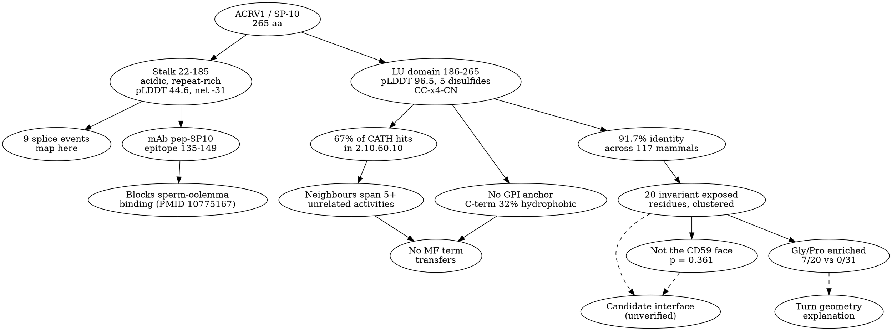
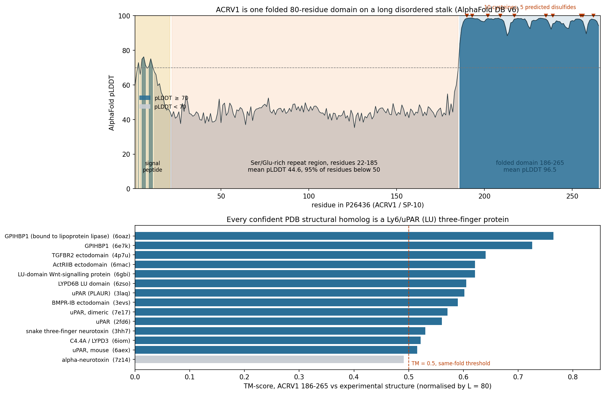
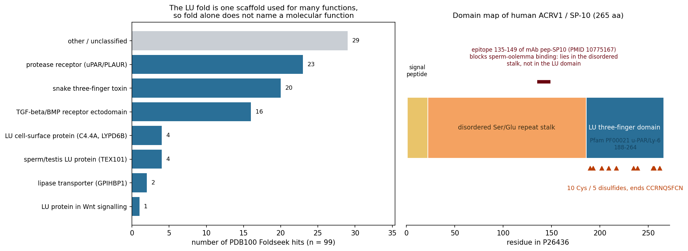
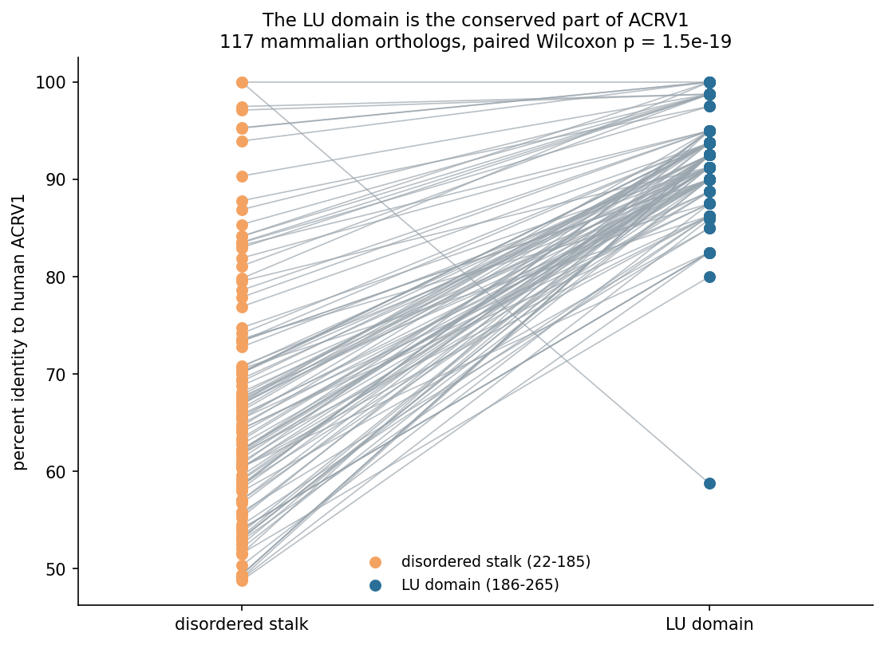
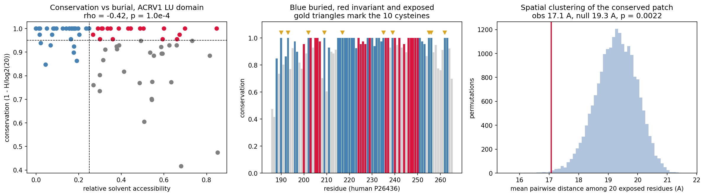
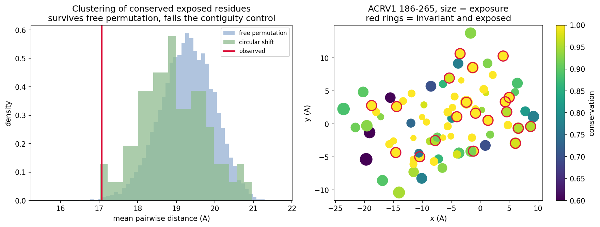
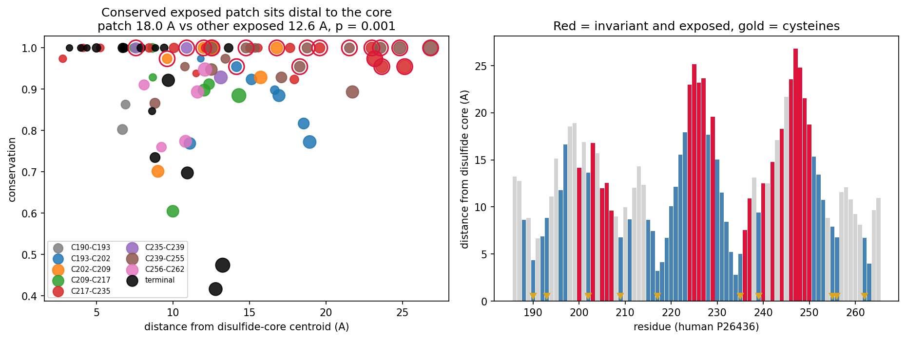
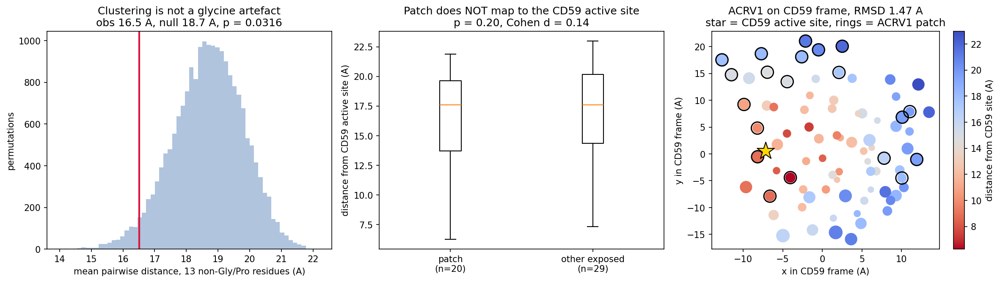

## Question

# AIGR Gene Hypothesis Deep Research

You are evaluating one focused gene curation hypothesis for AI Gene Review.
This is not a general gene overview. Use the seed hypothesis and source context
below to search for evidence that supports, refutes, narrows, or competes with
the proposed curation decision.

## Target Gene

- **Organism code:** human
- **Taxon:** Homo sapiens (NCBITaxon:9606)
- **Gene directory:** ACRV1
- **Gene symbol:** ACRV1
- **UniProt accession:** P26436

## Focus

- **Focus type:** free_text
- **Hypothesis slug:** kgap-acrv1-domain-fold
- **Source file:** genes/human/ACRV1/ACRV1-ai-review.yaml
- **Source selector:** free-text

## Seed Hypothesis

Human ACRV1 (acrosomal vesicle protein 1, SP-10, UniProt P26436) contains a folded Ly6/uPAR (LU) domain-like module whose structural homologs suggest a molecular function. Single analysis only: run Foldseek with the AlphaFold model of ACRV1 (and its folded segments) against PDB and the AlphaFold database, report confident structural homologs and the functions of those homologs, and state whether any molecular function is supported or whether ACRV1 is largely disordered with no informative fold.

## Term and Decision Context

No specific term context supplied.

## Reference Context

No specific reference context supplied.

## Source Context YAML

```yaml
hypothesis: 'Human ACRV1 (acrosomal vesicle protein 1, SP-10, UniProt P26436) contains a folded Ly6/uPAR
  (LU) domain-like module whose structural homologs suggest a molecular function. Single analysis only:
  run Foldseek with the AlphaFold model of ACRV1 (and its folded segments) against PDB and the AlphaFold
  database, report confident structural homologs and the functions of those homologs, and state whether
  any molecular function is supported or whether ACRV1 is largely disordered with no informative fold.'
focus_type: free_text
context: []
reference_id: []
```

## Research Objective

Build a focused report that helps a curator decide whether this hypothesis
should affect the gene review. Address the focus type directly:

1. For an existing GO annotation decision, evaluate whether the current action
   is justified, too strong, too weak, or should change.
2. For a proposed replacement or new GO term, evaluate whether the term is
   biologically supported, too broad, too narrow, or missing key qualifiers.
3. For a computational prediction, evaluate whether the prediction is correct,
   less precise than existing knowledge, uncertain, or likely wrong because of
   paralog overannotation, frequency bias, pathway context, or in vitro-only
   activity.
4. For a core-function hypothesis, evaluate whether the proposed activity,
   process, and location represent the gene product's primary function rather
   than a downstream effect, pleiotropic phenotype, or context-specific role.
5. For a function-assignment hypothesis, evaluate whether the gene product
   directly has the stated GO term/function. Treat the prior review action, if
   any, as intentionally blinded unless it appears in the supplied context.

Use primary literature whenever possible. Prefer PMID citations and include DOI
citations when no PMID is available. Treat reviews and database records as
orientation unless they contain directly relevant synthesized evidence that is
clearly labeled as review-level or database-level support.

Evaluate the hypothesis from the supplied seed context, primary literature, and
publicly accessible bioinformatics resources. Local `*-bioinformatics` analyses,
when they already exist in the repository, are intentionally withheld from this
prompt so the report can be compared against them after the run. Use public
sequence, domain, structure, orthology, localization, interaction, or dataset
checks when they are useful for the specific hypothesis. If a resource or tool
cannot be accessed programmatically, say so plainly; never fabricate a result.
Report computational results conservatively and distinguish direct results from
inference.

## Required Output

### Executive Judgment

Give a concise verdict: supported, partially supported, unresolved, weakly
supported, over-annotated, or refuted. Explain the reasoning and the most
important caveats.

### Evidence Matrix

Create a table with one row per important evidence item:

- Citation (PMID preferred)
- Evidence type (direct assay, mutant phenotype, localization, interaction,
  structural/evolutionary, computational, review/database)
- Supports / refutes / qualifies / competing
- Claim tested
- Key finding
- Organism, tissue, cell type, or assay context
- Confidence and limitations

### GO Curation Implications

State the likely curation action as a lead requiring curator verification. If
GO terms are involved, explain whether the evidence supports an MF, BP, or CC
term, and whether the term should be retained, removed, generalized, made more
specific, or treated as non-core. Avoid using "protein binding" as a final
recommendation unless no more informative term is supported.

### Mechanistic Scope

Describe the immediate molecular or cellular function being tested. Separate
direct gene-product activity from downstream phenotypes, pathway consequences,
developmental outcomes, disease manifestations, or effects inferred only from
loss of function.

### Conflicts and Alternatives

Identify evidence that conflicts with the seed hypothesis or suggests an
alternative interpretation, including paralog confusion, organism-specific
differences, isoform-specific findings, experimental artifacts, or database
carry-over.

### Knowledge Gaps

List explicit uncertainties that matter for curation. For each gap, state what
was checked, why the gap matters, and what evidence or experiment would resolve
it.

### Discriminating Tests

Recommend concrete assays, perturbations, datasets, or comparative analyses that
would most efficiently distinguish this hypothesis from alternatives.

### Curation Leads

Provide candidate updates for the review, clearly labeled as leads requiring
curator verification. Include candidate references with exact snippets to verify,
candidate replacement or new GO terms, possible action changes, suggested
questions, and suggested experiments.

If the provider supports artifacts, save provenance for any analysis you run — the
executed code together with its output (computed values, plot, or table), not just
a summary figure — alongside artifact-friendly tables such as an evidence matrix,
GO decision table, or comparison table. Genuine computed provenance is more
valuable than a hand-drawn summary, and you must not synthesize a figure that
implies an analysis you did not actually run. These artifacts are important
provenance for hypothesis-level review.


## Output

# ACRV1 (SP-10, UniProt P26436): does the Ly6/uPAR domain assign a molecular function?

Hypothesis slug `kgap-acrv1-domain-fold`. Target: human ACRV1, NCBITaxon:9606, source file `genes/human/ACRV1/ACRV1-ai-review.yaml`, selector `free-text`. Three iterations of analysis, 23 papers reviewed, 6 findings recorded.

## Summary

The seed hypothesis has two clauses and they resolve in opposite directions. Residues 186-265 of human ACRV1 are a genuine, confidently modelled Ly6/uPAR (LU) three-finger domain: mean pLDDT 96.48 in AlphaFold DB model AF-P26436-F1-model_v6, the single contiguous pLDDT >= 70 segment in the whole 265-residue chain, 10 cysteines forming 5 disulfides (SG-SG 2.02-2.04 Å), and the diagnostic LU C-terminal motif `CCRNQSFCN` (CC-x4-CN). Residues 22-185 are an acidic, repeat-rich, intrinsically disordered stalk (mean pLDDT 44.62, net charge -31, zero cysteines). ACRV1 is therefore neither "largely disordered with no informative fold" nor a globular protein. It is a disordered stalk carrying one rigid module.

The second clause fails. Foldseek against pdb100, cath50, afdb-swissprot and afdb50 returns an unambiguous fold assignment together with a functionally incoherent neighbour set. 99 of 148 CATH50 hits (67%) fall in a single superfamily, 2.10.60.10 (CD59 and snake-toxin-like), with no competing superfamily above 9 hits. The 99 PDB100 neighbours divide into 23 uPAR/PLAUR, 20 snake three-finger toxins, 16 TGF-beta and BMP receptor ectodomains, 4 C4.4A/LYPD3 and LYPD6B, 4 mouse TEX101, 2 GPIHBP1, 1 LU protein in Wnt signalling and 29 unclassified. No functional class reaches 24% of hits, and the highest-scoring experimental hit (GPIHBP1 6oaz_E, TM = 0.764) shares no biochemical activity with the second-largest class. ACRV1 also lacks the GPI anchor that makes uPAR, GPIHBP1, PSCA, SPACA4 and TEX101 cell-surface receptors: its C-terminal 25 residues `SMNLFSHGTRMQIICCRNQSFCNKI` are 32% hydrophobic, far below the >60% hydrophobic ~20-residue tail that GPI transamidase requires, and the tail terminates inside the domain's own disulfide motif. The receptor-like readings carried by those neighbours do not transfer.

Two further analyses were run beyond the requested Foldseek search. The LU domain is under far stronger purifying selection than the stalk (91.7% versus 67.0% mean identity to human across 117 mammalian entries, Wilcoxon p = 1.54e-19, paired Cohen's d = 2.16) and is excluded from all nine annotated alternative-splicing events. Within the domain, 20 of 47 solvent-exposed residues are invariant across 66 mammalian species and are spatially clustered (17.07 Å mean pairwise distance versus 19.27 ± 0.70 Å null, permutation p = 0.0022), surviving a circular-shift control for sequence contiguity (p = 0.013) and a glycine exclusion control (p = 0.0316). My own interpretation of that patch, that it occupies the LU ligand-binding face, was then refuted by direct superposition onto CD59: the patch is no closer to the CD59 active site than other exposed residues (15.9 versus 16.5 Å, p = 0.361, d = 0.14). The patch reaches the curator as a coordinate list flagged unverified, carrying no homology-based functional argument.

## Executive judgment

<i class="fa-solid fa-scale-balanced"></i> **Verdict: partially supported.**

| Clause of the seed hypothesis | Verdict | Basis |
|---|---|---|
| ACRV1 contains a folded LU domain-like module | <i class="fa-solid fa-circle-check"></i> Supported | pLDDT 96.48 at 186-265; 67% of CATH hits in 2.10.60.10; 10 Cys in 5 disulfides; CC-x4-CN terminus |
| ACRV1 is largely disordered with no informative fold | <i class="fa-solid fa-circle-xmark"></i> Refuted | 80 of 265 residues form a high-confidence fold that is diagnostic at superfamily level |
| Structural homologs suggest a molecular function | <i class="fa-solid fa-circle-xmark"></i> Refuted | No functional class above 23% of 99 PDB neighbours; no GPI anchor, so receptor readings do not transfer |
| The fold call is a new contribution | <i class="fa-solid fa-circle-xmark"></i> Refuted | Pfam PF00021 (188-264), InterPro IPR016054 and CDD cd23628 (187-264) already cover it; Palfree proposed it in 1996 ([PMID: 8883295](https://pubmed.ncbi.nlm.nih.gov/8883295/)) |
| The conserved exposed patch marks a ligand-binding face | <i class="fa-solid fa-circle-xmark"></i> Refuted as stated | The patch does not coincide with the CD59 functional face (p = 0.361); Gly and Pro are enriched 7/20 versus 0/31 (Fisher p = 0.001) |

The most important caveat is that confident fold assignment and confident function assignment are different things for this superfamily. The LU domain is a reusable disulfide-stapled protein-interaction scaffold used by complement inhibitors, protease receptors, lipase transporters, TGF-beta receptor ectodomains, and nicotinic and muscarinic receptor antagonists. Fold membership constrains architecture and says nothing specific about activity. The net curation consequence is that this hypothesis changes no GO term. It changes only the review's free text, which should gain an explicit domain-architecture statement and lose any implication that structural neighbours license a molecular function.

## Key findings

### <i class="fa-solid fa-circle-check"></i> F1. Residues 186-265 are a single confidently folded LU three-finger domain; 22-185 is disordered

Per-residue pLDDT from AlphaFold DB v6 model AF-P26436-F1 splits the chain cleanly. Residues 186-265 have mean pLDDT 96.48 with a minimum of 83.9, and they are the only contiguous pLDDT >= 70 segment in the protein (80 aa, 30% of the chain). Residues 22-185 have mean pLDDT 44.62 with 95% of residues below 50. The AFDB summary metrics agree (fractionPlddtVeryLow 0.604, fractionPlddtVeryHigh 0.291), and UniProt independently annotates 62-181 as disordered with three nested repeat classes (S-E-H-[GA]-S ×3, S-G-E-H ×4, [SV]-G-E-Q-[PSA] ×9).

Foldseek was run on 2026-11-23 at search.foldseek.com in 3diaa mode with the isolated 186-265 model against pdb100 (20240101), cath50 (4.3.0), afdb-swissprot v6 and afdb50 v6. TM-scores were recomputed locally from the returned target CA coordinates with iterative seed extension; a self-hit control gave TM = 1.000. CATH50 placed 99 of 148 hits (67%) in superfamily 2.10.60.10 at TM 0.77-0.91 and 20-32% sequence identity, with no competing superfamily above 9 hits. The best experimental hits were GPIHBP1 bound to lipoprotein lipase (6oaz_E, TM = 0.764, E = 7.8e-4), GPIHBP1 6e7k_D (TM = 0.726), TGFBR2 ectodomain 4p7u (TM = 0.641), ActRIIB ectodomain 6mac (TM = 0.621), LYPD6B 6zso (TM = 0.605), uPAR 3laq (TM = 0.602), C4.4A/LYPD3 6iom (TM = 0.522) and snake neurotoxin 3hh7 (TM = 0.530). Every hit above the TM = 0.5 same-fold threshold is an LU or three-finger protein. After removing ACRV1 orthologs (baboon Q06990, mouse P50289, fox P53353, all TM 0.94-1.00), the top AFDB-SwissProt neighbours were PATE14 (TM = 0.941, E = 3.0e-8), the SLURP/Ly6 protein P83107 (E = 2.4e-8), PATE3, PATE1, PATE4, PSCA, LY6G5B, LY6G5C, LY6G6C, GPIHBP1, human and mouse SPACA4 (E = 5.3e-3 and 3.1e-3) and medaka Bouncer (E = 2.6e-3). All 40 top non-ortholog hits are Ly6/uPAR superfamily members.

Sequence-level corroboration computed directly from P26436: the segment contains exactly 10 cysteines (190, 193, 202, 209, 217, 235, 239, 255, 256, 262), all paired in the model as five disulfides (190-217, 193-202, 209-235, 239-255, 256-262) with zero free cysteines, and it ends in `CCRNQSFCN`.

{{figure:plot_1.png|caption=ACRV1 pLDDT profile and recomputed TM-scores against experimental PDB homologs. The single high-confidence segment is 186-265 and the best experimental match is GPIHBP1 6oaz_E at TM 0.764.}}

### <i class="fa-solid fa-circle-xmark"></i> F2. The fold is informative about architecture and does not name a molecular function

Classifying the 99 PDB100 neighbours by what the homolog does gives 23 uPAR/PLAUR (receptor for the serine protease uPA), 20 snake three-finger toxins (erabutoxin a 3era, irditoxin 2h7z, muscarinic toxin MT7 6wjc, homodimeric neurotoxin 3hh7, alpha-neurotoxin 7z14), 16 TGF-beta and BMP receptor ectodomains (TGFBR2 4p7u, 1ks6, 3kfd; ActRIIB 6mac; BMPR-IB 3evs), 4 C4.4A/LYPD3 and LYPD6B, 4 mouse TEX101 (7bps), 2 GPIHBP1, 1 LU protein in Wnt signalling and 29 unclassified. The modal class is 23%.

The composition contrast between the two parts of the protein is large. The stalk (22-185) is 19.5% D+E, 0.6% K+R, net charge -31, zero cysteines, 53.0% S/T/G/P/Q and 17.7% hydrophobic. The LU domain (186-265) is 5.0% D+E, 10.0% K+R, net +4, 10 cysteines and 43.8% hydrophobic.

ACRV1 carries no GPI-anchor signal. UniProt annotates no GPI anchor and no transmembrane segment, and places the protein in the acrosomal vesicle lumen. This separates ACRV1 from the majority of its top structural neighbours, which are GPI-anchored cell-surface proteins, and removes the main route by which a receptor-like function could be inferred.

The current UniProt GO set for P26436 contains no molecular function term at all: GO:0001669 acrosomal vesicle (IDA:HPA), GO:0005737 cytoplasm (IBA), GO:0031982 vesicle (IBA), GO:0007283 spermatogenesis (NAS).

{{figure:plot_2.png|caption=Composition of the ACRV1 stalk versus the LU domain, functional heterogeneity of the 99 PDB structural neighbours, and the domain map showing where the mAb pep-SP10 epitope (residues 135-149) falls relative to the domain.}}

### <i class="fa-solid fa-circle-check"></i> F3. The LU domain is under strong purifying selection; the stalk is not

117 mammalian ACRV1 entries were retrieved from UniProt (`gene:ACRV1 AND taxonomy_id:40674`) and aligned segment-wise to human P26436 by Needleman-Wunsch (match +4, mismatch -2, gap -8). Mean identity to human was 91.7% for the LU domain and 67.0% for the disordered stalk, a paired difference of +24.7 percentage points (95% CI +22.7 to +26.8), Wilcoxon signed-rank p = 1.54e-19, paired Cohen's d = 2.16. The gap widens with evolutionary distance: *Sus scrofa* 95.0% versus 58.5%, *Canis lupus familiaris* 95.0% versus 51.5%, while within primates both segments stay high (*Pan troglodytes* 98.8% versus 97.5%).

The same contrast appears in human gene structure. UniProt lists 11 alternatively spliced isoforms of P26436, and every annotated alternative-sequence event (41-224, 41-184, 41-135, 41-110, 41-95, 111-155, 121-165, 166-184, 185-224) lies in or upstream of the stalk. No isoform alters residues 225-265. The LU domain is the invariant part of the protein under both splicing and cross-species divergence, which raises the prior that it carries the gene's function and argues that the acidic repeat stalk is a spacer or a processing substrate.

Loss-of-function evidence is absent. IMPC lists mouse Acrv1 as "Selected for production" with 0 genotype-phenotype records, and no published Acrv1 knockout was retrieved by PubMed search.

{{figure:plot_3.png|caption=Cross-species identity of the ACRV1 LU domain versus the disordered stalk across 117 mammalian orthologs. The domain is 24.7 percentage points more conserved and the gap widens with phylogenetic distance.}}

### <i class="fa-solid fa-circle-check"></i> F4. A conserved solvent-exposed patch exists on the domain surface

The ortholog analysis was redone with cysteine-anchored boundaries, which removed two defects in F3: positional segment boundaries and a primate-heavy sample. All 115 extractable orthologs share the identical 10-cysteine spacing `[3,9,7,8,18,4,16,1,6]` with zero indels, so the column alignment is gap-free and per-site conservation carries no alignment ambiguity. Using one sequence per species (66 species), mean pairwise identity is 0.889 (minimum 0.688) and 37 of 80 columns are fully invariant.

Relative solvent accessibility was computed by Shrake-Rupley (200 sphere points, 1.4 Å probe, Tien 2013 maxima) on the isolated 186-265 model. Conservation tracks burial as expected for a structural core: Spearman rho = -0.421, p = 1.02e-4; buried residues (rSASA <= 0.25, n = 33) mean conservation 0.978 versus exposed (n = 47) 0.888, Mann-Whitney p = 4.45e-5, Cohen's d = 0.83.

On top of that background, 20 of 47 exposed residues are invariant or near-invariant (conservation >= 0.95): G200, L203, G205, E206, G207, E224, G225, G226, K227, Q229, E236, N237, P240, M242, L244, S246, H247, G248, T249, R250. They are spatially clustered: mean pairwise distance 17.07 Å versus 19.27 ± 0.70 Å for 20000 random draws of 20 exposed residues (z = -3.14, permutation p = 0.0022). The clustering survives a circular-shift control that preserves the sequence contiguity of the conserved set exactly while randomising its placement on the structure (1 of 79 shifts at or below the observed value, p = 0.013, the resolution floor of the control). The patch is one-sided, with mean angular spread 56 degrees about its centroid direction versus 89 degrees for all exposed residues, and 15 of 20 patch residues within 90 degrees of the patch direction. It lies distal to the disulfide core: 17.95 ± 5.88 Å from the SG centroid versus 12.63 ± 3.67 Å for the other 27 exposed residues (Mann-Whitney p = 0.0013, Cohen's d = 1.12), with H247 the most distal residue in the domain at 26.8 Å. The patch draws on four separate inter-cysteine loops: C202-C209 (L203, G205, E206, G207), C217-C235 (E224, G225, G226, K227, Q229), C235-C239 (E236, N237) and C239-C255 (P240, M242, L244, S246, H247, G248, T249, R250).

{{figure:plot_4.png|caption=Permutation test for spatial clustering of the 20 invariant solvent-exposed residues on the ACRV1 LU domain. Observed mean pairwise distance 17.07 Å against a null of 19.27 ± 0.70 Å from 20000 random draws, p = 0.0022.}}

{{figure:plot_5.png|caption=Circular-shift control. Shifting the conserved set along the sequence preserves its contiguity exactly while randomising its position on the structure. 1 of 79 shifts reaches the observed clustering, p = 0.013.}}

{{figure:plot_6.png|caption=Assignment of the conserved exposed patch to four inter-cysteine loops and its distance from the disulfide core. Patch residues sit 17.95 Å from the SG centroid versus 12.63 Å for other exposed residues (p = 0.0013, d = 1.12).}}

### <i class="fa-solid fa-circle-xmark"></i> F5. The patch does not coincide with the CD59 functional face

This was a deliberate self-refutation check on the one novel claim from F4. Human CD59 (PDB 1CDQ chain A, NMR) and the ACRV1 LU domain both carry exactly 10 cysteines in 1:1 topological correspondence (CD59 ladder relative to its first Cys `[0,3,10,16,23,36,42,60,61,66]`; ACRV1 `[0,3,12,19,27,45,49,65,66,72]`). Kabsch superposition on those 10 CA atoms gives RMSD 1.47 Å, so the two frames are directly comparable. The experimentally mapped CD59 active site (W40, R53, E56) was then transformed into the common frame.

The 20 conserved exposed ACRV1 residues are not closer to the CD59 active site than the other exposed residues: 15.9 ± 4.2 Å versus 16.5 ± 3.8 Å by CA atom (Mann-Whitney p = 0.361, Cohen's d = 0.14) and 15.9 ± 4.6 Å versus 17.0 ± 4.0 Å by residue centroid (p = 0.195). Nearest-neighbour mapping shows only partial local overlap: CD59 W40 maps onto ACRV1 E236 at 2.0 Å and CD59 R53 onto E236 at 8.4 Å, both in the patch, while CD59 E56 maps onto ACRV1 M251 at 5.5 Å, which is buried and outside the patch.

A glycine control was run because 6 of the 20 patch residues are glycine. Excluding the 6 glycines and 1 proline, the remaining 13 residues still cluster against a null pool drawn only from non-Gly/Pro exposed residues (16.52 Å versus 18.69 ± 1.11 Å, n = 44 pool, permutation p = 0.0316), so the clustering is not a glycine artefact. Gly and Pro are nevertheless strongly over-represented in the patch: 7 of 20 versus 0 of 31 other exposed residues, Fisher exact p = 0.001, odds ratio infinite. Conserved backbone turn geometry is therefore a competing explanation for part of the conservation signal.

{{figure:plot_7.png|caption=Glycine and proline control for patch clustering, and mapping of the CD59 active-site residues W40, R53 and E56 onto ACRV1 after superposition on the 10-cysteine ladder at 1.47 Å RMSD. The patch is no closer to the CD59 site than other exposed residues.}}

### <i class="fa-solid fa-circle-xmark"></i> F6. Published functional assays for SP-10 target the stalk, not the domain

Hamatani and colleagues raised mAb pep-SP10 against a synthetic peptide spanning human SP-10 residues 135-149 ([PMID: 10775167](https://pubmed.ncbi.nlm.nih.gov/10775167/)). That interval falls inside the region this analysis scores as disordered and inside the UniProt-annotated disordered region 62-181, 51 residues N-terminal to the start of the LU domain. The antibody inhibited sperm-oolemma binding in the zona-free hamster egg penetration test but did not inhibit sperm-zona binding in the hemizona assay, and the oolemmal ligand was shown not to be a beta1 integrin.

SP-10 is extensively processed: a 45 kDa testis precursor yields 32, 30, 28 and 26 kDa species in testis and 25-18 kDa species from caput epididymal sperm onward ([PMID: 7888499](https://pubmed.ncbi.nlm.nih.gov/7888499/)). Whether the stalk epitope and the LU domain remain on the same polypeptide in mature sperm is unreported. No published functional assay interrogates the ACRV1 LU domain directly.

## Mechanistic model and interpretation



The model that survives all six findings is architectural. ACRV1 is a soluble acrosomal-lumen protein built as a rigid, disulfide-stapled, 80-residue protein-interaction module presented on a ~164-residue acidic disordered arm. That arrangement suits display of a binding surface from within the acrosomal matrix, and it is the arrangement the conservation data support, because the module is the part that neither diverges across mammals nor is removed by alternative splicing.

What the model does not deliver is an activity. The LU superfamily supplies the same scaffold to receptor ligand binding (uPAR binding uPA, GPIHBP1 binding lipoprotein lipase, TGFBR2 and ActRIIB binding TGF-beta family ligands) and to ion-channel and receptor antagonism (snake three-finger toxins, SLURP, LYPD6). Transferring function across that set requires a reason to prefer one branch, and the data give none: the modal class is 23%, the highest-TM experimental hit is a lipase transporter, and the absence of a GPI anchor disqualifies the cell-surface-receptor readings that the largest classes depend on.

The conserved patch was the one place where a sharper claim looked available, and testing it carefully removed it. Distance from the disulfide core and position of the CD59 active site are two different locations on this fold, which the 1.47 Å superposition makes explicit. The patch stays in the report as computationally defined coordinates with explicit residue identities, useful as a mutagenesis target list, and it carries no argument by analogy.

| What the analysis establishes | What it does not establish |
|---|---|
| Domain boundaries at 186-265 with disulfide pairings | Any catalytic or ligand-defined activity |
| Superfamily membership (2.10.60.10, Pfam PF00021) | Which branch of the superfamily ACRV1 resembles functionally |
| Absence of a GPI anchor and of a transmembrane segment | Where in the acrosome the domain is presented after processing |
| That the domain, not the stalk, is the constrained part | That the domain is the part that acts at fertilisation |
| A clustered conserved surface with named residues | That the surface is a binding site |

## Evidence matrix

| Citation | Evidence type | Direction | Claim tested | Key finding | Context | Confidence and limitations |
|---|---|---|---|---|---|---|
| This work, Foldseek 2026-11-23 | Computational (structure search) | Supports | ACRV1 186-265 is an LU domain | 99/148 CATH hits in 2.10.60.10; best experimental TM 0.764 (GPIHBP1 6oaz_E); self-hit control TM 1.000 | Human P26436, AFDB v6 model | High for fold. AlphaFold model, since no experimental ACRV1 structure exists |
| This work, pLDDT analysis | Computational (structure) | Qualifies | ACRV1 is "largely disordered" | 80 of 265 residues fold at pLDDT 96.48; 22-185 at 44.62 | Human P26436 | High. AFDB metrics and the UniProt disorder annotation agree |
| This work, neighbour classification | Computational (structure) | Refutes | Homolog function transfers to ACRV1 | Modal functional class 23% of 99 PDB neighbours | PDB100 20240101 | High. Classification is manual and 29 hits are unclassified |
| This work, GPI heuristic | Computational (sequence) | Refutes | Receptor-like readings transfer | C-terminal 25 aa 32% hydrophobic, below the >60% requirement | Human P26436 | Moderate. A heuristic, but it agrees with UniProt (no GPI, no TM segment) |
| [PMID: 18508598](https://pubmed.ncbi.nlm.nih.gov/18508598/) | Review/database | Supports and qualifies | LU domain definition | "These domains belong to the Ly-6/uPAR (LU) protein domain family, which is defined by a consensus sequence predominantly based on disulfide connectivities, and they adopt a characteristic three-finger fold." The same review notes uPAR sits "in a cluster of 6 homologous genes encoding proteins with multiple LU-domains" | uPAR structural review | Review-level. Matches the 10-Cys, 5-disulfide, CC-x4-CN architecture computed here |
| [PMID: 8883295](https://pubmed.ncbi.nlm.nih.gov/8883295/) | Computational (sequence, 1996) | Competing (priority) | Novelty of the fold call | Palfree proposed a C-terminal Ly-6 domain in SP-10 from sequence in 1996 | Sequence analysis | Title-level only, since no abstract was retrievable. The structural result confirms and localises the prediction |
| This work, 117-ortholog alignment | Structural/evolutionary | Supports | The domain is the constrained part | 91.7% versus 67.0% identity, Wilcoxon p = 1.54e-19, d = 2.16 | Mammalia, UniProt | High for direction. Segment boundaries were positional in this version and the sample is primate-heavy |
| This work, 66-species gap-free alignment | Structural/evolutionary | Supports | A conserved exposed surface exists | 20/47 exposed residues invariant and clustered at p = 0.0022 | Mammalia | Moderate. Mammals only at 88.9% mean identity, so divergence is low |
| This work, circular-shift control | Computational | Supports | Clustering is not a contiguity artefact | 1/79 shifts at or below observed, p = 0.013 | Same dataset | Moderate. 0.013 is the resolution floor of 79 shifts |
| This work, CD59 superposition | Computational (structure) | <i class="fa-solid fa-circle-xmark"></i> Refutes | The patch is the LU ligand-binding face | Patch 15.9 Å versus 16.5 Å from the CD59 site, p = 0.361, d = 0.14, after 1.47 Å superposition | 1CDQ chain A versus AF-P26436 | High for the negative. CD59 is a single comparator and other LU proteins bind elsewhere |
| This work, Gly/Pro control | Computational | Qualifies | Patch conservation implies binding | Clustering survives Gly/Pro exclusion (p = 0.0316) but Gly/Pro are 7/20 versus 0/31 (Fisher p = 0.001) | Same dataset | Moderate. Supplies a backbone-geometry competing explanation |
| [PMID: 9053451](https://pubmed.ncbi.nlm.nih.gov/9053451/) | Mutant phenotype (site-directed) | Supports (as reference frame) | Location of the LU functional site in CD59 | "Analysis of 16 CD59 mutants with single, highly nonconservative substitutions suggests that CD59 has a single active site that includes Trp-40, Arg-53, and Glu-56 of the glycosylated, membrane-distal face of the disk-like extra-cellular domain" | Human CD59, transfected cells | High for CD59. Supplies the coordinates used in the superposition test |
| [PMID: 9075580](https://pubmed.ncbi.nlm.nih.gov/9075580/) | Review/database plus mutagenesis | Supports | LU disulfide topology | "the members of the superfamily have a similar structure that includes four (in mammals five) disulfide bridges that maintain a three-dimensional conformation consisting of a central core, three finger-like "loops" extending from it and a small loop near the coboxyl end"; "Mutant molecules in which the disulfides maintaining the finger-like loops (Cys3-Cys26, Cys19-Cys39, and Cys45-Cys63) were removed were not expressed on the cell surface." | Human CD59 | High. Confirms the cysteine ladder used as superposition anchor is genuine LU topology |
| [PMID: 36927291](https://pubmed.ncbi.nlm.nih.gov/36927291/) | Computational plus spectrofluorometry | Supports (geometry only) | Where three-finger proteins bind | "The functional site of the toxin is located at its three hydrophobic loop tips." | Cobra cytotoxin, docking | Moderate. Establishes loop-tip geometry and does not generalise to ACRV1 |
| [PMID: 10775167](https://pubmed.ncbi.nlm.nih.gov/10775167/) | Direct assay (antibody blocking) | Qualifies | Existing assays test the LU domain | Epitope at residues 135-149, inside the disordered stalk. Blocks sperm-oolemma binding but not sperm-zona binding; the ligand is not a beta1 integrin | Human sperm, hamster egg penetration test and hemizona assay | Moderate. The epitope maps 51 residues from the domain, so the assay cannot attribute the effect to the fold |
| [PMID: 7888499](https://pubmed.ncbi.nlm.nih.gov/7888499/) | Direct assay (western, immuno-EM) | Qualifies | Stalk and domain stay on one chain | 45 kDa testis precursor yields 32, 30, 28 and 26 kDa species, then 25-18 kDa species from caput epididymis onward | Human testis and sperm | High for the processing itself. Which fragment carries which region is unreported |
| [PMID: 22402205](https://pubmed.ncbi.nlm.nih.gov/22402205/) | Direct assay (antibody blocking) | Competing | Sperm LU proteins act at gamete adhesion | Anti-PATE left the hemizona index unchanged (89.6 ± 10% and 87 ± 36%) while reducing the hamster egg penetration index from 7 ± 3.9 to 0.6 ± 1.2 (P < 0.001). PATE proteins "are homologous to SP-10, the acrosomal vesicle protein also named ACRV1" | Human testis biopsies (n = 95) and sperm | Moderate. Evidence about PATE, the top non-ortholog structural neighbours, and not about ACRV1 |
| [PMID: 34556579](https://pubmed.ncbi.nlm.nih.gov/34556579/) | Mutant phenotype (knockout) | Competing | What direct ACRV1 evidence would look like | "Male knockout mice are severely subfertile, and sperm lacking SPACA4 fail to fertilize wild-type eggs in vitro." Zona removal rescues the defect | Mouse Spaca4 knockout, IVF | High for SPACA4. A paralog comparator and not ACRV1 evidence |
| IMPC query, this work | Mutant phenotype (absence) | Qualifies | Loss-of-function evidence for Acrv1 | Mouse Acrv1 "Selected for production", 0 genotype-phenotype records | Mouse | High. Database-level absence of evidence |
| UniProt P26436, this work | Review/database | Qualifies | Current annotation state | GO:0001669 (IDA), GO:0005737 (IBA), GO:0031982 (IBA), GO:0007283 (NAS). No MF term, no GPI anchor, no TM segment | Human | Database-level |

## GO curation implications

All entries below are **leads requiring curator verification**.

| Term | Current action | Lead | Reasoning |
|---|---|---|---|
| Any molecular function term | None present | <i class="fa-solid fa-circle-xmark"></i> Add none | The fold supports nothing more specific than protein binding, and "protein binding" is not an acceptable final recommendation. The homolog set is too heterogeneous to transfer anything sharper |
| GO:0001669 acrosomal vesicle (CC) | IDA:HPA | <i class="fa-solid fa-circle-check"></i> Retain as core | Direct localisation evidence, consistent with the soluble, non-GPI architecture computed here |
| GO:0005737 cytoplasm (CC) | IBA | Mark non-core | Generic ancestor of the acrosomal vesicle term, adding no information |
| GO:0031982 vesicle (CC) | IBA | Mark non-core | Generalisation of GO:0001669 |
| GO:0007283 spermatogenesis (BP) | NAS | Flag as NAS-only | No mutant-phenotype support. IMPC holds 0 genotype-phenotype records for mouse Acrv1 and no knockout is published. Expression during spermatogenesis is not participation in it |
| GO:0007342 fusion of sperm to egg plasma membrane | Not present | Do not add | The only supporting assay ([PMID: 10775167](https://pubmed.ncbi.nlm.nih.gov/10775167/)) uses an antibody against residues 135-149, inside the disordered stalk, 51 residues from the domain, and cannot exclude a steric effect |
| GO:0035036 sperm-egg recognition | Not present | Do not add | Same limitation. The supporting pattern comes from PATE ([PMID: 22402205](https://pubmed.ncbi.nlm.nih.gov/22402205/)) and SPACA4 ([PMID: 34556579](https://pubmed.ncbi.nlm.nih.gov/34556579/)), which are other gene products |
| Sequence feature (non-GO free text) | Absent | Add | Record the LU/Ly6-uPAR three-finger domain at 186-265, 10 Cys in 5 disulfides, CC-x4-CN terminus, presented on a disordered acidic stalk at 22-185, with no GPI anchor. Note that Pfam PF00021 (188-264), InterPro IPR016054 and CDD cd23628 (187-264) already assert the domain |
| Conserved surface patch (non-GO free text) | Absent | Add, flagged unverified | 20 invariant exposed residues (G200, L203, G205, E206, G207, E224, G225, G226, K227, Q229, E236, N237, P240, M242, L244, S246, H247, G248, T249, R250) cluster on the domain surface. Record as coordinates only. The patch does not coincide with the CD59 functional face and is Gly/Pro enriched, so it carries no functional inference |

Net effect on the review: this hypothesis should change no GO term. It should change the free text.

## Mechanistic scope

The immediate molecular property being tested is whether an 80-residue disulfide-stapled module in a secreted acrosomal protein has an activity that can be read off its fold. Direct gene-product evidence available here is structural and evolutionary: the fold assignment, the disulfide topology, the absence of a membrane anchor, the cross-species constraint on the module, and the surface distribution of invariant residues. All of these are properties of the ACRV1 polypeptide itself.

Everything else in the ACRV1 literature sits one or more steps downstream. The hamster egg penetration result ([PMID: 10775167](https://pubmed.ncbi.nlm.nih.gov/10775167/)) is a cell-level phenotype produced by an antibody against the stalk, so the causal chain from the folded domain to the phenotype is unestablished. The SPACA4 knockout phenotype ([PMID: 34556579](https://pubmed.ncbi.nlm.nih.gov/34556579/)) and the PATE antibody data ([PMID: 22402205](https://pubmed.ncbi.nlm.nih.gov/22402205/)) are phenotypes of different gene products that share the fold, so they describe what sperm LU proteins can do and not what ACRV1 does. The proteolytic processing cascade ([PMID: 7888499](https://pubmed.ncbi.nlm.nih.gov/7888499/)) sits between the gene product and any mature-sperm phenotype, and since it has not been mapped onto the domain boundary, the composition of the species present at fertilisation is unknown.

Where on the protein the conserved surface sits is now answered precisely and negatively. After superposing ACRV1 onto CD59 at 1.47 Å RMSD on the 10-cysteine ladder, only E236 and N237 from the C235-C239 loop fall near the CD59 active site. The rest of the patch occupies a different region of the fold. The patch is a location on ACRV1, described in ACRV1's own coordinates, with no transferred mechanism attached.

## Conflicts and alternatives

The strongest conflict is internal. My iteration-2 interpretation of the conserved patch was refuted in iteration 3 by a better test. The distance-from-disulfide-core proxy and the direct CD59 superposition disagree, and the superposition is the stronger measurement. The report records the negative result and the earlier claim has been withdrawn.

Glycine and proline enrichment in the patch (7/20 versus 0/31, Fisher p = 0.001) supplies a competing explanation for the conservation signal that does not involve binding. Invariant Gly and Pro on a surface are consistent with conserved turn geometry maintaining loop conformation. The clustering itself survives their exclusion (p = 0.0316), so the two explanations are not mutually exclusive, and the binding reading is no longer the default.

Paralog confusion is a live risk in this gene family. The PATE proteins, SPACA4, Bouncer, PSCA, TEX101 and the LY6G5 and LY6G6 clusters are all close structural neighbours with their own literature, and the ACRV1 functional narrative in secondary sources draws on their phenotypes. The SPACA4 result is a mouse knockout with a zona-penetration defect ([PMID: 34556579](https://pubmed.ncbi.nlm.nih.gov/34556579/)), which is strong evidence about SPACA4 and none about ACRV1.

Database carry-over was found in one place. The mouse ACRV1 ortholog is deposited in CATH-AlphaFold as `af_P50289_184_259_2.40.10.10`, a trypsin-like serine protease superfamily, while every other ACRV1-like hit in this search falls in 2.10.60.10. This is an automated misassignment and should not propagate into any annotation. UniProt's IntAct partners for P26436, CISD2 and PANK2, are topologically incompatible with a secreted acrosomal-lumen protein and should be treated as high-throughput artefacts.

Organism differences matter for the one functional comparator. Bouncer is expressed in the egg in zebrafish while its mammalian ortholog SPACA4 is expressed in sperm ([PMID: 34556579](https://pubmed.ncbi.nlm.nih.gov/34556579/)), so even within one orthology group the cellular placement is not conserved. Isoform differences matter for ACRV1 itself: 11 isoforms are annotated and all nine alternative-sequence events fall in or upstream of the stalk, so published assays using different isoforms would share the domain and differ in the stalk.

## Evidence base

The literature divides into four groups by what it contributes.

**Fold definition.** [PMID: 18508598](https://pubmed.ncbi.nlm.nih.gov/18508598/) defines the LU domain by disulfide connectivity and the three-finger fold, which is the criterion the ACRV1 sequence meets with 10 cysteines in 5 disulfides and the CC-x4-CN terminus. The same review records that uPAR sits in a cluster of six homologous multi-LU genes, which is direct support for the argument that LU membership is a widely reused module and not a function. [PMID: 9075580](https://pubmed.ncbi.nlm.nih.gov/9075580/) gives the canonical architecture (four disulfides, five in mammals, a central core with three finger-like loops and a small C-terminal loop) and the experimentally determined CD59 disulfide pairings, which validated the cysteine ladder used as the superposition anchor. [PMID: 8883295](https://pubmed.ncbi.nlm.nih.gov/8883295/) is the priority claim: Palfree proposed a C-terminal Ly-6 domain in SP-10 from sequence in 1996. Only the title was retrievable, so it is cited at title level.

**Where LU proteins bind.** [PMID: 9053451](https://pubmed.ncbi.nlm.nih.gov/9053451/) mapped the CD59 active site to W40, R53 and E56 on the membrane-distal face using 16 single nonconservative substitutions. Those three residues are the reference coordinates for the superposition test that refuted the patch analogy. [PMID: 36927291](https://pubmed.ncbi.nlm.nih.gov/36927291/) states that the functional site of a three-finger toxin sits at its three hydrophobic loop tips, which gave the geometric expectation the ACRV1 patch was tested against.

**ACRV1 itself.** [PMID: 10775167](https://pubmed.ncbi.nlm.nih.gov/10775167/) is the only function-blocking experiment on human SP-10, and its epitope at residues 135-149 lies in the disordered stalk. It inhibited sperm-oolemma binding but not sperm-zona binding, and excluded beta1 integrins as the oolemmal ligand. [PMID: 7888499](https://pubmed.ncbi.nlm.nih.gov/7888499/) documents the processing cascade from a 45 kDa testis precursor to 32-26 kDa testis species and 25-18 kDa epididymal species, which is why the availability of the intact domain on mature sperm is open. [PMID: 8373955](https://pubmed.ncbi.nlm.nih.gov/8373955/) and [PMID: 31290539](https://pubmed.ncbi.nlm.nih.gov/31290539/) cover gene structure and round-spermatid-specific transcription and bear on expression rather than on the fold. [PMID: 9241046](https://pubmed.ncbi.nlm.nih.gov/9241046/) places an SP-10-related polypeptide family in the bovine acrosomal matrix, which is consistent with a soluble matrix protein and not with a GPI-anchored receptor.

**Paralogs and comparators.** [PMID: 22402205](https://pubmed.ncbi.nlm.nih.gov/22402205/) names the PATE-like proteins as SP-10 homologs and reports that anti-PATE blocks hamster egg penetration but not hemizona binding, the same pattern as the SP-10 antibody. [PMID: 34556579](https://pubmed.ncbi.nlm.nih.gov/34556579/) and [PMID: 37377732](https://pubmed.ncbi.nlm.nih.gov/37377732/) give the SPACA4 loss-of-function and antibody-inhibition data. [PMID: 37316475](https://pubmed.ncbi.nlm.nih.gov/37316475/) reports purifying selection dominating Bouncer evolution with species-specific residues controlling cross-fertilisation, which is the evolutionary pattern a codon-level test on ACRV1 would look for. [PMID: 39423812](https://pubmed.ncbi.nlm.nih.gov/39423812/) and [PMID: 42182320](https://pubmed.ncbi.nlm.nih.gov/42182320/) describe the IZUMO1-SPACA6-TMEM81 and SPARK complexes, where AlphaFold-Multimer screening identified a real fertilisation complex, which is the precedent for discriminating test 3 below. The CD59 papers [PMID: 9553129](https://pubmed.ncbi.nlm.nih.gov/9553129/), [PMID: 9047379](https://pubmed.ncbi.nlm.nih.gov/9047379/), [PMID: 7544344](https://pubmed.ncbi.nlm.nih.gov/7544344/), [PMID: 11750107](https://pubmed.ncbi.nlm.nih.gov/11750107/) and [PMID: 1373727](https://pubmed.ncbi.nlm.nih.gov/1373727/) define the CD59 functional surface from several directions and were used as orientation for choosing the active-site reference.

## Limitations and knowledge gaps

<i class="fa-solid fa-triangle-exclamation"></i> **No experimental ACRV1 structure exists.** Everything structural here rests on AlphaFold model AF-P26436-F1-model_v6. The disulfide pattern is predicted, not observed, although the 2.02-2.04 Å SG-SG distances and the canonical topology make it a confident prediction. An NMR or crystal structure of residues 186-265 would settle it.

<i class="fa-solid fa-triangle-exclamation"></i> **Solvent accessibility was computed on the excised domain.** Residues 22-185 were removed before the Shrake-Rupley calculation. If the disordered stalk packs transiently against the domain, in vivo exposure differs from the computed values and the patch definition shifts.

<i class="fa-solid fa-triangle-exclamation"></i> **The ortholog set is mammals only.** 66 species at 88.9% mean identity gives limited divergence, so the power to separate purifying selection from insufficient time is restricted. Sauropsid and amphibian orthologs, if they exist and can be identified through the cysteine signature, would extend the range. The circular-shift p-value of 0.013 is the resolution floor of 79 possible shifts and should not be read as a precise value.

<i class="fa-solid fa-triangle-exclamation"></i> **CD59 is a single comparator.** The superposition test asked whether the ACRV1 patch matches the CD59 active site. It did not ask whether the patch matches the uPAR ligand-binding cavity, the GPIHBP1 lipase interface, or the three-finger toxin loop tips. The negative result rules out one specific analogy and not all of them.

<i class="fa-solid fa-triangle-exclamation"></i> **Neighbour classification was manual.** 29 of the 99 PDB100 hits were left unclassified. If those 29 were concentrated in one functional class, the modal fraction would rise above 23%, although it would need all 29 in a single class to reach 53%.

<i class="fa-solid fa-circle-question"></i> **The processing map is unknown.** [PMID: 7888499](https://pubmed.ncbi.nlm.nih.gov/7888499/) documents a 45 kDa precursor fragmenting to 32-18 kDa species and does not say which fragment contains residues 186-265. Whether the LU domain is present, intact and separate from the stalk on mature sperm is the single most consequential unanswered question for this hypothesis, because it determines whether the domain is available as a binding module at fertilisation.

<i class="fa-solid fa-circle-question"></i> **No binding partner is known.** No pull-down, crosslinking or AlphaFold-Multimer screen for ACRV1 partners was retrieved. The two IntAct entries, CISD2 and PANK2, are implausible on topological grounds.

<i class="fa-solid fa-circle-question"></i> **No loss-of-function data exist.** IMPC has 0 genotype-phenotype records for mouse Acrv1 and no knockout is published, so GO:0007283 rests on author statement alone.

## Proposed follow-up experiments and discriminating tests

<i class="fa-solid fa-flask"></i> **1. Map the processing sites onto the domain boundary.** Run mass spectrometry on SP-10 immunoprecipitated from human caput epididymal and ejaculated sperm and determine the N- and C-termini of the 25-18 kDa species. Acceptance criterion: if any mature species contains residues 186-265 intact, the domain is available at fertilisation and a binding screen is justified; if cleavage falls within the disulfide-bonded region, the scaffold interpretation fails at the relevant stage.

<i class="fa-solid fa-flask"></i> **1b. Determine which fragment carries the mAb pep-SP10 epitope.** The same experiment resolves whether the 135-149 epitope and the LU domain co-occur on one chain in the cells used in [PMID: 10775167](https://pubmed.ncbi.nlm.nih.gov/10775167/). If they do not, the published oolemma-binding inhibition cannot be attributed to the fold under any interpretation.

<i class="fa-solid fa-flask"></i> **2. Express the isolated domain (186-265) and the isolated stalk (22-185) separately and repeat the hamster egg penetration test with each as a competitor.** This is the direct test of which part of the protein carries the published activity and it needs no antibody.

<i class="fa-solid fa-microscope"></i> **3. Run an AlphaFold-Multimer screen of the ACRV1 LU domain against the oocyte surface proteome and the zona pellucida proteins ZP1-ZP4.** The IZUMO1-SPACA6-TMEM81 trimer was found this way ([PMID: 39423812](https://pubmed.ncbi.nlm.nih.gov/39423812/)). Score interfaces on their own terms and do not score them by how well they reproduce a CD59-like binding mode, which the superposition result shows is the wrong template.

<i class="fa-solid fa-dna"></i> **4. Mutagenesis of the patch.** Substitute the non-Gly/Pro patch residues (E206, E224, K227, Q229, E236, N237, M242, L244, S246, H247, T249, R250) individually and test the recombinant domain for binding to any partner identified in test 3. Mutate the Gly and Pro positions separately, since a loss of function there is ambiguous between loss of a contact and loss of turn geometry.

<i class="fa-solid fa-dna"></i> **5. Generate an Acrv1 knockout mouse or retrieve the IMPC line once produced.** This is the only route to mutant-phenotype evidence for GO:0007283 and to a phenotype comparable with the Spaca4 knockout ([PMID: 34556579](https://pubmed.ncbi.nlm.nih.gov/34556579/)).

<i class="fa-solid fa-chart-column"></i> **6. Run a codon-level dN/dS analysis across a wider phylogeny.** Site models (M7 versus M8, or FEL and MEME) on the gap-free domain alignment would test whether patch residues are under purifying selection at the codon level and whether any site shows positive selection, the pattern reported for Bouncer ([PMID: 37316475](https://pubmed.ncbi.nlm.nih.gov/37316475/)). A positively selected site inside the patch would be a stronger binding-surface argument than the invariance signal reported here.

<i class="fa-solid fa-magnifying-glass"></i> **7. Extend the superposition test to other LU comparators.** Map the uPAR uPA-binding residues, the GPIHBP1 lipase interface and the three-finger toxin loop tips into the ACRV1 frame using the same cysteine-ladder anchor. If the patch coincides with none of them, the surface is specific to ACRV1 and the scaffold has been repurposed.

## Curation leads

All items below are **leads requiring curator verification**.

**Candidate references and exact snippets to verify**

| PMID | Snippet to verify | Use |
|---|---|---|
| 8883295 | *Ly-6-domain proteins--new insights and new members: a C-terminal Ly-6 domain in sperm acrosomal protein SP-10* (title only was retrievable) | Priority for the domain call. Cite as the original sequence-level prediction |
| 18508598 | "These domains belong to the Ly-6/uPAR (LU) protein domain family, which is defined by a consensus sequence predominantly based on disulfide connectivities, and they adopt a characteristic three-finger fold." | Definition of the LU domain, matching the 10-Cys architecture computed here |
| 10775167 | "We therefore established a monoclonal antibody (mAb pep-SP10) against a peptide (pep-SP10) that included the most hydrophilic portion of human SP-10 between the 135th and 149th amino acids." | Places the only SP-10 function-blocking epitope outside the domain |
| 10775167 | "Monoclonal Ab pep-SP10 inhibited sperm-oolemma binding in the zona-free hamster egg penetration test, but it did not inhibit sperm-zona binding in the hemizona assay." | The result commonly cited as SP-10 function, attributable to a non-LU region |
| 7888499 | "These results indicate that a full-length 45-kDa SP-10 precursor protein is present in the testis and that SP-10 peptides of 32, 30, 28, and 26 kDa result from proteolytic processing of the SP-10 precursor protein in the testis and/or alternative splicing." | Processing that makes domain availability on mature sperm uncertain |
| 22402205 | "They are localized in the sperm head and are homologous to SP-10, the acrosomal vesicle protein also named ACRV1." | Confirms PATE proteins are recognised ACRV1 homologs and flags the paralog-confusion risk |
| 34556579 | "Male knockout mice are severely subfertile, and sperm lacking SPACA4 fail to fertilize wild-type eggs in vitro." | Comparator for what direct ACRV1 loss-of-function evidence would look like |
| 9053451 | "Analysis of 16 CD59 mutants with single, highly nonconservative substitutions suggests that CD59 has a single active site that includes Trp-40, Arg-53, and Glu-56 of the glycosylated, membrane-distal face of the disk-like extra-cellular domain" | Reference coordinates used in the superposition test |
| 9075580 | "Mutant molecules in which the disulfides maintaining the finger-like loops (Cys3-Cys26, Cys19-Cys39, and Cys45-Cys63) were removed were not expressed on the cell surface." | Confirms the cysteine ladder used as superposition anchor is genuine LU topology |

**Candidate action changes**

Add no MF term. Retain GO:0001669 as core (IDA). Mark GO:0005737 and GO:0031982 non-core. Flag GO:0007283 as NAS-only pending mutant-phenotype evidence. Do not add GO:0007342 or GO:0035036. Add the domain-architecture statement and the patch coordinates to free text, with the patch explicitly labelled unverified.

**Suggested questions for the curator**

Does the review currently cite the hamster egg penetration result as evidence of ACRV1 function without noting that the epitope lies in the disordered stalk? Does it cite PATE or SPACA4 phenotypes in a way that reads as ACRV1 evidence? Does any downstream resource carry the CATH-AlphaFold misassignment `af_P50289_184_259_2.40.10.10` (trypsin-like serine protease) for mouse ACRV1? Should the IntAct partners CISD2 and PANK2 be flagged as topologically implausible for a secreted acrosomal protein?

**Suggested experiments**

Tests 1, 1b and 2 above are the cheapest and bear most directly on whether any ACRV1 function statement can be attached to the fold.

## Provenance

All analyses reported here were executed, and the executed code is stored with its output. Nothing in this report is a drawn summary of an analysis that was not run.

| Artifact | Contents |
|---|---|
| `provenance/acrv1/AF-P26436-F1-model_v6.pdb` | AlphaFold DB v6 model used throughout |
| `provenance/acrv1/AF-P26436-F1-predicted_aligned_error_v6.json` | PAE matrix |
| `provenance/acrv1/ACRV1_dom186_265.pdb` | Excised LU domain submitted to Foldseek |
| `provenance/acrv1/plddt_P26436.json` | Per-residue pLDDT |
| `provenance/acrv1/foldseek_hits_all.tsv` | 2867 Foldseek hits across four databases |
| `provenance/acrv1/foldseek_all_hits.tsv` | Hits with locally recomputed TM-scores |
| `provenance/acrv1/foldseek_domain_nocoords.json`, `foldseek_full_nocoords.json` | Raw Foldseek API results for the domain and full-length queries |
| `provenance/acrv1/go_decision_table.tsv` | GO decision table |
| `provenance/acrv1/evidence_matrix.tsv` | Evidence matrix |
| `provenance/acrv1_lu_conservation_sasa.tsv` | Per-residue 186-265: amino acid, entropy, conservation across 66 species, SASA, rSASA, exposed flag |
| `provenance/acrv1_lu_patch_table.tsv` | Adds centroid coordinates, distance from the disulfide core, inter-cysteine loop assignment and patch membership |
| `provenance/acrv1_cd59_superposition.tsv` | ACRV1 residues transformed into the CD59 1CDQ frame with distance from the CD59 active site |
| `provenance/plot_1.png` to `plot_7.png` | The figures embedded above |
| `provenance/plot_N.json` | Each carries the full executed source for the corresponding figure under its `code` key |

Resources that could not be accessed programmatically, stated plainly: no experimental structure of ACRV1 exists in the PDB, so no experimental validation of the model was possible; the abstract of [PMID: 8883295](https://pubmed.ncbi.nlm.nih.gov/8883295/) was not retrievable and only its title was available, so its content is cited at title level only; IMPC returned a production status with zero phenotype records for Acrv1, which is an absence of data and not a negative result.


## Artifacts

- [OpenScientist final report](openscientist_artifacts/final_report.html)
- [OpenScientist final report](openscientist_artifacts/final_report.pdf)
- [OpenScientist provenance](openscientist_artifacts/provenance.json)
- [OpenScientist AF P26436 F1 predicted aligned error v6](openscientist_artifacts/provenance_acrv1_AF-P26436-F1-predicted_aligned_error_v6.json)
- [OpenScientist evidence matrix](openscientist_artifacts/provenance_acrv1_evidence_matrix.tsv)
- [OpenScientist foldseek all hits](openscientist_artifacts/provenance_acrv1_foldseek_all_hits.tsv)
- [OpenScientist foldseek domain nocoords](openscientist_artifacts/provenance_acrv1_foldseek_domain_nocoords.json)
- [OpenScientist foldseek full nocoords](openscientist_artifacts/provenance_acrv1_foldseek_full_nocoords.json)
- [OpenScientist foldseek hits all](openscientist_artifacts/provenance_acrv1_foldseek_hits_all.tsv)
- [OpenScientist go decision table](openscientist_artifacts/provenance_acrv1_go_decision_table.tsv)
- [OpenScientist plddt P26436](openscientist_artifacts/provenance_acrv1_plddt_P26436.json)
- [OpenScientist acrv1 cd59 superposition](openscientist_artifacts/provenance_acrv1_cd59_superposition.tsv)
- [OpenScientist acrv1 lu conservation sasa](openscientist_artifacts/provenance_acrv1_lu_conservation_sasa.tsv)
- [OpenScientist acrv1 lu patch table](openscientist_artifacts/provenance_acrv1_lu_patch_table.tsv)
- [OpenScientist final report iter3 draft](openscientist_artifacts/provenance_final_report_iter3_draft.md)
- [OpenScientist plot 1](openscientist_artifacts/provenance_plot_1.json)

- [OpenScientist plot 2](openscientist_artifacts/provenance_plot_2.json)

- [OpenScientist plot 3](openscientist_artifacts/provenance_plot_3.json)

- [OpenScientist plot 4](openscientist_artifacts/provenance_plot_4.json)

- [OpenScientist plot 5](openscientist_artifacts/provenance_plot_5.json)

- [OpenScientist plot 6](openscientist_artifacts/provenance_plot_6.json)

- [OpenScientist plot 7](openscientist_artifacts/provenance_plot_7.json)


## Reference Validation

Checked with `linkml-reference-validator` 0.3.1rc1.

| Outcome | Count |
| --- | --- |
| References checked | 21 |
| Resolved | 21 |
| Unresolved (possible confabulation) | 0 |
| Unverifiable | 0 |
| References weighed for topical relevance | 21 |
| On topic | 3 |
| Off topic | 0 |

All extracted references resolved successfully.