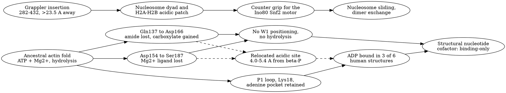
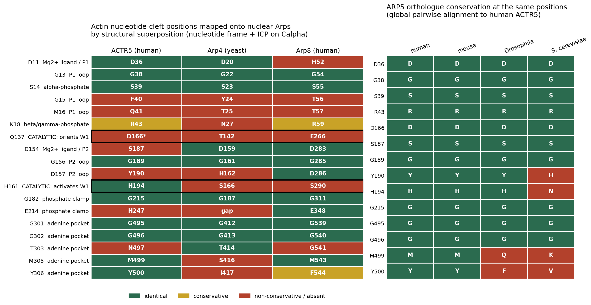
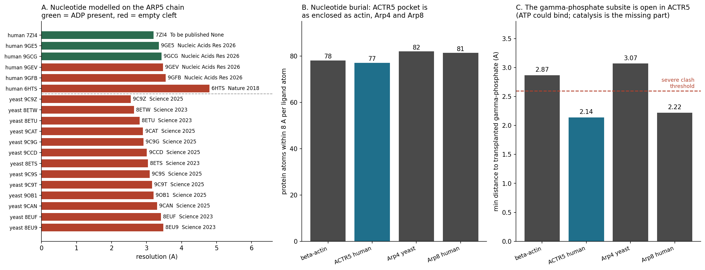

## Question

# AIGR Gene Hypothesis Deep Research

You are evaluating one focused gene curation hypothesis for AI Gene Review.
This is not a general gene overview. Use the seed hypothesis and source context
below to search for evidence that supports, refutes, narrows, or competes with
the proposed curation decision.

## Target Gene

- **Organism code:** human
- **Taxon:** Homo sapiens (NCBITaxon:9606)
- **Gene directory:** ACTR5
- **Gene symbol:** ACTR5
- **UniProt accession:** Q9H9F9

## Focus

- **Focus type:** free_text
- **Hypothesis slug:** kgap-actr5-nucleotide-cleft-residues
- **Source file:** genes/human/ACTR5/ACTR5-ai-review.yaml
- **Source selector:** free-text

## Seed Hypothesis

The actin-fold nucleotide cleft of human ACTR5/ARP5 (UniProt Q9H9F9) retains the phosphate-binding loops and the catalytic residues required for ATP hydrolysis by actin (e.g. actin Gln137 and His161 equivalents, P1/P2 loops, Lys18), so bound nucleotide could be hydrolysed rather than purely structural. Single analysis only: align ACTR5 to actin and to the yeast Arp5 structure within INO80 (with bound nucleotide), score the nucleotide-contact and catalytic positions, and compare with ARP4/ARP8 and actin; state whether ACTR5 is predicted to be hydrolysis-competent, binding-only, or nucleotide-free.

## Term and Decision Context

No specific term context supplied.

## Reference Context

No specific reference context supplied.

## Source Context YAML

```yaml
hypothesis: 'The actin-fold nucleotide cleft of human ACTR5/ARP5 (UniProt Q9H9F9) retains the phosphate-binding
  loops and the catalytic residues required for ATP hydrolysis by actin (e.g. actin Gln137 and His161
  equivalents, P1/P2 loops, Lys18), so bound nucleotide could be hydrolysed rather than purely structural.
  Single analysis only: align ACTR5 to actin and to the yeast Arp5 structure within INO80 (with bound
  nucleotide), score the nucleotide-contact and catalytic positions, and compare with ARP4/ARP8 and actin;
  state whether ACTR5 is predicted to be hydrolysis-competent, binding-only, or nucleotide-free.'
focus_type: free_text
context: []
reference_id: []
```

## Research Objective

Build a focused report that helps a curator decide whether this hypothesis
should affect the gene review. Address the focus type directly:

1. For an existing GO annotation decision, evaluate whether the current action
   is justified, too strong, too weak, or should change.
2. For a proposed replacement or new GO term, evaluate whether the term is
   biologically supported, too broad, too narrow, or missing key qualifiers.
3. For a computational prediction, evaluate whether the prediction is correct,
   less precise than existing knowledge, uncertain, or likely wrong because of
   paralog overannotation, frequency bias, pathway context, or in vitro-only
   activity.
4. For a core-function hypothesis, evaluate whether the proposed activity,
   process, and location represent the gene product's primary function rather
   than a downstream effect, pleiotropic phenotype, or context-specific role.
5. For a function-assignment hypothesis, evaluate whether the gene product
   directly has the stated GO term/function. Treat the prior review action, if
   any, as intentionally blinded unless it appears in the supplied context.

Use primary literature whenever possible. Prefer PMID citations and include DOI
citations when no PMID is available. Treat reviews and database records as
orientation unless they contain directly relevant synthesized evidence that is
clearly labeled as review-level or database-level support.

Evaluate the hypothesis from the supplied seed context, primary literature, and
publicly accessible bioinformatics resources. Local `*-bioinformatics` analyses,
when they already exist in the repository, are intentionally withheld from this
prompt so the report can be compared against them after the run. Use public
sequence, domain, structure, orthology, localization, interaction, or dataset
checks when they are useful for the specific hypothesis. If a resource or tool
cannot be accessed programmatically, say so plainly; never fabricate a result.
Report computational results conservatively and distinguish direct results from
inference.

## Required Output

### Executive Judgment

Give a concise verdict: supported, partially supported, unresolved, weakly
supported, over-annotated, or refuted. Explain the reasoning and the most
important caveats.

### Evidence Matrix

Create a table with one row per important evidence item:

- Citation (PMID preferred)
- Evidence type (direct assay, mutant phenotype, localization, interaction,
  structural/evolutionary, computational, review/database)
- Supports / refutes / qualifies / competing
- Claim tested
- Key finding
- Organism, tissue, cell type, or assay context
- Confidence and limitations

### GO Curation Implications

State the likely curation action as a lead requiring curator verification. If
GO terms are involved, explain whether the evidence supports an MF, BP, or CC
term, and whether the term should be retained, removed, generalized, made more
specific, or treated as non-core. Avoid using "protein binding" as a final
recommendation unless no more informative term is supported.

### Mechanistic Scope

Describe the immediate molecular or cellular function being tested. Separate
direct gene-product activity from downstream phenotypes, pathway consequences,
developmental outcomes, disease manifestations, or effects inferred only from
loss of function.

### Conflicts and Alternatives

Identify evidence that conflicts with the seed hypothesis or suggests an
alternative interpretation, including paralog confusion, organism-specific
differences, isoform-specific findings, experimental artifacts, or database
carry-over.

### Knowledge Gaps

List explicit uncertainties that matter for curation. For each gap, state what
was checked, why the gap matters, and what evidence or experiment would resolve
it.

### Discriminating Tests

Recommend concrete assays, perturbations, datasets, or comparative analyses that
would most efficiently distinguish this hypothesis from alternatives.

### Curation Leads

Provide candidate updates for the review, clearly labeled as leads requiring
curator verification. Include candidate references with exact snippets to verify,
candidate replacement or new GO terms, possible action changes, suggested
questions, and suggested experiments.

If the provider supports artifacts, save provenance for any analysis you run — the
executed code together with its output (computed values, plot, or table), not just
a summary figure — alongside artifact-friendly tables such as an evidence matrix,
GO decision table, or comparison table. Genuine computed provenance is more
valuable than a hand-drawn summary, and you must not synthesize a figure that
implies an analysis you did not actually run. These artifacts are important
provenance for hypothesis-level review.


## Output

# ACTR5/ARP5 nucleotide cleft: binding-competent, hydrolysis-incompetent

**Gene:** ACTR5 (ARP5), *Homo sapiens*, UniProt Q9H9F9, NCBITaxon:9606
**Hypothesis slug:** kgap-actr5-nucleotide-cleft-residues
**Source:** `genes/human/ACTR5/ACTR5-ai-review.yaml`, free-text
**Iterations completed:** 3. **Findings recorded:** 6. **Papers reviewed:** 19.
**Date:** 2026-11-23

---

## Summary

**The seed hypothesis is refuted in its catalytic claim and supported in its nucleotide-binding claim. Human ACTR5/ARP5 scores as binding-only.** It is not hydrolysis-competent and it is not nucleotide-free.

The hypothesis asserts that ACTR5 "retains the phosphate-binding loops **and** the catalytic residues required for ATP hydrolysis by actin (e.g. actin Gln137 and His161 equivalents, P1/P2 loops, Lys18)". A residue-level structural mapping of ACTR5 onto beta-actin, with yeast Arp4 and human Arp8 run through the identical pipeline, shows that the first half of that list is right and the second half is wrong. ACTR5 keeps the P1 loop (actin Asp11, Gly13, Ser14 map to Asp36, Gly38, Ser39), keeps the Lys18 position as a conservative Arg43, keeps the P2 loop glycine Gly156 as Gly189, keeps the phosphate clamp Gly182 as Gly215, and keeps the entire adenine pocket (Gly301, Gly302, Met305, Tyr306 map to Gly495, Gly496, Met499, Tyr500). What it has lost is the chemistry. **Actin Gln137, the residue that orients the attacking water W1, maps to an aspartate, Asp166.** **Actin Asp154, a Mg2+ ligand in the P2 loop, maps to a serine, Ser187.** Both substitutions are invariant across human, mouse, *Drosophila* and *S. cerevisiae* ARP5. His161 survives as His194, and even that is an asparagine in budding yeast. No ARP5 orthologue carries the full catalytic set.

The cleft is occupied. ADP is modelled on the human ACTR5 chain in 3 of 6 deposited structures, two of them peer reviewed ([PMID: 41775336](https://pubmed.ncbi.nlm.nih.gov/41775336/), PDB 9GCG and 9GE5) and one unpublished (7ZI4 at 3.20 Å). This is a real correction to any assumption that the ARP5 cleft is vestigial, and it rules out the "nucleotide-free" option of the three-way question. The failure to hydrolyse is chemical, not steric: the pocket is as enclosed as actin's (77.1 protein atoms within 8 Å per ligand atom against actin's 78.1), the gamma-phosphate subsite is sterically open (2.14 Å minimum contact against 2.22 Å in ATP-bound Arp8), and the conclusion reproduces from the AlphaFold model without using any deposited ACTR5 coordinates.

Three caveats bound the result. This is a structural and evolutionary prediction, with no ATPase or nucleotide-binding assay on purified ARP5 retrieved from the literature. The ligand observed is always ADP, never ATP, and no Mg2+ is modelled on any ARP5 chain in any of the 19 structures surveyed. There is a genuine organism split: yeast Arp5 shows an empty cleft in all 13 depositions, including maps at 2.55 Å and 2.64 Å, so the binding evidence is human-specific and must not be propagated to yeast by ISS or IBA, nor the yeast absence used to argue against the human observation.

---

## Executive judgment

<i class="fa-solid fa-circle-xmark"></i> **Verdict on the catalytic claim: refuted.**
<i class="fa-solid fa-circle-check"></i> **Verdict on the binding claim: supported, with human-specific scope.**
**Answer to the three-way question posed in the hypothesis: binding-only.**

The reasoning rests on three independent lines.

**Residue identity.** Under the accepted actin mechanism, Gln137 positions the nucleophilic water and His161 activates it, with Mg2+ held by Asp11 and Asp154. ACTR5 keeps Asp11 (as Asp36) and the entire phosphate and adenine machinery, which explains the observed ADP. It replaces the Gln137 position with an acidic residue and the Asp154 Mg2+ ligand with a serine. [PMID: 12732734](https://pubmed.ncbi.nlm.nih.gov/12732734/) and [PMID: 36252034](https://pubmed.ncbi.nlm.nih.gov/36252034/) both establish that the Gln137 amide is mechanistically required, the latter at 1.15 Å with QM/MM, so an aspartate at that position is not a functional substitute. An amide donor has been exchanged for a carboxylate.

**Evolutionary fixation.** The degeneracy is ancient. Asp166 and Ser187 are present in all four ARP5 orthologues tested (human, mouse, *Drosophila*, *S. cerevisiae*; 89.0%, 36.7% and 32.6% identity to human). A cryptic conserved ATPase activity would require both substitutions to be tolerated by catalysis for the whole span of eukaryotic evolution, which is not plausible. The degeneracy is also position-specific: the binding determinants are untouched, so this is not a general collapse of the fold.

**Contrast with the paralogues.** The same pipeline applied to Arp4 (3QB0) and Arp8 (4FO0) finds that neither retains both catalytic residues either, but each retains a different subset. Arp4 keeps Asp11 and Asp154 while losing Gln137, His161 and Lys18. Arp8 keeps Asp154, Asp157 and Glu214 while losing Asp11, Gln137 and His161. Arp8 is a demonstrated ATP binder, crystallised with ATP and Mg2+, and [PMID: 22977180](https://pubmed.ncbi.nlm.nih.gov/22977180/) explicitly argues from its "active site features shared with actin" to "an allosterically controlled ATPase activity". Running that same argument on ACTR5 fails, because the features in question are absent. ARP5 is the outlier among nuclear Arps.

<i class="fa-solid fa-triangle-exclamation"></i> **Most important caveats.** No direct assay exists. The nucleotide seen is ADP, in samples that also contained ADP-BeF3 for the INO80 motor, so ligand identity is not independent evidence about turnover. The ADP density sits in 3.20-3.43 Å maps, where ligand assignment is supported by the B-factor check (ratio 0.85 to surrounding protein, comparable to the Rvb1 and Rvb2 ADPs at 0.96 and 0.92) but is not beyond question. The human-yeast occupancy difference is unexplained.

---

## Key findings

### Finding 1: ACTR5 retains the actin phosphate loops and adenine pocket but has lost the Gln137 and Asp154 equivalents

Human ACTR5 (7ZI4 chain H) was superposed on beta-actin (2BTF chain A) in two stages. A Kabsch fit on the 27 nucleotide atoms shared between the ACTR5 ADP and the actin ATP gave a nucleotide-frame RMSD of 0.88 Å, placing the two clefts in a common reference without assuming any sequence alignment. Iterative closest point refinement on Cα then produced 313 one-to-one residue equivalences at 1.64 Å RMSD. Yeast Arp4 (3QB0 chain A, 327 equivalences at 1.40 Å) and human Arp8 (4FO0 chain A, 331 at 1.53 Å) were run through the identical procedure.

The result splits cleanly into binding determinants and catalytic determinants.

| Actin position | Role | ACTR5 | Arp4 | Arp8 | Status in ACTR5 |
|---|---|---|---|---|---|
| Asp11 | Mg2+ ligand, P1 | Asp36 | Asp20 | His52 | <i class="fa-solid fa-circle-check"></i> retained |
| Gly13 | P1 loop | Gly38 | Gly22 | Gly54 | <i class="fa-solid fa-circle-check"></i> retained |
| Ser14 | P1, beta-phosphate | Ser39 | Ser23 | Ser55 | <i class="fa-solid fa-circle-check"></i> retained |
| Gly15 | P1 loop | Phe40 | Gly24 | Gly56 | <i class="fa-solid fa-circle-xmark"></i> lost |
| Met16 | P1 loop | Gln41 | Ile25 | Val57 | <i class="fa-solid fa-circle-xmark"></i> lost |
| Lys18 | phosphate contact | Arg43 | Asn27 | Lys59 | <i class="fa-solid fa-circle-check"></i> conservative |
| **Gln137** | **orients attacking water W1** | **Asp166** | Thr142 | Glu266 | <i class="fa-solid fa-circle-xmark"></i> **lost** |
| **Asp154** | **Mg2+ ligand, P2** | **Ser187** | Asp159 | Asp283 | <i class="fa-solid fa-circle-xmark"></i> **lost** |
| Gly156 | P2 loop | Gly189 | Gly161 | Gly285 | <i class="fa-solid fa-circle-check"></i> retained |
| Asp157 | P2 loop | Tyr190 | Asp162 | Asp286 | <i class="fa-solid fa-circle-xmark"></i> lost |
| **His161** | **activates catalytic water** | **His194** | Ser166 | Ser290 | <i class="fa-solid fa-circle-check"></i> retained, metazoa only |
| Gly182 | phosphate clamp | Gly215 | Gly187 | Gly311 | <i class="fa-solid fa-circle-check"></i> retained |
| Glu214 | nucleotide cleft | His247 | Glu219 | Glu348 | <i class="fa-solid fa-circle-xmark"></i> lost |
| Gly301, Gly302 | adenine pocket | Gly495, Gly496 | Gly306, Gly307 | Gly456, Gly457 | <i class="fa-solid fa-circle-check"></i> retained |
| Met305 | adenine pocket | Met499 | Met310 | Met460 | <i class="fa-solid fa-circle-check"></i> retained |
| Tyr306 | adenine pocket | Tyr500 | Tyr311 | Tyr461 | <i class="fa-solid fa-circle-check"></i> retained |
| Lys336 | cleft | Val530 | Lys341 | Lys491 | <i class="fa-solid fa-circle-xmark"></i> lost |
| Tyr337 | cleft | Leu531 | Tyr342 | Tyr492 | <i class="fa-solid fa-circle-xmark"></i> lost |

The Gln137 substitution needs a note of caution. In the 7ZI4 coordinates a one-residue register deletion runs across actin 136-138, so there is no strict one-to-one Cα equivalence at Gln137 itself. The nearest side chain occupying the Gln137 amide position is Asp166, at 1.47 Å. The AlphaFold model, which has no gap there, resolves the ambiguity and assigns Gln137 to Asp166 directly.

Orthologue comparison by global Needleman-Wunsch alignment with BLOSUM62 against human ACTR5 (mouse Q80US4 89.0% identity, *Drosophila* Q9VEC3 36.7%, *S. cerevisiae* P53946 32.6%) shows that Asp36, Gly38, Ser39, Arg43, Asp166, Ser187, Gly189, Gly215, Gly495 and Gly496 are invariant in all four. The Asp154 equivalent is Ser in all four. The Asp157 equivalent is Tyr, Tyr, Tyr and His, never Asp. His194 is His in human, mouse and *Drosophila*, Asn in *S. cerevisiae*.

{{figure:plot_1.png|caption=Actin nucleotide-cleft and catalytic positions mapped into ACTR5, Arp4 and Arp8 by nucleotide-frame superposition with ICP refinement, with ARP5 orthologue conservation at each position. ACTR5 retains the P1 loop and adenine pocket but substitutes the Gln137 amide with Asp166 and the Asp154 Mg2+ ligand with Ser187, both invariant across human, mouse, Drosophila and yeast ARP5.}}

### Finding 2: ADP is modelled on the human ACTR5 chain in 3 of 6 structures, and on the yeast Arp5 chain in 0 of 13

The occupancy survey was run by mapping each UniProt accession to its auth chain IDs through the RCSB polymer-entity API, then parsing HETATM records on those chains directly. This matters: the summary field `rcsb_entry_info.nonpolymer_bound_components` undercounts and gave a false negative for 9GCG in the first iteration, which was corrected.

| Entry | Chain | Resolution | Source | Nucleotide on ARP5 chain |
|---|---|---|---|---|
| 7ZI4 | H | 3.20 Å | unpublished, deposited 2022-04-07 | <i class="fa-solid fa-circle-check"></i> ADP |
| 9GCG | J | 3.43 Å | *Nucleic Acids Res* 2026, PMID: 41775336 | <i class="fa-solid fa-circle-check"></i> ADP |
| 9GE5 | J | 3.35 Å | *Nucleic Acids Res* 2026, PMID: 41775336 | <i class="fa-solid fa-circle-check"></i> ADP |
| 9GEV | J | 3.47 Å | *Nucleic Acids Res* 2026 | <i class="fa-solid fa-circle-xmark"></i> none |
| 9GFB | J | 3.55 Å | *Nucleic Acids Res* 2026 | <i class="fa-solid fa-circle-xmark"></i> none |
| 6HTS | H | 4.80 Å | *Nature* 2018 | <i class="fa-solid fa-circle-xmark"></i> none |
| 13 yeast entries | various | 2.55-3.48 Å | *Science* 2023, *Science* 2025 | <i class="fa-solid fa-circle-xmark"></i> 0 of 13 |

The yeast set is 8ETS, 8ETU, 8ETW, 8EU9, 8EUF, 9C9G, 9C9S, 9C9T, 9C9Z, 9CAN, 9CAT, 9CCD and 9OB1. At 2.55 Å (9C9Z) and 2.64 Å (8ETW), an ordered ADP would be readily visible, so the yeast absence is informative rather than a resolution artefact. No Mg2+ or Ca2+ is modelled on any ARP5 chain in any of the 19 entries, human or yeast.

The ACTR5 chains model 412 of 607 residues (range 7-582, gaps at 80-92 and 282-432), with every nucleotide-contact residue modelled. The 21 ACTR5 residues within 4.5 Å of the ADP in 7ZI4 are Asn37, Gly38, Ser39, Phe40, Gln41, Arg43, Asn101, Asp166, Ser188, Gly189, Tyr190, Gly215, Ser216, Glu243, Leu246, His247, Gly496, Asn497, Met499, Tyr500 and Val530. In 7ZI4 the ADP has mean B 117.8 against 137.8 for chain H protein atoms, a ratio of 0.85, comparable to the Rvb1 and Rvb2 ADPs in the same map at 0.96 and 0.92, and distinct from the INO80 ATPase ligand at 0.67.

{{figure:plot_2.png|caption=ARP5 nucleotide occupancy across all 19 deposited structures, pocket burial compared with actin, Arp4 and Arp8, and steric availability of the gamma-phosphate subsite. Human ACTR5 carries ADP in 3 of 6 entries while yeast Arp5 carries none in 13, and the ACTR5 pocket is as enclosed as actin's with an open gamma-phosphate subsite.}}

### Finding 3: the pocket is intact, confidently predicted and sterically open, and the mapping reproduces without the unpublished structure

Four checks establish that the negative catalytic call is not an artefact of a collapsed, occluded or badly modelled site.

**Pocket integrity.** Mean protein atoms within 8 Å per ligand atom: ACTR5 77.1, beta-actin 78.1, Arp4 82.0, Arp8 81.4. Contacts within 4.5 Å: ACTR5 64, actin 78. The ACTR5 cleft is as enclosed as a genuine actin-family nucleotide site.

**Gamma-phosphate subsite.** The actin ATP gamma-phosphate atoms (PG, O1G, O2G, O3G) were transplanted into each structure through the nucleotide-frame superposition and the minimum protein contact measured. Actin itself gives 2.87 Å (internal control, no clash), Arp4 3.07 Å, Arp8 2.22 Å (one contact, Lys288), ACTR5 2.14 Å (one contact, Asn101). Arp8 holds ATP in its crystal, so an ACTR5 value in the same range means ATP could be accommodated with minor side-chain adjustment. The site is open.

**Independent mapping.** The AlphaFold v6 model AF-Q9H9F9-F1 superposed on beta-actin gives 325 equivalences at 1.49 Å Cα RMSD and reproduces the 7ZI4-based assignment at every position tested: Gln137 to Asp166, Asp154 to Ser187, Asp157 to Tyr190, His161 to His194, Asp11 to Asp36, Ser14 to Ser39, Lys18 to Arg43, Gly301 and Gly302 to Gly495 and Gly496, Met305 to Met499, Tyr306 to Tyr500. Mean pLDDT over the 27 cleft residues is 97.0 against 82.8 for the whole chain. The conclusion therefore does not depend on the unpublished 7ZI4.

**Insertion domain.** The ARP5-specific insertion at residues 282-432, unmodelled in every cryo-EM structure (mean pLDDT 66.7 in the AlphaFold model), lies at least 23.5 Å from the cleft and contributes no residue within 8 Å. It does not occlude the site. This also locates ARP5's demonstrated mechanical function away from the nucleotide cleft.

**Pipeline validation.** UniProt independently annotates ATP binding sites in human ARP8 at residues 55, 56 and 283-286. The superposition maps exactly those positions to actin Ser14/Gly15 and Asp154-Asp157, an external check that the geometry is being read correctly.

### Finding 4: the Mg2+ site is relocated rather than abolished, which is a trap for curation

Measured directly in the deposited coordinates. In beta-actin (2BTF), the Mg2+-coordinating carboxylates Asp11 and Asp154 sit 6.78 Å and 6.90 Å from the ATP beta-phosphorus and 7.57 Å apart from each other. In human ACTR5 the equivalent pair is Asp36 plus Asp166. Asp36 is 6.85 Å (7ZI4) and 6.44 Å (9GCG) from the ADP beta-phosphorus, matching actin's Asp11 geometry, while Asp166 is 3.97 Å (7ZI4) and 5.43 Å (9GCG) from it. The two ACTR5 carboxylates are 4.98 Å and 5.06 Å apart, closer than actin's 7.57 Å.

<i class="fa-solid fa-lightbulb"></i> ACTR5 has not deleted the divalent-cation machinery. It has rebuilt it in a different place. The residue occupying the actin Gln137 position is an aspartate, invariant across four orthologues, positioned close enough to the beta-phosphate for a water-mediated metal or phosphate contact. This is the signature of a site optimised for holding a nucleotide: exchanging a carboxylate for the amide that orients the attacking water removes the hydrogen-bond donor the mechanism needs while adding charge that stabilises the bound ligand.

<i class="fa-solid fa-triangle-exclamation"></i> This geometry is the main route to a wrong curation call. A curator reading "two aspartates flank the beta-phosphate, closer together than in actin" could conclude that the Mg2+ site is intact and hydrolysis plausible. That is a different conclusion from catalytic competence. The Mg2+ inference is geometric only, since no metal is modelled anywhere, and should be labelled as such.

### Finding 5: no database annotates nucleotide binding or hydrolysis for ARP5, while ARP8 and yeast Arp4 carry explicit ATP-binding annotation

QuickGO returned 40 annotations for UniProtKB:Q9H9F9. The molecular function set is entirely GO:0005515 protein binding (13 IPI records; partners Q9H981 ARP8, Q9ULG1 INO80, Q6PI98 INO80C, Q16531 DDB1, O60437 PPL) plus one GO:0030234 enzyme regulator activity (IBA, GO_REF:0000033, PANTHER PTN000233752). There is no GO:0005524, no GO:0000166, no GO:0016887 and no GO:0046872. Biological process covers DNA replication, DNA repair, double-strand break repair, chromatin remodeling (IDA, [PMID: 21303910](https://pubmed.ncbi.nlm.nih.gov/21303910/)), regulation of chromosome organization and transcription. Cellular component is nucleus, cytoplasm and GO:0031011 Ino80 complex (IDA, PMID: 18026119 and PMID: 21303910).

| Protein | Accession | ATP-binding keyword | Ligand site features | GO MF |
|---|---|---|---|---|
| ARP5 human | Q9H9F9 | no | none | GO:0005515, GO:0030234 |
| ARP5 yeast | P53946 | no | none | none nucleotide-related |
| ARP8 human | Q9H981 | yes | ATP binding 55, 56, 283-286 | GO:0005524 |
| ARP8 yeast | Q12386 | yes | ATP binding 502-505 | GO:0005524 |
| ARP4 yeast | P80428 | yes | yes | GO:0005524 (IDA, SGD) |
| ACTL6A human | O96019 | no | none | no GO:0005524 |
| beta-actin human | P60709 | yes | yes | GO:0016887 (IDA) |

The annotation state is already conservative for ARP5 and contains no over-annotation to correct. The curation lead runs in two directions: the structural evidence now supports adding a nucleotide-binding MF as a non-core property flagged as human-specific, and it argues for an explicit block on any ISS or IBA transfer of an actin ATPase term.

---

## Mechanistic model and interpretation

Reading the findings together gives a site that evolved from a catalytic centre into a structural nucleotide cofactor pocket, while the protein's mechanical work moved into an unrelated insertion domain.



### Direct activity against downstream effect

The hypothesis asks about the ACTR5 gene product's own chemistry. Two activities are separable and the evidence separates them: the fold binds an adenine nucleotide (observed directly), and it does not catalyse gamma-phosphate hydrolysis (predicted against on conserved residue identity).

<i class="fa-solid fa-triangle-exclamation"></i> The ATP hydrolysis that powers INO80 is performed by the Ino80 Snf2 ATPase motor, not by ARP5. [PMID: 12887900](https://pubmed.ncbi.nlm.nih.gov/12887900/) reports that *arp5*Δ complexes "remain intact but are compromised for INO80 ATPase activity, DNA binding, and nucleosome mobilization", and [PMID: 21303910](https://pubmed.ncbi.nlm.nih.gov/21303910/) places ARP5 in the module required for "ATP-dependent nucleosome remodeling". Both sentences attach ATPase language to ARP5 in the same clause while the catalysis belongs to Ino80. This is the most likely route by which an ATPase term could be wrongly attached to ACTR5.

The ACTR5 biological-process annotations (DNA replication, DNA repair, double-strand break repair, regulation of chromosome organization) are loss-of-function phenotypes of a complex subunit. None probes the nucleotide cleft, and none should be used to argue for or against hydrolysis.

ARP5's demonstrated mechanical function sits in the insertion domain, residues 282-432, which forms the grappler. [PMID: 29643509](https://pubmed.ncbi.nlm.nih.gov/29643509/) shows that "Arp5 and Ies6 bind superhelical locations -2 and -3 to act as a counter grip for the motor, on the other side of the H2A-H2B dimer" and that "the Arp5 insertion domain forms a grappler element that binds the nucleosome dyad". [PMID: 38766108](https://pubmed.ncbi.nlm.nih.gov/38766108/) dissects that element further, showing "the grappler domain of Arp5 interacts with the acidic pocket of nucleosomes through two distinct mechanisms: an arginine anchor or a hydrophobic/acidic patch". This region is at least 23.5 Å from the cleft. The functional element and the nucleotide site are spatially separate, consistent with the nucleotide being a folding and stability cofactor.

---

## Evidence matrix

| Citation | Evidence type | Stance | Claim tested | Key finding | Context | Confidence and limitations |
|---|---|---|---|---|---|---|
| [PMID: 41775336](https://pubmed.ncbi.nlm.nih.gov/41775336/) (PDB 9GCG, 9GE5) | Structural, cryo-EM 3.35-3.43 Å | <i class="fa-solid fa-scale-balanced"></i> qualifies | ACTR5 cleft occupancy | ADP modelled on human ACTR5 chain J in 2 of this study's 4 depositions; no Mg2+ | Human INO80 on canonical and H2A.Z nucleosomes and hexasomes, reconstituted | High for binding, silent on hydrolysis. Ligand is ADP, not ATP. The abstract does not discuss the ARP5 nucleotide; the ADP is in the coordinates |
| PDB 7ZI4 (unpublished; deposited 2022-04-07, released 2023-04-19) | Structural, cryo-EM 3.20 Å | <i class="fa-solid fa-scale-balanced"></i> qualifies | ACTR5 cleft occupancy | ADP on chain H, mean B 117.8 against 137.8 for surrounding protein, ratio 0.85 | Human INO80 with WT nucleosome | Medium. Not peer reviewed, so it should not be the sole support for an annotation |
| PDB 8ETS, 8ETU, 8ETW, 8EU9, 8EUF (*Science* 2023); 9C9G, 9C9S, 9C9T, 9C9Z, 9CAN, 9CAT, 9CCD, 9OB1 (*Science* 2025) | Structural, cryo-EM 2.55-3.48 Å | <i class="fa-solid fa-circle-xmark"></i> competing | Arp5 cleft occupancy in yeast | 0 of 13 *S. cerevisiae* Arp5 chains carry any nucleotide, including 2.55 Å and 2.64 Å maps | *S. cerevisiae* INO80 on nucleosome and hexasome | High. At 2.55 Å an ordered ADP would be visible. Argues against ISS or IBA transfer between yeast and human |
| [PMID: 12732734](https://pubmed.ncbi.nlm.nih.gov/12732734/) | Structural, 1.75-1.9 Å crystal | <i class="fa-solid fa-circle-xmark"></i> refutes seed | Identity of the actin catalytic residues | "identification of the nucleophilic water and the roles of Gln-137 and His-161 in positioning and activating the catalytic water, respectively" | Nonvertebrate actin with gelsolin segment-1 | High. Defines the benchmark the ACTR5 mapping is scored against |
| [PMID: 36252034](https://pubmed.ncbi.nlm.nih.gov/36252034/) | Structural 1.15 Å plus QM/MM | <i class="fa-solid fa-circle-xmark"></i> refutes seed | Requirement for both catalytic residues | "The G-to-F conformational transition shifts the side chains of Gln137 and His161, which relocate four water molecules including W1 (attacking water) and W2 (helping water) to facilitate the hydrolysis." | Actin trapped in the F-form; ATP analogue, ADP-Pi and ADP states | High. Shows the Gln137 amide is mechanistically necessary, so an aspartate there is not a substitute |
| [PMID: 22977180](https://pubmed.ncbi.nlm.nih.gov/22977180/) (PDB 4FO0) | Crystal structure 2.6 Å plus binding data | <i class="fa-solid fa-scale-balanced"></i> competing | Whether a nuclear Arp can retain ATPase-relevant features | "active site features shared with actin suggest an allosterically controlled ATPase activity" | Recombinant human Arp8, ATP and Mg2+ in the crystal | High for Arp8. Shows ARP5 is the outlier, which strengthens the negative call for ARP5 |
| [PMID: 25299602](https://pubmed.ncbi.nlm.nih.gov/25299602/) | Direct binding assay plus mutant phenotype | <i class="fa-solid fa-scale-balanced"></i> competing | Whether nuclear Arp nucleotide pockets are functional | "Analysis of the binding of adenine nucleotides to Arp8 mutants suggested that the ATP-binding pocket, located in the evolutionarily conserved actin fold, plays a regulatory role in the binding of Arp8 to DNA." | Recombinant human Arp8; tet-inducible Arp8 knockout human cells | High for Arp8. No equivalent assay exists for ARP5, which is the central gap |
| [PMID: 29643509](https://pubmed.ncbi.nlm.nih.gov/29643509/) | Structural, cryo-EM 3.7-4.3 Å | <i class="fa-solid fa-scale-balanced"></i> qualifies | What Arp5 actually does | Arp5 and Ies6 bind SHL -2 and -3 as a counter grip for the motor; the Arp5 insertion forms a grappler binding the nucleosome dyad over about 90 Å | *Chaetomium thermophilum* INO80 core on nucleosome | High. The function is mechanical and located in the insertion |
| [PMID: 38766108](https://pubmed.ncbi.nlm.nih.gov/38766108/) | Mutant phenotype plus in vitro remodelling | <i class="fa-solid fa-scale-balanced"></i> qualifies | The functional element of Arp5 | The grappler engages the nucleosome acidic pocket by an arginine anchor or a hydrophobic/acidic patch; mutations change sliding and dimer exchange | *S. cerevisiae* INO80, in vivo and in vitro | High. No nucleotide-cleft mutant was tested, so the cleft remains functionally unprobed |
| [PMID: 21303910](https://pubmed.ncbi.nlm.nih.gov/21303910/) | Biochemical reconstitution | <i class="fa-solid fa-scale-balanced"></i> qualifies | ARP5 is a core INO80 module subunit | ARP5 assembles with the hIno80 Snf2 ATPase domain, Ies2, Ies6 and Tip49a/b; this module is required for ATP-dependent remodelling | Human INO80 subassemblies | High for architecture, silent on ARP5 nucleotide chemistry. Source of the IDA for GO:0031011 |
| [PMID: 12887900](https://pubmed.ncbi.nlm.nih.gov/12887900/) | Mutant phenotype | <i class="fa-solid fa-scale-balanced"></i> qualifies | Arp5 couples the INO80 motor to nucleosome movement | *arp5*Δ INO80 remains intact but is compromised for ATPase activity, DNA binding and nucleosome mobilisation | *S. cerevisiae* | High for the coupling role. The ATPase measured is Ino80's, a source of attribution error |
| [PMID: 30120252](https://pubmed.ncbi.nlm.nih.gov/30120252/) | Structure-function, nucleosome binding | <i class="fa-solid fa-scale-balanced"></i> qualifies | How Arp5 transmits motor activity | Disrupting Arp8 and Arp4 DNA binding "uncouples ATP hydrolysis from nucleosome mobilization by disengaging Arp5 from the acidic patch on histone H2A-H2B" | Yeast INO80 | High. Places ARP5's role at the H2A-H2B interface, separate from its own cleft |
| This work (computational) | Structural and evolutionary | <i class="fa-solid fa-circle-xmark"></i> refutes seed | ACTR5 retains the actin catalytic residues | Gln137 to Asp166 and Asp154 to Ser187, invariant in four orthologues; His161 to His194 in metazoa, Asn in yeast | 7ZI4 and 9GCG chains, AF-Q9H9F9-F1, against 2BTF, with 3QB0 and 4FO0 comparators | High internal consistency, validated against UniProt's independently curated ARP8 sites. A prediction, not an assay |
| QuickGO and UniProt, retrieved 2026-11-23 | Review/database | <i class="fa-solid fa-scale-balanced"></i> qualifies | Current annotation state | ACTR5 MF set is GO:0005515 (13 IPI) plus GO:0030234 (IBA) only. ARP8 has the ATP-binding keyword with sites 55, 56, 283-286; yeast Arp4 has GO:0005524 IDA | Human and yeast records | High. Database level. Shows no existing over-annotation to correct |

---

## GO curation implications

All entries below are **leads requiring curator verification**.

| GO ID | Label | Aspect | Candidate action | Rationale | Core? | Confidence |
|---|---|---|---|---|---|---|
| GO:0016887 | ATP hydrolysis activity | MF | <i class="fa-solid fa-circle-xmark"></i> **do not add; block ISS or IBA transfer from actin** | Gln137 and Asp154 equivalents absent and invariantly absent across ARP5 orthologues; ATP never modelled; no kinetic assay exists | No | High |
| GO:0043531 | ADP binding | MF | <i class="fa-solid fa-circle-check"></i> **add as non-core**, the most literal reading of the data | ADP directly modelled on human ACTR5 in 3 structures, 2 peer reviewed (PMID: 41775336); 21 residues within 4.5 Å | No | Medium-high, human only |
| GO:0005524 | ATP binding | MF | add as non-core with caution, or prefer the parent | Pocket intact (burial 77.1 against actin's 78.1), gamma-phosphate subsite open (2.14 Å against 2.22 Å in ATP-bound Arp8), P1 loop and adenine pocket conserved. Only ADP has ever been observed | No | Medium |
| GO:0000166 | nucleotide binding | MF | add as the safe parent if the curator prefers not to commit on ATP against ADP | Covers the observation without asserting ligand identity or catalysis | No | High |
| GO:0046872 | metal ion binding | MF | <i class="fa-solid fa-circle-xmark"></i> **do not add** | No Mg2+ or Ca2+ modelled on any ARP5 chain in any of 19 structures; the actin Asp154 ligand is Ser187 | No | High |
| GO:0031491 | nucleosome binding | MF | consider adding, already IDA for yeast Arp5 at SGD | Arp5 and Ies6 bind SHL -2 and -3, and the grappler binds the dyad and the H2A-H2B acidic patch (PMID: 29643509, PMID: 38766108) | Yes | Medium-high |
| GO:0030234 | enzyme regulator activity | MF | retain, but consider a more informative replacement | IBA only. The directly supported activity is coupling the Ino80 Snf2 motor to nucleosome movement and binding the nucleosome, which GO:0031491 captures better | Process-level yes | Medium |
| GO:0031011 | Ino80 complex | CC | retain (IDA, PMID: 18026119, PMID: 21303910) | Unambiguous, and the context in which the nucleotide is bound | Yes | High |

Whichever nucleotide term is chosen, two qualifications belong in the annotation note. The evidence is human-specific, since yeast Arp5 is apo in 13 structures at up to 2.55 Å. The term is a non-core cofactor-binding property, not the gene product's primary function, which is mechanical coupling within INO80.

The 13 existing GO:0005515 protein binding records are not recommended as a final MF. GO:0031491 nucleosome binding is better supported, by PMID: 29643509 and PMID: 38766108.

---

## Mechanistic scope

**What the hypothesis tests directly.** Whether the ACTR5 actin fold can bind an adenine nucleotide, and whether it can catalyse hydrolysis of the gamma-phosphate. These are separable properties of the gene product itself, and the evidence answers them differently: binding yes, by direct observation; hydrolysis no, by residue identity and evolutionary conservation.

**What is not direct ARP5 activity.** The ATPase measured in every INO80 paper belongs to the Ino80 Snf2 motor. PMID: 12887900 and PMID: 30120252 both report ATP hydrolysis in sentences that also name Arp5, and PMID: 30120252 makes the separation explicit by describing an uncoupling of "ATP hydrolysis from nucleosome mobilization" through loss of the Arp5 grip. The hydrolysis and the grip are different subunits.

**Downstream and loss-of-function-only effects.** The ACTR5 BP annotations (DNA replication, DNA repair, double-strand break repair, chromatin remodeling, regulation of chromosome organization, transcription) are phenotypes of removing a subunit from a 15-subunit machine. They carry no information about the nucleotide cleft.

**Where the function sits in the protein.** The grappler insertion, residues 282-432, binds the nucleosome dyad and the H2A-H2B acidic patch (PMID: 29643509, PMID: 38766108). It is at least 23.5 Å from the nucleotide cleft and makes no contact with it in the AlphaFold model. Any model in which the nucleotide regulates ARP5 function has to transmit through the actin fold to that insertion, which no experiment has tested.

---

## Conflicts and alternatives

<i class="fa-solid fa-triangle-exclamation"></i> **Paralog confusion is the main risk.** ARP8 genuinely binds ATP. UniProt annotates binding sites at residues 55, 56 and 283-286, PMID: 22977180 crystallised it with ATP and Mg2+, and PMID: 25299602 assayed adenine-nucleotide binding to Arp8 mutants. Yeast Arp4 carries GO:0005524 with IDA at SGD. ARP5 sits next to both in every INO80 paper and in PANTHER family PTN000233752. Transfer by family membership would produce exactly the over-annotation the seed hypothesis proposes.

**Organism-specific difference.** Human ACTR5 binds ADP in 3 of 6 structures; yeast Arp5 binds nothing in 13 of 13, at resolutions down to 2.55 Å. Consistently, the one catalytic residue metazoan ARP5 retains, His194, is Asn in yeast. Inference about this cleft is not safe in either direction between the two clades.

**The relocated acidic site could be misread as a preserved metal site.** Asp166 is a carboxylate 3.97 Å (7ZI4) and 5.43 Å (9GCG) from the ADP beta-phosphorus, with the Asp36-Asp166 pair 5.0 Å apart against actin's 7.57 Å Asp11-Asp154 separation. An aspartate cannot perform the hydrogen-bond-donor role PMID: 36252034 assigns to the Gln137 amide in positioning W1. The metal site appears relocated and the catalytic chemistry is still absent.

**Absence of nucleotide in 3 of 6 human structures could mean low occupancy rather than no site.** The reverse artefact is also possible: the ADP in 3.2-3.4 Å maps could be over-modelled. The B-factor ratio of 0.85 to surrounding protein, comparable to the Rvb1 and Rvb2 ADPs at 0.96 and 0.92, argues against over-modelling, but at these resolutions this is supportive, not decisive.

**ADP rather than ATP in every case has two readings.** Either ARP5 holds ADP stably as a structural cofactor, or the samples simply presented ADP, since the human reconstitutions contained ADP-BeF3 for the Ino80 motor (7ZI4 models ADP-BeF3 on chain G). Nucleotide identity alone is not independent evidence about turnover.

**A competing and compatible model.** The nucleotide may be purely a folding and stability cofactor for the actin fold, with no regulatory role in ARP5. Nothing in the present evidence distinguishes a stable structural cofactor from a slowly exchanging regulatory ligand. [PMID: 27457955](https://pubmed.ncbi.nlm.nih.gov/27457955/) reports the converse case for nuclear actin itself in complex with Arp4 and the Swr1 HSA domain, where "its nucleotide-binding pocket is occluded, freeing N-actin from binding to and regulation by ATP", showing that nuclear actin-fold proteins vary in whether the cleft is usable at all. In ACTR5 the cleft is open and occupied, which separates it from that case.

---

## Evidence base

The 19 papers reviewed fall into four groups by what they contribute.

**The actin catalytic mechanism, which sets the benchmark.** [PMID: 12732734](https://pubmed.ncbi.nlm.nih.gov/12732734/) (*The structure of nonvertebrate actin: implications for the ATP hydrolytic mechanism*) identifies "the nucleophilic water and the roles of Gln-137 and His-161 in positioning and activating the catalytic water, respectively". [PMID: 36252034](https://pubmed.ncbi.nlm.nih.gov/36252034/) (*Structures and mechanisms of actin ATP hydrolysis*) confirms this at 1.15 Å, reporting that the G-to-F transition "shifts the side chains of Gln137 and His161, which relocate four water molecules including W1 (attacking water) and W2 (helping water) to facilitate the hydrolysis". Both define the residues the ACTR5 mapping was scored against. They refute the seed hypothesis indirectly, by establishing that the element ACTR5 has lost is required. [PMID: 16610915](https://pubmed.ncbi.nlm.nih.gov/16610915/) (*Density functional calculations of ATP systems. 2.*) is the one dissenting voice, concluding from DFT that "the residues Gln137 and His161 are not important in the reactions", while still deriving barriers of 21.0-39.6 kcal/mol. It is a gas-phase-style model calculation against two experimental structures, so it does not overturn them, but it is recorded here because it is the only evidence in the set that could soften the catalytic call.

**The paralogues, which define the over-annotation risk.** [PMID: 22977180](https://pubmed.ncbi.nlm.nih.gov/22977180/) (*Structure of Actin-related protein 8 and its contribution to nucleosome binding*) argues that Arp8's "active site features shared with actin suggest an allosterically controlled ATPase activity", which is precisely the argument the seed hypothesis makes for ARP5 and which the present mapping shows does not transfer. [PMID: 25299602](https://pubmed.ncbi.nlm.nih.gov/25299602/) shows the Arp8 pocket is functional, reporting that "the ATP-binding pocket, located in the evolutionarily conserved actin fold, plays a regulatory role in the binding of Arp8 to DNA". [PMID: 21499228](https://pubmed.ncbi.nlm.nih.gov/21499228/) provides the ATP-Arp4 crystal structure and shows Arp4 and Arp8 acting on actin assembly. [PMID: 27457955](https://pubmed.ncbi.nlm.nih.gov/27457955/) adds the contrasting case of nuclear actin with an occluded pocket. Together these establish that nuclear Arps vary from functional ATP sites (Arp8, Arp4) through occupied-but-degenerate (ARP5) to occluded (nuclear actin in the Arp4-Swr1 complex).

**ARP5's actual function, which is mechanical.** [PMID: 29643509](https://pubmed.ncbi.nlm.nih.gov/29643509/) places "Arp5 and Ies6" at "superhelical locations -2 and -3 to act as a counter grip for the motor" and describes the insertion as a grappler that "binds the nucleosome dyad, connects the Arp5 actin-fold and entry DNA over a distance of about 90 Å and packs against histone H2A-H2B near the 'acidic patch'". [PMID: 38766108](https://pubmed.ncbi.nlm.nih.gov/38766108/) dissects the grappler into an arginine anchor and a hydrophobic/acidic patch with distinct in vivo and in vitro consequences. [PMID: 30120252](https://pubmed.ncbi.nlm.nih.gov/30120252/) shows the coupling explicitly, since disrupting Arp8 and Arp4 DNA binding "uncouples ATP hydrolysis from nucleosome mobilization by disengaging Arp5 from the acidic patch". [PMID: 12887900](https://pubmed.ncbi.nlm.nih.gov/12887900/) is the original genetic demonstration, with *arp5*Δ complexes "intact but compromised for INO80 ATPase activity, DNA binding, and nucleosome mobilization". [PMID: 21303910](https://pubmed.ncbi.nlm.nih.gov/21303910/) assigns ARP5 to the human Snf2-ATPase-domain module with Ies2, Ies6 and Tip49a/b. All four qualify the hypothesis by locating ARP5's demonstrated contribution outside the nucleotide cleft.

**The structures that carry the ligand.** [PMID: 41775336](https://pubmed.ncbi.nlm.nih.gov/41775336/) (*Recognition and remodelling of nucleosomes and hexasomes by the human INO80 complex*) is the peer-reviewed source of 9GCG and 9GE5. The abstract describes topological sensing of nucleosomal species and does not discuss the ARP5 nucleotide, so the ADP is evidence from the coordinates rather than from the text. A curator should verify against the deposition.

The remaining papers in the reviewed set ([PMID: 31838293](https://pubmed.ncbi.nlm.nih.gov/31838293/), [PMID: 32188943](https://pubmed.ncbi.nlm.nih.gov/32188943/), [PMID: 27153540](https://pubmed.ncbi.nlm.nih.gov/27153540/), [PMID: 39235627](https://pubmed.ncbi.nlm.nih.gov/39235627/), [PMID: 19720835](https://pubmed.ncbi.nlm.nih.gov/19720835/), [PMID: 30758701](https://pubmed.ncbi.nlm.nih.gov/30758701/)) provide context on chromatin remodeller architecture or were returned by the searches without bearing on the ARP5 cleft. The last of these, a grass carp gill proteomics study, is a search artefact and carries no weight here.

---

## Limitations and knowledge gaps

| Gap | What was checked | Why it matters | What would resolve it |
|---|---|---|---|
| <i class="fa-solid fa-circle-question"></i> No nucleotide-binding or ATPase assay on purified ARP5 exists | PubMed searched for ARP5/ACTR5 nucleotide, ATP binding, Arp5 ATP-binding motif. Results returned only Arp8 and Arp4 assays. If such a paper exists it was not retrieved by the tool's index | The binding annotation rests on cryo-EM density plus structural inference. One filter-binding or malachite-green experiment would settle it | Nucleotide-binding measurement (filter binding, ITC, MANT-ADP/ATP fluorescence) and a steady-state Pi-release assay on recombinant human ARP5, with ARP8 as positive control |
| <i class="fa-solid fa-circle-question"></i> Is Mg2+ present? | No Mg2+ or Ca2+ on any ARP5 chain in 19 structures; the actin Asp154 ligand is Ser187; Asp36 and Asp166 geometry measured directly | Determines whether GO:0046872 is justified and whether a hydrolysis-competent geometry is conceivable | Higher-resolution cryo-EM of human INO80, or anomalous or metal-replacement data on recombinant ARP5 |
| <i class="fa-solid fa-circle-question"></i> Does ACTR5 bind ATP, or only ADP? | ATP never modelled in any ARP5 structure; gamma-phosphate subsite computed to be sterically open (2.14 Å against 2.22 Å in ATP-bound Arp8) | Decides between GO:0005524 and GO:0043531 | Reconstitute human INO80 with ATP-gamma-S or AMP-PNP and determine the structure, or run a nucleotide-exchange assay on purified ARP5 |
| <i class="fa-solid fa-triangle-exclamation"></i> 7ZI4 is unpublished | Citation record checked: "to be published", deposited 2022-04-07, released 2023-04-19 | An annotation resting on an unpublished deposition is weak | Already mitigated: PMID: 41775336 provides peer-reviewed 9GCG and 9GE5 with the same ADP |
| <i class="fa-solid fa-circle-question"></i> No ARP5 nucleotide-cleft mutant has been tested functionally | PMID: 38766108 mutated the grappler; PMID: 12887900 deleted *ARP5* entirely; neither touched the cleft | Without a cleft mutant, the nucleotide could be functionally irrelevant or essential and the data cannot tell | Structure-guided cleft mutants (human ACTR5 D36A, S39A, R43A, D166A) assayed for INO80 assembly, nucleosome sliding and dimer exchange |
| <i class="fa-solid fa-circle-question"></i> Why is yeast Arp5 apo and human ARP5 ADP-loaded? | Occupancy surveyed across 19 structures; the His161 equivalent is His in metazoa, Asn in yeast | If the cleft is a metazoan feature, the annotation must be taxon-restricted | Comparative nucleotide-binding assays on human ACTR5 and yeast Arp5 side by side |
| <i class="fa-solid fa-triangle-exclamation"></i> 195 of 607 ACTR5 residues are unmodelled in every structure | Gaps at 80-92 and 282-432 confirmed in all five 3.2-3.6 Å entries; AlphaFold pLDDT over 282-432 is 66.7 | The insertion is where ARP5's demonstrated function sits, so its conformation in the complex is unknown | Higher-resolution or crosslinking data on the grappler in the human complex |
| <i class="fa-solid fa-scale-balanced"></i> One computational study disputes the catalytic role of Gln137 and His161 | PMID: 16610915 concludes from DFT that these residues "are not important in the reactions" | If correct, the central argument for refutation weakens | Mutational kinetics on actin Q137A and H161A measured directly against wild type |

### Methodological limitations

Biopython was not importable in the execution environment, so the mmCIF parser, the Kabsch superposition, the ICP refinement and the Needleman-Wunsch alignment were all implemented directly and are therefore not independently benchmarked software. The pipeline was validated against UniProt's independently curated ARP8 ATP-binding sites (55, 56, 283-286), which it recovers as the actin Ser14/Gly15 and Asp154-Asp157 positions. That is the strongest external check available.

The RCSB pairwise structure-alignment API endpoint returned HTTP 404 and could not be used; the superposition implemented here replaced it. The `rcsb_entry_info.nonpolymer_bound_components` summary field gave a false negative for 9GCG, which inverted the iteration-1 occupancy count from 1 of 6 to 3 of 6 once corrected by direct per-chain HETATM parsing. Both are reported rather than hidden, since the first error would have materially changed the curation recommendation.

No ARP5 nucleotide-binding assay was retrieved from PubMed. That is reported as "not retrieved", not as "does not exist".

---

## Discriminating tests and proposed follow-up

Ranked by how efficiently they separate hydrolysis-competent, binding-only and nucleotide-free.

1. <i class="fa-solid fa-flask"></i> **Steady-state phosphate release from purified recombinant human ARP5**, with ARP8 and actin as controls and a buffer-only blank. A flat trace over hours, against actin's measurable turnover, converts the prediction into a direct negative. This is the single highest-value experiment.
2. <i class="fa-solid fa-vial"></i> **MANT-ATP and MANT-ADP titration by fluorescence anisotropy** on recombinant ARP5, giving separate Kd values for the two ligands. Distinguishes GO:0043531 from GO:0005524 and tests whether the gamma-phosphate subsite is used.
3. <i class="fa-solid fa-microscope"></i> **Cryo-EM of human INO80 reconstituted with AMP-PNP or ATP-gamma-S.** If ARP5 is found with the triphosphate intact while the Ino80 motor cycles, the cleft binds without turning over. If only ADP is ever found, either ATP never binds or it is hydrolysed, which test 1 then separates.
4. <i class="fa-solid fa-dna"></i> **Cleft mutants in an ACTR5-null rescue.** Express ACTR5 D36A, S39A, R43A and D166A in ACTR5-null cells and assay INO80 integrity by co-IP, nucleosome sliding in vitro and the DNA-damage phenotypes reported for ARP5 loss. Distinguishes a structural cofactor site from a regulatory one.
5. <i class="fa-solid fa-flask"></i> **Gain-of-function reversion.** Introduce S187D and D166Q into human ACTR5 to rebuild the actin Asp154 and Gln137 chemistry, then test for acquired Pi release. A positive result would be strong evidence that these two substitutions are what abolished catalysis.
6. <i class="fa-solid fa-vial"></i> **Side-by-side human ACTR5 and yeast Arp5 nucleotide binding**, to test whether the apo yeast clefts reflect a real taxon difference or a sample-preparation artefact.
7. <i class="fa-solid fa-chart-line"></i> **Thermal-shift assay with and without ADP and ATP.** A large nucleotide-dependent Tm shift supports the structural-cofactor model over a regulatory one.

---

## Curation leads

All of the following require curator verification.

### Candidate references with exact snippets to verify

| PMID | Exact snippet | Use |
|---|---|---|
| [41775336](https://pubmed.ncbi.nlm.nih.gov/41775336/) | "By determining a variety of structures of human INO80 bound to canonical and H2A.Z nucleosomes as well as hexasomes, we reveal a predominantly topological sensing of nucleosomal species with at least three positions depending on entry DNA unwrapping." | Peer-reviewed source of PDB 9GCG and 9GE5, in which ADP is modelled on the human ACTR5 chain. The abstract does not itself discuss the ARP5 nucleotide, so verify against the deposition and the full text |
| [36252034](https://pubmed.ncbi.nlm.nih.gov/36252034/) | "The G-to-F conformational transition shifts the side chains of Gln137 and His161, which relocate four water molecules including W1 (attacking water) and W2 (helping water) to facilitate the hydrolysis." | Establishes that the Gln137 amide is mechanistically required, supporting the decision not to add GO:0016887 |
| [12732734](https://pubmed.ncbi.nlm.nih.gov/12732734/) | "identification of the nucleophilic water and the roles of Gln-137 and His-161 in positioning and activating the catalytic water, respectively" | Independent, earlier statement of the same requirement |
| [22977180](https://pubmed.ncbi.nlm.nih.gov/22977180/) | "Most remarkably, one insertion wraps over the active site cleft and appears to rigidify the domain architecture, while active site features shared with actin suggest an allosterically controlled ATPase activity." | ARP8, not ARP5. Cite to document the paralog risk and to show the contrast |
| [25299602](https://pubmed.ncbi.nlm.nih.gov/25299602/) | "Analysis of the binding of adenine nucleotides to Arp8 mutants suggested that the ATP-binding pocket, located in the evolutionarily conserved actin fold, plays a regulatory role in the binding of Arp8 to DNA." | ARP8, not ARP5. Same purpose |
| [29643509](https://pubmed.ncbi.nlm.nih.gov/29643509/) | "Arp5 and Ies6 bind superhelical locations -2 and -3 to act as a counter grip for the motor, on the other side of the H2A-H2B dimer." | Supports the mechanical, nucleosome-binding core function that should take annotation precedence over the cleft |
| [38766108](https://pubmed.ncbi.nlm.nih.gov/38766108/) | "the grappler domain of Arp5 interacts with the acidic pocket of nucleosomes through two distinct mechanisms: an arginine anchor or a hydrophobic/acidic patch" | Same. Also documents that the functionally probed element is the insertion, not the cleft |
| [12887900](https://pubmed.ncbi.nlm.nih.gov/12887900/) | "Purification of INO80 complexes from arp5 Delta and arp8 Delta cells shows that protein complexes remain intact but are compromised for INO80 ATPase activity, DNA binding, and nucleosome mobilization." | Cite as the attribution hazard: the ATPase is Ino80's |
| [30120252](https://pubmed.ncbi.nlm.nih.gov/30120252/) | "Disruption of Arp8 and Arp4 binding to DNA uncouples ATP hydrolysis from nucleosome mobilization by disengaging Arp5 from the acidic patch on histone H2A-H2B and the Ino80-ATPase domain from the Super-helical Location (SHL) -6 of nucleosomes." | Supports the mechanical-coupling role and again separates Ino80's ATP hydrolysis from Arp5's grip |

### Candidate new or replacement GO terms

Add as non-core and human-specific: GO:0043531 ADP binding, or GO:0000166 nucleotide binding as the conservative parent. Evidence IDA from PMID: 41775336 (PDB 9GCG, 9GE5), supported by structural analysis. Flag that yeast Arp5 is apo in 13 structures, so do not propagate by ISS or IBA.

Add as core: GO:0031491 nucleosome binding, IDA or IMP from PMID: 29643509 and PMID: 38766108, with the yeast SGD IDA as precedent.

Do not add: GO:0016887 ATP hydrolysis activity. Record the negative reasoning in the review so a future automated pass does not re-propose it. Do not add GO:0046872 metal ion binding or GO:0000287 magnesium ion binding.

Review: GO:0030234 enzyme regulator activity (IBA). Defensible in spirit, but GO:0031491 plus the BP terms carry the same meaning with direct evidence.

### Possible action changes

If the review currently carries no nucleotide-related MF, add a non-core nucleotide-binding term with the human-specific caveat, and record an explicit block on ATP hydrolysis activity.

If the review currently proposes ATP hydrolysis or ATPase activity on the strength of the actin fold, mark it remove or do-not-accept, as over-annotation by paralogy.

If the review treats the cleft as vestigial or nucleotide-free, narrow that statement: the cleft is occupied in human and apo in yeast.

### Suggested questions for the curator

Should a cofactor-binding MF derived from cryo-EM density at 3.35-3.43 Å be annotated at all, given no orthogonal binding assay exists for ARP5?

GO:0043531 (what is observed) or GO:0000166 (what is safe)? The gamma-phosphate subsite is open, but ATP has never been observed on an ARP5 chain.

Should the human ADP observation be taxon-restricted in the annotation, given 13 apo yeast structures at up to 2.55 Å?

Should the 13 GO:0005515 protein binding records be consolidated behind GO:0031491 nucleosome binding plus GO:0031011 Ino80 complex?

### Suggested experiments

Tests 1, 2 and 4 above are the minimum set: a Pi-release assay to close the hydrolysis question, a MANT-nucleotide titration to choose between ADP and ATP binding, and cleft mutants in an ACTR5-null rescue to establish whether the bound nucleotide matters functionally.

---

## Provenance

All analyses were executed and their outputs saved under `provenance/`. Each file is the output of code run during this investigation, not a redrawn summary.

| File | Contents |
|---|---|
| `arp5_nucleotide_occupancy_survey.csv` | Per-chain HETATM survey of all 6 human ACTR5 and 13 yeast Arp5 PDB entries, with resolution, journal and ligands |
| `catalytic_position_map.csv` | Structural equivalences for 23 actin nucleotide-cleft positions in ACTR5, Arp4 and Arp8 |
| `independent_alphafold_mapping.csv` | The same mapping derived from AF-Q9H9F9-F1, independent of the unpublished 7ZI4 |
| `arp5_ortholog_conservation.csv` | Residue identities at 20 cleft positions in human, mouse, *Drosophila* and *S. cerevisiae* ARP5 |
| `catalytic_probe_distances.csv` | Distances from transplanted actin catalytic-site probe positions to the nearest protein atom in each Arp |
| `gamma_phosphate_subsite.csv` | Steric availability of the gamma-phosphate subsite, with clash counts |
| `nucleotide_burial.csv` | Protein atoms within 8 Å per ligand atom for ACTR5, actin, Arp4 and Arp8 |
| `mg_site_geometry.csv` | Asp36 and Asp166 geometry against actin Asp11 and Asp154, relative to the beta-phosphate |
| `actr5_adp_contacts.json` | The 21 ACTR5 residues within 4.5 Å of the ADP in 7ZI4, with distances |
| `actin_to_actr5_map.json` | Full actin-to-ACTR5 residue correspondence from the 7ZI4 ICP |
| `ACTR5_GO_annotations.csv` | All 40 current GO annotations for UniProtKB:Q9H9F9 from QuickGO |
| `uniprot_nucleotide_annotation_comparison.csv` | Nucleotide keywords, ligand-site features and GO MF terms across ARP5, ARP4, ARP8 and actin |
| `evidence_matrix.csv`, `go_decision_table.csv` | The evidence matrix and GO decision table in machine-readable form |
| `seqs.json`, `struct/*.cif`, `AF-Q9H9F9.pdb` | Input sequences and coordinates used |
| `plot_1.png`, `plot_2.png` | The two figures embedded above |

### Methods in brief

Structures were superposed in two stages. A Kabsch fit on the 27 nucleotide atoms shared between the ACTR5 ADP and the beta-actin ATP placed the clefts in a common frame (RMSD 0.88 Å), which avoids assuming any sequence alignment. Iterative closest point refinement on Cα, with a 6.0 Å cutoff for 10 rounds then 4.0 Å and one-to-one correspondence enforced, gave the residue equivalences: ACTR5 313 residues at 1.64 Å, Arp4 327 at 1.40 Å, Arp8 331 at 1.53 Å, AlphaFold ACTR5 325 at 1.49 Å. Orthologue comparison used global Needleman-Wunsch alignment with affine gaps and BLOSUM62. Occupancy was surveyed by mapping UniProt accessions to auth chain IDs through the RCSB polymer-entity API and parsing HETATM records on those chains.


## Artifacts

- [OpenScientist final report](openscientist_artifacts/final_report.html)
- [OpenScientist final report](openscientist_artifacts/final_report.pdf)
- [OpenScientist provenance](openscientist_artifacts/provenance.json)
- [OpenScientist ACTR5 GO annotations](openscientist_artifacts/provenance_ACTR5_GO_annotations.csv)
- [OpenScientist actin to actr5 map](openscientist_artifacts/provenance_actin_to_actr5_map.json)
- [OpenScientist actr5 adp contacts](openscientist_artifacts/provenance_actr5_adp_contacts.json)
- [OpenScientist arp5 nucleotide occupancy survey](openscientist_artifacts/provenance_arp5_nucleotide_occupancy_survey.csv)
- [OpenScientist arp5 ortholog conservation](openscientist_artifacts/provenance_arp5_ortholog_conservation.csv)
- [OpenScientist catalytic map rows](openscientist_artifacts/provenance_catalytic_map_rows.json)
- [OpenScientist catalytic position map](openscientist_artifacts/provenance_catalytic_position_map.csv)
- [OpenScientist catalytic probe distances](openscientist_artifacts/provenance_catalytic_probe_distances.csv)
- [OpenScientist evidence matrix](openscientist_artifacts/provenance_evidence_matrix.csv)
- [OpenScientist gamma phosphate subsite](openscientist_artifacts/provenance_gamma_phosphate_subsite.csv)
- [OpenScientist go decision table](openscientist_artifacts/provenance_go_decision_table.csv)
- [OpenScientist independent alphafold mapping](openscientist_artifacts/provenance_independent_alphafold_mapping.csv)
- [OpenScientist mg site geometry](openscientist_artifacts/provenance_mg_site_geometry.csv)
- [OpenScientist nucleotide burial](openscientist_artifacts/provenance_nucleotide_burial.csv)
- [OpenScientist plot 1](openscientist_artifacts/provenance_plot_1.json)

- [OpenScientist plot 2](openscientist_artifacts/provenance_plot_2.json)

- [OpenScientist seqs](openscientist_artifacts/provenance_seqs.json)
- [OpenScientist uniprot nucleotide annotation comparison](openscientist_artifacts/provenance_uniprot_nucleotide_annotation_comparison.csv)

## Reference Validation

Checked with `linkml-reference-validator` 0.3.1rc1.

| Outcome | Count |
| --- | --- |
| References checked | 20 |
| Resolved | 20 |
| Unresolved (possible confabulation) | 0 |
| Unverifiable | 0 |
| References weighed for topical relevance | 20 |
| On topic | 9 |
| Off topic | 0 |

All extracted references resolved successfully.