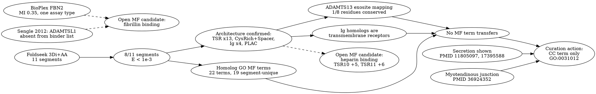
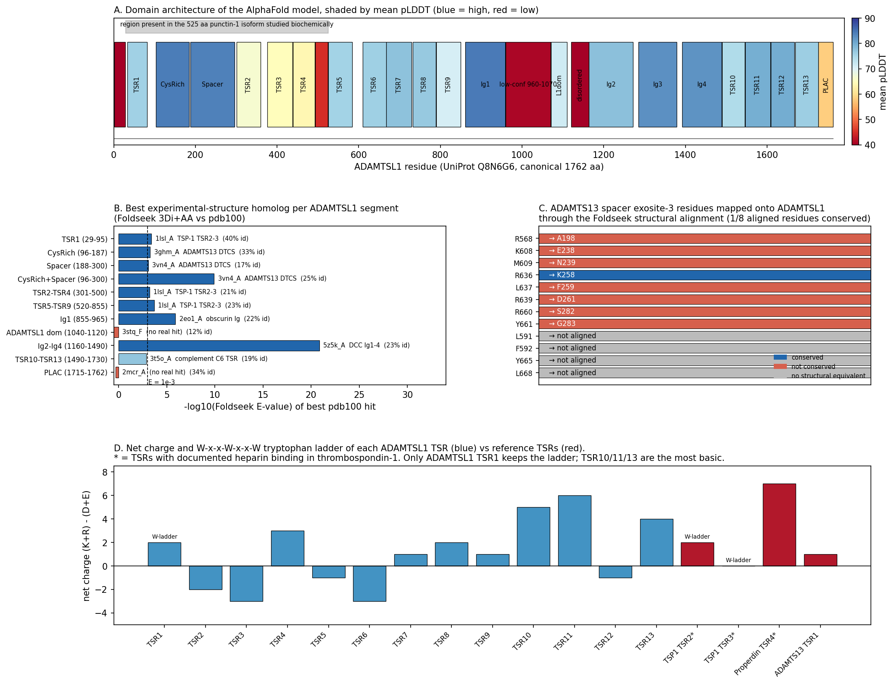
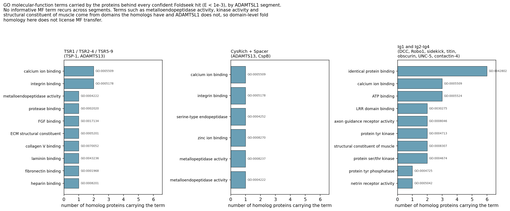
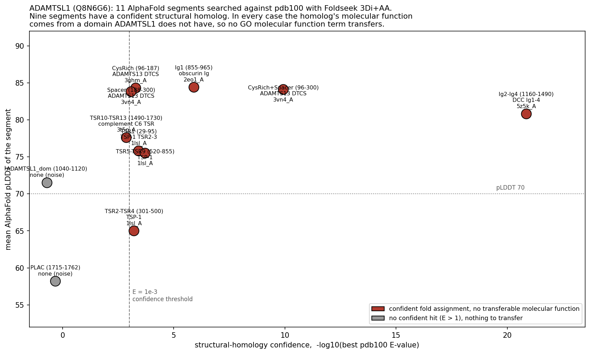

## Question

# AIGR Gene Hypothesis Deep Research

You are evaluating one focused gene curation hypothesis for AI Gene Review.
This is not a general gene overview. Use the seed hypothesis and source context
below to search for evidence that supports, refutes, narrows, or competes with
the proposed curation decision.

## Target Gene

- **Organism code:** human
- **Taxon:** Homo sapiens (NCBITaxon:9606)
- **Gene directory:** ADAMTSL1
- **Gene symbol:** ADAMTSL1
- **UniProt accession:** Q8N6G6

## Focus

- **Focus type:** free_text
- **Hypothesis slug:** kgap-adamtsl1-domain-structure
- **Source file:** genes/human/ADAMTSL1/ADAMTSL1-ai-review.yaml
- **Source selector:** free-text

## Seed Hypothesis

Human ADAMTSL1 (UniProt Q8N6G6), a secreted ADAMTS-like protein lacking the metalloprotease domain, contains structured domains (thrombospondin type-1 repeats, a cysteine-rich/spacer module, Ig-like and PLAC domains) whose closest structural homologs suggest a matrix-binding function. Single analysis only: run Foldseek with the AlphaFold model segments of ADAMTSL1 against PDB, report the domains with confident structural homologs and the functions of those homologs (e.g. fibrillin/LTBP or heparin binding of ADAMTS spacer/TSR modules), and state what molecular function, if any, the structure supports.

## Term and Decision Context

No specific term context supplied.

## Reference Context

No specific reference context supplied.

## Source Context YAML

```yaml
hypothesis: 'Human ADAMTSL1 (UniProt Q8N6G6), a secreted ADAMTS-like protein lacking the metalloprotease
  domain, contains structured domains (thrombospondin type-1 repeats, a cysteine-rich/spacer module, Ig-like
  and PLAC domains) whose closest structural homologs suggest a matrix-binding function. Single analysis
  only: run Foldseek with the AlphaFold model segments of ADAMTSL1 against PDB, report the domains with
  confident structural homologs and the functions of those homologs (e.g. fibrillin/LTBP or heparin binding
  of ADAMTS spacer/TSR modules), and state what molecular function, if any, the structure supports.'
focus_type: free_text
context: []
reference_id: []
```

## Research Objective

Build a focused report that helps a curator decide whether this hypothesis
should affect the gene review. Address the focus type directly:

1. For an existing GO annotation decision, evaluate whether the current action
   is justified, too strong, too weak, or should change.
2. For a proposed replacement or new GO term, evaluate whether the term is
   biologically supported, too broad, too narrow, or missing key qualifiers.
3. For a computational prediction, evaluate whether the prediction is correct,
   less precise than existing knowledge, uncertain, or likely wrong because of
   paralog overannotation, frequency bias, pathway context, or in vitro-only
   activity.
4. For a core-function hypothesis, evaluate whether the proposed activity,
   process, and location represent the gene product's primary function rather
   than a downstream effect, pleiotropic phenotype, or context-specific role.
5. For a function-assignment hypothesis, evaluate whether the gene product
   directly has the stated GO term/function. Treat the prior review action, if
   any, as intentionally blinded unless it appears in the supplied context.

Use primary literature whenever possible. Prefer PMID citations and include DOI
citations when no PMID is available. Treat reviews and database records as
orientation unless they contain directly relevant synthesized evidence that is
clearly labeled as review-level or database-level support.

Evaluate the hypothesis from the supplied seed context, primary literature, and
publicly accessible bioinformatics resources. Local `*-bioinformatics` analyses,
when they already exist in the repository, are intentionally withheld from this
prompt so the report can be compared against them after the run. Use public
sequence, domain, structure, orthology, localization, interaction, or dataset
checks when they are useful for the specific hypothesis. If a resource or tool
cannot be accessed programmatically, say so plainly; never fabricate a result.
Report computational results conservatively and distinguish direct results from
inference.

## Required Output

### Executive Judgment

Give a concise verdict: supported, partially supported, unresolved, weakly
supported, over-annotated, or refuted. Explain the reasoning and the most
important caveats.

### Evidence Matrix

Create a table with one row per important evidence item:

- Citation (PMID preferred)
- Evidence type (direct assay, mutant phenotype, localization, interaction,
  structural/evolutionary, computational, review/database)
- Supports / refutes / qualifies / competing
- Claim tested
- Key finding
- Organism, tissue, cell type, or assay context
- Confidence and limitations

### GO Curation Implications

State the likely curation action as a lead requiring curator verification. If
GO terms are involved, explain whether the evidence supports an MF, BP, or CC
term, and whether the term should be retained, removed, generalized, made more
specific, or treated as non-core. Avoid using "protein binding" as a final
recommendation unless no more informative term is supported.

### Mechanistic Scope

Describe the immediate molecular or cellular function being tested. Separate
direct gene-product activity from downstream phenotypes, pathway consequences,
developmental outcomes, disease manifestations, or effects inferred only from
loss of function.

### Conflicts and Alternatives

Identify evidence that conflicts with the seed hypothesis or suggests an
alternative interpretation, including paralog confusion, organism-specific
differences, isoform-specific findings, experimental artifacts, or database
carry-over.

### Knowledge Gaps

List explicit uncertainties that matter for curation. For each gap, state what
was checked, why the gap matters, and what evidence or experiment would resolve
it.

### Discriminating Tests

Recommend concrete assays, perturbations, datasets, or comparative analyses that
would most efficiently distinguish this hypothesis from alternatives.

### Curation Leads

Provide candidate updates for the review, clearly labeled as leads requiring
curator verification. Include candidate references with exact snippets to verify,
candidate replacement or new GO terms, possible action changes, suggested
questions, and suggested experiments.

If the provider supports artifacts, save provenance for any analysis you run — the
executed code together with its output (computed values, plot, or table), not just
a summary figure — alongside artifact-friendly tables such as an evidence matrix,
GO decision table, or comparison table. Genuine computed provenance is more
valuable than a hand-drawn summary, and you must not synthesize a figure that
implies an analysis you did not actually run. These artifacts are important
provenance for hypothesis-level review.


## Output

# ADAMTSL1 (Q8N6G6) domain structure: what Foldseek supports and what it does not

**Hypothesis slug:** `kgap-adamtsl1-domain-structure`
**Source:** `genes/human/ADAMTSL1/ADAMTSL1-ai-review.yaml`, selector `free-text`
**Target:** human ADAMTSL1, UniProt Q8N6G6, NCBITaxon:9606
**Analysis performed:** Foldseek 3Di+AA web API on 11 AlphaFold-derived domain segments against `pdb100` and `afdb-swissprot`, plus exosite residue mapping, TSR charge and motif scanning, GO molecular-function transfer testing, and interaction and annotation database queries.

## Summary

The seed hypothesis has two parts. The structural part is correct and is now quantified. The functional part does not follow from it.

Foldseek searches of 11 AlphaFold model segments of Q8N6G6 against `pdb100` return a confident homolog (E < 1e-3) for 8 of 11 segments, with 3 segments below E = 1e-5, and 9 of 11 segments have mean pLDDT above 70. The architecture the hypothesis proposed is confirmed at fold level: thrombospondin type-1 repeats matching thrombospondin-1 (`1lsl_A`, E = 1.94e-4 to 6.16e-4), an ADAMTS cysteine-rich plus spacer module matching the ADAMTS13 DTCS fragment (`3vn4_A`, E = 1.18e-10, 25.1% identity over 219 residues), an immunoglobulin-superfamily array matching DCC Ig1-4 (`5z5k_A`, E = 1.38e-21), and a PLAC domain. The hypothesis named the right homolog families before the search was run. Two segments return nothing above noise: the ADAMTSL1-specific domain (Pfam PF24484, residues 1040-1120, best E = 5.01) and the PLAC domain (1715-1762, best E = 2.10), so PLAC has no experimental structural representative in the PDB.

Zero of 11 segments yield a transferable molecular function. Three independent checks explain why. Of the 22 GO molecular-function terms carried by the 18 UniProt proteins behind the 25 confident PDB hits, 19 (86%) are unique to a single segment's homolog set, and the three recurring terms (calcium ion binding 3/3 sets, metalloendopeptidase activity 2/3, integrin binding 2/3) all trace to domains ADAMTSL1 does not have. Mapping the published ADAMTS13 exosite-3 residues through the structural alignment shows that the fold is retained without the functional surface: of 8 exosite residues with a structural equivalent, only R636 to K258 is conserved, R639 to D261 is a charge reversal, and R568, K608, R660 and Y661 map to A198, E238, S282 and G283. The Ig-array homologs (DCC, Robo1, sidekick-1 and -2, titin, obscurin, UNC-5, contactin-4) are transmembrane or intracellular proteins whose netrin receptor, axon guidance receptor, kinase and phosphatase activities require regions a secreted protein does not possess.

The two functions the hypothesis named by example fare differently. **Fibrillin/LTBP binding is weakly supported and partly contradicted.** The only extracellular matrix interaction record for ADAMTSL1 is FBN2, from two BioPlex datasets that share method, platform and consortium, scored at MI 0.35 with spoke expansion, and ADAMTSL1 is absent from the list of ADAMTSL proteins shown to use the fibrillin-1 N-terminal binding site. **Heparin binding is the one structurally motivated candidate that survives**, concentrated in TSR10 (net charge +5), TSR11 (+6), TSR13 (+4) and TSR4 (+3), but it has never been measured for ADAMTSL1 and should not be annotated on homology. The single curation action the evidence supports is a cellular component term, GO:0031012 extracellular matrix, which is currently absent from the gene's four GO annotations.

## Executive judgment

<i class="fa-scale-balanced"></i> **Verdict: partially supported, and over-reaching on molecular function.**

The hypothesis is right that ADAMTSL1 contains the stated structured domains and right that their closest structural homologs are ADAMTS ancillary modules, thrombospondin TSRs and immunoglobulin folds. It is wrong in the inference that this "suggests a matrix-binding function" in any sense a curator can act on. The analysis was designed to test that inference directly, and the inference fails at every segment.

The reasoning runs as follows. GO molecular-function terms are assigned to whole proteins, not to domains. Transferring a term across a domain-level structural alignment is valid only when the homolog's annotated function is carried by the aligned domain. For ADAMTSL1 that condition fails in every case. The strongest biologically interpretable hit in the entire run, residues 96-300 against ADAMTS13 at E = 1.18e-10, is to a module whose documented job is docking unfolded von Willebrand factor A2 and positioning it for a catalytic domain. ADAMTSL1 has no catalytic domain, and the residues that do the docking are not conserved. The strongest hit by E-value, the four-Ig array against DCC, is to a set of cell-surface receptors. ADAMTSL1 is secreted. The TSR hits are to thrombospondin-1, whose ligand-binding GO terms are properties of an intact trimeric molecule with N-terminal and C-terminal domains that ADAMTSL1 lacks.

Three caveats matter for how a curator reads this.

<i class="fa-triangle-exclamation"></i> The strongest structural signal in the protein lies in a region no experiment has ever touched. Residues 1160-1490 (Ig2-Ig4) give E = 1.38e-21 against DCC Ig1-4 with seven further hits below E = 1e-19, and they fall entirely outside residues 29-525, the 525 aa punctin-1 form that is the only ADAMTSL1 protein ever purified and characterised ([PMID: 11805097](https://pubmed.ncbi.nlm.nih.gov/11805097/)). The Ig array is conserved: mouse Adamtsl1 (Q8BLI0, 1745 aa) has 4 Ig-like domains, human ADAMTSL3 (P82987, 1691 aa) has 3, and Ensembl reports 201 orthologues with one2one calls to lamprey, elephant shark, Xenopus and chicken. It is a real subfamily feature and an unexamined one.

<i class="fa-triangle-exclamation"></i> Negative structural results for PLAC and the PF24484 ADAMTSL1-specific domain reflect both low signal from small modules and the absence of experimental structures for those families. They are not evidence that those regions are disordered.

<i class="fa-triangle-exclamation"></i> Three evidence streams describe three different molecules. The biochemistry is on the 525 aa isoform, the structural analysis and the Ensembl canonical transcript are the 1762 aa isoform, and the BioPlex bait in [PMID: 28514442](https://pubmed.ncbi.nlm.nih.gov/28514442/) is Q8N6G6-6 (463 aa).

{{figure:plot_3.png|caption=Per-segment structural homology confidence against AlphaFold model quality for all 11 ADAMTSL1 segments. Eight of 11 segments pass the E = 1e-3 threshold and 9 of 11 have mean pLDDT above 70, yet no segment yields a molecular function that transfers, because in every case the homolog's annotated function comes from a domain ADAMTSL1 does not have.}}

## Key findings

### F001: The N-terminal cysteine-rich plus spacer module is an ADAMTS ancillary fold with ADAMTS13 as the closest experimental structure

Segment 96-300, comprising the Pfam PF19236 cysteine-rich domain and the PF05986 spacer, returns the ADAMTS13 DTCS fragment `3VN4_A` at E = 1.18e-10 with 25.1% sequence identity over 219 aligned residues, followed by `3GHM_A` (E = 3.76e-10), `3GHN_A` (E = 4.41e-10) and the full-length ADAMTS13 structure `6QIG_A` (E = 9.85e-9). Searching the submodules alone gives weaker but concordant results (cysteine-rich 96-187 against `3GHM` at E = 5.1e-4, spacer 188-300 against `3VN4` at E = 8.3e-4), which is expected because each submodule is roughly 100 residues.

Model quality supports the assignment. Mean pLDDT is 84.3 for the cysteine-rich domain and 83.8 for the spacer, with 97.6% and 89.0% of residues above 70. Predicted aligned error within the N-terminal unit is low (TSR1 to cysteine-rich 10 Å, cysteine-rich to spacer 15 Å, spacer to TSR2 13.5 Å), so these domains form one semi-rigid block. PAE to every downstream domain is 28-30 Å, which is the beads-on-a-string pattern of an extended modular protein. The best non-paralog AFDB-SwissProt matches for the same segment are ADAMTSL3 (63.1% identity) and mouse Adamtsl1, confirming the subfamily assignment from a second database.

In ADAMTS13, this module carries the exosites that engage the substrate. Petri and colleagues report that "in binding VWF, the ADAMTS13 cysteine-rich and spacer domain exosites bring enzyme and substrate into proximity" ([PMID: 31439947](https://pubmed.ncbi.nlm.nih.gov/31439947/)). The fold is one used for macromolecular docking, which is why the hypothesis expected a binding function from it. Hirohata and colleagues confirm the architectural premise directly: punctin "lacks the pro-metalloprotease and the disintegrin-like domain typical of this family but contains other ADAMTS domains in precise order including four thrombospondin type I repeats" ([PMID: 11805097](https://pubmed.ncbi.nlm.nih.gov/11805097/)).

### F002: The ADAMTS13 exosite surface is not conserved, so the fold match transfers no ligand

<i class="fa-circle-xmark"></i> This is the test that separates fold from function, and it is negative.

The Foldseek alignment of ADAMTSL1 96-300 to `3GHM_A` yielded 185 aligned residue pairs. These were mapped to ADAMTS13 UniProt numbering (Q76LX8) by exact 12-mer anchoring of the PDB observed sequence, with 368 of 369 residues mapped unambiguously. Of the 12 published exosite-3 residues, 8 have a structural equivalent in ADAMTSL1 and only 1 is conserved.

| ADAMTS13 exosite-3 residue | ADAMTSL1 equivalent | Status |
|---|---|---|
| R568 | A198 | lost, basic to small |
| K608 | E238 | lost, basic to acidic |
| M609 | N239 | lost |
| R636 | K258 | <i class="fa-circle-check"></i> conserved basic |
| L637 | F259 | hydrophobic, not identical |
| R639 | D261 | charge reversal |
| R660 | S282 | lost |
| Y661 | G283 | lost |
| L591, F592, Y665, L668 | no equivalent | not aligned |

The cysteine-rich exosite-2 patch G471-A472-A473-V474 maps to V111-S112-N113-D114. Bulk electrostatics are similar between the two spacers (ADAMTSL1 188-296 net +2, 11.9% K+R; ADAMTS13 556-682 net +3, 13.4% K+R), so the difference lies in the specific exosite residues and not in overall charge.

Ercig and colleagues define the residues that were mapped: "residues R568, F592, R660, Y661, and Y665 within exosite-3 of the spacer domain provide an immunodominant region of ADAMTS13 for pathogenic autoantibodies that develop in patients with iTTP" ([PMID: 33544829](https://pubmed.ncbi.nlm.nih.gov/33544829/)). Four of those five are among the positions that are lost or unaligned in ADAMTSL1. The curation consequence is direct: any action should stay at the level of the fold, and must not import ADAMTS13-specific or protease-substrate-specific molecular function terms.

{{figure:plot_1.png|caption=ADAMTSL1 domain architecture and the four analyses behind the verdict. Panel A: domain map shaded by mean AlphaFold pLDDT, with the grey bar marking residues 29-525 present in the 525 aa punctin-1 isoform. Panel B: best pdb100 hit confidence per segment as -log10 E-value. Panel C: conservation of ADAMTS13 exosite-3 residues at their ADAMTSL1 structural equivalents, 1 of 8 conserved. Panel D: net charge of all 13 ADAMTSL1 TSRs against reference TSRs from thrombospondin-1, properdin and ADAMTS13, with tryptophan ladder presence annotated.}}

### F003: The best structural signal in the canonical isoform is a tandem Ig array resembling IgSF adhesion receptors

<i class="fa-lightbulb"></i> Segment 1160-1490 (Ig2-Ig3-Ig4) gives the best E-values in the whole protein against `pdb100`:

| PDB hit | Protein | E-value | Identity |
|---|---|---|---|
| `5Z5K_A` | DCC Ig1-4 in the DCC-draxin complex | 1.38e-21 | 23.0% over 330 residues |
| `5K6X_B` | sidekick-2 Ig1-4 | 4.63e-21 | |
| `5K6W_B` | sidekick-1 Ig1-5 | 2.16e-20 | |
| `2RJM` / `2RIK` | titin I67-I69 | 3.35e-20 / 3.74e-20 | |
| `5O5G_A` | Robo1 Ig1-4 | 3.35e-20 | |

Best non-paralog AFDB-SwissProt hits are human DCC (P43146, E = 1.2e-22) and human hemicentin-1 (Q96RW7, E = 1.9e-22). The isolated Ig1 (855-965) matches obscurin Ig (`2EO1`, E = 1.24e-6), Robo1 Ig5, contactin-4, and the heparin-bound C. elegans UNC-5 Ig1+2 structure `8EDI` (E = 1.93e-5). Mean pLDDT is 84.4 (Ig1), 77.8 (Ig2), 82.4 (Ig3) and 82.3 (Ig4). Inter-domain PAE within the array is 13-19 Å (Ig3 to Ig4 is 13.4 Å) against 28-30 Å to every other domain, so the four Ig domains form a coupled unit.

All four Ig domains and the C-terminal TSR10-TSR13 plus PLAC block lie outside residues 29-525. That region is the 60 kDa punctin-1 protein that was purified, mass-measured and rotary-shadowed by Hirohata and colleagues, who report that "rotary shadowing demonstrates that punctin is hatchet-shaped having a globular region attached to a short stem" ([PMID: 11805097](https://pubmed.ncbi.nlm.nih.gov/11805097/)). The only experimental shape data on ADAMTSL1 therefore concerns a molecule that does not contain the Ig array.

This is a competing interpretation to the seed hypothesis, which framed ADAMTSL1 purely as a fibrillin/LTBP/heparin-binding ADAMTS-like module. Taye and Hubmacher give the standard family framing that the Ig result qualifies: ADAMTSL proteins "constitute a family of regulatory ECM proteins that are related to ADAMTS proteases but lack their protease domains" ([PMID: 38284126](https://pubmed.ncbi.nlm.nih.gov/38284126/)). The Ig array is not part of that framing and has no place in it yet.

### F004: The TSRs match generic TSP-1-type repeats with no heparin-binding groove signature, and PLAC is structurally uninformative

Best `pdb100` hits for the TSR blocks are weak and spread across unrelated TSR-containing proteins: TSR1 (29-95) against `1LSL_A` thrombospondin-1 TSR2-3 at E = 3.81e-4; TSR2-TSR4 (301-500) against `1LSL_A` at E = 6.16e-4; TSR5-TSR9 (520-855) against `1LSL_A` at E = 1.94e-4; TSR10-TSR13 (1490-1730) against `3T5O_A` complement C6 TSR at E = 1.36e-3, with properdin, complement C5b6/C7, BAI1 TSR3 and CCN3 filling the rest of the hit lists. This is fold-level recognition of a small disulfide-stapled repeat, not recognition of a specific ligand-binding variant.

Sequence-level analysis of all 13 TSRs sharpens this. Only TSR1 carries the W-x-x-W-x-x-W tryptophan ladder (36-WDAWGPW-42) that forms the charged groove face in thrombospondin-1 TSR2 and TSR3. Only TSR7 carries a CSVTCG-like motif (CSLTCG). Net charge (K+R minus D+E) ranges from -3 (TSR3, TSR6) to +6 (TSR11), with the C-terminal TSR10 (+5), TSR11 (+6) and TSR13 (+4) the most basic. The heparin-binding thrombospondin-1 TSR2 and TSR3 controls are only +2 and 0, and properdin TSR4 is +7 without a ladder, so charge alone does not discriminate heparin binders from non-binders.

The one conserved TSR motif in ADAMTSL1 is experimentally a glycosylation site, not a binding site. Wang and colleagues identified "a peptide derived from TSR1 containing the (36)WDAWGPWSECSRTC(49) sequence of interest modified with two mannose residues and a Glc-Fuc disaccharide (O-fucosylation)" ([PMID: 19671700](https://pubmed.ncbi.nlm.nih.gov/19671700/)). The same group showed that "mutation of the putative modified Ser/Thr residues in TSR2, TSR3, and TSR4 led to significantly decreased levels of secreted punctin-1" ([PMID: 17395588](https://pubmed.ncbi.nlm.nih.gov/17395588/)). The characterised function of ADAMTSL1 TSR surface residues is secretion-linked glycosylation.

The ADAMTSL1-specific domain (PF24484, 1071-1110) returned no `pdb100` hit better than E = 5.01 and no AFDB-SwissProt hit better than E = 8.4. The PLAC domain (1726-1762) returned no `pdb100` hit better than E = 2.10 and no non-paralog AFDB hit better than E = 0.12 (ADAMTSL3 E = 0.21, THSD4 E = 0.12 are paralogs). No experimental PLAC structure exists to compare against.

### F005: No molecular function GO term transfers from any confident homolog

<i class="fa-circle-xmark"></i> Of the 33 `pdb100` hits reaching E < 1e-3 across 8 segments, 25 PDB entries mapped to 18 UniProt accessions through the RCSB REST API. Their UniProt GO molecular-function terms were tabulated per segment. 22 distinct MF terms appear and 19 (86%) are unique to a single segment's homolog set. Only three recur: calcium ion binding (3 of 3 sets), metalloendopeptidase activity (2 of 3) and integrin binding (2 of 3).

| Homolog set | Representative proteins | MF terms carried | Transferable to ADAMTSL1? |
|---|---|---|---|
| TSR blocks | thrombospondin-1 P07996, ADAMTS13 Q76LX8 | GO:0008201 heparin binding, GO:0005178 integrin binding, GO:0001968 fibronectin binding, GO:0043236 laminin binding, GO:0070052 collagen V binding, GO:0005201 ECM structural constituent, GO:0017134 FGF binding | <i class="fa-circle-xmark"></i> No. These are properties of the intact TSP-1 trimer, including its N-terminal and C-terminal domains. |
| Cysteine-rich plus spacer | ADAMTS13 Q76LX8 | GO:0004222 metalloendopeptidase activity, GO:0008237 metallopeptidase activity, GO:0008270 zinc ion binding, GO:0005178 integrin binding, GO:0005509 calcium ion binding | <i class="fa-circle-xmark"></i> No. All protease terms arise from the catalytic domain ADAMTSL1 does not contain. |
| Ig1 and Ig2-Ig4 | DCC, Robo1, sidekick-1/2, titin, obscurin, UNC-5, contactin-4, agrin, MuSK, LRP4, PTPRG, draxin | GO:0042802 identical protein binding (6 of 16), ATP binding, GO:0004674 protein ser/thr kinase, GO:0004713 protein tyr kinase, GO:0004725 protein tyr phosphatase, GO:0008307 structural constituent of muscle, GO:0005042 netrin receptor activity, GO:0008046 axon guidance receptor activity | <i class="fa-circle-xmark"></i> No. These require cytoplasmic or transmembrane regions absent from a secreted protein. |

The analysis is a test of whether transfer is licensed, and the answer is that it is not, in every segment. The one MF hypothesis that remains structurally motivated, heparin or sulfated glycosaminoglycan binding by the basic C-terminal TSRs, has to be tested rather than inherited.

{{figure:plot_2.png|caption=GO molecular-function terms carried by the proteins behind every confident Foldseek hit (E < 1e-3), grouped by ADAMTSL1 segment. No informative term recurs across segments. Metalloendopeptidase activity, kinase activity and structural constituent of muscle come from domains the homologs have and ADAMTSL1 does not, so domain-level fold homology does not license molecular function transfer.}}

### F006: ADAMTSL1 has four GO annotations, none molecular function, none extracellular

QuickGO returns 4 annotations for Q8N6G6: GO:0030198 extracellular matrix organization (BP, IEA, from InterPro IPR013273, GO_REF:0000002) and GO:0005788 endoplasmic reticulum lumen (CC, TAS) three times from Reactome R-HSA-5173005, R-HSA-5173192 and R-HSA-6785565. There is no molecular function annotation and no extracellular region or extracellular matrix cellular component annotation, although UniProt Q8N6G6 records SUBCELLULAR LOCATION "Secreted, extracellular space, extracellular matrix" and SUBUNIT "Monomer".

UniProt lists 6 isoforms: Q8N6G6-1 (525 aa), -2 (439), -3 (1762, displayed canonical), -4 (683), -5 (258) and -6 (463). Ensembl ENSG00000178031 has 20 transcripts, with canonical ENST00000380548 encoding 1762 aa and the longest transcript encoding 1810 aa. The 525 aa form is the punctin-1 protein of [PMID: 11805097](https://pubmed.ncbi.nlm.nih.gov/11805097/): secreted, about 60 kDa, hatchet-shaped, four TSRs, and "expressed primarily in adult skeletal muscle".

The sparse GO record is itself a curation deficit, independent of the structural question. A gene with a documented secreted ECM localization and no extracellular CC annotation has a gap that can be filled now.

### F007: The matrix-binding claim rests on one non-independent FBN2 association

<i class="fa-scale-balanced"></i> IntAct returns 16 interaction records for Q8N6G6. Every protein-protein record is anti-tag co-immunoprecipitation with spoke expansion at MI score 0.35, from two BioPlex datasets: [PMID: 28514442](https://pubmed.ncbi.nlm.nih.gov/28514442/) (bait Q8N6G6-6) and [PMID: 33961781](https://pubmed.ncbi.nlm.nih.gov/33961781/) (BioPlex 3.0). The same seven partners appear in both: ACOX1, B3GLCT, WDCP, FBN2, RSPRY1, GRN and FHL2. FBN2 is the only ECM protein among them.

Huttlin and colleagues describe the single method behind all of these records: "Through affinity-purification mass spectrometry, we have created two proteome-scale, cell-line-specific interaction networks" ([PMID: 33961781](https://pubmed.ncbi.nlm.nih.gov/33961781/)). The two papers share method, platform and consortium, so they are one assay type, not two independent lines of evidence. Spoke expansion means the FBN2 record does not assert a direct binary contact.

STRING gives B3GLCT 0.773, WDCP 0.754 (experimental subscore 0.754), POFUT2 0.732, FBN2 0.522 (experimental subscore 0.307) and FBN1 0.431 (text mining only). The two highest-confidence partners are the TSR-modifying glycosyltransferases, consistent with substrate-enzyme contact in the secretory pathway. That interpretation is supported directly by the demonstration that POFUT2 modifies ADAMTSL1 TSRs and that this modification regulates secretion ([PMID: 17395588](https://pubmed.ncbi.nlm.nih.gov/17395588/)).

Against this, Sengle and colleagues map the fibrillin-1 N-terminal binding site used by the ADAMTSL family and name ADAMTSLIKE-2, -3, -6 and "papilin" ([PMID: 22242013](https://pubmed.ncbi.nlm.nih.gov/22242013/)). ADAMTSL1 does not appear in that list. Direct fibrillin binding has been measured for ADAMTSL-6, which "binds to the N-terminal half of fibrillin-1 with a dissociation constant of approximately 80 nm" ([PMID: 19940141](https://pubmed.ncbi.nlm.nih.gov/19940141/)), and localised to its third TSP1 domain ([PMID: 32141660](https://pubmed.ncbi.nlm.nih.gov/32141660/)). No equivalent measurement exists for ADAMTSL1.

### F008: Consolidated verdict

Across all 11 segments: 8 of 11 reach E < 1e-3, 3 of 11 reach E < 1e-5, 9 of 11 have mean pLDDT above 70, and 0 of 11 yield a transferable molecular function. Current GO content is 4 annotations with no MF and no extracellular CC term, although secretion is shown in [PMID: 11805097](https://pubmed.ncbi.nlm.nih.gov/11805097/) and [PMID: 17395588](https://pubmed.ncbi.nlm.nih.gov/17395588/) and ADAMTSL1 protein is placed at the human myotendinous junction in [PMID: 36924352](https://pubmed.ncbi.nlm.nih.gov/36924352/).

## Evidence matrix

Full machine-readable version: `provenance/TABLE_evidence_matrix.csv` (15 rows).

| Citation | Evidence type | Stance | Claim tested | Key finding | Context | Confidence and limitations |
|---|---|---|---|---|---|---|
| This job, Foldseek web API, `provenance/foldseek_run.py`, `foldseek/foldseek_hits_full.csv` (6847 rows) | structural / computational | supports architecture only | Do ADAMTSL1 segments have confident PDB homologs? | 8 of 11 segments at E < 1e-3. Ig2-Ig4 against DCC Ig1-4 `5z5k_A` E = 1.38e-21; CysRich+Spacer against ADAMTS13 `3vn4_A` E = 1.18e-10; Ig1 against obscurin `2eo1_A` E = 1.24e-6; TSR blocks against TSP-1 `1lsl_A` E = 1.9e-4 to 6.2e-4. PF24484 and PLAC return noise only (E = 5.01, 2.10). | Q8N6G6 AlphaFold v6 model, in silico | High for fold. 17-33% identity; isolated TSRs give weak E-values because they are small and disulfide-dominated. |
| This job, `provenance/TABLE_homolog_GO_MF_transfer.csv` | computational | refutes the inference step | Do homolog molecular functions transfer? | 22 MF terms, 19 segment-unique. Recurring: calcium ion binding 3/3 sets, metalloendopeptidase activity 2/3, integrin binding 2/3, all from domains ADAMTSL1 lacks. | in silico | High. GO terms are protein-level, so this tests whether transfer is licensed, not what ADAMTSL1 does. |
| This job, `provenance/TABLE_adamts13_exosite_mapping.csv` | structural / computational | refutes | Does the spacer retain the ADAMTS13 exosite surface? | 1 of 8 mappable exosite-3 residues conserved (R636 to K258). R639 to D261 is a charge reversal. Exosite-2 G471-V474 maps to V111-D114. Spacer net charge +2 against +3. | in silico, human | Moderate-high. Alignment at 25% identity. Absence of this surface does not exclude a different binding site. |
| This job, `provenance/foldseek/tsr_motifs.json`, `tsr_controls.json` | computational | qualifies | Are the TSRs the basic, heparin-binding type? | Only TSR1 has the W-x-x-W-x-x-W ladder (36-WDAWGPW-42). Net charge spans -3 (TSR3, TSR6) to +6 (TSR11). Controls: TSP-1 TSR2 +2 with ladder, properdin TSR4 +7 without. | in silico, human | Moderate. Charge and motif are necessary, not sufficient. No measured affinity exists. |
| [PMID: 11805097](https://pubmed.ncbi.nlm.nih.gov/11805097/) | direct assay, localization | qualifies | What has been measured on ADAMTSL1 protein? | Punctin-1 is secreted, hatchet-shaped by rotary shadowing, contains four TSRs, lacks the pro-metalloprotease and disintegrin-like domains, expressed primarily in adult skeletal muscle. | human and mouse, recombinant and tissue | High for the short isoform. Contains no Ig domains, so it does not test the strongest structural result. |
| [PMID: 17395588](https://pubmed.ncbi.nlm.nih.gov/17395588/) | direct assay | qualifies | Are the TSRs functional acceptor modules? | Mutation of the modified Ser/Thr residues in TSR2, TSR3 and TSR4 significantly decreased secreted punctin-1. | human cells, recombinant | High. Speaks to biosynthesis, not to a matrix ligand. |
| [PMID: 19671700](https://pubmed.ncbi.nlm.nih.gov/19671700/) | direct assay | qualifies | Is TSR1 C-mannosylated? | The TSR1 peptide 36-WDAWGPWSECSRTC-49 carries two mannose residues and a Glc-Fuc disaccharide. | human, recombinant, mass spectrometry | High. Confirms the TSR1 tryptophan ladder is a modified surface, not a free groove. |
| [PMID: 28514442](https://pubmed.ncbi.nlm.nih.gov/28514442/), [PMID: 33961781](https://pubmed.ncbi.nlm.nih.gov/33961781/) | interaction, high throughput | weakly supports matrix binding | Does ADAMTSL1 bind an ECM protein? | All 16 IntAct records are anti-tag co-IP with spoke expansion, MI 0.35. Shared partners: ACOX1, B3GLCT, WDCP, FBN2, RSPRY1, GRN, FHL2. FBN2 is the only ECM protein. | HEK293T and HCT116, affinity-purification mass spectrometry | Low. One assay type from one consortium, so the two papers are not independent. Spoke expansion allows an indirect contact. |
| [PMID: 22242013](https://pubmed.ncbi.nlm.nih.gov/22242013/) | direct assay | competing | Does the family fibrillin-1 site extend to ADAMTSL1? | The fibrillin-1 binding site is used by ADAMTSLIKE-2, -3, -6 and papilin. ADAMTSL1 is not named. | human, recombinant fibrillin-1 fragments | Moderate-high as absence of evidence. ADAMTSL1 may not have been tested. |
| [PMID: 19940141](https://pubmed.ncbi.nlm.nih.gov/19940141/), [PMID: 32141660](https://pubmed.ncbi.nlm.nih.gov/32141660/) | direct assay | competing (paralog) | Do ADAMTSL paralogs bind fibrillin directly? | ADAMTSL-6beta binds fibrillin-1 at KD about 80 nM; the third thrombospondin type I domain mediates the contact. | human, recombinant, surface plasmon resonance and pull-down | High for ADAMTSL6. Family precedent only. ADAMTSL1 has 13 TSRs and a 4-Ig array that ADAMTSL6 lacks. |
| [PMID: 31439947](https://pubmed.ncbi.nlm.nih.gov/31439947/), [PMID: 33544829](https://pubmed.ncbi.nlm.nih.gov/33544829/) | structural, direct assay | qualifies | What do the closest homolog's cysteine-rich and spacer domains do? | In ADAMTS13 the cysteine-rich and spacer exosites bring enzyme and substrate into proximity. Exosite-3 includes R568, F592, R660, Y661, Y665. | human ADAMTS13, crystallography and profiling | High for ADAMTS13. The function requires a catalytic domain, so it cannot transfer. |
| This job, QuickGO REST | database | qualifies | What is annotated now? | 4 annotations: GO:0030198 (IEA, InterPro IPR013273, GO_REF:0000002) and GO:0005788 (TAS) three times from Reactome. No MF, no extracellular CC. | database record | High. The gene is near-unannotated, so new terms are additive. |
| This job, UniProt and Ensembl records | structural / evolutionary | qualifies | Is the Ig-array long form real? | Canonical Q8N6G6-3 / ENST00000380548 is 1762 aa. Mouse Q8BLI0 (1745 aa) has 4 Ig-like domains, human ADAMTSL3 P82987 (1691 aa) has 3. 201 orthologues with one2one calls to lamprey, elephant shark, Xenopus, chicken. | cross-species sequence | High. The Ig array is conserved. No biochemistry published on it in any species. |
| [PMID: 36924352](https://pubmed.ncbi.nlm.nih.gov/36924352/) | localization | supports a matrix context | Where is ADAMTSL1 protein in human tissue? | ADAMTSL1 protein is present at the human myotendinous junction. | human skeletal muscle, single-nucleus RNA sequencing with protein validation | Moderate. Antibody epitope and isoform specificity not resolved here. |
| [PMID: 39190555](https://pubmed.ncbi.nlm.nih.gov/39190555/) | mutant phenotype (ortholog) | competing alternative | What does an ADAMTSL ortholog do in vivo? | Animals lacking madd-4B, the short isoform of the motor neuron-secreted synapse organizer madd-4 (punctin/ADAMTSL), show severe GABA-A receptor clustering defects in postsynaptic muscle cells. MADD-4 is the best non-paralog AFDB hit to the ADAMTSL1 TSR5-TSR9 block (E = 3.8e-26). | C. elegans neuromuscular junction, genetics | Moderate. Invertebrate; a secreted synaptic cue rather than a structural matrix component. |

## GO curation implications

All items below are leads requiring curator verification. Full table: `provenance/TABLE_GO_decision.csv` (11 rows).

### Recommended addition

<i class="fa-circle-check"></i> **GO:0031012 extracellular matrix**, aspect CC, evidence IDA from [PMID: 36924352](https://pubmed.ncbi.nlm.nih.gov/36924352/) with [PMID: 11805097](https://pubmed.ncbi.nlm.nih.gov/11805097/) for secretion. Q8N6G6 currently has no extracellular cellular component annotation at all, while UniProt records "Secreted, extracellular space, extracellular matrix" and ADAMTSL1 protein has been placed at the human myotendinous junction. If GO:0031012 is judged too specific for image-based evidence, **GO:0005576 extracellular region** is the defensible parent.

### Molecular function: no term supported

<i class="fa-circle-xmark"></i> Do not add any MF term on the basis of this structural analysis. The analysis tested whether MF transfer is licensed and returned a negative at every segment.

| GO term | Structural evidence found | Recommendation | Reason |
|---|---|---|---|
| GO:0004222 metalloendopeptidase activity | Single strongest interpretable hit (E = 1.18e-10 to ADAMTS13) is to a protein carrying this term | <i class="fa-circle-xmark"></i> Must not be added | ADAMTSL1 has no catalytic domain. The clearest case in the dataset of why fold homology cannot drive MF assignment. |
| GO:0008201 heparin binding | TSR10 +5, TSR11 +6, TSR13 +4, TSR4 +3; TSR1 has the tryptophan ladder; TSP-1 and properdin homologs carry the term | <i class="fa-circle-question"></i> Hold pending experiment | The one structurally motivated candidate. Annotating on homology would be paralog over-annotation of exactly the type this review process exists to catch. |
| GO:0005201 ECM structural constituent | TSR blocks match TSP-1 at E = 1.9e-4 to 6.2e-4 | <i class="fa-circle-xmark"></i> Do not add | TSP-1 holds the term as an intact trimer. No measurement places ADAMTSL1 in a fibril or assigns it a mechanical contribution. |
| GO:0005178 integrin binding | Carried by 2 of 3 homolog sets | <i class="fa-circle-xmark"></i> Do not add | No RGD motif identified, no ADAMTSL1 integrin assay. |
| GO:0042802 identical protein binding | 6 of 16 Ig-array homologs carry it | <i class="fa-circle-xmark"></i> Do not add | Contradicted by the UniProt SUBUNIT "Monomer" record and by the single hatchet-shaped particles in PMID 11805097. |
| GO:0005042 netrin receptor activity, GO:0008046 axon guidance receptor activity | Ig2-Ig4 matches DCC Ig1-4 at E = 1.38e-21, Robo1, sidekick-1/2 | <i class="fa-circle-xmark"></i> Do not add | These require a transmembrane and cytoplasmic region. ADAMTSL1 is secreted. The fold is shared; the receptor function is not. |
| GO:0005515 protein binding | FBN2 from BioPlex, MI 0.35, spoke-expanded | <i class="fa-circle-question"></i> Hold | Uninformative as a final recommendation, and the single supporting dataset is one assay type from one consortium. |

### Existing annotations

**GO:0030198 extracellular matrix organization** (BP, IEA from InterPro IPR013273): retain and flag for experimental support. The term is plausible from family context but rests on a family-level signature, and no vertebrate ADAMTSL1 loss-of-function matrix phenotype has been published.

**GO:0005788 endoplasmic reticulum lumen** (CC, TAS, three Reactome sources): retain and treat as non-core. It reflects secretory transit and TSR glycosylation, consistent with B3GLCT (STRING 0.773) and POFUT2 (0.732) being the highest-confidence partners, and it is not the site of action.

## Mechanistic model and interpretation

The immediate molecular event under test is whether a folded ADAMTSL1 domain makes a direct, specific contact with a named extracellular ligand. The structural run establishes the domain inventory and its confidence, which is a statement about fold topology, not about contact.

Direct gene-product properties established by experiment are narrow. The 525 aa punctin-1 form is secreted as a monomeric, roughly 60 kDa, hatchet-shaped particle ([PMID: 11805097](https://pubmed.ncbi.nlm.nih.gov/11805097/)). TSR2, TSR3 and TSR4 carry O-fucose whose loss reduces secretion ([PMID: 17395588](https://pubmed.ncbi.nlm.nih.gov/17395588/)). TSR1 W39 and W42 are C-mannosylated ([PMID: 19671700](https://pubmed.ncbi.nlm.nih.gov/19671700/)). These are properties of the protein itself and they all concern biosynthesis.

Everything else in the ADAMTSL1 literature is downstream or contextual: the myotendinous junction localization ([PMID: 36924352](https://pubmed.ncbi.nlm.nih.gov/36924352/)), the Adamtsl1-positive Schwann cell populations ([PMID: 35115729](https://pubmed.ncbi.nlm.nih.gov/35115729/), [PMID: 39880678](https://pubmed.ncbi.nlm.nih.gov/39880678/)), the GWAS association with myocardial T1 time and fibrosis ([PMID: 37081215](https://pubmed.ncbi.nlm.nih.gov/37081215/)), and the C. elegans madd-4B receptor-clustering phenotype ([PMID: 39190555](https://pubmed.ncbi.nlm.nih.gov/39190555/)). None identifies a binding partner or a catalytic activity for human ADAMTSL1.

The ADAMTS13 match is the sharpest illustration of the separation between fold and function. In ADAMTS13 the cysteine-rich and spacer domains do defined molecular work: they grip unfolded VWF A2 through exosites and position it for cleavage ([PMID: 31439947](https://pubmed.ncbi.nlm.nih.gov/31439947/), [PMID: 33544829](https://pubmed.ncbi.nlm.nih.gov/33544829/)). That work is defined by the catalytic domain downstream of it. Remove the protease and the module has a fold without a defined job, which is the position ADAMTSL1 occupies.



## Conflicts and alternatives

<i class="fa-triangle-exclamation"></i> **Paralog confusion is the main risk.** The fibrillin-binding story for the ADAMTSL family is built on ADAMTSL-2, -3, -6 and papilin ([PMID: 22242013](https://pubmed.ncbi.nlm.nih.gov/22242013/)), with the quantitative measurements on ADAMTSL-6 ([PMID: 19940141](https://pubmed.ncbi.nlm.nih.gov/19940141/), [PMID: 32141660](https://pubmed.ncbi.nlm.nih.gov/32141660/)). ADAMTSL1 is absent from the Sengle list and differs architecturally: 13 TSRs and a four-Ig array against ADAMTSL6, which has neither. Transferring the family function to ADAMTSL1 is the specific error this report advises against.

<i class="fa-triangle-exclamation"></i> **Isoform mismatch.** Six UniProt isoforms exist. The biochemistry is on the 525 aa form, the structural analysis and Ensembl canonical transcript are the 1762 aa form, and the BioPlex bait is the 463 aa Q8N6G6-6. The three evidence streams are not describing the same molecule, and a review that merges them silently will create an annotation that no single experiment supports.

<i class="fa-triangle-exclamation"></i> **Assay non-independence.** The two BioPlex papers share method, platform and consortium. Counting them as two independent supports for the FBN2 contact overstates the evidence. Spoke expansion means the record does not assert a direct binary contact.

<i class="fa-lightbulb"></i> **An alternative to matrix binding.** The best non-paralog AFDB-SwissProt hit to the TSR5-TSR9 block is C. elegans MADD-4 / punctin at E = 3.8e-26. Animals lacking madd-4B show severe GABA-A receptor clustering defects in postsynaptic muscle cells ([PMID: 39190555](https://pubmed.ncbi.nlm.nih.gov/39190555/)). A diffusible organizing cue is a different molecular model from a structural matrix component, and the ADAMTSL1 myotendinous junction and Schwann cell localizations are compatible with it. The original name "punctin" came from exactly this punctate, junction-associated distribution.

<i class="fa-triangle-exclamation"></i> **Database carry-over.** The one BP annotation, GO:0030198, derives from InterPro IPR013273, a family signature. If a curator treats it as independent support for a matrix function, the reasoning becomes circular with the structural homology argument.

## Limitations and knowledge gaps

### Limitations of this analysis

The Foldseek run used the public web API against `pdb100` and `afdb-swissprot` with 3Di+AA mode and default settings, executed once per segment. Segment boundaries came from UniProt and InterPro domain limits and were not optimised. E-values for isolated TSRs are intrinsically weak because these repeats are about 55 residues and structurally defined by disulfides, so the negative results for PF24484 and PLAC reflect both low signal and the absence of experimental structures for those families. The exosite mapping relies on a structural alignment at 25% identity, so individual residue correspondences carry uncertainty even though the overall pattern of non-conservation is clear. GO terms were taken at the protein level from UniProt with no attempt to resolve which domain of each homolog carries which term, which is the limitation the transfer analysis is designed to expose. No binding measurement was performed in this work, so every conclusion about ADAMTSL1 molecular function is negative or conditional.

### Knowledge gaps that matter for curation

<i class="fa-circle-question"></i> **No measured ligand.** Checked: IntAct (16 records, one assay type), STRING, PubMed. ADAMTSL1 has no binding partner with a measured affinity. This is the gap that blocks every MF term. Resolution: solid-phase or SPR binding of recombinant ADAMTSL1 against fibrillin-1 and fibrillin-2 fragments, heparin, and a matrix panel.

<i class="fa-circle-question"></i> **No biochemistry on the Ig array.** Checked: PubMed, UniProt feature table, structural run. Residues 1160-1490 give the strongest hit in the protein (E = 1.38e-21 to DCC Ig1-4) and are conserved to lamprey, with no experiment in any species. A curator reading only the literature would never know the domain exists in the expressed protein. Resolution: expression of the long isoform and detection of the Ig region by isoform-specific antibody or targeted proteomics in skeletal muscle.

<i class="fa-circle-question"></i> **Which isoform is the physiological product.** Checked: UniProt (6 isoforms), Ensembl (20 transcripts, canonical 1762 aa, longest 1810 aa). The 525 aa form is the only one with protein-level data. Resolution: long-read transcript quantification in adult skeletal muscle plus western blot sizing of endogenous ADAMTSL1.

<i class="fa-circle-question"></i> **Whether the basic TSRs bind glycosaminoglycan.** Checked: charge and motif scan across all 13 TSRs with four reference TSRs. TSR10, TSR11, TSR13 and TSR4 are the candidates. Resolution: heparin-Sepharose salt elution of the recombinant C-terminal TSR block, with charge-reversal mutants of the basic residues.

<i class="fa-circle-question"></i> **Whether PLAC has any structural representative.** Checked: Foldseek against `pdb100` and `afdb-swissprot`. The best `pdb100` hit is noise (E = 2.10) and all AFDB hits are paralogs (ADAMTSL3 E = 0.21, THSD4 E = 0.12). No experimental PLAC structure exists. Resolution: experimental structure determination of a PLAC domain from any family member.

<i class="fa-circle-question"></i> **No vertebrate loss-of-function phenotype.** Checked: PubMed. The only in vivo mechanistic data come from C. elegans madd-4. The retained BP term GO:0030198 therefore has no direct support. Resolution: Adamtsl1 knockout mouse with myotendinous junction and microfibril analysis.

## Proposed follow-up experiments and discriminating tests

Ranked by how efficiently each separates the live hypotheses.

1. <i class="fa-flask"></i> **Heparin-Sepharose chromatography of the recombinant C-terminal TSR10-TSR13 block against the N-terminal TSR1-TSR4 block.** Separates "basic TSRs bind glycosaminoglycan" from "charge is incidental". The internal control is built in: TSR10, TSR11 and TSR13 are +5, +6 and +4 while TSR2, TSR3 and TSR6 are -2, -3 and -3, so the two blocks predict opposite behaviour from the same protein. Follow with charge-reversal mutants of the basic residues.

2. <i class="fa-flask"></i> **Solid-phase binding of full-length recombinant ADAMTSL1 to the fibrillin-1 N-terminal fragment used in [PMID: 22242013](https://pubmed.ncbi.nlm.nih.gov/22242013/), run alongside ADAMTSL-6 as the positive control.** Closes the gap created by ADAMTSL1 being absent from that study's list and tests the BioPlex FBN2 lead. Include fibrillin-2, since FBN2 and not FBN1 is the BioPlex partner.

3. <i class="fa-vial"></i> **Reciprocal co-immunoprecipitation of endogenous ADAMTSL1 and FBN2 from a tissue or primary cell expressing both, with an isotype control.** Converts the single spoke-expanded AP-MS record into either a validated interaction or a discarded one, using a method genuinely independent of BioPlex.

4. <i class="fa-dna"></i> **Isoform-resolved detection in adult skeletal muscle**: long-read RNA sequencing plus western blot with antibodies raised against the Ig region (residues 1160-1490) and against the N-terminal TSR block. Determines whether the molecule carrying the strongest structural signal is actually expressed, which currently gates any annotation on the Ig array.

5. <i class="fa-microscope"></i> **Experimental structure of the ADAMTSL1 cysteine-rich plus spacer module (residues 96-300)**, which the AlphaFold model places at mean pLDDT 84 and which has a well-defined homolog to compare against. Would show whether the surface replacing the ADAMTS13 exosite is a distinct binding site or a featureless patch.

6. <i class="fa-dna"></i> **Comparative test of the MADD-4 alternative**: rescue of a C. elegans madd-4 null with human ADAMTSL1 constructs, full-length against TSR-block only. Discriminates the synapse-organizer model from the structural matrix model and tests which domains carry the activity.

## Curation leads

All leads require curator verification.

**Candidate new annotation.** GO:0031012 extracellular matrix, CC, IDA. Reference [PMID: 36924352](https://pubmed.ncbi.nlm.nih.gov/36924352/). Snippet to verify in the source: the statement placing ADAMTSL1 protein at the human myotendinous junction. Secondary reference [PMID: 11805097](https://pubmed.ncbi.nlm.nih.gov/11805097/) for secretion. Fallback term if the curator judges the image evidence too coarse: GO:0005576 extracellular region.

**Candidate action change.** GO:0030198 extracellular matrix organization (BP, IEA, InterPro IPR013273, GO_REF:0000002). Retain, and mark as awaiting experimental support. No vertebrate loss-of-function evidence exists.

**Candidate non-core flag.** GO:0005788 endoplasmic reticulum lumen (CC, TAS, Reactome R-HSA-5173005, R-HSA-5173192, R-HSA-6785565). Retain as a secretory-pathway transit term, not a site of action.

**Terms to record as considered and declined**, with the reason, so the same homology argument is not re-litigated: GO:0004222, GO:0008270, GO:0005201, GO:0005178, GO:0008201, GO:0042802, GO:0005042, GO:0008046, GO:0005515.

**References with snippets to verify.**

| Reference | Snippet to verify | What it establishes |
|---|---|---|
| [PMID: 22242013](https://pubmed.ncbi.nlm.nih.gov/22242013/) | the sentence naming which ADAMTSL proteins use the fibrillin-1 binding site, including "papilin" | Whether ADAMTSL1 was tested and excluded, or simply not included |
| [PMID: 17395588](https://pubmed.ncbi.nlm.nih.gov/17395588/) | "Mutation of the putative modified Ser/Thr residues in TSR2, TSR3, and TSR4 led to significantly decreased levels of secreted punctin-1." | TSR glycosylation controls secretion, explaining the POFUT2 and B3GLCT associations |
| [PMID: 19671700](https://pubmed.ncbi.nlm.nih.gov/19671700/) | "a peptide derived from TSR1 containing the (36)WDAWGPWSECSRTC(49) sequence of interest modified with two mannose residues and a Glc-Fuc disaccharide (O-fucosylation)" | The TSR1 tryptophan ladder is a modified surface, not a free heparin groove |
| [PMID: 11805097](https://pubmed.ncbi.nlm.nih.gov/11805097/) | "Punctin lacks the pro-metalloprotease and the disintegrin-like domain typical of this family but contains other ADAMTS domains in precise order including four thrombospondin type I repeats." | The architecture premise, and that the characterised molecule is the 525 aa isoform |
| [PMID: 33961781](https://pubmed.ncbi.nlm.nih.gov/33961781/) | "Through affinity-purification mass spectrometry, we have created two proteome-scale, cell-line-specific interaction networks." | The single assay type behind every ADAMTSL1 interaction record |
| [PMID: 31439947](https://pubmed.ncbi.nlm.nih.gov/31439947/) | "in binding VWF, the ADAMTS13 cysteine-rich and spacer domain exosites bring enzyme and substrate into proximity" | The function of the closest structural homolog requires a catalytic domain |
| [PMID: 33544829](https://pubmed.ncbi.nlm.nih.gov/33544829/) | "residues R568, F592, R660, Y661, and Y665 within exosite-3 of the spacer domain" | The exosite residues that were mapped and found non-conserved |
| [PMID: 39190555](https://pubmed.ncbi.nlm.nih.gov/39190555/) | "Animals lacking unc-30 or madd-4B, the short isoform of the motor neuron-secreted synapse organizer madd-4 (punctin/ADAMTSL), display severe GABA receptor type A (GABAAR) clustering defects in postsynaptic muscle cells." | The competing synapse-organizer model for the ADAMTSL ortholog |

**Suggested questions for the reviewer.**

1. Should a gene with no measured ligand receive any MF annotation, given that every structurally available candidate traces to a domain ADAMTSL1 lacks?
2. Which isoform does the review intend to describe? The literature (525 aa), the Ensembl canonical (1762 aa) and the BioPlex bait (463 aa) are three different molecules.
3. Does the absence of ADAMTSL1 from the Sengle 2012 fibrillin-1 binder list warrant an explicit negative note in the review, so future curators do not infer family-wide fibrillin binding?
4. Should the four-Ig array be recorded as a described but uncharacterised feature, so its absence from the functional literature is visible?

## Evidence base

The 35 papers reviewed divide into five groups by what they contribute.

**Direct biochemistry on ADAMTSL1 protein (3 papers).** [PMID: 11805097](https://pubmed.ncbi.nlm.nih.gov/11805097/) is the original punctin-1 characterisation and the source of the architecture premise, the rotary-shadowing shape and the skeletal muscle expression. [PMID: 17395588](https://pubmed.ncbi.nlm.nih.gov/17395588/) and [PMID: 19671700](https://pubmed.ncbi.nlm.nih.gov/19671700/) establish TSR O-fucosylation and C-mannosylation and their effect on secretion. All three concern the 525 aa isoform. Together they support the architecture and the secretion claims and they qualify the TSR motif analysis by showing that the one conserved tryptophan ladder is a glycosylation acceptor.

**ADAMTS13 structure and exosite function (6 papers).** [PMID: 31439947](https://pubmed.ncbi.nlm.nih.gov/31439947/) and [PMID: 33544829](https://pubmed.ncbi.nlm.nih.gov/33544829/) define what the closest structural homolog's cysteine-rich and spacer domains do and which residues do it. [PMID: 32196558](https://pubmed.ncbi.nlm.nih.gov/32196558/), [PMID: 28209710](https://pubmed.ncbi.nlm.nih.gov/28209710/), [PMID: 34946607](https://pubmed.ncbi.nlm.nih.gov/34946607/), [PMID: 34517169](https://pubmed.ncbi.nlm.nih.gov/34517169/) and [PMID: 42173289](https://pubmed.ncbi.nlm.nih.gov/42173289/) describe the autoinhibition and conformational activation of ADAMTS13 through the same spacer exosites. These papers challenge rather than support the seed hypothesis: they show that the module's documented function is inseparable from the catalytic domain.

**ADAMTSL paralog function (6 papers).** [PMID: 19940141](https://pubmed.ncbi.nlm.nih.gov/19940141/) and [PMID: 32141660](https://pubmed.ncbi.nlm.nih.gov/32141660/) measure ADAMTSL-6 binding to fibrillin-1 and localise it to the third TSP1 domain. [PMID: 22242013](https://pubmed.ncbi.nlm.nih.gov/22242013/) maps the fibrillin-1 binding site used by the family and omits ADAMTSL1. [PMID: 25957949](https://pubmed.ncbi.nlm.nih.gov/25957949/), [PMID: 31463913](https://pubmed.ncbi.nlm.nih.gov/31463913/), [PMID: 38284126](https://pubmed.ncbi.nlm.nih.gov/38284126/) and [PMID: 38324186](https://pubmed.ncbi.nlm.nih.gov/38324186/) provide review-level family framing. [PMID: 32855533](https://pubmed.ncbi.nlm.nih.gov/32855533/) shows that THSD4 (ADAMTSL6) haploinsufficiency causes thoracic aortic aneurysm through impaired fibrillin-1 microfibril assembly. These establish the family precedent that makes the seed hypothesis plausible, and the one that specifically excludes ADAMTSL1 from it.

**ADAMTSL1 in tissue and disease contexts (6 papers).** [PMID: 36924352](https://pubmed.ncbi.nlm.nih.gov/36924352/) places the protein at the human myotendinous junction, which is the evidence behind the recommended CC term. [PMID: 35115729](https://pubmed.ncbi.nlm.nih.gov/35115729/) and [PMID: 39880678](https://pubmed.ncbi.nlm.nih.gov/39880678/) identify Adamtsl1-expressing Schwann cells that myelinate large-caliber motor axons. [PMID: 37081215](https://pubmed.ncbi.nlm.nih.gov/37081215/) associates the ADAMTSL1 locus with myocardial T1 time and tissue repair in 41,505 UK Biobank participants. [PMID: 39190555](https://pubmed.ncbi.nlm.nih.gov/39190555/) supplies the C. elegans synapse-organizer alternative. [PMID: 34790768](https://pubmed.ncbi.nlm.nih.gov/34790768/) reports pan-cancer prognostic associations across the ADAMTSL family. None of these identifies a molecular function; all are downstream or correlative.

**High-throughput interaction and expression data (several papers).** [PMID: 33961781](https://pubmed.ncbi.nlm.nih.gov/33961781/) and [PMID: 28514442](https://pubmed.ncbi.nlm.nih.gov/28514442/) are the source of every ADAMTSL1 interaction record in IntAct, including FBN2. The remaining expression-level papers ([PMID: 41534528](https://pubmed.ncbi.nlm.nih.gov/41534528/), [PMID: 39769211](https://pubmed.ncbi.nlm.nih.gov/39769211/), [PMID: 37061115](https://pubmed.ncbi.nlm.nih.gov/37061115/), [PMID: 34499774](https://pubmed.ncbi.nlm.nih.gov/34499774/), [PMID: 40401006](https://pubmed.ncbi.nlm.nih.gov/40401006/), [PMID: 40869199](https://pubmed.ncbi.nlm.nih.gov/40869199/), [PMID: 42413983](https://pubmed.ncbi.nlm.nih.gov/42413983/), [PMID: 42175658](https://pubmed.ncbi.nlm.nih.gov/42175658/), [PMID: 36339449](https://pubmed.ncbi.nlm.nih.gov/36339449/)) report ADAMTSL1 transcript changes in adipose fatty acid genetics, mucopolysaccharidosis, pseudoexfoliation glaucoma, surgical wound healing, breast cancer, egg albumen quality, urothelial carcinoma, gastric cancer and type 2 diabetes. They establish that the gene is transcriptionally responsive across many tissues and contribute nothing to the molecular function question.

## Provenance

Executed code and outputs are in `provenance/`. Every figure in this report plots values computed in this job from the files listed below.

| File | Contents |
|---|---|
| `foldseek_run.py` | Foldseek submission script with segment definitions and the web API ticket workflow |
| `foldseek/seg_*.pdb` | The 11 AlphaFold-derived segment files actually submitted |
| `foldseek/foldseek_raw_results_noCA.json.gz` | Raw API responses, 2.2 MB, target Cα coordinate strings stripped |
| `foldseek/foldseek_hits_full.csv` | 6847 hit rows across all segments and both databases |
| `foldseek/foldseek_top10_pdb100_per_segment.csv` | 103 rows, top 10 `pdb100` hits per segment |
| `foldseek/plddt_by_domain.json`, `plddt_per_residue.json`, `pae_interdomain.json` | AlphaFold confidence and inter-domain predicted aligned error |
| `foldseek/tsr_motifs.json`, `tsr_controls.json` | TSR charge and tryptophan-ladder scan with reference TSRs |
| `TABLE_foldseek_segment_summary.csv` | 11 rows, one per segment |
| `TABLE_adamts13_exosite_mapping.csv` | 16 rows, exosite-2 and exosite-3 residue mapping |
| `TABLE_homolog_GO_MF_transfer.csv` | GO MF terms per homolog per segment |
| `TABLE_evidence_matrix.csv` | 15 rows, the evidence matrix above |
| `TABLE_GO_decision.csv` | 11 rows, the GO decision table above |
| `pdb2uniprot.json`, `homolog_GO.json`, `intact_Q8N6G6.json`, `interpro_Q8N6G6.json`, `Q8N6G6_uniprot.json` | Raw database query results |
| `AF-Q8N6G6-F1-model_v6.pdb`, `AF-Q8N6G6-F1-pae_v6.json`, `Q8N6G6.fasta`, `ADAMTS13_Q76LX8.fasta` | Downloaded inputs |
| `plot_1.png`, `plot_2.png`, `plot_3.png` | The three figures embedded above |


## Artifacts

- [OpenScientist final report](openscientist_artifacts/final_report.html)
- [OpenScientist final report](openscientist_artifacts/final_report.pdf)
- [OpenScientist provenance](openscientist_artifacts/provenance.json)
- [OpenScientist Q8N6G6 uniprot](openscientist_artifacts/provenance_Q8N6G6_uniprot.json)
- [OpenScientist TABLE GO decision](openscientist_artifacts/provenance_TABLE_GO_decision.csv)
- [OpenScientist TABLE adamts13 exosite mapping](openscientist_artifacts/provenance_TABLE_adamts13_exosite_mapping.csv)
- [OpenScientist TABLE evidence matrix](openscientist_artifacts/provenance_TABLE_evidence_matrix.csv)
- [OpenScientist TABLE foldseek segment summary](openscientist_artifacts/provenance_TABLE_foldseek_segment_summary.csv)
- [OpenScientist TABLE homolog GO MF transfer](openscientist_artifacts/provenance_TABLE_homolog_GO_MF_transfer.csv)
- [OpenScientist alignment pairs L1 vs A13](openscientist_artifacts/provenance_foldseek_alignment_pairs_L1_vs_A13.json)
- [OpenScientist foldseek hits full](openscientist_artifacts/provenance_foldseek_foldseek_hits_full.csv)
- [OpenScientist foldseek top10 pdb100 per segment](openscientist_artifacts/provenance_foldseek_foldseek_top10_pdb100_per_segment.csv)
- [OpenScientist hit CRspacer 3ghm](openscientist_artifacts/provenance_foldseek_hit_CRspacer_3ghm.json)
- [OpenScientist pae interdomain](openscientist_artifacts/provenance_foldseek_pae_interdomain.json)
- [OpenScientist plddt by domain](openscientist_artifacts/provenance_foldseek_plddt_by_domain.json)
- [OpenScientist plddt per residue](openscientist_artifacts/provenance_foldseek_plddt_per_residue.json)
- [OpenScientist tseq to adamts13](openscientist_artifacts/provenance_foldseek_tseq_to_adamts13.json)
- [OpenScientist tsr controls](openscientist_artifacts/provenance_foldseek_tsr_controls.json)
- [OpenScientist tsr motifs](openscientist_artifacts/provenance_foldseek_tsr_motifs.json)
- [OpenScientist homolog GO](openscientist_artifacts/provenance_homolog_GO.json)
- [OpenScientist intact Q8N6G6](openscientist_artifacts/provenance_intact_Q8N6G6.json)
- [OpenScientist interpro Q8N6G6](openscientist_artifacts/provenance_interpro_Q8N6G6.json)
- [OpenScientist pdb2uniprot](openscientist_artifacts/provenance_pdb2uniprot.json)
- [OpenScientist plot 1](openscientist_artifacts/provenance_plot_1.json)

- [OpenScientist plot 2](openscientist_artifacts/provenance_plot_2.json)

- [OpenScientist plot 3](openscientist_artifacts/provenance_plot_3.json)


## Reference Validation

Checked with `linkml-reference-validator` 0.3.1rc1.

| Outcome | Count |
| --- | --- |
| References checked | 35 |
| Resolved | 35 |
| Unresolved (possible confabulation) | 0 |
| Unverifiable | 0 |
| Quoted claims checked | 9 |
| Quoted claims found in source | 9 |
| Quoted claims **not** found in source | 0 |
| References weighed for topical relevance | 35 |
| On topic | 9 |
| Off topic | 0 |

All extracted references resolved successfully.