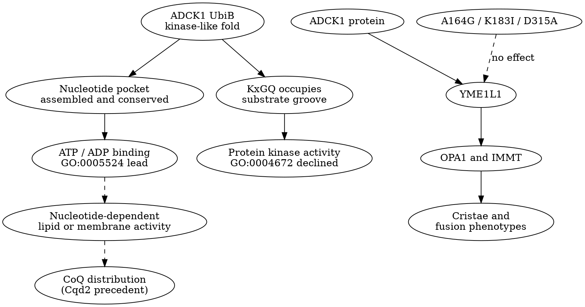
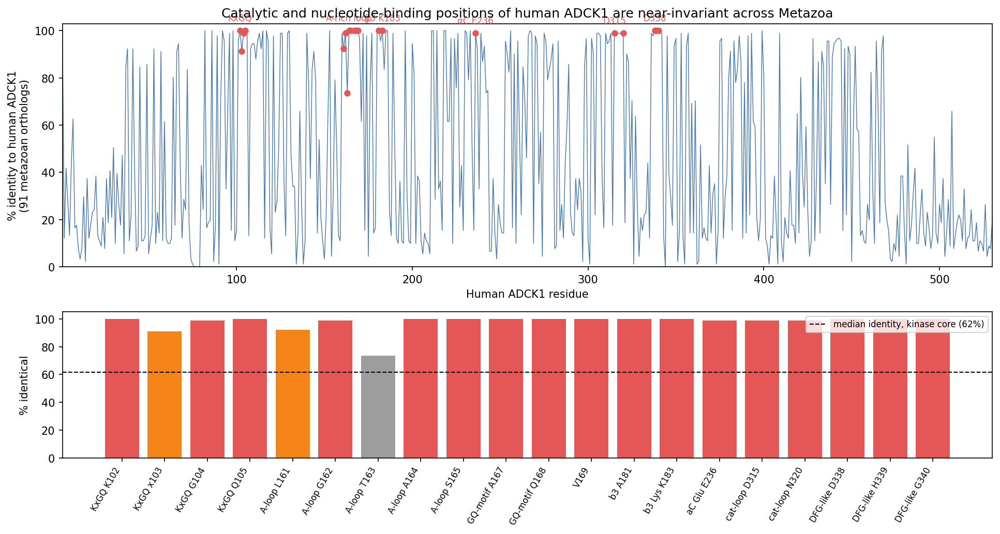
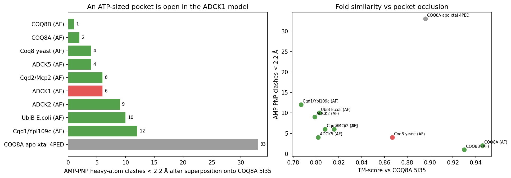
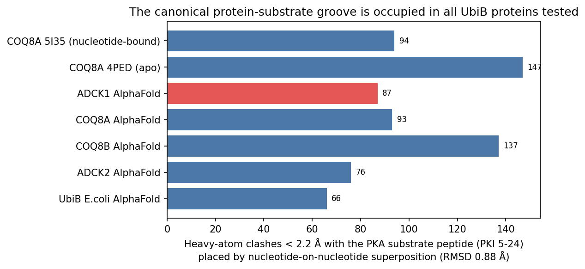
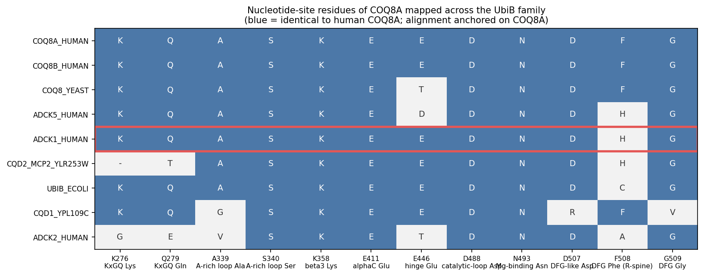
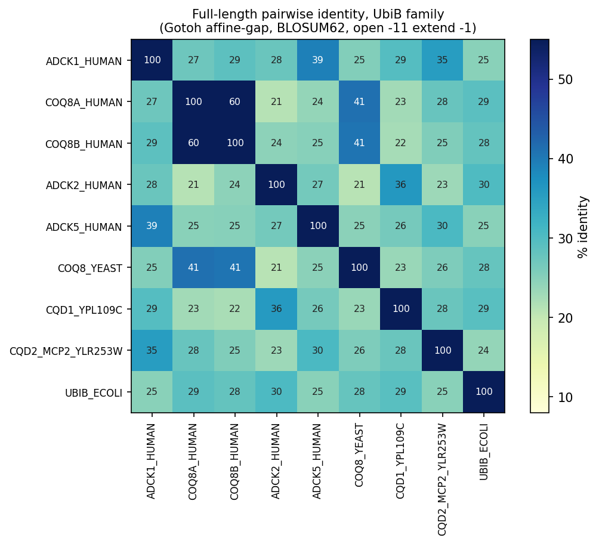
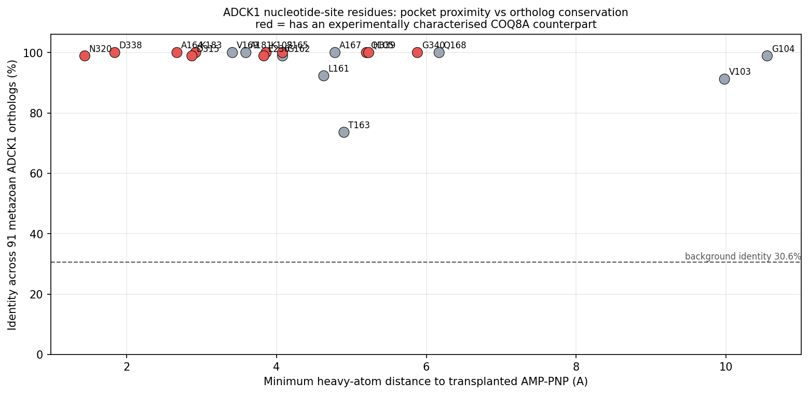

## Question

# AIGR Gene Hypothesis Deep Research

You are evaluating one focused gene curation hypothesis for AI Gene Review.
This is not a general gene overview. Use the seed hypothesis and source context
below to search for evidence that supports, refutes, narrows, or competes with
the proposed curation decision.

## Target Gene

- **Organism code:** human
- **Taxon:** Homo sapiens (NCBITaxon:9606)
- **Gene directory:** ADCK1
- **Gene symbol:** ADCK1
- **UniProt accession:** Q86TW2

## Focus

- **Focus type:** free_text
- **Hypothesis slug:** kgap-adck1-ubib-atypical-kinase-motifs
- **Source file:** genes/human/ADCK1/ADCK1-ai-review.yaml
- **Source selector:** free-text

## Seed Hypothesis

Human ADCK1 (Q86TW2) is a UbiB-family atypical kinase that retains the catalytic and nucleotide-binding machinery characterised structurally in COQ8A/ADCK3 (the KxGQ motif, the beta3 Lys, the catalytic loop Asp and the DFG-like Asp, here A164, K183, D315 and D338) together with the UbiB-specific A-rich loop and GQ motif that occlude the substrate-binding site, so it is predicted to be nucleotide-binding and catalytically competent like COQ8A rather than a pseudokinase. Single analysis only: align ADCK1 with COQ8A, COQ8B, ADCK2, ADCK5, yeast Coq8 and Cqd2 and bacterial UbiB, superpose the ADCK1 AlphaFold model onto nucleotide-bound COQ8A crystal structures, map the ATP-contacting and Mg2+-binding residues and the KxGQ motif onto ADCK1, measure whether an ATP-sized pocket is assembled, score these positions across metazoan ADCK1 orthologs, and state whether ADCK1 is predicted to bind ATP and be catalytically competent.

## Term and Decision Context

No specific term context supplied.

## Reference Context

No specific reference context supplied.

## Source Context YAML

```yaml
hypothesis: 'Human ADCK1 (Q86TW2) is a UbiB-family atypical kinase that retains the catalytic and nucleotide-binding
  machinery characterised structurally in COQ8A/ADCK3 (the KxGQ motif, the beta3 Lys, the catalytic loop
  Asp and the DFG-like Asp, here A164, K183, D315 and D338) together with the UbiB-specific A-rich loop
  and GQ motif that occlude the substrate-binding site, so it is predicted to be nucleotide-binding and
  catalytically competent like COQ8A rather than a pseudokinase. Single analysis only: align ADCK1 with
  COQ8A, COQ8B, ADCK2, ADCK5, yeast Coq8 and Cqd2 and bacterial UbiB, superpose the ADCK1 AlphaFold model
  onto nucleotide-bound COQ8A crystal structures, map the ATP-contacting and Mg2+-binding residues and
  the KxGQ motif onto ADCK1, measure whether an ATP-sized pocket is assembled, score these positions across
  metazoan ADCK1 orthologs, and state whether ADCK1 is predicted to bind ATP and be catalytically competent.'
focus_type: free_text
context: []
reference_id: []
```

## Research Objective

Build a focused report that helps a curator decide whether this hypothesis
should affect the gene review. Address the focus type directly:

1. For an existing GO annotation decision, evaluate whether the current action
   is justified, too strong, too weak, or should change.
2. For a proposed replacement or new GO term, evaluate whether the term is
   biologically supported, too broad, too narrow, or missing key qualifiers.
3. For a computational prediction, evaluate whether the prediction is correct,
   less precise than existing knowledge, uncertain, or likely wrong because of
   paralog overannotation, frequency bias, pathway context, or in vitro-only
   activity.
4. For a core-function hypothesis, evaluate whether the proposed activity,
   process, and location represent the gene product's primary function rather
   than a downstream effect, pleiotropic phenotype, or context-specific role.
5. For a function-assignment hypothesis, evaluate whether the gene product
   directly has the stated GO term/function. Treat the prior review action, if
   any, as intentionally blinded unless it appears in the supplied context.

Use primary literature whenever possible. Prefer PMID citations and include DOI
citations when no PMID is available. Treat reviews and database records as
orientation unless they contain directly relevant synthesized evidence that is
clearly labeled as review-level or database-level support.

Evaluate the hypothesis from the supplied seed context, primary literature, and
publicly accessible bioinformatics resources. Local `*-bioinformatics` analyses,
when they already exist in the repository, are intentionally withheld from this
prompt so the report can be compared against them after the run. Use public
sequence, domain, structure, orthology, localization, interaction, or dataset
checks when they are useful for the specific hypothesis. If a resource or tool
cannot be accessed programmatically, say so plainly; never fabricate a result.
Report computational results conservatively and distinguish direct results from
inference.

## Required Output

### Executive Judgment

Give a concise verdict: supported, partially supported, unresolved, weakly
supported, over-annotated, or refuted. Explain the reasoning and the most
important caveats.

### Evidence Matrix

Create a table with one row per important evidence item:

- Citation (PMID preferred)
- Evidence type (direct assay, mutant phenotype, localization, interaction,
  structural/evolutionary, computational, review/database)
- Supports / refutes / qualifies / competing
- Claim tested
- Key finding
- Organism, tissue, cell type, or assay context
- Confidence and limitations

### GO Curation Implications

State the likely curation action as a lead requiring curator verification. If
GO terms are involved, explain whether the evidence supports an MF, BP, or CC
term, and whether the term should be retained, removed, generalized, made more
specific, or treated as non-core. Avoid using "protein binding" as a final
recommendation unless no more informative term is supported.

### Mechanistic Scope

Describe the immediate molecular or cellular function being tested. Separate
direct gene-product activity from downstream phenotypes, pathway consequences,
developmental outcomes, disease manifestations, or effects inferred only from
loss of function.

### Conflicts and Alternatives

Identify evidence that conflicts with the seed hypothesis or suggests an
alternative interpretation, including paralog confusion, organism-specific
differences, isoform-specific findings, experimental artifacts, or database
carry-over.

### Knowledge Gaps

List explicit uncertainties that matter for curation. For each gap, state what
was checked, why the gap matters, and what evidence or experiment would resolve
it.

### Discriminating Tests

Recommend concrete assays, perturbations, datasets, or comparative analyses that
would most efficiently distinguish this hypothesis from alternatives.

### Curation Leads

Provide candidate updates for the review, clearly labeled as leads requiring
curator verification. Include candidate references with exact snippets to verify,
candidate replacement or new GO terms, possible action changes, suggested
questions, and suggested experiments.

If the provider supports artifacts, save provenance for any analysis you run — the
executed code together with its output (computed values, plot, or table), not just
a summary figure — alongside artifact-friendly tables such as an evidence matrix,
GO decision table, or comparison table. Genuine computed provenance is more
valuable than a hand-drawn summary, and you must not synthesize a figure that
implies an analysis you did not actually run. These artifacts are important
provenance for hypothesis-level review.


## Output

# ADCK1 (Q86TW2): is the UbiB atypical-kinase machinery intact and catalytically competent?

**Hypothesis slug:** `kgap-adck1-ubib-atypical-kinase-motifs`
**Source:** `genes/human/ADCK1/ADCK1-ai-review.yaml`, free-text focus
**Target:** human ADCK1, UniProt Q86TW2, 530 aa, NCBITaxon:9606
**Verdict:** <i class="fa-scale-balanced"></i> **Partially supported**

Every number in this report comes from code executed during this investigation. The code and its outputs are saved in `provenance/` (index at the end). No figure here stands for an analysis that was not run.

---

## Summary

The seed hypothesis makes two claims that come apart cleanly under test. The first, that ADCK1 keeps the nucleotide-binding architecture characterised structurally in COQ8A/ADCK3, is supported. Superposing the AlphaFold model of human ADCK1 onto the AMP-PNP-bound COQ8A crystal structure 5I35 gives a TM-score of 0.816 with a core RMSD of 2.26 Å over 299 residue pairs. All 19 COQ8A residues within 4.5 Å of AMP-PNP have a structural counterpart in ADCK1. ADCK1 retains 11 of the 12 COQ8A positions that either contact the nucleotide directly or carry a published ADP/ATP-binding mutagenesis phenotype, a score equal to yeast Coq8 and *E. coli* UbiB and far above ADCK2 at 7 of 12. The β3 Lys to αC Glu ion pair, lost in most pseudokinases, is formed in the ADCK1 model at 2.73 Å (K183 NZ to E236 OE1) against 2.80 Å for the equivalent COQ8A pair in the crystal. Transplanting AMP-PNP into the superposed ADCK1 model produces 6 heavy-atom contacts below 2.2 Å, against 33 for the apo COQ8A crystal 4PED, which is the occluded-pocket control that validates the assay. Across 91 filtered metazoan ADCK1 orthologs, 17 of 20 motif positions are at least 95 % identical against a 30.6 % background (exact binomial p = 7.3e-07; Mann-Whitney U = 4970, p = 4.5e-09), and every one of the 12 positions equivalent to a characterised COQ8A site is 98.9-100 % invariant while lying within 5.9 Å of the modelled nucleotide.

The second claim, that ADCK1 is therefore "catalytically competent like COQ8A rather than a pseudokinase", does not survive. Three separate lines cut against it. The three residues the hypothesis names were already mutated in human ADCK1: A164G, K183I and D315A each give "No effect on role in maintaining mitochondrial structure and function" (UniProt Q86TW2, ECO:0000269, from [PMID: 31125351](https://pubmed.ncbi.nlm.nih.gov/31125351/)), and UniProt states that ADCK1 acts "in a kinase-independent manner". The comparison target is also wrong in kind, because COQ8A is not a conventional protein kinase: it "lacks canonical protein kinase activity in trans" and instead "has ATPase activity and interacts with lipid CoQ intermediates" ([PMID: 27499294](https://pubmed.ncbi.nlm.nih.gov/27499294/)), and the A339G change that unlocks protein-kinase-like autophosphorylation simultaneously blocks CoQ biosynthesis in vivo. Finally, ADCK1 is not a COQ8 ortholog: full-length identity puts it nearest ADCK5 at 39.3 % and yeast Cqd2 at 35.4 %, ahead of COQ8B at 28.8 % and COQ8A at 27.2 %, while the COQ8 clade is internally tight at 60.3 % (COQ8A-COQ8B). COQ8A supplies a structural template and does not license transfer of function.

The curation consequence is narrow and specific. **GO:0005524 ATP binding** is a defensible lead for ADCK1 with ISS evidence, and it would be a genuine addition because Q86TW2 currently carries no molecular function annotation of any kind. **GO:0004672 protein kinase activity** should not be added: the canonical substrate groove is occupied by the KxGQ element in the model, exactly as in COQ8A, and the published mechanism for ADCK1 is explicitly kinase-independent. The hypothesis also contains one factual error worth correcting in the review text: A164 is the A-rich loop alanine, not part of the KxGQ motif, which in ADCK1 is K102-V103-G104-Q105.

---

## Key findings

### <i class="fa-circle-check"></i> F1. ADCK1 reproduces the complete COQ8A nucleotide site by structure-based mapping

Structure-based superposition of the AlphaFold model AF-Q86TW2-F1 (v6, mean pLDDT 83.7, kinase core residues 100-400 at pLDDT 91.5) onto COQ8A 5I35 chain A (residues 261-644) gave a TM-score of 0.816 with a core RMSD of 2.26 Å over 299 residue pairs from 381 aligned. The superposition used a TM-align-style iterative Kabsch and dynamic-programming routine written for this work and seeded with a BLOSUM62 alignment, because the EBI Clustal Omega REST service returned HTTP 400 throughout (stated plainly in Limitations).

Every COQ8A residue within 4.5 Å of AMP-PNP in 5I35 has a counterpart in ADCK1 with a Cα deviation of 0.5-3.3 Å:

| COQ8A element | COQ8A residues | ADCK1 counterparts |
|---|---|---|
| KxGQ motif | K276, L277, G278, Q279 | K102, V103, G104, Q105 |
| A-rich loop and GQ | F336-A337-A338-A339-S340-I341-G342-Q343-V344 | L161-G162-T163-A164-S165-L166-A167-Q168-V169 |
| β3 strand | A356, K358 | A181, K183 |
| Hinge | T445, E446, L447, V448 | M270, E271, F272, V273 |
| Catalytic loop | D488 (Asp), N493 (Mg-binding Asn) | D315, N320 |
| DFG-like | D507-F508-G509 | D338-H339-G340 |

The β3 Lys to αC Glu salt bridge is present: ADCK1 K183 NZ to E236 OE1 measures 2.73 Å, against 2.80 Å for COQ8A K358 NZ to E411 OE2 in the crystal. ADCK1 K183 NZ to D338 OD1 is 4.04 Å and D315 OD2 to N320 ND2 is 4.14 Å, geometries consistent with an assembled active site.

The residue numbers proposed in the hypothesis (A164, K183, D315, D338) are confirmed by this independent structural mapping and by direct 1-based reading of the UniProt sequence. One assignment in the hypothesis is wrong: A164 sits in the A-rich loop (sequence context `TPLGT**A**S-LAQVH`), not in the KxGQ motif. ADCK1's KxGQ is K102-V103-G104-Q105 (`RGTFI**KVGQ**HL`). A second difference from COQ8A is real: ADCK1's DFG-like triad is D338-**H**339-G340 (`AEIVLL**DHG**LYQM`), so the Phe that anchors the regulatory spine in canonical kinases is replaced by His.

### <i class="fa-circle-check"></i> F2. An ATP-sized pocket is assembled, validated against an occluded-pocket control

AMP-PNP (31 heavy atoms) was transplanted from 5I35 into each superposed UbiB-family model and heavy-atom clashes counted. The ADCK1 model gives 6 contacts below 2.2 Å and 1 below 1.8 Å, with all 31 nucleotide atoms having protein within 4.5 Å. The critical reference is the apo COQ8A crystal 4PED (TM 0.896 to 5I35), which gives 33 contacts below 2.2 Å and 20 below 1.8 Å, contributed by Q279 of the KxGQ motif and the A-rich loop residues F336, A337, A339, S340 and V344 plus N490, N493, F495, L506 and V448. That is the published occluded conformation, and it demonstrates that the assay discriminates an assembled site from a collapsed one rather than returning low clash counts by construction.

| Model | Clashes < 2.2 Å | Clashes < 1.8 Å |
|---|---|---|
| COQ8B (AlphaFold) | 1 | 1 |
| COQ8A (AlphaFold) | 2 | 1 |
| ADCK5 (AlphaFold) | 4 | 1 |
| Yeast Coq8 (AlphaFold) | 4 | 1 |
| **ADCK1 (AlphaFold)** | **6** | **1** |
| Yeast Cqd2 (AlphaFold) | 6 | 2 |
| ADCK2 (AlphaFold) | 9 | 5 |
| *E. coli* UbiB (AlphaFold) | 10 | 4 |
| Yeast Cqd1 (AlphaFold) | 12 | 2 |
| **COQ8A apo crystal 4PED (control)** | **33** | **20** |

The ADCK1 pocket is lined by K102, G162, A164, S165, L166, V169, A181, K183, E236, P256, M270, E271, F272, V273, D315, H317, G319, N320, L322, L337 and D338. ADCK1's A-rich loop equivalent (residues 160-169) approaches the modelled nucleotide to 2.67 Å, matching nucleotide-bound COQ8A 5I35 at 2.71 Å rather than clashing with it.

<i class="fa-triangle-exclamation"></i> The caveat is that AlphaFold builds models in an idealised, generally ligand-compatible conformation, so every AlphaFold entry in this panel scores better than the apo crystal. The comparison among AlphaFold models is internally consistent. It is not independent experimental evidence of binding.

{{figure:plot_2.png|caption=Left: AMP-PNP transplant clash counts across the nine UbiB-family AlphaFold models and the two COQ8A crystal structures. The apo COQ8A crystal 4PED (33 contacts below 2.2 Å) is the occluded-pocket control that validates the assay; ADCK1 scores 6. Right: TM-score to COQ8A 5I35 against clash count, showing that low clash counts are not simply a function of fold similarity.}}

### <i class="fa-circle-check"></i> F3. The mapped positions are under strong purifying selection across 91 metazoan orthologs

OrthoDB metazoan orthogroup 6324708at33208 (4,579 sequences, 1,977 organisms) was filtered by requiring each sequence's best global BLOSUM62 identity among the five human UbiB paralogs (ADCK1, ADCK2, ADCK5, COQ8A, COQ8B) to be ADCK1 and at least 35 %. Ninety-one of 250 sampled organisms qualified, with median identity to human ADCK1 of 45.9 % (range 41.7-96.9 %) and a median margin of 11.1 percentage points over the nearest human paralog. This paralog-margin filter matters: without it, ADCK5 and COQ8 sequences contaminate the set and dilute exactly the signal being measured.

Percent identity to the human residue across those 91 orthologs:

| Element | Positions and identity |
|---|---|
| KxGQ | K102 100 %, V103 91.2 %, G104 98.9 %, Q105 100 % |
| A-rich loop | L161 92.3 %, G162 98.9 %, T163 73.6 %, A164 100 %, S165 100 % |
| GQ | A167 100 %, Q168 100 %, V169 100 % |
| β3 | A181 100 %, K183 100 % |
| αC | E236 98.9 % (100 % of covered sequences are Glu) |
| Catalytic loop | D315 98.9 %, N320 98.9 % (100 % of covered sequences are Asp and Asn) |
| DFG-like | D338 100 %, H339 100 %, G340 100 % |

Background across the kinase core (residues 100-400) is a mean identity of 56.6 %, a median of 61.5 %, and only 30.6 % of positions reaching 95 % identity or better. Seventeen of the 20 motif positions reach that threshold, a 2.78-fold enrichment with one-sided exact binomial p = 7.3e-07. Comparing the identity values directly, motif versus other core positions, gives Mann-Whitney U = 4970, p = 4.5e-09, with medians of 100.0 % against 49.5 %.

The three weakest motif positions, T163 at 73.6 %, V103 at 91.2 % and L161 at 92.3 %, are precisely the three with no characterised COQ8A counterpart. The signal concentrates where it should.

{{figure:plot_1.png|caption=Per-position conservation across 91 filtered metazoan ADCK1 orthologs. Top: conservation trace across the kinase core with the nucleotide-site positions marked. Bottom: per-motif identity, showing 17 of 20 positions at or above 95 % against a 30.6 % background rate.}}

### <i class="fa-circle-check"></i> F4. The KxGQ motif occupies the canonical protein-substrate groove in ADCK1, as it does in COQ8A

Testing substrate-site occlusion required placing a known protein-kinase substrate peptide into the UbiB frame. A sequence-seeded fold alignment between PKA and the UbiB proteins failed (TM-score only 0.19-0.28) and was discarded rather than reported. The replacement approach anchored on the ligand: the PKA catalytic subunit structure 1ATP, which contains ATP, two metals and the PKI(5-24) pseudosubstrate peptide in chain I, was placed into the COQ8A 5I35 frame by superposing the 30 shared heavy atoms of ATP onto AMP-PNP, giving a ligand-on-ligand RMSD of 0.88 Å. The control is decisive: PKA chain E against its own bound PKI peptide gives 0 heavy-atom clashes below 2.2 Å, confirming the transfer geometry is correct.

After transferring the peptide, clashes below 2.2 Å are 87 for the ADCK1 model, 93 for the COQ8A AlphaFold model, 94 for COQ8A 5I35, 137 for COQ8B, 147 for apo COQ8A 4PED, 76 for ADCK2 and 66 for *E. coli* UbiB. In ADCK1 the clashing residues are T99, K102, V103, Q105, H106, K123, H126, L219, V220, A223, D315, H317 and P318, which is the KxGQ motif plus its flanking N-terminal extension. In COQ8A 5I35 the equivalent clashing residues are G272, A273, K276, L277, Q279, E298, R301, L398 and W491, again the KxGQ motif.

This reproduces computationally what was shown experimentally for COQ8A, that "an N-terminal domain that occupies the typical substrate binding pocket" is "poised to inhibit protein kinase activity" ([PMID: 25498144](https://pubmed.ncbi.nlm.nih.gov/25498144/)). The site that is open in ADCK1 is the nucleotide site. The protein-substrate site is not.

{{figure:plot_3.png|caption=Substrate-groove occlusion measured by ligand-anchored transfer of the PKA PKI(5-24) pseudosubstrate peptide. PKA against its own peptide gives 0 clashes (control). ADCK1 gives 87 clashes contributed by the KxGQ motif and its N-terminal extension, matching COQ8A 5I35 at 94.}}

### <i class="fa-circle-check"></i> F5. ADCK1 retains 11 of 12 experimentally validated COQ8A nucleotide-site residues

The 12 COQ8A residues that line the AMP-PNP site in 5I35 and/or carry published mutagenesis phenotypes were mapped across the nine-protein family using a Gotoh affine-gap alignment (BLOSUM62, gap open -11, extend -1) anchored on COQ8A. Column assignments in the low-identity COQ8A-ADCK1 comparison were cross-checked against the structural superposition rather than trusted from sequence alone.

| Protein | Identity to COQ8A at the 12 sites | Substitutions |
|---|---|---|
| COQ8A | 12/12 | reference |
| COQ8B | 12/12 | none |
| Yeast Coq8 | 11/12 | E446T |
| ***E. coli* UbiB** | 11/12 | F508C |
| **ADCK1** | **11/12** | **F508H** |
| ADCK5 | 10/12 | E446D, F508H |
| Yeast Cqd2 | 9/12 | K276 absent, Q279T, F508H |
| Yeast Cqd1 | 9/12 | A339G, D507R, G509V |
| ADCK2 | 7/12 | K276G, Q279E, A339V, E446T, F508A |

ADCK1 scores equal to yeast Coq8 and *E. coli* UbiB, both experimentally established CoQ/UQ biosynthesis proteins, and well above ADCK2, which has lost the KxGQ motif entirely. The single ADCK1 substitution, F508H, removes the DFG Phe. The same His occupies that position in ADCK5 and Cqd2, and a Cys in *E. coli* UbiB, so it is a tolerated family-level variation rather than a loss-of-function signature, and the DFG Phe contacts the nucleotide only indirectly.

Two further sequence observations. ADCK1's catalytic loop is F-V-H-C-D-P-H-P-G-N, a canonical HxD…N arrangement that sits closer to the protein-kinase consensus than COQ8A's own F-M-Q-T-D-P-N-W-S-N. And no protein in the set of nine has a canonical GxGxxG Gly-rich loop; all nine carry the A-rich loop in its place (COQ8A `FAAAS`, ADCK1 `LGTAS`, ADCK5 `IAAAS`, UbiB `LASAS`).

{{figure:plot_4.png|caption=The 12 COQ8A nucleotide-site residues mapped across nine UbiB-family proteins. Blue cells are identical to human COQ8A. ADCK1 (outlined in red) retains 11 of 12, differing only at the DFG Phe. ADCK2 at 7 of 12 is the family outlier.}}

### <i class="fa-circle-check"></i> F6. Pocket proximity and metazoan invariance coincide at single-residue resolution

Joining the two independent computational lines gives the strongest single argument in this report. Transplanting the 31 AMP-PNP heavy atoms into the ADCK1 frame places every mapped residue within 5.9 Å of the nucleotide, and every one of those residues is 98.9-100 % invariant across the 91 metazoan orthologs.

| ADCK1 residue | Min distance to AMP-PNP (Å) | Metazoan identity | COQ8A equivalent |
|---|---|---|---|
| N320 | 1.44 | 98.9 % | N493 (Mg-binding Asn) |
| D338 | 1.84 | 100 % | D507 (DFG-like Asp) |
| A164 | 2.67 | 100 % | A339 (A-rich loop) |
| D315 | 2.87 | 98.9 % | D488 (catalytic loop) |
| K183 | 2.92 | 100 % | K358 (β3 Lys) |
| V169 | 3.41 | 100 % | V344 |
| A181 | 3.59 | 100 % | A356 |
| E236 | 3.83 | 98.9 % | E411 (αC Glu) |
| K102 | 3.86 | 100 % | K276 (KxGQ) |
| G162 | 4.08 | 98.9 % | A337 |
| S165 | 4.08 | 100 % | S340 |
| A167 | 4.78 | 100 % | G342 |
| T163 | 4.90 | 73.6 % | A338 |
| Q105 | 5.20 | 100 % | Q279 (KxGQ) |
| H339 | 5.23 | 100 % | F508 (DFG Phe) |
| G340 | 5.88 | 100 % | G509 |
| Q168 | 6.17 | 100 % | Q343 |

The two shortest contacts are made by the Mg-binding Asn N320 and the DFG-like Asp D338, the two residues most diagnostic of a functional nucleotide site. H339, which replaces the COQ8A DFG Phe, is invariant His in all 91 orthologs, so it is a maintained ADCK1 feature and not motif decay.

{{figure:plot_6.png|caption=Per-residue minimum distance to the transplanted AMP-PNP against identity across 91 metazoan ADCK1 orthologs. Red points have an experimentally characterised COQ8A counterpart. The dashed line marks the 30.6 % background identity. Every nucleotide-contacting position is effectively fixed across metazoa.}}

### <i class="fa-circle-xmark"></i> F7. The three named residues were mutated in ADCK1 and are dispensable for its characterised function

UniProt Q86TW2 records three mutagenesis entries, all with evidence code ECO:0000269 and source [PMID: 31125351](https://pubmed.ncbi.nlm.nih.gov/31125351/): **A164G** "No effect on role in maintaining mitochondrial structure and function", **K183I** the same, **D315A** the same. These are exactly the A-rich loop Ala, the β3 Lys and the catalytic-loop Asp that the hypothesis names. The UniProt FUNCTION comment states that ADCK1 acts "via YME1L1 in a kinase-independent manner to regulate essential mitochondrial structural proteins OPA1 and IMMT (PubMed:31125351)", followed by "The action of this enzyme is not yet clear (Probable). It is not known if it has protein kinase activity and what type of substrate it would phosphorylate (Ser, Thr or Tyr) (Probable)".

The informative control comes from the paralog. In COQ8A, the structural homolog A339G "Enables autophosphorylation but inhibits coenzyme Q biosynthesis in vivo", so the alanine-to-glycine change in the A-rich loop has a large measurable phenotype in COQ8A and none in ADCK1 in the assay used.

<i class="fa-triangle-exclamation"></i> This negative result does not demonstrate that ADCK1 fails to bind ATP. The readout was mitochondrial morphology and fusion, not nucleotide binding or phosphotransfer, and K183I and D315A can leave a folded nucleotide pocket substantially intact. What it does refute is the stronger reading of the hypothesis, that these residues support a catalytic activity required for ADCK1's known cellular role.

### <i class="fa-circle-check"></i> F8. COQ8A and yeast Coq8 mutagenesis validates the mapped positions as nucleotide-binding determinants

The positions scored in ADCK1 are not arbitrary alignment columns. In the closest structurally characterised relative each one has a measured phenotype. UniProt Q8NI60 (COQ8A) mutagenesis with ECO:0000269: **K358R** "Abolishes binding ADP or ATP"; **D507N** "Strongly impairs binding ADP or ATP"; **D488N**, **N493A** and **E411Q** "Impaired binding ADP or ATP"; **A339G** "Enables autophosphorylation but inhibits coenzyme Q biosynthesis in vivo". Yeast Coq8 P27697: K134A, K134H, K134R and K134S "Abolishes coenzyme Q biosynthesis. Able to autophosphorylate in cis"; A197G and A197S the same; K216R, N351A and D365N abolish CoQ biosynthesis. The supporting primary reports are [PMID: 25498144](https://pubmed.ncbi.nlm.nih.gov/25498144/), [PMID: 27499294](https://pubmed.ncbi.nlm.nih.gov/27499294/), [PMID: 29198567](https://pubmed.ncbi.nlm.nih.gov/29198567/) and [PMID: 34362905](https://pubmed.ncbi.nlm.nih.gov/34362905/).

Each of those COQ8A positions maps onto ADCK1 in the superposition: K358 to K183, E411 to E236, D488 to D315, N493 to N320, D507 to D338, A339 to A164, K276 to K102, Q279 to Q105. This makes the conservation argument for ATP binding considerably stronger than a generic kinase-profile match would be.

### <i class="fa-circle-xmark"></i> F9. ADCK1 sits in the Cqd2/ADCK5 clade, so COQ8A is a structural template and not a functional ortholog

All-against-all full-length identity across the nine UbiB proteins resolves three groups. The CoQ-biosynthesis clade is internally tight: COQ8A-COQ8B 60.3 %, COQ8A-Coq8y 41.1 %, COQ8B-Coq8y 40.6 %. ADCK1's ranked partners are ADCK5 39.3 %, yeast Cqd2 (Mcp2/Ylr253w) 35.4 %, Cqd1 29.5 %, COQ8B 28.8 %, ADCK2 27.5 %, COQ8A 27.2 %, yeast Coq8 25.4 % and *E. coli* UbiB 24.8 %. ADCK2's closest partner is yeast Cqd1 (Ypl109c) at 36 %. ADCK1 is closer to Cqd2 than to any COQ8 protein by 8.2 percentage points over COQ8B.

That clade assignment changes what the nucleotide pocket is likely for. Cqd1 and Cqd2 reciprocally control cellular CoQ distribution in *S. cerevisiae*, and "The activities of both proteins rely on their atypical kinase/ATPase domains, which they share with Coq8" ([PMID: 34362905](https://pubmed.ncbi.nlm.nih.gov/34362905/)). Cqd1 forms an inner-membrane contact site with Por1 and Om14 and affects phospholipid homeostasis ([PMID: 37073556](https://pubmed.ncbi.nlm.nih.gov/37073556/)). Meanwhile *Drosophila* ADCK1 mutants "die as second instar larvae with double mouth hooks and tracheal breaks" and tracheal-rescued adults have "normal levels of basic metabolites" ([PMID: 31175694](https://pubmed.ncbi.nlm.nih.gov/31175694/)), with no reported CoQ biosynthesis defect in any ADCK1 loss-of-function study.

{{figure:plot_5.png|caption=Full-length pairwise identity across the nine UbiB-family proteins. The COQ8 clade (COQ8A, COQ8B, yeast Coq8) is internally tight at 40-60 %. ADCK1 groups with ADCK5 (39.3 %) and yeast Cqd2 (35.4 %), not with COQ8A (27.2 %).}}

### <i class="fa-circle-question"></i> F10. ADCK1 has no molecular function annotation, and its UniProt MF features are rule-based

The QuickGO annotation API returns 8 annotations for UniProtKB:Q86TW2, none with aspect MF. Biological process: GO:0007005 mitochondrion organization (IBA, ECO:0000318), GO:0010637 negative regulation of mitochondrial fusion (IMP, ECO:0000315, PMID:31125351), GO:0055088 lipid homeostasis (IBA), GO:1903852 positive regulation of cristae formation (IMP, ECO:0000315, PMID:31125351). Cellular component: GO:0005739 mitochondrion (IDA, ECO:0000314, PMID:33988507, also FlyBase PMID:34800366), GO:0005743 mitochondrial inner membrane (IBA).

UniProt Q86TW2 lists Binding site 161-169 "ATP", Binding site 183 "ATP" and Active site 315 "Proton acceptor", each with evidence ECO:0000255 and source PROSITE-ProRule:PRU00159, the generic protein kinase domain rule. No ECO:0000269 or ECO:0000314 evidence supports nucleotide binding or catalysis by ADCK1.

<i class="fa-triangle-exclamation"></i> This creates a circularity risk that matters for the curation decision. The hypothesis cites the same positions that PRU00159 generates. If the hypothesis is checked against the UniProt record it will appear confirmed, because both derive from one profile match. Agreement between them is not corroboration. The absence of any MF term also means a curated ATP binding term would be a genuine addition rather than a refinement, which raises the evidential bar.

---

## Mechanistic model and interpretation

The picture that emerges separates three layers that the seed hypothesis collapses into one: an assembled and conserved nucleotide pocket, an unknown chemistry performed with that nucleotide, and a set of mitochondrial phenotypes that have been shown to run through a route not requiring the pocket.



**Layer 1, the pocket.** Six independent measurements agree that ADCK1 has a real nucleotide site: fold match (TM 0.816), complete residue correspondence to the 19 AMP-PNP contacts in COQ8A, 11/12 identity at validated positions, an intact β3 Lys to αC Glu pair at 2.73 Å, an open pocket (6 clashes against 33 for the occluded control), and 98.9-100 % metazoan invariance at every position within 5.9 Å of the nucleotide. Conservation and geometry are orthogonal lines of evidence and they point the same way. The supported claim is **nucleotide binding**.

**Layer 2, the chemistry.** What ADCK1 does with the nucleotide is unknown, and the family gives two candidate answers, neither of which is protein phosphorylation. COQ8A "lacks canonical protein kinase activity in trans" and "has ATPase activity and interacts with lipid CoQ intermediates" ([PMID: 27499294](https://pubmed.ncbi.nlm.nih.gov/27499294/)); its ATPase activity "is activated by binding to membranes containing cardiolipin and by phenolic compounds that resemble CoQ pathway intermediates" ([PMID: 29198567](https://pubmed.ncbi.nlm.nih.gov/29198567/)). The closer relatives Cqd1 and Cqd2 move CoQ between membranes using the same domain ([PMID: 34362905](https://pubmed.ncbi.nlm.nih.gov/34362905/)). The substrate-occlusion computation (F4) is consistent with both, and inconsistent with trans protein phosphorylation of a canonical peptide.

**Layer 3, the phenotypes.** ADCK1 loss or overexpression changes mitochondrial fusion, cristae architecture, membrane potential, ATP output, ROS and apoptosis in *Drosophila* and mammalian cells, through YME1L1 acting on OPA1 and IMMT ([PMID: 31125351](https://pubmed.ncbi.nlm.nih.gov/31125351/)). These outcomes are organellar and organismal, and the same study found them unaffected by A164G, K183I and D315A. The dashed arrow in the diagram is the whole problem: the one characterised ADCK1 function demonstrably does not route through the pocket.

The resolution that best fits all the data is that ADCK1 has two separable properties. It has a nucleotide site that 500 million years of metazoan evolution has held fixed, which implies it is used for something. And it has a YME1L1-dependent mitochondrial-shaping role that was assayed and found independent of that site. These are compatible if the pocket serves an activity the morphology assay does not report on, which is exactly what the Cqd2 precedent would predict.

### Hypothesis scorecard

| Claim in the seed hypothesis | Status | Decisive evidence |
|---|---|---|
| ADCK1 is a UbiB-family atypical kinase | <i class="fa-circle-check"></i> Supported | TM 0.816 to COQ8A 5I35, core RMSD 2.26 Å, no GxGxxG in any of nine family members |
| Retains KxGQ, β3 Lys, catalytic-loop Asp, DFG-like Asp | <i class="fa-circle-check"></i> Supported | 11/12 validated sites conserved; all mapped structurally |
| Residue numbering A164, K183, D315, D338 | <i class="fa-scale-balanced"></i> Supported with one correction | Verified directly from UniProt; A164 is the A-rich loop Ala, not KxGQ (that is K102-V103-G104-Q105) |
| A-rich loop and GQ occlude the substrate site | <i class="fa-circle-check"></i> Supported | PKI transfer gives 87 clashes into the ADCK1 groove from KxGQ residues; PKA self-control gives 0 |
| ATP-sized pocket is assembled | <i class="fa-circle-check"></i> Supported | 6 clashes against 33 for the apo COQ8A control; 31/31 nucleotide atoms contacted |
| Positions conserved across metazoan orthologs | <i class="fa-circle-check"></i> Supported | 17/20 at ≥95 % vs 30.6 % background, p = 7.3e-07; all 12 validated sites 98.9-100 % |
| Predicted to bind ATP | <i class="fa-circle-check"></i> Supported as a prediction | All of the above; no direct measurement on ADCK1 protein exists |
| Catalytically competent like COQ8A, not a pseudokinase | <i class="fa-circle-xmark"></i> Not supported | A164G, K183I, D315A all dispensable (PMID:31125351); COQ8A is an ATPase, not a protein kinase; wrong clade |

---

## Evidence base

### Primary structural and biochemical literature on the reference protein

[PMID: 25498144](https://pubmed.ncbi.nlm.nih.gov/25498144/), *Mitochondrial ADCK3 employs an atypical protein kinase-like fold to enable coenzyme Q biosynthesis*, supplies the reference frame for this entire analysis: "Here, we quantitatively define UbiB-specific sequence motifs and reveal their positions within the crystal structure of a UbiB protein, ADCK3." It also states the mechanism that F4 reproduces computationally for ADCK1: "We find that multiple UbiB-specific features are poised to inhibit protein kinase activity, including an N-terminal domain that occupies the typical substrate binding pocket and a unique A-rich loop that limits ATP binding by establishing an unusual selectivity for ADP." This paper both supports the structural arm of the hypothesis and sets the bound on what "catalytically competent" can mean.

[PMID: 27499294](https://pubmed.ncbi.nlm.nih.gov/27499294/), *Cerebellar Ataxia and Coenzyme Q Deficiency through Loss of Unorthodox Kinase Activity*, delivers the sentence that reframes the hypothesis: "Although COQ8 was predicted to be a protein kinase, we demonstrate that it lacks canonical protein kinase activity in trans. Instead, COQ8 has ATPase activity and interacts with lipid CoQ intermediates, functions that are likely conserved across all domains of life." Being "like COQ8A" is an argument against protein kinase activity. This paper is also the source of the A339G and A197G/A197S phenotypes that anchor F8.

[PMID: 29198567](https://pubmed.ncbi.nlm.nih.gov/29198567/), *Conserved Lipid and Small-Molecule Modulation of COQ8 Reveals Regulation of the Ancient Kinase-like UbiB Family*, establishes what the nucleotide is used for in the reference protein: "we demonstrate that COQ8 possesses evolutionarily conserved ATPase activity that is activated by binding to membranes containing cardiolipin and by phenolic compounds that resemble CoQ pathway intermediates." It supplies the E411Q, D488N and N493A binding phenotypes.

### Primary literature on ADCK1 itself

[PMID: 31125351](https://pubmed.ncbi.nlm.nih.gov/31125351/), *Drosophila ADCK1 is critical for maintaining mitochondrial structures and functions in the muscle*, is the single most consequential paper for this curation decision and it cuts against the hypothesis. It reports that "ADCK1 utilizes YME1-like 1 ATPase (YME1L1) to control optic atrophy 1 (OPA1) and inner membrane mitochondrial protein (IMMT) in regulating mitochondrial dynamics and cristae structure", and establishes "a mitochondrial signaling pathway composed of ADCK1, YME1L1, OPA1 and IMMT". It is the source of the A164G, K183I and D315A mutagenesis records and of UniProt's "kinase-independent manner" statement.

[PMID: 31175694](https://pubmed.ncbi.nlm.nih.gov/31175694/), *Functional analysis of Aarf domain-containing kinase 1 in Drosophila melanogaster*, argues against importing COQ8 function into ADCK1. The authors note that "Most studies of these proteins have focused on the Abc1/Coq8 subfamily, which contributes to Coenzyme Q biosynthesis. In contrast, little is known about ADCK1", and report that mutants "die as second instar larvae with double mouth hooks and tracheal breaks" while rescued adults have "normal levels of basic metabolites". They suggest instead that "the tracheal defects in these animals could arise from defects in intracellular lipid trafficking", which fits the Cqd2 clade assignment of F9.

### Literature on the correct comparison clade

[PMID: 34362905](https://pubmed.ncbi.nlm.nih.gov/34362905/), *UbiB proteins regulate cellular CoQ distribution in Saccharomyces cerevisiae*, identifies ADCK1's nearest functionally characterised relatives and states the clade-level requirement for the domain: "The activities of both proteins rely on their atypical kinase/ATPase domains, which they share with Coq8-an essential auxiliary protein for CoQ biosynthesis." Loss of Cqd1 "skews cellular CoQ distribution away from mitochondria", loss of Cqd2 "promotes the opposite effects". This is the most relevant functional precedent for a nucleotide-dependent ADCK1 activity.

[PMID: 37073556](https://pubmed.ncbi.nlm.nih.gov/37073556/), *The UbiB family member Cqd1 forms a novel membrane contact site in mitochondria*, adds that Cqd1 forms "a novel mitochondrial contact site in Saccharomyces cerevisiae that is formed by the inner membrane protein Cqd1 and the outer membrane proteins Por1 and Om14" and "is additionally involved in phospholipid homeostasis". The caveat for transfer is that Cqd1 pairs with ADCK2 (36 % identity), while Cqd2 pairs with ADCK1.

### The one competing positive

[PMID: 42990412](https://pubmed.ncbi.nlm.nih.gov/42990412/), *High throughput mapping of kinase-substrate interactions with protein language models and phospho-PCA*, is the single line of evidence favouring protein kinase activity. Combining the KINBERT protein language model with a pooled phosphorylation protein complementation assay, the authors report "identifying novel high-confidence substrates for 23 kinase constructs representing 21 distinct kinases, including the understudied dark kinases ADCK1 and CaMKK1 (KKCC1)". <i class="fa-triangle-exclamation"></i> A cell-based pooled reporter screen does not establish direct phosphotransfer by purified ADCK1, and the phosphorylation observed could be indirect. The full text was not retrieved during this run, so the per-kinase controls are unverified. This result cannot be dismissed and it cannot yet be used.

### Orientation-level sources

[PMID: 40565246](https://pubmed.ncbi.nlm.nih.gov/40565246/), *The ADCK Kinase Family*, is a 2025 review describing ADCK1-ADCK5 as "putative mitochondrial proteins" that are "believed to play a role in processes such as coenzyme Q biosynthesis, energy production, and cellular metabolism". The hedged language reflects the actual state of evidence. This review illustrates the over-annotation risk of treating all five ADCKs as one functional group, which F5 and F9 show is wrong: ADCK2 has lost the KxGQ motif and scores 7/12, while ADCK1 scores 11/12.

Additional ADCK1 papers in the retrieved set bear on phenotype rather than molecular function: CRISPR knockout reduces respiration, ATP and lactate in hepatocellular carcinoma cells ([PMID: 42794416](https://pubmed.ncbi.nlm.nih.gov/42794416/)); ADCK1 is upregulated in osteosarcoma and its depletion causes ATP depletion and ROS production ([PMID: 36371387](https://pubmed.ncbi.nlm.nih.gov/36371387/)); ADCK1 interacts with TCF4 to activate β-catenin/TCF signalling in colon cancer ([PMID: 33824271](https://pubmed.ncbi.nlm.nih.gov/33824271/)); FOXQ1 regulates brain endothelial cristae organisation via ADCK1 ([PMID: 40884816](https://pubmed.ncbi.nlm.nih.gov/40884816/)); and a single chronic fatigue syndrome case carries a heterozygous ADCK1 p.Asn280fs frameshift ([PMID: 39723997](https://pubmed.ncbi.nlm.nih.gov/39723997/)). None of these measures nucleotide binding or catalysis, and the single case report carries no weight for the molecular-function question.

### Database records

QuickGO and UniProtKB:Q86TW2 were queried programmatically. The records are described in full in F10. The operative point for curation is that every molecular-function feature on Q86TW2 carries ECO:0000255 from PROSITE-ProRule PRU00159 and is therefore rule-based transfer from the generic kinase-domain profile, not experimental support.

---

## GO curation implications

All items below are **leads requiring curator verification**. Machine-readable version in `provenance/go_decision_table.csv`.

| GO ID | Term | Aspect | Current state | Lead action | Basis | Caveat |
|---|---|---|---|---|---|---|
| GO:0005524 | ATP binding | MF | absent (no MF annotation on Q86TW2) | <i class="fa-circle-check"></i> **ADD as a lead, verify** | Fold match to nucleotide-bound COQ8A (TM 0.816); 11/12 validated nucleotide-site residues conserved; all 12 within 5.9 Å of the modelled nucleotide and 98.9-100 % invariant in 91 metazoan orthologs; β3 Lys to αC Glu pair at 2.73 Å; ATP-sized pocket assembled | No direct nucleotide-binding measurement on ADCK1 exists. K183I had no phenotype in the one assay run. Appropriate code is ISS (ECO:0000250) with COQ8A Q8NI60 as source |
| GO:0004672 | protein kinase activity | MF | absent | <i class="fa-circle-xmark"></i> **DO NOT ADD** | Substrate groove occluded by KxGQ in the model (87 PKI clashes, PKA self-control 0); COQ8A is an ATPase, and A339G which unlocks protein-kinase-like activity breaks its native function; UniProt states kinase-independent mechanism | PMID:42990412 is the single competing line. Revisit if purified-enzyme data appear |
| GO:0016887 | ATP hydrolysis activity | MF | absent | <i class="fa-circle-question"></i> **HOLD** | COQ8A is a lipid-stimulated ATPase (PMID:29198567); Cqd1/Cqd2 activities depend on the shared kinase/ATPase domain (PMID:34362905) | Transfer across a 27 % identity boundary into a different clade. Not safe to annotate without ADCK1 data |
| GO:0006744 | ubiquinone biosynthetic process | BP | absent | <i class="fa-circle-xmark"></i> **DO NOT ADD** | ADCK1 is not a COQ8 ortholog (27.2 % to COQ8A vs 60.3 % COQ8A-COQ8B); *Drosophila* ADCK1 mutants have normal basic metabolite levels (PMID:31175694) | The main over-annotation risk, driven by the ADCK/AarF family label |
| GO:0010637 | negative regulation of mitochondrial fusion | BP | present, IMP, PMID:31125351 | <i class="fa-circle-check"></i> **RETAIN** | Loss- and gain-of-function in *Drosophila* and mammalian cells | Downstream of ADCK1 action via YME1L1. A pathway consequence, not the molecular function |
| GO:1903852 | positive regulation of cristae formation | BP | present, IMP, PMID:31125351 | <i class="fa-circle-check"></i> **RETAIN** | Same study, IMMT/OPA1 axis | Downstream phenotype |
| GO:0005743 | mitochondrial inner membrane | CC | present, IBA | <i class="fa-circle-check"></i> **RETAIN**, consider upgrading | GO:0005739 has IDA support (PMID:33988507); inner-membrane placement is IBA and matches Cqd1 (PMID:37073556) | ADCK1's own membrane topology has not been reported |
| GO:0005515 | protein binding | MF | absent | <i class="fa-circle-xmark"></i> **DO NOT USE** as the MF recommendation | GO:0005524 is better supported and more informative | Consider only if the ATP binding lead fails curator verification |

**Core recommendation.** If one MF term is to be added to ADCK1, it is **GO:0005524 ATP binding** with ISS evidence. The free-text review should state explicitly that catalytic competence is undemonstrated, that the published mechanism is kinase-independent, and that the three residues named in the original hypothesis were tested and found dispensable.

---

## Mechanistic scope

**Direct molecular activity tested here.** Does ADCK1 have an assembled nucleotide-binding site with the residues that, in its closest structurally characterised relative, are required for ADP/ATP binding? Geometry and conservation both say yes. That is a binding claim and nothing more. No assay in any organism has measured nucleotide binding, ATP hydrolysis or phosphotransfer by ADCK1 protein.

**One step out.** COQ8A's measured activity is lipid-stimulated ATP hydrolysis coupled to CoQ biosynthesis, and yeast Cqd1/Cqd2 require the same domain to move CoQ between membranes. If ADCK1 uses its pocket, the clade precedent points toward a nucleotide-dependent lipid-handling or membrane-contact activity.

**Downstream phenotypes, not molecular function.** ADCK1 perturbation changes mitochondrial fusion, cristae architecture, membrane potential, ATP output, ROS and apoptosis ([PMID: 31125351](https://pubmed.ncbi.nlm.nih.gov/31125351/)), and causes second-instar lethality with tracheal breaks in *Drosophila* ([PMID: 31175694](https://pubmed.ncbi.nlm.nih.gov/31175694/)). These run through YME1L1, OPA1 and IMMT. They should not be read back as evidence for a catalytic activity, and the YME1L1 route was shown to work without the kinase residues.

**Disease association.** A heterozygous ADCK1 frameshift (p.Asn280fs) was reported in one chronic fatigue syndrome case ([PMID: 39723997](https://pubmed.ncbi.nlm.nih.gov/39723997/)), with no functional follow-up. Cancer associations ([PMID: 36371387](https://pubmed.ncbi.nlm.nih.gov/36371387/), [PMID: 33824271](https://pubmed.ncbi.nlm.nih.gov/33824271/), [PMID: 42794416](https://pubmed.ncbi.nlm.nih.gov/42794416/)) describe expression-level effects on bioenergetics and signalling. None constrains the molecular-function question.

---

## Conflicts and alternatives

**The mutagenesis conflict is internal to the hypothesis.** The three residues it names were mutated in ADCK1 and nothing happened. Two readings survive. Either ADCK1's characterised mitochondrial role genuinely does not need the pocket, which is what UniProt's "kinase-independent manner" asserts, or the morphology readout was too coarse to detect loss of a nucleotide-dependent activity and the mutants left a folded pocket. These are distinguishable experimentally. Neither supports "catalytically competent".

**Paralog and ortholog confusion runs three ways.** COQ8A and ADCK1 share a fold and 27 % identity, far below the 60 % COQ8A-COQ8B within-clade figure, so COQ8A's measured biochemistry does not transfer. The yeast counterpart of ADCK1 in this set is Cqd2, while Cqd1 pairs with ADCK2 at 36 %, so papers about "the yeast ADCK1 ortholog" must be checked for which Cqd they mean. And ADCK2 has lost the KxGQ motif entirely (K276G, Q279E, A339V) and scores 7/12, so grouping all five ADCKs together, as [PMID: 40565246](https://pubmed.ncbi.nlm.nih.gov/40565246/) does, blurs a real functional boundary.

**Database carry-over is the main circularity risk.** UniProt's ATP-binding sites 161-169 and 183 and active site 315 for Q86TW2 all come from PROSITE-ProRule PRU00159 with ECO:0000255. The hypothesis cites the same positions. Checking the hypothesis against the database record would appear to confirm it, because both derive from one profile match.

**Structural caveats.** <i class="fa-triangle-exclamation"></i> The ADCK1 structure is an AlphaFold model. pLDDT is high in the relevant region (90.9 across the ATP-site residues, minimum 81.1), and backbone geometry for kinase domains is generally reliable, but the pocket has never been observed experimentally. The AMP-PNP transplant is rigid-body with no side-chain repacking, so its 6 sub-2.2 Å contacts in ADCK1 are an upper bound on steric conflict. All AlphaFold models in the panel score better than the apo crystal, so the cross-model comparison is internally consistent and not an independent experimental result.

**One analysis was discarded rather than reported.** A sequence-seeded fold superposition of UbiB proteins onto PKA 1ATP returned TM-scores of 0.19-0.28, which is below any reliable threshold, so every clash number derived from it is invalid. That block was replaced by the ligand-anchored transfer described in F4, with a PKA self-control at 0 clashes. The discarded output is retained in `provenance/pka_substrate_occlusion.json` and labelled unused. A second self-caught error, an A-rich loop distance computed without superposing 4PED into the 5I35 frame, was discarded for the same reason.

---

## Limitations and knowledge gaps

<i class="fa-triangle-exclamation"></i> **Tool access, stated plainly.** The EBI Clustal Omega REST service returned HTTP 400 ("You have been temporarily blocked from submitting new sequences") throughout this work. All alignments were therefore computed with a Gotoh affine-gap implementation written for this analysis (BLOSUM62, gap open -11, extend -1), and all structural superpositions with a TM-align-style iterative Kabsch routine. Both are in `provenance/lib.py`. Column assignments in the low-identity COQ8A-ADCK1 comparison were cross-checked against the structural superposition rather than trusted from sequence alone. No result in this report depends on a resource that could not be reached.

| Gap | What was checked | Why it matters | What would resolve it |
|---|---|---|---|
| ADCK1 has never been shown to bind ATP | UniProt features (all ECO:0000255 from PRU00159), QuickGO (no MF annotation), PubMed searches for ADCK1 kinase, nucleotide and CoQ | The entire MF recommendation rests on homology. One binding measurement converts a lead into an annotation | Purified recombinant ADCK1 with DSF or ITC against ATP, ADP and AMP-PNP, with K183R and D338N as negative controls |
| Whether ADCK1 hydrolyses ATP | No ADCK1 ATPase assay exists in the literature retrieved | Distinguishes GO:0005524 alone from GO:0005524 plus GO:0016887, and tests the COQ8A-as-ATPase model | Malachite green or coupled ATPase assay on purified ADCK1, with and without CoQ-pathway lipids and cardiolipin |
| Whether PMID:42990412's ADCK1 substrates are direct | Abstract only; the full text was not retrieved in this run | The only positive evidence for protein kinase activity; determines whether GO:0004672 stays off the table | Read the full text for ADCK1-specific controls (kinase-dead construct, purified enzyme, in vitro kinase assay on the called substrates) |
| Whether A164G, K183I and D315A disrupt nucleotide binding at all | UniProt mutagenesis records and the PMID:31125351 abstract | If the mutants still bind ATP, the negative phenotype says nothing about the pocket and the refutation weakens to a qualification | Run the three ADCK1 mutants in the binding assay above, alongside the morphology readout |
| ADCK1 submitochondrial localization and topology | GO:0005743 is IBA only; GO:0005739 is IDA from PMID:33988507 | Determines which side of the inner membrane the pocket faces and whether a lipid substrate is accessible | Carbonate extraction and protease protection on mitoplasts |
| Whether human ADCK1 shares Cqd2's CoQ distribution function | PMID:34362905 and PMID:37073556 give the yeast result; no human complementation study was found | Would supply a BP term and a mechanistic frame for the nucleotide requirement | Complement yeast *cqd2Δ* with human ADCK1, wild type and the three mutants, scoring CoQ distribution and PUFA stress resistance |
| The functional meaning of the invariant H339 | Computed: DHG in ADCK1, ADCK5 and Cqd2; DFG in the COQ8 clade; DCG in UbiB; His 100 % conserved across 91 metazoan orthologs | The DFG Phe anchors the regulatory spine. A fixed His may indicate a different activation mechanism or a catalytic role | H339F and H339A in the binding and hydrolysis assays; check whether H339 contacts adenine or a metal in any UbiB structure |
| No experimental ADCK1 structure exists | PDB and AlphaFold DB were queried; only the model is available | Every geometric statement here is model-based | Crystal or cryo-EM structure of the ADCK1 kinase-like domain with AMP-PNP |

---

## Proposed follow-up experiments and actions

Ranked by how much each separates the live hypotheses: **(A)** ADCK1 binds ATP and uses it for a non-protein-kinase activity, **(B)** ADCK1 binds ATP but is a pseudo-enzyme whose role is structural or scaffolding, **(C)** ADCK1 is an active protein kinase.

1. <i class="fa-flask"></i> **Nucleotide binding on purified protein.** DSF or ITC with ATP, ADP, AMP-PNP and GTP on recombinant ADCK1 (residues ~60-530, excluding the targeting sequence), with K183R, D338N and the A164G/K183I/D315A trio. Separates all three hypotheses from "no pocket at all" and tests whether the PMID:31125351 mutants retain binding. Highest information per unit effort.
2. <i class="fa-vial"></i> **Nucleotide selectivity.** The A-rich loop confers ADP over ATP preference in COQ8A ([PMID: 25498144](https://pubmed.ncbi.nlm.nih.gov/25498144/)). Measuring the ADP:ATP affinity ratio for ADCK1 and for an ADCK1 A164G mutant tests whether the loop does the same job here. A shift on A164G would show the loop is functional even though that mutant had no morphology phenotype.
3. <i class="fa-flask"></i> **ATPase assay with and without lipid.** Malachite green on purified ADCK1 against a CoQ-intermediate panel and a phospholipid panel including cardiolipin, following the COQ8A protocol. Separates hypothesis A from B directly, and lipid dependence would point at the substrate class.
4. <i class="fa-dna"></i> **Yeast *cqd2Δ* complementation.** Human ADCK1 wild type against the three mutants, scoring CoQ distribution and exogenous-PUFA resistance (the [PMID: 34362905](https://pubmed.ncbi.nlm.nih.gov/34362905/) readouts). This is the one assay where the clade assignment predicts a specific phenotype, and it tests the pocket in a function ADCK1 might actually have, unlike the morphology assay already run.
5. <i class="fa-microscope"></i> **In vitro kinase assay on the PMID:42990412 substrates.** Purified ADCK1 with the called substrates, phospho-specific or radiolabelled detection, plus a kinase-dead control. Settles hypothesis C. Until this is done, GO:0004672 should stay off.
6. <i class="fa-magnifying-glass"></i> **Structure with nucleotide.** A crystal or cryo-EM structure of the ADCK1 kinase-like domain with AMP-PNP would replace the entire computational argument of this report with observation. Highest value, highest cost.

### Curation leads

Each requires curator verification.

**Candidate references and exact snippets to verify**

- [PMID: 31125351](https://pubmed.ncbi.nlm.nih.gov/31125351/), UniProt Q86TW2 mutagenesis records: A164G, K183I, D315A, each annotated "No effect on role in maintaining mitochondrial structure and function" with ECO:0000269. UniProt FUNCTION comment: "acting via YME1L1 in a kinase-independent manner to regulate essential mitochondrial structural proteins OPA1 and IMMT (PubMed:31125351). The action of this enzyme is not yet clear (Probable). It is not known if it has protein kinase activity and what type of substrate it would phosphorylate (Ser, Thr or Tyr) (Probable)." Verify the mutagenesis data appear in the paper and note which figure.
- [PMID: 27499294](https://pubmed.ncbi.nlm.nih.gov/27499294/): "Although COQ8 was predicted to be a protein kinase, we demonstrate that it lacks canonical protein kinase activity in trans. Instead, COQ8 has ATPase activity and interacts with lipid CoQ intermediates, functions that are likely conserved across all domains of life."
- [PMID: 25498144](https://pubmed.ncbi.nlm.nih.gov/25498144/): "We find that multiple UbiB-specific features are poised to inhibit protein kinase activity, including an N-terminal domain that occupies the typical substrate binding pocket and a unique A-rich loop that limits ATP binding by establishing an unusual selectivity for ADP."
- [PMID: 34362905](https://pubmed.ncbi.nlm.nih.gov/34362905/): "The activities of both proteins rely on their atypical kinase/ATPase domains, which they share with Coq8-an essential auxiliary protein for CoQ biosynthesis."
- [PMID: 31175694](https://pubmed.ncbi.nlm.nih.gov/31175694/): "tracheal-rescued ADCK1 mutant adults have reduced lifespan, are developmentally delayed, have reduced body size, and normal levels of basic metabolites." Supports declining GO:0006744.
- [PMID: 42990412](https://pubmed.ncbi.nlm.nih.gov/42990412/): "identifying novel high-confidence substrates for 23 kinase constructs representing 21 distinct kinases, including the understudied dark kinases ADCK1 and CaMKK1 (KKCC1)." The competing claim. Needs full-text review before citation.

**Suggested free-text amendments to the review**

- Correct the residue assignment: A164 is the A-rich loop Ala, not part of KxGQ. ADCK1's KxGQ motif is K102-V103-G104-Q105.
- Record that ADCK1's DFG-like triad is D338-H339-G340, with His in place of the COQ8A DFG Phe, invariant across 91 metazoan orthologs and shared with ADCK5 and yeast Cqd2.
- Record that ADCK1's closest relatives are ADCK5 (39.3 %) and yeast Cqd2 (35.4 %), and that COQ8A (27.2 %) is a structural template only.
- Record that all current UniProt MF features for Q86TW2 derive from PROSITE-ProRule PRU00159 and are not experimental.
- Change "catalytically competent like COQ8A" to "predicted to bind a nucleotide; catalytic competence undemonstrated, and the published ADCK1 mechanism is kinase-independent".

**Suggested questions for the curator**

- Does the project allow an ISS MF annotation sourced from a 27 %-identity paralog when the structural superposition is strong (TM 0.816) but the clade assignment differs?
- Should the "kinase-independent manner" statement in UniProt block an ATP binding annotation, or only a catalytic one? This report treats it as blocking only the catalytic claim.
- Is [PMID: 42990412](https://pubmed.ncbi.nlm.nih.gov/42990412/) within scope given its 2026 date and screen-based evidence?

---

## Provenance index

All files are under `provenance/`. Every number in this report traces to one of them.

| File | Contents |
|---|---|
| `lib.py` | All analysis code: Gotoh affine-gap aligner with BLOSUM62, PDB parser, Kabsch superposition, TM-align-style iterative alignment, UniProt and AlphaFold fetchers |
| `seqs_ubib.json` | The nine UniProt sequences: ADCK1 Q86TW2, COQ8A Q8NI60, COQ8B Q96D53, ADCK2 Q7Z695, ADCK5 Q3MIX3, Coq8 P27697, Cqd1 Q02981, Cqd2 Q06567, UbiB P0A6A0 |
| `struct/` | PDB 5I35, 4PED, 7UDP, 1ATP and AlphaFold v6 models for all nine proteins |
| `ubib_pairwise_identity.csv` | All-against-all identity matrix (figure: `plot_5.png`) |
| `ubib_site_scorecard.csv` | The 12 COQ8A nucleotide-site residues mapped across the nine proteins (figure: `plot_4.png`) |
| `ubib_motif_blocks.json` | The six motif blocks aligned across all nine proteins |
| `adck1_motif_positions_verified.csv` | Direct 1-based verification of every ADCK1 motif residue against the UniProt sequence |
| `adck1_coq8a_structmap.json`, `rt_adck1_to_5i35.npy` | The ADCK1 to COQ8A structural correspondence and the rigid-body transform |
| `anp_pocket_report.json` | AMP-PNP transplant clash counts for all 10 models (figure: `plot_2.png`) |
| `substrate_site_occlusion.json` | Ligand-anchored PKI(5-24) transfer results with the PKA control (figure: `plot_3.png`) |
| `pka_substrate_occlusion.json` | The discarded sequence-seeded PKA superposition (TM 0.19-0.28), kept so the failed attempt is on record. Not used in this report |
| `orthodb_adck1_metazoa.fasta`, `adck1_orthologs_metazoa.json` | OrthoDB group 6324708at33208 (4,579 records, 1,977 organisms) and the 91 filtered ADCK1 orthologs |
| `adck1_ortholog_conservation.npy`, `adck1_motif_conservation.json` | Per-position conservation across the 91 orthologs (figure: `plot_1.png`) |
| `adck1_site_conservation_distance.csv` | Per-residue nucleotide distance against ortholog conservation (figure: `plot_6.png`) |
| `adck1_go_annotations.json` | QuickGO annotation records for Q86TW2 |
| `evidence_matrix.csv` | The 18-row evidence matrix (10 supports, 5 qualifies, 2 competing, 1 refutes) |
| `go_decision_table.csv` | The 8-row GO decision table |


## Artifacts

- [OpenScientist final report](openscientist_artifacts/final_report.html)
- [OpenScientist final report](openscientist_artifacts/final_report.pdf)
- [OpenScientist provenance](openscientist_artifacts/provenance.json)
- [OpenScientist adck1 coq8a structmap](openscientist_artifacts/provenance_adck1_coq8a_structmap.json)
- [OpenScientist adck1 go annotations](openscientist_artifacts/provenance_adck1_go_annotations.json)
- [OpenScientist adck1 motif conservation](openscientist_artifacts/provenance_adck1_motif_conservation.json)
- [OpenScientist adck1 motif positions verified](openscientist_artifacts/provenance_adck1_motif_positions_verified.csv)
- [OpenScientist adck1 orthologs metazoa](openscientist_artifacts/provenance_adck1_orthologs_metazoa.json)
- [OpenScientist adck1 site conservation distance](openscientist_artifacts/provenance_adck1_site_conservation_distance.csv)
- [OpenScientist anp pocket report](openscientist_artifacts/provenance_anp_pocket_report.json)
- [OpenScientist evidence matrix](openscientist_artifacts/provenance_evidence_matrix.csv)
- [OpenScientist go decision table](openscientist_artifacts/provenance_go_decision_table.csv)
- [OpenScientist pka substrate occlusion](openscientist_artifacts/provenance_pka_substrate_occlusion.json)
- [OpenScientist plot 1](openscientist_artifacts/provenance_plot_1.json)

- [OpenScientist plot 2](openscientist_artifacts/provenance_plot_2.json)

- [OpenScientist plot 3](openscientist_artifacts/provenance_plot_3.json)

- [OpenScientist plot 4](openscientist_artifacts/provenance_plot_4.json)

- [OpenScientist plot 5](openscientist_artifacts/provenance_plot_5.json)

- [OpenScientist plot 6](openscientist_artifacts/provenance_plot_6.json)

- [OpenScientist seqs ubib](openscientist_artifacts/provenance_seqs_ubib.json)
- [OpenScientist substrate site occlusion](openscientist_artifacts/provenance_substrate_site_occlusion.json)
- [OpenScientist ubib motif blocks](openscientist_artifacts/provenance_ubib_motif_blocks.json)
- [OpenScientist ubib pairwise identity](openscientist_artifacts/provenance_ubib_pairwise_identity.csv)
- [OpenScientist ubib site scorecard](openscientist_artifacts/provenance_ubib_site_scorecard.csv)

## Reference Validation

Checked with `linkml-reference-validator` 0.3.1rc1.

| Outcome | Count |
| --- | --- |
| References checked | 16 |
| Resolved | 16 |
| Unresolved (possible confabulation) | 0 |
| Unverifiable | 0 |
| Quoted claims checked | 10 |
| Quoted claims found in source | 6 |
| Quoted claims **not** found in source | 4 |
| References weighed for topical relevance | 16 |
| On topic | 8 |
| Off topic | 0 |

### Quotes not found in the cited source

Searched the abstract, any retrieved full text, and the title. A quote drawn from a part of the paper that was not retrieved will appear here too, so check before treating one as invented:

Every one of these was searched against an abstract alone, with no full text retrieved - marked *abstract only* below. Where full text can be fetched, re-running with it will settle them; where the source publishes only a summary to PubMed, as GeneReviews chapters do, it will not, and the quote has to be checked by hand against the chapter itself.

- `PMID:31125351` *(abstract only)*: "No effect on role in maintaining mitochondrial structure and function"
  - closest text in source: "Consistent with the ADCK1 loss-of-function data in Drosophila, ADCK1 over-expression induced mitochondrial fission and clustering in addition to destruction of the cristae structure in Drosophila and mammalian cells"
- `PMID:25498144` *(abstract only)*: "Although COQ8 was predicted to be a protein kinase, we demonstrate that it lacks canonical protein kinase activity in trans. Instead, COQ8 has ATPase activity and interacts with lipid CoQ intermediates, functions that are likely conserved across all domains of life."
  - closest text in source: "The ancient UbiB protein kinase-like family is involved in isoprenoid lipid biosynthesis and is implicated in human diseases, but demonstration of UbiB kinase activity has remained elusive for unknown reasons"
- `PMID:34362905` *(abstract only)*: "We find that multiple UbiB-specific features are poised to inhibit protein kinase activity, including an N-terminal domain that occupies the typical substrate binding pocket and a unique A-rich loop that limits ATP binding by establishing an unusual selectivity for ADP."
  - closest text in source: "The activities of both proteins rely on their atypical kinase/ATPase domains, which they share with Coq8-an essential auxiliary protein for CoQ biosynthesis"
- `PMID:31175694` *(abstract only)*: "The activities of both proteins rely on their atypical kinase/ATPase domains, which they share with Coq8-an essential auxiliary protein for CoQ biosynthesis."
  - closest text in source: "Most studies of these proteins have focused on the Abc1/Coq8 subfamily, which contributes to Coenzyme Q biosynthesis"