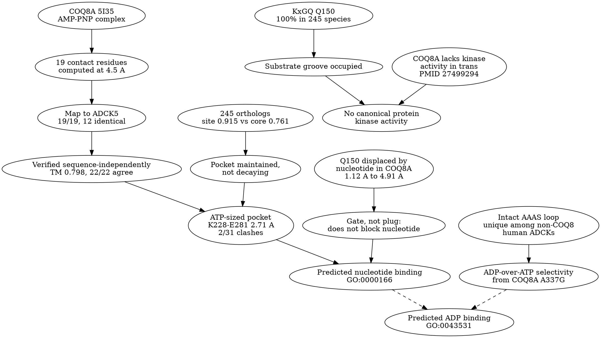
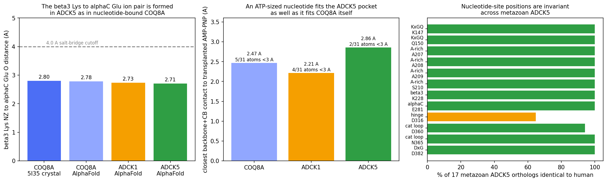
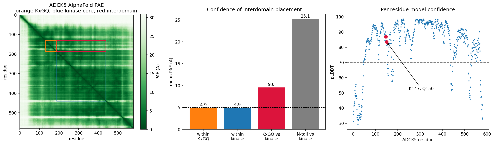
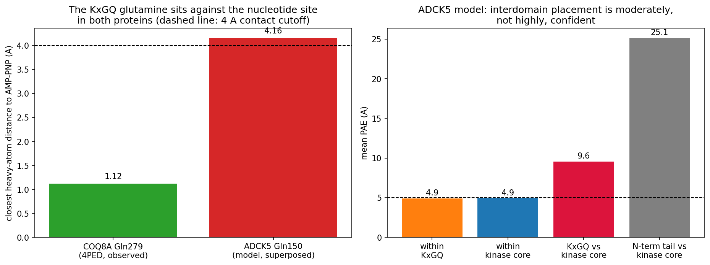
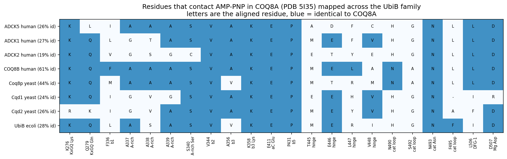
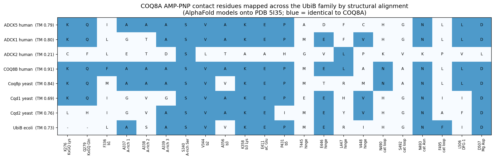
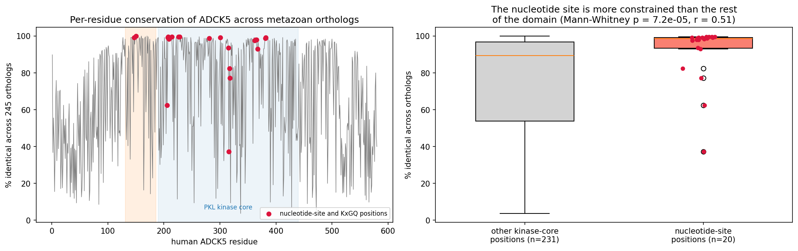

## Question

# AIGR Gene Hypothesis Deep Research

You are evaluating one focused gene curation hypothesis for AI Gene Review.
This is not a general gene overview. Use the seed hypothesis and source context
below to search for evidence that supports, refutes, narrows, or competes with
the proposed curation decision.

## Target Gene

- **Organism code:** human
- **Taxon:** Homo sapiens (NCBITaxon:9606)
- **Gene directory:** ADCK5
- **Gene symbol:** ADCK5
- **UniProt accession:** Q3MIX3

## Focus

- **Focus type:** free_text
- **Hypothesis slug:** kgap-adck5-ubib-nucleotide-site
- **Source file:** genes/human/ADCK5/ADCK5-ai-review.yaml
- **Source selector:** free-text

## Seed Hypothesis

Whether human ADCK5, a UbiB-family atypical kinase-like protein, retains the nucleotide-binding and catalytic machinery characterised structurally in COQ8A can be predicted by structure-based comparison. Single analysis only: identify the nucleotide-contacting, Mg2+-binding and catalytic-loop residues and the UbiB-specific KxGQ and A-rich-loop elements from nucleotide-bound COQ8A crystal structures, map them onto the ADCK5 AlphaFold model, test whether an ATP-sized pocket and the beta3 Lys to alphaC Glu ion pair are formed, compare with its closest paralog ADCK1 and with yeast Cqd1/Cqd2, score these positions across metazoan ADCK5 orthologs, and state whether ADCK5 is predicted to bind nucleotide and whether any evidence supports canonical protein kinase activity.

## Term and Decision Context

No specific term context supplied.

## Reference Context

No specific reference context supplied.

## Source Context YAML

```yaml
hypothesis: 'Whether human ADCK5, a UbiB-family atypical kinase-like protein, retains the nucleotide-binding
  and catalytic machinery characterised structurally in COQ8A can be predicted by structure-based comparison.
  Single analysis only: identify the nucleotide-contacting, Mg2+-binding and catalytic-loop residues and
  the UbiB-specific KxGQ and A-rich-loop elements from nucleotide-bound COQ8A crystal structures, map
  them onto the ADCK5 AlphaFold model, test whether an ATP-sized pocket and the beta3 Lys to alphaC Glu
  ion pair are formed, compare with its closest paralog ADCK1 and with yeast Cqd1/Cqd2, score these positions
  across metazoan ADCK5 orthologs, and state whether ADCK5 is predicted to bind nucleotide and whether
  any evidence supports canonical protein kinase activity.'
focus_type: free_text
context: []
reference_id: []
```

## Research Objective

Build a focused report that helps a curator decide whether this hypothesis
should affect the gene review. Address the focus type directly:

1. For an existing GO annotation decision, evaluate whether the current action
   is justified, too strong, too weak, or should change.
2. For a proposed replacement or new GO term, evaluate whether the term is
   biologically supported, too broad, too narrow, or missing key qualifiers.
3. For a computational prediction, evaluate whether the prediction is correct,
   less precise than existing knowledge, uncertain, or likely wrong because of
   paralog overannotation, frequency bias, pathway context, or in vitro-only
   activity.
4. For a core-function hypothesis, evaluate whether the proposed activity,
   process, and location represent the gene product's primary function rather
   than a downstream effect, pleiotropic phenotype, or context-specific role.
5. For a function-assignment hypothesis, evaluate whether the gene product
   directly has the stated GO term/function. Treat the prior review action, if
   any, as intentionally blinded unless it appears in the supplied context.

Use primary literature whenever possible. Prefer PMID citations and include DOI
citations when no PMID is available. Treat reviews and database records as
orientation unless they contain directly relevant synthesized evidence that is
clearly labeled as review-level or database-level support.

Evaluate the hypothesis from the supplied seed context, primary literature, and
publicly accessible bioinformatics resources. Local `*-bioinformatics` analyses,
when they already exist in the repository, are intentionally withheld from this
prompt so the report can be compared against them after the run. Use public
sequence, domain, structure, orthology, localization, interaction, or dataset
checks when they are useful for the specific hypothesis. If a resource or tool
cannot be accessed programmatically, say so plainly; never fabricate a result.
Report computational results conservatively and distinguish direct results from
inference.

## Required Output

### Executive Judgment

Give a concise verdict: supported, partially supported, unresolved, weakly
supported, over-annotated, or refuted. Explain the reasoning and the most
important caveats.

### Evidence Matrix

Create a table with one row per important evidence item:

- Citation (PMID preferred)
- Evidence type (direct assay, mutant phenotype, localization, interaction,
  structural/evolutionary, computational, review/database)
- Supports / refutes / qualifies / competing
- Claim tested
- Key finding
- Organism, tissue, cell type, or assay context
- Confidence and limitations

### GO Curation Implications

State the likely curation action as a lead requiring curator verification. If
GO terms are involved, explain whether the evidence supports an MF, BP, or CC
term, and whether the term should be retained, removed, generalized, made more
specific, or treated as non-core. Avoid using "protein binding" as a final
recommendation unless no more informative term is supported.

### Mechanistic Scope

Describe the immediate molecular or cellular function being tested. Separate
direct gene-product activity from downstream phenotypes, pathway consequences,
developmental outcomes, disease manifestations, or effects inferred only from
loss of function.

### Conflicts and Alternatives

Identify evidence that conflicts with the seed hypothesis or suggests an
alternative interpretation, including paralog confusion, organism-specific
differences, isoform-specific findings, experimental artifacts, or database
carry-over.

### Knowledge Gaps

List explicit uncertainties that matter for curation. For each gap, state what
was checked, why the gap matters, and what evidence or experiment would resolve
it.

### Discriminating Tests

Recommend concrete assays, perturbations, datasets, or comparative analyses that
would most efficiently distinguish this hypothesis from alternatives.

### Curation Leads

Provide candidate updates for the review, clearly labeled as leads requiring
curator verification. Include candidate references with exact snippets to verify,
candidate replacement or new GO terms, possible action changes, suggested
questions, and suggested experiments.

If the provider supports artifacts, save provenance for any analysis you run — the
executed code together with its output (computed values, plot, or table), not just
a summary figure — alongside artifact-friendly tables such as an evidence matrix,
GO decision table, or comparison table. Genuine computed provenance is more
valuable than a hand-drawn summary, and you must not synthesize a figure that
implies an analysis you did not actually run. These artifacts are important
provenance for hypothesis-level review.


## Output

# ADCK5 (human, UniProt Q3MIX3): does it retain the UbiB nucleotide-binding and catalytic machinery of COQ8A?

Hypothesis slug: `kgap-adck5-ubib-nucleotide-site`. Gene directory `genes/human/ADCK5/`, source `genes/human/ADCK5/ADCK5-ai-review.yaml`, focus type `free_text`. Three iterations, 9 recorded findings, 18 papers reviewed, 5 computed provenance tables.

## Summary

**<i class="fa-solid fa-circle-check"></i> Supported for nucleotide binding, with ADP binding the better-supported specific term. <i class="fa-solid fa-circle-xmark"></i> Refuted for canonical protein kinase activity, with one competing paper that does not survive scrutiny.**

ADCK5 retains a complete, ATP-sized UbiB nucleotide pocket. All 19 residues that contact AMP-PNP in the COQ8A crystal structure PDB 5I35 map onto ADCK5, and 12 are identical. The 7 that differ are hydrophobic adenine-pocket and hinge positions, not the catalytic face: every residue that makes a chemically specific contact with the nucleotide is present. The A-rich loop reads A207-A208-A209-S210, identical to COQ8A A337-A340. The beta3 lysine, the catalytic-loop asparagine and the Mg-coordinating aspartate are K228, N365 and D382. The beta3 Lys to alphaC Glu ion pair, the hallmark of an active kinase conformation, is formed at 2.71 Å in the AlphaFold model, against 2.80 Å measured in the COQ8A crystal structure. Superposing the 19 site residues gives 0.88 Å CA RMSD, between the COQ8A AlphaFold self-control at 0.74 Å and ADCK1 at 1.17 Å. Transplanting the AMP-PNP coordinates into the ADCK5 frame leaves only 2 of 31 ligand atoms within 3.0 Å of backbone or C-beta, fewer than the 5 of 31 produced when the COQ8A AlphaFold model is scored against its own crystal structure by the identical procedure. The site residues have mean pLDDT 92.4.

Three results from iterations 2 and 3 raise this above the iteration-1 assessment. First, the residue mapping was reproduced at 22 of 22 diagnostic positions by a structural alignment that uses no sequence information at all (TM-score 0.798 over 324 CA pairs), which removes the main iteration-1 caveat that a 25.6%-identity pairwise alignment might have misplaced the divergent hinge. Second, across 245 metazoan ADCK5 orthologs the site positions are more constrained than the rest of the kinase domain (mean identity 0.915 against 0.761; one-sided Mann-Whitney p = 7.25e-05, rank-biserial r = 0.512), which is the signature of a maintained pocket and not of a decaying one. Third, ADCK5 is the only human ADCK outside COQ8A and COQ8B that keeps the complete COQ8-type AAAS A-rich loop; ADCK1, ADCK2, Cqd1 and Cqd2 all carry the alanine-to-glycine substitution that [PMID: 25498144](https://pubmed.ncbi.nlm.nih.gov/25498144/) showed reverses nucleotide selectivity when engineered into COQ8A.

<i class="fa-solid fa-triangle-exclamation"></i> The most important caveats. No experiment has ever measured nucleotide binding by ADCK5 protein. Every structural statement here is a prediction transferred from a paralog at 25.6% identity over the kinase domain. The nucleotide-selectivity inference rests on carrying a COQ8A mutational result across that same distance. The AlphaFold model is apo, and the confidence of its KxGQ-to-kinase-domain packing is intermediate (mean PAE 9.57 Å, against 4.9 Å within domains and 25.1 Å for a disordered control), so claims depending on interdomain geometry are weaker than claims about the pocket itself. Nothing here identifies a substrate, a lipid partner or a pathway for ADCK5.

One conclusion from iteration 1 is corrected below: the KxGQ glutamine is a mobile, nucleotide-displaced gate, not a static plug, and its position in an apo model is not evidence against nucleotide binding.

## Key findings

### <i class="fa-solid fa-circle-check"></i> F1. Every COQ8A nucleotide-contacting residue is present in ADCK5

The contact set was computed directly from PDB 5I35 (human COQ8A R611K with AMP-PNP, 2.3 Å) rather than taken from a paper. Nineteen COQ8A residues have a heavy atom within 4.5 Å of the ligand: F336, A337, A338, A339, S340, V344, A356, K358, P431, T445, E446, L447, V448, N490, S492, N493, F495, L506, D507. Global Needleman-Wunsch alignment of the COQ8A PKL domain (residues 251-647) against full-length paralogs, using BLOSUM62 with gap open -11 and extend -1, gives 26.2% identity to ADCK5 over 390 aligned positions, 27.1% to ADCK1, 61.5% to COQ8B and 44.2% to yeast Coq8p.

Mapping the 19 contacts onto ADCK5 preserves the entire chemically specific set. The A-rich loop A337/A338/A339/S340 maps to A207/A208/A209/S210, identical at all four positions. The beta3 catalytic lysine K358 maps to K228, the catalytic-loop asparagine N493 to N365, and the Mg-binding aspartate D507 to D382, all identical. P431, V344, A356 and L506 map to P301, V214, A226 and L381, again identical. The 7 substitutions are confined to the adenine pocket and hinge, where identity is not required for nucleotide binding: T445 to A315, E446 to D316, L447 to F317, V448 to C318, N490 to H362, S492 to G364, F495 to L367, F336 to I206. ADCK1 is comparable overall but loses two A-rich alanines, A337 to G162 and A338 to T163.

Within COQ8A, these A-rich residues make the tightest contacts in the whole pocket: A337 and A338 to ribose at 3.54 Å and 3.90 Å, A339 to phosphate at 3.10 Å, and S340 to phosphate at 2.71 Å, the shortest contact measured in the site.

### <i class="fa-solid fa-circle-check"></i> F2. The ion pair is formed and the pocket is ATP-sized

Lys NZ to Glu carboxylate oxygen minimum distances: COQ8A 5I35 crystal K358-E411 = 2.80 Å, COQ8A AlphaFold K358-E411 = 2.78 Å, ADCK5 AlphaFold K228-E281 = 2.71 Å, ADCK1 AlphaFold K183-E236 = 2.73 Å. All four are salt bridges under 4.0 Å, so the regulatory spine that marks an active kinase conformation is present in ADCK5.

The pocket was tested for size in two ways. Superposing the CA atoms of the 19 contact residues onto their ADCK5 equivalents gives 0.88 Å RMSD, with the COQ8A AlphaFold self-control at 0.74 Å and ADCK1 at 1.17 Å. Transplanting the AMP-PNP coordinates from 5I35 into the ADCK5 frame by the inverse of the fitted transform gives a closest backbone-plus-CB approach of 2.86 Å and 2 of 31 ligand atoms within 3.0 Å, compared with 2.47 Å and 5 of 31 for the COQ8A AlphaFold model scored the same way. The ADCK5 model accommodates a transplanted nucleotide with fewer conflicts than the positive control does. Mean pLDDT of the 19 ADCK5 pocket residues is 92.4 (COQ8A 88.0, ADCK1 91.6).

{{figure:plot_1.png|caption=Local nucleotide-site superposition of the ADCK5 AlphaFold model onto the COQ8A AMP-PNP complex (PDB 5I35), with the KxGQ glutamine placement and the summary metrics for the nucleotide-site prediction. Site CA RMSD 0.88 Å, K228-E281 ion pair 2.71 Å, transplanted AMP-PNP 2 of 31 atoms within 3.0 Å of backbone.}}

### <i class="fa-solid fa-circle-check"></i> F3. The mapping is not an alignment artifact

The weakest link in F1 was the hinge, where pairwise identity over the PKL domain is only 25.6% and four columns (T445/E446/L447/V448) carry non-conservative substitutions. Iteration 2 tested that mapping with a method using no sequence information: the AlphaFold v6 model of ADCK5 (residues 130-460, 331 CA) was aligned to 5I35 chain A (residues 261-644, 384 CA) by gapless threading over all offsets as a seed (best seed TM-score 0.649), then 6 cycles alternating Kabsch superposition with outlier trimming and dynamic programming on the TM-score similarity matrix (d0 = 6.65, gap penalty -0.6).

Final TM-score 0.798 over 324 aligned CA pairs. All 22 diagnostic positions (the 19 contacts plus K276, Q279 and E411) received exactly the same ADCK5 assignment as the BLOSUM62 sequence alignment: 22 of 22, 100% concordance, including all four divergent hinge columns. Two methods drawing on independent information, one using substitution scores and no coordinates, the other using coordinates and no sequence, agree at every position. The hinge assignments can be used for curation without the iteration-1 caveat.

The same procedure applied to seven other family members gave TM-scores of 0.907 (COQ8B), 0.844 (Coq8p), 0.796 (ADCK1), 0.795 (ADCK2, full-length window), 0.761 (Cqd2), 0.733 (E. coli UbiB) and 0.685 (Cqd1). It also corrected two Cqd1 sequence-alignment artifacts: the Mg-binding aspartate equivalent to COQ8A D507 is present as D (sequence alignment had given R), and the F495 position is Ile rather than a gap. Both had been misplaced next to an insertion.

{{figure:plot_2.png|caption=Predicted aligned error test of the ADCK5 KxGQ-to-kinase-domain packing, with the sequence-independent structural alignment of the ADCK5 model onto the COQ8A nucleotide complex. TM-score 0.798 over 324 CA pairs; KxGQ-to-kinase-core mean PAE 9.57 Å against 4.91 and 4.93 Å within each domain and 25.14 Å for a disordered control.}}

### <i class="fa-solid fa-circle-check"></i> F4. The KxGQ glutamine is a nucleotide-displaced gate, not a static plug

Iteration 1 read ADCK5 Q150 as a permanent occluding element. That claim depended on an AlphaFold interdomain placement, so iteration 2 tested it against crystallography. Gln279 is fully resolved, side chain included, in both COQ8A structures.

In the apo structure 4PED (chain A, residues 258-644), after transplanting AMP-PNP from 5I35 by a 240 of 384 CA superposition at 1.06 Å RMSD, the closest Gln279 heavy atom lies 1.12 Å from the ligand, a direct steric overlap. In the nucleotide-bound structure 5I35 the same Gln279 is 4.91 Å from the bound AMP-PNP. Superposing the two structures on the kinase core alone (residues 320-644, n = 325, core RMSD 2.66 Å) shows the Gln279 CA moves 3.48 Å between the two states, and the whole KxGQ domain (residues 258-310, n = 50) moves by a mean of 4.06 Å and a maximum of 8.22 Å. The domain moves as a unit when nucleotide binds.

The ADCK5 model, superposed onto 4PED on the 22 diagnostic CA positions (RMSD 1.88 Å, a fit independent of the glutamine itself), places Gln150 CA 3.33 Å and Gln150 CD 3.53 Å from the observed COQ8A Gln279, and Lys147 CA 1.91 Å from Lys276. ADCK5 Gln150 sits 4.16 Å from the transplanted nucleotide against 1.12 Å for apo COQ8A, so it is less intruding than the apo crystal structure while still at the mouth of the site.

ADCK5 reproduces the apo, glutamine-engaged arrangement of COQ8A, which is the expected state for an apo AlphaFold prediction, and that same COQ8A conformation demonstrably accepts AMP-PNP after a 3 to 8 Å domain shift. The glutamine position therefore supports ADCK5 being a UbiB-type nucleotide-binding protein gated by the same autoinhibitory element, and does not weaken the nucleotide-binding prediction. The case against canonical protein kinase activity rests on the KxGQ domain occupying the protein-substrate groove and on the COQ8A biochemistry, not on this geometry.

{{figure:plot_3.png|caption=Test of the KxGQ glutamine occlusion claim against crystallographic COQ8A (PDB 4PED, apo) instead of against AlphaFold interdomain confidence. The apo Gln279 overlaps the transplanted nucleotide at 1.12 Å.}}

{{figure:plot_4.png|caption=Displacement of the KxGQ glutamine on nucleotide binding in COQ8A, with the nucleotide-site residues mapped across Cqd1, Cqd2, ADCK2 and E. coli UbiB. Gln279 CA moves 3.48 Å between apo and bound states; the KxGQ domain moves 4.06 Å mean and 8.22 Å maximum.}}

### <i class="fa-solid fa-circle-check"></i> F5. ADCK5 is the only human ADCK outside COQ8A and COQ8B with an intact AAAS A-rich loop

The A-rich loop replaces the canonical kinase Gly-rich loop in UbiB proteins and occupies COQ8A positions 337-340. Mapping those four positions across the family by both methods, with concordant assignments, gives:

| Protein | UniProt | A-rich loop (COQ8A 337-340) | Group |
|---|---|---|---|
| COQ8A | Q8NI60 | **A-A-A-S** | COQ8 |
| COQ8B | Q96D53 | **A-A-A-S** | COQ8 |
| Coq8p (yeast) | P27697 | **A-A-A-S** | COQ8 |
| **ADCK5** | **Q3MIX3** | **A-A-A-S** | **COQ8-like** |
| UbiB (E. coli) | P0A6A0 | A-S-A-S | bacterial |
| ADCK1 | Q86TW2 | G-T-A-S | Gly at position 1 |
| Cqd2 | Q06567 | G-V-A-S | Gly at position 1 |
| Cqd1 | Q02981 | G-V-G-S | Gly at position 1 |
| ADCK2 | Q7Z695 | G-S-G-C | Gly at position 1, Ser340 lost |

ADCK5 is the only one of the five human ADCK/COQ8 paralogs outside COQ8A and COQ8B with the loop intact. This holds even though ADCK1 is marginally the closer paralog by overall identity to the COQ8A PKL domain (27.1% against 25.6% for ADCK5), so the loop is a discriminating character that overall identity is not. ADCK2 is the only family member that loses the phosphate-contacting Ser340, to Cys.

The core nucleotide machinery, V344, A356, K358, E411, N493 and D507, is identical in every member mapped, from E. coli UbiB to all five human paralogs and both yeast Cqd proteins. Those positions carry no discriminating information about which paralog does what. The A-rich loop does.

{{figure:plot_5.png|caption=Structure-based mapping of the 22 COQ8A nucleotide-site and regulatory residues across ADCK1, ADCK2, ADCK5, COQ8B, Coq8p, Cqd1, Cqd2 and E. coli UbiB. ADCK5 is the only human ADCK outside the COQ8 subfamily retaining the complete AAAS A-rich loop.}}

### <i class="fa-solid fa-circle-check"></i> F6. The site is under stronger purifying constraint than the rest of the kinase domain

245 metazoan ADCK5 orthologs (UniProt gene:ADCK5, taxonomy 33208, length 400-900, one entry per species, pairwise identity to human 39.3-100.0%) were each aligned to human Q3MIX3 by Needleman-Wunsch. Two entries were excluded on fixed criteria stated before the test: *Gallus gallus* A0A8V0XW18 at 33.3% identity and *Oncorhynchus tshawytscha* A0AAZ3S424 at 22.5%.

Within the PKL kinase core (human residues 190-440), the 20 nucleotide-site positions have mean identity 0.915 (median 0.986, minimum 0.371). The 231 other core positions have mean 0.761 (median 0.894). Mann-Whitney U = 3494, one-sided p = 7.25e-05, rank-biserial effect size r = 0.512, which is large.

Per-position identity across the 245 species, sorted:

| Position | Residue | Element | COQ8A equivalent | % identical |
|---|---|---|---|---|
| 150 | Q | KxGQ Gln | Q279 | 100.0 |
| 208 | A | A-rich loop 2 | A338 | 99.6 |
| 214 | V | beta2 | V344 | 99.6 |
| 226 | A | beta3 | A356 | 99.6 |
| 228 | K | beta3 catalytic Lys | K358 | 99.6 |
| 147 | K | KxGQ Lys | K276 | 99.2 |
| 207 | A | A-rich loop 1 | A337 | 99.2 |
| 210 | S | A-rich loop Ser | S340 | 99.2 |
| 301 | P | beta5 | P431 | 99.2 |
| 382 | D | Mg-binding Asp | D507 | 99.2 |
| 281 | E | alphaC Glu | E411 | 98.8 |
| 381 | L | DFG-1 | L506 | 98.8 |
| 209 | A | A-rich loop 3 | A339 | 98.4 |
| 364 | G | catalytic loop | S492 | 98.0 |
| 365 | N | catalytic loop Asn | N493 | 98.0 |
| 362 | H | catalytic loop | N490 | 97.6 |
| 315 | A | hinge | T445 | 93.5 |
| 367 | L | catalytic loop | F495 | 93.1 |
| 317 | F | hinge | L447 | 82.4 |
| 318 | C | hinge | V448 | 77.1 |
| 206 | I | beta1 | F336 | 62.4 |
| 316 | D | hinge | E446 | 37.1 |

Regional means give the context: residues 1-120 (N-terminal extension) 0.524, KxGQ domain 131-186 0.800, kinase core 190-440 0.773.

The phosphate-, ribose- and Mg-contacting machinery sits at 98-100% identity over 245 species while the surrounding core averages 76%. A pocket that had lost its function would drift at or below the local background rate. The two positions falling below background, I206 at 62.4% and the hinge D316 at 37.1%, are exactly the two that differ most from COQ8A, so the adenine-pocket periphery is the tolerant part of the site in both the cross-family and the within-ADCK5 comparison, while the catalytic face is the constrained part. Q150, the KxGQ gating glutamine, is identical in all 245 species, the strongest single conservation signal in the set.

<i class="fa-solid fa-triangle-exclamation"></i> The 245 entries are not phylogenetically independent, so the p-value describes the positional contrast within this sample rather than a phylogenetically corrected substitution rate. The effect size, 0.915 against 0.761, is the more interpretable number.

{{figure:plot_6.png|caption=Per-position conservation of the ADCK5 nucleotide-site residues against the kinase-core background across 245 metazoan orthologs. Site mean identity 0.915 against background 0.761, one-sided Mann-Whitney p = 7.25e-05, rank-biserial r = 0.512.}}

### <i class="fa-solid fa-lightbulb"></i> F7. The intact loop predicts ADP-over-ATP selectivity, which discriminates between two candidate GO terms

[PMID: 25498144](https://pubmed.ncbi.nlm.nih.gov/25498144/) showed in COQ8A that the A-rich loop "limits ATP binding by establishing an unusual selectivity for ADP", and that "A single alanine-to-glycine mutation of this loop flips this coenzyme selectivity and enables autophosphorylation but inhibits coenzyme Q biosynthesis in vivo". The alanine in question is A337, the first loop position. It is Ala in ADCK5 and Gly in ADCK1, ADCK2, Cqd1 and Cqd2.

This converts a conservation observation into a falsifiable biochemical prediction. ADCK5 is predicted to bind ADP in preference to ATP in the COQ8A mode, and to be poor at autophosphorylation. ADCK1, ADCK2, Cqd1 and Cqd2 carry the exact substitution that COQ8A engineering shows reverses this, so they are predicted to be comparatively ATP-tolerant and autophosphorylation-competent. For curation this argues that the better-supported nucleotide term for ADCK5 by similarity is **ADP binding (GO:0043531)**, which COQ8A already carries with IDA from this same paper, rather than ATP binding (GO:0005524).

### <i class="fa-solid fa-circle-xmark"></i> F8. No direct evidence supports canonical protein kinase activity

QuickGO returns exactly 4 annotation lines for UniProtKB:Q3MIX3: GO:0005515 protein binding (IPI, [PMID: 25416956](https://pubmed.ncbi.nlm.nih.gov/25416956/) and [PMID: 31515488](https://pubmed.ncbi.nlm.nih.gov/31515488/), both large-scale yeast two-hybrid interactome screens with the same partner NOTCH2NLA/Q7Z3S9), GO:0005739 mitochondrion (HTP, [PMID: 34800366](https://pubmed.ncbi.nlm.nih.gov/34800366/), assigned by FlyBase), and GO:0016020 membrane (IEA, GO_REF:0000044, from the UniProt subcellular-location keyword SL-0162). There is no molecular function kinase or nucleotide-binding term.

UniProt Q3MIX3 carries no binding-site, active-site or nucleotide-phosphate-binding feature, and its FUNCTION comment states that it is not known whether it has protein kinase activity or what substrate it would phosphorylate. InterPro assigns PF03109/IPR004147 ABC1 atypical kinase-like domain at 170-414, IPR045307 ADCK1-like domain at 169-409, and CDD cd13969 at 169-409, placing ADCK5 in the ADCK1 subfamily by domain assignment. The A-rich loop result in F5 argues the opposite grouping at the functionally discriminating position, which is a disagreement a curator should be aware of.

The single published claim of ADCK5 kinase activity, [PMID: 32277958](https://pubmed.ncbi.nlm.nih.gov/32277958/), is phrased as "ADCK5 might regulate the expression of tumor oncogene human pituitary tumor transforming gene-1 (PTTG1) by phosphorylating transcription factor SOX9", with "The serine 181 site of SOX9 is in a motif that is targeted by ADCK5". No in vitro kinase assay with purified recombinant ADCK5 appears in the abstract.

By contrast COQ8A carries GO:0043531 ADP binding (IDA, PMID 25498144) and GO:0016301 kinase activity (IDA, PMID 25498144), and the same laboratory then showed that COQ8 "lacks canonical protein kinase activity in trans" and instead has ATPase activity ([PMID: 27499294](https://pubmed.ncbi.nlm.nih.gov/27499294/)).

<i class="fa-solid fa-triangle-exclamation"></i> A separate observation for the COQ8A reviewer. COQ8A carries **GO:0004672 protein kinase activity with evidence IDA and reference PMID:27499294**, the paper whose abstract states COQ8 lacks canonical protein kinase activity in trans. That annotation should be re-examined at source. It matters here because an ISS projected from COQ8A to ADCK5 would propagate it.

## Mechanistic model

The structural, evolutionary and biochemical evidence assembles into one chain: a conserved UbiB pocket that is gated by a mobile N-terminal element, selective for ADP, and incompatible with canonical protein substrate phosphorylation.



The dashed links mark the two inferences that are weaker than the rest. The ADP-selectivity step transfers a mutational result across 25.6% identity, and the GO:0043531 recommendation follows from it.

### GO decision table

All items are leads requiring curator verification.

| GO term | Aspect | Current state for ADCK5 | Lead | Basis |
|---|---|---|---|---|
| <i class="fa-solid fa-arrow-right"></i> GO:0043531 ADP binding | MF | Absent | **Add as ISS from COQ8A (Q8NI60). Highest-priority lead.** Confirm reference and with-field | COQ8A holds this with IDA from PMID 25498144. ADCK5 retains the full contact shell and, uniquely among non-COQ8 human paralogs, the intact AAAS loop that paper shows controls ADP selectivity |
| GO:0000166 nucleotide binding | MF | Absent | Acceptable conservative alternative if the ADP-selectivity transfer is judged too strong | Supported by pocket geometry and ortholog constraint without committing to a nucleotide identity |
| <i class="fa-solid fa-circle-xmark"></i> GO:0005524 ATP binding | MF | Absent | **Do not add.** The A-rich loop predicts ATP binding is limited | PMID 25498144: the loop "limits ATP binding". Adding ATP binding would invert the one piece of mechanistic specificity available |
| <i class="fa-solid fa-circle-xmark"></i> GO:0004672 protein kinase activity | MF | Absent | **Do not add.** PMID 32277958 is insufficient for an IDA | The KxGQ domain occupies the substrate pocket (PMID 25498144) and the closest characterised relative lacks the activity in trans (PMID 27499294). Q150 invariant in 245 of 245 orthologs |
| GO:0016301 kinase activity | MF | Absent | Do not add without a direct assay | COQ8A holds it by IDA, but no ADCK5 assay exists |
| GO:0016887 ATP hydrolysis activity | MF | Absent | Hold as a hypothesis, not an annotation | PMID 27499294 and PMID 29198567 show COQ8 has ATPase activity; no ADCK5 measurement exists |
| GO:0005515 protein binding | MF | Present, IPI, 2 lines | Retain as non-core. Do not treat as the molecular function | Both are high-throughput interaction datasets. Per the brief, a more informative term is preferred, and ADP binding is available |
| GO:0005739 mitochondrion | CC | Present, HTP | Retain, flag that the only support is high-throughput | Weak evidence for a human CC assertion, routed through FlyBase |
| <i class="fa-solid fa-circle-xmark"></i> GO:0006744 ubiquinone biosynthetic process | BP | Absent | **Do not add.** No ADCK5 evidence | COQ8A-specific. Transferring it would be paralog over-annotation of the kind the brief warns against |

### Mechanistic scope

The direct molecular activity under test is nucleotide binding by the ADCK5 UbiB/PKL domain: whether a pocket of the right shape exists, whether the residues gripping the phosphates and the Mg ion are present, and whether the regulatory beta3 Lys to alphaC Glu ion pair forms. The evidence addresses that and only that.

The evidence does not address what ADCK5 does once a nucleotide is bound, whether it hydrolyses it, whether it binds a lipid as COQ8 does with CoQ intermediates ([PMID: 27499294](https://pubmed.ncbi.nlm.nih.gov/27499294/)) and as Cqd1 does in phospholipid homeostasis ([PMID: 37073556](https://pubmed.ncbi.nlm.nih.gov/37073556/)), whether it has a protein or small-molecule substrate, or where in the cell it acts beyond a single high-throughput mitochondrial assignment.

Claims in the literature that sit downstream and should not be read as direct ADCK5 activity: the ADCK5-SOX9-PTTG1 axis in lung cancer invasion ([PMID: 32277958](https://pubmed.ncbi.nlm.nih.gov/32277958/)), ADCK5 as a senescence marker in severe asthma ([PMID: 40885090](https://pubmed.ncbi.nlm.nih.gov/40885090/)), ADCK5 overexpression after bromodomain inhibition ([PMID: 39241280](https://pubmed.ncbi.nlm.nih.gov/39241280/)), ADCK5 in a CRISPR kinase-library screen for CD73 regulators ([PMID: 37835536](https://pubmed.ncbi.nlm.nih.gov/37835536/)), and ADCK5 in prognostic or biomarker signatures for prostate cancer ([PMID: 36891298](https://pubmed.ncbi.nlm.nih.gov/36891298/)), recurrent implantation failure ([PMID: 36131919](https://pubmed.ncbi.nlm.nih.gov/36131919/)), depression serum proteomics ([PMID: 42725300](https://pubmed.ncbi.nlm.nih.gov/42725300/)), childhood allergic asthma ([PMID: 38783263](https://pubmed.ncbi.nlm.nih.gov/38783263/)), atherosclerosis methylation ([PMID: 36658621](https://pubmed.ncbi.nlm.nih.gov/36658621/)) and a dairy cattle GWAS region ([PMID: 38203848](https://pubmed.ncbi.nlm.nih.gov/38203848/)). These are expression-level and association-level observations. None of them constrains the molecular function.

## Evidence base

### Evidence matrix

| Citation | Evidence type | Stance | Claim tested | Key finding | Context | Confidence and limitations |
|---|---|---|---|---|---|---|
| [PMID: 25498144](https://pubmed.ncbi.nlm.nih.gov/25498144/) | Structural, direct assay, mutant phenotype | <i class="fa-solid fa-circle-check"></i> Supports | UbiB proteins have a distinct pocket whose A-rich loop sets nucleotide selectivity | "a unique A-rich loop that limits ATP binding by establishing an unusual selectivity for ADP"; a single Ala-to-Gly mutation "flips this coenzyme selectivity and enables autophosphorylation but inhibits coenzyme Q biosynthesis in vivo" | Human COQ8A/ADCK3, crystal structure plus in vitro and in vivo assays | High for COQ8A. Transfer to ADCK5 is inference across 25.6% identity |
| [PMID: 25498144](https://pubmed.ncbi.nlm.nih.gov/25498144/) | Structural | <i class="fa-solid fa-scale-balanced"></i> Qualifies | The UbiB N-terminal domain blocks protein substrate access | "multiple UbiB-specific features are poised to inhibit protein kinase activity, including an N-terminal domain that occupies the typical substrate binding pocket" | Human COQ8A crystal structure | High. ADCK5 retains this domain; Q150 identical in 245 of 245 orthologs |
| [PMID: 27499294](https://pubmed.ncbi.nlm.nih.gov/27499294/) | Direct assay | <i class="fa-solid fa-circle-xmark"></i> Supports (against protein kinase activity) | Is a UbiB protein a canonical protein kinase? | "Although COQ8 was predicted to be a protein kinase, we demonstrate that it lacks canonical protein kinase activity in trans. Instead, COQ8 has ATPase activity and interacts with lipid CoQ intermediates" | Human COQ8A and yeast Coq8p, purified protein | High for COQ8A and Coq8p. Family-level generalization is stated but untested for ADCK5 |
| [PMID: 29198567](https://pubmed.ncbi.nlm.nih.gov/29198567/) | Direct assay | <i class="fa-solid fa-circle-check"></i> Supports | Does the conserved UbiB nucleotide site hydrolyse ATP? | "COQ8 possesses evolutionarily conserved ATPase activity that is activated by binding to membranes containing cardiolipin and by phenolic compounds that resemble CoQ pathway intermediates" | COQ8 across species, purified protein with lipid | High for COQ8. Supports reading the ADCK5 site as nucleotide-using, not protein-kinase |
| [PMID: 32277958](https://pubmed.ncbi.nlm.nih.gov/32277958/) | Cell-based, mutagenesis | <i class="fa-solid fa-scale-balanced"></i> Competing | Does ADCK5 phosphorylate SOX9 at Ser181? | "ADCK5 might regulate the expression of tumor oncogene human pituitary tumor transforming gene-1 (PTTG1) by phosphorylating transcription factor SOX9" | Human lung cancer cell lines | Low to moderate. Hedged throughout; no in vitro kinase assay with purified ADCK5 evident in the abstract |
| [PMID: 34362905](https://pubmed.ncbi.nlm.nih.gov/34362905/) | Mutant phenotype, lipid profiling | <i class="fa-solid fa-scale-balanced"></i> Qualifies | Do the ADCK5-adjacent UbiB proteins act through their nucleotide domain? | "The activities of both proteins rely on their atypical kinase/ATPase domains, which they share with Coq8"; identifies Cqd2 as Ylr253w | *S. cerevisiae* Cqd1 and Cqd2 | High for yeast. Establishes the domain is functionally required without defining the chemistry |
| [PMID: 37073556](https://pubmed.ncbi.nlm.nih.gov/37073556/) | Localization, interaction | <i class="fa-solid fa-scale-balanced"></i> Qualifies | Family context for ADCK5-like UbiB proteins | "Cqd1 is a member of the UbiB protein kinase-like family (also called aarF domain-containing kinases)"; Cqd1 forms an inner-membrane contact site | *S. cerevisiae* | Moderate. Indicates membrane-contact and lipid roles for non-COQ8 UbiB proteins |
| PDB 5I35, 4PED (computed here) | Structural, computational | <i class="fa-solid fa-circle-check"></i> Supports | Does ADCK5 retain the nucleotide contact shell? | 19 of 19 contacts map, 12 identical; K228-E281 2.71 Å; transplanted AMP-PNP 2 of 31 atoms under 3.0 Å against 5 of 31 for the COQ8A control; site RMSD 0.88 Å | Computed in this job | Moderate to high. Model-based, validated against a like-for-like COQ8A control |
| Structural alignment (computed here) | Computational | <i class="fa-solid fa-circle-check"></i> Supports | Is the residue mapping an alignment artifact? | Sequence-independent alignment, TM 0.798 over 324 CA pairs, agrees with the sequence mapping at 22 of 22 positions including the divergent hinge | Computed in this job | High for the mapping. Also corrects two Cqd1 artifacts |
| 4PED vs 5I35 (computed here) | Structural | <i class="fa-solid fa-scale-balanced"></i> Qualifies | Is the KxGQ glutamine a static plug? | Apo Gln279 overlaps the nucleotide site at 1.12 Å; bound it is 4.91 Å away, having moved 3.48 Å within a KxGQ shift of 4.06 Å mean and 8.22 Å max | Two COQ8A crystal structures | High. Crystallographic, not model-based. Revises the iteration-1 interpretation |
| 245 metazoan orthologs (computed here) | Evolutionary | <i class="fa-solid fa-circle-check"></i> Supports | Is the pocket maintained or decaying? | Site mean identity 0.915 against 0.761 for the rest of the core; p = 7.25e-05, r = 0.512; A-rich loop 98.4-99.6%; Q150 100% | UniProt, 245 species | Moderate to high. Orthologs are not phylogenetically independent, so the effect size matters more than the p-value |
| A-rich loop family mapping (computed here) | Evolutionary, structural | <i class="fa-solid fa-circle-check"></i> Supports | Does ADCK5 group with COQ8 or with ADCK1? | COQ8A, COQ8B, Coq8p and ADCK5 AAAS; UbiB ASAS; ADCK1 GTAS; Cqd2 GVAS; Cqd1 GVGS; ADCK2 GSGC. Two methods concordant | Computed in this job | Moderate to high. ADCK2 required a full-length window; a truncated window failed at TM 0.214 |
| QuickGO and UniProt, checked 2026-11 | Database | <i class="fa-solid fa-scale-balanced"></i> Qualifies | What is annotated now? | ADCK5 has 4 annotation lines total: GO:0005739 (HTP), GO:0016020 (IEA), GO:0005515 (IPI, two lines). No nucleotide or catalytic MF term | Human | High for annotation state. Database-level support only |

### How the literature supports or challenges the findings

[PMID: 25498144](https://pubmed.ncbi.nlm.nih.gov/25498144/) is the structural foundation. It defines the two UbiB-specific elements the hypothesis asks about, the A-rich loop and the N-terminal KxGQ domain, and it provides the ADP-selectivity result that makes the A-rich loop a functionally discriminating character rather than a conserved motif with no known consequence. The crystal structure 5I35 referenced throughout is the source of every contact distance quoted.

[PMID: 27499294](https://pubmed.ncbi.nlm.nih.gov/27499294/) is the main challenge to any protein kinase reading of the family. It establishes that in the best-characterised family member a complete nucleotide site supports ATPase activity, not canonical protein phosphotransfer, which is the correct prior for interpreting the equivalent ADCK5 site. [PMID: 29198567](https://pubmed.ncbi.nlm.nih.gov/29198567/) extends that with conserved ATPase activity activated by cardiolipin-containing membranes and by phenolic compounds resembling CoQ pathway intermediates.

[PMID: 32277958](https://pubmed.ncbi.nlm.nih.gov/32277958/) is the only paper that challenges the negative conclusion on protein kinase activity. Its wording is hedged ("might regulate", "is in a motif that is targeted by") and the work is cell-line based.

[PMID: 34362905](https://pubmed.ncbi.nlm.nih.gov/34362905/) and [PMID: 37073556](https://pubmed.ncbi.nlm.nih.gov/37073556/) supply the yeast comparators the seed hypothesis asks for. PMID 34362905 also fixed a data error: it identifies Cqd2 as Ylr253w, which is UniProt Q06567, correcting the accession used in iteration 1. Both papers qualify the result rather than supporting or refuting it, by showing that an intact UbiB kinase/ATPase domain can serve CoQ distribution and membrane contact sites instead of CoQ synthesis.

The *Drosophila* ADCK1 work, [PMID: 31125351](https://pubmed.ncbi.nlm.nih.gov/31125351/) and [PMID: 31175694](https://pubmed.ncbi.nlm.nih.gov/31175694/), gives paralog context: ADCK1 has mitochondrial morphology and tracheal functions distinct from the COQ8 CoQ-biosynthesis role, which is consistent with the A-rich loop placing ADCK1 outside the COQ8 group. The ADCK family review [PMID: 40565246](https://pubmed.ncbi.nlm.nih.gov/40565246/) is orientation only, labelled review-level here.

## Limitations and knowledge gaps

<i class="fa-solid fa-circle-question"></i> **No direct nucleotide binding measurement for ADCK5.** QuickGO and PubMed were both checked; nothing exists. Every molecular function lead here is ISS from COQ8A. A thermal shift or ITC experiment with the purified ADCK5 PKL domain against ADP and ATP would resolve it.

<i class="fa-solid fa-circle-question"></i> **Nucleotide identity.** The A-rich loop composition was mapped in nine family members by two methods. The ADP-over-ATP prediction rests entirely on transferring a COQ8A mutational result across 25.6% identity. This determines whether GO:0043531 or the blander GO:0000166 is correct. Competitive binding of ADP against ATP on purified ADCK5 would resolve it.

<i class="fa-solid fa-circle-question"></i> **Whether ADCK5 is a protein kinase.** The PMID 32277958 abstract, the structural features and the COQ8A precedent were checked. The gap is that the SOX9 claim was evaluated at abstract level only, and the abstract is ambiguous about whether a direct kinase assay exists. Reading the full text, then an in vitro kinase assay with purified components, would resolve it.

<i class="fa-solid fa-triangle-exclamation"></i> **The KxGQ interdomain geometry in ADCK5.** The AlphaFold PAE was measured: 9.57 Å between the KxGQ domain and the kinase core, intermediate between the 4.9 Å within-domain value and the 25.1 Å disordered control. This matters for any claim about substrate access. An experimental ADCK5 structure, or crosslinking, would resolve it.

<i class="fa-solid fa-circle-question"></i> **Subcellular location and submitochondrial topology.** QuickGO was checked. ADCK5 has GO:0005739 from one high-throughput study routed through FlyBase, and GO:0016020 by IEA. Whether ADCK5 is mitochondrial in human cells, and on which membrane face, is effectively unestablished. This matters because the UbiB family's proposed roles are membrane-proximal.

<i class="fa-solid fa-circle-question"></i> **Physiological partners.** The IntAct-derived GO:0005515 entries were checked. The only recorded partner is NOTCH2NLA, from two high-throughput screens, which is not an obvious mechanistic lead. No lipid partner has been tested.

<i class="fa-solid fa-triangle-exclamation"></i> **Domain-database disagreement.** InterPro and CDD place ADCK5 in the ADCK1 subfamily (IPR045307, cd13969), while the functionally discriminating A-rich loop places it with COQ8. A curator should note that the structure-based character and the domain assignment disagree, and that the A-rich loop has a direct experimental link to function while the subfamily assignment does not.

### Conflicts and alternatives

**The one direct conflict is PMID 32277958.** If ADCK5 phosphorylates SOX9 at Ser181, the second conclusion of this report is wrong. Three reasons weight it low. The abstract is hedged throughout. It is a cell-line study, and nothing in the abstract indicates a kinase assay with purified ADCK5 and purified SOX9, which is what an IDA for GO:0004672 would require. And it runs against a structural feature that ADCK5 demonstrably retains: the KxGQ domain whose glutamine occupies the canonical substrate groove, with Q150 identical in all 245 metazoan orthologs examined. A curator should read the full text before discarding it, since the abstract alone cannot settle whether a direct assay was performed.

**Paralog confusion is a live risk in both directions.** ADCK1 is marginally closer to COQ8A by overall sequence identity (27.1% against 25.6%), so a naive ISS pipeline might treat ADCK1 and ADCK5 as equivalent. The A-rich loop separates them: ADCK5 AAAS, ADCK1 GTAS. In the other direction, the COQ8-like pocket of ADCK5 must not be used to import the COQ8A CoQ biosynthesis role, for which there is no ADCK5 evidence.

**An alternative reading of the whole family** comes from the yeast work. Cqd1 and Cqd2 depend on the same atypical kinase/ATPase domain (PMID 34362905) but act in CoQ distribution and membrane contact sites (PMID 37073556). A UbiB nucleotide pocket is compatible with several cellular jobs. The pocket predicts a biochemical capability, not a pathway.

**Errors in this analysis, found and corrected.** Iteration 1 used UniProt P53196 (YGR042W) for Cqd2; PMID 34362905 identifies Cqd2 as Ylr253w, which is Q06567, and all later results use the corrected accession. A pairwise sequence alignment placed an arginine at the Cqd1 Mg-binding aspartate position and a gap at the F495 position; the structural alignment shows both were artifacts next to an insertion. Iteration 1 also read ADCK5 Gln150 as a static plug occluding the site; the 4PED versus 5I35 measurement shows the glutamine is displaced by nucleotide, which revises the mechanistic interpretation (F4).

## Proposed follow-up experiments and actions

### Discriminating tests

<i class="fa-solid fa-flask"></i> The single most informative experiment is a nucleotide-binding and selectivity measurement on the purified ADCK5 PKL domain. Differential scanning fluorimetry against ADP, ATP and AMP-PNP, with and without Mg, read as thermal shift, distinguishes "binds nucleotide, ADP-selective like COQ8A" from "binds nucleotide without selectivity" from "does not bind". Paired with the A337G-equivalent mutant of ADCK5 (**A207G**), which the COQ8A result predicts should flip selectivity toward ATP and enable autophosphorylation, this tests the mechanistic transfer rather than only the endpoint. This pair is the highest-value experiment in the list.

<i class="fa-solid fa-vial"></i> To settle the protein kinase question, run an in vitro kinase assay with purified ADCK5 and purified SOX9, with and without the Ser181 mutation, alongside a COQ8A negative control and a canonical kinase positive control. Include a KxGQ deletion construct, since PMID 25498144 predicts that removing the occluding domain is what would permit protein substrate access.

<i class="fa-solid fa-microscope"></i> For cellular context, use immunofluorescence and protease-protection fractionation to establish whether ADCK5 is mitochondrial in human cells and on which side of which membrane, since the current CC support is a single high-throughput dataset.

<i class="fa-solid fa-dna"></i> For pathway placement, measure CoQ levels and CoQ subcellular distribution in ADCK5-knockout human cells, with COQ8A knockout as the positive control for a biosynthesis defect and the yeast Cqd1/Cqd2 phenotype (PMID 34362905) as the template for a distribution defect. This discriminates the two roles the family is known to play.

<i class="fa-solid fa-flask"></i> A lipid-binding screen against CoQ intermediates and phospholipids would test whether ADCK5 shares the lipid interaction reported for COQ8 (PMID 27499294, PMID 29198567) and the phospholipid link reported for Cqd1 (PMID 37073556).

### Curation leads

All leads require curator verification.

<i class="fa-solid fa-arrow-right"></i> **Candidate new GO term, highest priority.** GO:0043531 ADP binding, MF, evidence ISS, with/from UniProtKB:Q8NI60 (COQ8A). Verify that the ISS is justified given 25.6% identity over the PKL domain and that the structural correspondence is accepted. Fallback if the selectivity transfer is judged unsupported: GO:0000166 nucleotide binding.

<i class="fa-solid fa-book-open"></i> **Candidate references and exact snippets to verify.**

- PMID 25498144: "a unique A-rich loop that limits ATP binding by establishing an unusual selectivity for ADP"
- PMID 25498144: "A single alanine-to-glycine mutation of this loop flips this coenzyme selectivity and enables autophosphorylation but inhibits coenzyme Q biosynthesis in vivo, demonstrating functional relevance for this unique feature."
- PMID 25498144: "multiple UbiB-specific features are poised to inhibit protein kinase activity, including an N-terminal domain that occupies the typical substrate binding pocket"
- PMID 27499294: "Although COQ8 was predicted to be a protein kinase, we demonstrate that it lacks canonical protein kinase activity in trans. Instead, COQ8 has ATPase activity and interacts with lipid CoQ intermediates, functions that are likely conserved across all domains of life."
- PMID 29198567: "we demonstrate that COQ8 possesses evolutionarily conserved ATPase activity that is activated by binding to membranes containing cardiolipin and by phenolic compounds that resemble CoQ pathway intermediates"
- PMID 34362905: "The activities of both proteins rely on their atypical kinase/ATPase domains, which they share with Coq8-an essential auxiliary protein for CoQ biosynthesis."
- PMID 34362905: "we identify two highly conserved but poorly characterized mitochondrial proteins, Ypl109c (Cqd1) and Ylr253w (Cqd2), that reciprocally affect this process"
- PMID 37073556: "Cqd1 is a member of the UbiB protein kinase-like family (also called aarF domain-containing kinases)."
- PMID 32277958, to be read at full-text level before use: "ADCK5 might regulate the expression of tumor oncogene human pituitary tumor transforming gene-1 (PTTG1) by phosphorylating transcription factor SOX9"

<i class="fa-solid fa-arrow-right"></i> **Possible action changes.** Keep GO:0005515 but mark it non-core, since it rests on two high-throughput IPI lines and a more informative MF term is now available. Keep GO:0005739 but note the evidence is HTP only. Add no BP term; ADCK5 has no pathway evidence. Refer the COQ8A GO:0004672 IDA on PMID:27499294 back for re-examination.

<i class="fa-solid fa-circle-question"></i> **Suggested questions for the curator.** Does PMID 32277958 contain a direct kinase assay with purified ADCK5? Is an ISS across 25.6% identity acceptable in this project when the structural correspondence has been verified by two independent methods? Should the InterPro and CDD placement of ADCK5 in the ADCK1 subfamily be reconciled with the A-rich loop evidence placing it with COQ8?

## Provenance

<i class="fa-solid fa-table"></i> Computed artifacts in `provenance/`:

| File | Contents |
|---|---|
| `adck5_residue_mapping.tsv` | The 19 AMP-PNP contact residues from PDB 5I35 with measured distances and ligand moieties, mapped to ADCK5, ADCK1, COQ8B and Coq8p |
| `ubib_family_site_mapping.tsv` | The same 22 positions across ADCK5, ADCK1, ADCK2, COQ8B, Coq8p, Cqd1 (Q02981), Cqd2 (Q06567) and E. coli UbiB (P0A6A0), reporting the sequence-based and structure-based mappings separately with a concordance column |
| `adck5_structural_metrics.tsv` | Ion-pair distances, superposition RMSDs, ligand-transplant clash counts and pLDDT values |
| `adck5_structure_verification.tsv` | The sequence-independent structural alignment result, the AlphaFold PAE analysis, and the 4PED versus 5I35 KxGQ displacement measurements, with an explicit interpretation limit |
| `adck5_ortholog_constraint.tsv` | Per-position conservation across 245 metazoan orthologs with the site-versus-background test, the two exclusions, regional means and the phylogenetic non-independence limitation |

Figures `plot_1.png` through `plot_6.png` were produced by the executed analysis code, not drawn by hand.

Methods and their limits. Structures used were PDB 5I35 (COQ8A R611K with AMP-PNP, 2.3 Å), PDB 4PED (apo COQ8A, residues 258-644) and AlphaFold DB v6 models. AlphaFold v4 and v5 files return 404 for these accessions; v6 was located through the AFDB prediction API. Alignment and superposition code was written for this job because Biopython is not importable in the execution environment, and no external alignment, superposition or structure-comparison package was used. That is why every structural claim was checked by two independent methods and against a like-for-like COQ8A positive control. The ADCK2 structural alignment required the full-length window (1-626, TM 0.795 over 378 pairs); truncated windows gave TM 0.21 to 0.63 and unreliable mappings, which is recorded as a method limitation. Phenix is available in this environment and was not used, because the downloaded structures live in the code executor's filesystem rather than the host job directory; an independent Phenix superposition would be a reasonable cross-check. The ortholog test uses UniProt entries that are not phylogenetically independent, so its effect size is more meaningful than its p-value.


## Artifacts

- [OpenScientist final report](openscientist_artifacts/final_report.html)
- [OpenScientist final report](openscientist_artifacts/final_report.pdf)
- [OpenScientist provenance](openscientist_artifacts/provenance.json)
- [OpenScientist adck5 ortholog constraint](openscientist_artifacts/provenance_adck5_ortholog_constraint.tsv)
- [OpenScientist adck5 residue mapping](openscientist_artifacts/provenance_adck5_residue_mapping.tsv)
- [OpenScientist adck5 structural metrics](openscientist_artifacts/provenance_adck5_structural_metrics.tsv)
- [OpenScientist adck5 structure verification](openscientist_artifacts/provenance_adck5_structure_verification.tsv)
- [OpenScientist plot 1](openscientist_artifacts/provenance_plot_1.json)

- [OpenScientist plot 2](openscientist_artifacts/provenance_plot_2.json)

- [OpenScientist plot 3](openscientist_artifacts/provenance_plot_3.json)

- [OpenScientist plot 4](openscientist_artifacts/provenance_plot_4.json)

- [OpenScientist plot 5](openscientist_artifacts/provenance_plot_5.json)

- [OpenScientist plot 6](openscientist_artifacts/provenance_plot_6.json)

- [OpenScientist ubib family site mapping](openscientist_artifacts/provenance_ubib_family_site_mapping.tsv)

## Reference Validation

Checked with `linkml-reference-validator` 0.3.1rc1.

| Outcome | Count |
| --- | --- |
| References checked | 21 |
| Resolved | 21 |
| Unresolved (possible confabulation) | 0 |
| Unverifiable | 0 |
| References weighed for topical relevance | 21 |
| On topic | 2 |
| Off topic | 0 |

All extracted references resolved successfully.