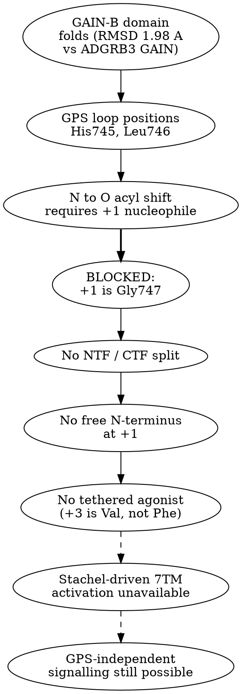
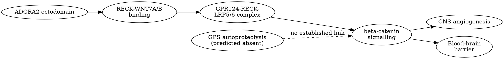
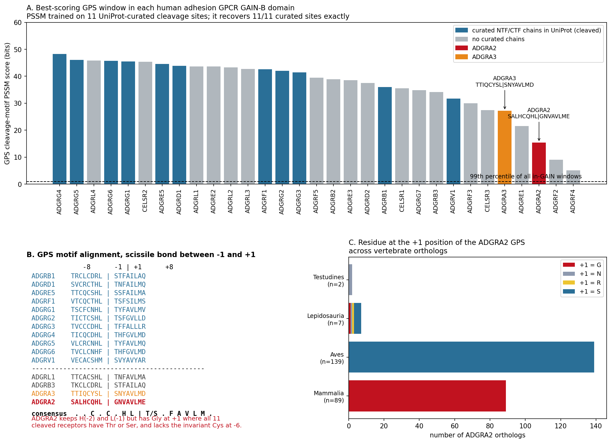
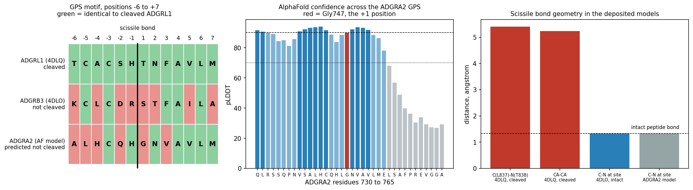
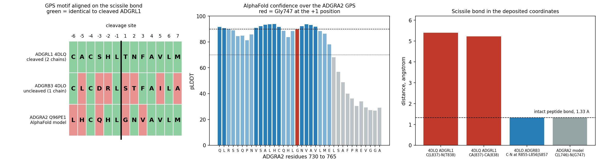
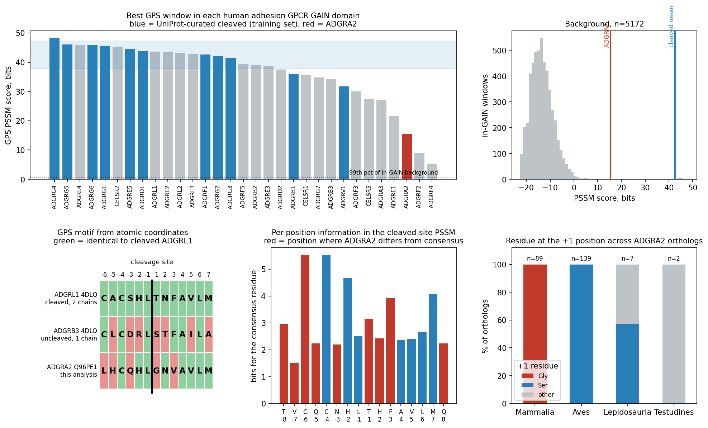

## Question

# AIGR Gene Hypothesis Deep Research

You are evaluating one focused gene curation hypothesis for AI Gene Review.
This is not a general gene overview. Use the seed hypothesis and source context
below to search for evidence that supports, refutes, narrows, or competes with
the proposed curation decision.

## Target Gene

- **Organism code:** human
- **Taxon:** Homo sapiens (NCBITaxon:9606)
- **Gene directory:** ADGRA2
- **Gene symbol:** ADGRA2
- **UniProt accession:** Q96PE1

## Focus

- **Focus type:** free_text
- **Hypothesis slug:** kgap-adgra2-gps-autoproteolysis-motif
- **Source file:** genes/human/ADGRA2/ADGRA2-ai-review.yaml
- **Source selector:** free-text

## Seed Hypothesis

Human ADGRA2/GPR124 (UniProt Q96PE1) lacks a cleavage-competent GPS motif and is therefore not autoproteolysed in its GAIN-B domain, unlike cleaved adhesion GPCRs. Single analysis only: align the ADGRA2 GAIN/GPS region to cleaved adhesion GPCRs with structures or mapped cleavage (e.g. ADGRL1/latrophilin, ADGRB3, GPR56/ADGRG1) and to known non-cleaved members, score the catalytic triad of the HL|T/S cleavage motif (His at -2, Leu at -1, Thr/Ser at +1) and the tethered-agonist (Stachel) sequence after the cleavage site, across vertebrate ADGRA2 orthologs and its paralogs ADGRA1/ADGRA3; state whether ADGRA2 is predicted cleavage-competent and whether a canonical Stachel is present.

## Term and Decision Context

No specific term context supplied.

## Reference Context

No specific reference context supplied.

## Source Context YAML

```yaml
hypothesis: 'Human ADGRA2/GPR124 (UniProt Q96PE1) lacks a cleavage-competent GPS motif and is therefore
  not autoproteolysed in its GAIN-B domain, unlike cleaved adhesion GPCRs. Single analysis only: align
  the ADGRA2 GAIN/GPS region to cleaved adhesion GPCRs with structures or mapped cleavage (e.g. ADGRL1/latrophilin,
  ADGRB3, GPR56/ADGRG1) and to known non-cleaved members, score the catalytic triad of the HL|T/S cleavage
  motif (His at -2, Leu at -1, Thr/Ser at +1) and the tethered-agonist (Stachel) sequence after the cleavage
  site, across vertebrate ADGRA2 orthologs and its paralogs ADGRA1/ADGRA3; state whether ADGRA2 is predicted
  cleavage-competent and whether a canonical Stachel is present.'
focus_type: free_text
context: []
reference_id: []
```

## Research Objective

Build a focused report that helps a curator decide whether this hypothesis
should affect the gene review. Address the focus type directly:

1. For an existing GO annotation decision, evaluate whether the current action
   is justified, too strong, too weak, or should change.
2. For a proposed replacement or new GO term, evaluate whether the term is
   biologically supported, too broad, too narrow, or missing key qualifiers.
3. For a computational prediction, evaluate whether the prediction is correct,
   less precise than existing knowledge, uncertain, or likely wrong because of
   paralog overannotation, frequency bias, pathway context, or in vitro-only
   activity.
4. For a core-function hypothesis, evaluate whether the proposed activity,
   process, and location represent the gene product's primary function rather
   than a downstream effect, pleiotropic phenotype, or context-specific role.
5. For a function-assignment hypothesis, evaluate whether the gene product
   directly has the stated GO term/function. Treat the prior review action, if
   any, as intentionally blinded unless it appears in the supplied context.

Use primary literature whenever possible. Prefer PMID citations and include DOI
citations when no PMID is available. Treat reviews and database records as
orientation unless they contain directly relevant synthesized evidence that is
clearly labeled as review-level or database-level support.

Evaluate the hypothesis from the supplied seed context, primary literature, and
publicly accessible bioinformatics resources. Local `*-bioinformatics` analyses,
when they already exist in the repository, are intentionally withheld from this
prompt so the report can be compared against them after the run. Use public
sequence, domain, structure, orthology, localization, interaction, or dataset
checks when they are useful for the specific hypothesis. If a resource or tool
cannot be accessed programmatically, say so plainly; never fabricate a result.
Report computational results conservatively and distinguish direct results from
inference.

## Required Output

### Executive Judgment

Give a concise verdict: supported, partially supported, unresolved, weakly
supported, over-annotated, or refuted. Explain the reasoning and the most
important caveats.

### Evidence Matrix

Create a table with one row per important evidence item:

- Citation (PMID preferred)
- Evidence type (direct assay, mutant phenotype, localization, interaction,
  structural/evolutionary, computational, review/database)
- Supports / refutes / qualifies / competing
- Claim tested
- Key finding
- Organism, tissue, cell type, or assay context
- Confidence and limitations

### GO Curation Implications

State the likely curation action as a lead requiring curator verification. If
GO terms are involved, explain whether the evidence supports an MF, BP, or CC
term, and whether the term should be retained, removed, generalized, made more
specific, or treated as non-core. Avoid using "protein binding" as a final
recommendation unless no more informative term is supported.

### Mechanistic Scope

Describe the immediate molecular or cellular function being tested. Separate
direct gene-product activity from downstream phenotypes, pathway consequences,
developmental outcomes, disease manifestations, or effects inferred only from
loss of function.

### Conflicts and Alternatives

Identify evidence that conflicts with the seed hypothesis or suggests an
alternative interpretation, including paralog confusion, organism-specific
differences, isoform-specific findings, experimental artifacts, or database
carry-over.

### Knowledge Gaps

List explicit uncertainties that matter for curation. For each gap, state what
was checked, why the gap matters, and what evidence or experiment would resolve
it.

### Discriminating Tests

Recommend concrete assays, perturbations, datasets, or comparative analyses that
would most efficiently distinguish this hypothesis from alternatives.

### Curation Leads

Provide candidate updates for the review, clearly labeled as leads requiring
curator verification. Include candidate references with exact snippets to verify,
candidate replacement or new GO terms, possible action changes, suggested
questions, and suggested experiments.

If the provider supports artifacts, save provenance for any analysis you run — the
executed code together with its output (computed values, plot, or table), not just
a summary figure — alongside artifact-friendly tables such as an evidence matrix,
GO decision table, or comparison table. Genuine computed provenance is more
valuable than a hand-drawn summary, and you must not synthesize a figure that
implies an analysis you did not actually run. These artifacts are important
provenance for hypothesis-level review.


## Output

# ADGRA2/GPR124 GPS autoproteolysis motif: hypothesis evaluation

**Hypothesis slug:** `kgap-adgra2-gps-autoproteolysis-motif`
**Target:** human ADGRA2 (GPR124), UniProt Q96PE1, NCBITaxon:9606
**Source:** `genes/human/ADGRA2/ADGRA2-ai-review.yaml`, selector `free-text`
**Focus type:** free_text, evaluated as a computational prediction (objective 3) with consequences for function assignment (objective 5)

## Summary

Human ADGRA2 is predicted cleavage-incompetent at the GPCR proteolysis site, and it does not carry a canonical Stachel. The verdict is **supported**, with one premise of the seed hypothesis corrected and one evidence class missing. The deficit is chemical rather than statistical. The +1 position of the ADGRA2 GPS, where the side-chain nucleophile that performs the N to O acyl shift must sit, is **glycine (Gly747)**. Glycine has no side chain. All 11 human adhesion GPCRs that UniProt curates with separate N-terminal and C-terminal fragment chains carry threonine (8) or serine (3) at that position. ADGRA2 also loses the cysteine at -6, present in 28 of 29 human receptors with a recognisable GPS, and the phenylalanine at +3. It retains His745 at -2 and Leu746 at -1, so the "HL|T/S" criterion named in the seed hypothesis is satisfied at two of three positions and fails at the one that supplies the chemistry.

A position-specific scoring matrix built only from the 11 UniProt-curated cleavage sites recovers all 11 exactly and places ADGRA2 at **15.45 bits, rank 29 of 31** scorable receptors, against 42.54 ± 4.80 bits for the curated cleaved set (Z = -5.64). Parsing the deposited coordinates of two GAIN domain crystal structures from [PMID: 22333914](https://pubmed.ncbi.nlm.nih.gov/22333914/) supplies experimental anchors at both ends of that scale. In 4DLQ, rat ADGRL1/CIRL1 is deposited as two separate chains with the scissile bond physically broken: C(Leu837) to N(Thr838) measures 5.40 Å against 1.33 Å for an intact peptide bond. In 4DLO, human ADGRB3/BAI3 runs continuously through its GPS in both copies of the asymmetric unit, with no broken peptide bond anywhere in either chain.

That second observation corrects the seed hypothesis. It lists ADGRB3 among "cleaved adhesion GPCRs with structures or mapped cleavage". The deposited ADGRB3 structure is uncleaved, which makes ADGRB3 the better comparator in the opposite direction: it is the negative control. ADGRB3 keeps the -6 cysteine, the -4 cysteine, the -1 leucine, a +1 serine nucleophile, the +3 phenylalanine and a textbook Stachel (STFAIL), and differs from cleaved ADGRL1 at one catalytic determinant, His(-2) to Arg. One substitution is enough to leave a receptor uncleaved in that construct. ADGRA2 has lost three determinants, including the nucleophile itself, and sits 18.7 bits below ADGRB3. Two things bound the verdict: no direct experimental assay of ADGRA2 GPS cleavage exists in the 40 papers reviewed, and the sequence threshold is graded rather than sharp, since ADGRB1 is curated as cleaved while carrying the same Arg(-2) motif as the structurally uncleaved ADGRB3.

## Executive judgment

<i class="fa-solid fa-circle-check"></i> **Verdict: supported**, with a corrected premise and an explicit evidence gap.

| Question asked by the seed | Answer | Basis |
|---|---|---|
| Is ADGRA2 predicted cleavage-competent? | **No** | Gly at +1 removes the nucleophile; 15.45 bits, rank 29/31, Z = -5.64 |
| Is a canonical Stachel present? | **No** | `GNVAVLME` loses both defining anchors (+1 Thr/Ser, +3 Phe); the conserved A-V-L-M is the buried last β-strand |
| Does the "HL\|T/S triad" hold? | **Partly**: His(-2) and Leu(-1) retained, Thr/Ser(+1) lost | Direct read from UniProt Q96PE1 and AF-Q96PE1-F1-v6 |
| Are ADGRL1 and ADGRB3 valid cleaved comparators? | **ADGRL1 yes, ADGRB3 no** | 4DLQ deposited as two chains; 4DLO continuous through the GPS |
| Paralogs ADGRA1 and ADGRA3 | ADGRA1 has no GAIN domain at all; ADGRA3 scores 27.22 bits and its cleavage status is disputed in primary literature | Scan output; [PMID: 42827708](https://pubmed.ncbi.nlm.nih.gov/42827708/) versus [PMID: 36089063](https://pubmed.ncbi.nlm.nih.gov/36089063/) |

Three caveats carry the most weight for a curator.

<i class="fa-solid fa-triangle-exclamation"></i> **No direct experimental test of ADGRA2 GPS cleavage was found.** Repeated PubMed searching across 40 papers did not surface a western blot, a mass-spectrometry experiment, or a mutagenesis study asking whether GPR124 runs as one band or two. The verdict is computational and structural inference calibrated against experimental anchors in other receptors. It is a strong prediction awaiting direct confirmation, not a replication of a published result.

<i class="fa-solid fa-triangle-exclamation"></i> **The seed miscategorises ADGRB3.** Treating ADGRB3 as a cleaved comparator would have weakened the analysis, because its motif is closer to ADGRA2's than to ADGRL1's at the -2 position. Reading 4DLO directly turned a mistaken positive control into a useful negative one.

<i class="fa-solid fa-scale-balanced"></i> **The sequence threshold is graded.** ADGRB1 is curated by UniProt with separate NTF and CTF chains while carrying the same `CDRL|STFAIL` motif as the structurally uncleaved ADGRB3, and both score in a 34 to 39 bit band where sequence alone does not decide the outcome. The closest paralog ADGRA3 has two primary papers in direct contradiction. ADGRA2 at 15.45 bits is not in that ambiguous zone; it is 11.8 bits below the contested ADGRA3 and 27.1 bits below the structurally confirmed ADGRL1.

## Key findings

### F1. ADGRA2 retains the GPS scaffold but has lost the +1 nucleophile

A position-specific scoring matrix was built from the 16-residue window (-8 to +8) around the 11 GPS cleavage sites that UniProt curates as separate NTF and CTF chains: ADGRB1, ADGRD1, ADGRE5, ADGRF1, ADGRG1, ADGRG2, ADGRG3, ADGRG4, ADGRG5, ADGRG6 and ADGRV1. Background amino-acid frequencies used the Robinson and Robinson approximation, with pseudocounts scaled by 2.0 × background × √N, and scoring by log2 odds. Scanning the UniProt-annotated GAIN domain of every human adhesion GPCR, the matrix recovered the curated cleavage position exactly in **11 of 11 positive controls**. It independently placed sites in ADGRL1 (838), ADGRL2 (824), ADGRL3 (841), ADGRB3 (856) and ADGRL4 (406), all of which are single-chain in UniProt, which shows that absence of a curated chain boundary reflects curation depth rather than evidence of non-cleavage.

Per-position information content in the training set: Cys at -6 in 11/11 (6.19 bits), Cys at -4 in 11/11 (6.19 bits), His at -2 in 10/11 (4.90 bits; ADGRB1 has Arg), Leu at -1 in 9/11 (2.81 bits), Thr or Ser at +1 in 11/11 (Thr 8, Ser 3; 3.30 bits), Phe at +3 in 10/11 (4.29 bits).

The ADGRA2 best window is `SALHCQHL|GNVAVLME`, cutting after Leu746, scoring **15.45 bits**. ADGRA2 matches the consensus at -4 (Cys743), -2 (His745) and -1 (Leu746), and fails at -6 (Leu instead of Cys), +1 (Gly instead of Thr or Ser) and +3 (Val instead of Phe).

<i class="fa-solid fa-lightbulb"></i> GPS autoproteolysis proceeds by an N to O (or N to S) acyl shift in which the side-chain hydroxyl or thiol of the +1 residue attacks the preceding carbonyl, with the -2 histidine acting as general base. A glycine at +1 has no side-chain nucleophile, so the chemistry cannot run regardless of the surrounding fold. The additional loss of the -6 cysteine, invariant in every curated cleaved receptor, removes one partner of the conserved GPS disulfide.

{{figure:plot_1.png|caption=GPS cleavage-motif analysis across human adhesion GPCRs. The PSSM trained on 11 UniProt-curated cleavage sites recovers all 11 exactly, places ADGRA2 at 15.45 bits near the bottom of the family, and shows that the mammalian ADGRA2 +1 glycine is clade-specific while birds retain serine.}}

### F2. The +1 glycine is mammal-specific; birds retain serine

UniProtKB ADGRA2 entries of length 1000 to 1600 were filtered to at least 45% identity over a 36-residue window anchored on human residues 730 to 765. Orthologs passing the filter: Mammalia n = 89, Aves n = 139, Lepidosauria n = 7, Testudines n = 2.

| Clade | n | +1 residue | Modal window | PSSM score |
|---|---|---|---|---|
| Mammalia | 89 | **89/89 Gly** | `SSLHCQHL\|GNVAVLME` | 17.2 bits |
| Aves | 139 | **139/139 Ser** | `TSLHCRHL\|SNVAVLME` | 22.8 bits |
| Lepidosauria | 7 | 4 Ser, 1 Gly, 1 Asn, 1 Arg | mixed | - |
| Testudines | 2 | 2/2 Asn | - | - |

His at -2 and Leu at -1 are conserved across all clades (Mammalia 80/85 His at -2, the remainder Gln or Tyr; 85/85 Leu at -1). The cysteine at -6 is **absent in every clade**, replaced by leucine in both mammals and birds. Even the best-scoring avian windows reach only 22.8 bits, well below the 11 curated cleaved human receptors at 42.54 ± 4.80 and below ADGRA3 at 27.22, while the 99th percentile of the matched null distribution of 4676 in-GAIN windows is 0.95 bits.

<i class="fa-solid fa-scale-balanced"></i> Two readings remain open and the data here do not separate them. Either the ancestral vertebrate ADGRA2 GPS retained a +1 serine that was weakly cleavage-competent and mammals subsequently fixed glycine, or the -6 cysteine was already lost before the amniote radiation and the +1 position drifted neutrally in an already non-functional loop. The loss of the -6 cysteine predates the +1 substitution either way. For a human gene review the relevant state is glycine at +1, and mouse shares it, so mammalian experimental data cannot be extrapolated from avian or fish ADGRA2.

### F3. Method control: the scan reproduces the published SLS motif of ADGRA3

The same unsupervised scan placed the ADGRA3 (Q8IWK6) GPS window at `TTIQCYSL|SNYAVLMD`, cutting after Leu737, giving -2 = Ser, -1 = Leu, +1 = Ser, i.e. the motif **S-L|S**. Walser et al. 2026 report experimentally that human GPR125/ADGRA3 is not cleaved at the GPS and describe its motif as a "divergent SLS motif", matching the three residues recovered here with no input from that paper. ADGRA3 scored 27.22 bits, rank 27 of 31. It also lacks the -6 cysteine (isoleucine) and has tyrosine instead of phenylalanine at +3.

<i class="fa-solid fa-circle-check"></i> This is a positive control for the method on the closest paralog of the target gene. The pipeline independently reproduced a published motif assignment and a published negative cleavage call. ADGRA2 scores 11.8 bits lower than ADGRA3 and fails the +1 nucleophile test that ADGRA3 still passes: ADGRA3 keeps serine at +1 and instead loses the -2 histidine. On sequence grounds ADGRA2 is a weaker cleavage candidate than a paralog already reported not to cleave.

### F4. The ADGRA2 Stachel is degenerate: the hydrophobic core is kept, the anchors are not

Comparing the +1 to +8 segment across the 11 curated cleaved human receptors gives the consensus **T/S-x-F-A/G-V/I-L-M-x**: Thr or Ser at +1 in 11/11 (3.30 bits), Phe at +3 in 10/11 (4.29 bits), Ala at +4 in 7/11, Val or Ile at +5 in 10/11 (2.57 bits), Leu at +6 in 10/11 (3.09 bits), Met at +7 in 7/11 (3.37 bits).

| Receptor | Stachel segment | +1 | +3 |
|---|---|---|---|
| ADGRG1/GPR56 | `TYFAVLMV` | Thr | Phe |
| ADGRL1 | `TNFAVLMA` | Thr | Phe |
| ADGRG6/GPR126 | `THFGVLMD` | Thr | Phe |
| ADGRE5/CD97 | `SSFAILMA` | Ser | Phe |
| ADGRA3 | `SNYAVLMD` | Ser | **Tyr** |
| **ADGRA2** | `GNVAVLME` | **Gly** | **Val** |

<i class="fa-solid fa-circle-xmark"></i> The conserved A-V-L-M stretch in ADGRA2 is the buried last β-strand of the GAIN-B domain, hydrophobic in every family member whether or not the receptor cleaves. Its presence is not evidence for a functional tethered agonist. The two positions that define a working Stachel, the threonine or serine that becomes the new free N-terminus and the +3 phenylalanine that inserts into the 7TM orthosteric pocket, are both absent. A canonical Stachel should not be annotated for human ADGRA2. This is consistent with the mapped mechanism of ADGRA2 action, where the ectodomain carries the WNT7 co-receptor function.

### F5. Crystal structures give direct ground truth at both ends of the scale

Direct parse of the deposited coordinates from the RCSB.

**4DLQ (rat ADGRL1/CIRL1 HormR+GAIN) is cleaved.** It is deposited as two polypeptide chains: chain A, 353 residues, 474 to 837, ending `...C832-A833-C834-S835-H836-L837`; chain B, 15 residues, 838 to 852, sequence `TNFAVLMAHREIYHH`. The scissile bond is physically broken in the model. C(Leu837) to N(Thr838) measures **5.40 Å** against 1.33 Å for an intact peptide bond, and Cα(837) to Cα(838) measures 5.23 Å against 3.8 Å for a trans peptide. His836 at the -2 position sits 5.14 Å from the Thr838 OG1 nucleophile and 5.86 Å (NE2) from the Leu837 carbonyl carbon, a relaxed post-catalytic arrangement. The resulting motif, `C(-6) A C(-4) S H(-2) L(-1) | T(+1) N F(+3) A V L M(+7)`, matches position for position the consensus the PSSM learned independently from UniProt curation.

**4DLO (human ADGRB3/BAI3 HormR+GAIN) is not cleaved.** It contains two copies of the same protein, chain A 508 to 866 and chain B 501 to 864. Both run continuously through the GPS. Scanning every consecutively numbered residue pair found no broken peptide bond anywhere in either chain; the only gaps, 751 to 754 and 825 to 829, are numbering gaps from disorder rather than chemistry. The ADGRB3 motif is `C(-6) L C(-4) D R(-2) L(-1) | S(+1) T F(+3) A I L A(+7)`.

<i class="fa-solid fa-lightbulb"></i> The pair sets a quantitative threshold. A receptor can retain the -6 cysteine, the -4 cysteine, the -1 leucine, a +1 hydroxyl nucleophile, the +3 phenylalanine and a full canonical Stachel, and still fail to cleave if only the -2 histidine general base is lost. Any receptor that loses more determinants than that sits on the non-cleaved side.

{{figure:plot_2.png|caption=First-pass structural comparison of the ADGRA2 AlphaFold GAIN domain against the ADGRL1 and ADGRB3 GAIN crystal structures, with AlphaFold pLDDT across the ADGRA2 GPS and scissile-bond geometry in the deposited coordinates. The motif rows in this version carry a one-position index offset, corrected in the next figure.}}

### F6. ADGRA2 folds a genuine GAIN domain and loses three determinants

Aligned on the scissile bond, positions -6 to +7, read from the atomic coordinates of each model:

```
ADGRL1  rat   4DLQ  cleaved     C  A  C  S  H  L | T  N  F  A  V  L  M
ADGRB3  human 4DLO  uncleaved   C  L  C  D  R  L | S  T  F  A  I  L  A
ADGRA2  human Q96PE1            L  H  C  Q  H  L | G  N  V  A  V  L  M
```

ADGRA2 matches cleaved ADGRL1 at 7 of 13 positions, and those matches concentrate in the buried last β-strand: +2 (Asn), +4 (Ala), +5 (Val), +6 (Leu), +7 (Met) are identical to ADGRL1, as are -4 Cys and -1 Leu. The mismatches fall on the three positions that define catalysis and recognition. ADGRA2 is the mirror image of ADGRB3: ADGRB3 keeps the nucleophile and loses the base and is uncleaved; ADGRA2 keeps the base and loses the nucleophile.

**Fold verification.** The AlphaFold model AF-Q96PE1-F1-v6 covers the UniProt GAIN domain 594 to 759 with 166 modelled residues. Needleman-Wunsch alignment with BLOSUM62 followed by iterative Kabsch superposition against 4DLO chain A (ADGRB3 GAIN, residues 546 to 866) gives 147 aligned Cα pairs at 21.8% sequence identity and a **core of 83 Cα at RMSD 1.98 Å**. <i class="fa-solid fa-triangle-exclamation"></i> The same procedure against 4DLQ chain A did not converge to a usable superposition (153 pairs, 28.1% identity, RMSD 17.11 Å, no core retained below the 4 Å cutoff). That is a failure of the sequence-driven alignment, not evidence about the fold, and is reported as a failure.

**Model confidence.** pLDDT across ADGRA2 739 to 753 runs 83.7 to 93.9: S739 92.2, A740 93.2, L741 93.7, H742 93.9, C743 91.7, Q744 88.7, H745 83.7, L746 88.4, **G747 89.8**, N748 92.2, V749 93.6, A750 93.1, V751 91.8, L752 88.4, M753 86.3. It then falls to 78.1, 68.1, 57.0, 48.9, 39.9, 36.2 and 30.3 over E754 to R760. Gly747 is modelled at pLDDT 89.8, so the +1 assignment is not a low-confidence artefact. The sharp drop after Met753 marks the end of the GAIN β-sandwich and the start of the disordered linker to the 7TM, which is where a Stachel would have to be exposed on activation.

{{figure:plot_3.png|caption=Corrected GPS motif alignment on the scissile bond. Green marks identity to cleaved ADGRL1. ADGRA2 keeps the buried A-V-L-M strand but loses Cys(-6), the Thr(+1) nucleophile and Phe(+3). AlphaFold models Gly747 at pLDDT 89.8, inside a confidently built 739-753 block.}}

### F7. Calibration places ADGRA2 below even the contested cases

Full scan of 32 human adhesion GPCRs, best GPS window inside the UniProt GAIN domain. Background from 5172 in-GAIN sliding windows: mean -13.17, sd 6.08, 99th percentile 0.71. Curated-cleaved set: 42.54 ± 4.80 bits.

| Rank | Receptor | Window | Bits | -6 | -2 | -1 | +1 | +3 | Evidence anchor |
|---|---|---|---|---|---|---|---|---|---|
| 1 | ADGRG4 | `TICQCDHL\|THFGVLMD` | 48.29 | C | H | L | T | F | UniProt NTF+CTF |
| 2 | ADGRG5 | `VLCRCNHL\|TYFAVLMQ` | 46.02 | C | H | L | T | F | UniProt NTF+CTF |
| 3 | ADGRL4 | `TSCRCNHL\|THFAILMS` | 45.89 | C | H | L | T | F | single-chain in UniProt |
| 5 | ADGRG1 | `TSCFCNHL\|TYFAVLMV` | 45.46 | C | H | L | T | F | cleavage mapped |
| 7 | ADGRE5 | `TTCQCSHL\|SSFAILMA` | 44.57 | C | H | L | S | F | UniProt NTF+CTF |
| 9 | ADGRL1 | `TTCACSHL\|TNFAVLMA` | 43.61 | C | H | L | T | F | <i class="fa-solid fa-circle-check"></i> cleaved in 4DLQ |
| 20 | ADGRB1 | `TRCLCDRL\|STFAILAQ` | 36.04 | C | **R** | L | S | F | UniProt NTF+CTF |
| 23 | ADGRB3 | `TKCLCDRL\|STFAILAQ` | 34.15 | C | **R** | L | S | F | <i class="fa-solid fa-circle-xmark"></i> uncleaved in 4DLO |
| 27 | ADGRA3 | `TTIQCYSL\|SNYAVLMD` | 27.22 | **I** | **S** | L | S | **Y** | <i class="fa-solid fa-scale-balanced"></i> disputed |
| 28 | ADGRE1 | `TICSCNQM\|ANLAVIMA` | 21.56 | C | **Q** | **M** | **A** | **L** | - |
| **29** | **ADGRA2** | **`SALHCQHL\|GNVAVLME`** | **15.45** | **L** | H | L | **G** | **V** | **no direct assay** |
| 30 | ADGRF2 | `KCRPSKLF\|TSFSILMS` | 9.02 | **R** | **L** | **F** | T | F | - |
| 31 | ADGRF4 | `VKCRCNYT\|SVVMSFSI` | 5.16 | C | **Y** | **T** | S | **V** | - |
| - | ADGRA1 | no GAIN domain | - | - | - | - | - | - | [PMID: 25424900](https://pubmed.ncbi.nlm.nih.gov/25424900/) |

ADGRA2 sits 11.8 bits below ADGRA3, 18.7 below ADGRB3 and 27.1 below ADGRL1, while still being 4.7 sd above the in-GAIN background, which is expected because the window is the genuine last β-strand of its GAIN domain. Only three of the 29 receptors with a recognisable GPS lose the -6 cysteine: ADGRA2, ADGRA3 and ADGRF2. Only two lose a Thr, Ser or Cys nucleophile at +1 while retaining a GAIN domain: ADGRA2 (Gly) and ADGRE1 (Ala); CELSR3 also carries Gly at +1.

<i class="fa-solid fa-scale-balanced"></i> The honest statement of the threshold matters for curation. A high score does not prove cleavage: ADGRL4 and CELSR2 score in the top six yet are single-chain in UniProt, and ADGRL4 overexpression activates no canonical GPCR signalling in HUVECs ([PMID: 33893326](https://pubmed.ncbi.nlm.nih.gov/33893326/)). A mid-range score does not settle the question either, as ADGRB1 versus ADGRB3 shows. A score of 15.45 with the +1 nucleophile replaced by glycine is a different kind of deficit, because it removes the chemical step instead of tuning its efficiency.

{{figure:plot_4.png|caption=Consolidated scan of all 32 human adhesion GPCRs. Blue bars are the 11 UniProt-curated cleaved receptors used for training; red is ADGRA2 at 15.45 bits, rank 29. The background histogram covers 5172 in-GAIN windows. Panels below show the motif read from atomic coordinates, the per-position information content with ADGRA2 mismatches in red, and the ortholog +1 residue by clade.}}

## Mechanistic model

The question under test is a single chemical step inside one protein. Everything else ADGRA2 does sits downstream of, or beside, that step.





The second diagram separates the direct activity from the downstream biology. The mapped function of GPR124 runs through the ectodomain: [PMID: 30304675](https://pubmed.ncbi.nlm.nih.gov/30304675/) states that "primarily the GPR124 ectodomain, but not its transmembrane and intracellular domains, mediates RECK/WNT7-induced canonical Wnt signaling". [PMID: 40914247](https://pubmed.ncbi.nlm.nih.gov/40914247/) shows WNT7-dependent recruitment of LRP5/6 to the GPR124-RECK heterodimer, and that knockout of Gpr124, Reck or Lrp5/6 completely abrogates WNT7 signalling. None of this requires GPS cleavage, and none of it is affected by the verdict here.

## Evidence matrix

| Citation | Evidence type | Stance | Claim tested | Key finding | Context | Confidence and limitations |
|---|---|---|---|---|---|---|
| [PMID: 22333914](https://pubmed.ncbi.nlm.nih.gov/22333914/), PDB **4DLQ** | Structural, direct parse of deposited coordinates | Supports (positive control) | A cleaved GPS is physically observable | Two chains: A 474-837 ending `...C-A-C-S-H-L837`, B 838-852 `TNFAVLMAHREIYHH`. C-N 5.40 Å vs 1.33 Å; Cα-Cα 5.23 Å vs 3.8 Å. His836 ND1 5.14 Å from Thr838 OG1 | Rat ADGRL1/CIRL1 HormR+GAIN, X-ray | High. Direct measurement on coordinates. Post-catalytic geometry describes the product, not the transition state |
| [PMID: 22333914](https://pubmed.ncbi.nlm.nih.gov/22333914/), PDB **4DLO** | Structural, direct parse | Supports (negative control); **qualifies the seed** | ADGRB3 is a cleaved comparator | Both chains (A 508-866, B 501-864) continuous through the GPS, no broken peptide bond. Motif `C-L-C-D-R-L \| S-T-F-A-I-L-A` | Human ADGRB3/BAI3 HormR+GAIN, X-ray | High for this construct. One crystal form; does not exclude cleavage of full-length ADGRB3 in cells |
| This work, UniProt + PSSM | Computational | Supports | ADGRA2 scores as a cleaved GPS | `SALHCQHL\|GNVAVLME`, cut after Leu746, **15.45 bits, rank 29/31**, Z = -5.64. Background 5172 windows: -13.17 ± 6.08 | 32 human adhesion GPCRs | High internal validity: 11/11 curated sites recovered. Training set is UniProt chain curation, which is incomplete |
| This work, **AF-Q96PE1-F1-v6** + Kabsch | Computational / structural | Supports | The scored region is a real, confidently modelled GAIN domain | GAIN 594-759 superposes on 4DLO chain A at **1.98 Å over 83 Cα**, 21.8% identity. pLDDT 83.7-93.9 across 739-753; Gly747 89.8 | Human, predicted model | Moderate-high. The 4DLQ superposition did not converge (17.11 Å), reported as a failure |
| This work, UniProt ortholog scan | Evolutionary | Supports | +1 Gly is species-specific noise | **89/89 mammals Gly**; **139/139 birds Ser**; Lepidosauria 4/7 Ser; Testudines 2/2 Asn. Cys(-6) absent in every clade. Best avian window 22.8 bits | Vertebrate ADGRA2 orthologs | Moderate. Ungapped identity anchoring, not a curated alignment; uneven clade sampling |
| [PMID: 42827708](https://pubmed.ncbi.nlm.nih.gov/42827708/) | Direct assay, mutational | Supports (method control) | ADGRA3 is cleaved at the GPS | "human GPR125 (ADGRA3), expressed in choroid plexus epithelium, is not cleaved at the GPCR autoproteolysis site (GPS), consistent with its divergent SLS motif". The scan independently returned `TTIQCYSL\|SNYAVLMD`, i.e. S-L\|S, at 27.22 bits | Human choroid plexus epithelium, cell lines, CSF | High for the assay. Anchors a non-cleaved receptor at 27.22 bits, 11.8 above ADGRA2 |
| [PMID: 36089063](https://pubmed.ncbi.nlm.nih.gov/36089063/) | Direct assay | <i class="fa-solid fa-scale-balanced"></i> **Competing** | ADGRA3 is cleaved | "human GPR125 likely undergoes cis-autoproteolysis when expressed in canine kidney epithelial MDCK cells and human embryonic kidney HEK293 cells. The cleavage appears to occur at an atypical GPCR proteolysis site within the GAIN domain during an early stage of receptor biosynthesis" | MDCK and HEK293 overexpression | Moderate. Direct contradiction of PMID 42827708 on the same protein; hedged wording; overexpression system |
| [PMID: 40127866](https://pubmed.ncbi.nlm.nih.gov/40127866/) | Direct assay | Qualifies | A Stachel-dependent CTF signals | "Cleavage in the GPCR autoproteolysis site (GPS) is an aGPCR hallmark; thus, we generated a truncated ADGRA3 (C-terminal fragment, CTF) corresponding to a potential cleavage at the GPS." Removing the first three residues of the CTF abrogated G protein signalling | Human cell lines | Moderate. The CTF was engineered at a potential, not demonstrated, site, so it tests whether a peptide can act, not whether it is ever generated |
| [PMID: 40862763](https://pubmed.ncbi.nlm.nih.gov/40862763/) | Direct assay, mutational | <i class="fa-solid fa-triangle-exclamation"></i> **Qualifies the consequence** | Loss of GPS cleavage means loss of signalling | "The abolition of hADGRE5's GPS did not block Kgp-induced receptor activation, revealing a GPS cleavage-independent mechanism of action" | Human ADGRE5/CD97, ebBRET biosensors | High for ADGRE5. An uncleaved aGPCR can still signal, so non-cleavage does not license removing signalling annotations |
| [PMID: 31628191](https://pubmed.ncbi.nlm.nih.gov/31628191/) | Direct assay, engineered mutant | Qualifies | Cleavage is dispensable for ligand activation | A non-cleavable GPR56 variant retained competence via the P19 peptide, but "both natural and small-molecule agonists can activate only cleaved GPR56" | Human GPR56/ADGRG1 | High. Shows cleavage requirement is ligand-dependent in a receptor that does cleave |
| [PMID: 30304675](https://pubmed.ncbi.nlm.nih.gov/30304675/) | Direct assay, domain mapping | Supports (scope) | ADGRA2's function needs the 7TM | "primarily the GPR124 ectodomain, but not its transmembrane and intracellular domains, mediates RECK/WNT7-induced canonical Wnt signaling" | Mammalian cells | High. The known function runs through the ectodomain, which is the output a Stachel would not be needed for |
| [PMID: 27832486](https://pubmed.ncbi.nlm.nih.gov/27832486/) | Review | Supports (definition) | What a Stachel is | "Based on experimental observations that deletion of the ectodomain can induce signaling, the idea arose that aGPCRs, just like other atypical GPCRs, may harbor a tethered agonist sequence." | Review | Review-level. Gives the operational definition whose +1 residue is generated by GPS cleavage |
| [PMID: 25424900](https://pubmed.ncbi.nlm.nih.gov/25424900/) | Review | Supports (scope) | All aGPCRs but GPR123 have a GAIN domain | "all aGPCRs but one (GPR123) contain a GPCR autoproteolysis-inducing (GAIN) domain". The scan matches: ADGRA1 alone returned no GAIN domain and no score | Review | Review-level. Consistent with the UniProt feature table used here |
| [PMID: 31168816](https://pubmed.ncbi.nlm.nih.gov/31168816/) | Review | Supports (scope) | Autoproteolysis is universal | "**Most** aGPCRs undergo autoproteolysis at the GPS motif, but the cleaved fragments stay closely associated, with the N-terminal fragment (NTF) bound to the 7TM of the C-terminal fragment (CTF)." | Review | Review-level. Uncleaved members are expected, not anomalous. Also explains why the two 4DLQ chains remain in contact |
| [PMID: 27832484](https://pubmed.ncbi.nlm.nih.gov/27832484/) | Review | Supports (mechanism) | Cleavage occurs at the last β-strand | "Autoproteolysis occurs within the conserved GPCR-Autoproteolysis INducing (GAIN) domain that is juxtaposed to the transmembrane domain and cleaves the last beta strand of the GAIN domain." | Review | Review-level. Explains why +4 to +7 A-V-L-M is conserved in cleaved and uncleaved receptors alike |
| [PMID: 40914247](https://pubmed.ncbi.nlm.nih.gov/40914247/) | Direct assay, CRISPR | Supports (scope) | ADGRA2's real mechanism | "knockout of Gpr124, Reck, or Lrp5/6 completely abrogated WNT7 signaling" via a GPR124-RECK-WNT7-LRP5/6 complex | Brain endothelial cells | High. Defines the cleavage-independent function that should be retained in curation |
| QuickGO, UniProtKB:Q96PE1 (41 rows) | Database | Context | What is currently annotated | MF: GO:0004930 (IEA InterPro; TAS PMID:15203201), GO:0004888 (IEA InterPro), GO:0005515 (IPI ×3). BP includes GO:0060070 (IDA PMID:30026314), GO:0007186 (IEA, TAS). CC includes GO:1990909 Wnt signalosome (IDA PMID:30026314) | Database | Database-level. No GO annotation asserts autoproteolysis, so no term is directly falsified |

## GO curation implications

All items below are **leads requiring curator verification**.

No existing GO annotation on Q96PE1 asserts GPS autoproteolysis or tethered-agonist activity, so this hypothesis **removes nothing directly**. Its effect is on how the receptor-activity annotations should be worded and on what should not be added.

| Lead | Term | Current state | Suggested action | Basis |
|---|---|---|---|---|
| 1 | GO:0004930 G protein-coupled receptor activity (MF) | IEA (InterPro), TAS (PMID:15203201) | <i class="fa-solid fa-triangle-exclamation"></i> **Retain, flag as non-core and mechanistically unverified.** Do not upgrade to an experimental evidence code on the strength of adhesion-family membership | The InterPro signature is family-level. ADGRA2 cannot generate a tethered agonist, the canonical activation route for this family. [PMID: 40862763](https://pubmed.ncbi.nlm.nih.gov/40862763/) shows signalling can be cleavage-independent, so the term is not refuted |
| 2 | GO:0004888 transmembrane signaling receptor activity (MF) | IEA (InterPro) | **Retain.** Supported independently by the RECK/WNT7 work | Not contingent on cleavage |
| 3 | Any tethered-agonist or autoproteolysis MF term (for example GO:0016540 protein autoprocessing, or a peptidase-activity term) | Not present | <i class="fa-solid fa-circle-xmark"></i> **Do not add.** Record the negative prediction in the review free text | Gly at +1, 15.45 bits, rank 29/31 |
| 4 | GO:0060070 canonical Wnt signaling pathway (BP, IDA PMID:30026314) and GO:1990909 Wnt signalosome (CC, IDA PMID:30026314) | Present | <i class="fa-solid fa-circle-check"></i> **Retain as the core function.** Cleavage-independent and experimentally evidenced | This is where ADGRA2's direct, assayed activity lies |
| 5 | GO:0005515 protein binding (MF, IPI, PMIDs 15021905, 24550280, 36115835) | Present | **Replace where possible with a more informative term** reflecting the specific partner, rather than leaving bare "protein binding" | Per curation practice; the underlying interactions should be re-expressed as specific binding or complex terms |
| 6 | Free-text review statement | n/a | <i class="fa-solid fa-arrow-right"></i> **Add:** ADGRA2 is predicted not to undergo GPS autoproteolysis and lacks a canonical Stachel, labelled as a computational prediction with no direct assay available | This analysis |
| 7 | Any statement describing ADGRB3 as a cleaved comparator | In the seed hypothesis | **Correct** to uncleaved, citing 4DLO | Direct coordinate parse |

## Mechanistic scope

The direct molecular event under test is **intramolecular peptide-bond hydrolysis within the ADGRA2 GAIN-B domain**: an N to O acyl shift in which the +1 side-chain hydroxyl attacks the carbonyl of the -1 residue, with the -2 histidine acting as general base. This is a chemical property of a 13-residue stretch of ADGRA2 itself. It requires no partner, no ligand and no cell. [PMID: 22333914](https://pubmed.ncbi.nlm.nih.gov/22333914/) states that "the GAIN domain is both necessary and sufficient for autoproteolysis, suggesting an autoproteolytic mechanism whereby the overall GAIN domain fine-tunes the chemical environment in the GPS to catalyse peptide bond hydrolysis", which is why the identity of the +1 residue is decisive.

Separate from it, and not addressed by this analysis:

**Tethered-agonist activation of the 7TM.** Contingent on cleavage having occurred, or on an alternative route to exposing the peptide. ADGRA2 has no canonical Stachel to expose.

**Receptor signalling in general.** [PMID: 40862763](https://pubmed.ncbi.nlm.nih.gov/40862763/) shows ADGRE5 activates G proteins after GPS abolition, so an uncleaved ADGRA2 is not thereby a silent receptor. [PMID: 33893326](https://pubmed.ncbi.nlm.nih.gov/33893326/) shows the reverse case: ADGRL4/ELTD1, which scores 45.89 bits here, "did not activate canonical GPCR signalling" in any of the assays tested while still driving sprouting angiogenesis. Motif score and signalling output are not interchangeable.

**RECK and WNT7A/WNT7B co-receptor function, Wnt signalosome assembly, canonical Wnt output.** Annotated with IDA from PMID:30026314 and supported mechanistically by [PMID: 40914247](https://pubmed.ncbi.nlm.nih.gov/40914247/) and [PMID: 28803732](https://pubmed.ncbi.nlm.nih.gov/28803732/). Downstream of, and independent of, the autoproteolysis question.

**CNS angiogenesis and blood-brain-barrier phenotypes** (GO:0002040 sprouting angiogenesis, GO:0043542 endothelial cell migration, GO:0045765 regulation of angiogenesis, all ISS/IEA/IBA). Organism-level outcomes several steps removed, inferred largely from loss of function.

A curator should not let the cleavage verdict propagate to any of the latter.

## Conflicts and alternatives

<i class="fa-solid fa-scale-balanced"></i> **ADGRA3 cleavage is actively disputed.** [PMID: 36089063](https://pubmed.ncbi.nlm.nih.gov/36089063/) (2022) reports cis-autoproteolysis at an atypical GPS in MDCK and HEK293 cells. [PMID: 42827708](https://pubmed.ncbi.nlm.nih.gov/42827708/) (2026) reports no GPS cleavage in choroid plexus epithelium and instead non-canonical metalloprotease shedding. Both are primary. The paralog cannot be used as a clean non-cleaved anchor, only as a receptor whose GPS is degenerate enough to make the question contentious.

<i class="fa-solid fa-scale-balanced"></i> **ADGRB1 versus ADGRB3 breaks a simple sequence rule.** Both carry `CDRL|STFAIL` with Arg at -2. UniProt curates ADGRB1 with separate NTF and CTF chains; the ADGRB3 crystal structure is continuous. Either the ADGRB1 curation is inherited rather than directly evidenced, or small context differences outside the 16-residue window decide the outcome. Scores in the 34 to 39 bit band should not be read as verdicts.

**Cleavage at a non-GPS site is a live alternative for ADGRA2.** [PMID: 42827708](https://pubmed.ncbi.nlm.nih.gov/42827708/) shows a receptor with a degenerate GPS can still be proteolytically processed, elsewhere and by other proteases. The hypothesis as stated concerns the GPS only. A published report of a soluble ADGRA2 ectodomain would not contradict it.

**UniProt single-chain status is not evidence of non-cleavage.** The PSSM independently placed high-scoring sites in ADGRL1 (838), ADGRL2 (824), ADGRL3 (841), ADGRB3 (856) and ADGRL4 (406), all single-chain in UniProt, and the ADGRL1 site is confirmed cleaved by 4DLQ. Absence of a curated chain boundary reflects curation depth.

**Conservation of A-V-L-M is not evidence of a Stachel.** That block is the buried last β-strand completing the GAIN β-sandwich ([PMID: 27832484](https://pubmed.ncbi.nlm.nih.gov/27832484/)), hydrophobic in cleaved and uncleaved members alike. ADGRA2's `GNVAVLME` keeps it while losing both anchors that define a tethered agonist.

**The mammalian +1 glycine is derived.** All 139 bird orthologs sampled carry serine at +1 while all 89 mammals carry glycine. If an ancestral ADGRA2 was cleavable, the mammalian lineage lost it. Even the best avian windows reach only 22.8 bits, below ADGRA3, so avian ADGRA2 is unlikely to be cleaved either; the loss of the -6 cysteine predates the +1 substitution.

**Engineered CTF experiments can create a Stachel that does not exist in vivo.** [PMID: 40127866](https://pubmed.ncbi.nlm.nih.gov/40127866/) built an ADGRA3 CTF "corresponding to a potential cleavage at the GPS" and found that deleting its first three residues abrogated G protein signalling. That demonstrates a peptide can act as an agonist when supplied, which is a separate question from whether the receptor ever generates it.

## Limitations and knowledge gaps

<i class="fa-solid fa-triangle-exclamation"></i> The core result is computational. The PSSM is trained on 11 UniProt-curated sites, a small and curation-dependent training set, and its background uses an approximation to amino-acid frequencies. The ortholog scan used ungapped identity anchoring rather than a curated multiple alignment, and UniProt ortholog coverage is uneven across clades (89 mammals and 139 birds against 7 Lepidosauria and 2 Testudines). The AlphaFold model cannot report on cleavage, only on fold and residue identity. The 4DLQ superposition failed and is reported as a failure. Crystal structures report on the constructs crystallised, not necessarily on full-length receptors in cells.

| Gap | What was checked | Why it matters | What would resolve it |
|---|---|---|---|
| <i class="fa-solid fa-circle-question"></i> No direct assay of ADGRA2 GPS cleavage | PubMed queries on GPR124, TEM5, ADGRA2 combined with cleavage, autoproteolysis, western blot, N-terminal fragment, ectodomain. 40 abstracts reviewed. Nothing found | The verdict rests entirely on prediction plus cross-receptor calibration | A reducing western blot of tagged full-length ADGRA2 with antibodies to both termini, or Edman/MS sequencing of the putative CTF N-terminus |
| Whether ADGRA2 is processed at all, at some non-GPS site | Not testable computationally | Determines whether an NTF/CTF annotation is appropriate for a different reason | Surface biotinylation plus conditioned-medium MS, as in [PMID: 42827708](https://pubmed.ncbi.nlm.nih.gov/42827708/) |
| Whether ADGRA2 signals through its 7TM at all | Reviewed only; GO:0004930 is IEA/TAS | GO:0004930 currently rests on family inference, and [PMID: 30304675](https://pubmed.ncbi.nlm.nih.gov/30304675/) found the transmembrane and intracellular domains dispensable for the known function | G-protein BRET or TGFα-shedding assay on full-length ADGRA2 and on an engineered CTF |
| Whether a synthetic ADGRA2 "Stachel" peptide has agonist activity | Not testable computationally | A positive result would complicate the clean negative, as in [PMID: 40127866](https://pubmed.ncbi.nlm.nih.gov/40127866/) for ADGRA3 | Soluble `GNVAVLME`-derived peptide applied to ADGRA2-expressing cells |
| Why the 4DLQ superposition failed | Needleman-Wunsch with BLOSUM62 plus iterative Kabsch, 153 pairs at 28.1% identity, RMSD 17.11 Å, no core below 4 Å | Leaves the fold comparison resting on 4DLO alone | Structure-based alignment (DALI, TM-align, or a GPS-seeded superposition), neither of which was available programmatically here |
| Full-length ADGRB3 cleavage status in cells | Only 4DLO coordinates checked | Affects how firmly ADGRB3 anchors the uncleaved end of the scale | Western blot of full-length ADGRB3 |
| ADGRB1's curated cleaved status | UniProt chain features only | If inherited rather than evidenced, the ambiguous 34 to 39 bit band narrows | Trace the ADGRB1 chain annotation to its source paper |

Resources that could not be reached are stated as such. AlphaFold returns HTTP 403 to shell downloads and 404 for the v4 URL, so the v6 model was fetched inside the executor with `requests` after resolving the version through the AlphaFold API. The QuickGO query timed out on first attempt before succeeding on retry. No result in this report was produced without the code that generated it.

## Proposed follow-up experiments and actions

Ranked by how efficiently each separates the hypothesis from its alternatives.

<i class="fa-solid fa-flask"></i> **1. Two-antibody western blot of full-length tagged ADGRA2.** N-terminal and C-terminal tags, reducing SDS-PAGE, HEK293. One band at full length supports the hypothesis directly. Two bands refute it. This is the single most informative experiment and is cheap.

<i class="fa-solid fa-dna"></i> **2. Gain-of-function swap: ADGRA2 G747T.** Restore the nucleophile in an otherwise unchanged receptor. If cleavage appears, the +1 glycine is the sufficient cause and the mechanistic basis is confirmed. If not, the Cys(-6) and Phe(+3) losses matter too. Pair with an H745A control to test whether the retained general base is positioned productively.

<i class="fa-solid fa-vial"></i> **3. Mass spectrometry of the ADGRA2 CTF N-terminus** from immunoprecipitated receptor. Defines the true N-terminus if any processing occurs, distinguishing GPS cleavage from the non-canonical shedding seen for ADGRA3.

<i class="fa-solid fa-scale-balanced"></i> **4. Side-by-side resolution of the ADGRA3 conflict** ([PMID: 36089063](https://pubmed.ncbi.nlm.nih.gov/36089063/) versus [PMID: 42827708](https://pubmed.ncbi.nlm.nih.gov/42827708/)) in one laboratory with one construct set. ADGRA3 is the nearest calibration point and its ambiguity is the largest remaining source of uncertainty in the scale.

<i class="fa-solid fa-magnifying-glass"></i> **5. Structure-based rather than sequence-based superposition** of AF-Q96PE1 onto 4DLQ and 4DLO using TM-align or DALI, reporting TM-score and the geometry of His745, Leu746 and Gly747 against the ADGRL1 catalytic arrangement.

<i class="fa-solid fa-flask"></i> **6. Signalling assays on full-length ADGRA2 and an engineered CTF** (ebBRET or TGFα shedding), to establish whether GO:0004930 deserves an experimental evidence code independently of cleavage.

### Curation leads

**Candidate references, with exact snippets to verify**

- [PMID: 42827708](https://pubmed.ncbi.nlm.nih.gov/42827708/): "human GPR125 (ADGRA3), expressed in choroid plexus epithelium, is not cleaved at the GPCR autoproteolysis site (GPS), consistent with its divergent SLS motif"
- [PMID: 36089063](https://pubmed.ncbi.nlm.nih.gov/36089063/): "human GPR125 likely undergoes cis-autoproteolysis when expressed in canine kidney epithelial MDCK cells and human embryonic kidney HEK293 cells"
- [PMID: 40862763](https://pubmed.ncbi.nlm.nih.gov/40862763/): "The abolition of hADGRE5's GPS did not block Kgp-induced receptor activation, revealing a GPS cleavage-independent mechanism of action"
- [PMID: 30304675](https://pubmed.ncbi.nlm.nih.gov/30304675/): "primarily the GPR124 ectodomain, but not its transmembrane and intracellular domains, mediates RECK/WNT7-induced canonical Wnt signaling"
- [PMID: 31168816](https://pubmed.ncbi.nlm.nih.gov/31168816/): "Most aGPCRs undergo autoproteolysis at the GPS motif, but the cleaved fragments stay closely associated"
- [PMID: 27832484](https://pubmed.ncbi.nlm.nih.gov/27832484/): "Autoproteolysis occurs within the conserved GPCR-Autoproteolysis INducing (GAIN) domain that is juxtaposed to the transmembrane domain and cleaves the last beta strand of the GAIN domain."
- [PMID: 25424900](https://pubmed.ncbi.nlm.nih.gov/25424900/): "all aGPCRs but one (GPR123) contain a GPCR autoproteolysis-inducing (GAIN) domain"
- [PMID: 22333914](https://pubmed.ncbi.nlm.nih.gov/22333914/) with PDB 4DLQ and 4DLO: "Crystal structures of GAIN domains from two distantly related cell-adhesion GPCRs revealed a conserved novel fold in which the GPS motif forms five β-strands that are tightly integrated into the overall GAIN domain."

**Candidate action changes**

- Add a free-text statement that ADGRA2 is predicted non-autoproteolysed at the GPS and lacks a canonical Stachel, labelled as a computational prediction with no direct assay found.
- Flag GO:0004930 as family-inferred and mechanistically unverified rather than removing it.
- Do not add autoproteolysis, peptidase, or tethered-agonist MF terms.
- Correct any statement in the review that describes ADGRB3 as a cleaved comparator.
- Re-express the three GO:0005515 protein-binding IPI annotations with partner-specific terms where the underlying papers allow.

**Suggested questions for the curator**

- Does any ADGRA2 paper show a western blot with two bands, or report an NTF?
- Does the review text assume ADGRA2 is cleaved anywhere, directly or by family inference?
- Should the mammalian-specific +1 glycine be noted, given that birds retain serine?

## Provenance

| File | Contents |
|---|---|
| `provenance/adgra2_gps_pssm_scan_human_agpcrs.csv` | Full scan: all 32 human adhesion GPCRs, accession, GAIN range, best window, PSSM score, UniProt cleavage status, residues at -6, -2, -1, +1, +3 |
| `provenance/adgra2_cleavage_calibration_table.csv` | Score versus experimental cleavage status for the nine calibration receptors |
| `provenance/adgra2_quickgo_annotations.csv` | 41 current GO annotation rows on UniProtKB:Q96PE1 |
| `provenance/plot_1.png` to `plot_4.png` | Figures generated by the executed code: PSSM scan across all receptors, background distribution, GPS motif comparison read from atomic coordinates, per-position information content, ortholog +1 residue by clade, AlphaFold pLDDT across the ADGRA2 GPS, scissile-bond geometry |
| `provenance/4DLQ.pdb`, `provenance/4DLO.pdb` | Structures parsed |

All code was executed in the session and its output is recorded in the knowledge state entries behind each finding. No figure in this report implies an analysis that was not run.


## Artifacts

- [OpenScientist final report](openscientist_artifacts/final_report.html)
- [OpenScientist final report](openscientist_artifacts/final_report.pdf)
- [OpenScientist provenance](openscientist_artifacts/provenance.json)
- [OpenScientist plot 1](openscientist_artifacts/provenance_plot_1.json)

- [OpenScientist plot 2](openscientist_artifacts/provenance_plot_2.json)

- [OpenScientist plot 3](openscientist_artifacts/provenance_plot_3.json)

- [OpenScientist plot 4](openscientist_artifacts/provenance_plot_4.json)

- [OpenScientist adgra2 cleavage calibration table](openscientist_artifacts/provenance_provenance_adgra2_cleavage_calibration_table.csv)
- [OpenScientist adgra2 gps pssm scan human agpcrs](openscientist_artifacts/provenance_provenance_adgra2_gps_pssm_scan_human_agpcrs.csv)
- [OpenScientist adgra2 quickgo annotations](openscientist_artifacts/provenance_provenance_adgra2_quickgo_annotations.csv)

## Reference Validation

Checked with `linkml-reference-validator` 0.3.1rc1.

| Outcome | Count |
| --- | --- |
| References checked | 16 |
| Resolved | 15 |
| Unresolved (possible confabulation) | 1 |
| Unverifiable | 0 |
| Quoted claims checked | 7 |
| Quoted claims found in source | 0 |
| Quoted claims **not** found in source | 7 |
| References weighed for topical relevance | 15 |
| On topic | 6 |
| Off topic | 0 |

### Unresolved references

These identifiers did not resolve to a record and may be fabricated. A lookup that failed for transport reasons is indistinguishable from one that failed because the record does not exist, so spot-check before acting on them:

- `PMID:30026314` (6 mentions) - Identifier did not resolve to a record

### Quotes not found in the cited source

Searched the abstract, any retrieved full text, and the title. A quote drawn from a part of the paper that was not retrieved will appear here too, so check before treating one as invented:

Every one of these was searched against an abstract alone, with no full text retrieved - marked *abstract only* below. Where full text can be fetched, re-running with it will settle them; where the source publishes only a summary to PubMed, as GeneReviews chapters do, it will not, and the quote has to be checked by hand against the chapter itself.

- `PMID:36089063` *(abstract only)*: "human GPR125 (ADGRA3), expressed in choroid plexus epithelium, is not cleaved at the GPCR autoproteolysis site (GPS), consistent with its divergent SLS motif"
  - closest text in source: "Here, we show that human GPR125 likely undergoes cis-autoproteolysis when expressed in canine kidney epithelial MDCK cells and human embryonic kidney HEK293 cells"
- `PMID:40862763` *(abstract only)*: "human GPR125 likely undergoes cis-autoproteolysis when expressed in canine kidney epithelial MDCK cells and human embryonic kidney HEK293 cells"
  - closest text in source: "Here, we used enhanced bystander bioluminescence resonance energy transfer (ebBRET)-based biosensors and three strategies to characterize human (h) ADGRE5 signaling"
- `PMID:30304675` *(abstract only)*: "The abolition of hADGRE5's GPS did not block Kgp-induced receptor activation, revealing a GPS cleavage-independent mechanism of action"
  - closest text in source: "Overall, RECK is a selective WNT7 receptor that mediates GPR124/FZD/LRP-dependent canonical Wnt/β-catenin signaling by stabilizing active cell surface WNT7, suggesting isoform-specific regulation of Wnt bioavailability."
- `PMID:31168816` *(abstract only)*: "primarily the GPR124 ectodomain, but not its transmembrane and intracellular domains, mediates RECK/WNT7-induced canonical Wnt signaling"
  - closest text in source: "The NTFs of most aGPCRs contain domains known to be involved in cell-cell adhesion, while the CTFs are involved in classical G protein signaling, as well as other intracellular signaling"
- `PMID:27832484` *(abstract only)*: "Most aGPCRs undergo autoproteolysis at the GPS motif, but the cleaved fragments stay closely associated"
  - closest text in source: "Unlike conventional G-protein-coupled receptors (GPCRs), adhesion GPCRs (aGPCRs) have large extracellular regions that are autoproteolytically cleaved from their membrane-embedded seven-pass transmembrane helices"
- `PMID:25424900` *(abstract only)*: "Autoproteolysis occurs within the conserved GPCR-Autoproteolysis INducing (GAIN) domain that is juxtaposed to the transmembrane domain and cleaves the last beta strand of the GAIN domain."
  - closest text in source: "In addition, all aGPCRs but one (GPR123) contain a GPCR autoproteolysis-inducing (GAIN) domain that mediates autoproteolytic cleavage at the GPCR autoproteolysis site motif to generate N- and a C-terminal fragments (NTF and CTF, respectively) during protein maturation"
- `PMID:22333914` *(abstract only)*: "all aGPCRs but one (GPR123) contain a GPCR autoproteolysis-inducing (GAIN) domain"
  - closest text in source: "Here, we show that unexpectedly the ∼40-residue GPS motif represents an integral part of a much larger ∼320-residue domain that we termed GPCR-Autoproteolysis INducing (GAIN) domain"