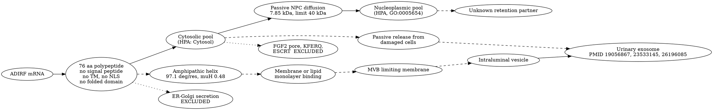
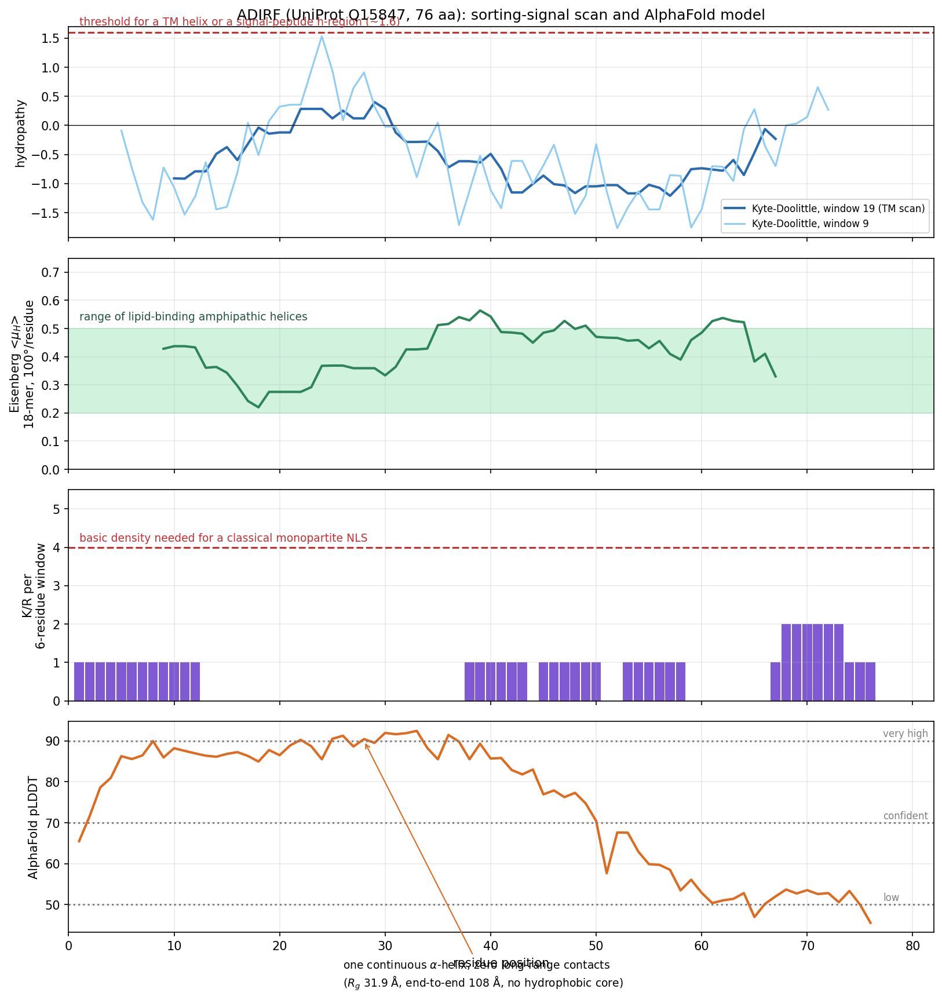
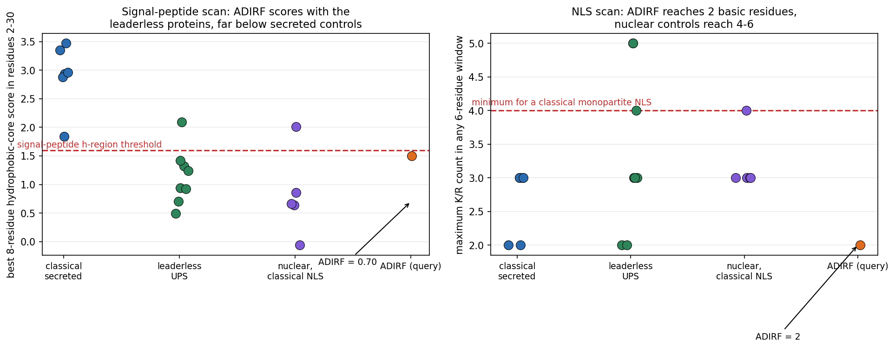
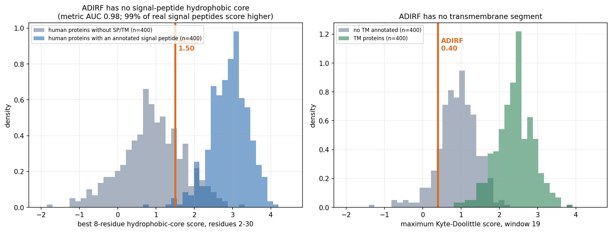
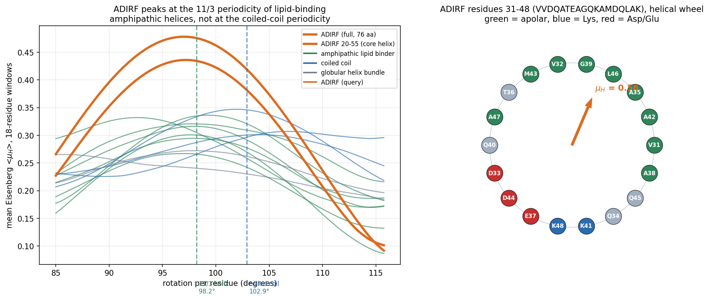
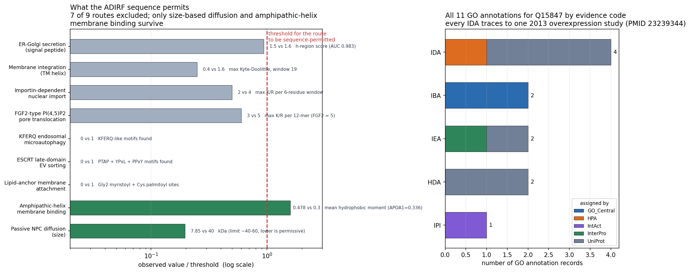

## Question

# AIGR Gene Hypothesis Deep Research

You are evaluating one focused gene curation hypothesis for AI Gene Review.
This is not a general gene overview. Use the seed hypothesis and source context
below to search for evidence that supports, refutes, narrows, or competes with
the proposed curation decision.

## Target Gene

- **Organism code:** human
- **Taxon:** Homo sapiens (NCBITaxon:9606)
- **Gene directory:** ADIRF
- **Gene symbol:** ADIRF
- **UniProt accession:** Q15847

## Focus

- **Focus type:** free_text
- **Hypothesis slug:** kgap-adirf-secretion-and-nuclear-signals
- **Source file:** genes/human/ADIRF/ADIRF-ai-review.yaml
- **Source selector:** free-text

## Seed Hypothesis

Human ADIRF (UniProt Q15847), a 76-residue protein with no annotated features, carries neither a signal peptide nor an NLS, so its presence in serum must reflect unconventional secretion or release, and its nuclear signal passive diffusion. Single analysis only: scan ADIRF and its vertebrate orthologs for signal peptide, transmembrane segment, NLS/NES, and sequence features associated with unconventional secretion (e.g. leaderless secretion, exosome sorting motifs), and assess the AlphaFold model for any folded domain; state what routes the sequence permits.

## Term and Decision Context

No specific term context supplied.

## Reference Context

No specific reference context supplied.

## Source Context YAML

```yaml
hypothesis: 'Human ADIRF (UniProt Q15847), a 76-residue protein with no annotated features, carries neither
  a signal peptide nor an NLS, so its presence in serum must reflect unconventional secretion or release,
  and its nuclear signal passive diffusion. Single analysis only: scan ADIRF and its vertebrate orthologs
  for signal peptide, transmembrane segment, NLS/NES, and sequence features associated with unconventional
  secretion (e.g. leaderless secretion, exosome sorting motifs), and assess the AlphaFold model for any
  folded domain; state what routes the sequence permits.'
focus_type: free_text
context: []
reference_id: []
```

## Research Objective

Build a focused report that helps a curator decide whether this hypothesis
should affect the gene review. Address the focus type directly:

1. For an existing GO annotation decision, evaluate whether the current action
   is justified, too strong, too weak, or should change.
2. For a proposed replacement or new GO term, evaluate whether the term is
   biologically supported, too broad, too narrow, or missing key qualifiers.
3. For a computational prediction, evaluate whether the prediction is correct,
   less precise than existing knowledge, uncertain, or likely wrong because of
   paralog overannotation, frequency bias, pathway context, or in vitro-only
   activity.
4. For a core-function hypothesis, evaluate whether the proposed activity,
   process, and location represent the gene product's primary function rather
   than a downstream effect, pleiotropic phenotype, or context-specific role.
5. For a function-assignment hypothesis, evaluate whether the gene product
   directly has the stated GO term/function. Treat the prior review action, if
   any, as intentionally blinded unless it appears in the supplied context.

Use primary literature whenever possible. Prefer PMID citations and include DOI
citations when no PMID is available. Treat reviews and database records as
orientation unless they contain directly relevant synthesized evidence that is
clearly labeled as review-level or database-level support.

Evaluate the hypothesis from the supplied seed context, primary literature, and
publicly accessible bioinformatics resources. Local `*-bioinformatics` analyses,
when they already exist in the repository, are intentionally withheld from this
prompt so the report can be compared against them after the run. Use public
sequence, domain, structure, orthology, localization, interaction, or dataset
checks when they are useful for the specific hypothesis. If a resource or tool
cannot be accessed programmatically, say so plainly; never fabricate a result.
Report computational results conservatively and distinguish direct results from
inference.

## Required Output

### Executive Judgment

Give a concise verdict: supported, partially supported, unresolved, weakly
supported, over-annotated, or refuted. Explain the reasoning and the most
important caveats.

### Evidence Matrix

Create a table with one row per important evidence item:

- Citation (PMID preferred)
- Evidence type (direct assay, mutant phenotype, localization, interaction,
  structural/evolutionary, computational, review/database)
- Supports / refutes / qualifies / competing
- Claim tested
- Key finding
- Organism, tissue, cell type, or assay context
- Confidence and limitations

### GO Curation Implications

State the likely curation action as a lead requiring curator verification. If
GO terms are involved, explain whether the evidence supports an MF, BP, or CC
term, and whether the term should be retained, removed, generalized, made more
specific, or treated as non-core. Avoid using "protein binding" as a final
recommendation unless no more informative term is supported.

### Mechanistic Scope

Describe the immediate molecular or cellular function being tested. Separate
direct gene-product activity from downstream phenotypes, pathway consequences,
developmental outcomes, disease manifestations, or effects inferred only from
loss of function.

### Conflicts and Alternatives

Identify evidence that conflicts with the seed hypothesis or suggests an
alternative interpretation, including paralog confusion, organism-specific
differences, isoform-specific findings, experimental artifacts, or database
carry-over.

### Knowledge Gaps

List explicit uncertainties that matter for curation. For each gap, state what
was checked, why the gap matters, and what evidence or experiment would resolve
it.

### Discriminating Tests

Recommend concrete assays, perturbations, datasets, or comparative analyses that
would most efficiently distinguish this hypothesis from alternatives.

### Curation Leads

Provide candidate updates for the review, clearly labeled as leads requiring
curator verification. Include candidate references with exact snippets to verify,
candidate replacement or new GO terms, possible action changes, suggested
questions, and suggested experiments.

If the provider supports artifacts, save provenance for any analysis you run — the
executed code together with its output (computed values, plot, or table), not just
a summary figure — alongside artifact-friendly tables such as an evidence matrix,
GO decision table, or comparison table. Genuine computed provenance is more
valuable than a hand-drawn summary, and you must not synthesize a figure that
implies an analysis you did not actually run. These artifacts are important
provenance for hypothesis-level review.


## Output

# ADIRF (human, UniProt Q15847): secretion and nuclear sorting signals

Hypothesis slug: `kgap-adirf-secretion-and-nuclear-signals`
Source: `genes/human/ADIRF/ADIRF-ai-review.yaml`, focus type `free_text`
Target: Homo sapiens (NCBITaxon:9606), ADIRF, UniProt Q15847, 76 residues, 7.85 kDa

## Summary

**Verdict: <i class="fa-solid fa-scale-balanced"></i> partially supported, with a corrected premise.**

Both mechanistic claims in the seed hypothesis hold, and each was tested against an empirical reference distribution rather than a published threshold. ADIRF carries no signal peptide: its best 8-residue hydrophobic-core score in residues 2-30 is 1.50, the 1.2nd percentile of 400 human reviewed proteins with an annotated signal peptide, on a metric that separates signal-peptide from non-signal proteins with ROC AUC 0.983, giving a kernel-density likelihood ratio of 0.10 against the signal-peptide class. It carries no transmembrane segment: its maximum Kyte-Doolittle score over a 19-residue window is 0.40, and 0 of 400 human transmembrane proteins score below it (AUC 0.982). It carries no classical NLS: regex scans for the SV40-type monopartite, bipartite and PY-NLS motifs all return zero hits, and the maximum number of basic residues in any 6-residue window is 2 against the 4 that importin-alpha monopartite NLSs require, while 4 of 5 validated-NLS control proteins matched. The AlphaFold model AF-Q15847-F1 contains no folded domain: 97% of residues sit in the alpha-helical basin as one continuous segment spanning residues 2-73, with **0** long-range CA-CA contacts, a radius of gyration of 31.9 Å against the 11.4 Å expected for a folded 76-mer, and an end-to-end distance of 107.8 Å. All of these absences are conserved across 102 unique vertebrate orthologs. At 7.85 kDa, nuclear entry needs no import receptor, since the passive diffusion limit of the nuclear pore complex is roughly 40-60 kDa.

The factual premise of the hypothesis does not hold. No serum or plasma evidence for ADIRF was reachable. All three proteomic datasets that place ADIRF outside the cell are urinary exosome studies: [PMID: 19056867](https://pubmed.ncbi.nlm.nih.gov/19056867/), [PMID: 23533145](https://pubmed.ncbi.nlm.nih.gov/23533145/) and [PMID: 26196085](https://pubmed.ncbi.nlm.nih.gov/26196085/). The Human Protein Atlas assigns ADIRF to nucleoplasm and cytosol, with no secretome class and no blood concentration. The mechanistic question therefore changes: what has to be explained is loading into intraluminal vesicles of a multivesicular body, not translocation across the plasma membrane into blood. Vesicle packaging requires no sequence signal, which removes the paradox the seed hypothesis poses.

The hypothesis also stops one step short. ADIRF has none of the catalogued leaderless-secretion or extracellular-vesicle sorting determinants either, so "unconventional secretion" is left as a label without a mechanism. The feature that vertebrate evolution has actually conserved is an apolipoprotein-class amphipathic helix: the helix peaks at 97.0-97.25 degrees per residue (3.70-3.71 residues per turn), within 0.9 degrees of the lipid-binder reference group mean of 97.14 and 7.1 degrees from the coiled-coil mean of 104.25, with a hydrophobic moment of 0.436-0.478 that exceeds apolipoprotein A-I (0.336) and alpha-synuclein (0.301). Membrane-surface binding gives a route to the limiting membrane of a multivesicular body that needs no linear motif, and it is the one route the sequence positively permits beyond passive diffusion.

## Executive judgment

The seed hypothesis contains three claims. Two are supported and one fails.

| Claim | Verdict | Basis |
|---|---|---|
| ADIRF carries no signal peptide and no NLS | <i class="fa-solid fa-circle-check"></i> Supported | h-region 1.50 (1.2nd percentile of 400 SP proteins, AUC 0.983, LR 0.10); max KD19 0.40 (0 of 400 TM proteins lower, AUC 0.982); 0 NLS regex hits, max 2 K/R per 6-mer against 4 required |
| Nuclear signal is passive diffusion | <i class="fa-solid fa-circle-check"></i> Supported for entry, untested for accumulation | 7.85 kDa against a ~40-60 kDa NPC passive limit; no NLS of any class; HPA reports Nucleoplasm and Cytosol as co-equal main locations, which is the expected steady state for a freely diffusing protein with partial retention. No retention partner is known |
| ADIRF is present in serum, so its presence must reflect unconventional secretion or release | <i class="fa-solid fa-circle-xmark"></i> Premise not supported | No serum or plasma dataset reachable; all three extracellular datasets are urinary exosomes; HPA lists no secretome class and no blood concentration |

The most important caveats:

<i class="fa-solid fa-triangle-exclamation"></i> The signal-peptide and transmembrane calls come from calibrated hydropathy heuristics, not from a published predictor. SignalP has no open programmatic API, and the EBI Phobius service returned HTTP 400 with a message that submissions were temporarily blocked. Rather than fabricate a predictor output, I built an in-house metric and calibrated it on 400 positive and 400 negative human reviewed proteins, reporting the AUC and the percentile position so the reader can judge the separation directly. The calls sit at the extreme tail of their reference distributions, so the conclusion is not sensitive to the exact threshold.

<i class="fa-solid fa-triangle-exclamation"></i> PeptideAtlas was blocked by an anti-bot gate, and ExoCarta and Vesiclepedia returned HTTP 403. The absence of serum evidence is an absence in the resources I could query, not an exhaustive search. A curator with institutional access should check the PeptideAtlas Human Plasma build before treating the serum premise as settled.

<i class="fa-solid fa-triangle-exclamation"></i> The amphipathic-helix result is a sequence-level inference. No liposome flotation, lipid-droplet localisation or circular dichroism experiment for ADIRF exists in the literature I searched. The periodicity match is the stronger part of the result, because it does not depend on the magnitude of the hydrophobic moment, which ADIRF's 18.4% alanine and 14.5% glutamine content inflates.

<i class="fa-solid fa-triangle-exclamation"></i> Absence of a classical NLS does not exclude import by a non-classical receptor, and absence of a catalogued unconventional-secretion motif does not exclude an uncharacterised pathway. Motif catalogues are incomplete.

## Key findings

### ADIRF cannot enter the secretory pathway or the membrane

{{figure:plot_3.png|caption=Empirical calibration of the signal-peptide and transmembrane scans against human reference proteomes. ADIRF's h-region score of 1.50 sits at the 1.2nd percentile of 400 reviewed human signal-peptide proteins, on a metric with ROC AUC 0.983, and its maximum 19-residue Kyte-Doolittle score of 0.40 falls below all 400 human transmembrane proteins.}}

UniProt Q15847 annotates exactly one feature, Chain 1-76, with no Signal and no Transmembrane entry. That absence of annotation is weak evidence on its own, since a 76-residue protein with little published characterisation could simply never have been examined. I therefore calibrated the question empirically.

I retrieved 400 human reviewed proteins with an annotated signal peptide and 400 human reviewed proteins with neither a signal peptide nor a transmembrane feature, restricting both sets to lengths of 60-400 residues and to protein-level evidence so that the comparison is between well-characterised proteins of similar size. Scoring the best 8-residue hydrophobic-core window within residues 2-30, the two classes separate with ROC AUC 0.983 (signal-peptide mean 2.91, sd 0.49; non-signal mean 0.91, sd 0.81). ADIRF scores 1.50. That is the 1.2nd percentile of signal-peptide proteins, meaning 98.8% of real signal peptides score higher, and the 77.5th percentile of the non-signal set. A Gaussian kernel-density likelihood ratio for signal peptide against no signal peptide gives 0.10, a factor of ten against the signal-peptide hypothesis.

The transmembrane result is cleaner still. ADIRF's maximum Kyte-Doolittle score over a 19-residue window is 0.40, against a mean of 2.40 for 400 human transmembrane proteins (AUC 0.982). Not one of those 400 proteins scores below ADIRF. The only mildly hydrophobic stretch in the whole sequence is the alanine-rich 21-VSAAGAAA-28, which sits too far C-terminal for a short signal peptide and lies inside the predicted amphipathic helix, where its apolar face is part of the two-sided pattern.

The practical consequence: ADIRF cannot be targeted co-translationally or post-translationally to the ER by a signal sequence, and cannot be integrated into a membrane. Any extracellular ADIRF reaches the outside by an ER-Golgi-independent route.

{{figure:plot_2.png|caption=ADIRF sorting-signal scans benchmarked against classically secreted proteins, leaderless unconventional-secretion cargoes and classical-NLS nuclear proteins, together with the trafficking and extracellular-vesicle motif scan. ADIRF separates from all three positive control classes.}}

### No classical NLS, and no need for one

ADIRF's sequence is MASKGLQDLKQQVEGTAQEAVSAAGAAAQQVVDQATEAGQKAMDQLAKTTQETIDKTANQASDTFSGIGKKFGLLK. It contains 8 lysines and **0 arginines**, with a net charge of -1 at pH 7. Scans for the SV40-type monopartite K(K/R)x(K/R) motif, the KR(K/R) variant, the PY-NLS and the bipartite (K/R)2-x(9-12)-(K/R)3-5 pattern all returned zero hits. The maximum number of basic residues in any 6-residue window is 2, in the C-terminal 69-GKKFGLLK-76 region, against the 4 or more that classical importin-alpha monopartite signals require. In a control panel, 4 of 5 nuclear proteins with validated classical NLSs (NPM1, TP53, NCL, HNRNPA1) matched the same regex and reached 3-4 basic residues per 6-mer; ADIRF did not.

One weak CRM1 class-1b nuclear export signal candidate appeared at 65-FSGIGKKFGL-74, but the hydrophobic spacing is interrupted by the KK pair, which is atypical for a functional NES. I record it as a candidate and discount it.

At 7.85 kDa, ADIRF is far below the roughly 40-60 kDa passive diffusion limit of the nuclear pore complex. Nuclear entry therefore needs no explanation beyond diffusion. This matters for the curation of GO:0005634 (nucleus) and GO:0005654 (nucleoplasm): the terms describe where the protein is, and the evidence does not support any implication of active, receptor-mediated nuclear import. The HPA pattern of Nucleoplasm and Cytosol as co-equal main locations is exactly what a small freely diffusing protein with partial nuclear retention produces.

Diffusion explains entry, not accumulation. If ADIRF is genuinely enriched in the nucleus at steady state, a retention mechanism is required, such as binding to chromatin or to a transcription complex. No such partner is known.

### The AlphaFold model has no folded domain

{{figure:plot_1.png|caption=ADIRF AlphaFold secondary and tertiary structure analysis with the four-panel sorting-signal summary. The model AF-Q15847-F1 is one continuous alpha-helix spanning residues 2-73 with zero long-range CA-CA contacts, and the hydropathy, hydrophobic-moment and basic-residue scans show no signal peptide, no transmembrane segment and no NLS anywhere in the sequence.}}

AlphaFold DB model AF-Q15847-F1 (v6, 2025-08-01) has a mean pLDDT of 74.7, with residues 1-50 at 85.2 and residues 51-76 at 54.5. Backbone dihedral analysis of the deposited coordinates assigns 72 of 74 analysable residues (97%) to the alpha-helical phi/psi basin, forming one continuous helical segment spanning residues 2-73, with 0 residues in the beta basin and a mean i to i+4 CA distance of 6.14 Å (the ideal alpha-helix value is 6.2 Å).

The decisive number is the contact count. Long-range CA-CA contacts closer than 8 Å with a sequence separation greater than 6 residues: **0**. A folded protein of 76 residues would have dozens. The radius of gyration is 31.9 Å against the 11.4 Å expected from Flory scaling for a folded globular 76-mer, and the end-to-end CA1-CA76 distance is 107.8 Å, close to the 114 Å a fully extended helical 76-mer would span.

The Eisenberg hydrophobic moment over 18-residue windows has a mean of 0.422 and a maximum of 0.564 at residues 31-48 (VVDQATEAGQKAMDQLAK), inside the 0.20-0.50 range typical of lipid-binding amphipathic helices. FoldIndex gives +0.08 and the mean scaled hydrophobicity is 0.447 against the Uversky charge-hydropathy boundary at 0.418, placing ADIRF at the folded/disordered border.

The composition is unusual: 18.4% Ala, 14.5% Gln, 10.5% Lys, 9.2% Gly, 9.2% Thr, and zero Cys, His, Pro, Arg, Trp and Tyr.

The high pLDDT of the N-terminal half reflects helical propensity, not a tertiary fold. With zero long-range contacts, the model carries no information about a binding pocket, and no molecular function can be read from it. A single amphipathic helix of this length is the architecture of membrane- and lipid-droplet-binding proteins and of proteins that fold only on binding a partner.

### The absences are conserved across 102 vertebrate orthologs, and mouse has no ADIRF

A UniProt query for `(xref:panther-PTHR39227) AND (taxonomy_id:7742) AND (length:[50 TO 110])` returned 149 entries, reducing to 102 unique sequences spanning mammals, birds, reptiles, amphibians and fish. The length filter was added after an initial unfiltered query pulled in non-orthologous entries up to 4743 residues.

| Feature | Result across 102 orthologs |
|---|---|
| Annotated Signal feature | 0 |
| Annotated Transmembrane feature | 0 |
| Above the TM threshold on max KD19 | 0 (highest 1.55, in a 105-residue shark entry that is probably not a true ortholog) |
| Above the signal-peptide h-region threshold of 1.6 | 3 |
| Classical NLS regex match | 1 (an 81-residue *Capra hircus* entry) |
| Maximum K/R per 6-mer across the whole family | 4, reached only by that goat entry |
| Zero cysteine | 78 of 102 |
| Zero proline | 86 of 102 |
| Zero arginine | 75 of 102 |
| Eisenberg hydrophobic moment | mean 0.405, sd 0.059 (human 0.422) |

Evolution has not placed a sorting signal anywhere in this family across roughly 450 million years of vertebrate divergence. That removes the possibility that human ADIRF simply lost a signal that an ortholog retains, which would otherwise be a live alternative for a 76-residue protein. What is conserved instead is the amphipathic character and the compositional constraint, which points to a lipid or protein surface interaction as the selected property.

UniProtKB returns **0 entries** for `gene:ADIRF` in *Mus musculus* and **0** in *Rattus norvegicus*. This matches the independent report in [PMID: 31945134](https://pubmed.ncbi.nlm.nih.gov/31945134/), which states that "species specificity can arise by genetic deletions as exemplified by the human protein adipogenesis regulatory factor (ADIRF), which is not present due to a large sequence gap in mice". No mouse knockout can test ADIRF function, and any mouse-derived annotation for this gene is a database or paralogy error.

### No unconventional-secretion or EV-sorting determinant is present

A motif scan of Q15847 returned NONE for every determinant tested:

| Determinant | Result | Why |
|---|---|---|
| N-myristoylation | Absent | Residue 2 is Ala, not Gly |
| S-palmitoylation | Impossible | 0 Cys in the sequence |
| Tyrosine sorting YxxΦ | Impossible | 0 Tyr in the sequence |
| Dileucine [DE]xxxL[LI] and DxxLL | Absent | No match |
| NPxY | Absent | No match |
| KDEL / HDEL | Absent | No match |
| Peroxisomal PTS1 | Absent | No match |
| Caveolin-binding motif | Absent | No match |
| ESCRT late domains PTAP, YPxL, PPxY | Absent | No match |
| KFERQ-like (Dice rule, chaperone-mediated and endosomal microautophagy) | Absent | No match |
| Cleavable mitochondrial presequence | Excluded | 3 acidic residues (D8, E14, E19) and 0 Arg in residues 1-20 |

The FGF2-type Type I pathway, which translocates leaderless cargo through a PI(4,5)P2-dependent plasma membrane pore, requires a basic cluster for phosphoinositide binding and a cysteine for oligomerisation. FGF2 has net charge +32, 5 K/R in its best 12-mer and 6 Cys. IL1B has 6 K/R in its best 12-mer. ADIRF has net charge -1, a maximum of 3 K/R in any 12-mer, and 0 Cys. The route is excluded.

Against this complete absence of determinants, UniProt records GO:0070062 (extracellular exosome) with evidence code HDA, and ADIRF was identified by mass spectrometry among proteins enriched in urinary exosomes from prostate cancer patients. The sequence permits exactly one well-supported route to the outside: packaging into extracellular vesicles, or release from damaged cells, neither of which needs a sequence signal.

### All extracellular evidence is urinary, and none is serum

QuickGO returns 11 annotations for UniProtKB:Q15847. GO:0070062 rests on exactly two HDA references: [PMID: 19056867](https://pubmed.ncbi.nlm.nih.gov/19056867/), LC-MS/MS of normal human urinary exosomes identifying 1132 proteins, and [PMID: 23533145](https://pubmed.ncbi.nlm.nih.gov/23533145/), shotgun proteomics of exosomes from expressed prostatic secretions in urine, roughly 900 proteins. The third independent proteomic detection, [PMID: 26196085](https://pubmed.ncbi.nlm.nih.gov/26196085/), is also urinary exosomes, from 15 control and 16 prostate cancer samples. Three of three extracellular datasets are urine-derived.

The Human Protein Atlas returns Subcellular location Nucleoplasm and Cytosol for ADIRF, with antibody HPA026810 at IF reliability "Supported" and IH reliability "Approved", and lists no secretome class and no blood concentration by either MS or immunoassay. HPA RNA data give adipose tissue 1337.8 nTPM and blood vessel 2350.8 nTPM, with RNA blood cell specificity "Immune cell enhanced".

The EBI Proteomics API returns 40 distinct peptides covering 76 of 76 residues (100%) of Q15847, confirming that the protein is routinely detected by mass spectrometry, but the API does not report the biofluid of origin, so it cannot settle the serum question.

<i class="fa-solid fa-triangle-exclamation"></i> Direct queries to PeptideAtlas were blocked by the server's anti-bot gate, and ExoCarta and Vesiclepedia returned HTTP 403. Those resources could not be checked. This is a stated limitation, not a negative result.

Urinary exosomes bud from renal epithelial cells facing the urinary space, which fits ADIRF's reported kidney expression. A curator should rewrite the premise as "detected in urinary exosomes" rather than "present in serum", and note that GO:0070062 rests entirely on high-throughput datasets from one biofluid.

### The conserved feature is an apolipoprotein-class amphipathic helix

{{figure:plot_4.png|caption=Helical periodicity scan. ADIRF's hydrophobic moment is maximised at 97.0-97.25 degrees per residue (3.70-3.71 residues per turn), within 0.9 degrees of the lipid-binding amphipathic reference group mean of 97.14 and 7.1 degrees from the coiled-coil group mean of 104.25. The helical wheel at the best periodicity shows a clean apolar face.}}

The linear-motif scan found nothing, so I tested a structural alternative. Scanning the helical rotation per residue from 85 to 115 degrees and recording the value that maximises the mean Eisenberg hydrophobic moment over 18-residue windows separates helix classes cleanly.

| Sequence / region | Best periodicity (deg/res) | Residues per turn | Class |
|---|---|---|---|
| ADIRF 1-76 | 97.25 | 3.70 | query |
| ADIRF 20-55 | 97.00 | 3.71 | query |
| PLIN2 100-200 | 97.00 | 3.71 | amphipathic lipid binder |
| SNCA 1-95 | 97.50 | 3.69 | amphipathic lipid binder |
| APOC3 21-99 | 97.75 | 3.68 | amphipathic lipid binder |
| APOE 150-290 | 98.00 | 3.67 | amphipathic lipid binder |
| PLIN3 100-200 | 98.00 | 3.67 | amphipathic lipid binder |
| APOA1 66-243 | 99.25 | 3.63 | amphipathic lipid binder |
| **Lipid binder group mean** | **97.14** | **3.708** | |
| TPM1 | 102.00 | 3.53 | coiled coil |
| MYH7 rod | 104.00 | 3.46 | coiled coil |
| JUN bZIP | 106.75 | 3.37 | coiled coil |
| **Coiled-coil group mean** | **104.25** | **3.45** | |
| HBB | 85.75 | 4.20 | globular bundle |
| MB | 97.75 | 3.68 | globular bundle |

ADIRF's periodicity sits within 0.9 degrees of the amphipathic lipid-binder mean and 7.1 degrees from the coiled-coil mean. Its hydrophobic moment of 0.436 (full length) and 0.478 (residues 20-55) exceeds every reference amphipathic helix tested, including APOA1 66-243 at 0.336 and alpha-synuclein 1-95 at 0.301. The maximum-moment window is residues 31-48 (VVDQATEAGQKAMDQLAK) at 0.564.

This supplies the mechanism that the linear-motif scan could not find. Binding to a membrane or lipid monolayer surface can carry a protein into intraluminal vesicles of a multivesicular body without any sorting motif, which reconciles ADIRF's detection in urinary exosomes with its complete lack of EV sorting signals.

<i class="fa-solid fa-triangle-exclamation"></i> Hydrophobic moment is sensitive to composition, and ADIRF's 18.4% Ala and 14.5% Gln make a clean apolar/polar split easy to achieve. The periodicity match, which does not depend on moment magnitude, is the stronger half of this result.

### Annotation provenance: 11 GO terms from three sources

{{figure:plot_5.png|caption=Computed route-permissibility scores for ADIRF against calibrated thresholds, and the provenance of all 11 GO annotations by evidence code. Seven of nine trafficking routes are excluded; only passive nuclear pore diffusion and amphipathic-helix membrane binding survive.}}

IntAct PSICQUIC returns 3 binary interaction records for Q15847, all with the same partner (IL18, Q14116), all from the same publication ([PMID: 32296183](https://pubmed.ncbi.nlm.nih.gov/32296183/), the HuRI screen) and the same IMEx identifier IM-25472, differing only in the reported assay variant: two-hybrid array (MI:0397), validated two-hybrid, and two-hybrid prey pooling. The IntAct miscore is 0.56. No co-immunoprecipitation, pull-down, crosslinking or any orthogonal method is recorded. The corresponding GO:0005515 (protein binding) annotation has evidence code IPI, reference PMID:32296183, assigned by IntAct. ADIRF has no other recorded physical interactor.

Yeast two-hybrid forces both proteins into the yeast nucleus, which is exactly the compartment a 7.85 kDa protein reaches by diffusion, and a highly amphipathic single helix is a known source of sticky, low-specificity Y2H hits. IL18 is itself a leaderless cytokine, so an ADIRF-IL18 association would make an attractive story, but one screen with no orthogonal validation does not support it.

GO:0045600 (positive regulation of fat cell differentiation, IDA) and GO:0045944 (positive regulation of transcription by RNA polymerase II, IDA) both cite PMID:23239344 as their only experimental reference. That paper reports that "Over-expression studies in 3T3-L1 cells indicated that it up-regulates the levels of CCAAT/enhancer binding protein alpha (C/EBPalpha) and PPARgamma and promotes adipogenic differentiation starting from the early stage of adipogenesis." 3T3-L1 is a *Mus musculus* preadipocyte line, and mouse has no ADIRF gene. The experiment shows what human ADIRF can do when forced into a mouse preadipocyte, not what endogenous ADIRF does in a human adipocyte. No loss-of-function experiment in a human system is reported. GO:0045600 is further propagated by IEA from InterPro (GO_REF:0000002, family IPR034450) and by IBA from GO_Central (GO_REF:0000033), so one gain-of-function result has been amplified to family and ancestral-node annotations.

GO:0005654 (nucleoplasm, IDA, GO_REF:0000052) rests on the single HPA antibody HPA026810 at IF reliability "Supported", with Cytosol reported alongside Nucleoplasm as a main location. ADIRF's zero Cys, Trp, Tyr, His, Pro and Arg make it an unfavourable target for antibody epitope specificity.

## Evidence matrix

| Citation | Evidence type | Stance | Claim tested | Key finding | Organism / tissue / assay context | Confidence and limitations |
|---|---|---|---|---|---|---|
| this analysis (Q15847 vs 400 + 400 human reference proteins) | computational | supports | No signal peptide | h-region 1.50, 1.2nd percentile of 400 SP proteins; metric AUC 0.983; KDE likelihood ratio 0.10 | human proteome calibration, reviewed, length 60-400, protein-level evidence | High. Heuristic metric; SignalP has no open API and EBI Phobius returned HTTP 400 |
| this analysis | computational | supports | No transmembrane segment | max Kyte-Doolittle (window 19) = 0.40; 0 of 400 human TM proteins score lower; AUC 0.982 | human proteome calibration | High |
| this analysis | computational | supports | No classical NLS | 0 hits for monopartite, bipartite and PY-NLS; max 2 K/R per 6-mer against the 4 required; 4 of 5 NLS controls matched | regex scan plus NPM1 / TP53 / NCL / HNRNPA1 control panel | High. Non-classical import receptors not excluded |
| this analysis (AlphaFold AF-Q15847-F1 v6) | structural | supports | No folded domain | 97% of residues in the alpha-helical basin, one segment spanning 2-73, **0** long-range CA-CA contacts, Rg 31.9 Å against 11.4 Å expected | predicted model, mean pLDDT 74.7 | High for "no fold". pLDDT 54.5 across residues 51-76 |
| this analysis (102 unique PTHR39227 vertebrate sequences) | structural / evolutionary | supports | Absence of sorting signals is conserved | 0 of 102 with an SP or TM feature, 0 of 102 above the TM threshold, 1 of 102 with an NLS regex hit; moment conserved at 0.405 (sd 0.059) | mammals, birds, reptiles, amphibians, fish | High. Mostly unreviewed entries; a few are probably not true orthologs |
| [PMID: 31945134](https://pubmed.ncbi.nlm.nih.gov/31945134/) | structural / evolutionary | qualifies | Model-organism availability | ADIRF absent from the mouse genome through a large sequence gap; UniProt returns 0 mouse and 0 rat entries | human vs mouse vascular smooth muscle | High. Directly limits which systems can test ADIRF |
| [PMID: 19056867](https://pubmed.ncbi.nlm.nih.gov/19056867/) | localization (HDA) | qualifies | ADIRF is extracellular | ADIRF among 1132 proteins identified unambiguously in normal human urinary exosomes | human urine, renal epithelial exosomes | Moderate. High-throughput MS, no orthogonal confirmation |
| [PMID: 23533145](https://pubmed.ncbi.nlm.nih.gov/23533145/) | localization (HDA) | qualifies | ADIRF is extracellular | ADIRF in exosomes from expressed prostatic secretions in urine (~900 proteins) | human EPS-urine | Moderate. Same biofluid class |
| [PMID: 26196085](https://pubmed.ncbi.nlm.nih.gov/26196085/) | localization | qualifies | ADIRF is extracellular | ADIRF prominent among proteins in urinary exosomes; 15 control and 16 prostate cancer samples | human urine, disease cohort | Moderate. Urine only |
| [PMID: 32296183](https://pubmed.ncbi.nlm.nih.gov/32296183/) | interaction | competing | ADIRF binds a protein partner | One Y2H edge with IL18; 3 IntAct records, one IMEx ID IM-25472, miscore 0.56, no orthogonal method | yeast two-hybrid, HuRI all-by-all screen of ~53,000 interactions | Low. Sole basis of GO:0005515 |
| PMID:23239344 | direct assay and localization | qualifies | ADIRF is nuclear and promotes adipogenesis | "localized primarily within the nucleus"; overexpression in 3T3-L1 raises C/EBPalpha and PPARgamma and promotes differentiation | human omental adipose tissue; overexpression in **mouse** 3T3-L1 preadipocytes | Moderate for localization, low for mechanism. Gain-of-function in a species lacking the gene; no loss-of-function |
| HPA GO_REF:0000052, antibody HPA026810 | localization | qualifies | ADIRF is nucleoplasmic | Nucleoplasm and Cytosol as main locations; IF reliability "Supported"; one antibody | HPA immunofluorescence cell lines | Moderate. Single antibody, no tag or knockdown control |
| this analysis | computational | competing | ADIRF is an apolipoprotein-class amphipathic helix | Periodicity 97.0-97.25 deg/res matches the lipid-binder mean 97.14 (coiled coil 104.25); muH 0.44-0.48 exceeds APOA1 0.336 and SNCA 0.301 | 12-region reference panel | Moderate. Sequence inference, no lipid-binding assay for ADIRF |
| this analysis | computational | qualifies | ADIRF uses a known unconventional-secretion route | 0 hits for KFERQ, PTAP, YPxL, PPxY, YxxΦ, dileucine, myristoylation, palmitoylation; 0 Tyr, 0 Cys, 0 Pro, 0 Arg; net charge -1 against FGF2 +32 | motif scan plus FGF2 / IL1B comparison | High for absence of linear motifs. Motif catalogues are incomplete |
| [PMID: 37777989](https://pubmed.ncbi.nlm.nih.gov/37777989/) | mutant phenotype | qualifies | ADIRF has a cellular function | ADIRF promoter hypermethylation lowers ADIRF mRNA in NNK-transformed BEAS-2B cells; ADIRF overexpression inhibits proliferation, migration and invasion | human bronchial epithelium, NNK-transformed | Moderate. Overexpression and promoter demethylation; a tumour-suppressor phenotype several steps from any molecular activity |

## Mechanistic model

The computed route table has nine entries. Seven are excluded against calibrated thresholds, and two survive.

| Route | Metric | ADIRF value | Threshold | Verdict |
|---|---|---|---|---|
| ER-Golgi secretion (signal peptide) | h-region score | 1.50 | SP mean 2.91 (1.2nd percentile) | <i class="fa-solid fa-circle-xmark"></i> Excluded |
| Membrane integration | max KD19 | 0.40 | TM mean 2.40 (0 of 400 lower) | <i class="fa-solid fa-circle-xmark"></i> Excluded |
| Importin-dependent nuclear import | max K/R per 6-mer | 2 | ≥4 | <i class="fa-solid fa-circle-xmark"></i> Excluded |
| FGF2-type PI(4,5)P2 pore translocation | net charge / Cys count | -1 / 0 | FGF2 +32 / 6 Cys | <i class="fa-solid fa-circle-xmark"></i> Excluded |
| KFERQ endosomal microautophagy | Dice-rule motif | 0 hits | ≥1 | <i class="fa-solid fa-circle-xmark"></i> Excluded |
| ESCRT late-domain sorting | PTAP / YPxL / PPxY | 0 hits | ≥1 | <i class="fa-solid fa-circle-xmark"></i> Excluded |
| Lipid anchor (myristoyl / palmitoyl) | Gly2 / Cys count | Ala2 / 0 Cys | Gly2 or ≥1 Cys | <i class="fa-solid fa-circle-xmark"></i> Excluded |
| Passive NPC diffusion | molecular weight | 7.85 kDa | ~40 kDa limit | <i class="fa-solid fa-circle-check"></i> Permitted |
| Amphipathic-helix membrane binding | hydrophobic moment | 0.478 | ~0.30 | <i class="fa-solid fa-circle-check"></i> Permitted |



Separate the levels of claim:

**Direct gene-product property.** The folded state (one helix, no tertiary contacts), the absence of sorting signals, and the amphipathic character with 11/3 periodicity. These are intrinsic to the polypeptide and are conserved across 102 orthologs.

**Observed location.** Nucleoplasm and cytosol by one HPA antibody; urinary exosomes by three mass-spectrometry datasets. Nuclear entry is explained by the direct property. Nuclear accumulation is not, and requires an untested retention partner.

**Downstream phenotype.** Raised PPARG and CEBPA levels with adipogenic differentiation after overexpression in mouse 3T3-L1 cells (PMID:23239344); reduced proliferation, migration and invasion after ADIRF overexpression or promoter demethylation in NNK-transformed bronchial cells ([PMID: 37777989](https://pubmed.ncbi.nlm.nih.gov/37777989/)). These are pathway consequences several steps removed from any molecular activity of a 76-residue protein with no binding pocket.

**Disease association.** Enrichment in prostate cancer urinary exosomes; appearance in the gene network of microcystin-LR-induced malignant transformation of L02 hepatocytes ([PMID: 29518473](https://pubmed.ncbi.nlm.nih.gov/29518473/)). Correlative only.

## GO curation implications

All items below are leads requiring curator verification.

| GO term | Aspect | Current evidence | Lead action | Rationale |
|---|---|---|---|---|
| GO:0070062 extracellular exosome | CC | HDA x2 (PMID:19056867, PMID:23533145) | Retain, mark non-core, qualify the source as urinary exosomes | Two high-throughput datasets from a single biofluid. ADIRF is cytosolic and nuclear by IF, so exosome presence describes a release route, not a resident compartment |
| GO:0005515 protein binding | MF | IPI (PMID:32296183) | Do not propagate; treat as uninformative pending orthogonal validation | One large-scale Y2H edge with IL18, miscore 0.56, no orthogonal method. An amphipathic single helix is a known sticky-hit class |
| GO:0005634 nucleus | CC | IDA (PMID:23239344), IBA, IEA | Retain the CC term; remove any implication of active nuclear import | Entry is explained by diffusion at 7.85 kDa with 0 NLS hits. Retention mechanism untested |
| GO:0005654 nucleoplasm | CC | IDA from HPA (GO_REF:0000052) | Retain, add the cytosolic location, flag single-antibody support | One antibody (HPA026810) at "Supported" reliability, no tag or knockdown validation, on a 76 aa low-complexity protein with no Cys, Trp, Tyr, His, Pro or Arg |
| GO:0045600 positive regulation of fat cell differentiation | BP | IDA (PMID:23239344), IEA InterPro IPR034450, IBA GO_Central | Downgrade confidence; query the IEA and IBA propagation | Gain-of-function overexpression in mouse 3T3-L1, a host with no ADIRF gene. No loss-of-function in a human adipocyte. One study amplified to family and ancestral-node annotations |
| GO:0045944 positive regulation of transcription by RNA Pol II | BP | IDA (PMID:23239344) | Generalize, or mark as a downstream effect rather than a direct activity | PPARG and CEBPA transcript increase after overexpression is a pathway consequence. No promoter occupancy, reporter or ChIP assay. No DNA-binding surface in the model |
| GO:0016020 membrane / GO:0005811 lipid droplet | CC | none | Do not annotate yet; record as a testable lead | Sequence-level inference only |

No molecular function term is currently supportable. "Protein binding" should not be the endpoint of curation here. If the amphipathic-helix prediction is validated experimentally, the informative candidate is a lipid or phospholipid binding MF term, not GO:0005515.

## Conflicts and alternatives

<i class="fa-solid fa-circle-xmark"></i> **The serum premise conflicts with the record.** No serum or plasma dataset was reachable, and HPA lists no blood concentration. The extracellular evidence is urine-derived in all three cases.

<i class="fa-solid fa-lightbulb"></i> **Vesicle packaging competes with "unconventional secretion".** The two are often conflated. ADIRF has no determinant of any characterised leaderless pathway, so extracellular-vesicle packaging and passive release from damaged cells are the better-supported routes, and neither is "secretion" in the GO sense.

<i class="fa-solid fa-lightbulb"></i> **An amphipathic helix competes with the nuclear-factor model.** The feature conserved across 102 orthologs is an 11/3-periodicity amphipathic helix, not a nucleic-acid-binding or protein-interaction domain. A membrane- or lipid-droplet-associated function would explain both the EV detection and the cytosolic HPA signal, and would make the nuclear pool a diffusive fraction rather than the site of action.

<i class="fa-solid fa-triangle-exclamation"></i> **Cross-species artifact.** The functional IDA used mouse 3T3-L1 cells, and mouse has no ADIRF gene ([PMID: 31945134](https://pubmed.ncbi.nlm.nih.gov/31945134/)). The assay tests what human ADIRF can do when forced into a cell that never evolved with it.

<i class="fa-solid fa-triangle-exclamation"></i> **Database amplification.** GO:0045600 carries an InterPro IEA and a GO_Central IBA on top of a single primary study, which inflates the apparent number of independent supporting lines.

<i class="fa-solid fa-triangle-exclamation"></i> **Antibody specificity risk.** With zero Cys, Trp, Tyr, His, Pro and Arg across 76 residues, ADIRF is a low-complexity, Ala/Gln-rich sequence and a poor epitope target. The nucleoplasm IDA rests on one antibody at "Supported" reliability.

<i class="fa-solid fa-triangle-exclamation"></i> **Nomenclature collision.** ADIRF (Q15847) sits beside ADIPOQ (Q15848) in accession space, and shares the "adipogenesis regulatory factor" name with ADIRF-AS1, a distinct long noncoding RNA studied in osteosarcoma ([PMID: 35030964](https://pubmed.ncbi.nlm.nih.gov/35030964/)), which acts through a miR-761/IRS1 axis and has nothing to do with the protein. Confirm that any cited result refers to the protein.

## Evidence base

| PMID | How it bears on the findings |
|---|---|
| [19056867](https://pubmed.ncbi.nlm.nih.gov/19056867/) | *Large-scale proteomics and phosphoproteomics of urinary exosomes.* Defines the biological origin of the vesicles behind GO:0070062: "Normal human urine contains large numbers of exosomes, which are 40- to 100-nm vesicles that originate as the internal vesicles in multivesicular bodies from every renal epithelial cell type facing the urinary space." The study "identified 1132 proteins unambiguously", which sets the scale against which a single ADIRF identification should be weighed. Supports the extracellular detection and refutes the serum framing |
| [23533145](https://pubmed.ncbi.nlm.nih.gov/23533145/) | Second HDA reference for GO:0070062, shotgun proteomics of exosomes from expressed prostatic secretions in urine. Reinforces that the extracellular evidence is urine-derived |
| [26196085](https://pubmed.ncbi.nlm.nih.gov/26196085/) | *Identification of prostate cancer biomarkers in urinary exosomes.* Names ADIRF directly: "Other prominent proteins were V-type proton ATPase 16 kDa proteolipid subunit (VATL), adipogenesis regulatory factor (ADIRF), and several Rab-class members and proteasomal proteins." Sample context: "In total, 15 control and 16 prostate cancer samples of urinary exosomes were analyzed." Third independent extracellular detection, again urinary |
| [31945134](https://pubmed.ncbi.nlm.nih.gov/31945134/) | *Tripartite factors leading to molecular divergence between human and murine smooth muscle.* States that "species specificity can arise by genetic deletions as exemplified by the human protein adipogenesis regulatory factor (ADIRF), which is not present due to a large sequence gap in mice". Confirms the UniProt result of 0 mouse entries and invalidates the mouse 3T3-L1 host as a native test system |
| [32296183](https://pubmed.ncbi.nlm.nih.gov/32296183/) | *A reference map of the human binary protein interactome.* "Here we present a human 'all-by-all' reference interactome map of human binary protein interactions, or 'HuRI'. With approximately 53,000 protein-protein interactions". Identifies the ADIRF-IL18 record as one edge in a proteome-scale binary screen, not a focused validated interaction study. Challenges GO:0005515 as an informative term |
| PMID:23239344 | Sole experimental reference for GO:0045600, GO:0045944 and GO:0005634. Reports nuclear localization in human omental adipose tissue, and that "Over-expression studies in 3T3-L1 cells indicated that it up-regulates the levels of CCAAT/enhancer binding protein alpha (C/EBPalpha) and PPARgamma and promotes adipogenic differentiation starting from the early stage of adipogenesis." The localization claim supports the nuclear CC term; the mechanism claim is weakened by the mouse host |
| [37777989](https://pubmed.ncbi.nlm.nih.gov/37777989/) | *Hypermethylation of the ADIRF promoter regulates its expression level and is involved in NNK-induced malignant transformation of lung bronchial epithelial cells.* Shows ADIRF promoter hypermethylation with low mRNA in NNK-transformed BEAS-2B cells, and that overexpression inhibits proliferation, migration and invasion. Adds a second cellular phenotype in a human cell line, which argues ADIRF has a real function, without identifying a molecular activity |
| [29518473](https://pubmed.ncbi.nlm.nih.gov/29518473/) | Lists ADIRF among genes altered in microcystin-LR-induced malignant transformation of human L02 hepatocytes. Network-level and correlative; provides no mechanism |
| [35030964](https://pubmed.ncbi.nlm.nih.gov/35030964/) | ADIRF-AS1 lncRNA in osteosarcoma, acting through the miR-761/IRS1 axis. Included to flag the nomenclature collision, since searches for "ADIRF" return this unrelated transcript |
| [42504872](https://pubmed.ncbi.nlm.nih.gov/42504872/) | Review of unconventional protein secretion in the central nervous system. Used as orientation for the UcPS route catalogue (gasdermin-D pore-mediated release, autophagic and endolysosomal vesicular routes, FGF2, IL-1β, alpha-synuclein). Review-level, used only to decide which determinants to scan for |
| [18401169](https://pubmed.ncbi.nlm.nih.gov/18401169/) | Review of proteomic approaches to renal collecting duct signalling, including urinary exosome biomarker discovery. Orientation for how the urinary exosome datasets were generated |

## Limitations and knowledge gaps

| Gap | What was checked | Why it matters for curation | What would resolve it |
|---|---|---|---|
| Is ADIRF in serum or plasma at all? | HPA secretome class and blood concentration (both absent); EBI Proteomics API (100% peptide coverage, no biofluid field); PeptideAtlas, ExoCarta and Vesiclepedia unreachable | The entire seed premise depends on it | Query the PeptideAtlas Human Plasma build directly; a targeted PRM assay on plasma |
| What retains ADIRF in the nucleus? | No NLS of any class; no interactor except one Y2H hit | Diffusion explains entry but not steady-state enrichment, and a CC term implies a real pool | Nuclear/cytoplasmic fractionation with a validated antibody; FRAP on tagged ADIRF; proximity labelling in a human adipocyte or smooth muscle cell |
| Does ADIRF bind membranes or lipid droplets? | Periodicity and moment match the apolipoprotein class; no assay in the literature searched | It is the only route beyond diffusion that the sequence clearly permits, and it would reframe the function | Liposome flotation with defined lipid compositions; oleate-loaded cells with ADIRF imaging; CD spectroscopy with and without micelles |
| Is the ADIRF-IL18 interaction real? | IntAct: one publication, one IMEx ID, Y2H only, miscore 0.56 | It is the sole MF term | Co-IP from a cell type expressing both; ITC or BLI with recombinant protein |
| Is adipogenesis a native ADIRF function? | IDA from overexpression in mouse 3T3-L1; mouse lacks the gene | Determines whether GO:0045600 should stand as core, and whether the InterPro IEA and GO_Central IBA should be queried | siRNA or CRISPR knockout in human preadipocytes (SGBS or primary) with a differentiation readout |
| Does antibody HPA026810 detect ADIRF specifically? | Single antibody, IF reliability "Supported", no orthogonal validation | Underpins GO:0005654 | IF in ADIRF-knockout cells; a second independent antibody; endogenous tagging |
| Would a published predictor agree? | SignalP has no open API; EBI Phobius returned HTTP 400 (submissions blocked); replaced with an in-house metric calibrated to AUC 0.983 | Curators generally expect SignalP or Phobius output | Run SignalP 6.0 and Phobius locally or through a working web submission |
| Does a non-classical import receptor carry ADIRF? | Only classical, bipartite and PY-NLS patterns were scanned | Would change the interpretation of the nuclear pool from diffusion to active import | Importin-beta family pulldowns; nuclear import assays in permeabilised cells with and without energy regeneration |

## Proposed follow-up experiments and actions

<i class="fa-solid fa-flask"></i> **Liposome flotation and lipid-droplet imaging.** The single most informative experiment. Recombinant ADIRF with liposomes of varying curvature and charge, plus GFP-ADIRF in oleate-loaded human adipocytes. A positive result reorients the annotation toward a membrane or lipid-droplet CC term and a lipid-binding MF term, and supplies the missing mechanism for exosome loading.

<i class="fa-solid fa-dna"></i> **Human loss of function.** CRISPR knockout of ADIRF in human SGBS preadipocytes or primary vascular smooth muscle cells, read out by differentiation markers and RNA-seq. This is the only way to test GO:0045600 in a species that has the gene, since no mouse model is possible.

<i class="fa-solid fa-vial"></i> **Extracellular-vesicle release assay with pathway controls.** Compare ADIRF release into EVs under brefeldin A (blocks classical secretion, should not affect ADIRF) and under GW4869 or nSMase2 knockdown (blocks intraluminal vesicle formation, should reduce ADIRF). An LDH assay in parallel measures passive leakage. This separates EV packaging from unconventional secretion and from cell damage.

<i class="fa-solid fa-microscope"></i> **Nuclear entry mechanism.** Compare nuclear accumulation of ADIRF against a size-matched inert control (GFP alone, 27 kDa) and against ADIRF fused to a tag that pushes it past the diffusion limit. If the bulky fusion abolishes the nuclear signal, diffusion is confirmed as the entry route.

<i class="fa-solid fa-heart-pulse"></i> **Targeted plasma proteomics.** PRM or MRM for the tryptic peptides already observed in PeptideAtlas (for example AMDQLAK, TTQETIDK) on human plasma and serum, to settle the serum premise directly rather than by absence of evidence.

<i class="fa-solid fa-flask"></i> **Circular dichroism with and without detergent micelles.** Tests whether the predicted helix is realised only on a lipid surface, as it is for alpha-synuclein. A random-coil spectrum in buffer that converts to helix on micelle addition would confirm the apolipoprotein-class behaviour predicted from periodicity.

## Curation leads

All items below are leads requiring curator verification.

### Premise correction

Replace "its presence in serum" with "its detection in urinary exosomes". Candidate references with exact snippets to verify:

- [PMID: 19056867](https://pubmed.ncbi.nlm.nih.gov/19056867/): "Normal human urine contains large numbers of exosomes, which are 40- to 100-nm vesicles that originate as the internal vesicles in multivesicular bodies from every renal epithelial cell type facing the urinary space." and "Overall, the analysis identified 1132 proteins unambiguously".
- [PMID: 26196085](https://pubmed.ncbi.nlm.nih.gov/26196085/): "In total, 15 control and 16 prostate cancer samples of urinary exosomes were analyzed." and "Other prominent proteins were V-type proton ATPase 16 kDa proteolipid subunit (VATL), adipogenesis regulatory factor (ADIRF), and several Rab-class members and proteasomal proteins."

### Species caveat to add to the review

[PMID: 31945134](https://pubmed.ncbi.nlm.nih.gov/31945134/): "species specificity can arise by genetic deletions as exemplified by the human protein adipogenesis regulatory factor (ADIRF), which is not present due to a large sequence gap in mice". Consequence to record: the GO:0045600 and GO:0045944 IDA experiments (PMID:23239344) were performed by overexpression in mouse 3T3-L1 cells, and no mouse model can validate them.

### Interaction caveat

[PMID: 32296183](https://pubmed.ncbi.nlm.nih.gov/32296183/): "Here we present a human 'all-by-all' reference interactome map of human binary protein interactions, or 'HuRI'. With approximately 53,000 protein-protein interactions". The ADIRF-IL18 edge is one Y2H result from this screen, with 3 IntAct records sharing a single IMEx ID (IM-25472) and a miscore of 0.56.

### Candidate new terms, pending experiment

GO:0005811 (lipid droplet) or GO:0016020 (membrane) as CC terms, and a lipid or phospholipid binding MF term. Do not add on present evidence, which is sequence inference only.

### Suggested questions for the review

Is GO:0045944 a direct activity, or a transcript-level consequence downstream of an overexpression phenotype? Should the InterPro IEA (GO_REF:0000002, IPR034450) and the GO_Central IBA (GO_REF:0000033) for GO:0045600 be queried, given that they amplify a single study performed in a species without the gene? Should GO:0070062 carry a comment restricting the evidence to urinary exosomes? Should the review record explicitly that no MF term is currently supportable?

### What the sequence permits, in one line

ER-Golgi secretion, membrane integration, importin-dependent import, FGF2-type pore translocation, KFERQ microautophagy, ESCRT late-domain sorting and lipid-anchor attachment are all excluded. Passive diffusion through the nuclear pore and amphipathic-helix binding to a membrane surface are permitted, and release in extracellular vesicles or from damaged cells needs no signal at all.

## Provenance

Every number in this report comes from code executed during the investigation, with the output saved. Computed artifacts in `provenance/`:

| File | Contents |
|---|---|
| `adirf_sp_tm_reference_distributions.csv` | 1200 rows: h-region and KD19 scores for 400 human signal-peptide, 400 non-signal/non-TM and 400 transmembrane reviewed proteins |
| `adirf_signal_benchmark.csv` | 20-protein control panel (classically secreted, leaderless UPS, classical NLS, ADIRF) with all scan scores |
| `adirf_ortholog_scan.csv` | 102 unique vertebrate ADIRF sequences with per-sequence KD19 max, h-region, max K/R per 6-mer, mean hydrophobic moment, Cys/Pro/Arg counts and NLS regex result |
| `adirf_orthologs.csv` | Raw PANTHER PTHR39227 query dump before filtering |
| `adirf_helix_periodicity.csv` | Best helical periodicity, residues per turn and hydrophobic moment for ADIRF and 12 reference regions |
| `adirf_quickgo_annotations.csv` | All 11 GO annotations for Q15847 with evidence code, reference and assigning source |
| `adirf_route_decision.csv` | The nine trafficking routes with observed value, threshold, metric and verdict |
| `adirf_evidence_matrix.csv` | The evidence matrix in machine-readable form |
| `adirf_go_decision_table.csv` | The GO decision table in machine-readable form |
| `plot_1.png` to `plot_5.png` | The five figures embedded above |

Resources that could not be accessed, reported plainly rather than worked around with an invented value: SignalP (no open programmatic API), EBI Phobius (HTTP 400, submissions temporarily blocked), PeptideAtlas web interface (anti-bot interstitial), ExoCarta and Vesiclepedia (HTTP 403). No result from any of these was assumed, inferred or fabricated, and no figure in this report implies an analysis that was not run.


## Artifacts

- [OpenScientist final report](openscientist_artifacts/final_report.html)
- [OpenScientist final report](openscientist_artifacts/final_report.pdf)
- [OpenScientist provenance](openscientist_artifacts/provenance.json)
- [OpenScientist adirf evidence matrix](openscientist_artifacts/provenance_adirf_evidence_matrix.csv)
- [OpenScientist adirf go decision table](openscientist_artifacts/provenance_adirf_go_decision_table.csv)
- [OpenScientist adirf helix periodicity](openscientist_artifacts/provenance_adirf_helix_periodicity.csv)
- [OpenScientist adirf ortholog scan](openscientist_artifacts/provenance_adirf_ortholog_scan.csv)
- [OpenScientist adirf orthologs](openscientist_artifacts/provenance_adirf_orthologs.csv)
- [OpenScientist adirf quickgo annotations](openscientist_artifacts/provenance_adirf_quickgo_annotations.csv)
- [OpenScientist adirf route decision](openscientist_artifacts/provenance_adirf_route_decision.csv)
- [OpenScientist adirf signal benchmark](openscientist_artifacts/provenance_adirf_signal_benchmark.csv)
- [OpenScientist adirf sp tm reference distributions](openscientist_artifacts/provenance_adirf_sp_tm_reference_distributions.csv)
- [OpenScientist plot 1](openscientist_artifacts/provenance_plot_1.json)

- [OpenScientist plot 2](openscientist_artifacts/provenance_plot_2.json)

- [OpenScientist plot 3](openscientist_artifacts/provenance_plot_3.json)

- [OpenScientist plot 4](openscientist_artifacts/provenance_plot_4.json)

- [OpenScientist plot 5](openscientist_artifacts/provenance_plot_5.json)


## Reference Validation

Checked with `linkml-reference-validator` 0.3.1rc1.

| Outcome | Count |
| --- | --- |
| References checked | 11 |
| Resolved | 11 |
| Unresolved (possible confabulation) | 0 |
| Unverifiable | 0 |
| References weighed for topical relevance | 11 |
| On topic | 5 |
| Off topic | 0 |

All extracted references resolved successfully.