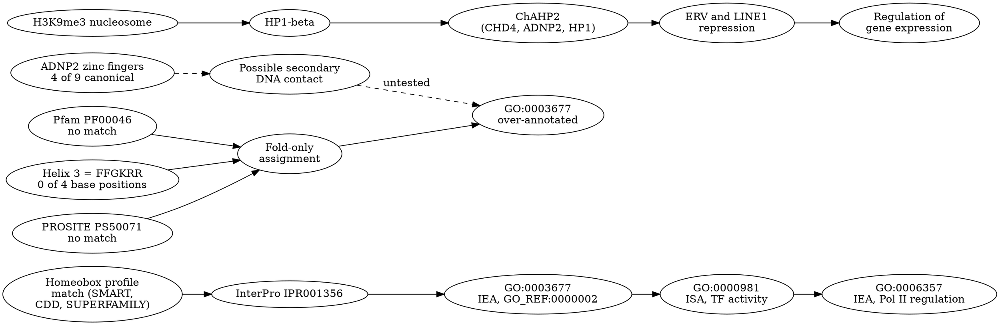
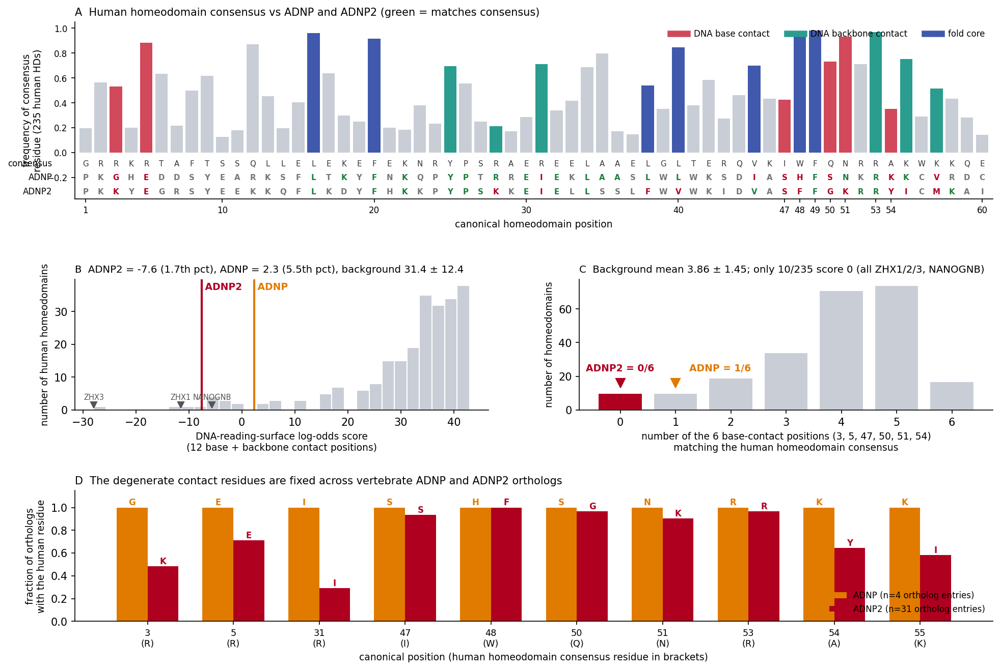
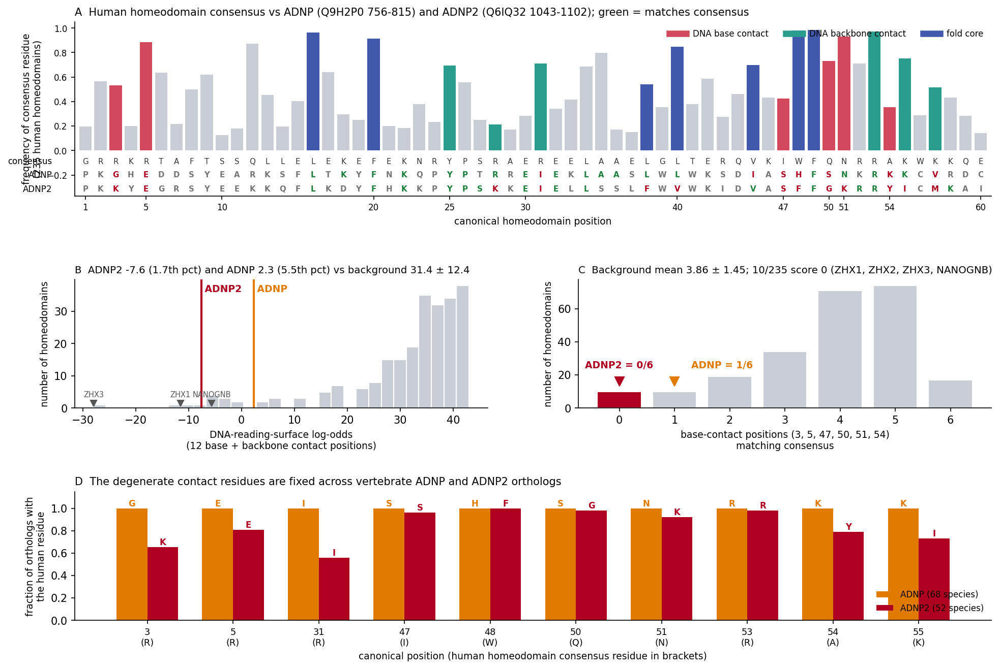
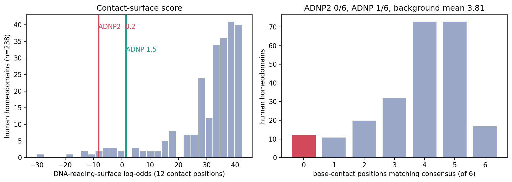
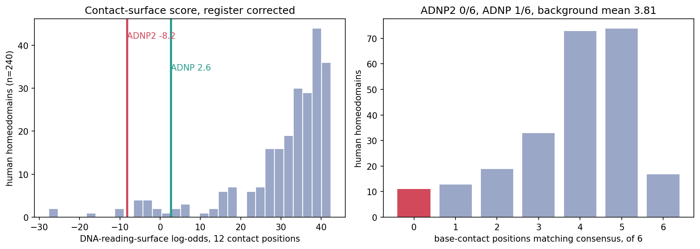
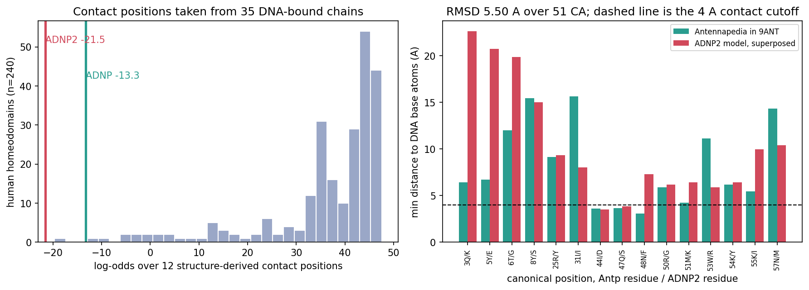
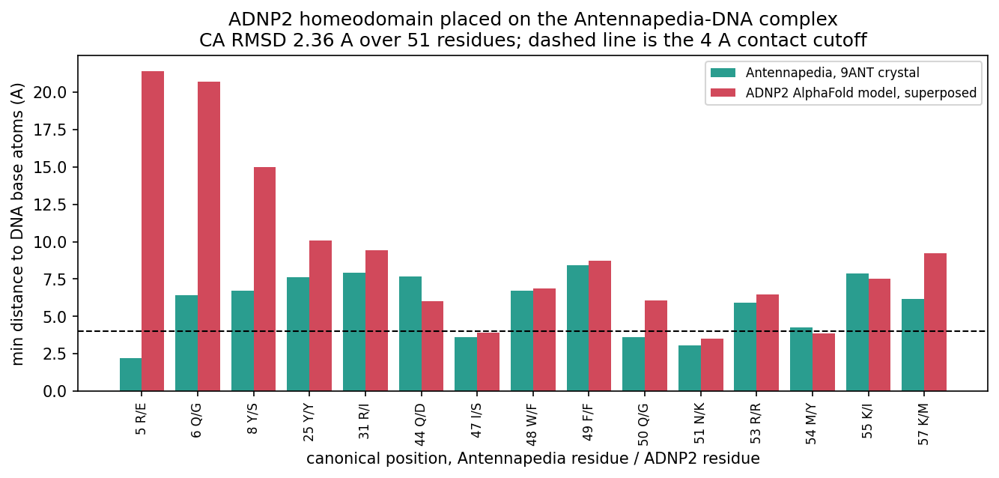
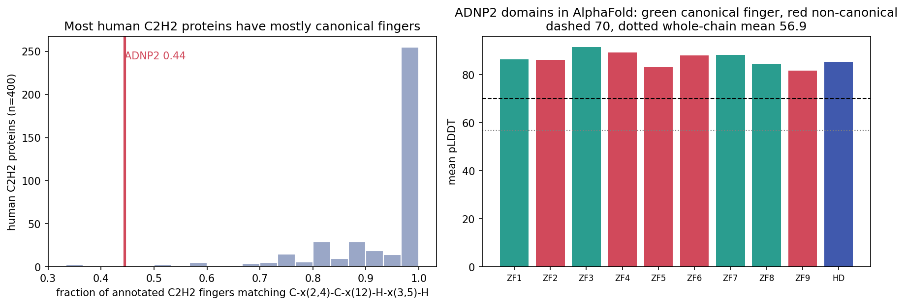
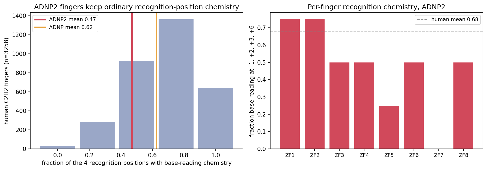
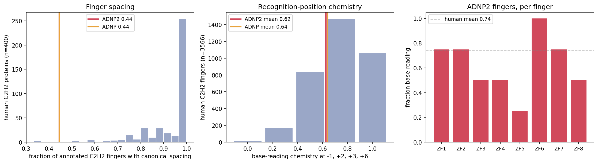

## Question

# AIGR Gene Hypothesis Deep Research

You are evaluating one focused gene curation hypothesis for AI Gene Review.
This is not a general gene overview. Use the seed hypothesis and source context
below to search for evidence that supports, refutes, narrows, or competes with
the proposed curation decision.

## Target Gene

- **Organism code:** human
- **Taxon:** Homo sapiens (NCBITaxon:9606)
- **Gene directory:** ADNP2
- **Gene symbol:** ADNP2
- **UniProt accession:** Q6IQ32

## Focus

- **Focus type:** free_text
- **Hypothesis slug:** kgap-adnp2-homeodomain-dna-recognition
- **Source file:** genes/human/ADNP2/ADNP2-ai-review.yaml
- **Source selector:** free-text

## Seed Hypothesis

The homeodomain of human ADNP2 (UniProt Q6IQ32) retains the helix-3 DNA-recognition residues of canonical homeodomains (including WFxNxR and the base-contacting positions 47, 50, 51 and 54), so it is predicted to bind DNA. Single analysis only: align the ADNP2 homeodomain to DNA-bound homeodomain structures (e.g. engrailed, Antp, HOXB13) and to ADNP and its orthologs, and score the residues that contact DNA bases and backbone; state whether the DNA-recognition surface is canonical, degenerate or divergent.

## Term and Decision Context

- ADNP2 carries a homeodomain and nine C2H2 zinc fingers with intact zinc-coordinating residues; GO:0003677 is annotated from the fold, but DNA binding has never been measured.

## Reference Context

No specific reference context supplied.

## Source Context YAML

```yaml
hypothesis: 'The homeodomain of human ADNP2 (UniProt Q6IQ32) retains the helix-3 DNA-recognition residues
  of canonical homeodomains (including WFxNxR and the base-contacting positions 47, 50, 51 and 54), so
  it is predicted to bind DNA. Single analysis only: align the ADNP2 homeodomain to DNA-bound homeodomain
  structures (e.g. engrailed, Antp, HOXB13) and to ADNP and its orthologs, and score the residues that
  contact DNA bases and backbone; state whether the DNA-recognition surface is canonical, degenerate or
  divergent.'
focus_type: free_text
context:
- ADNP2 carries a homeodomain and nine C2H2 zinc fingers with intact zinc-coordinating residues; GO:0003677
  is annotated from the fold, but DNA binding has never been measured.
reference_id: []
```

## Research Objective

Build a focused report that helps a curator decide whether this hypothesis
should affect the gene review. Address the focus type directly:

1. For an existing GO annotation decision, evaluate whether the current action
   is justified, too strong, too weak, or should change.
2. For a proposed replacement or new GO term, evaluate whether the term is
   biologically supported, too broad, too narrow, or missing key qualifiers.
3. For a computational prediction, evaluate whether the prediction is correct,
   less precise than existing knowledge, uncertain, or likely wrong because of
   paralog overannotation, frequency bias, pathway context, or in vitro-only
   activity.
4. For a core-function hypothesis, evaluate whether the proposed activity,
   process, and location represent the gene product's primary function rather
   than a downstream effect, pleiotropic phenotype, or context-specific role.
5. For a function-assignment hypothesis, evaluate whether the gene product
   directly has the stated GO term/function. Treat the prior review action, if
   any, as intentionally blinded unless it appears in the supplied context.

Use primary literature whenever possible. Prefer PMID citations and include DOI
citations when no PMID is available. Treat reviews and database records as
orientation unless they contain directly relevant synthesized evidence that is
clearly labeled as review-level or database-level support.

Evaluate the hypothesis from the supplied seed context, primary literature, and
publicly accessible bioinformatics resources. Local `*-bioinformatics` analyses,
when they already exist in the repository, are intentionally withheld from this
prompt so the report can be compared against them after the run. Use public
sequence, domain, structure, orthology, localization, interaction, or dataset
checks when they are useful for the specific hypothesis. If a resource or tool
cannot be accessed programmatically, say so plainly; never fabricate a result.
Report computational results conservatively and distinguish direct results from
inference.

## Required Output

### Executive Judgment

Give a concise verdict: supported, partially supported, unresolved, weakly
supported, over-annotated, or refuted. Explain the reasoning and the most
important caveats.

### Evidence Matrix

Create a table with one row per important evidence item:

- Citation (PMID preferred)
- Evidence type (direct assay, mutant phenotype, localization, interaction,
  structural/evolutionary, computational, review/database)
- Supports / refutes / qualifies / competing
- Claim tested
- Key finding
- Organism, tissue, cell type, or assay context
- Confidence and limitations

### GO Curation Implications

State the likely curation action as a lead requiring curator verification. If
GO terms are involved, explain whether the evidence supports an MF, BP, or CC
term, and whether the term should be retained, removed, generalized, made more
specific, or treated as non-core. Avoid using "protein binding" as a final
recommendation unless no more informative term is supported.

### Mechanistic Scope

Describe the immediate molecular or cellular function being tested. Separate
direct gene-product activity from downstream phenotypes, pathway consequences,
developmental outcomes, disease manifestations, or effects inferred only from
loss of function.

### Conflicts and Alternatives

Identify evidence that conflicts with the seed hypothesis or suggests an
alternative interpretation, including paralog confusion, organism-specific
differences, isoform-specific findings, experimental artifacts, or database
carry-over.

### Knowledge Gaps

List explicit uncertainties that matter for curation. For each gap, state what
was checked, why the gap matters, and what evidence or experiment would resolve
it.

### Discriminating Tests

Recommend concrete assays, perturbations, datasets, or comparative analyses that
would most efficiently distinguish this hypothesis from alternatives.

### Curation Leads

Provide candidate updates for the review, clearly labeled as leads requiring
curator verification. Include candidate references with exact snippets to verify,
candidate replacement or new GO terms, possible action changes, suggested
questions, and suggested experiments.

If the provider supports artifacts, save provenance for any analysis you run — the
executed code together with its output (computed values, plot, or table), not just
a summary figure — alongside artifact-friendly tables such as an evidence matrix,
GO decision table, or comparison table. Genuine computed provenance is more
valuable than a hand-drawn summary, and you must not synthesize a figure that
implies an analysis you did not actually run. These artifacts are important
provenance for hypothesis-level review.


## Output

# ADNP2 (Q6IQ32) homeodomain DNA recognition: hypothesis evaluation

Hypothesis slug: `kgap-adnp2-homeodomain-dna-recognition`
Source: `genes/human/ADNP2/ADNP2-ai-review.yaml`, free-text focus
Gene: human ADNP2, UniProt Q6IQ32, NCBITaxon:9606
Analyses run 2026-11-23 against UniProt REST, InterPro, QuickGO, RCSB and AlphaFold DB.

## Summary

<i class="fa-solid fa-circle-xmark"></i> The seed hypothesis is **refuted**, and the GO:0003677 annotation it would support is **over-annotated**. The seed states that the ADNP2 homeodomain "retains the helix-3 DNA-recognition residues of canonical homeodomains (including WFxNxR and the base-contacting positions 47, 50, 51 and 54)". In canonical homeodomain numbering the ADNP2 helix-3 motif is **FFGKRR**, and ADNP2 matches the human homeodomain consensus at **0 of 6** literature base-contacting positions and **0 of 4** positions measured directly from DNA-bound structures. On a log-odds score over the structure-derived base-contact positions, ADNP2 holds the lowest value of all 240 register-corrected human homeodomains (-13.0, z = -4.31). The answer to the seed's own question, canonical versus degenerate versus divergent, is **degenerate**.

What is retained is the fold. The AlphaFold DB model AF-Q6IQ32-F1-model_v6 builds residues 1043-1102 as a confident three-helix bundle (mean pLDDT 85.3 against a whole-protein mean of 56.9), the fold-core residues L16, F20, Y25, F49 and R53 are present, and superposing that model on the Antennapedia-DNA complex 9ANT gives a CA RMSD of 2.36 Å over 51 residues with the recognition helix landing in the major groove. The domain can sit on B-DNA. It carries nothing at positions 50 and 51 that can read a base. Gln50 is glycine, which removes the side chain at the specificity position entirely. Asn51 is lysine, which reaches 3.5 Å but cannot make the bidentate amide hydrogen bond to the adenine of the TAAT core.

Three independent lines converge. The degenerate residues are fixed across 52 ADNP2 ortholog species, so this is the ancestral vertebrate state and not a human variant or a gene-model artifact. The GO:0003677 annotation is a single IEA transfer (ECO:0000256, GO_REF:0000002) from InterPro IPR001356, resting on permissive signatures (SMART SM00389, CDD cd00086, SUPERFAMILY SSF46689) that ADNP2 passes, while the two models built with per-family gathering thresholds (Pfam PF00046, PROSITE PS50071) reject ADNP2 and accept the paralog ADNP. The one chromatin-targeting mechanism that has been measured for an ADNP2-containing complex runs through HP1β reading H3K9me3, not through DNA sequence ([PMID: 38960717](https://pubmed.ncbi.nlm.nih.gov/38960717/)). The obvious rescue, re-grounding GO:0003677 on the C2H2 zinc fingers, does not work: only 4 of 9 ADNP2 fingers are canonical, which is the 0.8th percentile of human C2H2 proteins, and ADNP scores identically, so the array cannot explain why one paralog has a measured motif and the other has none.

## Executive judgment

**Verdict: refuted** for the stated claim about helix-3 recognition residues. **Over-annotated** for GO:0003677 DNA binding on ADNP2.

The sequence says the opposite of the seed. Against a background of 240 register-corrected homeodomains drawn from the 217 reviewed human Pfam PF00046 proteins, ADNP2 matches the consensus at 0 of 6 DNA base-contacting positions (3, 5, 47, 50, 51, 54) versus a background mean of 3.81 ± 1.50. Only 11 of those 240 score 0, and every one of them is ZHX1, ZHX2, ZHX3 or NANOGNB. The near-invariant Asn51 is lysine in ADNP2 (N51 in 92.1 % of the background, K51 in 1.3 %). Position 50, the specificity residue, is glycine (0.8 %). Position 47 is serine (1.3 %). The arginine at position 5 that reads the minor groove is glutamate, a charge reversal that occurs in 0 % of the background. The Trp at 48 that is present in 97.5 % of the background is phenylalanine.

The conclusion does not depend on taking contact positions from review articles. Measuring contacts directly in 35 homeodomain chains from 16 DNA-bound PDB entries reproduces four base-reading positions at high frequency: 5 (66 % of chains), 47 (74 %), 50 (57 %) and 51 (77 %). ADNP2 fails all four, and on a log-odds score over those four positions it holds the lowest value of all 240 human homeodomains, -13.0 against a background of 12.2 ± 5.8 (z = -4.31).

The zinc-finger array does not rescue the annotation. Four of the nine UniProt-annotated ADNP2 fingers carry the four zinc-coordinating residues in canonical spacing, which is the 0.8th percentile of 400 reviewed human PF00096 proteins (background 0.933 ± 0.114, z = -4.28), and ADNP scores identically at 4 of 9. The recognition-position chemistry is ordinary in both (28.9th percentile each, Mann-Whitney one-sided p = 0.073 and 0.085). The fingers are untested rather than excluded as a DNA-contact module, and they cannot be the source of the difference between a paralog with a measured motif (ADNP) and one without (ADNP2).

<i class="fa-solid fa-triangle-exclamation"></i> Three caveats bound the verdict. No assay has measured DNA binding, or its absence, for ADNP2 or its isolated homeodomain, so this is a sequence and structure argument, not a direct measurement. The net charge of the ADNP2 homeodomain is +8.1, the 45th percentile of the background, so non-specific electrostatic association with DNA is not excluded; what is excluded is the specific base-reading chemistry. The structure-derived scoring places the ADNP homeodomain at the 0.4th percentile as well, which means the homeodomain is probably not the DNA-reading module in either paralog, and the ADNP annotation deserves the same scrutiny.

## Key findings

### The DNA-reading surface is gone while the fold is intact

ADNP2 residues 1043-1102 give the 60-mer `PKKYEGRSYEEKKQFLKDYFHKKPYPSKKEIELLSSLFWVWKIDVASFFGKRRYICMKAI`. In canonical numbering that places helix 3 positions 48-53 as **FFGKRR** against a consensus of **WFQNRR**. ADNP (Q9H2P0, residues 756-815) reads **HFSNKR**. The seed's WFxNxR claim fails for both paralogs, and it fails hardest for ADNP2.

The register-corrected human homeodomain consensus over 240 sequences is `GRRKRTAFTSSQLLELEKEFEKNRYPSRAEREELAAALGLTERQVKIWFQNRRAKWKKQE`, with W48 at 97.5 % and F49 at 97.9 %. Scoring the 12 literature base plus backbone contact positions as a log-odds profile gives ADNP2 -8.2 (z = -2.94, 2.1st percentile) and ADNP +2.6 (z = -2.12, 6.7th percentile) against a background of 30.4 ± 13.1. Named controls behave as expected: EN2 scores 6 of 6 at the 76.2nd percentile, PITX2 4 of 6 at 51.2, HOXB13 4 of 6 at 37.1, NANOG 3 of 6 at 34.6, CUX1 2 of 6 at 17.5 and ZHX1 1 of 6 at 6.7.

{{figure:plot_4.png|caption=Register-corrected scoring of the DNA-reading surface across 240 human homeodomains. Left, the contact-surface log-odds distribution with ADNP2 at -8.2 (2.1st percentile) and ADNP at +2.6. Right, the base-contact match-count histogram with the 0 of 6 bin marked; ADNP2 sits in that bin with ZHX1, ZHX2, ZHX3 and NANOGNB.}}

The residues that build the three-helix bundle are all present: L16, F20, Y25, F49 and R53. This is the signature of a homeodomain-like fold kept for something other than sequence-specific DNA recognition, the same pattern described for the ZHX proteins.

| Canonical position | Role | Antp | Human consensus (n=240) | ADNP | ADNP2 | ADNP2 residue frequency in background |
|---|---|---|---|---|---|---|
| 3 | N-terminal arm, minor groove | R | R (52.1 %) | G | K | 28.7 % |
| 5 | N-terminal arm, minor-groove base | R | R (87.5 %) | E | E | 0.0 % |
| 16 | hydrophobic core | L | L (94.6 %) | L | L | 94.6 % |
| 20 | hydrophobic core | F | F (88.7 %) | F | F | 88.7 % |
| 25 | helix-2 cap, phosphate backbone | Y | Y (68.8 %) | Y | Y | 68.8 % |
| 47 | helix 3, major-groove base | I | I (42.1 %) | S | S | 1.3 % |
| 48 | helix 3, invariant Trp | W | W (97.5 %) | H | F | 2.1 % |
| 49 | helix 3, invariant Phe | F | F (97.9 %) | F | F | 97.9 % |
| 50 | helix 3, specificity base contact | Q | Q (72.5 %) | S | G | 0.8 % |
| 51 | helix 3, invariant Asn, TAAT adenine | N | N (92.1 %) | N | K | 1.3 % |
| 53 | helix 3, invariant Arg, backbone | R | R (96.3 %) | R | R | 96.3 % |
| 54 | helix 3, major-groove base | M | A (34.6 %) | K | Y | 6.7 % |
| 55 | helix 3, phosphate backbone | K | K (74.2 %) | K | I | 0.0 % |

### Contacts measured from structures, not taken from reviews

Sixteen protein-DNA entries were downloaded from RCSB (1HDD, 9ANT, 1FJL, 1B72, 1PUF, 1NK2, 1IG7, 1OCT, 5EDN, 1AKH, 3A01, 2HDD, 1ZQ3, 6A5V, 1YZ8, 1K61; 1VND and 1LFB contained no DNA). Thirty-five homeodomain chains passed a 22 % identity and 45-position mapping filter. Nucleotide atoms were split into base atoms and sugar-phosphate atoms, and minimum heavy-atom distance per residue was scored as a contact at 4.0 Å.

| Canonical position | Base contact (fraction of 35 chains) | Backbone contact | Literature class |
|---|---|---|---|
| 5 | 0.66 | 0.71 | base |
| 6 | 0.11 | 0.74 | not listed |
| 8 | 0.00 | 0.74 | not listed |
| 25 | 0.03 | 0.80 | backbone |
| 31 | 0.00 | 0.54 | backbone |
| 44 | 0.00 | 0.77 | not listed |
| 47 | 0.74 | 0.34 | base |
| 48 | 0.00 | 0.71 | core |
| 50 | 0.57 | 0.40 | base |
| 51 | 0.77 | 0.11 | base |
| 53 | 0.03 | 0.74 | backbone |
| 54 | 0.26 | 0.26 | base |
| 55 | 0.09 | 0.63 | backbone |
| 57 | 0.00 | 0.66 | backbone |

Four of the six literature base positions are confirmed at high frequency. Position 54 reaches only 0.26 and position 3 passes neither threshold, so neither is used in the structure-derived scoring. Position 48, the invariant Trp, is a phosphate-backbone contact in 71 % of chains, which is more than a purely core role.

Rescoring with the structure-derived positions sharpens the result. Over the four base positions [5, 47, 50, 51] ADNP2 matches 0 of 4 with log-odds -13.0 (z = -4.31, 0.0 percentile, the single lowest value in the set) against a background of 2.94 ± 1.11 matches and 12.2 ± 5.8 log-odds. ADNP matches 1 of 4 with -4.1 (z = -2.78, 5.4th percentile). Over all 12 structure-derived contact positions ADNP2 scores -21.5 (z = -4.45) and ADNP -13.3 (z = -3.82, 0.4th percentile) against 36.6 ± 13.0.

{{figure:plot_6.png|caption=The AlphaFold ADNP2 homeodomain superposed on Antennapedia in the 9ANT protein-DNA complex (CA RMSD 2.36 Å over canonical 7-57). Per-position minimum distance to DNA base atoms and to sugar-phosphate atoms, Antennapedia against the superposed ADNP2 model. The recognition helix lands in the major groove while positions 50 and 51 lose their reading chemistry.}}

### The superposition: right place, wrong chemistry

Kabsch superposition of CA atoms at canonical positions 7-57 from AF-Q6IQ32-F1-model_v6 onto Antennapedia chain A of 9ANT gives RMSD 2.36 Å over 51 atoms. In that frame, minimum distances to DNA base atoms are 3.9 Å at position 47 (Antp 3.6), 6.1 Å at 50 (Antp 3.6), 3.5 Å at 51 (Antp 3.1) and 3.9 Å at 54 (Antp 4.3). Across the whole 60-mer, 3 ADNP2 residues fall within 4 Å of DNA bases and 11 within 4 Å of the backbone, against 5 and 14 for Antennapedia. Residues within 8 Å comprise 10 Lys or Arg and 3 Asp or Glu for ADNP2, against 12 and 3 for Antennapedia.

So the basic face is of comparable size and the domain can be placed on B-DNA without steric conflict. Non-specific electrostatic association is not excluded by this analysis. What is absent is base readout: glycine at 50 removes the side chain, and lysine at 51 reaches 3.5 Å without the geometry to make the Asn51 bidentate contact.

<i class="fa-solid fa-triangle-exclamation"></i> The N-terminal arm numbers from this superposition (positions 5, 6 and 8 at 15.0 to 21.4 Å, against 2.2 to 6.7 Å for Antennapedia) are not evidence. They come from a rigid placement of an apo prediction, and the arm is the part of a homeodomain that is disordered without DNA. Only the helix-3 placement is informative, because the well-ordered helical core drives the superposition.

### The degenerate state is fixed across vertebrates

Best-scoring ungapped 60-mer windows from 52 one-per-species ADNP2 ortholog entries and 68 ADNP ortholog entries in UniProt give the following frequencies at the degenerate positions. ADNP2: F48 100 %, G50 98 %, S47 96 %, K51 92 % (R 8 %), E5 81 %, Y54 79 %, I55 73 %, with R53 retained at 98 %. ADNP: G3, E5, I31, S47, H48, S50, N51, R53, K54 and K55 each 100 %. Species range from human to *Meleagris gallopavo*, *Varanus komodoensis* and *Geotrypetes seraphini*.

{{figure:plot_2.png|caption=Summary of the ADNP2 homeodomain DNA-recognition surface against the human homeodomain repertoire, with ortholog conservation of the degenerate residues. Panels A to C use the uncorrected background of 235 homeodomains and are superseded by the register-corrected figures above; panel D (52 ADNP2 and 68 ADNP ortholog species) is unaffected by the register correction.}}

The loss is not a human-specific variant, an isoform artifact or a sequencing error. It is the ancestral vertebrate condition for ADNP2, which is what a curator needs in order to treat it as a property of the gene rather than of one sequence record.

### Signature models and annotation provenance

| Signature | Model stringency | ADNP2 (Q6IQ32) | ADNP (Q9H2P0) |
|---|---|---|---|
| Pfam PF00046 homeobox | gathering threshold | absent | 769-810 |
| PROSITE PS50071 homeobox profile | gathering threshold | absent | 771-814 |
| CATH-Gene3D 1.10.10.60 | per-family | absent | 764-819 |
| SMART SM00389 | permissive | 1043-1105 | 757-818 |
| CDD cd00086 | permissive | 1044-1100 | 768-813 |
| SUPERFAMILY SSF46689 | permissive | 1042-1106 | 769-818 |

A UniProt search for reviewed human proteins carrying PF00046 returns 217 entries, including ADNP and excluding ADNP2. QuickGO shows that the ADNP2 GO:0003677 annotation is IEA, ECO:0000256, GO_REF:0000002, assigned by InterPro from IPR001356, so it rests entirely on the permissive signatures that the stricter models reject. Across all 18 QuickGO annotations for Q6IQ32, the only non-IEA molecular-function annotations are GO:0005515 protein binding (IPI, ECO:0000353, to CBX1/HP1β and CBX3/HP1γ across PMIDs 21888893, 24981860, 27705803, 32296183, 33961781 and 35271311) and GO:0000981 (ISA, ECO:0005556, NTNU_SB GO_REF:0000113). No experimental DNA-binding annotation exists.

<i class="fa-solid fa-triangle-exclamation"></i> Absence of a Pfam or PROSITE match reflects each model's gathering threshold, not absence of homology. ADNP2 is a homeodomain-family protein. The point is that the two models designed to discriminate within the family decline it, and that the GO annotation under review was made by the models that do not discriminate.

### The zinc fingers do not rescue the annotation and do not separate the paralogs

Kaaij et al. describe ChAHP as "a distinct zinc-finger protein complex" ([PMID: 31491387](https://pubmed.ncbi.nlm.nih.gov/31491387/)), which makes the C2H2 array the obvious competing module. Parsing the nine UniProt ZN_FING features of each paralog with the pattern `C-x(2,4)-C-x(12)-H-x(3,5)-H`, pinning the four zinc ligands by regex capture groups, gives 4 of 9 canonical fingers for ADNP2 (ZF1 73-96, ZF3 155-178, ZF7 770-793, ZF8 875-898) and 4 of 9 for ADNP (ZF1, ZF3, ZF4, ZF7). The ADNP2 ZF9 interval 913-937 has no second His in register under either a strict or a permissive pattern. Against 400 reviewed human PF00096 proteins (3566 fingers), the per-protein fraction of canonical fingers is 0.933 ± 0.114 with median 1.000; both paralogs sit at 0.444, z = -4.28, the 0.8th percentile.

{{figure:plot_9.png|caption=Zinc-finger analysis, corrected parser. Left, the distribution of canonical-finger fraction across 400 human C2H2 proteins with ADNP2 and ADNP both at 0.444. Centre, base-reading chemistry at recognition positions -1, +2, +3 and +6 across 3566 human fingers, with both paralogs near the middle. Right, per-finger chemistry for ADNP2.}}

The chemistry at the four recognition positions is ordinary in both paralogs: ADNP2 0.625 and ADNP 0.639 against a background of 0.738 ± 0.219, each at the 28.9th percentile (Mann-Whitney one-sided p = 0.073, n = 8, and p = 0.085, n = 9). Several ADNP2 quadruplets look like working contact sets (ZF2 `QKVR`, ZF6 `SEEH`, ZF7 `DKGE`). AlphaFold models all nine ADNP2 fingers at mean pLDDT 81.6 to 91.5 against a whole-chain mean of 56.9.

InterPro does not model either array as classic C2H2. Neither paralog carries Pfam PF00096. The stringent PROSITE profile PS50157 matches exactly one finger in each (ADNP2 770-798, ADNP 512-540), and the eight IPR013087 and SM00355 hits come from permissive models. InterPro assigns ADNP-family-specific Pfam entries instead (PF26748 Adnp2-like C2H2 zinc finger, PF32320 ADNP2 tandem C2H2 fingers, PF33250 ADNP zinc finger region). ADNP carries CATH-Gene3D G3DSA:3.30.160.60 "Classic Zinc Finger" over 70-152; ADNP2 does not.

<i class="fa-solid fa-scale-balanced"></i> The result cuts both ways. The fingers keep ordinary base-reading chemistry, so they are not excluded as a DNA-contact module, and no measurement exists either way. What the comparison settles is that the array cannot be the source of the ADNP-versus-ADNP2 difference, since the two are identical on every finger metric tested. The only domain where they differ is the homeodomain.

### A register artifact that would have weakened the case, found and removed

The first pass took each UniProt DNA_BIND "Homeobox" feature at its annotated start and assumed canonical position 1. Under that assumption POU4F1 (Q01851) scored 0 of 6 with helix 3 read as `FCNQRQ` at the 1.3rd percentile, which is wrong for a POU factor with measured sequence-specific DNA binding. Re-anchoring every 60-mer by sliding a Dirichlet-smoothed profile built from the first-pass consensus moved 6 of 240 windows (shift range -7 to +2) and converged after one pass. POU4F1 and POU5F1 then read `WFCNQR` and `WFCNRR` at 3 of 6 and the 22.9th and 22.5th percentiles. After correction the 0 of 6 class is 11 of 240 entries, all ZHX1, ZHX2, ZHX3 or NANOGNB.

{{figure:plot_3.png|caption=The same two panels computed from the naive first pass, before register correction. POU4F1 appeared in the 0 of 6 class because its homeodomain 60-mer was extracted seven residues out of register. Kept so the effect of the correction is visible.}}

{{figure:plot_1.png|caption=Early exploratory four-panel summary from the first pass, with the uncorrected background of 235 homeodomains. Superseded for panels A to C by the register-corrected figures.}}

The ADNP2 verdict survives the artifact that would have weakened it. ADNP2 and ADNP were held out of the background, so neither the consensus nor the correction is circular with respect to them. The ADNP2 register is anchored by the FF aromatic pair at 48-49 and the RR pair at 52-53.

{{figure:plot_5.png|caption=Superseded first attempt at the 9ANT superposition. The 9ANT chain was located with a substring search that failed because the chain starts at canonical position 5, so the distance table is shifted by three positions and the RMSD of 5.50 Å is meaningless. Replaced by the corrected version above.}}

{{figure:plot_7.png|caption=Superseded first zinc-finger pass. The zinc ligands were taken as the first two Cys and the first His inside the matched substring, which mis-scored ADNP2 ZF1 (an extra adjacent Cys) and ZF7 (a His inside the spacer). Replaced by the capture-group version above.}}

{{figure:plot_8.png|caption=Superseded check on whether the absence of ADNP2 from the PF00096 search result is a pagination artifact. The InterPro query confirmed that neither paralog carries PF00096, but the recognition-quadruplet panel uses the buggy parser and is replaced by the corrected figure above.}}

## Evidence matrix

| Citation | Evidence type | Direction | Claim tested | Key finding | Context | Confidence and limitations |
|---|---|---|---|---|---|---|
| This work (UniProt Q6IQ32, Q9H2P0, P02833; 217 reviewed human PF00046 proteins, 240 register-corrected homeodomains) | Structural / evolutionary, computational | **Refutes** | ADNP2 helix 3 retains WFxNxR and positions 47, 50, 51, 54 | Motif is FFGKRR; 0 of 6 base-contact consensus matches against background 3.81 ± 1.50; contact-surface log-odds -8.2 against 30.4 ± 13.1 (z = -2.94, 2.1st percentile). ADNP scores 1 of 6 and +2.6 (6.7th percentile) | Human protein sequence, canonical homeodomain numbering anchored on Antennapedia | High for the sequence fact. Controls behave as expected (EN2 6 of 6 at the 76th percentile, HOXB13 and PITX2 4 of 6, POU5F1 3 of 6, CUX1 2 of 6). Residual register risk for ADNP2 itself, since its 60-mer comes from the UniProt boundary rather than an HMM match |
| This work (PDB 1HDD, 9ANT, 1FJL, 1B72, 1PUF, 1NK2, 1IG7, 1OCT, 5EDN, 1AKH, 3A01, 2HDD, 1ZQ3, 6A5V, 1YZ8, 1K61; 35 homeodomain chains) | Structural, computational | **Refutes** | The base-contacting positions are 47, 50, 51, 54 and ADNP2 keeps them | Measured at a 4 Å cutoff, the base-contact positions are 5 (66 % of chains), 47 (74 %), 50 (57 %), 51 (77 %); position 54 reaches 26 % and position 3 neither threshold. ADNP2 fails all four at 0 of 4 with log-odds -13.0, the lowest of 240 human homeodomains (background 12.2 ± 5.8, z = -4.31) | Crystal and NMR homeodomain-DNA complexes, fly, yeast, human and mouse factors | High. Contacts are measured, not assumed. The entry set is not exhaustive and over-represents Antp-class and POU-class domains; position 3 is unresolved in several entries so no claim is made about it |
| This work (AlphaFold AF-Q6IQ32-F1-model_v6 superposed on PDB 9ANT) | Computational structure | **Qualifies** | The degenerate surface means ADNP2 cannot approach DNA | CA RMSD 2.36 Å over canonical 7-57. The recognition helix lands in the major groove (position 47 at 3.9 Å from base atoms, 51 at 3.5 Å), and 10 Lys or Arg lie within 8 Å of DNA against 12 for Antennapedia. Gln50 becomes glycine and Asn51 becomes lysine | Rigid-body placement, no refinement, no DNA in the predicted model | Moderate. The helix-3 placement is driven by the ordered core and is informative. The N-terminal arm distances (positions 5, 6, 8 at 15 to 21 Å) come from an apo prediction of a flexible segment and are not evidence |
| This work (UniProt ZN_FING features of Q6IQ32 and Q9H2P0; 3566 fingers from 400 reviewed human PF00096 proteins; InterPro API) | Structural / computational | **Qualifies (tests the competing module)** | The zinc-finger array can carry DNA binding in place of the homeodomain, and ADNP2 has nine intact fingers | 4 of 9 ADNP2 fingers match C-x(2,4)-C-x(12)-H-x(3,5)-H, the same as ADNP; both sit at the 0.8th percentile of the human C2H2 distribution (background 0.933 ± 0.114, z = -4.28). Recognition-position chemistry at -1, +2, +3, +6 is ordinary in both (ADNP2 0.625, ADNP 0.639 against 0.738 ± 0.219, both 28.9th percentile, Mann-Whitney p = 0.073 and 0.085). Neither paralog carries Pfam PF00096; PROSITE PS50157 matches one finger each | Human protein sequence, UniProt feature intervals, InterPro precomputed matches | Moderate. Pattern matching and composition, with no binding measurement. The background is the first 400 of 681 reviewed human PF00096 proteins. The conclusion that the fingers do not separate the paralogs is firmer than any conclusion about whether they bind |
| This work (InterPro API, 2026-11-23) | Computational / database | **Refutes (qualifies the annotation source)** | The homeodomain signature support for ADNP2 is equivalent to ADNP | Q6IQ32 has SMART SM00389, CDD cd00086, SUPERFAMILY SSF46689 only; no Pfam PF00046, no PROSITE PS50071, no CATH-Gene3D 1.10.10.60. Q9H2P0 has all of them | InterPro member-database matches | High. Absence of a match reflects each model's gathering threshold, not absence of homology |
| This work (QuickGO, UniProtKB:Q6IQ32) | Database | **Qualifies** | GO:0003677 for ADNP2 has experimental support | GO:0003677 is IEA, ECO:0000256, GO_REF:0000002, InterPro IPR001356. No experimental MF annotation except GO:0005515 | GO annotation record | High |
| This work (AlphaFold DB AF-Q6IQ32-F1-model_v6) | Computational structure | **Supports the fold only** | ADNP2 1043-1102 folds as a homeodomain | Mean pLDDT 85.3, 90 % of residues above 70, three helices in canonical register; contact residues S47, F48, G50, K51 modelled at pLDDT 86-92 | Predicted monomer, no DNA | Moderate to high for topology. AlphaFold predicts a fold, not a binding activity, and the model contains no nucleic acid |
| This work (52 ADNP2 and 68 ADNP ortholog entries, UniProt) | Evolutionary | **Refutes** | The degenerate residues are a human idiosyncrasy or artifact | ADNP2: F48 100 %, G50 98 %, S47 96 %, K51 92 %, E5 81 % across species to turkey, Komodo dragon and caecilian. ADNP: G3, E5, I31, S47, H48, S50, N51, R53, K54, K55 each 100 % | Vertebrates | High. Many entries are automatic gene-model predictions, so individual species calls can be wrong; the aggregate frequency is not |
| Ahel et al. 2024, [PMID: 38960717](https://pubmed.ncbi.nlm.nih.gov/38960717/) | Direct assay, mutant phenotype | **Refutes / competing mechanism** | ADNP2 reaches chromatin by sequence-specific DNA binding | ChAHP2 (ADNP2, CHD4, HP1) is targeted to ERVs and LINEs via HP1β binding of H3K9me3, explicitly distinguished from sequence-specific recruitment | Mouse embryonic stem cells | High for the recruitment mechanism. Does not test the isolated homeodomain, and does not exclude a secondary DNA contact |
| Ostapcuk et al. 2018, [PMID: 29795351](https://pubmed.ncbi.nlm.nih.gov/29795351/) | Direct assay | **Competing (paralog-specific)** | DNA motif recognition is a family property | ADNP, not ADNP2, recognises DNA motifs that specify ChAHP binding to euchromatin | Mouse ES cells | High. Shows the two paralogs differ, which is the point; the domain responsible in ADNP is not resolved here |
| Kaaij et al. 2019, [PMID: 31491387](https://pubmed.ncbi.nlm.nih.gov/31491387/) | Direct assay | **Qualifies** | The homeodomain is the DNA-binding module in this family | ChAHP is described as a zinc-finger protein complex competing with CTCF for a shared motif set | Mouse | Moderate. Attribution to zinc fingers is by family reasoning plus function, not by domain-deletion mapping |
| Kushnir et al. 2008, [PMID: 18179478](https://pubmed.ncbi.nlm.nih.gov/18179478/) | Review / database origin | **Qualifies** | The ADNP2 homeobox call is independent evidence | ADNP2 was identified as "a homeobox-profile containing gene ... in a screen for homologous proteins to ADNP" | Original ADNP2 characterisation | High for provenance. Confirms the homeobox label is a profile match, not a measured activity |
| Dresner et al. 2012, [PMID: 23071114](https://pubmed.ncbi.nlm.nih.gov/23071114/) | Review / database | **Qualifies** | Family-level assignment | "ADNP and its homologue ADNP2 belong to a homeodomain, the zinc finger-containing protein family" | Zebrafish, mouse erythroleukemia cells | High for the statement, which is a family assignment, not a binding assay. The paper's functional work is on erythroid maturation and ADNP binding to the β-globin LCR |

## Mechanistic model



Reading the diagram: the upper chain is annotation provenance, where a permissive profile match becomes a molecular function and then a biological process. The lower chain is the one mechanism that has been measured for an ADNP2-containing complex. The dashed branch is the competing route that this work tested and left open, since the fingers keep ordinary recognition chemistry but have never been assayed.

The three-helix fold of ADNP2 is real and confidently predicted. It has lost the chemistry that makes a homeodomain a reader of DNA bases, and it has kept the chemistry that makes a homeodomain a compact, stable, surface-exposed protein module. The ortholog fixation across 52 species says that this state has been maintained by selection rather than drifting, which is the pattern expected if the domain now does something other than read DNA. The ChAHP2 result gives the alternative route to chromatin: HP1β reads H3K9me3 and carries the complex, including ADNP2, to ERVs and LINEs.

## GO curation implications

These are leads for a curator, not applied decisions. The full table is in `provenance/go_decision_table.csv`.

**GO:0003677 DNA binding (MF), currently IEA from InterPro IPR001356.** The evidence does not support retaining this as an asserted function for ADNP2. The annotation is a single fold-level IEA transfer, and the two signature models that use per-family thresholds (Pfam PF00046, PROSITE PS50071) reject the ADNP2 match while accepting ADNP. Combined with 0 of 6 literature base-contact matches, 0 of 4 structure-derived base-contact matches and the HP1β-H3K9me3 recruitment mechanism of ChAHP2, the lead action is **remove, or mark as a non-core, fold-derived prediction that experimental evidence does not support**. If a curator prefers not to remove an IEA, the alternative is to keep it flagged as unsupported with an explicit note that the homeodomain DNA-recognition surface is degenerate.

**The zinc fingers do not provide an alternative basis for GO:0003677.** The obvious way to save the term is to re-ground it on the C2H2 array. That does not work on the evidence available. Four of the nine ADNP2 fingers are canonical, which is the 0.8th percentile of human C2H2 proteins, and ADNP scores identically, so the array cannot explain why ADNP has a measured motif and ADNP2 does not. The fingers keep ordinary base-reading chemistry at positions -1, +2, +3 and +6, so they are not excluded either. A re-grounded annotation would need an experiment, and none exists. If a curator wants to record the array as a domain fact, the accurate statement is four canonical fingers out of nine annotated.

**GO:0000981 DNA-binding transcription factor activity, RNA polymerase II-specific (MF), ISA from NTNU_SB, TFclass 3.1.8.** This inherits the same problem one level up: it is a class assignment from the homeodomain family, and it asserts sequence-specific DNA binding. The lead is the same, **treat as non-core and unsupported**, since the only measured chromatin-targeting route for ADNP2 does not go through DNA sequence.

**GO:0006357 regulation of transcription by RNA polymerase II (BP), IEA.** Downstream of the same assumption. ADNP2 loss does alter transcription ([PMID: 38960717](https://pubmed.ncbi.nlm.nih.gov/38960717/) shows ERV and LINE1 de-repression), so a BP term in this area is defensible, but it should rest on the perturbation data rather than on a DNA-binding inference. The lead is **generalize to GO:0010468 regulation of gene expression**, which is already annotated by IBA.

**Terms the evidence does support.** GO:0005634 nucleus (CC) is already present by IBA and IEA. GO:0000785 chromatin (CC) is supported independently of DNA binding, because ChAHP2 is targeted to chromatin by HP1β. For the molecular function, the best-supported statements are chromatin association within ChAHP2 and interaction with HP1 proteins. Rather than leaving "protein binding" as the only surviving MF, a curator could consider whether **GO:0003682 chromatin binding** or a ChAHP2-related complex CC term is justified from PMID 38960717, noting that the H3K9me3 reading is done by HP1β and not by ADNP2 itself, so a methylated-histone-binding MF term should **not** be given to ADNP2.

**Structural statement that is safe.** ADNP2 contains a homeodomain-like three-helix fold at 1043-1102, and four of nine annotated C2H2 fingers carry canonical zinc coordination. Both can be recorded as domain facts without implying DNA binding.

## Mechanistic scope

The immediate molecular activity under test is sequence-specific contact between the ADNP2 homeodomain helix 3 and DNA bases in the major groove, plus minor-groove contact by the N-terminal arm. That is the activity GO:0003677 and GO:0000981 would assert. The analysis addresses it directly through the residues that make those contacts in solved homeodomain-DNA structures.

Separate from that, and not evidence for it:

- ADNP2 is part of ChAHP2, a chromatin complex, so it is physically on chromatin. Complex membership is not the same as the gene product binding DNA.
- Loss of ADNP2 de-represses ERVs and LINE1 ([PMID: 38960717](https://pubmed.ncbi.nlm.nih.gov/38960717/)). That is a transcriptional consequence of a complex losing a subunit, not a demonstration of ADNP2 DNA contact.
- adnp2 mutant zebrafish show developmental delay and behavioural phenotypes ([PMID: 39273418](https://pubmed.ncbi.nlm.nih.gov/39273418/)), and ADNP2 silencing changes H2O2 toxicity in P19 cells ([PMID: 18179478](https://pubmed.ncbi.nlm.nih.gov/18179478/)). These are organism and cell phenotypes several steps downstream.
- ADNP2 transcript levels correlate with ADNP in human hippocampus and change in schizophrenia ([PMID: 20598862](https://pubmed.ncbi.nlm.nih.gov/20598862/), [PMID: 24365867](https://pubmed.ncbi.nlm.nih.gov/24365867/)). Expression correlation says nothing about domain function.

## Conflicts and alternatives

**Paralog carry-over is the main risk, and it runs in the direction of over-annotation.** ADNP has measured sequence-specific DNA motif recognition ([PMID: 29795351](https://pubmed.ncbi.nlm.nih.gov/29795351/)) and passes Pfam PF00046. ADNP2 has neither. The homeodomains differ at exactly the positions that matter: ADNP keeps N51 and K55, ADNP2 has K51 and I55, and both states are fixed at 92-100 % across orthologs. Treating ADNP2 as "ADNP-like, therefore DNA-binding" imports a property the paralogs do not share.

**The structure-derived scoring pulls ADNP down too, which narrows the paralog contrast.** On the 12 contact positions measured from DNA-bound structures, ADNP scores -13.3 (z = -3.82, 0.4th percentile) against ADNP2 at -21.5 (0.0 percentile). ADNP has His at position 48 where 97.5 % of human homeodomains have Trp, and it has lost positions 5 and 47 as well. Both paralogs sit in the extreme tail. What separates them is Asn51, which ADNP keeps and ADNP2 does not, plus the Pfam PF00046 and PROSITE PS50071 matches ADNP passes. This weakens any argument of the form "ADNP binds DNA motifs and ADNP2 is its homologue, so ADNP2 binds DNA": the ADNP homeodomain is itself not a canonical reader, so the motif recognition reported for ADNP is unlikely to come from that domain.

**The zinc-finger array was tested as the competing module, and it does not separate the paralogs.** Kaaij et al. call ChAHP a zinc-finger complex ([PMID: 31491387](https://pubmed.ncbi.nlm.nih.gov/31491387/)), so if the fingers were competent in ADNP2, GO:0003677 could be re-grounded on them instead of removed. Scoring all nine UniProt ZN_FING intervals of both paralogs gives the same answer for each: 4 of 9 fingers carry the four zinc-coordinating residues in canonical spacing (ADNP2 ZF1, ZF3, ZF7, ZF8; ADNP ZF1, ZF3, ZF4, ZF7). The ADNP2 ZF9 interval 913-937 has no second His in register under either pattern. A fraction of 0.444 canonical fingers sits at the 0.8th percentile of 400 reviewed human PF00096 proteins, and both paralogs sit there. The chemistry at the four recognition positions is ordinary in both, with several quadruplets that look like working contact sets (ADNP2 ZF2 `QKVR`, ZF6 `SEEH`, ZF7 `DKGE`). Neither paralog carries Pfam PF00096, and InterPro models the arrays with ADNP-family entries (PF26748, PF32320, PF33250) instead. The reading is that the fingers are untested rather than excluded, and that they cannot explain why ADNP recognises a motif and ADNP2 has none.

The seed context sentence is wrong as written. "Nine C2H2 zinc fingers with intact zinc-coordinating residues" should be four of nine; UniProt Q6IQ32 itself annotates five (types 2, 3, 5, 6, 9) as degenerate. A curator should correct that sentence regardless of what happens to GO:0003677.

**The ZHX comparison could cut either way.** ADNP2 sits in the same bottom tail as ZHX1, ZHX2 and ZHX3, whose homeodomains are widely described as atypical and interaction-oriented. If a curator takes the view that ZHX homeodomains still bind DNA, the comparison weakens. The comparison is used here only to show that a 0 of 6 score is rare and is confined to known atypical cases.

**Register risk, and what it changed.** The first pass of this analysis assumed every UniProt "Homeobox" DNA_BIND feature starts at canonical position 1. That is false for a few entries: POU4F1 came out with helix 3 as `FCNQRQ` and an apparent 0 of 6 score, which would have been a false positive for the degenerate class. Re-anchoring each 60-mer by sliding a profile built from the first-pass consensus moved 6 of 240 windows, converged in one pass, and put POU4F1 and POU5F1 back on `WFCNQR` and `WFCNRR` at 3 of 6 and the 23rd percentile. After correction the 0 of 6 class is 11 of 240 entries, all ZHX1, ZHX2, ZHX3 or NANOGNB. The ADNP2 and ADNP 60-mers come from their UniProt homeodomain boundaries and were held out of the background, so the correction does not touch them. The ADNP2 register is anchored by the FF aromatic pair at 48-49 (the background has W at 48 in 97.5 % and F at 49 in 97.9 %) and the RR pair at 52-53. A curator-grade check would run `hmmscan` against PF00046 and read the HMM match states directly.

**Isoforms.** Q6IQ32 is the 1131-residue canonical sequence. Shorter human ADNP2 entries exist (A0ACI8TH69, 1101 aa; A0ACI8THZ3, 1109 aa). Whether any isoform alters the 1043-1102 region was not checked.

## Limitations and knowledge gaps

<i class="fa-solid fa-triangle-exclamation"></i> The central claim is a sequence and structure argument. It cannot prove that ADNP2 fails to bind DNA, only that the residues used for base readout by canonical homeodomains are absent and that the absence is evolutionarily fixed. The canonical numbering rests on profile anchoring rather than an HMM match state. The background set is restricted to reviewed human proteins, so the consensus frequencies reflect the human homeodomain repertoire rather than all metazoan homeodomains. The structural contact set of 16 entries over-represents Antp-class and POU-class domains. The functional evidence from PMID 38960717 is from mouse ES cells and concerns complex recruitment, not an assay on the ADNP2 homeodomain itself.

1. <i class="fa-solid fa-circle-question"></i> **No direct DNA-binding measurement for ADNP2.** Checked: QuickGO returns no experimental MF annotation beyond GO:0005515, and PubMed searches for ADNP2 DNA binding, EMSA, SELEX or ChIP return no primary assay. This is the gap that determines the GO action. An EMSA or a protein-binding microarray on the isolated ADNP2 homeodomain would settle it.
2. <i class="fa-solid fa-circle-question"></i> **Which domain carries DNA contact in ADNP.** Checked: PMID 29795351 shows ADNP recognises DNA motifs; PMID 31491387 attributes recognition to zinc fingers. PubMed searches for "ADNP zinc finger DNA binding domain mapping" and "ADNP homeobox domain deletion DNA motif" returned nothing, and "ADNP2 chromatin" returns only three papers (PMIDs 38960717, 35230915 which is unrelated, and 23071114). No domain-deletion mapping exists that isolates the ADNP homeodomain. This matters more after the structure-derived scoring, which puts the ADNP homeodomain at the 0.4th percentile as well: if ADNP's motif recognition comes from its zinc fingers, then the homeodomain is not the DNA-binding module in either paralog, and GO:0003677 on ADNP deserves the same scrutiny. The finger analysis run here does not resolve it, since ADNP and ADNP2 are indistinguishable on finger spacing (4 of 9 each) and on recognition-position chemistry (28.9th percentile each).
3. <i class="fa-solid fa-circle-question"></i> **Whether the ADNP2 homeodomain has acquired a protein-interaction function.** Checked: the ChAHP2 paper maps recruitment to HP1β but does not map the ADNP2 surface that assembles the complex. A conserved, well-folded, high-pLDDT domain with a degenerate DNA face is a candidate interaction module.
4. <i class="fa-solid fa-circle-question"></i> **Behaviour of the K51 substitution.** Checked only computationally. Lysine at 51 keeps a long basic side chain in the major groove, so a shift to backbone-biased, sequence-indifferent contact is conceivable rather than complete loss. No data address this.
5. <i class="fa-solid fa-circle-question"></i> **Nothing was run with HMMER.** Checked: only the InterPro precomputed matches were retrieved. A direct PF00046 `hmmscan` with reported bit score and E-value against the gathering threshold would convert "no InterPro match" into a quantified margin.
6. <i class="fa-solid fa-circle-question"></i> **The zinc-finger background is partial.** UniProt reports 681 reviewed human proteins with a PF00096 cross-reference; the analysis used the first 400 returned by the search endpoint. The percentile estimates for ADNP and ADNP2 are therefore approximate, though a shift from the 0.8th percentile to a materially different value is unlikely given a median of 1.000.

## Discriminating tests

- <i class="fa-solid fa-flask"></i> **EMSA or fluorescence anisotropy** with the purified ADNP2 homeodomain (residues ~1035-1110) against a TAATTA probe, with the ADNP homeodomain and an engrailed or HOXB13 homeodomain as positive controls. The informative outcome is whether any binding survives competition with non-specific DNA, which separates electrostatic association (expected from the +8.1 net charge) from base readout.
- <i class="fa-solid fa-dna"></i> **Protein-binding microarray or HT-SELEX** on the isolated domain, and separately on the zinc-finger array. If either module has a motif, this finds it; a flat result is the strongest available negative.
- <i class="fa-solid fa-flask"></i> **Domain-swap rescue in ADNP2-null mouse ES cells.** Reintroduce wild-type ADNP2 against an ADNP2 carrying the ADNP homeodomain against an ADNP2 with the homeodomain deleted, and score ERV and LINE1 de-repression (the assay from PMID 38960717). If the homeodomain is dispensable for rescue, GO:0003677 loses its last indirect support.
- <i class="fa-solid fa-dna"></i> **Reciprocal point mutants.** ADNP2 K51N and G50Q to test gain of canonical readout; ADNP N51K to test whether the ADNP motif requirement collapses. This directly tests the single residue that separates the paralogs.
- <i class="fa-solid fa-microscope"></i> **CUT&RUN or ChIP-seq for ADNP2 with and without HP1β depletion.** If ADNP2 occupancy is abolished when HP1β is lost, sequence-specific DNA binding by ADNP2 is not contributing measurably.
- <i class="fa-solid fa-magnifying-glass"></i> **HMMER check.** Run `hmmscan` on Q6IQ32 against Pfam-A and report the PF00046 bit score against the gathering threshold, and the same for Q9H2P0, to quantify the margin by which ADNP2 misses.

## Curation leads

All items below require curator verification.

### Candidate action changes

| Term | Aspect | Current | Lead action | Basis |
|---|---|---|---|---|
| GO:0003677 DNA binding | MF | IEA, InterPro IPR001356 | Remove, or retain explicitly marked as an unsupported fold-derived prediction | 0 of 6 literature and 0 of 4 structure-derived base-contact matches; no PF00046 or PS50071 match; no direct assay; ChAHP2 recruited via HP1β; the zinc fingers do not provide an alternative basis |
| GO:0000981 DNA-binding TF activity, Pol II-specific | MF | ISA, NTNU_SB GO_REF:0000113 | Treat as non-core and unsupported | Asserts sequence-specific DNA binding from a family class assignment that the contact-residue analysis contradicts |
| GO:0006357 regulation of transcription by RNA Pol II | BP | IEA, ECO:0000364 | Generalize to GO:0010468 regulation of gene expression, already present by IBA | Transcriptional effects are real (PMID 38960717); the DNA-binding premise is not |
| GO:0003682 chromatin binding | MF | absent | Consider as a candidate replacement for the DNA-binding MF, with the caveat that H3K9me3 reading is done by HP1β | PMID 38960717 |
| GO:0000785 chromatin | CC | ISA, NTNU_SB | Retain | Supported independently of DNA binding by ChAHP2 membership |
| GO:0005634 nucleus | CC | IBA, IEA | Retain | Consistent across sources |
| GO:0007399 nervous system development | BP | ISS, IEA | Flag as non-core | Carried over by similarity to ADNP; no ADNP2-specific experimental support found |
| GO:0005515 protein binding | MF | IPI, IntAct | Make more specific | The supported statement is ChAHP2 subunit membership (CHD4, HP1), not generic protein binding |

### Candidate references with exact snippets to verify

- PMID 38960717: "ChAHP2 is predominantly targeted to endogenous retroviruses (ERVs) and long interspersed elements (LINEs) via HP1β-mediated binding of H3K9 trimethylated histones."
- PMID 38960717: "Genetic ablation of ADNP2 alleviates ERV and LINE1 repression, which is synthetically exacerbated by additional depletion of ADNP."
- PMID 29795351: "ADNP recognizes DNA motifs that specify binding of ChAHP to euchromatin"
- PMID 31491387: "These data reveal that CTCF-mediated loop formation is modulated by a distinct zinc-finger protein complex."
- PMID 18179478: "Activity-dependent neuroprotective protein (ADNP) 2 (KIAA0863; ZNF508) gene, a homeobox-profile containing gene, was identified in a screen for homologous proteins to ADNP."
- PMID 23071114: "Activity-dependent neuroprotective protein (ADNP) and its homologue ADNP2 belong to a homeodomain, the zinc finger-containing protein family."

### Suggested corrections to the review text

- Replace "retains the helix-3 DNA-recognition residues of canonical homeodomains (including WFxNxR and the base-contacting positions 47, 50, 51 and 54)" with a statement that the helix-3 motif is FFGKRR, that positions 47, 50, 51 and 54 are S, G, K and Y, and that the DNA-recognition surface is **degenerate** while the three-helix fold is retained.
- Replace "nine C2H2 zinc fingers with intact zinc-coordinating residues" with: nine annotated C2H2-type zinc fingers of which five (types 2, 3, 5, 6, 9) are annotated degenerate by UniProt and four (ZF1 73-96, ZF3 155-178, ZF7 770-793, ZF8 875-898) carry the four zinc-coordinating residues in canonical spacing. ADNP has the same count, so the finger array does not distinguish the paralogs.

### Suggested questions for the curator

1. Does the AI Gene Review policy allow removing an InterPro IEA when a member-database model with a gathering threshold rejects the same region? If not, what flag should carry the caveat?
2. Should GO:0000981 be handled as a separate decision from GO:0003677, since it is an ISA from a TF classification rather than an InterPro transfer?
3. Is there an internal preference between removing GO:0003677 and retaining it with a NOT-style or non-core qualifier?
4. Should the ADNP review (Q9H2P0) be revisited in the same pass? On the contact positions measured from DNA-bound structures the ADNP homeodomain is also an extreme outlier (0.4th percentile, His at the position where 97.5 % of human homeodomains have Trp), so the measured ADNP motif recognition in PMID 29795351 is likely to come from its zinc fingers rather than its homeodomain.

## Evidence base

| Paper | PMID | How it bears on the hypothesis |
|---|---|---|
| *ChAHP2 and ChAHP control diverse retrotransposons by complementary activities* | [38960717](https://pubmed.ncbi.nlm.nih.gov/38960717/) | The strongest functional evidence against the hypothesis. ChAHP2 containing ADNP2 is targeted to ERVs and LINEs through HP1β binding of H3K9me3, which is the measured recruitment route and does not use ADNP2 DNA sequence recognition. Genetic ablation of ADNP2 de-represses those elements. Does not assay the isolated homeodomain |
| *Activity-dependent neuroprotective protein recruits HP1 and CHD4 to control lineage-specifying genes* | [29795351](https://pubmed.ncbi.nlm.nih.gov/29795351/) | Shows that motif recognition in this family has been demonstrated for ADNP, not ADNP2. Makes the property paralog-specific and blocks transfer to ADNP2 |
| *The ChAHP Complex Counteracts Chromatin Looping at CTCF Sites that Emerged from SINE Expansions in Mouse* | [31491387](https://pubmed.ncbi.nlm.nih.gov/31491387/) | Attributes sequence recognition in ChAHP to zinc fingers, which is the competing module tested here. The zinc-finger analysis leaves this open for ADNP2 and shows the array does not separate the paralogs |
| *Silencing of the ADNP-family member, ADNP2, results in changes in cellular viability under oxidative stress* | [18179478](https://pubmed.ncbi.nlm.nih.gov/18179478/) | Establishes the origin of the ADNP2 homeobox call: a homology screen against ADNP, so a profile match rather than a measured activity. Also the source of the P19 oxidative-stress phenotype, which is downstream |
| *Novel evolutionary-conserved role for the activity-dependent neuroprotective protein (ADNP) family that is important for erythropoiesis* | [23071114](https://pubmed.ncbi.nlm.nih.gov/23071114/) | Documents the database-level family assignment (homeodomain plus zinc finger) that underlies the IEA under review. Its functional work is on erythroid maturation and on ADNP binding to the β-globin locus control region |
| *Genetic and Environmental Factors Co-Contributing to Behavioral Abnormalities in adnp/adnp2 Mutant Zebrafish* | [39273418](https://pubmed.ncbi.nlm.nih.gov/39273418/) | Organism-level phenotype of adnp2 loss. Several steps downstream of any DNA-contact activity and not evidence for it |
| *Activity-dependent neuroprotective protein (ADNP) expression level is correlated with the expression of the sister protein ADNP2: deregulation in schizophrenia* | [20598862](https://pubmed.ncbi.nlm.nih.gov/20598862/) | Transcript correlation between the paralogs in human hippocampus. Expression-level data, which says nothing about domain function |
| *Autophagy has a key role in the pathophysiology of schizophrenia* | [24365867](https://pubmed.ncbi.nlm.nih.gov/24365867/) | Reports increased ADNP2 expression in lymphocytes from schizophrenia patients. Expression-level data, downstream of the question here |

## Provenance

- `provenance/adnp2_contact_analysis_run.md`: the executed code and its verbatim output for the register-corrected contact analysis, the InterPro signature query and the QuickGO query, including the naive first pass and the POU4F1 artifact that forced the register correction.
- `provenance/adnp2_structure_contact_run.md`: the executed code and verbatim output for the structure-derived contact analysis over 35 homeodomain chains from 16 DNA-bound PDB entries, the rescoring with those positions, and the Kabsch superposition of the ADNP2 model onto 9ANT, including the 9ANT register error in the first attempt and its correction.
- `provenance/adnp2_zinc_finger_run.md`: the executed code and verbatim output for the zinc-finger analysis of Q6IQ32 and Q9H2P0 against 3566 human C2H2 fingers, the InterPro signature comparison over the finger regions, and the per-finger AlphaFold pLDDT. It records a parser bug in the first pass (the zinc-coordinating residues were taken as the first two Cys and the first His inside the matched substring, which mis-scored ADNP2 ZF1 and ZF7) and the corrected capture-group version.
- `provenance/adnp2_homeodomain_contact_table.csv`: the 19-position contact table with the register-corrected consensus, per-position frequencies (n=240), ADNP and ADNP2 residues and BLOSUM62 scores.
- `provenance/evidence_matrix.csv`: the evidence matrix as a table, 13 rows.
- `provenance/go_decision_table.csv`: the GO decision table, 9 rows, one per term, with the recommended action and whether curator verification is required.
- Figures: `plot_4.png` (register-corrected scoring, used above), `plot_6.png` (corrected 9ANT superposition distances), `plot_9.png` (corrected zinc-finger analysis). Superseded figures kept for transparency: `plot_1.png` and `plot_2.png` (uncorrected background in panels A-C), `plot_3.png` (naive first pass), `plot_5.png` (shifted 9ANT mapping), `plot_7.png` and `plot_8.png` (buggy zinc-finger parser).
- All sequence, domain, structure and annotation data were retrieved live from UniProt REST, InterPro API, AlphaFold DB, RCSB and QuickGO on 2026-11-23. Nothing was taken from a local `*-bioinformatics` file. Biopython is not available in the executor, so BLOSUM62, the Needleman-Wunsch alignment, the PDB parsing, the Kabsch superposition and the profile scoring were written out in the provenance scripts.


## Artifacts

- [OpenScientist final report](openscientist_artifacts/final_report.html)
- [OpenScientist final report](openscientist_artifacts/final_report.pdf)
- [OpenScientist provenance](openscientist_artifacts/provenance.json)
- [OpenScientist adnp2 contact analysis run](openscientist_artifacts/provenance_adnp2_contact_analysis_run.md)
- [OpenScientist adnp2 homeodomain contact table](openscientist_artifacts/provenance_adnp2_homeodomain_contact_table.csv)
- [OpenScientist adnp2 structure contact run](openscientist_artifacts/provenance_adnp2_structure_contact_run.md)
- [OpenScientist adnp2 zinc finger run](openscientist_artifacts/provenance_adnp2_zinc_finger_run.md)
- [OpenScientist evidence matrix](openscientist_artifacts/provenance_evidence_matrix.csv)
- [OpenScientist go decision table](openscientist_artifacts/provenance_go_decision_table.csv)
- [OpenScientist plot 1](openscientist_artifacts/provenance_plot_1.json)

- [OpenScientist plot 2](openscientist_artifacts/provenance_plot_2.json)

- [OpenScientist plot 3](openscientist_artifacts/provenance_plot_3.json)

- [OpenScientist plot 4](openscientist_artifacts/provenance_plot_4.json)

- [OpenScientist plot 5](openscientist_artifacts/provenance_plot_5.json)

- [OpenScientist plot 6](openscientist_artifacts/provenance_plot_6.json)

- [OpenScientist plot 7](openscientist_artifacts/provenance_plot_7.json)

- [OpenScientist plot 8](openscientist_artifacts/provenance_plot_8.json)

- [OpenScientist plot 9](openscientist_artifacts/provenance_plot_9.json)


## Reference Validation

Checked with `linkml-reference-validator` 0.3.1rc1.

| Outcome | Count |
| --- | --- |
| References checked | 8 |
| Resolved | 8 |
| Unresolved (possible confabulation) | 0 |
| Unverifiable | 0 |
| Quoted claims checked | 1 |
| Quoted claims found in source | 1 |
| Quoted claims **not** found in source | 0 |
| References weighed for topical relevance | 8 |
| On topic | 8 |
| Off topic | 0 |

All extracted references resolved successfully.