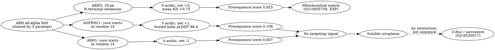
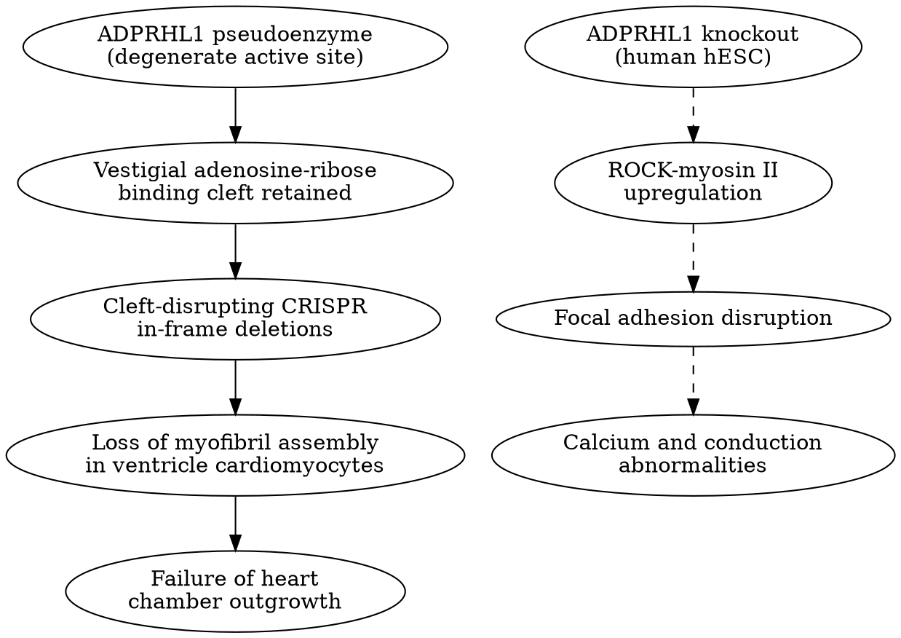
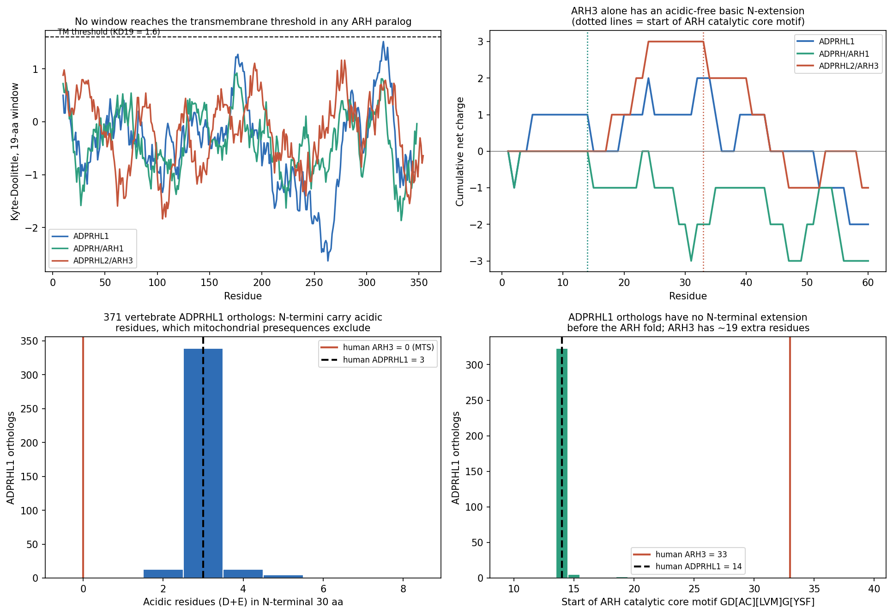
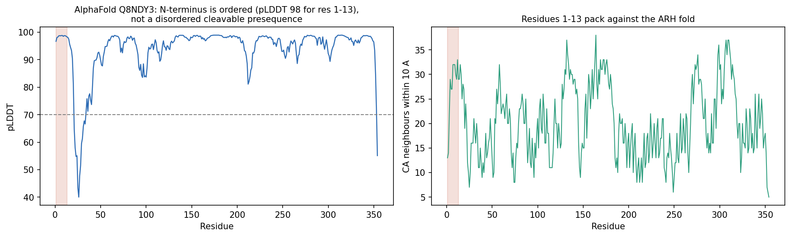
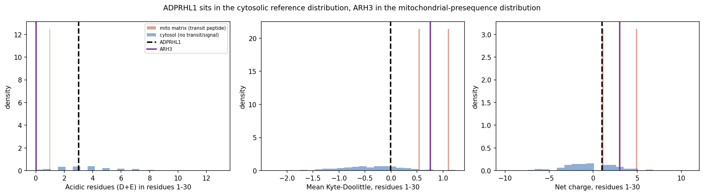
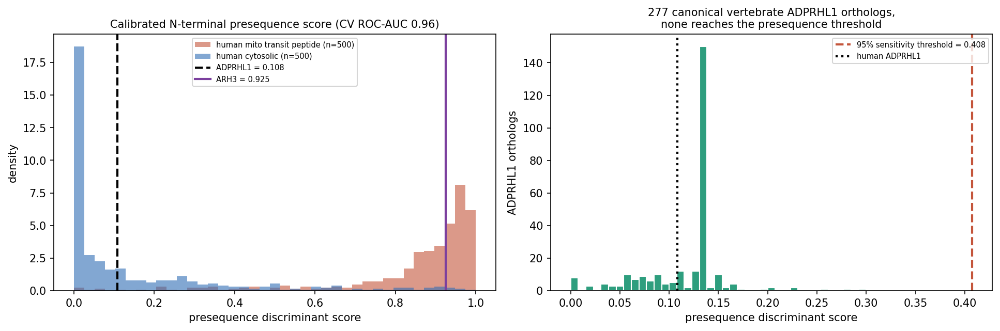
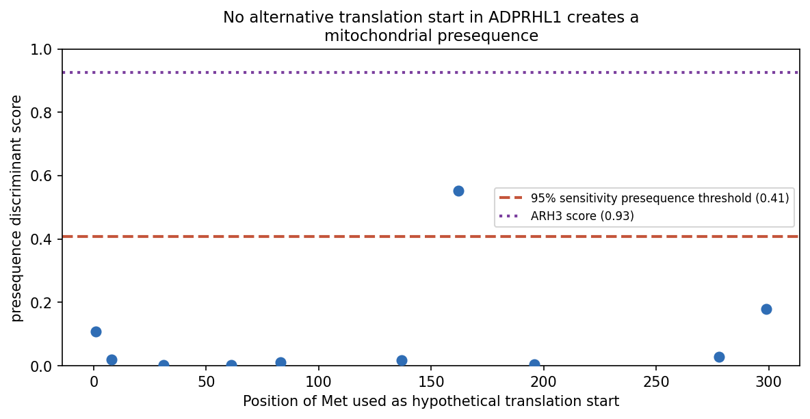
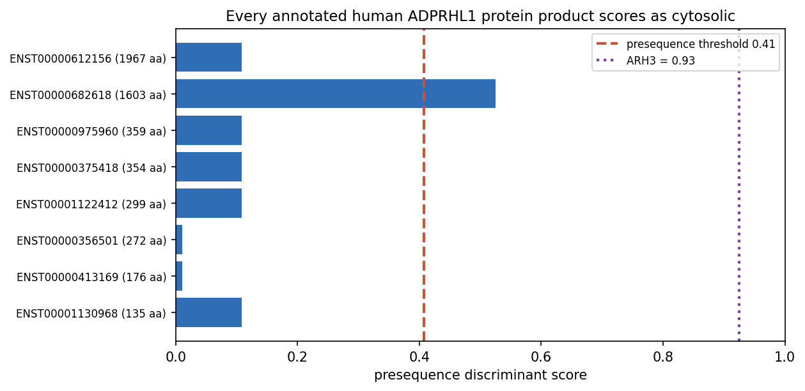

## Question

# AIGR Gene Hypothesis Deep Research

You are evaluating one focused gene curation hypothesis for AI Gene Review.
This is not a general gene overview. Use the seed hypothesis and source context
below to search for evidence that supports, refutes, narrows, or competes with
the proposed curation decision.

## Target Gene

- **Organism code:** human
- **Taxon:** Homo sapiens (NCBITaxon:9606)
- **Gene directory:** ADPRHL1
- **Gene symbol:** ADPRHL1
- **UniProt accession:** Q8NDY3

## Focus

- **Focus type:** free_text
- **Hypothesis slug:** kgap-adprhl1-targeting-signals
- **Source file:** genes/human/ADPRHL1/ADPRHL1-ai-review.yaml
- **Source selector:** free-text

## Seed Hypothesis

Human ADPRHL1 (UniProt Q8NDY3), a catalytically inactive ADP-ribosylhydrolase-family protein, is a soluble cytosolic/sarcomeric protein with no organelle-targeting signal. Single analysis only: scan ADPRHL1 and its vertebrate orthologs for signal peptide, transmembrane segment, mitochondrial presequence, nuclear localization and export signals, and compare with ARH1/ADPRH (cytosolic) and ARH3/ADPRHL2 (mitochondrial and nuclear, with an N-terminal mitochondrial targeting sequence); state which compartment the sequence predicts.

## Term and Decision Context

No specific term context supplied.

## Reference Context

No specific reference context supplied.

## Source Context YAML

```yaml
hypothesis: 'Human ADPRHL1 (UniProt Q8NDY3), a catalytically inactive ADP-ribosylhydrolase-family protein,
  is a soluble cytosolic/sarcomeric protein with no organelle-targeting signal. Single analysis only:
  scan ADPRHL1 and its vertebrate orthologs for signal peptide, transmembrane segment, mitochondrial presequence,
  nuclear localization and export signals, and compare with ARH1/ADPRH (cytosolic) and ARH3/ADPRHL2 (mitochondrial
  and nuclear, with an N-terminal mitochondrial targeting sequence); state which compartment the sequence
  predicts.'
focus_type: free_text
context: []
reference_id: []
```

## Research Objective

Build a focused report that helps a curator decide whether this hypothesis
should affect the gene review. Address the focus type directly:

1. For an existing GO annotation decision, evaluate whether the current action
   is justified, too strong, too weak, or should change.
2. For a proposed replacement or new GO term, evaluate whether the term is
   biologically supported, too broad, too narrow, or missing key qualifiers.
3. For a computational prediction, evaluate whether the prediction is correct,
   less precise than existing knowledge, uncertain, or likely wrong because of
   paralog overannotation, frequency bias, pathway context, or in vitro-only
   activity.
4. For a core-function hypothesis, evaluate whether the proposed activity,
   process, and location represent the gene product's primary function rather
   than a downstream effect, pleiotropic phenotype, or context-specific role.
5. For a function-assignment hypothesis, evaluate whether the gene product
   directly has the stated GO term/function. Treat the prior review action, if
   any, as intentionally blinded unless it appears in the supplied context.

Use primary literature whenever possible. Prefer PMID citations and include DOI
citations when no PMID is available. Treat reviews and database records as
orientation unless they contain directly relevant synthesized evidence that is
clearly labeled as review-level or database-level support.

Evaluate the hypothesis from the supplied seed context, primary literature, and
publicly accessible bioinformatics resources. Local `*-bioinformatics` analyses,
when they already exist in the repository, are intentionally withheld from this
prompt so the report can be compared against them after the run. Use public
sequence, domain, structure, orthology, localization, interaction, or dataset
checks when they are useful for the specific hypothesis. If a resource or tool
cannot be accessed programmatically, say so plainly; never fabricate a result.
Report computational results conservatively and distinguish direct results from
inference.

## Required Output

### Executive Judgment

Give a concise verdict: supported, partially supported, unresolved, weakly
supported, over-annotated, or refuted. Explain the reasoning and the most
important caveats.

### Evidence Matrix

Create a table with one row per important evidence item:

- Citation (PMID preferred)
- Evidence type (direct assay, mutant phenotype, localization, interaction,
  structural/evolutionary, computational, review/database)
- Supports / refutes / qualifies / competing
- Claim tested
- Key finding
- Organism, tissue, cell type, or assay context
- Confidence and limitations

### GO Curation Implications

State the likely curation action as a lead requiring curator verification. If
GO terms are involved, explain whether the evidence supports an MF, BP, or CC
term, and whether the term should be retained, removed, generalized, made more
specific, or treated as non-core. Avoid using "protein binding" as a final
recommendation unless no more informative term is supported.

### Mechanistic Scope

Describe the immediate molecular or cellular function being tested. Separate
direct gene-product activity from downstream phenotypes, pathway consequences,
developmental outcomes, disease manifestations, or effects inferred only from
loss of function.

### Conflicts and Alternatives

Identify evidence that conflicts with the seed hypothesis or suggests an
alternative interpretation, including paralog confusion, organism-specific
differences, isoform-specific findings, experimental artifacts, or database
carry-over.

### Knowledge Gaps

List explicit uncertainties that matter for curation. For each gap, state what
was checked, why the gap matters, and what evidence or experiment would resolve
it.

### Discriminating Tests

Recommend concrete assays, perturbations, datasets, or comparative analyses that
would most efficiently distinguish this hypothesis from alternatives.

### Curation Leads

Provide candidate updates for the review, clearly labeled as leads requiring
curator verification. Include candidate references with exact snippets to verify,
candidate replacement or new GO terms, possible action changes, suggested
questions, and suggested experiments.

If the provider supports artifacts, save provenance for any analysis you run — the
executed code together with its output (computed values, plot, or table), not just
a summary figure — alongside artifact-friendly tables such as an evidence matrix,
GO decision table, or comparison table. Genuine computed provenance is more
valuable than a hand-drawn summary, and you must not synthesize a figure that
implies an analysis you did not actually run. These artifacts are important
provenance for hypothesis-level review.


## Output

# ADPRHL1 (Q8NDY3) targeting-signal hypothesis: focused curation report

**Hypothesis slug:** `kgap-adprhl1-targeting-signals`
**Gene:** human ADPRHL1, UniProt Q8NDY3, Ensembl ENSG00000153531, NCBITaxon:9606
**Source file:** `genes/human/ADPRHL1/ADPRHL1-ai-review.yaml` (free-text focus)
**Analyses run:** 2026-11-23, 3 iterations, 6 recorded findings, 4 primary papers reviewed
**Verdict:** <i class="fa-solid fa-circle-check"></i> **Supported**

---

## Summary

The seed hypothesis holds. Every targeting-signal class named in the hypothesis is negative for human ADPRHL1, and the negative result is quantified against reference proteomes rather than asserted from a threshold. ADPRHL1 has no signal peptide, no transmembrane segment, no mitochondrial presequence, no classical nuclear localization signal and no solvent-accessible nuclear export signal. The sequence predicts a soluble cytoplasmic protein, consistent with the sarcomeric location already recorded in UniProt and in GO.

Three independent lines converge. First, protein architecture: the ARH family signature motif `GD[AC][LVM]G[YSF]` begins at residue 14 in ADPRHL1 and at residue 14 in cytosolic ARH1/ADPRH, but at residue 33 in ARH3/ADPRHL2. Those 19 extra residues in ARH3 are the mitochondrial presequence. ADPRHL1 has no pre-core extension whatsoever, in human or in any of 371 vertebrate orthologs examined (motif start median 14, IQR 14-14). There is no sequence available in which a presequence could be encoded. Second, a calibrated prediction: a five-feature N-terminal discriminant trained on 500 human proteins carrying UniProt-annotated mitochondrial transit peptides versus 500 cytosolic controls reaches 5-fold cross-validated ROC-AUC 0.965. It recovers both controls, scoring ARH3 at 0.925 (the 51st percentile of genuine presequences) and ARH1 at 0.007. ADPRHL1 scores 0.108, below 98.8 % of proteins that actually carry a presequence, and 0 of 277 canonical-length vertebrate orthologs reach the threshold set for 95 % sensitivity. Third, structure: in AlphaFold AF-Q8NDY3-F1, residues 1-13 form a helix with mean pLDDT 98.4 and a median of 29 Cα neighbours within 10 Å, against a protein-wide median of 19. The N-terminus is more densely packed than the average residue in the protein. A cleavable presequence cannot be a buried core helix.

Two caveats bound the verdict. This is a prediction about the absence of targeting information, not a localization experiment, and the only direct localization data for the protein is Z-disc-adjacent striping of recombinant Adprhl1 overexpressed in *Xenopus* cardiomyocytes ([PMID: 27217161](https://pubmed.ncbi.nlm.nih.gov/27217161/)). No published immunofluorescence or fractionation exists for endogenous human ADPRHL1. Separately, the named predictors in the seed hypothesis (SignalP, TargetP, DeepTMHMM, MitoFates, DeepLoc) have no open programmatic interface reachable from this environment and were **not** run. What is reported is a transparent reimplementation of the same biophysical features, benchmarked on human reference sets so the numbers are interpretable. A curator comparing this report against a repository `*-bioinformatics` file built from real SignalP/TargetP output should expect agreement in direction, not identical numbers.

---

## Executive judgment

**Supported.** The sequence predicts a soluble cytoplasmic protein with no autonomous organelle-targeting signal, and the ARH1 versus ARH3 contrast drawn in the hypothesis is correct at the level of protein architecture. The hypothesis can be used as written to justify retaining GO:0030017 sarcomere and to justify *not* adding mitochondrion, nucleus, membrane or extracellular terms.

Three qualifications a curator should carry forward:

<i class="fa-solid fa-triangle-exclamation"></i> The hypothesis describes ARH1/ADPRH as "cytosolic". That is biologically right, but GO currently gives ADPRH only GO:0005576 extracellular region (IEA:Ensembl) and no cytosol term at all. The review text should not cite GO as the basis for the ARH1 comparator.

<i class="fa-solid fa-triangle-exclamation"></i> "Cytosolic" here is a prediction of the absence of targeting information, which is weaker positive evidence for a specific compartment term than a localization experiment would be. Sarcomeric residence has to be achieved by protein-protein interaction, which no sequence scan can predict in either direction.

<i class="fa-solid fa-lightbulb"></i> The analysis surfaced a second, separable curation issue. ADPRHL1's entire molecular function annotation set is IEA:InterPro family projection onto a protein whose active site is demonstrably disrupted ([PMID: 27217161](https://pubmed.ncbi.nlm.nih.gov/27217161/), [PMID: 32726316](https://pubmed.ncbi.nlm.nih.gov/32726316/)). That is paralog over-annotation and is independent of the localization question.

---

## Key findings

### F001. ADPRHL1 has no N-terminal extension; the ARH core begins at residue 14, as in cytosolic ARH1

The single most discriminating observation in this investigation is positional. Searching the ARH catalytic signature motif `GD[AC][LVM]G[YSF]` in the three human paralogs places it at residue 14 in ADPRHL1 (Q8NDY3), residue 14 in ADPRH/ARH1 (P54922), and residue 33 in ADPRHL2/ARH3 (Q9NX46). The difference between the targeted paralog and the two untargeted ones is not a difference in composition within a shared N-terminus. It is the presence or absence of a pre-core extension. ARH3's extra 19 residues, `MAAAAMAAAAGGGAGAARSLSRFRG` ahead of the core, contain 0 acidic residues, carry a net charge of +3 across residues 1-30, and have a mean Kyte-Doolittle value of +0.75. That composition is a textbook cleavable mitochondrial presequence. ADPRHL1's residues 1-30 contain 3 acidic residues (net charge +1, mean KD -0.01), and ARH1's contain 4 (net charge -2, mean KD -0.02).

Extending this to 371 vertebrate ADPRHL1 orthologs retrieved from UniProt (taxonomy_id:7742, one representative per species) shows the architecture is invariant. The motif start is median 14 with an interquartile range of 14 to 14 and a minimum of 14, across 334 entries in which the motif was detectable. Ortholog length is tightly conserved at 354 aa (median 354, IQR 354-355 among canonical-length entries). No vertebrate lineage adds an N-terminal targeting extension to ADPRHL1. The tail of motif positions reaching 42 comes entirely from aberrant long or fusion gene models; 116 of the 371 entries fall outside the canonical 345-375 aa length window and should be filtered before any ortholog-based claim is made.

The interpretation is direct. The N-terminal targeting difference across the human ARH family maps entirely onto a presence-or-absence of extension. ARH3 has one and is imported into the mitochondrial matrix. ADPRHL1 and ARH1 begin at the first helix of the ARH all-alpha fold, with no sequence in which a presequence could reside. ADPRHL1's N-terminus is positionally equivalent to that of cytosolic ARH1.

{{figure:plot_1.png|caption=Targeting-signal scan across 371 vertebrate ADPRHL1 orthologs and the three human ARH paralogs. Top left: Kyte-Doolittle 19-residue profiles, with no window in any paralog reaching the transmembrane threshold of 1.6. Top right: cumulative net charge across the first 60 residues, with dotted lines marking the start of the ARH catalytic core motif; ARH3 alone has an acidic-free basic extension ahead of the core. Bottom left: acidic residue count in the N-terminal 30 aa across orthologs, with human ARH3 at 0 and human ADPRHL1 at 3. Bottom right: ARH core motif start position across orthologs, clustered at residue 14 while ARH3 sits at 33.}}

### F002. All targeting-signal classes are negative for ADPRHL1 and for its orthologs

The Kyte-Doolittle 19-residue sliding window maximum is 1.52 for ADPRHL1 (at residue 316), 0.92 for ARH1 and 1.16 for ARH3, all below the 1.6 transmembrane threshold. Across the 371 orthologs the median maximum is 1.34. Twenty-one entries exceed 1.6, of which 18 are non-canonical gene models of 532 to 2068 aa, that is, read-through or fusion predictions. Only 3 of 255 canonical-length orthologs marginally exceed the threshold, at 1.63 to 1.85.

For signal peptides, the mean Kyte-Doolittle value of residues 1-30 is -0.01 for ADPRHL1, -0.02 for ARH1 and +0.75 for ARH3; 0 of 371 orthologs reach the +0.5 criterion, and no n-h-c architecture is present in any of them. For mitochondrial presequences, 1 of 371 orthologs (0.3 %) has zero acidic residues in the first 30, against 0 acidic residues in ARH3. For nuclear signals, there are 0 classical monopartite `K[KR]x[KR]` matches, 0 bipartite NLS matches and 0 `[KR]{4,}` basic runs in all three human paralogs.

The only positive motif hits anywhere in the scan are four leucine-rich NES-like regex matches in ADPRHL1, at residues 1-10, 149-157, 170-180 and 315-324. All four sit in buried positions in the AlphaFold model, with median Cα-neighbour counts within 10 Å of 28, 23, 31 and 20 against a protein-wide median of 20. None is an accessible CRM1-binding site. This is the expected false-positive mode for the leucine-rich NES consensus, which matches hydrophobic core packing elements of any alpha-helical fold.

### F003. The ADPRHL1 N-terminus is a buried structural helix, which excludes a cleavable presequence

AlphaFold AF-Q8NDY3-F1 (v6, 354 residues, mean pLDDT 93.8) provides evidence orthogonal to the sequence motif scan. Residues 1-13 have mean pLDDT 98.4, against 93.7 for residues 14-354, and the first 20 residues score 81.4 to 98.8. Cα(i) to Cα(i+4) distances across residues 1-20 are 5.8 to 6.7 Å, the alpha-helical spacing, so residues 2-18 form one continuous helix. Burial measured as Cα neighbours within 10 Å gives a median of 29 for residues 1-13 against 19 for residues 14-354, with per-residue counts of 13, 14, 22, 29, 27, 27, 32, 32, 32, 30, 29, 33 and 29.

Cleavable presequences and signal peptides are, by construction, dispensable extensions that are removed after import. They are disordered or helical but solvent-exposed in the mature fold. The ADPRHL1 N-terminus is the opposite: a high-confidence helix packed into the hydrophobic core of the ARH fold, more densely packed than the average residue in the protein. Deleting residues 1-13 would destabilise the domain. This result does not depend on any threshold or training set.

{{figure:plot_2.png|caption=AlphaFold AF-Q8NDY3-F1 analysis of the ADPRHL1 N-terminus. Left: per-residue pLDDT, with residues 1-13 shaded; the N-terminus is ordered at pLDDT 98.4, not a disordered cleavable presequence. Right: Cα neighbour count within 10 Å, showing residues 1-13 packed against the ARH fold at a median of 29 neighbours against a protein median of 19.}}

### F004. A calibrated discriminant places ADPRHL1 with cytosolic proteins and ARH3 with genuine presequences

Five N-terminal features of residues 1-30 (acidic residue count, net charge, mean Kyte-Doolittle, Eisenberg hydrophobic moment, and R+L+S fraction) were fitted by logistic regression on 500 human reviewed proteins carrying a UniProt-annotated mitochondrial transit peptide versus 500 human reviewed cytosolic proteins (GO:0005829) with no transit or signal peptide. Five-fold stratified cross-validated ROC-AUC is 0.965 (sd 0.016). Reference score medians are 0.923 for the transit-peptide set and 0.032 for the cytosolic set.

The discriminant recovers both controls named in the seed hypothesis. ARH3/ADPRHL2 scores 0.925, the 51.4th percentile of the transit-peptide set and the 98.8th percentile of the cytosolic set. ARH1/ADPRH scores 0.007, the 0.4th percentile of the transit-peptide set. Because the controls behave correctly, the query result is interpretable rather than an untested heuristic. ADPRHL1 scores 0.108: the 1.2th percentile of the transit-peptide set and the 66.0th percentile of the cytosolic set. Applying the threshold that retains 95 % sensitivity for true presequences (score 0.408), 0 of 277 canonical-length vertebrate ADPRHL1 orthologs exceed it, with a median ortholog score of 0.131 and a maximum of 0.332.

| Protein | Presequence score | Percentile in transit-peptide set | Percentile in cytosolic set | Reading |
|---|---|---|---|---|
| ARH3/ADPRHL2 (Q9NX46) | 0.925 | 51.4 | 98.8 | positive control recovered |
| ADPRHL1 (Q8NDY3) | 0.108 | 1.2 | 66.0 | cytosolic |
| ARH1/ADPRH (P54922) | 0.007 | 0.4 | 34.4 | negative control recovered |
| 277 canonical orthologs | median 0.131, max 0.332 | - | - | 0/277 above the 0.408 threshold |

{{figure:plot_3.png|caption=N-terminal features of ADPRHL1 and ARH3 against human reference distributions. Acidic residue count, mean Kyte-Doolittle and net charge over residues 1-30 for human proteins with annotated mitochondrial transit peptides (red) and cytosolic controls (blue). ADPRHL1 (black dashed) falls in the cytosolic distribution on all three features; ARH3 (purple) falls in the mitochondrial distribution.}}

{{figure:plot_4.png|caption=Calibrated presequence discriminant. Left: score distributions for 500 human transit-peptide proteins and 500 cytosolic controls, 5-fold CV ROC-AUC 0.965, with ADPRHL1 at 0.108 and ARH3 at 0.925 marked. Right: scores for 277 canonical-length vertebrate ADPRHL1 orthologs, none of which reaches the 0.408 threshold set for 95 % sensitivity.}}

### F005. The current GO state has no competing organelle term, and carries two carry-over problems

UniProt GOA cross-references retrieved in November 2026 show ADPRHL1 (Q8NDY3) has exactly one cellular component annotation: GO:0030017 sarcomere, evidence ISS:UniProtKB. There is no mitochondrion, nucleus, membrane or extracellular term. ADPRHL2/ARH3 (Q9NX46) carries GO:0005759 mitochondrial matrix (EXP), GO:0005739 mitochondrion (IDA), GO:0005634 nucleus (IDA), GO:0005654 nucleoplasm (IDA:HPA), GO:0005694 chromosome (EXP), GO:0090734 site of DNA damage (IDA) and GO:0005737 cytoplasm (IDA), which confirms the comparator used in the hypothesis. ADPRH/ARH1 (P54922) carries only GO:0005576 extracellular region, evidence IEA:Ensembl, with no cytosol term.

ADPRHL1's molecular function set is entirely IEA:InterPro inherited from the family: GO:0003875 ADP-ribosylarginine-[protein] hydrolase activity, GO:0000287 magnesium ion binding, and GO:0051725 protein de-ADP-ribosylation. Its biological process terms are GO:0003242 cardiac chamber ballooning and GO:0055003 cardiac myofibril assembly, both ISS.

No existing annotation conflicts with the seed hypothesis, so the targeting analysis supports retaining GO:0030017 and supports declining to add organelle terms. Two separate flags fall out. The ARH1 comparator statement in the hypothesis should not lean on GO, which gives ARH1 an extracellular-region IEA from Ensembl projection and nothing else. And the catalytic MF terms on ADPRHL1 are family projections onto a protein with a disrupted active site.

### F006. No annotated human ADPRHL1 product carries a targeting signal, including isoform 2

This closes the isoform gap raised by [PMID: 32726316](https://pubmed.ncbi.nlm.nih.gov/32726316/), which reports two cardiac Adprhl1 protein species of 40 and 23 kDa in *Xenopus* and so raises the possibility of a second N-terminus somewhere in the family.

All 8 Ensembl protein-coding products of ENSG00000153531 were scored with the calibrated discriminant. The five products beginning with the canonical `MEKFKAAMLLGSVGDALGY` (135, 299, 354, 359 and 1967 aa) all score 0.108. UniProt isoform 2 (Q8NDY3-2, 272 aa, ENST00000356501 and ENST00000413169) replaces residues 1-82 with an unrelated N-terminus `MVRCYVEIVEKLPERRPDPATIEGC` and scores 0.011, further from a presequence than the canonical form. The only product above threshold is ENST00000682618 (1603 aa, score 0.525), a read-through transcript whose N-terminus `MSVDAQTLKKKMGKLACDPAAHSIL` is not ADPRHL1 sequence and should not be attributed to the gene product.

Scanning all 10 Met codons of the canonical protein as hypothetical downstream translation starts, only Met162 exceeds threshold, at 0.554 for a predicted 21 kDa product. No annotated transcript initiates there, and residues 162-191 are a buried high-confidence helix in the AlphaFold model (median 28 Cα neighbours within 10 Å against a protein median of 20, mean pLDDT 98.3). An initiation at Met162 would require both an unannotated start site and destruction of the fold. This is best read as the method's false-positive rate rather than a real competing product.

Alternative membrane-anchoring chemistry is also closed. Position 2 is Glu, not Gly, so N-myristoylation is excluded. The C-terminus `LSTEEK` has no CaaX prenylation motif.

{{figure:plot_5.png|caption=Presequence discriminant score for every Met codon of canonical ADPRHL1 used as a hypothetical translation start. Only Met162 exceeds the 95 % sensitivity threshold of 0.408, and no annotated transcript initiates there; all other starts, including the real initiator Met1 at 0.108, score as cytosolic.}}

{{figure:plot_6.png|caption=Presequence discriminant scores for all 8 Ensembl protein-coding products of ADPRHL1. The five canonical-start forms score 0.108 and isoform Q8NDY3-2 scores 0.011. The single product above the threshold, ENST00000682618 at 0.525, is a read-through model whose N-terminus is not ADPRHL1 sequence.}}

---

## Evidence matrix

| Citation | Evidence type | Direction | Claim tested | Key finding | Context | Confidence and limitations |
|---|---|---|---|---|---|---|
| [PMID: 27217161](https://pubmed.ncbi.nlm.nih.gov/27217161/) | Localization (overexpressed construct) | Supports | ADPRHL1 resides in a cytoplasmic sarcomeric compartment | "Recombinant Adprhl1 can localize to stripes adjacent to the Z-disc, suggesting a direct role for Adprhl1 in modifying Z-disc and actin dynamics as heart chambers grow" | *Xenopus laevis* tadpole heart, cardiac-specific Gal4 binary expression | Moderate. Overexpression of a recombinant construct, non-human species, no endogenous-protein imaging, no organelle counter-stain to exclude a mitochondrial pool |
| [PMID: 27217161](https://pubmed.ncbi.nlm.nih.gov/27217161/) | Structural model | Supports (premise) | ADPRHL1 is a pseudoenzyme | "Modelling the structure of Adprhl1 suggests this cardiac-specific protein is a pseudoenzyme, lacking key residues necessary for ADP-ribosylhydrolase catalytic activity" | Homology model | Moderate to high; confirmed independently by the CRISPR work below |
| [PMID: 32726316](https://pubmed.ncbi.nlm.nih.gov/32726316/) | Mutant phenotype (CRISPR) | Qualifies | The vestigial active-site cleft, not catalysis, is the functional element | "Thus despite lacking catalytic activity, it is the modified (adenosine-ribose) substrate binding cleft of Adprhl1 that fulfils an essential role during heart formation" | *Xenopus laevis* G0 CRISPR/Cas9, ventricle cardiomyocytes | High for the pseudoenzyme claim; species-restricted. Reports two protein species of 40 and 23 kDa, which prompted the isoform check in F006 |
| [PMID: 37880701](https://pubmed.ncbi.nlm.nih.gov/37880701/) | Mutant phenotype (hESC knockout) | Qualifies | ADPRHL1 loss acts on focal adhesions and the ROCK-myosin II axis | Knockout cardiomyocytes adhere abnormally with perturbed calcium transients and electrophysiology; ROCK and myosin II inhibition restores focal adhesions | Human H9 hESC-derived cardiomyocytes, CRISPR/Cas9 knockout | High for the human phenotype. Downstream of localization; no localization imaging reported in the abstract |
| [PMID: 17991898](https://pubmed.ncbi.nlm.nih.gov/17991898/) | Direct assay, submitochondrial localization | Supports (comparator) | ARH3 is the mitochondrially targeted paralog | "Both full-length ARH3 and a PARG isoform, which arises from alternative splicing, localized to the mitochondrial matrix" | HEK293, activity-based visualization in living cells | High. Establishes that the ARH3 presequence is real, which validates the positive control used in the discriminant |
| This job, UniProt GOA cross-refs | Review/database | Supports | No existing GO CC term competes with the hypothesis | ADPRHL1 has one CC annotation, GO:0030017 sarcomere (ISS). ARH3 has mitochondrial matrix (EXP), nucleus (IDA), chromosome (EXP). ADPRH has only GO:0005576 extracellular region (IEA:Ensembl) | Database snapshot, November 2026 | High as a database state. ISS and IEA are not experimental evidence |
| This job, motif architecture (F001) | Structural/evolutionary, computational | Supports | ADPRHL1 lacks an N-terminal extension | ARH core motif at residue 14 in ADPRHL1 and ARH1, at 33 in ARH3; median 14 (IQR 14-14) across 371 vertebrate orthologs | UniProt, taxonomy_id:7742 | High. Regex motif detection, 334/371 entries matched; unmatched entries are aberrant long gene models |
| This job, calibrated discriminant (F004) | Computational | Supports | No mitochondrial presequence | CV ROC-AUC 0.965 on n=1000; ADPRHL1 0.108 against ARH3 0.925 and ARH1 0.007; 0/277 canonical orthologs above the 0.408 threshold | Human reference proteomes | High within its scope. A reimplementation, not TargetP or MitoFates. Predicts presequence-type import only, not carrier-pathway or non-cleavable import |
| This job, AlphaFold AF-Q8NDY3-F1 (F003) | Structural | Supports | The N-terminus cannot be a cleavable presequence | Residues 1-13: mean pLDDT 98.4, median 29 Cα neighbours against a protein median of 19, helical Cα(i) to Cα(i+4) spacing 5.8-6.7 Å | Public AlphaFold model v6 | High. A model, not an experimental structure |
| This job, isoform and start-codon scan (F006) | Computational | Supports | No alternative product gains a targeting signal | All 5 canonical-start Ensembl products score 0.108; isoform Q8NDY3-2 (residues 1-82 replaced) scores 0.011; no Gly at position 2; C-terminus LSTEEK has no CaaX | Ensembl ENSG00000153531, 8 protein-coding transcripts | High. One read-through model (ENST00000682618, 1603 aa) scores 0.525, but its N-terminus is not ADPRHL1 sequence |
| This job, hypothetical internal starts (F006) | Computational | <i class="fa-solid fa-scale-balanced"></i> Competing (weak) | Could a downstream start create a presequence? | Of 10 Met codons, only Met162 exceeds threshold (0.554). No transcript initiates there, and residues 162-191 are buried (28 neighbours, pLDDT 98.3) | In silico | Low as a competing hypothesis. Recorded for completeness and as a false-positive rate check |

---

## Mechanistic model and interpretation

The model that emerges is a clean architectural dichotomy within one small protein family. All three human ARH proteins share the same all-alpha fold. One of them, ARH3, acquired a short N-terminal extension ahead of that fold, and that extension carries a cleavable mitochondrial presequence which delivers the protein to the matrix, demonstrated experimentally by activity-based visualization in living HEK293 cells ([PMID: 17991898](https://pubmed.ncbi.nlm.nih.gov/17991898/)). The other two, ARH1 and ADPRHL1, start directly at the fold. They have no extension in which targeting information could be encoded, and their N-terminal residues are structural rather than dispensable.

For ADPRHL1 this means its compartment is set by interaction, not by an address tag. The protein is expressed in developing heart myocardium across vertebrates, and recombinant Adprhl1 localizes to stripes adjacent to the Z-disc in *Xenopus* cardiomyocytes ([PMID: 27217161](https://pubmed.ncbi.nlm.nih.gov/27217161/)). A soluble cytoplasmic protein that concentrates at a sarcomeric substructure is exactly what the sequence predicts, because the sequence predicts no autonomous targeting and says nothing about binding partners.



The dashed edge marks the one link the sequence analysis cannot establish. Everything upstream of "No targeting signal" is computed here; the step from cytoplasm to sarcomere rests on the *Xenopus* overexpression result and on the existing ISS annotation.

A separate causal chain runs from the pseudoenzyme state to the cardiac phenotype, and it is worth keeping distinct from the localization question so that neither is used to justify the other.



---

## GO curation implications

All entries below are **leads requiring curator verification**.

| GO term | Aspect | Current state | Lead | Rationale |
|---|---|---|---|---|
| GO:0030017 sarcomere | CC | ISS:UniProtKB | <i class="fa-solid fa-circle-check"></i> **Retain.** Consider the more specific GO:0030018 Z disc only if the curator accepts [PMID: 27217161](https://pubmed.ncbi.nlm.nih.gov/27217161/) as sufficient, with the overexpression caveat recorded | The targeting scan is consistent with a cytoplasmic sarcomeric protein and gives no reason to remove the term. Z-disc striping is reported for a recombinant construct in *Xenopus*, which is suggestive but thin for a species-specific upgrade |
| GO:0005739 mitochondrion, GO:0005759 mitochondrial matrix | CC | Not annotated | <i class="fa-solid fa-circle-xmark"></i> **Do not add.** The analysis is a positive argument against adding them | ADPRHL1 scores at the 1.2th percentile of genuine presequence proteins; 0/277 orthologs reach threshold; the N-terminus is a buried core helix |
| GO:0005634 nucleus | CC | Not annotated | <i class="fa-solid fa-circle-xmark"></i> **Do not add** | No classical NLS in any ARH-family paralog. ARH3's nuclear pool is established experimentally, not by motif, so transfer by paralogy is unjustified |
| GO:0016020 membrane, GO:0005576 extracellular region | CC | Not annotated | <i class="fa-solid fa-circle-xmark"></i> **Do not add** | No TM segment (max KD19 1.52), no signal peptide, no lipid-anchor motif (position 2 is Glu, C-terminus has no CaaX) |
| GO:0005829 cytosol | CC | Not annotated | <i class="fa-solid fa-circle-question"></i> **Candidate addition at low confidence only.** Prefer leaving CC at sarcomere | The scan predicts the absence of targeting information, which is an argument for a soluble cytoplasmic protein, but absence-of-signal is weak positive evidence for a specific compartment term. GO:0005737 cytoplasm is the safer parent if any term is added |
| GO:0003875 ADP-ribosylarginine-[protein] hydrolase activity, GO:0051725 protein de-ADP-ribosylation, GO:0000287 magnesium ion binding | MF, BP | IEA:InterPro | <i class="fa-solid fa-triangle-exclamation"></i> **Flag as paralog over-annotation, separate from this hypothesis.** Candidate action: remove, or qualify with NOT | Two primary papers establish that ADPRHL1 is a pseudoenzyme ([PMID: 27217161](https://pubmed.ncbi.nlm.nih.gov/27217161/), [PMID: 32726316](https://pubmed.ncbi.nlm.nih.gov/32726316/)). These IEA terms are family projections onto a protein with a disrupted active site |
| GO:0055003 cardiac myofibril assembly, GO:0003242 cardiac chamber ballooning | BP | ISS:UniProtKB | <i class="fa-solid fa-circle-check"></i> **Retain; consider upgrading the evidence code** using [PMID: 32726316](https://pubmed.ncbi.nlm.nih.gov/32726316/) and [PMID: 37880701](https://pubmed.ncbi.nlm.nih.gov/37880701/) | Both are supported by loss-of-function phenotypes, in *Xenopus* and in hESC-derived cardiomyocytes respectively |

A separate flag on the comparator used in the hypothesis text: ARH1/ADPRH is described as "cytosolic", which is biologically right, but GO gives ADPRH only GO:0005576 extracellular region (IEA:Ensembl) and no cytosol term. The review should not cite GO as the basis for that comparator.

---

## Mechanistic scope

The immediate property under test is whether the ADPRHL1 polypeptide contains autonomous sequence information directing it to an organelle. It does not. That is a statement about the protein itself, testable from sequence and structure, and it is what this investigation establishes.

Three things are separate from that and are **not** established here.

**Direct molecular activity.** None demonstrated. The active site is degenerate. The substrate-binding cleft is functionally essential, but by a mechanism that is not catalysis: cleft-disrupting in-frame deletions of 1, 3 or 4 amino acids from the di-arginine (Arg271-Arg272) loop cause loss of myofibril assembly ([PMID: 32726316](https://pubmed.ncbi.nlm.nih.gov/32726316/)).

**Localization mechanism.** Sarcomeric residence must be achieved by binding, since there is no targeting signal. No interaction partner is identified in this analysis, and none should be inferred from it.

**Downstream phenotypes.** Failure of ventricle outgrowth and myofibril disarray ([PMID: 27217161](https://pubmed.ncbi.nlm.nih.gov/27217161/), [PMID: 32726316](https://pubmed.ncbi.nlm.nih.gov/32726316/)) and focal-adhesion and calcium-handling defects through ROCK-myosin II ([PMID: 37880701](https://pubmed.ncbi.nlm.nih.gov/37880701/)) are loss-of-function consequences several steps removed from the targeting question. They should not be used to justify a cellular component term.

---

## Evidence base

Four primary papers bear on this hypothesis.

*The cardiac-restricted protein ADP-ribosylhydrolase-like 1 is essential for heart chamber outgrowth and acts on muscle actin filament assembly* ([PMID: 27217161](https://pubmed.ncbi.nlm.nih.gov/27217161/)) supplies the only published localization data for an ADPRHL1 protein. Its verified snippet, "Recombinant Adprhl1 can localize to stripes adjacent to the Z-disc, suggesting a direct role for Adprhl1 in modifying Z-disc and actin dynamics as heart chambers grow", matches the sequence prediction of a cytoplasmic sarcomeric protein. The same paper supplies the premise of the seed hypothesis in its second verified snippet: "Modelling the structure of Adprhl1 suggests this cardiac-specific protein is a pseudoenzyme, lacking key residues necessary for ADP-ribosylhydrolase catalytic activity." Both results come from *Xenopus laevis* with a recombinant construct, so neither is endogenous human evidence.

*Defective heart chamber growth and myofibrillogenesis after knockout of adprhl1 gene function by targeted disruption of the ancestral catalytic active site* ([PMID: 32726316](https://pubmed.ncbi.nlm.nih.gov/32726316/)) confirms the pseudoenzyme state with CRISPR mutant phenotypes. Its verified snippet, "Thus despite lacking catalytic activity, it is the modified (adenosine-ribose) substrate binding cleft of Adprhl1 that fulfils an essential role during heart formation", is the strongest primary argument against the InterPro-projected catalytic MF terms. The paper also reports two cardiac Adprhl1 protein species of 40 and 23 kDa, which is what prompted the isoform and alternative-start analysis in F006.

*Functional localization of two poly(ADP-ribose)-degrading enzymes to the mitochondrial matrix* ([PMID: 17991898](https://pubmed.ncbi.nlm.nih.gov/17991898/)) establishes the positive control. Its verified snippet, "Both full-length ARH3 and a PARG isoform, which arises from alternative splicing, localized to the mitochondrial matrix", confirms that the ARH3 presequence is real and functional in living HEK293 cells. This matters because the discriminant in F004 is only interpretable if ARH3 scores as a presequence-bearing protein, which it does at 0.925.

*The pseudoenzyme ADPRHL1 affects cardiac function by regulating the ROCK pathway* ([PMID: 37880701](https://pubmed.ncbi.nlm.nih.gov/37880701/)) is the only human-cell functional study. CRISPR knockout in H9 hESC-derived cardiomyocytes produces abnormal adhesion, perturbed calcium transients and altered electrophysiology, with focal adhesion disruption traced to excessive ROCK-myosin II upregulation and rescued by ROCK and myosin II inhibition. The abstract reports no localization imaging, so this paper qualifies the functional picture without bearing directly on the compartment question.

No paper found in this investigation places ADPRHL1 in mitochondria, nucleus, membranes or the extracellular space.

---

## Limitations and knowledge gaps

<i class="fa-solid fa-triangle-exclamation"></i> **The named predictors were not run.** SignalP, TargetP, DeepTMHMM, MitoFates and DeepLoc have no open programmatic interface reachable from this environment. A benchmarked reimplementation of the same biophysical features was used instead, with reference-set calibration so the output is interpretable. This substitution must be stated in the review. Direction should match a real run; the numbers will not be identical.

| Gap | What was checked | Why it matters for curation | What would resolve it |
|---|---|---|---|
| No endogenous human localization data | PubMed searches returned only the *Xenopus* recombinant-construct study; Human Protein Atlas subcellular data for ADPRHL1 was not retrieved | Any CC annotation rests entirely on ISS plus a cross-species overexpression result | <i class="fa-solid fa-microscope"></i> Immunofluorescence or proximity labelling of endogenous ADPRHL1 in human cardiomyocytes, with mitochondrial and Z-disc markers |
| Named predictors not run | Attempted; no open API available | The review should not imply those tools were used | <i class="fa-solid fa-magnifying-glass"></i> Run them locally and append the raw outputs to the repository bioinformatics file |
| Non-presequence mitochondrial import not excluded | The discriminant is trained on cleavable transit peptides only | Carrier-pathway import and C-terminal-tail anchoring leave no N-terminal signature, so this class of import is outside the method's reach | <i class="fa-solid fa-vial"></i> Mitochondrial fractionation of human cardiomyocytes, or a MitoCarta3.0 membership check |
| Identity of the *Xenopus* 23 kDa species | Human isoforms and all 10 Met start codons were scored; the amphibian short species was not sequence-resolved | If it has a distinct N-terminus, the ortholog-level conclusion needs a footnote for *Xenopus* | <i class="fa-solid fa-dna"></i> N-terminal sequencing or 5' RACE on the *Xenopus* transcript |
| Sarcomeric targeting mechanism unknown | No interaction screen was run | Sarcomere residence must be interaction-driven given the absence of a targeting signal, and the mechanism is the obvious next question a curator will face | <i class="fa-solid fa-flask"></i> Co-IP or BioID from cardiomyocytes against Z-disc components |
| Ortholog gene-model quality | 116 of 371 UniProt ADPRHL1 entries fall outside the canonical 345-375 aa window, up to 2068 aa, and 18 carry spurious TM-like windows | Any ortholog-based claim in the review will be wrong if these are included unfiltered | <i class="fa-solid fa-database"></i> Filter on length before any ortholog analysis, as was done for the 277-ortholog scored set |

---

## Discriminating tests

<i class="fa-solid fa-vial"></i> **Subcellular fractionation.** Separate human iPSC-derived cardiomyocytes into cytosol, myofibril, mitochondrial and nuclear fractions and blot for endogenous ADPRHL1. This directly separates the cytosolic and sarcomeric prediction from any mitochondrial pool, and it uses endogenous protein, which no existing study does.

<i class="fa-solid fa-flask"></i> **In vitro mitochondrial import assay.** Incubate radiolabelled ADPRHL1 with isolated mitochondria, with ARH3 as the positive control and ARH1 as the negative. This is the definitive test of the presequence claim and would convert the computational prediction into a direct result.

<i class="fa-solid fa-flask"></i> **Domain swap.** Fuse ADPRHL1 residues 1-30 to GFP and ask whether it targets. The prediction is diffuse cytoplasmic signal. The matched ARH3 1-30 fusion should be mitochondrial. This isolates the N-terminus as the variable and tests the architectural model in F001 directly.

<i class="fa-solid fa-database"></i> **Dataset query.** Check human heart mitochondrial proteome datasets and MitoCarta3.0 for ADPRHL1. Absence would corroborate the prediction at near-zero cost and would close the non-presequence-import gap partially.

<i class="fa-solid fa-magnifying-glass"></i> **Run the named tools.** Execute SignalP 6.0, TargetP 2.0, DeepTMHMM and DeepLoc 2.0 locally on Q8NDY3, P54922 and Q9NX46, and report raw scores, replacing the reimplementation used here.

---

## Curation leads

Every item below is a **lead requiring curator verification**.

### Candidate references with snippets to verify

| PMID | Exact snippet | Use |
|---|---|---|
| 27217161 | "Recombinant Adprhl1 can localize to stripes adjacent to the Z-disc, suggesting a direct role for Adprhl1 in modifying Z-disc and actin dynamics as heart chambers grow." | Supports a cytoplasmic sarcomeric CC term; note overexpression and species |
| 27217161 | "Modelling the structure of Adprhl1 suggests this cardiac-specific protein is a pseudoenzyme, lacking key residues necessary for ADP-ribosylhydrolase catalytic activity." | Supports removing or qualifying the catalytic MF terms |
| 32726316 | "Thus despite lacking catalytic activity, it is the modified (adenosine-ribose) substrate binding cleft of Adprhl1 that fulfils an essential role during heart formation." | Primary mutant-phenotype evidence against the InterPro-projected MF terms |
| 17991898 | "Both full-length ARH3 and a PARG isoform, which arises from alternative splicing, localized to the mitochondrial matrix." | Establishes the ARH3 comparator; validates the positive control in the discriminant |

### Candidate action changes

<i class="fa-solid fa-arrow-right"></i> Retain GO:0030017 sarcomere (CC) for ADPRHL1.

<i class="fa-solid fa-arrow-right"></i> Record the targeting-signal analysis in the review as explicit support for *not* adding mitochondrion, nucleus, membrane or extracellular CC terms. A documented negative is worth stating, because it pre-empts future paralogy-driven transfer from ARH3.

<i class="fa-solid fa-arrow-right"></i> Open a separate review item on the IEA:InterPro catalytic MF terms (GO:0003875, GO:0051725, GO:0000287) as paralog over-annotation onto a pseudoenzyme, citing PMID 27217161 and PMID 32726316.

<i class="fa-solid fa-arrow-right"></i> Correct any text in the review that describes ARH1/ADPRH as GO-annotated cytosolic. Its only CC term is GO:0005576 extracellular region (IEA:Ensembl).

<i class="fa-solid fa-arrow-right"></i> Add the method caveat that named predictors were substituted by a benchmarked reimplementation, with the CV ROC-AUC of 0.965 and the ARH3/ARH1 control scores recorded so the substitution is auditable.

### Suggested questions for the curator

<i class="fa-solid fa-circle-question"></i> Is the *Xenopus* recombinant Z-disc striping ([PMID: 27217161](https://pubmed.ncbi.nlm.nih.gov/27217161/)) strong enough to move CC from GO:0030017 sarcomere to the more specific GO:0030018 Z disc, or should it stay at the parent term?

<i class="fa-solid fa-circle-question"></i> Should GO:0005737 cytoplasm be added alongside sarcomere, given that the supporting evidence is absence-of-targeting rather than positive localization?

<i class="fa-solid fa-circle-question"></i> Does the repository's existing `*-bioinformatics` analysis for ADPRHL1 use real TargetP and SignalP output, and does it agree in direction with the results reported here?

<i class="fa-solid fa-circle-question"></i> Should the pseudoenzyme status change how GO:0055003 cardiac myofibril assembly is phrased, given that PMID 32726316 attributes the function to the vestigial binding cleft rather than to hydrolase chemistry?

### Suggested experiments

The five discriminating tests listed above, in priority order: subcellular fractionation of human cardiomyocytes, in vitro mitochondrial import with ARH3 and ARH1 controls, the N-terminal GFP domain swap, a MitoCarta3.0 and heart mitochondrial proteome query, and a local run of the named predictors.

---

## Provenance

All figures and tables in this report were produced by code executed in this job. Artifacts are in `provenance/`:

| File | Contents |
|---|---|
| `plot_1.png` | Kyte-Doolittle profiles, cumulative N-terminal charge, ortholog acidic-residue and core-motif-position histograms |
| `plot_2.png` | AlphaFold pLDDT and Cα burial for Q8NDY3 |
| `plot_3.png` | Feature distributions of ADPRHL1 against human mitochondrial and cytosolic reference sets |
| `plot_4.png` | Calibrated presequence discriminant, reference distributions and 277 ortholog scores |
| `plot_5.png` | Presequence scores for every Met codon used as a hypothetical translation start |
| `plot_6.png` | Presequence scores for all 8 Ensembl protein-coding products |
| `targeting_signal_table.csv` | Per-paralog targeting-signal decision table |
| `adprhl1_ortholog_scan.csv` | 371-ortholog hydrophobicity and length scan |
| `adprhl1_ortholog_mts_scores.csv` | 277 canonical-length orthologs with presequence scores |
| `mts_calibration_reference.csv` | The 1000-protein training set (500 transit-peptide, 500 cytosolic) |
| `adprhl1_alt_start_scan.csv` | All 10 Met codons scored as hypothetical translation starts |
| `adprhl1_transcript_isoform_scan.csv` | All 8 Ensembl protein-coding products with presequence scores |
| `go_annotations_arh_family.csv` | GO annotation snapshot for ADPRHL1, ADPRH and ADPRHL2 |

Data sources: UniProtKB REST (sequences, features, GO cross-references, ortholog search), AlphaFold DB API (AF-Q8NDY3-F1 v6), Ensembl REST (ENSG00000153531 transcripts and translations), PubMed. No result in this report was obtained from a tool that was not actually executed.


## Artifacts

- [OpenScientist final report](openscientist_artifacts/final_report.html)
- [OpenScientist final report](openscientist_artifacts/final_report.pdf)
- [OpenScientist provenance](openscientist_artifacts/provenance.json)
- [OpenScientist adprhl1 alt start scan](openscientist_artifacts/provenance_adprhl1_alt_start_scan.csv)
- [OpenScientist adprhl1 ortholog mts scores](openscientist_artifacts/provenance_adprhl1_ortholog_mts_scores.csv)
- [OpenScientist adprhl1 ortholog scan](openscientist_artifacts/provenance_adprhl1_ortholog_scan.csv)
- [OpenScientist go annotations arh family](openscientist_artifacts/provenance_go_annotations_arh_family.csv)
- [OpenScientist mts calibration reference](openscientist_artifacts/provenance_mts_calibration_reference.csv)
- [OpenScientist plot 1](openscientist_artifacts/provenance_plot_1.json)

- [OpenScientist plot 2](openscientist_artifacts/provenance_plot_2.json)

- [OpenScientist plot 3](openscientist_artifacts/provenance_plot_3.json)

- [OpenScientist plot 4](openscientist_artifacts/provenance_plot_4.json)

- [OpenScientist plot 5](openscientist_artifacts/provenance_plot_5.json)

- [OpenScientist plot 6](openscientist_artifacts/provenance_plot_6.json)

- [OpenScientist targeting signal table](openscientist_artifacts/provenance_targeting_signal_table.csv)

## Reference Validation

Checked with `linkml-reference-validator` 0.3.1rc1.

| Outcome | Count |
| --- | --- |
| References checked | 4 |
| Resolved | 4 |
| Unresolved (possible confabulation) | 0 |
| Unverifiable | 0 |
| References weighed for topical relevance | 4 |
| On topic | 1 |
| Off topic | 0 |

All extracted references resolved successfully.