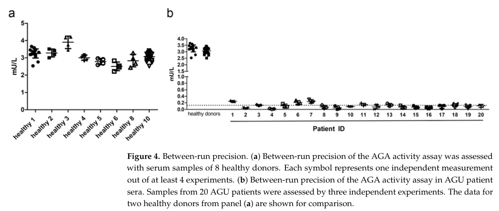

## Question

# Gene Research for Functional Annotation

## ⚠️ CRITICAL: Gene/Protein Identification Context

**BEFORE YOU BEGIN RESEARCH:** You MUST verify you are researching the CORRECT gene/protein. Gene symbols can be ambiguous, especially for less well-characterized genes from non-model organisms.

### Target Gene/Protein Identity (from UniProt):
- **UniProt Accession:** P20933
- **Protein Description:** RecName: Full=N(4)-(beta-N-acetylglucosaminyl)-L-asparaginase; EC=3.5.1.26 {ECO:0000269|PubMed:1703489, ECO:0000269|PubMed:1904874, ECO:0000269|PubMed:2401370}; AltName: Full=Aspartylglucosaminidase; AltName: Full=Glycosylasparaginase; AltName: Full=N4-(N-acetyl-beta-glucosaminyl)-L-asparagine amidase; Contains: RecName: Full=Glycosylasparaginase alpha chain; Contains: RecName: Full=Glycosylasparaginase beta chain; Flags: Precursor;
- **Gene Information:** Name=AGA;
- **Organism (full):** Homo sapiens (Human).
- **Protein Family:** Belongs to the Ntn-hydrolase family. .
- **Key Domains:** Ntn_hydrolases_N. (IPR029055); Peptidase_T2. (IPR000246); Asparaginase_2 (PF01112)

### MANDATORY VERIFICATION STEPS:

1. **Check if the gene symbol "AGA" matches the protein description above**
2. **Verify the organism is correct:** Homo sapiens (Human).
3. **Check if protein family/domains align with what you find in literature**
4. **If you find literature for a DIFFERENT gene with the same or similar symbol, STOP**

### If Gene Symbol is Ambiguous or You Cannot Find Relevant Literature:

**DO NOT PROCEED WITH RESEARCH ON A DIFFERENT GENE.** Instead:
- State clearly: "The gene symbol 'AGA' is ambiguous or literature is limited for this specific protein"
- Explain what you found (e.g., "Found extensive literature on a different gene with the same symbol in a different organism")
- Describe the protein based ONLY on the UniProt information provided above
- Suggest that the protein function can be inferred from domain/family information

### Research Target:

Please provide a comprehensive research report on the gene **AGA** (gene ID: AGA, UniProt: P20933) in human.

The research report should be a detailed narrative explaining the function, biological processes, and localization of the gene product. Citations should be given for all claims.

You should prioritize authoritative reviews and primary scientific literature when conducting research. You can supplement
this with annotations you find in gene/protein databases, but these can be outdated or inaccurate.

We are specifically interested in the primary function of the gene - for enzymes, what reaction is catalyzed, and what is the substrate specificity? For transporters, what is the substrate? For structural proteins or adapters, what is the broader structural role? For signaling molecules, what is the role in the pathway.

We are interested in where in or outside the cell the gene product carries out its function.

We are also interested in the signaling or biochemical pathways in which the gene functions. We are less interested in broad pleiotropic effects, except where these elucidate the precise role.

Include evidence where possible. We are interested in both experimental evidence as well as inference from structure, evolution, or bioinformatic analysis. Precise studies should be prioritized over high-throughput, where available.

## Output

Question: You are an expert researcher providing comprehensive, well-cited information.

Provide detailed information focusing on:
1. Key concepts and definitions with current understanding
2. Recent developments and latest research (prioritize 2023-2024 sources)
3. Current applications and real-world implementations
4. Expert opinions and analysis from authoritative sources
5. Relevant statistics and data from recent studies

Format as a comprehensive research report with proper citations. Include URLs and publication dates where available.
Always prioritize recent, authoritative sources and provide specific citations for all major claims.

# Gene Research for Functional Annotation

## ⚠️ CRITICAL: Gene/Protein Identification Context

**BEFORE YOU BEGIN RESEARCH:** You MUST verify you are researching the CORRECT gene/protein. Gene symbols can be ambiguous, especially for less well-characterized genes from non-model organisms.

### Target Gene/Protein Identity (from UniProt):
- **UniProt Accession:** P20933
- **Protein Description:** RecName: Full=N(4)-(beta-N-acetylglucosaminyl)-L-asparaginase; EC=3.5.1.26 {ECO:0000269|PubMed:1703489, ECO:0000269|PubMed:1904874, ECO:0000269|PubMed:2401370}; AltName: Full=Aspartylglucosaminidase; AltName: Full=Glycosylasparaginase; AltName: Full=N4-(N-acetyl-beta-glucosaminyl)-L-asparagine amidase; Contains: RecName: Full=Glycosylasparaginase alpha chain; Contains: RecName: Full=Glycosylasparaginase beta chain; Flags: Precursor;
- **Gene Information:** Name=AGA;
- **Organism (full):** Homo sapiens (Human).
- **Protein Family:** Belongs to the Ntn-hydrolase family. .
- **Key Domains:** Ntn_hydrolases_N. (IPR029055); Peptidase_T2. (IPR000246); Asparaginase_2 (PF01112)

### MANDATORY VERIFICATION STEPS:

1. **Check if the gene symbol "AGA" matches the protein description above**
2. **Verify the organism is correct:** Homo sapiens (Human).
3. **Check if protein family/domains align with what you find in literature**
4. **If you find literature for a DIFFERENT gene with the same or similar symbol, STOP**

### If Gene Symbol is Ambiguous or You Cannot Find Relevant Literature:

**DO NOT PROCEED WITH RESEARCH ON A DIFFERENT GENE.** Instead:
- State clearly: "The gene symbol 'AGA' is ambiguous or literature is limited for this specific protein"
- Explain what you found (e.g., "Found extensive literature on a different gene with the same symbol in a different organism")
- Describe the protein based ONLY on the UniProt information provided above
- Suggest that the protein function can be inferred from domain/family information

### Research Target:

Please provide a comprehensive research report on the gene **AGA** (gene ID: AGA, UniProt: P20933) in human.

The research report should be a detailed narrative explaining the function, biological processes, and localization of the gene product. Citations should be given for all claims.

You should prioritize authoritative reviews and primary scientific literature when conducting research. You can supplement
this with annotations you find in gene/protein databases, but these can be outdated or inaccurate.

We are specifically interested in the primary function of the gene - for enzymes, what reaction is catalyzed, and what is the substrate specificity? For transporters, what is the substrate? For structural proteins or adapters, what is the broader structural role? For signaling molecules, what is the role in the pathway.

We are interested in where in or outside the cell the gene product carries out its function.

We are also interested in the signaling or biochemical pathways in which the gene functions. We are less interested in broad pleiotropic effects, except where these elucidate the precise role.

Include evidence where possible. We are interested in both experimental evidence as well as inference from structure, evolution, or bioinformatic analysis. Precise studies should be prioritized over high-throughput, where available.

# Human AGA (UniProt P20933): functional annotation and research report

## Identity and principal function

**Identity verified.** The supplied UniProt accession [P20933](https://www.uniprot.org/uniprotkb/P20933/entry) identifies human **AGA**, or aspartylglucosaminidase/glycosylasparaginase (EC 3.5.1.26). Human biochemical studies identify it as a lysosomal enzyme, and a structural review places it among N-terminal-nucleophile (Ntn) hydrolases in the MEROPS T2 asparaginase family. The related human protein **ASRGL1** is a distinct enzyme, not an alternative identity for AGA. The supplied Ntn-hydrolase, Peptidase_T2 and Asparaginase_2 domain annotations are consistent with that classification. (saarela2004autoproteolyticactivationof pages 1-2, linhorst2022thehumanntnhydrolase pages 9-11, enomaa1992humanaspartylglucosaminidase.a pages 1-2)

**Functional conclusion:** AGA’s established physiological role is a late step in *lysosomal N-linked glycoprotein degradation*. After proteolysis has exposed a glycosylated asparagine residue, AGA hydrolyzes the amide bond between the asparagine side chain and the innermost N-acetylglucosamine (GlcNAc) of its glycan. The principal small substrate is **GlcNAc–Asn**; larger glycoasparagines are also substrates. The immediate products are L-aspartate and a glycan bearing 1-amino-GlcNAc at its reducing end. Loss of the 1-amino group then occurs **nonenzymatically**, yielding the corresponding sugar and ammonia; it should not be counted as a second AGA-catalyzed step. AGA is therefore not best annotated simply as a general-purpose L-asparaginase or as a signaling protein. (tikkanen1996functionalanalysesof pages 1-2, dunder2010theapplicationofa pages 33-37, winchester2005lysosomalmetabolismof pages 4-5)

The table summarizes the principal experimental evidence; its specificity qualification is expanded below.

| Feature | Experimental observation | Interpretation |
|---|---|---|
| Reaction and native substrate | Human AGA (EC 3.5.1.26) hydrolyzes the amide linkage between asparagine and the innermost N-acetylglucosamine of glycoasparagines, producing L-aspartate and a glycan with a 1-amino-GlcNAc reducing end; the 1-amino group is subsequently lost nonenzymatically. GlcNAc-Asn and larger glycoasparagines are physiological substrates. (tikkanen1996functionalanalysesof pages 1-2, dunder2010theapplicationofa pages 33-37) | AGA performs a late, obligatory step in lysosomal degradation of asparagine-linked glycoproteins rather than acting primarily as a general protein asparaginase. |
| Substrate specificity | The enzyme tolerates substantial variation in the attached glycan, but core α1,6-linked fucose on GlcNAc blocks cleavage and must first be removed by α-fucosidase. A free α-carboxyl group on asparagine is required. Older sources also state that a free α-amino group is required, but later substrate-analogue work reported that it is dispensable; the α-amino requirement should therefore not be treated as universal. (tikkanen1996functionalanalysesof pages 1-2, enomaa1992humanaspartylglucosaminidase.a pages 1-2, dunder2010theapplicationof pages 33-37) | Recognition is centered on the glycosylated asparagine linkage and its local chemical environment; upstream defucosylation can determine pathway order. |
| Ntn-hydrolase maturation | AGA is synthesized as an inactive 346-residue precursor. After signal-peptide removal, precursor dimerization and autocleavage between Asp205 and Thr206 generate α and β chains; Thr206 becomes the β-chain N-terminal catalytic nucleophile. The active enzyme is an (αβ)₂ heterotetramer. (saarela2004autoproteolyticactivationof pages 1-2, tikkanen1996functionalanalysesof pages 1-2) | Autoproteolysis is both a maturation event and creation of the active site; variants that impair folding, dimerization, or cleavage can abolish activity without directly altering substrate binding. |
| Intracellular localization | Folding, dimerization, and autocatalytic activation occur in the ER. N-glycan phosphorylation and mannose-6-phosphate-receptor sorting through the Golgi/endosomal pathway deliver AGA to lysosomes, where subunit trimming occurs. Immunofluorescence and immunoelectron microscopy directly localized native AGA to lysosomes in control human fibroblasts. (saarela2004autoproteolyticactivationof pages 1-2, enomaa1992humanaspartylglucosaminidase.a pages 1-2) | The physiologically relevant reaction occurs predominantly in the lysosomal lumen; AGA is a soluble lysosomal catabolic enzyme, not an established signaling protein. |
| Deficiency and diagnostic substrate | Loss of AGA activity causes aspartylglucosaminuria, with lysosomal and extracellular accumulation of GlcNAc-Asn and other undegraded glycoasparagines. A 2024 case with homozygous AGA c.698+1G>T showed experimentally confirmed abnormal splicing and urinary aspartylglucosamine of 208 mmol/mol creatinine, versus undetectable in the control urine. (kouhashi2024a37yearoldman pages 2-4, kouhashi2024a37yearoldman pages 1-2) | Substrate accumulation provides a direct biochemical readout of failed AGA-mediated glycoprotein catabolism and complements molecular diagnosis. |
| 2023 serum activity assay | A validated Asp-AMC fluorometric assay measured 20 AGU samples at a mean 0.11 mU/L (range 0.0123–0.251) versus 3.252 mU/L (2.503–3.897) in healthy donors; between-run testing included eight donors. Healthy activity was approximately 29-fold higher, although many patient values were near or below the 0.18 mU/L quantification limit. (banning2023validationofaspartylglucosaminidase pages 7-8, banning2023validationofaspartylglucosaminidase pages 2-5, banning2023validationofaspartylglucosaminidase pages 5-7) | Serum AGA activity can distinguish this genetically homogeneous AGU cohort from controls and can serve as a pharmacodynamic biomarker, but very low patient activities should preferably be compared within the same analytical run. |

*Table: Experimentally supported annotation of human AGA/P20933, covering catalytic specificity, Ntn-hydrolase maturation, lysosomal trafficking, deficiency biomarkers, and the validated 2023 serum assay.*

## Substrate specificity and biochemical pathway

AGA accommodates variation in the attached N-glycan, including reported high-mannose, hybrid and complex structures. Its physiological substrate is the *glycoasparagine remaining after proteolysis*, rather than an intact glycoprotein whose asparagine is still embedded in a peptide. Core fucose linked to the innermost GlcNAc prevents cleavage in the reported human-enzyme studies, placing **defucosylation before AGA cleavage** for that substrate class. The enzyme can also hydrolyze L-asparagine and certain β-aspartyl substrates in vitro, but these activities do not displace glycoasparagine catabolism as its established lysosomal function. (tikkanen1996functionalanalysesof pages 1-2, enomaa1992humanaspartylglucosaminidase.a pages 1-2, saarela2004characterizationofaspartylglucosaminidase pages 15-18, kelo2013catalyticandtherapeutic pages 51-54)

**Specificity qualification.** Older descriptions say that both the asparagine α-carboxyl and α-amino groups must be free. A later substrate-analogue report, *“Glycosylasparaginase activity requires the α-carboxyl group, but not the α-amino group…”* (Risley *et al.*, July 2001, [DOI:10.1006/abbi.2001.2416](https://doi.org/10.1006/abbi.2001.2416)), qualifies the α-amino claim. Its full experimental results were unavailable for this review. Thus, recognition of the exposed glycoasparagine and the α-carboxyl group is a safer annotation than an **unqualified, universal** free-α-amino requirement. (tikkanen1996functionalanalysesof pages 1-2, dunder2010theapplicationof pages 33-37)

This function belongs to the **lysosomal glycoprotein-catabolism pathway**, not cytosolic protein deglycosylation. Lysosomal proteases can leave glycans attached to individual asparagine residues; AGA then separates amino-acid and carbohydrate components so subsequent glycan degradation can proceed. The primary studies establish this biochemical role, whereas a direct AGA-mediated signaling pathway is not established by the evidence reviewed. (winchester2005lysosomalmetabolismof pages 4-5, tikkanen1996functionalanalysesof pages 1-2)

## Molecular mechanism and site of action

AGA is synthesized as an approximately **346-residue precursor** bearing an approximately **23-residue signal peptide**. Folding and precursor association occur in the endoplasmic reticulum (ER). Autocatalytic cleavage at **Asp205–Thr206** generates α and β chains and exposes **Thr206 at the β-chain N terminus**. This N-terminal threonine is the catalytic nucleophile; the mature active assembly is described structurally as an **(αβ)₂ heterotetramer**. These observations connect the protein’s Ntn-hydrolase fold directly to both self-activation and substrate hydrolysis. (saarela2004autoproteolyticactivationof pages 1-2, tikkanen1996functionalanalysesof pages 1-2, saarela1998activationandoligomerization pages 1-1)

The mechanism is supported experimentally, not only by family inference. Active-site substitutions at **Arg234 or Asp237** abolished activity in expression experiments, while changes at **Ser72, Thr224 or Thr257** reduced it; mutagenesis and structural analysis also implicate Thr206 in activation and catalysis. Disrupting precursor folding or association can therefore produce deficient enzyme even when the eventual substrate-binding residues are not themselves mutated. (tikkanen1996functionalanalysesof pages 1-2, saarela2004autoproteolyticactivationof pages 1-2, saarela2004characterizationofaspartylglucosaminidasea pages 35-39)

**Where AGA works:** its principal physiological reaction occurs in the **lysosomal lumen**. The secretory-pathway precursor passes through the ER and Golgi; mannose-6-phosphate-dependent sorting delivers active enzyme through endosomes to lysosomes, where further subunit trimming occurs. Immunofluorescence **and immunoelectron microscopy directly localized AGA to lysosomes in normal human fibroblasts**. In fibroblasts with an aspartylglucosaminuria-associated defect, much immunoreactive protein instead accumulated around the cis-Golgi region. Secretion and uptake of AGA are relevant to enzyme delivery and cross-correction, but do not change its established principal site of catabolic action. (saarela2004autoproteolyticactivationof pages 1-2, enomaa1992humanaspartylglucosaminidase.a pages 1-2, dunder2010theapplicationofa pages 74-76)

## Human genetic and diagnostic evidence: 2023–2024

Loss of AGA function causes **autosomal-recessive aspartylglucosaminuria (AGU)**. The direct biochemical consequence is accumulation of **GlcNAc–Asn and other incompletely degraded glycoasparagines** in tissues and body fluids. This substrate–product relationship is strong evidence for the enzyme’s in-vivo role; the neurological and systemic manifestations are downstream consequences, not evidence of a separate primary signaling reaction. (enomaa1992humanaspartylglucosaminidase.a pages 1-2, kouhashi2024a37yearoldman pages 1-2, tikkanen2026pharmacologicalchaperonetreatment pages 1-4)

A **March 2023** serum-assay study, [Banning, Laine and Tikkanen, *International Journal of Molecular Sciences*](https://doi.org/10.3390/ijms24065722), validated a fluorometric assay using the synthetic **Asp–AMC** substrate. Twenty AGU samples averaged **0.11 mU/L** AGA activity (range **0.0123–0.251**), versus **3.252 mU/L** in healthy donors (range **2.503–3.897**)—approximately **29-fold higher** activity in donors. Between-run testing included eight healthy donors and 20 patients. The quantification limit was **0.18 mU/L**, so some very-low-activity patient values require caution in longitudinal comparison. Asp–AMC is an *analytical assay substrate*, not a claim that it is AGA’s physiological substrate. The study’s cropped **Figure 4** illustrates donor–patient separation and between-run measurements. (banning2023validationofaspartylglucosaminidase pages 2-5, banning2023validationofaspartylglucosaminidase pages 5-7, banning2023validationofaspartylglucosaminidase media 0e9e2f39)

A **June 2024** case report, [Kouhashi *et al.*, *Neurology Genetics*](https://doi.org/10.1212/nxg.0000000000200161), illustrates diagnosis beyond the Finnish founder variant: trio exome sequencing found homozygous **AGA c.698+1G>T** in a 37-year-old man. Blood-cDNA analysis demonstrated abnormal splicing, and urinary aspartylglucosamine measured **208 mmol/mol creatinine**, versus undetectable in the reported control sample. This is compelling genotype–splicing–metabolite evidence for an individual case, not a population estimate. (kouhashi2024a37yearoldman pages 2-4, kouhashi2024a37yearoldman pages 1-2)

## Therapeutic relevance and present limits

Restoring catalytically active, correctly delivered AGA is a direct therapeutic strategy implied by its function. In a **March 2021** preclinical study, [Chen *et al.*, *Molecular Therapy*](https://doi.org/10.1016/j.ymthe.2020.11.012), intravenous or intrathecal **AAV9/AGA** treatment of *Aga*-deficient mice increased sustained enzyme activity, reduced the GlcNAc–Asn substrate biomarker, improved locomotor measures, preserved cerebellar Purkinje neurons and reduced gliosis. The study assessed animals through **18 months**; the authors favored intrathecal delivery because an effective dose was approximately tenfold lower than that required intravenously in their comparison. These are **mouse**, not human efficacy or long-term safety results. Earlier recombinant-enzyme replacement also corrected substrate storage in cells and mice, supporting cross-correction as a therapeutic principle. (chen2021preclinicalgenetherapy pages 8-9, chen2021preclinicalgenetherapy pages 1-2, dunder2010theapplicationof pages 67-71)

The most recent human interventional evidence retrieved is a **7 January 2026 preprint**, [Tikkanen *et al.*](https://doi.org/10.21203/rs.3.rs-8103849/v1), reporting an open-label phase 1b/2 study of oral **betaine/Cystadane** in **21 Finnish children** homozygous for the AGUFin-major variant. Over 48 months, urinary GlcNAc–Asn fell to approximately **30% of untreated levels** after dose escalation, while serum AGA activity rose **1.72-fold** after treatment restarted; the three-month treatment interruption was accompanied by biomarker reversal. The authors propose that betaine improves mutant-precursor folding and processing. This is **preliminary, nonrandomized, variant-specific evidence**, not proof of durable neurological benefit or an approved AGU treatment. The preprint itself states that no disease-cause-targeting treatment was then available. (tikkanen2026pharmacologicalchaperonetreatment pages 1-4, tikkanen2026pharmacologicalchaperonetreatment pages 4-6, tikkanen2026pharmacologicalchaperonetreatment pages 8-10)

**Overall annotation:** human **AGA/P20933 is a soluble lysosomal Ntn hydrolase whose defining reaction is cleavage of the asparagine–innermost-GlcNAc amide linkage in glycoasparagines**. Its ER autocatalytic maturation and lysosomal delivery are essential to that function; loss of either catalytic activity or proper processing leads to the characteristic glycoasparagine-storage phenotype. (saarela2004autoproteolyticactivationof pages 1-2, tikkanen1996functionalanalysesof pages 1-2, enomaa1992humanaspartylglucosaminidase.a pages 1-2, kouhashi2024a37yearoldman pages 2-4)

References

1. (saarela2004autoproteolyticactivationof pages 1-2): Jani SAARELA, Carita OINONEN, Anu JALANKO, Juha ROUVINEN, and Leena PELTONEN. Autoproteolytic activation of human aspartylglucosaminidase. The Biochemical journal, 378 Pt 2:363-71, Mar 2004. URL: https://doi.org/10.1042/bj20031496, doi:10.1042/bj20031496. This article has 44 citations.

2. (linhorst2022thehumanntnhydrolase pages 9-11): Arne Linhorst and Torben Lübke. The human ntn-hydrolase superfamily: structure, functions and perspectives. Cells, 11:1592, May 2022. URL: https://doi.org/10.3390/cells11101592, doi:10.3390/cells11101592. This article has 31 citations.

3. (enomaa1992humanaspartylglucosaminidase.a pages 1-2): N. Enomaa, Tumoas Heiskanen, R. Halila, R. Sormunen, T. R. Seppala, Mauno, Vihineni, and L. Peltonen. Human aspartylglucosaminidase. a biochemical and immunocytochemical characterization of the enzyme in normal and aspartylglucosaminuria fibroblasts. The Biochemical journal, 286 ( Pt 2):613-8, Sep 1992. URL: https://doi.org/10.1042/bj2860613, doi:10.1042/bj2860613. This article has 21 citations.

4. (tikkanen1996functionalanalysesof pages 1-2): R. Tikkanen, Aija Riikonen, C. Oinonen, Juha Rouvinen, and Leena Peltonen. Functional analyses of active site residues of human lysosomal aspartylglucosaminidase: implications for catalytic mechanism and autocatalytic activation. The EMBO Journal, 15:2954-2960, Jun 1996. URL: https://doi.org/10.1002/j.1460-2075.1996.tb00658.x, doi:10.1002/j.1460-2075.1996.tb00658.x. This article has 114 citations.

5. (dunder2010theapplicationofa pages 33-37): U Dunder. The application of enzyme replacement therapy in vitro and in a mouse model in aspartylglycosaminuria. Unknown journal, 2010.

6. (winchester2005lysosomalmetabolismof pages 4-5): Bryan Winchester. Lysosomal metabolism of glycoproteins. Glycobiology, 15 6:1R-15R, Jun 2005. URL: https://doi.org/10.1093/glycob/cwi041, doi:10.1093/glycob/cwi041. This article has 364 citations and is from a peer-reviewed journal.

7. (dunder2010theapplicationof pages 33-37): U Dunder. The application of enzyme replacement therapy in vitro and in a mouse model in aspartylglycosaminuria. Unknown journal, 2010.

8. (kouhashi2024a37yearoldman pages 2-4): Mutsuo Kouhashi, Kayoko Yukawa, Naoko Yano, Marne C. Hagemeijer, Shinya Hirata, Daisuke Kambe, Atsushi Yokoyama, Akira Yoshida, Kengo Kora, Corline J. de Ronde, Sandrien Vrieswijk, Eric van der Meijden, Takeshi Yoshida, and Hirofumi Yamashita. A 37-year-old man with intellectual disability discovered to have aspartylglucosaminuria. Neurology Genetics, Jun 2024. URL: https://doi.org/10.1212/nxg.0000000000200161, doi:10.1212/nxg.0000000000200161. This article has 3 citations.

9. (kouhashi2024a37yearoldman pages 1-2): Mutsuo Kouhashi, Kayoko Yukawa, Naoko Yano, Marne C. Hagemeijer, Shinya Hirata, Daisuke Kambe, Atsushi Yokoyama, Akira Yoshida, Kengo Kora, Corline J. de Ronde, Sandrien Vrieswijk, Eric van der Meijden, Takeshi Yoshida, and Hirofumi Yamashita. A 37-year-old man with intellectual disability discovered to have aspartylglucosaminuria. Neurology Genetics, Jun 2024. URL: https://doi.org/10.1212/nxg.0000000000200161, doi:10.1212/nxg.0000000000200161. This article has 3 citations.

10. (banning2023validationofaspartylglucosaminidase pages 7-8): Antje Banning, Minna Laine, and Ritva Tikkanen. Validation of aspartylglucosaminidase activity assay for human serum samples: establishment of a biomarker for diagnostics and clinical studies. International Journal of Molecular Sciences, Mar 2023. URL: https://doi.org/10.3390/ijms24065722, doi:10.3390/ijms24065722. This article has 10 citations.

11. (banning2023validationofaspartylglucosaminidase pages 2-5): Antje Banning, Minna Laine, and Ritva Tikkanen. Validation of aspartylglucosaminidase activity assay for human serum samples: establishment of a biomarker for diagnostics and clinical studies. International Journal of Molecular Sciences, Mar 2023. URL: https://doi.org/10.3390/ijms24065722, doi:10.3390/ijms24065722. This article has 10 citations.

12. (banning2023validationofaspartylglucosaminidase pages 5-7): Antje Banning, Minna Laine, and Ritva Tikkanen. Validation of aspartylglucosaminidase activity assay for human serum samples: establishment of a biomarker for diagnostics and clinical studies. International Journal of Molecular Sciences, Mar 2023. URL: https://doi.org/10.3390/ijms24065722, doi:10.3390/ijms24065722. This article has 10 citations.

13. (saarela2004characterizationofaspartylglucosaminidase pages 15-18): J Saarela. Characterization of aspartylglucosaminidase activation and aspartylglucosaminuria mutations. Unknown journal, 2004.

14. (kelo2013catalyticandtherapeutic pages 51-54): E Kelo. Catalytic and therapeutic characteristics of human recombinant glycosylasparaginase and bacterial l-asparaginases. Unknown journal, 2013.

15. (saarela1998activationandoligomerization pages 1-1): Jani Saarela, Minna Laine, Carita Oinonen, Anu Jalanko, Juha Rouvinen, Leena Peltonen, and Ritva Tikkanen. Activation and oligomerization of aspartylglucosaminidase*. The Journal of Biological Chemistry, 273:25320-25328, Sep 1998. URL: https://doi.org/10.1074/jbc.273.39.25320, doi:10.1074/jbc.273.39.25320. This article has 53 citations.

16. (saarela2004characterizationofaspartylglucosaminidasea pages 35-39): J Saarela. Characterization of aspartylglucosaminidase activation and aspartylglucosaminuria mutations. Unknown journal, 2004.

17. (dunder2010theapplicationofa pages 74-76): U Dunder. The application of enzyme replacement therapy in vitro and in a mouse model in aspartylglycosaminuria. Unknown journal, 2010.

18. (tikkanen2026pharmacologicalchaperonetreatment pages 1-4): Ritva Tikkanen, Minna Laine, Antje Banning, Viljami Sairanen, Günter Lochnit, Timo Roine, Elina Harjunen, Ulrika Roine, Anna Tokola, Hanna Terinkoski, Daniel Leufkens, Päivi Helenius, and Taina Autti. Pharmacological chaperone treatment with cystadane for aspartylglucosaminuria: an open-label, phase 1b/2, clinical trial. Unknown journal, Jan 2026. URL: https://doi.org/10.21203/rs.3.rs-8103849/v1, doi:10.21203/rs.3.rs-8103849/v1.

19. (banning2023validationofaspartylglucosaminidase media 0e9e2f39): Antje Banning, Minna Laine, and Ritva Tikkanen. Validation of aspartylglucosaminidase activity assay for human serum samples: establishment of a biomarker for diagnostics and clinical studies. International Journal of Molecular Sciences, Mar 2023. URL: https://doi.org/10.3390/ijms24065722, doi:10.3390/ijms24065722. This article has 10 citations.

20. (chen2021preclinicalgenetherapy pages 8-9): Xin Chen, Sarah Snanoudj-Verber, Laura Pollard, Yuhui Hu, Sara S. Cathey, Ritva Tikkanen, and Steven J. Gray. Pre-clinical gene therapy with aav9/aga in aspartylglucosaminuria mice provides evidence for clinical translation. Molecular Therapy, 29:989-1000, Mar 2021. URL: https://doi.org/10.1016/j.ymthe.2020.11.012, doi:10.1016/j.ymthe.2020.11.012. This article has 41 citations and is from a highest quality peer-reviewed journal.

21. (chen2021preclinicalgenetherapy pages 1-2): Xin Chen, Sarah Snanoudj-Verber, Laura Pollard, Yuhui Hu, Sara S. Cathey, Ritva Tikkanen, and Steven J. Gray. Pre-clinical gene therapy with aav9/aga in aspartylglucosaminuria mice provides evidence for clinical translation. Molecular Therapy, 29:989-1000, Mar 2021. URL: https://doi.org/10.1016/j.ymthe.2020.11.012, doi:10.1016/j.ymthe.2020.11.012. This article has 41 citations and is from a highest quality peer-reviewed journal.

22. (dunder2010theapplicationof pages 67-71): U Dunder. The application of enzyme replacement therapy in vitro and in a mouse model in aspartylglycosaminuria. Unknown journal, 2010.

23. (tikkanen2026pharmacologicalchaperonetreatment pages 4-6): Ritva Tikkanen, Minna Laine, Antje Banning, Viljami Sairanen, Günter Lochnit, Timo Roine, Elina Harjunen, Ulrika Roine, Anna Tokola, Hanna Terinkoski, Daniel Leufkens, Päivi Helenius, and Taina Autti. Pharmacological chaperone treatment with cystadane for aspartylglucosaminuria: an open-label, phase 1b/2, clinical trial. Unknown journal, Jan 2026. URL: https://doi.org/10.21203/rs.3.rs-8103849/v1, doi:10.21203/rs.3.rs-8103849/v1.

24. (tikkanen2026pharmacologicalchaperonetreatment pages 8-10): Ritva Tikkanen, Minna Laine, Antje Banning, Viljami Sairanen, Günter Lochnit, Timo Roine, Elina Harjunen, Ulrika Roine, Anna Tokola, Hanna Terinkoski, Daniel Leufkens, Päivi Helenius, and Taina Autti. Pharmacological chaperone treatment with cystadane for aspartylglucosaminuria: an open-label, phase 1b/2, clinical trial. Unknown journal, Jan 2026. URL: https://doi.org/10.21203/rs.3.rs-8103849/v1, doi:10.21203/rs.3.rs-8103849/v1.

## Artifacts

- [Edison artifact artifact-00](AGA-deep-research-falcon_artifacts/artifact-00.md)

## Citations

1. saarela2004autoproteolyticactivationof pages 1-2
2. linhorst2022thehumanntnhydrolase pages 9-11
3. tikkanen1996functionalanalysesof pages 1-2
4. dunder2010theapplicationofa pages 33-37
5. winchester2005lysosomalmetabolismof pages 4-5
6. dunder2010theapplicationof pages 33-37
7. banning2023validationofaspartylglucosaminidase pages 7-8
8. banning2023validationofaspartylglucosaminidase pages 2-5
9. banning2023validationofaspartylglucosaminidase pages 5-7
10. saarela2004characterizationofaspartylglucosaminidase pages 15-18
11. kelo2013catalyticandtherapeutic pages 51-54
12. saarela1998activationandoligomerization pages 1-1
13. saarela2004characterizationofaspartylglucosaminidasea pages 35-39
14. dunder2010theapplicationofa pages 74-76
15. tikkanen2026pharmacologicalchaperonetreatment pages 1-4
16. chen2021preclinicalgenetherapy pages 8-9
17. chen2021preclinicalgenetherapy pages 1-2
18. dunder2010theapplicationof pages 67-71
19. tikkanen2026pharmacologicalchaperonetreatment pages 4-6
20. tikkanen2026pharmacologicalchaperonetreatment pages 8-10
21. P20933
22. DOI:10.1006/abbi.2001.2416
23. Banning, Laine and Tikkanen, *International Journal of Molecular Sciences*
24. Kouhashi *et al.*, *Neurology Genetics*
25. Chen *et al.*, *Molecular Therapy*
26. Tikkanen *et al.*
27. https://www.uniprot.org/uniprotkb/P20933/entry
28. https://doi.org/10.1006/abbi.2001.2416
29. https://doi.org/10.3390/ijms24065722
30. https://doi.org/10.1212/nxg.0000000000200161
31. https://doi.org/10.1016/j.ymthe.2020.11.012
32. https://doi.org/10.21203/rs.3.rs-8103849/v1
33. https://doi.org/10.1042/bj20031496,
34. https://doi.org/10.3390/cells11101592,
35. https://doi.org/10.1042/bj2860613,
36. https://doi.org/10.1002/j.1460-2075.1996.tb00658.x,
37. https://doi.org/10.1093/glycob/cwi041,
38. https://doi.org/10.1212/nxg.0000000000200161,
39. https://doi.org/10.3390/ijms24065722,
40. https://doi.org/10.1074/jbc.273.39.25320,
41. https://doi.org/10.21203/rs.3.rs-8103849/v1,
42. https://doi.org/10.1016/j.ymthe.2020.11.012,