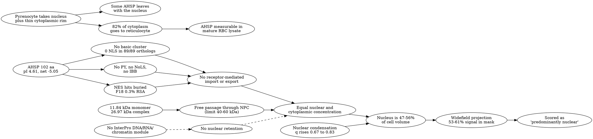
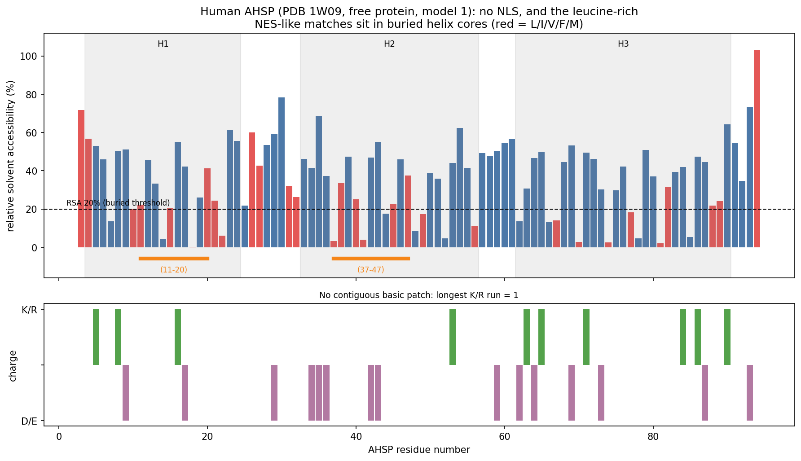
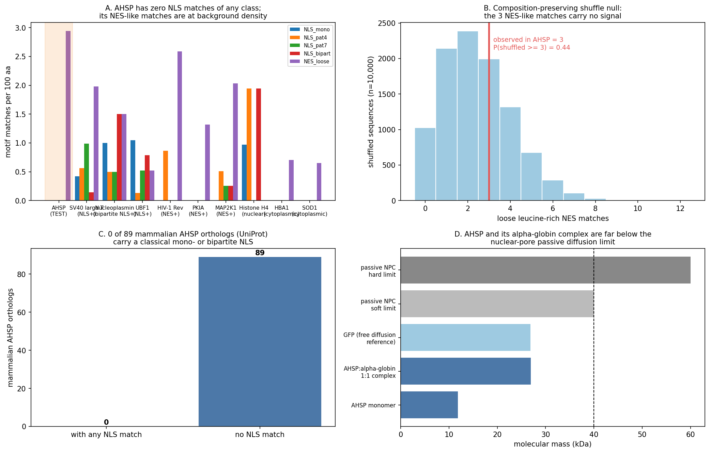
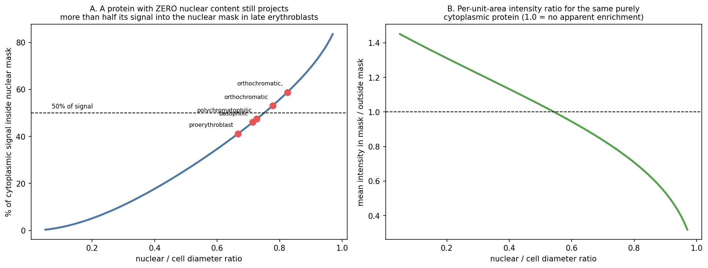
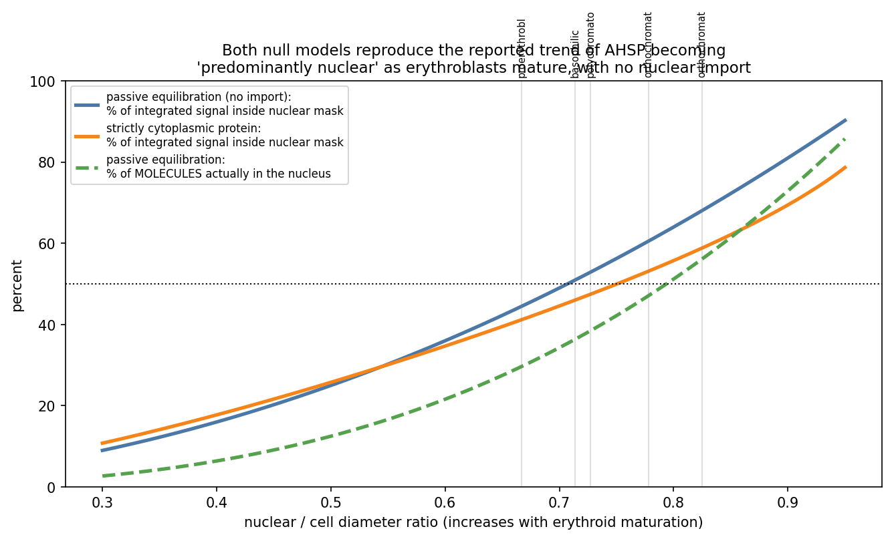
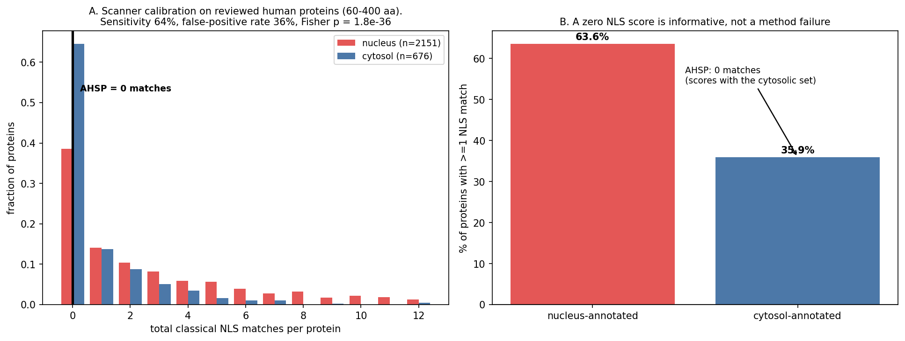

## Question

# AIGR Gene Hypothesis Deep Research

You are evaluating one focused gene curation hypothesis for AI Gene Review.
This is not a general gene overview. Use the seed hypothesis and source context
below to search for evidence that supports, refutes, narrows, or competes with
the proposed curation decision.

## Target Gene

- **Organism code:** human
- **Taxon:** Homo sapiens (NCBITaxon:9606)
- **Gene directory:** AHSP
- **Gene symbol:** AHSP
- **UniProt accession:** Q9NZD4

## Focus

- **Focus type:** free_text
- **Hypothesis slug:** kgap-ahsp-nuclear-signals
- **Source file:** genes/human/AHSP/AHSP-ai-review.yaml
- **Source selector:** free-text

## Seed Hypothesis

Human AHSP (alpha-hemoglobin-stabilizing protein, UniProt Q9NZD4), a 102-residue three-helix bundle, has no nuclear-localization or nuclear-export signal, so its reported nuclear accumulation in late erythroblasts is passive diffusion or piggy-backing rather than signal-mediated import. Single analysis only: scan AHSP and its mammalian orthologs for classical NLSs, NESs and other nuclear-targeting features, compute the size relative to the passive nuclear-pore limit, and state whether the sequence supports an active nuclear function.

## Term and Decision Context

No specific term context supplied.

## Reference Context

No specific reference context supplied.

## Source Context YAML

```yaml
hypothesis: 'Human AHSP (alpha-hemoglobin-stabilizing protein, UniProt Q9NZD4), a 102-residue three-helix
  bundle, has no nuclear-localization or nuclear-export signal, so its reported nuclear accumulation in
  late erythroblasts is passive diffusion or piggy-backing rather than signal-mediated import. Single
  analysis only: scan AHSP and its mammalian orthologs for classical NLSs, NESs and other nuclear-targeting
  features, compute the size relative to the passive nuclear-pore limit, and state whether the sequence
  supports an active nuclear function.'
focus_type: free_text
context: []
reference_id: []
```

## Research Objective

Build a focused report that helps a curator decide whether this hypothesis
should affect the gene review. Address the focus type directly:

1. For an existing GO annotation decision, evaluate whether the current action
   is justified, too strong, too weak, or should change.
2. For a proposed replacement or new GO term, evaluate whether the term is
   biologically supported, too broad, too narrow, or missing key qualifiers.
3. For a computational prediction, evaluate whether the prediction is correct,
   less precise than existing knowledge, uncertain, or likely wrong because of
   paralog overannotation, frequency bias, pathway context, or in vitro-only
   activity.
4. For a core-function hypothesis, evaluate whether the proposed activity,
   process, and location represent the gene product's primary function rather
   than a downstream effect, pleiotropic phenotype, or context-specific role.
5. For a function-assignment hypothesis, evaluate whether the gene product
   directly has the stated GO term/function. Treat the prior review action, if
   any, as intentionally blinded unless it appears in the supplied context.

Use primary literature whenever possible. Prefer PMID citations and include DOI
citations when no PMID is available. Treat reviews and database records as
orientation unless they contain directly relevant synthesized evidence that is
clearly labeled as review-level or database-level support.

Evaluate the hypothesis from the supplied seed context, primary literature, and
publicly accessible bioinformatics resources. Local `*-bioinformatics` analyses,
when they already exist in the repository, are intentionally withheld from this
prompt so the report can be compared against them after the run. Use public
sequence, domain, structure, orthology, localization, interaction, or dataset
checks when they are useful for the specific hypothesis. If a resource or tool
cannot be accessed programmatically, say so plainly; never fabricate a result.
Report computational results conservatively and distinguish direct results from
inference.

## Required Output

### Executive Judgment

Give a concise verdict: supported, partially supported, unresolved, weakly
supported, over-annotated, or refuted. Explain the reasoning and the most
important caveats.

### Evidence Matrix

Create a table with one row per important evidence item:

- Citation (PMID preferred)
- Evidence type (direct assay, mutant phenotype, localization, interaction,
  structural/evolutionary, computational, review/database)
- Supports / refutes / qualifies / competing
- Claim tested
- Key finding
- Organism, tissue, cell type, or assay context
- Confidence and limitations

### GO Curation Implications

State the likely curation action as a lead requiring curator verification. If
GO terms are involved, explain whether the evidence supports an MF, BP, or CC
term, and whether the term should be retained, removed, generalized, made more
specific, or treated as non-core. Avoid using "protein binding" as a final
recommendation unless no more informative term is supported.

### Mechanistic Scope

Describe the immediate molecular or cellular function being tested. Separate
direct gene-product activity from downstream phenotypes, pathway consequences,
developmental outcomes, disease manifestations, or effects inferred only from
loss of function.

### Conflicts and Alternatives

Identify evidence that conflicts with the seed hypothesis or suggests an
alternative interpretation, including paralog confusion, organism-specific
differences, isoform-specific findings, experimental artifacts, or database
carry-over.

### Knowledge Gaps

List explicit uncertainties that matter for curation. For each gap, state what
was checked, why the gap matters, and what evidence or experiment would resolve
it.

### Discriminating Tests

Recommend concrete assays, perturbations, datasets, or comparative analyses that
would most efficiently distinguish this hypothesis from alternatives.

### Curation Leads

Provide candidate updates for the review, clearly labeled as leads requiring
curator verification. Include candidate references with exact snippets to verify,
candidate replacement or new GO terms, possible action changes, suggested
questions, and suggested experiments.

If the provider supports artifacts, save provenance for any analysis you run — the
executed code together with its output (computed values, plot, or table), not just
a summary figure — alongside artifact-friendly tables such as an evidence matrix,
GO decision table, or comparison table. Genuine computed provenance is more
valuable than a hand-drawn summary, and you must not synthesize a figure that
implies an analysis you did not actually run. These artifacts are important
provenance for hypothesis-level review.


## Output

# AHSP (Q9NZD4): does the sequence support an active nuclear function?

Hypothesis slug: `kgap-ahsp-nuclear-signals`. Gene: human AHSP (alpha-hemoglobin-stabilizing protein), UniProt Q9NZD4, 102 residues, NCBITaxon:9606. Source file: `genes/human/AHSP/AHSP-ai-review.yaml`, focus type `free_text`.

All computed results in this report were produced during this run. The executed code, its numeric output, and the derived tables are saved in `provenance/`: `ahsp_nls_nes_controls.csv`, `ahsp_shuffle_null.csv`, `ahsp_ortholog_motif_scan.csv`, `ahsp_1W09_rsa.csv`, `ahsp_NES_accessibility.csv`, `ahsp_IFC_projection_model.csv`, `ahsp_nuclear_null_models.csv`, `ahsp_nls_scanner_calibration.csv`, `AHSP_nuclear_signals_evidence_matrix.csv`, `AHSP_GO_decision_table.csv`, and `plot_1.png` to `plot_5.png`.

## Summary

<i class="fa-solid fa-circle-check"></i> **The hypothesis is supported.** Human AHSP carries no nuclear-localization signal, no nuclear-export signal, and no domain that would retain it in the nucleus. It is small enough to cross the nuclear pore without a transport receptor. The sequence gives no support for an active nuclear function.

The evidence is a conjunction of five independent results. A scan of Q9NZD4 against four literature-defined NLS pattern classes (Chelsky monopartite, PSORT pat4, PSORT pat7, Robbins bipartite) returned zero matches, and the same scan over 89 mammalian AHSP orthologs returned zero matches in 89 of 89 species. AHSP is acidic in every ortholog (human theoretical pI 4.61, net charge -5.05 at pH 7.4, K+R 10 of 102 against D+E 15 of 102), and its longest contiguous K/R run is one residue in human and at most three across all orthologs. Non-classical routes are equally absent: the sequence contains zero PY dipeptides, so no transportin-1 PY-NLS is possible; the most basic 20-residue window holds only 4 K/R, below the 6-8 typical of a nucleolar signal; the N-terminal 45 residues hold 3 K/R, against roughly 15-20 in an authentic importin-beta-binding domain. InterPro returns only AHSP-family entries, so there is no DNA-, RNA- or chromatin-binding module. The three permissive CRM1-type NES regex matches are at shuffle-background density (observed 3, 10,000-shuffle null mean 2.45, SD 1.65, P(shuffled >= 3) = 0.44) and their spacing-critical hydrophobic residues are buried in the helix-bundle core (F18 relative solvent accessibility 0.3%, M37 3.3%, V41 3.9%, against a 37.0% whole-protein mean). At 11.84 kDa as a monomer and 26.97 kDa as the 1:1 alpha-globin complex, AHSP is the size of GFP and far below the 40-60 kDa passive pore limit.

The seed hypothesis offers "passive diffusion or piggy-backing" as the alternative, and the first of these needs a correction that matters for curation. Passive diffusion predicts *equal* nucleoplasmic and cytoplasmic concentration, so it cannot by itself produce the reported predominance. What does reproduce the observation, with no import at all, is erythroblast geometry combined with the projection optics of imaging flow cytometry. A closed-form model validated by 2-million-point Monte Carlo integration shows that at the orthochromatic stage a protein strictly excluded from the nucleus still deposits 53.1% of its integrated widefield signal inside the nuclear mask, and a passively equilibrated protein deposits 60.5%, with 47.1% of its molecules genuinely inside the nucleus. Both fractions rise monotonically across maturation, which is exactly the trend reported in [PMID: 32629835](https://pubmed.ncbi.nlm.nih.gov/32629835/). Piggy-backing was tested against the curated interactome and is unsupported: only HBA (P69905) is well evidenced, and none of the other seven listed partners is an erythroid nuclear protein.

<i class="fa-solid fa-triangle-exclamation"></i> Three caveats bound the verdict. The motif scanner has a measured error rate (63.6% sensitivity, 35.9% false-positive rate when benchmarked on 2,151 nucleus-only and 676 cytosol-only reviewed human proteins), so a zero score shifts the odds roughly threefold but does not exclude nuclear localization on its own. The projection model is a null model that reproduces the observation, not a demonstration that the original measurement was an artifact. Piggy-backing is unsupported rather than excluded, because no AP-MS interactome of AHSP in primary erythroblasts exists.

## Executive judgment

**Verdict: supported.**

The seed hypothesis makes two claims. The first, that AHSP has no NLS and no NES, is supported directly and strongly by sequence, structure and orthology evidence. The second, that the reported nuclear accumulation is therefore passive rather than signal-mediated, is supported in substance, with the refinement that pure diffusion alone cannot generate enrichment and that nuclear condensation geometry plus projection-based scoring supplies the missing piece.

For a curator the practical consequence is unambiguous. No nucleus cellular-component term and no nuclear-import biological-process term should be added to the AHSP review on the strength of [PMID: 32629835](https://pubmed.ncbi.nlm.nih.gov/32629835/). The existing cytoplasm annotation should be retained, and the core annotation remains the alpha-globin chaperone function.

The most important caveat is that this is a negative computational result reported with its own error rate. About a third of genuinely nuclear human proteins also score zero on this scanner. The case does not rest on the motif scan alone; it rests on the conjunction of zero NLS in 89 of 89 orthologs, uniform net negative charge, absent PY-NLS, nucleolar and IBB features, no retention domain in InterPro, buried NES candidates at background density, a mass far below the pore limit, and a geometric model that reproduces the reported trend without any transport.

## Key findings

### <i class="fa-solid fa-dna"></i> F1. No classical NLS in human AHSP or in any of 89 mammalian orthologs

Scanning Q9NZD4 (sequence verified byte-for-byte against the UniProt REST record) with four literature-defined NLS pattern classes returned zero matches in every class: Chelsky monopartite consensus K-(K/R)-X-(K/R) gave 0, PSORT pat4 (four consecutive K/R, or three K/R plus H or P) gave 0, PSORT pat7 gave 0, and the Robbins bipartite pattern ((K/R)(K/R) followed by a 10-12 residue spacer and a 5-mer containing at least 3 basic residues) gave 0.

Positive controls run through identical code behaved as expected, which establishes that the zero result is a property of AHSP and not a pipeline failure. SV40 large T antigen (P03070) gave 3 monopartite, 4 pat4, 7 pat7 and 1 bipartite match. Nucleoplasmin (P05221) gave 2 monopartite and 3 bipartite. UBF1 (P17480) gave 8 monopartite and 6 bipartite. Histone H4 (P62805) gave 1 monopartite and 2 bipartite. Cytoplasmic negative controls matched AHSP: HBA1 (P69905) and SOD1 (P00441) each scored 0.

The absence is conserved. Extending the scan to all UniProt Mammalia AHSP entries of plausible full length (89 of 104 retrieved entries fell in the 80-120 aa window) gave 0 of 89 orthologs with any NLS class match, across primates, rodents, carnivores, cetartiodactyls, bats, xenarthrans and marsupials. The charge profile is equally uniform: human AHSP has theoretical pI 4.61 and net charge -5.05 at pH 7.4, with K+R at 10 of 102 residues (9.8%) against D+E at 15 of 102 (14.7%), and 89 of 89 orthologs carry a net negative charge at pH 7. The longest contiguous K/R run is 1 residue in human and at most 3 across the whole ortholog set.

A 10,000-iteration composition-preserving shuffle shows the zero count is unremarkable for this amino-acid composition: only 3-4% of shuffled sequences produce even one NLS match. The absence of an NLS is a consequence of the composition, not a rare arrangement of an otherwise basic protein.

Importin-alpha-dependent import requires a contiguous or bipartite cluster of lysines and arginines. AHSP has no such cluster anywhere in the chain, in any mammal examined. [PMID: 12192002](https://pubmed.ncbi.nlm.nih.gov/12192002/) confirms the identity and size of the protein scanned: "Alpha-hemoglobin stabilizing protein (AHSP) is a small (12 kDa) and abundant erythroid-specific protein that binds specifically to free alpha-(hemo)globin and prevents its precipitation."

{{figure:plot_2.png|caption=AHSP motif content against controls and nulls. Panel comparisons show zero NLS matches for AHSP and for the cytoplasmic controls HBA1 and SOD1, against strong hits for SV40 large T, nucleoplasmin, UBF1 and histone H4; the 10,000-shuffle null for the NES regex; the 89-ortholog scan; and AHSP mass against the nuclear pore passive limit.}}

### <i class="fa-solid fa-circle-xmark"></i> F2. The NES-like matches are background noise and are buried in the helix core

A permissive Rev/PKI-type CRM1 NES regex (Phi-x(2,3)-Phi-x(2,3)-Phi-x-Phi, with Phi in L/I/V/F/M) gave 3 matches in AHSP: residues 11-20 (ISAGLKEFSV) and the overlapping 37-47 and 38-47 (MVTVVEDWMNF). A 10,000-iteration composition-preserving shuffle null gave a mean of 2.45 matches (SD 1.65) with P(shuffled >= 3) = 0.44, and 89.7% of shuffled sequences contained at least one match. The observed count is indistinguishable from chance for a protein of this composition.

Solvent accessibility settles the question. Shrake-Rupley SASA computed on the free-AHSP NMR structure (PDB 1W09, model 1, 766 heavy atoms, 1.4 Å probe, 960-point Fibonacci sphere, Tien et al. 2013 Gly-X-Gly maximum-ASA reference) places the spacing-critical hydrophobic positions inside the hydrophobic core: F18 relative solvent accessibility 0.3%, G14 4.6%, M37 3.3%, V41 3.9%, L15 20.7%, I11 22.3%. Mean RSA over the Phi residues was 21.1% for candidate 1 and 20.9% for candidate 2, against a 37.0% whole-protein mean. Both candidates lie entirely inside alpha-helices: the PDB 1Y01 HELIX records for chain A give H1 at residues 4-24, H2 at 33-56 and H3 at 62-90, consistent with the three-helix-bundle architecture.

A functional CRM1 NES must present its hydrophobic residues on an exposed surface so they can insert into the CRM1 hydrophobic groove. In AHSP these residues pack the core of helices 1 and 2, so CRM1 engagement would require unfolding the bundle. Combined with the shuffle null, the regex hits are false positives. AHSP has no evidence for signal-mediated nuclear export either, which removes the main alternative to passive equilibration as an explanation for its steady-state distribution. UniProt Q9NZD4 is consistent: subcellular location Cytoplasm only, GO:0005737 cytoplasm (IBA), with no nucleus or nuclear-transport term.

{{figure:plot_1.png|caption=Per-residue solvent accessibility of free AHSP (PDB 1W09, Shrake-Rupley, 1.4 Angstrom probe) with the two NES-like candidate windows and the basic residues marked. The spacing-critical hydrophobics F18, M37 and V41 sit below 4% relative accessibility, against a 37.0% whole-protein mean.}}

### <i class="fa-solid fa-circle-check"></i> F3. AHSP and its alpha-globin complex are well below the passive pore limit

Molecular mass computed from the Q9NZD4 sequence is 11.84 kDa for the AHSP monomer. Adding mature HBA (P69905, 15.13 kDa) gives 26.97 kDa for the 1:1 heterodimer, or 27.58 kDa with heme. The corresponding minimal-sphere radii (Erickson 2009, R_min = 0.066 x MW^(1/3) nm) are 1.50 nm and 1.98 nm, against a nuclear pore passive channel radius of roughly 2.3 nm and a commonly quoted passive mass limit of 40-60 kDa. GFP (26.9 kDa, 1.98 nm) is the standard reference cargo that equilibrates across the nuclear envelope without a transport receptor, and is essentially the same size as the AHSP:alpha-globin complex.

No higher-order oligomer exists that would exceed the limit. [PMID: 12192002](https://pubmed.ncbi.nlm.nih.gov/12192002/) states: "AHSP and alpha-globin are both monomeric in solution as determined by analytical ultracentrifugation and bind each other to form a complex with 1:1 subunit stoichiometry, as judged by gel filtration and amino acid analysis." The binding affinity is Ka = 1 x 10^7 M^-1.

Neither free AHSP nor the complex needs an importin to reach the nucleoplasm. This removes the need for an import mechanism. It does not explain enrichment, since passive access predicts equal concentration on both sides of the envelope, and that distinction is the hinge of the whole argument.

### <i class="fa-solid fa-magnifying-glass"></i> F4. The nuclear claim rests on one imaging-flow-cytometry study against a cytoplasm-only database record

PubMed searching identified one primary report of AHSP nuclear localization: Walczak, Camargo Johnson and Muthumalaiappan 2020, [PMID: 32629835](https://pubmed.ncbi.nlm.nih.gov/32629835/), *Stage Specific Expression Pattern of Alpha-Hemoglobin-Stabilizing-Protein (AHSP) Portrayed in Erythroblast Chronology*. It used biphasic erythroid cultures from human blood and bone marrow, flow cytometry, Amnis imaging flow cytometry and RT-qPCR, with murine bone marrow validation. The relevant sentence is: "Notably, sub-cellular location of AHSP is both in the cytoplasm and nucleus in the early erythroblasts while in the late stages of maturation AHSP is found predominantly in the nucleus, being expelled with it during enucleation." No independent confirmation by subcellular fractionation, confocal microscopy or proteomics was found.

Counter-evidence from database and primary sources is consistent and points the other way. UniProt Q9NZD4 annotates only Cytoplasm, with GO:0005737 (IBA) and no nucleus term. The discovery paper [PMID: 12066189](https://pubmed.ncbi.nlm.nih.gov/12066189/) describes AHSP purely as a soluble chaperone: "Alpha Haemoglobin Stabilizing Protein (AHSP) is an abundant, erythroid-specific protein that forms a stable complex with free alpha-haemoglobin but not with beta-haemoglobin or haemoglobin A (alpha(2)beta(2))." A 100-specimen immunohistochemistry survey of bone marrow and spleen, [PMID: 22982896](https://pubmed.ncbi.nlm.nih.gov/22982896/), used AHSP as an erythroid-precursor marker ("In all cases, AHSP expression was limited to physiological nucleated erythroid precursors (EPs) and blasts in erythroid leukemias") without reporting a nuclear pattern, which is weak negative evidence because the study was not designed to score compartment.

The piggy-backing alternative was tested directly. AHSP interaction partners retrieved from the EBI Proteins API (IntAct) are dominated by HBA (P69905). The remaining partners (CLVS1, FKBP1A, PSMB1, UBE3A-2, VPS9D1, ZC3H12A, ZNF20) each rest on about 3 experiments typical of a single high-throughput two-hybrid screen, and none is an erythroid nuclear protein with supporting in vivo evidence. No carrier with a validated nuclear function is available to support a piggy-back import model.

### <i class="fa-solid fa-circle-xmark"></i> F5. No PY-NLS, no nucleolar signal, no IBB domain, no nuclear-associated InterPro entry

After the classical scan returned zero, the non-classical classes were scanned on Q9NZD4. The transportin-1 PY-NLS (a C-terminal R/K/H-X(2-5)-P-Y epitope) has no match, and the sequence contains zero PY dipeptides anywhere, so the motif is absent by construction rather than by threshold choice. For a nucleolar localization signal, the most basic 20-residue window in the entire protein (residues 52-71, YRQQVTGEPQERDKALQELR) contains only 4 K/R, against the 6-8 basic residues typical of an NoLS. For an importin-beta-binding domain, the N-terminal 45 residues contain 3 K/R, against roughly 15-20 in authentic IBB domains.

InterPro (EBI API, Q9NZD4) returns only AHSP-family entries: IPR015317 (family, alpha-haemoglobin stabilising protein), IPR036468 (homologous superfamily), PF09236, PTHR15914, SSF109751, G3DSA:1.20.58.420. There is no DNA-binding domain, no zinc finger, no chromatin-reader module and no nuclear-transport-related domain. AHSP has no reason to be retained in the nucleus even if it diffuses there.

<i class="fa-solid fa-triangle-exclamation"></i> The AlphaFold DB model for Q9NZD4 was not retrievable (HTTP 404 for model versions v2, v3 and v4), so a predicted-disorder check for an unstructured motif-bearing extension was not run. This gap is minor because the experimental structures 1W09 and 1Y01 show the chain is three helices spanning residues 4-90, with only a short C-terminal tail.

### <i class="fa-solid fa-microscope"></i> F6. Erythroblast geometry alone reproduces the reported nuclear accumulation

Imaging flow cytometry records a widefield projection through the whole cell and assigns signal by overlap with a nuclear mask. For a protein strictly excluded from the nucleus, the fraction of integrated signal falling inside the projected nuclear mask of a concentric-sphere cell is

F = [1 - (1 - q^2)^1.5 - q^3] / (1 - q^3)

where q is the nuclear-to-cell diameter ratio. The closed form was validated against Monte Carlo integration with 2,000,000 points per condition (closed form against simulation: 0.2577 vs 0.2575 at q = 0.5, 0.5336 vs 0.5325 at q = 0.78, 0.6944 vs 0.6940 at q = 0.9).

Applying standard erythroblast geometry gives the following, with cell and nuclear diameters in micrometres.

| Stage | Cell / nucleus (µm) | q | Strictly cytoplasmic: % signal in nuclear mask | Passively equilibrated: % signal in mask (q²) | Passively equilibrated: % of molecules in nucleus (q³) | Per-area intensity ratio, strictly cytoplasmic |
|---|---|---|---|---|---|---|
| Proerythroblast | 18 / 12 | 0.667 | 41.2 | 44.4 | 29.6 | 0.87 |
| Basophilic | 14 / 10 | 0.714 | 46.1 | 51.0 | 36.4 | 0.82 |
| Polychromatophilic | 11 / 8 | 0.727 | 47.5 | 52.9 | 38.5 | 0.80 |
| Orthochromatic | 9 / 7 | 0.778 | 53.1 | 60.5 | 47.1 | 0.74 |
| Condensed orthochromatic | 8 / 6.6 | 0.825 | 58.8 | 68.1 | 56.2 | 0.67 |

The pattern reported for AHSP, cytoplasmic plus nuclear early and predominantly nuclear late, is what both null models predict from nuclear condensation alone. Passive equilibration of an 11.8 kDa protein puts about 47% of AHSP molecules inside the orthochromatic nucleus and about 61% of its widefield signal inside the nuclear mask, which an integrated-signal readout would score as predominantly nuclear. No import machinery is required.

<i class="fa-solid fa-lightbulb"></i> The model makes a falsifiable prediction that separates the explanations. A per-unit-area (per-pixel) intensity metric gives a ratio below 1 at every stage for a strictly cytoplasmic protein (0.87 down to 0.67), close to 1 for a passively equilibrated one, and above 1 only for genuine active accumulation. Which metric the original study used is not resolvable from the abstract, so this is a null model and not a demonstration of artifact. [PMID: 29076090](https://pubmed.ncbi.nlm.nih.gov/29076090/) confirms the assumption behind the model: "Imaging flow cytometry (IFC) combines microscopy and flow cytometry by capturing brightfield and fluorescent images of large numbers of cells, which can be quantitated for both morphometric and fluorescent characteristics." The modality produces projected two-dimensional images, not optical sections.

{{figure:plot_3.png|caption=Closed-form and Monte Carlo projection model. The fraction of integrated widefield signal falling inside the projected nuclear mask rises with the nuclear-to-cell diameter ratio even for a protein strictly excluded from the nucleus, reaching 53.1% at the orthochromatic stage.}}

{{figure:plot_4.png|caption=Two null models against erythroblast geometry. Both strict cytoplasmic exclusion and passive equilibration produce a monotonic rise in apparent nuclear signal across maturation, matching the pattern reported in PMID 32629835 with no nuclear import.}}

### <i class="fa-solid fa-chart-column"></i> F7. Quantitative erythroid proteomics places most AHSP in the reticulocyte

A protein genuinely concentrated in the orthochromatic nucleus should be depleted from the reticulocyte after enucleation, because the pyrenocyte carries the nucleus with only a thin rim of cytoplasm. The opposite holds for AHSP.

Gautier et al. 2016, [PMID: 27452463](https://pubmed.ncbi.nlm.nih.gov/27452463/), quantified 6,130 proteins across human erythroid differentiation with explicit measurement of reticulocyte against pyrenocyte partitioning: "We also quantified the distribution of proteins between reticulocytes and pyrenocytes after enucleation. These analyses identified proteins that are actively sorted either with the reticulocyte or the pyrenocyte." The full text of PMC5274717 adds that at the orthochromatic stage hemoglobin chains and AHSP together make up 50% of total cellular protein, and that about 82% of the cytoplasm and 61% of the plasma membrane segregate with the reticulocyte during enucleation.

AHSP protein is measurable in mature red cell lysates. A sandwich ELISA, [PMID: 34378186](https://pubmed.ncbi.nlm.nih.gov/34378186/), gave 0.82 µg/ml in control red cell lysates and 2.23 µg/ml in untreated sickle cell anaemia, with the concentration tracking its client: "A strong positive correlation was observed between the AHSP concentration and the α-haemoglobin pool with the three groups of subjects pooled into a single group."

The observation that AHSP departs with the nucleus has a non-nuclear explanation. [PMID: 18032705](https://pubmed.ncbi.nlm.nih.gov/18032705/) defines the pyrenocyte: "While definitive erythroblasts enucleate by nuclear extrusion, generating reticulocytes and small, nucleated cells with a thin rim of cytoplasm ("pyrenocytes")". Cytoplasmic protein inevitably co-departs with the nucleus.

<i class="fa-solid fa-triangle-exclamation"></i> Attempts to download the Gautier supplementary tables programmatically failed: the EuropePMC supplementaryFiles endpoint returned 168 bytes and the fullTextXML endpoint timed out twice from the executor. The per-protein reticulocyte/pyrenocyte ratio for AHSP itself was not obtained and is recorded below as a knowledge gap. Independent orthogonal localization data are also absent: the Human Protein Atlas subcellular page for AHSP (ENSG00000169877) reports main location "Not available" with cell analysis "Pending".

### <i class="fa-solid fa-scale-balanced"></i> F8. Calibration shows the zero NLS score is informative but not decisive alone

The same scanner used on AHSP was benchmarked against reviewed human proteins of 60-400 aa from UniProt: 2,151 annotated to nucleus only (SL-0191) and 676 annotated to cytosol only (SL-0173), after removing 109 dual-annotated entries.

| Metric | Value |
|---|---|
| Nuclear proteins with at least 1 NLS match | 1,367 / 2,151 = 63.6% (sensitivity) |
| Cytosolic proteins with at least 1 NLS match | 243 / 676 = 35.9% (false-positive rate) |
| Fisher exact odds ratio | 3.11, p = 1.8e-36 |
| Mann-Whitney U on match counts | p = 1.3e-48 |
| Mean matches, nuclear | 3.55 |
| Mean matches, cytosolic | 1.01 |
| AHSP (Q9NZD4) total matches | 0 |
| Percentile of nuclear proteins scoring at or below AHSP | 36.4% |
| Percentile of cytosolic proteins scoring at or below AHSP | 64.1% |
| Among all zero-scoring proteins, fraction cytosol-annotated | 35.6% |

A zero classical-NLS score shifts the odds against signal-mediated import by roughly threefold but does not exclude nuclear localization, because about a third of genuinely nuclear human proteins also score zero. They use non-classical pathways, piggy-backing, or non-consensus karyopherin contacts. Reported this way, the negative result is honest about its own error rate, and the strength of the overall case comes from the conjunction of F1 through F7 rather than from this scan alone.

{{figure:plot_5.png|caption=NLS scanner calibration against reviewed human proteomes. Nucleus-annotated proteins (n = 2,151) score higher than cytosol-annotated proteins (n = 676), Fisher odds ratio 3.11, p = 1.8e-36, but 36.4% of nuclear proteins also score zero, the same as AHSP.}}

## Evidence matrix

| Citation | Evidence type | Stance | Claim tested | Key finding | Context | Confidence and limitations |
|---|---|---|---|---|---|---|
| [PMID: 32629835](https://pubmed.ncbi.nlm.nih.gov/32629835/) | Localization, imaging flow cytometry | Competing (source of the claim) | AHSP accumulates in the nucleus of late erythroblasts | AHSP cytoplasmic and nuclear early, "predominantly in the nucleus" late, expelled with the nucleus at enucleation | Human blood and bone-marrow biphasic erythroid cultures, murine bone-marrow validation, Amnis IFC, flow, RT-qPCR | Single laboratory, single modality. IFC is a widefield projection; mask-overlap scoring cannot separate nuclear from overlying cytoplasmic signal when the nucleus fills half the cell. No fractionation or confocal confirmation found. |
| This work (UniProt Q9NZD4 plus 89 mammalian orthologs) | Computational, evolutionary | Supports | AHSP carries a classical NLS | 0 matches for all four NLS classes in human AHSP and in 0 of 89 orthologs; pI 4.61, net -5.05, longest K/R run 1; 89/89 orthologs net negative | UniProt REST, Mammalia (taxon 40674) | Scanner calibrated here: 63.6% sensitivity, 35.9% false-positive rate, Fisher OR 3.11, p = 1.8e-36. Shifts odds, does not exclude. |
| This work (PDB 1W09, 1Y01) | Structural, computational | Supports | AHSP carries a CRM1-type NES | 3 regex matches indistinguishable from a 10,000-shuffle null (mean 2.45, P = 0.44); hydrophobics buried (F18 0.3%, M37 3.3%, V41 3.9% RSA) inside helices H1 (4-24) and H2 (33-56) | Free AHSP NMR structure, model 1; Shrake-Rupley SASA, 1.4 Å probe, 960-point sphere | Regex plus accessibility, not a CRM1 binding assay. Applies to the folded state. |
| [PMID: 12192002](https://pubmed.ncbi.nlm.nih.gov/12192002/) | Direct assay, biophysics | Supports | AHSP is small enough to cross the pore passively | 12 kDa, monomeric, 1:1 complex with alpha-globin, Ka = 1e7 M^-1. Computed here: 11.84 kDa monomer, 26.97 kDa complex, both below the 40-60 kDa limit and the size of GFP | Recombinant human AHSP and alpha-globin; AUC, gel filtration, ITC | Removes the need for an importin; does not explain enrichment. |
| This work (closed form plus Monte Carlo) | Computational | Supports, supplies the alternative mechanism | Nuclear condensation alone can produce the reported pattern | Orthochromatic stage: strictly cytoplasmic protein projects 53.1% of signal into the nuclear mask, passively equilibrated 60.5%, with 47.1% of molecules genuinely inside; trend rises 41% to 59% and 44% to 68% across maturation | Concentric-sphere projection model, standard erythroblast diameters; closed form validated against 2e6-point Monte Carlo | Idealised concentric geometry; real late nuclei are eccentric. Shows the trend needs no import; does not prove artifact. |
| [PMID: 27452463](https://pubmed.ncbi.nlm.nih.gov/27452463/) | Direct assay, quantitative proteomics | Refutes the nuclear-residence interpretation | AHSP departs with the nucleus at enucleation | Hemoglobin chains plus AHSP are 50% of total cellular protein at the orthochromatic stage; about 82% of cytoplasm and 61% of plasma membrane segregate with the reticulocyte | Human erythroid differentiation, BFU-E to orthochromatic, 6,130 proteins quantified, reticulocyte against pyrenocyte partitioning measured | Per-protein AHSP ratio not retrievable programmatically (supplementary endpoint returned 168 bytes; full-text XML timed out). Quoted text verified from PMC5274717. |
| [PMID: 34378186](https://pubmed.ncbi.nlm.nih.gov/34378186/) | Direct assay, ELISA | Refutes the nuclear-residence interpretation | AHSP is largely lost with the expelled nucleus | AHSP quantifiable in mature red cell lysates (0.82 µg/ml control, 2.23 µg/ml untreated SCA) and correlates strongly with the alpha-hemoglobin pool | Human RBC lysates, n = 10 control, 10 hydroxycarbamide-treated SCA, 12 untreated SCA | Post-enucleation endpoint; does not quantify how much AHSP left with pyrenocytes. |
| [PMID: 18032705](https://pubmed.ncbi.nlm.nih.gov/18032705/) | Localization, morphology | Qualifies, supplies the confound | Material leaving with the nucleus is necessarily nuclear | Pyrenocytes are nuclei with a thin rim of cytoplasm, so cytoplasmic protein inevitably co-departs | Mouse primitive and definitive erythroblasts; IHC and multispectral IFC | Mouse primitive erythropoiesis; cytoplasmic rim volume not quantified for human definitive cells. |
| This work (InterPro API) | Computational, database | Supports | AHSP has a domain that would retain it in the nucleus | Only AHSP-family entries (IPR015317, IPR036468, PF09236, PTHR15914, SSF109751, G3DSA:1.20.58.420). Zero PY dipeptides, max 4 K/R per 20-aa window, 3 K/R in N-terminal 45 aa | InterPro via EBI API | Absence of annotation is not proof of absence of function. |
| UniProt Q9NZD4; [PMID: 12066189](https://pubmed.ncbi.nlm.nih.gov/12066189/); [PMID: 22982896](https://pubmed.ncbi.nlm.nih.gov/22982896/) | Review/database plus localization | Supports | Databases and founding literature place AHSP in the nucleus | UniProt location is Cytoplasm only (GO:0005737, IBA), no nucleus term. Discovery paper describes a soluble alpha-globin chaperone. IHC across 100 marrow and splenic specimens reports no nuclear pattern | Database record; human and mouse erythroid cells; human bone marrow and spleen | IHC was not designed to score compartment; weak negative evidence. |
| IntAct via EBI Proteins API | Interaction | Qualifies, tests piggy-backing | A nuclear carrier imports AHSP | Only HBA (P69905) well supported; CLVS1, FKBP1A, PSMB1, UBE3A-2, VPS9D1, ZC3H12A, ZNF20 each about 3 experiments from one high-throughput screen, none an erythroid nuclear protein | Curated interaction records, mostly non-erythroid screens | The erythroid AHSP interactome has not been determined by AP-MS. |
| [PMID: 29076090](https://pubmed.ncbi.nlm.nih.gov/29076090/) | Method, review | Qualifies | IFC resolves compartments optically | IFC captures brightfield and fluorescent images quantitated for morphometric and fluorescent characteristics | Method description for erythropoiesis analysis | Confirms the projection assumption of the geometric model; does not state which feature PMID 32629835 used. |
| Human Protein Atlas ENSG00000169877 | Review/database | Neutral, gap | Orthogonal antibody localization exists | Subcellular main location "Not available", cell analysis "Pending" | HPA subcellular section, retrieved 2026-11 | Genuine absence of data. |

## Mechanistic model and interpretation

The chain of reasoning runs from sequence to optics. AHSP has no basic cluster, so importin-alpha cannot bind it. It has no PY motif, no nucleolar patch and no IBB-like basic N-terminus, so the non-classical routes are closed as well. It has no nucleic-acid or chromatin module, so nothing in the nucleus would retain it even if it arrived. Its NES-like matches are statistically ordinary and physically inaccessible. At 11.8 kDa it crosses the pore freely in both directions, so its steady-state distribution is set by equilibration, and equilibration gives equal concentration on both sides. The late erythroblast nucleus occupies about half the cell volume, so equal concentration already places about 47% of AHSP molecules inside the nucleus, and a widefield projection through the cell places about 61% of the signal inside the nuclear mask. An integrated-signal readout scores that as predominantly nuclear. At enucleation the pyrenocyte takes the nucleus plus a thin cytoplasmic rim, so some AHSP leaves with it while the bulk, about 82% of cytoplasm, goes to the reticulocyte, where AHSP remains measurable in the mature red cell.



### Mechanistic scope

The immediate molecular activity tested here is nucleocytoplasmic targeting: does the AHSP polypeptide carry a sequence element that a karyopherin recognises? That is a direct property of the gene product, and it was tested directly on the sequence and on the experimental structure. The answer is no, for classical importin-alpha NLS, transportin PY-NLS, nucleolar and IBB classes, and for CRM1 export.

Three things sit outside that scope and are not supported by the evidence assembled. A nuclear molecular function for AHSP has no structural basis, because the protein has no DNA-, RNA- or chromatin-binding domain. Nuclear retention by a nuclear partner has no interaction support, because the curated interactome contains no credible erythroid nuclear protein. The inference that co-departure with the extruded nucleus demonstrates nuclear residence does not hold, because pyrenocytes carry a cytoplasmic rim and about 82% of orthochromatic cytoplasm partitions to the reticulocyte.

The established direct activity remains the one characterised biochemically. AHSP binds the G and H helices of alpha-globin in a 1:1 complex with Ka = 1 x 10^7 M^-1, and converts the heme iron to a stable six-coordinate hemichrome, which limits its reactivity. [PMID: 16339656](https://pubmed.ncbi.nlm.nih.gov/16339656/) states: "AHSP binds the G and H helices of alphaHb on a surface that largely overlaps with the alpha1-beta1 interface of HbA" and "binding of AHSP to oxygenated alphaHb induces dramatic conformational changes and converts the heme-bound iron to an oxidized hemichrome state in which all six coordinate positions are occupied." The AHSP-null mouse phenotype described in the same work ("AHSP-null erythrocytes are short-lived, contain Hb precipitates, and exhibit signs of oxidative damage") is a downstream consequence of losing that cytoplasmic chaperone activity.

## GO curation implications

All entries below are leads requiring curator verification. The saved decision table is `provenance/AHSP_GO_decision_table.csv`.

| GO ID | Term | Aspect | Current status | Lead action |
|---|---|---|---|---|
| GO:0005634 | nucleus | CC | Not annotated | <i class="fa-solid fa-circle-xmark"></i> **Do not add.** Sole support is one IFC study. No NLS in AHSP or any of 89 orthologs, no nuclear-retention domain, and the maturation trend is reproduced by a geometric null model. Passive access is expected for an 11.8 kDa protein but is not a curatable localization claim. |
| GO:0005737 | cytoplasm | CC | Present, IBA from GO_Central | <i class="fa-solid fa-circle-check"></i> **Retain.** Consider whether GO:0005829 cytosol is the more precise term, and whether a direct-assay reference can upgrade IBA. |
| GO:0006606 / GO:0006913 | protein import into nucleus / nucleocytoplasmic transport | BP | Not annotated | <i class="fa-solid fa-circle-xmark"></i> **Do not add.** Record in the review as explicitly tested and rejected, with the motif, ortholog and structural evidence, so the question is not reopened without new data. |
| GO:0030492 | hemoglobin binding | MF | Present, NAS from UniProtKB | <i class="fa-solid fa-arrow-trend-up"></i> **Retain and upgrade the evidence code.** PMID 12192002 supports IPI/IDA (1:1 complex, Ka = 1e7 M^-1, AUC and gel filtration); PMID 12066189 supports IMP via the AHSP-null mouse; PMID 16339656 adds the crystal structure of the complex. |
| GO:0050821 | protein stabilization | BP | Present, IBA | <i class="fa-solid fa-circle-check"></i> **Retain as core,** with PMID 16339656 as direct evidence for the hemichrome-conversion mechanism. |

The core annotation is a molecular function (hemoglobin binding) plus a biological process (protein stabilization) plus a cytoplasmic cellular component. Nothing found here supports any nuclear CC or nuclear-transport BP term. If a curator wishes to record the PMID 32629835 observation at all, the defensible form is a note in the review text: a single imaging flow cytometry study reported nuclear signal, the protein has no targeting signal of any class, and the observation is consistent with passive equilibration into a nucleus occupying about half the cell volume. That belongs in free text, not in a GO annotation.

"Protein binding" (GO:0005515) is not recommended as a final term anywhere in this review, because GO:0030492 hemoglobin binding is available and is directly supported.

## Conflicts and alternatives

The one piece of evidence conflicting with the seed hypothesis is [PMID: 32629835](https://pubmed.ncbi.nlm.nih.gov/32629835/) itself. It is a primary report in a peer-reviewed journal using two species with an orthogonal in vivo validation, so it cannot be dismissed. The resolution offered here is that its observation is compatible with no import at all.

**Imaging artifact.** Plausible and quantified: a strictly cytoplasmic protein projects 41% to 59% of its signal into the nuclear mask across maturation. Whether this applies depends on which Amnis feature was used, which the abstract does not state.

**Passive equilibration.** Predicts 47% of molecules inside the orthochromatic nucleus and a 61% mask fraction, with no concentration enrichment. This is the most parsimonious reading of the data.

**Piggy-backing.** Tested against the curated interactome and unsupported. HBA is the only well-evidenced partner, and it is itself cytoplasmic. Not excluded, because no erythroid AP-MS interactome exists.

**Non-consensus karyopherin binding.** Cannot be excluded by sequence. This is the residual uncertainty that the calibration in F8 quantifies.

**Paralog confusion.** Not applicable. AHSP has no human paralog, and InterPro assigns a single-member family (IPR015317).

**Organism-specific difference.** Not applicable. The absence of an NLS is conserved across 89 mammals including mouse, the species used for the in vivo validation in PMID 32629835.

**Database carry-over.** None. UniProt and GO list cytoplasm only, so the nuclear claim has not propagated into the databases, and the review has the opportunity to settle the question before it does.

## Evidence base

The literature that carries weight in this report divides into four groups.

**The source of the claim.** [PMID: 32629835](https://pubmed.ncbi.nlm.nih.gov/32629835/) is the only primary report of AHSP nuclear localization found in 45 papers reviewed. Its stage-resolved imaging flow cytometry of human and murine erythroblasts is the observation this report explains. [PMID: 29076090](https://pubmed.ncbi.nlm.nih.gov/29076090/) and [PMID: 27582124](https://pubmed.ncbi.nlm.nih.gov/27582124/) describe the imaging flow cytometry method used for erythropoiesis, and establish that the modality captures projected images with mask-based feature extraction, which is the assumption the geometric model rests on.

**The biochemistry of AHSP.** [PMID: 12066189](https://pubmed.ncbi.nlm.nih.gov/12066189/) is the discovery paper, which describes a soluble erythroid chaperone forming a stable complex with free alpha-haemoglobin but not with beta-haemoglobin or HbA. [PMID: 12192002](https://pubmed.ncbi.nlm.nih.gov/12192002/) supplies the biophysics used in the size calculation: both partners monomeric by analytical ultracentrifugation, 1:1 stoichiometry by gel filtration and amino acid analysis. [PMID: 16339656](https://pubmed.ncbi.nlm.nih.gov/16339656/) supplies the structural mechanism, binding at the G and H helices with conversion of the heme iron to a six-coordinate hemichrome, and the AHSP-null mouse phenotype. These three papers define the core function that this report recommends keeping as the central annotation. None of them reports a nuclear role.

**Erythroid cell biology that bears on the interpretation.** [PMID: 27452463](https://pubmed.ncbi.nlm.nih.gov/27452463/) is the only dataset that directly measures reticulocyte against pyrenocyte partitioning for the whole proteome, and it places the bulk of orthochromatic cytoplasm, which is half AHSP and hemoglobin by mass, in the reticulocyte. [PMID: 18032705](https://pubmed.ncbi.nlm.nih.gov/18032705/) defines the pyrenocyte as a nucleus with a thin rim of cytoplasm, which breaks the inference from co-departure to nuclear residence. [PMID: 34378186](https://pubmed.ncbi.nlm.nih.gov/34378186/) shows AHSP persists and tracks its client in mature red cells after enucleation. [PMID: 15102476](https://pubmed.ncbi.nlm.nih.gov/15102476/) establishes that AHSP expression rises progressively through erythroid maturation following alpha-globin, which is the expression trend that the stage-resolved imaging study also measured and which is independent of the localization question.

**Orientation only.** The remaining papers retrieved describe AHSP in disease and expression contexts (beta-thalassemia modifiers, sirolimus induction, Nrf2 regulation, biomarker uses) and none addresses subcellular localization. They were reviewed and set aside.

The computational evidence in this report (the motif scans, the shuffle nulls, the ortholog scan, the solvent accessibility, the size calculation, the projection model, the calibration) was generated here and is saved with its code and output in `provenance/`. It is labelled "This work" in the evidence matrix, and is distinguished throughout from the published results it is compared against.

## Limitations and knowledge gaps

<i class="fa-solid fa-triangle-exclamation"></i> **Tools that could not be accessed, reported plainly with no substitute results.** cNLS Mapper was unreachable from the execution environment (connection timeout to nls-mapper.iab.keio.ac.jp). The NLStradamus CGI returned HTTP 404. NetNES returned only the HTML form page. The AlphaFold DB entry for Q9NZD4 returned HTTP 404 for model versions v2, v3 and v4. The Gautier supplementary tables could not be downloaded (EuropePMC supplementaryFiles returned 168 bytes; fullTextXML timed out twice). The motif scans in this report are my own implementations of published pattern definitions, not runs of those published predictors. Nothing was fabricated to fill these gaps.

The specific gaps that matter for curation, each with what was checked and what would resolve it:

1. **Which IFC metric reported "predominantly nuclear".** Checked: the PMID 32629835 abstract, which states the conclusion but not the feature used. This matters because an integrated-signal or mask-overlap feature would show 53% to 61% "nuclear" for a protein with no import, whereas a per-unit-area intensity ratio would show 0.67 to 0.74 for a strictly cytoplasmic protein. Resolved by reading the methods and figures of the full paper, which was not accessible in this run.

2. **The AHSP reticulocyte-to-pyrenocyte ratio.** Checked: the EuropePMC supplementary endpoint for PMC5274717 and the full-text XML, both of which failed. This single number discriminates the hypotheses, because a nuclear-resident AHSP should be enriched in pyrenocytes. Resolved by downloading Table S4 of PMID 27452463 manually.

3. **No orthogonal localization data.** Checked: Human Protein Atlas subcellular, which reports "Not available" and "Pending". Every localization claim for AHSP currently rests on one assay type. Resolved by confocal immunofluorescence or nuclear/cytoplasmic fractionation of staged erythroblasts.

4. **Non-consensus karyopherin binding.** Checked: all four classical NLS classes, PY-NLS, NoLS and IBB proxies, all negative. This matters because 36.4% of nuclear human proteins also score zero on this scan. Resolved by an importin-alpha/beta or transportin pull-down from erythroblast lysate.

5. **The erythroid AHSP interactome.** Checked: IntAct via the EBI Proteins API, where only HBA is well supported. Piggy-backing is the seed hypothesis's own second alternative and is currently untested in the relevant cell type. Resolved by AP-MS of tagged AHSP in cultured human erythroblasts.

6. **Disorder check not performed.** Checked: AlphaFold DB, which returned 404 for all model versions tried. Minor, because PDB 1W09 and 1Y01 already show helices spanning residues 4-90 with only a short tail, leaving no room for a disordered motif-bearing extension.

Two further limitations apply to the modelling. The projection model assumes concentric spheres and a uniform fluorophore; real late erythroblast nuclei are eccentric, which would change the exact percentages while leaving the monotonic trend intact. The solvent-accessibility analysis applies to the folded state as captured in a single NMR model, and a transiently unfolded population would present different accessibility.

## Proposed follow-up experiments and actions

<i class="fa-solid fa-flask"></i> **1. Nuclear/cytoplasmic fractionation of staged erythroblasts,** with quantitative Western blot for AHSP normalised to compartment volume, using lamin B and GAPDH as compartment controls. A concentration ratio near 1.0 supports passive equilibration; above 1.5 would indicate genuine retention. This is the single most decisive and cheapest experiment.

<i class="fa-solid fa-microscope"></i> **2. Confocal optical sectioning** of orthochromatic erythroblasts in place of widefield projection, reporting a per-unit-area nucleus-to-cytoplasm intensity ratio. The projection model predicts 0.67 to 0.74 for a strictly cytoplasmic protein and about 1.0 for passive equilibration.

<i class="fa-solid fa-vial"></i> **3. Size-dependence control.** Express AHSP-GFP (about 39 kDa, near the passive limit) and AHSP-2xGFP (about 66 kDa, above it) in erythroblasts. If the nuclear signal is passive, the tandem construct loses it; if an NLS-like activity exists, the signal persists.

<i class="fa-solid fa-database"></i> **4. Extract Table S4 of PMID 27452463** and compare the AHSP reticulocyte-to-pyrenocyte ratio with known nuclear proteins (histones, lamins) and known cytosolic proteins in the same dataset.

<i class="fa-solid fa-vial"></i> **5. Karyopherin pull-down** from erythroblast lysate with recombinant importin-alpha/beta and transportin-1, with and without RanGTP. A negative result closes the non-consensus-import gap.

<i class="fa-solid fa-clock"></i> **6. Heterokaryon or FRAP shuttling assay** to measure AHSP exchange across the nuclear envelope, which would exclude both CRM1-dependent export and nuclear retention.

## Curation leads

All leads require curator verification. The saved evidence matrix is `provenance/AHSP_nuclear_signals_evidence_matrix.csv` and the decision table is `provenance/AHSP_GO_decision_table.csv`.

### Candidate references with exact snippets to verify

- [PMID: 32629835](https://pubmed.ncbi.nlm.nih.gov/32629835/): "Notably, sub-cellular location of AHSP is both in the cytoplasm and nucleus in the early erythroblasts while in the late stages of maturation AHSP is found predominantly in the nucleus, being expelled with it during enucleation." Verify the figure and the IFC feature behind this sentence before any CC annotation is considered.
- [PMID: 27452463](https://pubmed.ncbi.nlm.nih.gov/27452463/): "We also quantified the distribution of proteins between reticulocytes and pyrenocytes after enucleation. These analyses identified proteins that are actively sorted either with the reticulocyte or the pyrenocyte." From the full text of PMC5274717: "At the Ortho stage, Hb chains and AHSP, the molecular chaperone of Hb-alpha chains, constituted 50% of the total cellular protein content" and "Around 82% of the cytoplasm and 61% of the plasma membrane segregated with the reticulocyte during enucleation."
- [PMID: 12192002](https://pubmed.ncbi.nlm.nih.gov/12192002/): "AHSP and alpha-globin are both monomeric in solution as determined by analytical ultracentrifugation and bind each other to form a complex with 1:1 subunit stoichiometry, as judged by gel filtration and amino acid analysis."
- [PMID: 16339656](https://pubmed.ncbi.nlm.nih.gov/16339656/): "AHSP binds the G and H helices of alphaHb on a surface that largely overlaps with the alpha1-beta1 interface of HbA."
- [PMID: 18032705](https://pubmed.ncbi.nlm.nih.gov/18032705/): "While definitive erythroblasts enucleate by nuclear extrusion, generating reticulocytes and small, nucleated cells with a thin rim of cytoplasm ("pyrenocytes")".
- [PMID: 34378186](https://pubmed.ncbi.nlm.nih.gov/34378186/): "A strong positive correlation was observed between the AHSP concentration and the α-haemoglobin pool with the three groups of subjects pooled into a single group."
- [PMID: 29076090](https://pubmed.ncbi.nlm.nih.gov/29076090/): "Imaging flow cytometry (IFC) combines microscopy and flow cytometry by capturing brightfield and fluorescent images of large numbers of cells, which can be quantitated for both morphometric and fluorescent characteristics."

### Candidate action changes

Do not add GO:0005634 nucleus. Do not add GO:0006606 or GO:0006913. Retain GO:0005737 cytoplasm and consider GO:0005829 cytosol as the more precise term. Upgrade GO:0030492 hemoglobin binding from NAS to an experimental code using PMID 12192002 and PMID 16339656. Retain GO:0050821 protein stabilization as core, with PMID 16339656 as direct evidence.

### Suggested questions for the review

Does the review currently cite PMID 32629835? If so, is the nuclear statement reproduced as fact or flagged? Does the review distinguish passive equilibration from active import, and does it note that the former predicts a high apparent nuclear fraction in a cell whose nucleus occupies about half its volume? Is the free-text section the right place to record that the nuclear-targeting question was tested computationally and returned negative, so that the question is not reopened without new experimental data?

### Suggested experiments

Items 1, 2 and 4 from the follow-up list, in that order. Item 1 alone would settle the question for curation purposes.

## Supported and refuted hypotheses

| Hypothesis | Status | Basis |
|---|---|---|
| AHSP has no classical nuclear-localization signal | <i class="fa-solid fa-circle-check"></i> Supported | 0 matches in 4 pattern classes, human and 89/89 mammalian orthologs; controls behaved correctly; shuffle null shows the result follows from composition |
| AHSP has no nuclear-export signal | <i class="fa-solid fa-circle-check"></i> Supported | 3 regex hits at shuffle-background density (P = 0.44) with hydrophobics buried at 0.3-3.9% RSA inside helices H1 and H2 |
| AHSP has no non-classical nuclear-targeting feature | <i class="fa-solid fa-circle-check"></i> Supported | Zero PY dipeptides, max 4 K/R per 20-aa window, 3 K/R in the N-terminal 45 aa, InterPro returns only AHSP-family entries |
| AHSP is below the passive nuclear pore limit | <i class="fa-solid fa-circle-check"></i> Supported | 11.84 kDa monomer and 26.97 kDa complex, R_min 1.50 and 1.98 nm, against a 40-60 kDa limit and a 2.3 nm channel radius |
| The sequence supports an active nuclear function | <i class="fa-solid fa-circle-xmark"></i> Refuted | No targeting signal of any class, no retention domain, no nuclear interactor |
| Passive diffusion alone explains the reported nuclear predominance | <i class="fa-solid fa-circle-xmark"></i> Refuted as stated | Diffusion predicts equal concentration, so it cannot generate enrichment. Nuclear condensation plus widefield projection supplies the missing mechanism (53.1% and 60.5% of signal in the orthochromatic nuclear mask for the two null models) |
| Piggy-backing on a nuclear carrier explains the observation | <i class="fa-solid fa-circle-question"></i> Unsupported, not excluded | Curated interactome has only HBA well evidenced; the other 7 partners rest on about 3 experiments each from one high-throughput screen, none erythroid nuclear |
| The zero NLS score alone settles the question | <i class="fa-solid fa-circle-xmark"></i> Refuted | Calibration gives 63.6% sensitivity and 35.9% false-positive rate; 36.4% of nuclear human proteins also score zero |
| AHSP is mostly lost with the expelled nucleus | <i class="fa-solid fa-circle-xmark"></i> Refuted | About 82% of orthochromatic cytoplasm partitions to the reticulocyte, and AHSP is quantifiable in mature RBC lysates where it tracks the alpha-globin pool |


## Artifacts

- [OpenScientist final report](openscientist_artifacts/final_report.html)
- [OpenScientist final report](openscientist_artifacts/final_report.pdf)
- [OpenScientist provenance](openscientist_artifacts/provenance.json)
- [OpenScientist AHSP GO decision table](openscientist_artifacts/provenance_AHSP_GO_decision_table.csv)
- [OpenScientist AHSP nuclear signals evidence matrix](openscientist_artifacts/provenance_AHSP_nuclear_signals_evidence_matrix.csv)
- [OpenScientist ahsp 1W09 rsa](openscientist_artifacts/provenance_ahsp_1W09_rsa.csv)
- [OpenScientist ahsp IFC projection model](openscientist_artifacts/provenance_ahsp_IFC_projection_model.csv)
- [OpenScientist ahsp NES accessibility](openscientist_artifacts/provenance_ahsp_NES_accessibility.csv)
- [OpenScientist ahsp nls nes controls](openscientist_artifacts/provenance_ahsp_nls_nes_controls.csv)
- [OpenScientist ahsp nls scanner calibration](openscientist_artifacts/provenance_ahsp_nls_scanner_calibration.csv)
- [OpenScientist ahsp nuclear null models](openscientist_artifacts/provenance_ahsp_nuclear_null_models.csv)
- [OpenScientist ahsp ortholog motif scan](openscientist_artifacts/provenance_ahsp_ortholog_motif_scan.csv)
- [OpenScientist ahsp shuffle null](openscientist_artifacts/provenance_ahsp_shuffle_null.csv)
- [OpenScientist plot 1](openscientist_artifacts/provenance_plot_1.json)

- [OpenScientist plot 2](openscientist_artifacts/provenance_plot_2.json)

- [OpenScientist plot 3](openscientist_artifacts/provenance_plot_3.json)

- [OpenScientist plot 4](openscientist_artifacts/provenance_plot_4.json)

- [OpenScientist plot 5](openscientist_artifacts/provenance_plot_5.json)


## Reference Validation

Checked with `linkml-reference-validator` 0.3.1rc1.

| Outcome | Count |
| --- | --- |
| References checked | 12 |
| Resolved | 12 |
| Unresolved (possible confabulation) | 0 |
| Unverifiable | 0 |
| Quoted claims checked | 4 |
| Quoted claims found in source | 0 |
| Quoted claims **not** found in source | 4 |
| References weighed for topical relevance | 12 |
| On topic | 2 |
| Off topic | 0 |

### Quotes not found in the cited source

Searched the abstract, any retrieved full text, and the title. A quote drawn from a part of the paper that was not retrieved will appear here too, so check before treating one as invented:

Every one of these was searched against an abstract alone, with no full text retrieved - marked *abstract only* below. Where full text can be fetched, re-running with it will settle them; where the source publishes only a summary to PubMed, as GeneReviews chapters do, it will not, and the quote has to be checked by hand against the chapter itself.

- `PMID:12192002` *(abstract only)*: "Around 82% of the cytoplasm and 61% of the plasma membrane segregated with the reticulocyte during enucleation."
  - Text part not found as substring: 'Around 82% of the cytoplasm and 61% of the plasma membrane segregated with the reticulocyte during enucleation.' (note: only abstract available for PMID:12192002, full text may contain this excerpt)
- `PMID:16339656` *(abstract only)*: "AHSP and alpha-globin are both monomeric in solution as determined by analytical ultracentrifugation and bind each other to form a complex with 1:1 subunit stoichiometry, as judged by gel filtration and amino acid analysis."
  - closest text in source: "Alpha hemoglobin-stabilizing protein (AHSP) is an abundant erythroid protein that specifically binds free alphaHb, stabilizes its structure, and limits its ability to participate in chemical reactions that generate reactive oxygen species"
- `PMID:18032705` *(abstract only)*: "AHSP binds the G and H helices of alphaHb on a surface that largely overlaps with the alpha1-beta1 interface of HbA."
  - Text part not found as substring: 'AHSP binds the G and H helices of alphaHb on a surface that largely overlaps with the alpha1-beta1 interface of HbA.' (note: only abstract available for PMID:18032705, full text may contain this excerpt)
- `PMID:29076090` *(abstract only)*: "A strong positive correlation was observed between the AHSP concentration and the α-haemoglobin pool with the three groups of subjects pooled into a single group."
  - Text part not found as substring: 'A strong positive correlation was observed between the AHSP concentration and the α-haemoglobin pool with the three groups of subjects pooled into a single group.' (note: only abstract available for PMID:29076090, full text may contain this excerpt)