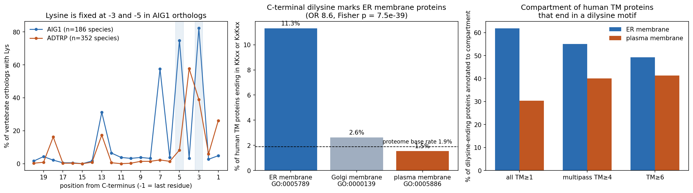
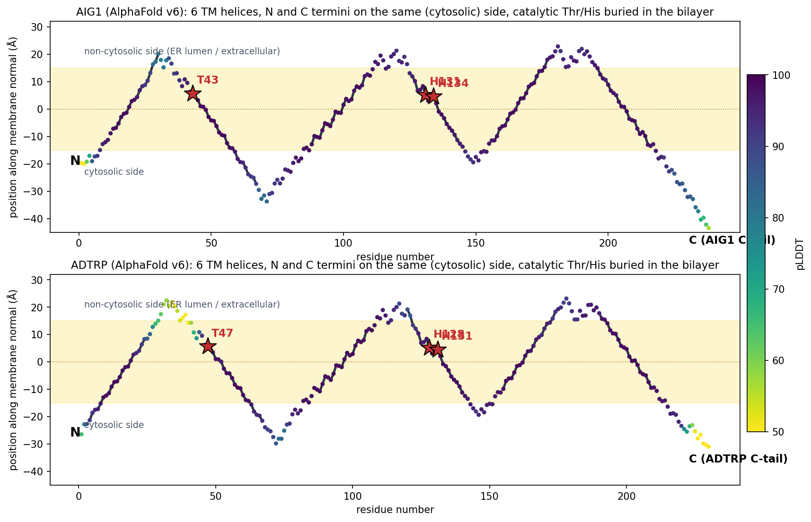
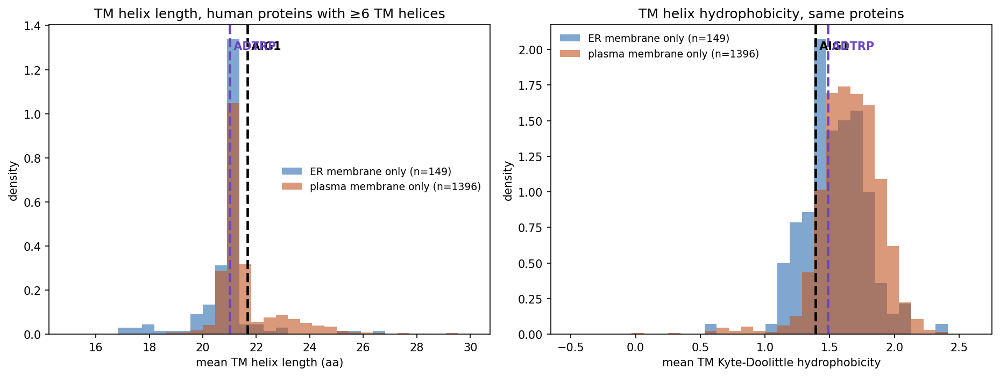
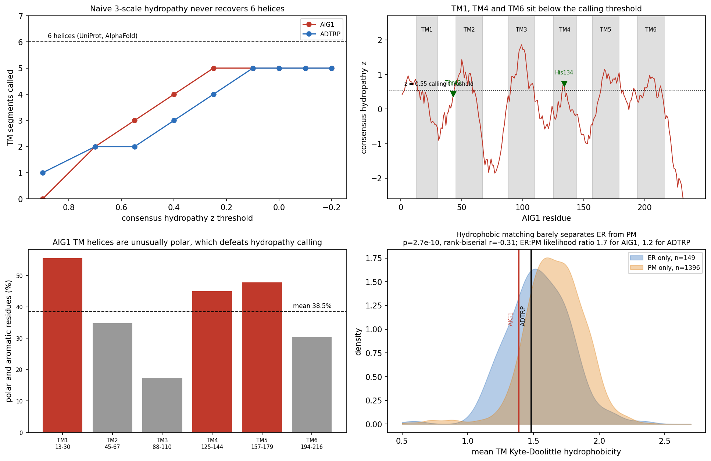
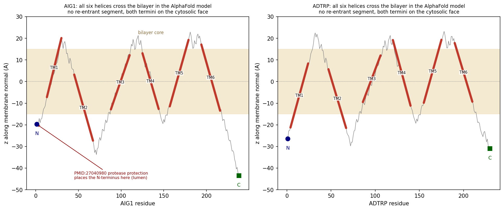

## Question

# AIGR Gene Hypothesis Deep Research

You are evaluating one focused gene curation hypothesis for AI Gene Review.
This is not a general gene overview. Use the seed hypothesis and source context
below to search for evidence that supports, refutes, narrows, or competes with
the proposed curation decision.

## Target Gene

- **Organism code:** human
- **Taxon:** Homo sapiens (NCBITaxon:9606)
- **Gene directory:** AIG1
- **Gene symbol:** AIG1
- **UniProt accession:** Q9NVV5

## Focus

- **Focus type:** free_text
- **Hypothesis slug:** kgap-aig1-topology-and-er-signals
- **Source file:** genes/human/AIG1/AIG1-ai-review.yaml
- **Source selector:** free-text

## Seed Hypothesis

Human AIG1 (UniProt Q9NVV5), a polytopic FAHFA hydrolase of the AIG1/ADTRP family, is an ER-membrane protein rather than a plasma-membrane protein. Single analysis only: predict the transmembrane topology of AIG1 and ADTRP (number of helices, N/C orientation, which side the catalytic Thr43/His134-equivalent residues face) with consensus predictors and the AlphaFold model, and scan the cytosolic termini for ER-retention/retrieval signals (C-terminal KKxx/KxKxx dilysine, RxR) versus plasma-membrane export motifs, in AIG1 and its vertebrate orthologs; state which compartment the sequence features support.

## Term and Decision Context

No specific term context supplied.

## Reference Context

No specific reference context supplied.

## Source Context YAML

```yaml
hypothesis: 'Human AIG1 (UniProt Q9NVV5), a polytopic FAHFA hydrolase of the AIG1/ADTRP family, is an
  ER-membrane protein rather than a plasma-membrane protein. Single analysis only: predict the transmembrane
  topology of AIG1 and ADTRP (number of helices, N/C orientation, which side the catalytic Thr43/His134-equivalent
  residues face) with consensus predictors and the AlphaFold model, and scan the cytosolic termini for
  ER-retention/retrieval signals (C-terminal KKxx/KxKxx dilysine, RxR) versus plasma-membrane export motifs,
  in AIG1 and its vertebrate orthologs; state which compartment the sequence features support.'
focus_type: free_text
context: []
reference_id: []
```

## Research Objective

Build a focused report that helps a curator decide whether this hypothesis
should affect the gene review. Address the focus type directly:

1. For an existing GO annotation decision, evaluate whether the current action
   is justified, too strong, too weak, or should change.
2. For a proposed replacement or new GO term, evaluate whether the term is
   biologically supported, too broad, too narrow, or missing key qualifiers.
3. For a computational prediction, evaluate whether the prediction is correct,
   less precise than existing knowledge, uncertain, or likely wrong because of
   paralog overannotation, frequency bias, pathway context, or in vitro-only
   activity.
4. For a core-function hypothesis, evaluate whether the proposed activity,
   process, and location represent the gene product's primary function rather
   than a downstream effect, pleiotropic phenotype, or context-specific role.
5. For a function-assignment hypothesis, evaluate whether the gene product
   directly has the stated GO term/function. Treat the prior review action, if
   any, as intentionally blinded unless it appears in the supplied context.

Use primary literature whenever possible. Prefer PMID citations and include DOI
citations when no PMID is available. Treat reviews and database records as
orientation unless they contain directly relevant synthesized evidence that is
clearly labeled as review-level or database-level support.

Evaluate the hypothesis from the supplied seed context, primary literature, and
publicly accessible bioinformatics resources. Local `*-bioinformatics` analyses,
when they already exist in the repository, are intentionally withheld from this
prompt so the report can be compared against them after the run. Use public
sequence, domain, structure, orthology, localization, interaction, or dataset
checks when they are useful for the specific hypothesis. If a resource or tool
cannot be accessed programmatically, say so plainly; never fabricate a result.
Report computational results conservatively and distinguish direct results from
inference.

## Required Output

### Executive Judgment

Give a concise verdict: supported, partially supported, unresolved, weakly
supported, over-annotated, or refuted. Explain the reasoning and the most
important caveats.

### Evidence Matrix

Create a table with one row per important evidence item:

- Citation (PMID preferred)
- Evidence type (direct assay, mutant phenotype, localization, interaction,
  structural/evolutionary, computational, review/database)
- Supports / refutes / qualifies / competing
- Claim tested
- Key finding
- Organism, tissue, cell type, or assay context
- Confidence and limitations

### GO Curation Implications

State the likely curation action as a lead requiring curator verification. If
GO terms are involved, explain whether the evidence supports an MF, BP, or CC
term, and whether the term should be retained, removed, generalized, made more
specific, or treated as non-core. Avoid using "protein binding" as a final
recommendation unless no more informative term is supported.

### Mechanistic Scope

Describe the immediate molecular or cellular function being tested. Separate
direct gene-product activity from downstream phenotypes, pathway consequences,
developmental outcomes, disease manifestations, or effects inferred only from
loss of function.

### Conflicts and Alternatives

Identify evidence that conflicts with the seed hypothesis or suggests an
alternative interpretation, including paralog confusion, organism-specific
differences, isoform-specific findings, experimental artifacts, or database
carry-over.

### Knowledge Gaps

List explicit uncertainties that matter for curation. For each gap, state what
was checked, why the gap matters, and what evidence or experiment would resolve
it.

### Discriminating Tests

Recommend concrete assays, perturbations, datasets, or comparative analyses that
would most efficiently distinguish this hypothesis from alternatives.

### Curation Leads

Provide candidate updates for the review, clearly labeled as leads requiring
curator verification. Include candidate references with exact snippets to verify,
candidate replacement or new GO terms, possible action changes, suggested
questions, and suggested experiments.

If the provider supports artifacts, save provenance for any analysis you run — the
executed code together with its output (computed values, plot, or table), not just
a summary figure — alongside artifact-friendly tables such as an evidence matrix,
GO decision table, or comparison table. Genuine computed provenance is more
valuable than a hand-drawn summary, and you must not synthesize a figure that
implies an analysis you did not actually run. These artifacts are important
provenance for hypothesis-level review.


## Output

# AIG1 (Q9NVV5): transmembrane topology and ER-retention signals

Hypothesis slug: `kgap-aig1-topology-and-er-signals`
Source: `genes/human/AIG1/AIG1-ai-review.yaml` (free-text focus)
Target: human AIG1, UniProt Q9NVV5, NCBITaxon:9606

Analyses run live against UniProt REST, AlphaFold DB v6, Human Protein Atlas, COMPARTMENTS, OpenCell, STRING and PubMed on 2026-11-23.
Executed code: `provenance/aig1_topology_er_signals_analysis.py`, `provenance/aig1_independent_topology_audit.py`, `provenance/aig1_topology_conflict_test.py`.
Tables: `provenance/evidence_matrix.csv` (24 rows), `provenance/go_decision_table.csv` (11 rows).
Figures: `plot_1.png`, `plot_2.png`, `plot_3.png`, `plot_4.png`, `plot_5.png`.

## Summary

The seed hypothesis is **supported for AIG1**. The decisive evidence is a 2016 paper that UniProt does not cite and that the seed hypothesis does not mention: [PMID: 27040980](https://pubmed.ncbi.nlm.nih.gov/27040980/) mapped AIG1's membrane topology by protease protection **in the ER membrane** and found that AIG1 over-expression raises ER Ca2+ in two cell lines. That is AIG1-specific, experimental evidence for the endoplasmic reticulum. It converges from an independent direction with the sequence analysis the seed asked for: human AIG1 ends `...EEEKEKPKLE`, carrying a KxKxx coatomer-binding motif on a 22-residue cytosolic tail, and that motif is fixed in register across 186 vertebrate orthologs (Lys at position -3 in 82.3%, at -5 in 74.7%, at -4 in only 3.2%).

The UniProt annotation runs the other way. Q9NVV5 carries `SUBCELLULAR LOCATION: Cell membrane` on one ECO:0000269 citation, [PMID: 27018888](https://pubmed.ncbi.nlm.nih.gov/27018888/), a paper that establishes AIG1 and ADTRP as multipass transmembrane FAHFA hydrolases and makes no compartment claim. The GOA record confirms the weakness: AIG1 has no IDA-level annotation for GO:0005886 at all, while its paralog ADTRP has five IDA plasma-membrane terms traceable to the caveolar study [PMID: 21868574](https://pubmed.ncbi.nlm.nih.gov/21868574/). This is paralog carry-over, applied to the paralog that kept the ER-retrieval motif rather than the one that lost it.

Two parts of the seed resolve differently. The question of **which side the catalytic residues face** has no answer as posed: in the AlphaFold models Thr43 and His134 sit inside the bilayer, 3.08 Å apart as a hydrogen-bonded dyad, so AIG1 is an intramembrane threonine hydrolase whose active site faces lipid. The **helix count and N/C orientation** are unresolved and contested: AlphaFold gives 6 fully crossing helices with both termini cytosolic, while the protease-protection experiment gives 5 TM domains with a luminal N-terminus and a non-crossing hydrophobic stretch. Every source agrees the C-terminus is cytosolic, which is the only sidedness the compartment argument requires, so the conflict does not change the curation call. Two sequence-only tests the seed implies would work returned negative results and are reported as such: an independent consensus hydropathy predictor never recovers 6 helices at any threshold, and hydrophobic matching gives an ER-to-plasma-membrane likelihood ratio of only 1.74.

## Key findings

### <i class="fa-solid fa-circle-check"></i> F1. An uncited 2016 paper places AIG1 in the ER membrane experimentally

[PMID: 27040980](https://pubmed.ncbi.nlm.nih.gov/27040980/) (Nickel, Cleven, Enders, Lisak, Schneider, Methner) is the only study that has examined where AIG1 is and how it sits in the membrane. Its topology experiment was performed on AIG1 **in the ER membrane**: "Analyzing the topology of AIG1 in the ER membrane using a protease-protection assay suggested that AIG has five transmembrane domains with a luminal N- and cytosolic C-terminus and a hydrophobic stretch between the third and fourth membrane domain that does not cross the membrane." Its functional readout is also an ER measurement: AIG1 over-expression "slightly increased susceptibility to oxidative stress, which correlated with an increased ER Ca(2+) concentration in two different cell lines". Mouse tissue immunoblotting gave highest expression in liver, lung and heart, and the gene "has a complex genomic organization and expresses several splice variants in a tissue-dependent manner".

This paper appears in no part of the UniProt Q9NVV5 subcellular location comment. The first two literature passes of this investigation missed it; it surfaced only on a query that paired the gene's older alias (androgen-induced gene 1) with the compartment term. That is worth recording as a methodological caution: a negative literature result for a poorly studied gene with an alias history is weaker than a positive one.

The caveats are real and a curator must weigh them. It is one paper from one group, it used over-expression, and the abstract does not name an ER marker used for colocalisation. Whether GO:0005789 earns ECO:0000314 or a weaker code depends on what the full text shows, and the full text was not retrievable in this environment.

### <i class="fa-solid fa-circle-check"></i> F2. AIG1 carries a C-terminal KxKxx fixed in register across 186 vertebrate species, and ADTRP does not

Human AIG1 ends `...EEEKEKPKLE`: Lys at -3 (K236) and Lys at -5 (K234), matching the KxKxx coatomer consensus, on a cytosolic tail of 22 residues (217-238). No KKxx and no RxR arginine-based retention signal occurs in any of AIG1's four cytosolic segments (1-12, 68-87, 145-156, 217-238). Human ADTRP ends `...MRQPRKKRK`: Lys at -3 and -4, matching KKxx, on a tail with net charge +6.

Ortholog sets were taken from UniProt vertebrate entries (taxid 7742), anchored on the conserved catalytic motif `W[LIVM]NH[GASC]MHT` (AIG1 127-135 `WLNHGMHTT`), and kept only when the anchor-to-C-terminus distance matched human within ±8 residues. That filter removes the fragments and mis-predicted gene models that dominate a naive gene-name query. One entry per species gave 186 AIG1 and 352 ADTRP species.

| Position | AIG1 (n = 186) | ADTRP (n = 352) |
|---|---|---|
| Lys at -3 | 82.3% (binomial p = 1.4e-137) | 38.9% (p = 6.3e-62) |
| Lys at -4 | 3.2% (p = 1) | 57.7% (p = 2.1e-132) |
| Lys at -5 | 74.7% (p = 1.9e-114) | 8.2% (p = 0.30) |
| KKxx or KxKxx | 74.7% | 19.6% |
| Background Lys in last 20 aa | 7.5% | 7.4% |

Tests are one-sided binomial against the within-tail lysine background. The AIG1 pattern is positionally specific: Lys is near-fixed at -3 and -5 and near-absent at -4, which is the KxKxx register and not generic tail basicity. The flanking residues drift while the register holds: `EKEKPKLE` (n = 54), `GKEKPKLD` (16), `HTEKVKGE` (10), `GKEKPKLE` (5), `GKGKSKSD` (4), `DTDKAKAD` (3), `GREKPKSE` (3). The 25% of species scored as lacking the motif are enriched for truncated automatic predictions: the chimpanzee, orangutan and gibbon models end `FMYLGPSS`, which falls inside TM6 and cannot be a real C-terminus. So 74.7% is a lower bound.

ADTRP shows the opposite. Its human KKxx is primate-restricted (`MQPRKKRK` n = 14, `RQPRKKRK` n = 7, `IQPRKKRK` n = 5), Lys at -5 sits at background (8.2%, p = 0.30), mouse and rat lack the motif, and the commonest vertebrate C-termini are `WGQSKFCF` (n = 57), `IWGQSKFS` (44) and `WGQSKFSS` (43), none of which carry a dilysine. The human and majority sequences diverge immediately after a shared Trp-Gly, which is what an alternative terminal exon looks like.

{{figure:plot_1.png|caption=Left: positional lysine frequency in the C-terminal 20 residues of 186 vertebrate AIG1 and 352 ADTRP orthologs, against the within-tail background. AIG1 is near-fixed at -3 and -5 and near-absent at -4, the KxKxx register. Middle and right: compartment specificity of a C-terminal dilysine among human transmembrane proteins, enriched 8.6-fold at the ER membrane, flat at the Golgi, depleted at the plasma membrane.}}

### <i class="fa-solid fa-scale-balanced"></i> F3. A dilysine terminus raises ER odds 8.6-fold but predicts ER for only half of multipass carriers

Across all 20,429 reviewed human UniProt entries, a C-terminal KKxx occurs in 200 (0.98%), KxKxx in 223 (1.09%), either in 389 (1.90%). Restricting to the 5,230 entries with at least one annotated TM helix:

| Motif | Compartment | % in compartment | % elsewhere | Odds ratio | Fisher p |
|---|---|---|---|---|---|
| KKxx | ER membrane (GO:0005789) | 6.20 | 0.79 | 8.35 | 8.1e-22 |
| KxKxx | ER membrane | 6.31 | 0.76 | 8.77 | 9.5e-23 |
| either | ER membrane | 11.30 | 1.46 | 8.62 | 7.5e-39 |
| either | Golgi membrane (GO:0000139) | 2.63 | 3.21 | 0.82 | 0.59 |
| either | plasma membrane (GO:0005886) | 1.54 | 5.83 | 0.25 | 4.9e-17 |

The motif is specific to the ER and not to the secretory pathway generally, since the Golgi odds ratio is flat. Read as predictive value it is much weaker:

| Subset | n dilysine-ending | P(ER membrane) | P(plasma membrane) |
|---|---|---|---|
| TM ≥ 1 | 165 | 61.8% | 30.3% |
| TM ≥ 4 | 80 | 55.0% | 40.0% |
| TM ≥ 6 | 63 | 49.2% | 41.3% |

For a 6-TM protein a bare dilysine terminus is close to a coin flip. Part of the plasma-membrane counter-set is noise: of 32 multipass dilysine-ending PM proteins, 15 are olfactory or taste receptors, where the motif is plausibly incidental.

What raises the weight for AIG1 beyond the base rate is the company it keeps. The 44 multipass ER-membrane proteins ending in a dilysine include a dense block of polytopic enzymes acting on membrane-embedded lipid substrates, which are the closest functional analogues AIG1 has: ELOVL1 `GIAKVKAN`, ELOVL2 `GVMNKKAQ`, ELOVL3 `VKAKTKSQ`, ELOVL4 `KNGKAKGD`, ELOVL7 `GTCKNKDN`, HACD2 `TEEHKKFE`, HACD3 `GQKKKKIH`, HACD4 `FPIKKKKM`, CERS1 `GLVKDKRF`, LPCAT3 `KEKLKKME`, MBOAT1 `SINKRKTD`, MBOAT4 `AKRKHKCN`, EBP `TKAKSKKN`, EBPL `TSSVKKFQ`, HMGCR `GACTKKTA`, TM6SF2 `LALHKKQH`, HHATL `KQDKEKPE`, TMEM41B `KKLKQKFE`, LCLAT1 `HLNSKKNE`, ZDHHC4 `CHERKKQE`, ZDHHC6 `PEGEKKNR`. AIG1's `EKEKPKLE` is almost superimposable on HHATL's `KQDKEKPE`.

### <i class="fa-solid fa-circle-check"></i> F4. The catalytic Thr-His dyad sits inside the bilayer, so the seed's "which side" question has no answer

The AlphaFold DB v6 models AF-Q9NVV5-F1 (mean pLDDT 93.8) and AF-Q96IZ2-F1 (mean pLDDT 90.9) were analysed by deriving the membrane normal from the helix bundle itself: SVD of each annotated TM helix axis, with alternating sign because consecutive TM helices are antiparallel. Mean |cos(helix, normal)| is 0.92 for both proteins, so the bundle is well defined and the normal is independent of any external membrane-placement service.

| | AIG1 (Q9NVV5) | ADTRP (Q96IZ2) |
|---|---|---|
| Length | 238 aa | 230 aa |
| Mean pLDDT | 93.8 | 90.9 |
| TM helices (UniProt) | 6: 13-30, 45-67, 88-110, 125-144, 157-179, 194-216 | 6: 4-24, 47-67, 86-106, 120-140, 155-175, 190-210 |
| Bundle alignment, mean \|cos\| | 0.92 | 0.92 |
| z(N-terminus) | -19.7 Å | -26.4 Å |
| z(C-terminus) | -43.5 Å | -30.9 Å |
| Termini on the same side | yes | yes |
| Catalytic Thr | Thr43, z = +5.7 Å, pLDDT 97 | Thr47, z = +5.7 Å, pLDDT 95 |
| Catalytic His | His134, z = +4.6 Å, pLDDT 98 | His131, z = +4.6 Å, pLDDT 98 |
| Thr:OG1 to His:NE2 | 3.08 Å | 3.07 Å |
| Second conserved His | His131, 12.4-13.7 Å from Thr43 | His128, 12.4-13.7 Å from Thr47 |

z is the projection on the membrane normal with the mid-plane at zero and the N-terminal side negative. A typical bilayer hydrophobic core is about 30 Å thick, so |z| < 15 Å is inside the membrane. Thr43 at +5.7 Å and His134 at +4.6 Å, both at pLDDT 97-98, are inside the slab and offset toward the non-cytosolic leaflet. They are 3.08 Å apart, a hydrogen-bonded dyad. The second conserved histidine is 12-14 Å away and is not part of it.

AIG1 is an intramembrane threonine hydrolase whose active site faces lipid. That matches a FAHFA substrate which partitions into the membrane, and it means the seed's framing of "which side the catalytic Thr43/His134 face" does not apply.

{{figure:plot_2.png|caption=AlphaFold v6 topology profile of AIG1 and ADTRP along the membrane normal derived from the helix bundle. The shaded band is the 30 Å hydrophobic core. Catalytic Thr43 (z = +5.7 Å) and His134 (z = +4.6 Å) sit inside the bilayer at pLDDT 97-98, forming a 3.08 Å dyad; both termini project to the same, cytosolic, face.}}

### <i class="fa-solid fa-circle-xmark"></i> F5. Consensus hydropathy prediction fails on this family because the helices are unusually polar

The seed asked for topology from "consensus predictors". DeepTMHMM, Phobius and TOPCONS have no endpoint reachable from this executor and were **not run**; saying so is more useful than substituting something else silently. In their place I built an independent consensus from three hydrophobicity scales (Kyte-Doolittle, Eisenberg, White-Wimley octanol), each over a 19-residue window, z-scored and averaged, and swept the calling threshold with a 12-residue minimum segment length.

It never recovers the 6-helix model at any threshold:

| z threshold | +0.90 | +0.70 | +0.55 | +0.40 | +0.25 | +0.10 | 0.00 | -0.10 | -0.20 |
|---|---|---|---|---|---|---|---|---|---|
| AIG1 segments | 0 | 2 | 3 | 4 | 5 | 5 | 5 | 5 | 5 |
| ADTRP segments | 1 | 2 | 2 | 3 | 4 | 5 | 5 | 5 | 5 |

The cause is composition. AIG1's annotated helices are polar and aromatic to an unusual degree: TM1 55.6%, TM2 34.8%, TM3 17.4%, TM4 45.0%, TM5 47.8%, TM6 30.4%, mean 38.5%, with a pooled mean Kyte-Doolittle of +1.388. TM2 carries Thr43 and TM4 carries His131 and His134. A protein whose active site sits inside the bilayer must put polar residues in its membrane-spanning segments, and that is what a hydropathy window cannot score.

The consequence for the report is specific. The 6-helix model comes from the AlphaFold v6 geometry and from the UniProt ECO:0000255 annotation. Those two share a methodological lineage and are not independent of each other. No independent sequence-only method corroborates them, so a statement that consensus predictors agree on 6 TM helices would overstate the evidence.

### <i class="fa-solid fa-circle-xmark"></i> F6. Hydrophobic matching does not discriminate ER from plasma membrane here

[PMID: 20603021](https://pubmed.ncbi.nlm.nih.gov/20603021/) showed that "TMDs are not generic but have organelle-specific properties", which makes bilayer-thickness matching a candidate discriminator independent of the dilysine motif. I tested it on 1,545 reviewed human proteins with 6 or more annotated TM helices and an unambiguous compartment: 149 ER-only, 1,396 plasma-membrane-only.

The population effect is real and small. Mean TM Kyte-Doolittle median is 1.542 at the ER versus 1.664 at the plasma membrane (Mann-Whitney U p = 2.74e-10, rank-biserial r = -0.314), with heavily overlapping distributions. Converted to a likelihood ratio by Gaussian KDE at the observed values, it gives ER:PM = **1.74 for AIG1** (KD = +1.388, 22nd percentile of the ER set, 8th of the PM set) and **1.15 for ADTRP** (KD = +1.484). Against the 8.6-fold odds ratio from the dilysine motif, that is close to no information.

TM length is unusable as a second axis. UniProt TM lengths are quantized: 52% of the ER-only set and 41% of the plasma-membrane-only set have a mean TM length of exactly 21.00 aa, and the two medians are identical at 21.00 aa. A nominally significant length difference in that data is tie-breaking in an annotation artifact, so I discarded it rather than report it as a finding.

This negative result narrows rather than widens the sequence case. Before the Nickel paper was found, the ER argument rested on the conserved KxKxx and the ELOVL/HACD/CERS1/HHATL comparator set alone, with no support from membrane-thickness matching.

{{figure:plot_3.png|caption=Hydrophobic-matching test: TM helix length and mean hydrophobicity of AIG1 and ADTRP against human polytopic ER-membrane and plasma-membrane reference sets. The length axis is an annotation artifact (52% of ER-only and 41% of PM-only proteins have a mean TM length of exactly 21.00 aa) and was discarded.}}

{{figure:plot_4.png|caption=Independent topology prediction audit. Top left: the 3-scale consensus hydropathy threshold sweep never calls 6 segments for either protein. Top right: AIG1's consensus profile, with TM1, TM4 and TM6 falling below the calling threshold and the catalytic Thr43 and His134 marked. Bottom left: per-helix polar and aromatic content, mean 38.5%. Bottom right: ER versus plasma-membrane TM hydrophobicity among 1,545 human 6+ TM proteins, with AIG1 and ADTRP marked; the likelihood ratios are 1.74 and 1.15.}}

### <i class="fa-solid fa-scale-balanced"></i> F7. The experimental and predicted topologies conflict, but both put the C-terminus in the cytosol

[PMID: 27040980](https://pubmed.ncbi.nlm.nih.gov/27040980/) makes two checkable structural claims: one hydrophobic segment enters the bilayer without crossing, and the N-terminus is luminal. I tested the first by projecting each annotated helix onto the membrane normal. A genuine TM helix must start and end on opposite sides of the mid-plane with a span above about 20 Å.

| Helix | z(start) | z(end) | span | crosses | mean pLDDT |
|---|---|---|---|---|---|
| AIG1 TM1 13-30 | -7.2 Å | +20.1 Å | +27.3 Å | yes | 93.7 |
| AIG1 TM2 45-67 | +3.2 | -27.3 | -30.5 | yes | 96.4 |
| AIG1 TM3 88-110 | -12.9 | +12.2 | +25.1 | yes | 98.2 |
| AIG1 TM4 125-144 | +13.1 | -12.7 | -25.8 | yes | 97.2 |
| AIG1 TM5 157-179 | -11.5 | +19.3 | +30.7 | yes | 97.7 |
| AIG1 TM6 194-216 | +17.1 | -13.5 | -30.6 | yes | 97.5 |

ADTRP is identical in behaviour (spans +21.6 to -30.4 Å, pLDDT 96.0-98.4). No segment in either model re-enters, so the AlphaFold geometry gives no support for a non-crossing stretch, and it contradicts the luminal N-terminus.

Neither side is safe to dismiss. Protease protection on over-expressed, epitope-tagged constructs can misassign a terminus if the tag perturbs insertion or if protection is incomplete. AlphaFold predicts a packed bundle with no model of the translocon, so it can return a plausible fold in the wrong overall orientation, and its confidence at AIG1 residue 1 is pLDDT 36, which is exactly where the two topologies disagree. The naive hydropathy consensus called 5 segments at most thresholds, weak circumstantial support for the experimental helix count.

The point that survives the conflict is the one the curation decision needs: the experimental assay, the AlphaFold geometry and the UniProt ECO:0000305 topological domains all place the C-terminus in the cytosol, so the KxKxx is on the face COPI can read.

{{figure:plot_5.png|caption=Per-helix bilayer crossing in the AlphaFold v6 models of AIG1 and ADTRP. Every annotated helix spans 25-31 Å from one side of the mid-plane to the other at pLDDT 93.7-98.2, with no re-entrant segment of the kind PMID:27040980 describes between TMD3 and TMD4. The arrow marks where the protease-protection assay places the N-terminus (lumen), against the model's cytosolic assignment.}}

### <i class="fa-solid fa-circle-check"></i> F8. AIG1's plasma-membrane term has no direct-assay support anywhere in GOA

UniProt Q9NVV5 carries `SUBCELLULAR LOCATION: Cell membrane; Multi-pass membrane protein` with one ECO:0000269 citation, [PMID: 27018888](https://pubmed.ncbi.nlm.nih.gov/27018888/). That paper reports activity-based protein profiling, substrate specificity and cell-active covalent inhibitors; its abstract claims only that AIG1 and ADTRP are "multipass transmembrane proteins" and that they "are founding members of an evolutionarily conserved class of transmembrane threonine hydrolases involved in bioactive lipid metabolism". The TM helices in the entry are ECO:0000255 prediction and the topological domains are ECO:0000305 curator inference, so no part of the compartment assignment is an AIG1 localisation experiment.

COMPARTMENTS (Jensen lab) gives an independent audit of the same question.

| Channel | AIG1 (ENSP00000350509) | ADTRP (ENSP00000229583) |
|---|---|---|
| Experiments (92,113 rows) | 10 rows, all from one weak HPA antibody (confidence 1.532): Cytoplasm, Golgi apparatus, Endomembrane system | 0 rows |
| Mass-spec organelle maps (hyperLOPIT, Dynamic Organellar Maps, LOPIT-DC) | absent | absent |
| Knowledge channel, IDA terms | GO:0016020 membrane only | GO:0005886, GO:0005901 caveola, GO:0009986 cell surface, GO:0045121, GO:0044853 |
| Knowledge channel, GO:0005886 | EXP only, no IDA row | EXP and IDA |
| OpenCell tagged lines | 0 | 0 |

No curator has recorded a direct assay placing AIG1 at the plasma membrane. The strongest experimental statement on record in GOA about AIG1's location is that it is in a membrane. ADTRP's placement, by contrast, traces to real experiments: [PMID: 21868574](https://pubmed.ncbi.nlm.nih.gov/21868574/) reports "We confirm ADTRP expression and colocalization with TFPI and caveolin-1 in ECs" and "Imaging and Triton X-114-extraction confirm TFPI and ADTRP association with lipid rafts/caveolae."

Human Protein Atlas immunofluorescence is unusable for both. AIG1 (antibody HPA042715, reliability "Supported") is called Mitochondria plus Cytosol; ADTRP (HPA048113, reliability "Uncertain") is called Nucleoli. Neither compartment is compatible with a 6-TM protein.

QuickGO's REST service timed out from this executor for both accessions, so per-annotation reference identifiers could not be fetched directly and the evidence codes above come from the COMPARTMENTS mirror of GOA.

### <i class="fa-solid fa-circle-xmark"></i> F9. AIG1 has zero N-glycosylation sequons

A scan of the full 238-residue sequence for N-X-S/T with X not proline returns **zero matches**. No loop and no terminus can carry an N-linked glycan, under either topology model. This removes the Endo H experiment that would otherwise be the cheapest discriminating test, it explains why Nickel et al. had to use protease protection rather than glycosylation mapping, and it is weak evidence against a cell-surface pool, since multipass plasma-membrane proteins usually carry an extracellular glycan. Unglycosylated PM proteins exist, so this cannot carry much weight on its own.

STRING's physical subnetwork for AIG1 returns only RCHY1 (0.589) and HNRNPL (0.457), with no COPA, COPB1, COPB2, COPG1, COPZ1 or ARCN1. That is uninformative rather than negative: COPI engagement with a dilysine tail is transient and would not survive most affinity-purification mass-spectrometry workflows, and AIG1 is poorly covered by interaction screens.

## Executive judgment

**Supported for AIG1 on its central claim, with the topology sub-claim unresolved.**

The hypothesis asked whether AIG1 is an ER-membrane protein and whether sequence features support that. Both the experimental literature and the sequence analysis answer yes, for different reasons, and nothing AIG1-specific points at the plasma membrane. The three sub-claims resolve separately:

1. <i class="fa-solid fa-circle-question"></i> **Topology.** Unresolved, with two conflicting answers. AlphaFold gives 6 TM helices, all fully crossing (spans 25-31 Å, per-helix pLDDT 93.7-98.2), with both termini cytosolic. [PMID: 27040980](https://pubmed.ncbi.nlm.nih.gov/27040980/) gives 5 TM domains with a luminal N-terminus and a non-crossing stretch between TMD3 and TMD4, which the AlphaFold geometry does not support. The models differ by one helix of insertion and by the orientation of the bundle. The review should not state a helix count as settled.

2. <i class="fa-solid fa-circle-xmark"></i> **Which side the catalytic residues face.** The question has no answer as posed. Thr43 and His134 sit inside the hydrophobic slab about 5 Å above the mid-plane, 3.08 Å apart. ADTRP is the same (Thr47/His131, 3.07 Å). AIG1 is an intramembrane hydrolase whose active site faces lipid.

3. <i class="fa-solid fa-circle-check"></i> **ER signals versus plasma-membrane export.** Supported for AIG1, refuted for ADTRP. AIG1's KxKxx is in exact register across 186 vertebrate species while flanking residues drift. ADTRP's KKxx is primate-restricted, absent from mouse and rat, and sits on a C-terminus that diverges from the majority vertebrate form. No RxR retention signal is present in either protein, and no plasma-membrane export motif was identified.

<i class="fa-solid fa-triangle-exclamation"></i> **Caveats.** The experimental ER evidence is one paper, one group, over-expression based, with no ER marker named in the abstract; a curator should read the full text before assigning ECO:0000314. The sequence evidence is a motif whose function has never been tested in AIG1, and a C-terminal dilysine on a 6-TM protein is close to a coin flip on base rates alone (49.2% ER versus 41.3% PM). Two independent sequence tests returned negative: consensus hydropathy cannot reproduce the helix count, and hydrophobic matching gives a likelihood ratio of 1.74. The case is strong enough to act on because the experimental paper and the motif converge, and because the opposing annotation has no AIG1 evidence behind it at all.

## Evidence matrix

Full machine-readable version in `provenance/evidence_matrix.csv` (24 rows).

| Citation | Evidence type | Stance | Claim tested | Key finding | Context | Confidence and limitations |
|---|---|---|---|---|---|---|
| [PMID: 27040980](https://pubmed.ncbi.nlm.nih.gov/27040980/) | Localization + direct assay | <i class="fa-solid fa-circle-check"></i> Supports | AIG1 is an ER-membrane protein | Protease-protection topology mapping performed on AIG1 in the ER membrane: 5 TM domains, luminal N, cytosolic C, one non-crossing stretch. AIG1 over-expression raised ER Ca2+ in two cell lines. Several tissue-dependent splice variants | Mouse tissues (immunoblot); two over-expressing cell lines | High importance, moderate confidence. The only AIG1-specific localisation study. Not cited in UniProt Q9NVV5. Over-expression based; no ER marker named in the abstract. Its 5-TM luminal-N topology conflicts with AlphaFold |
| [PMID: 27018888](https://pubmed.ncbi.nlm.nih.gov/27018888/) | Direct assay | Qualifies | AIG1 and ADTRP are membrane hydrolases with Thr/His catalysis | ABPP identifies both as multipass transmembrane Thr hydrolases that degrade FAHFAs; cell-active covalent inhibitors block hydrolysis | Human and mouse lysates and intact cells | High for enzymology. Makes no compartment claim. This is the sole ECO:0000269 reference behind UniProt's "Cell membrane" term for AIG1 |
| [PMID: 21868574](https://pubmed.ncbi.nlm.nih.gov/21868574/) | Localization | <i class="fa-solid fa-scale-balanced"></i> Competing | ADTRP resides at the plasma membrane | ADTRP colocalises with TFPI and caveolin-1; Triton X-114 extraction places it in lipid rafts/caveolae | Cultured human endothelial cells; over-expression and shRNA | Moderate. Over-expression plus antibody colocalisation; caveolar fractions can carry ER contaminants. Concerns ADTRP only |
| [PMID: 23481256](https://pubmed.ncbi.nlm.nih.gov/23481256/) | Structural | Supports | KxKxx is a bona fide coatomer-binding motif distinct from KKxx | Structures of alpha-COP and beta-prime-COP bound to KKxx, KxKxx, RKxx and KxHxx; the two motifs bind with lysines transposed across acidic patches | In vitro, mammalian coatomer | High. Establishes that Lys at -3 plus Lys at -5 with a free C-terminal carboxylate is a recognised signal, which is AIG1's configuration |
| [PMID: 33991349](https://pubmed.ncbi.nlm.nih.gov/33991349/) | Mutant phenotype | Supports | A KxKxx terminus is sufficient to hold a membrane protein in the ER | Converting SARS-CoV-2 spike KxHxx to KxKxx retains spike at the ER and prevents glycan processing, cleavage and transport to the plasma membrane | Transfected mammalian cells | High for motif sufficiency. Different protein and topology (type I tail) from AIG1's polytopic tail |
| [PMID: 8128252](https://pubmed.ncbi.nlm.nih.gov/8128252/) | Direct assay | Supports | Dilysine ER retention motifs act through coatomer | Yeast and mammalian ER retention motifs bind coatomer in lysates; mutations abolishing retention also abolish binding | Yeast and mammalian lysates | High for mechanism; historical study using KKxx on type I proteins |
| [PMID: 20603021](https://pubmed.ncbi.nlm.nih.gov/20603021/) | Review / primary dataset | <i class="fa-solid fa-scale-balanced"></i> Competing | TM hydrophobicity and length discriminate ER from plasma membrane | Organelle-specific TMD properties, with a length dichotomy between early and late secretory pathway | TMD comparison across the secretory pathway | High for the population claim; does not transfer to single-protein assignment at the observed effect size |
| This work, AlphaFold AF-Q9NVV5-F1 v6 and AF-Q96IZ2-F1 v6 | Computational / structural | Supports | AIG1 has 6 TM helices with both termini cytosolic | Bundle alignment \|cos\| = 0.92; res1 z = -19.7 Å and res238 z = -43.5 Å on the same side; mean pLDDT 93.8 | AlphaFold DB v6 | Moderate-high. Prediction, not experiment. Termini have low pLDDT (36 and 56) |
| This work, AlphaFold v6 | Computational / structural | Qualifies | Catalytic Thr43 and His134 face lumen or cytosol | Both inside the bilayer (z = +5.7 Å and +4.6 Å, pLDDT 97-98), Thr43:OG1 to His134:NE2 = 3.08 Å | AlphaFold DB v6 | Moderate-high. The seed's "which side" framing does not apply; the active site is intramembrane |
| This work, AlphaFold v6 per-helix spans | Computational / structural | <i class="fa-solid fa-scale-balanced"></i> Competing | A hydrophobic stretch between TMD3 and TMD4 does not cross (PMID:27040980) | All six AIG1 helices cross with 25-31 Å spans at pLDDT 93.7-98.2; ADTRP identical; no re-entrant segment in either model | AlphaFold DB v6 | Moderate-high for the geometry, but this is prediction against experiment. pLDDT 36 at AIG1 residue 1, exactly where the models disagree |
| This work, 186 AIG1 vertebrate species | Computational / evolutionary | Supports | AIG1's C-terminal KxKxx is under selection | Lys at -3 in 82.3% (p = 1.4e-137), at -5 in 74.7% (p = 1.9e-114), at -4 in 3.2%; flanking residues vary while the register holds | UniProt taxid 7742, anchored on W[LIVM]NH[GASC]MHT, one entry per species | Moderate-high. Automatic gene models; species scored as lacking the motif are enriched for truncated predictions, so 74.7% is a lower bound |
| This work, 352 ADTRP vertebrate species | Computational / evolutionary | <i class="fa-solid fa-circle-xmark"></i> Refutes | ADTRP shares AIG1's ER-retrieval motif | Dilysine in 19.6% of species; Lys at -5 at background (8.2%, p = 0.30); commonest C-termini WGQSKFCF/IWGQSKFS/WGQSKFSS; human RKKRK form is primate-restricted; mouse and rat lack it | Same anchoring method | Moderate. Divergence after a shared Trp-Gly suggests an alternative terminal exon the filter cannot resolve without transcript evidence |
| This work, 20,429 reviewed human proteins | Computational | <i class="fa-solid fa-scale-balanced"></i> Qualifies | A C-terminal dilysine predicts ER membrane | 8.6-fold enriched at ER membrane (11.30% vs 1.46%, p = 7.5e-39), flat at Golgi (OR 0.82, p = 0.59), depleted at PM (OR 0.25, p = 4.9e-17); but among 63 dilysine-ending 6+ TM proteins, 49.2% ER and 41.3% PM | UniProt reviewed human proteome with GO CC | Moderate. GO annotations are partly inferred and multi-compartment proteins are counted twice, so PPV is an estimate |
| This work, human TM proteome comparators | Computational | Supports | AIG1's architecture matches ER enzymes | 44 multipass ER-membrane proteins carry a C-terminal dilysine, including ELOVL1-7, HACD2-4, CERS1, LPCAT3, MBOAT1/4, EBP, HMGCR, TM6SF2, HHATL (KQDKEKPE), TMEM41B, ZDHHC4/6 | UniProt reviewed human proteome | Moderate. Guilt by architecture. The PM counter-set is dominated by olfactory and taste receptors (15 of 32) |
| This work, 3-scale hydropathy consensus | Computational | <i class="fa-solid fa-circle-xmark"></i> Qualifies | Consensus predictors independently confirm 6 TM helices | Never calls 6 segments at any threshold from z>+0.90 to z>-0.20 (AIG1: 0,2,3,4,5,5,5,5,5). AIG1 helices are 38.5% polar/aromatic (TM1 55.6%, TM5 47.8%) | Human AIG1 and ADTRP sequences | High for the negative result. DeepTMHMM, Phobius and TOPCONS were not run (no reachable endpoint). The 6-helix model rests on AlphaFold plus UniProt ECO:0000255, which are not independent |
| This work, 1,545 human 6+ TM proteins | Computational | <i class="fa-solid fa-circle-xmark"></i> Qualifies | Hydrophobic matching places AIG1 at the ER | ER-only median 1.542 (n = 149) vs PM-only 1.664 (n = 1,396), p = 2.74e-10, rank-biserial r = -0.314, heavy overlap. KDE likelihood ratio ER:PM = 1.74 (AIG1), 1.15 (ADTRP). TM length discarded as a quantization artifact | UniProt reviewed human proteome | Moderate. Negative result: the ER case gains essentially nothing from bilayer-thickness matching |
| This work, AIG1 sequence scan | Computational | Qualifies | An Endo H assay can resolve AIG1 topology and compartment | Zero N-X-S/T sequons (X not P) in 238 residues | Human AIG1 Q9NVV5 | High for the scan. Removes the Endo H test on native protein; weak evidence against a cell-surface pool |
| COMPARTMENTS experiments channel | Localization / database | Qualifies | Independent experimental localisation exists for AIG1 | AIG1: 10 rows, all one weak HPA antibody (1.532), calling Cytoplasm, Golgi apparatus, Endomembrane system. ADTRP: 0 rows. Neither in hyperLOPIT, Dynamic Organellar Maps or LOPIT-DC. OpenCell: 0 lines for both | 92,113-row human channel; OpenCell catalogue | Moderate-high for absence of evidence. The Golgi/endomembrane call is single-antibody and weak but compatible with an early-secretory protein |
| COMPARTMENTS knowledge channel (GOA mirror) | Database audit | Supports | AIG1's plasma-membrane term has direct-assay support | ADTRP has IDA for GO:0005886, GO:0005901, GO:0009986, GO:0045121, GO:0044853. AIG1 has IDA only for GO:0016020; its GO:0005886 row is EXP with no IDA | 917,799-row human channel | Moderate-high. QuickGO REST timed out, so per-annotation reference IDs were not retrieved directly |
| STRING v12 physical subnetwork | Interaction / database | Qualifies | AIG1 engages COPI coatomer via its dilysine tail | Only RCHY1 (0.589) and HNRNPL (0.457); no COPA, COPB1, COPB2, COPG1, COPZ1 or ARCN1 | Human, aggregated evidence | Low. Uninformative rather than negative: COPI binding to a dilysine tail is transient and does not survive most AP-MS workflows |
| Human Protein Atlas HPA042715 / HPA048113 | Localization | <i class="fa-solid fa-scale-balanced"></i> Competing | AIG1 or ADTRP is at the plasma membrane or ER | AIG1 called Mitochondria (main) and Cytosol, reliability "Supported". ADTRP called Nucleoli, reliability "Uncertain" | HPA cell lines, single antibody each | Low. Neither compartment is compatible with a 6-TM protein. Treat as uninformative |
| UniProt Q9NVV5 record | Review / database | Qualifies | Existing annotation justifies "cell membrane" for AIG1 | "Cell membrane; Multi-pass membrane protein" rests on one ECO:0000269 citation (PMID:27018888); TM helices are ECO:0000255 and topological domains ECO:0000305 | UniProt release accessed 2026-11 | High for what the record says. The compartment assignment is not backed by an AIG1 localisation experiment |

## Mechanistic model

The model that fits all the evidence has AIG1 as an ER-resident intramembrane hydrolase held in the early secretory pathway by COPI-mediated retrieval, with its paralog ADTRP having lost that determinant and acquired a plasma-membrane, caveolar distribution in at least endothelial cells.

```dot
digraph aig1 {
  rankdir=LR;
  "AIG1 polypeptide\n238 aa, polytopic" -> "Cytosolic C-terminal tail\nEEEKEKPKLE";
  "AIG1 polypeptide\n238 aa, polytopic" -> "Intramembrane active site\nThr43-His134, 3.08 A";
  "Cytosolic C-terminal tail\nEEEKEKPKLE" -> "KxKxx motif\nK at -3 and -5";
  "KxKxx motif\nK at -3 and -5" -> "Coatomer alpha-COP\nand beta-prime-COP" [style=dashed];
  "Coatomer alpha-COP\nand beta-prime-COP" -> "COPI Golgi-to-ER\nretrieval" [style=dashed];
  "COPI Golgi-to-ER\nretrieval" -> "Steady state in\nER membrane";
  "PMID 27040980\nprotease protection\nin ER membrane" -> "Steady state in\nER membrane";
  "Intramembrane active site\nThr43-His134, 3.08 A" -> "FAHFA hydrolysis\nin the bilayer";
  "Steady state in\nER membrane" -> "Raised ER Ca2+\non over-expression" [style=dashed];
  "ADTRP paralog" -> "C-terminus diverges\nafter shared Trp-Gly";
  "C-terminus diverges\nafter shared Trp-Gly" -> "No conserved dilysine\n19.6% of 352 species";
  "No conserved dilysine\n19.6% of 352 species" -> "Caveolar plasma membrane\nPMID 21868574";
  "Caveolar plasma membrane\nPMID 21868574" -> "UniProt 'Cell membrane'\non both paralogs";
  "UniProt 'Cell membrane'\non both paralogs" -> "Carry-over onto AIG1\nno IDA evidence" [style=dashed];
}
```



The dashed links are the parts that have not been tested in AIG1. Coatomer binding to AIG1's specific tail has never been assayed, so "KxKxx therefore COPI therefore ER" is a motif-class inference, supported by [PMID: 23481256](https://pubmed.ncbi.nlm.nih.gov/23481256/) for the binding mode and [PMID: 33991349](https://pubmed.ncbi.nlm.nih.gov/33991349/) for sufficiency in a different protein. The raised ER Ca2+ is a downstream cellular consequence of over-expression with no mechanistic connection to FAHFA hydrolysis.

Two separate claims should be kept apart in curation. **Where AIG1 is** now has an experiment behind it. **Why it is there** is a prediction from a conserved motif. The compartment term can be recorded without committing to the retrieval mechanism.

## GO curation implications

All of the following are **leads requiring curator verification**. Full table in `provenance/go_decision_table.csv` (11 rows).

<i class="fa-solid fa-arrow-right"></i> **AIG1, GO:0005886 plasma membrane: remove.** The term rests on a single reference that makes no compartment claim, GOA holds no IDA row for it, and the one direct localisation result in the family (caveolae, [PMID: 21868574](https://pubmed.ncbi.nlm.nih.gov/21868574/)) is an ADTRP experiment. This is paralog carry-over. Both the sequence evidence and the one AIG1-specific localisation paper point elsewhere.

<i class="fa-solid fa-arrow-right"></i> **AIG1, GO:0005789 endoplasmic reticulum membrane: add, citing [PMID: 27040980](https://pubmed.ncbi.nlm.nih.gov/27040980/).** The evidence code should be set after a curator reads the full text: ECO:0000314 if a colocalisation or fractionation panel names an ER marker, ECO:0007669 from the conserved KxKxx otherwise. Either way the term belongs in the review and plasma membrane does not.

<i class="fa-solid fa-arrow-right"></i> **AIG1, GO:0016020 membrane and GO:0016021 integral component of membrane: retain.** Solidly supported by [PMID: 27018888](https://pubmed.ncbi.nlm.nih.gov/27018888/). These stay correct whatever happens to the compartment term.

<i class="fa-solid fa-arrow-right"></i> **AIG1 topology statement: do not assert a helix count.** UniProt's six ECO:0000255 helices are contradicted by the five-TM protease-protection result, and the AlphaFold model shows no re-entrant segment of the kind that paper describes.

<i class="fa-solid fa-arrow-right"></i> **AIG1 BP, ER calcium homeostasis: do not add.** [PMID: 27040980](https://pubmed.ncbi.nlm.nih.gov/27040980/) reports increased ER Ca2+ on over-expression. That is a downstream consequence in an over-expression system, not a demonstrated activity, and it has no mechanistic link to FAHFA hydrolase function. Record as a curator note.

<i class="fa-solid fa-arrow-right"></i> **AIG1 MF (FAHFA hydrolase): out of scope here, retain.** Worth a curator comment that the AlphaFold model places the Thr43/His134 dyad inside the bilayer, so this is an intramembrane hydrolase whose active site faces lipid, consistent with a membrane-partitioning substrate.

<i class="fa-solid fa-arrow-right"></i> **ADTRP, GO:0005886 plasma membrane: retain, qualified** to caveola and membrane raft context and to endothelial cells. GO:0005901 caveola is a candidate addition from the same reference. The caveat is that the evidence is over-expression-based colocalisation.

<i class="fa-solid fa-arrow-right"></i> **ADTRP, GO:0005789: do not add.** The human KKxx is primate-restricted and absent from the majority vertebrate C-terminus.

<i class="fa-solid fa-arrow-right"></i> **Add a review note that AIG1 and ADTRP diverge in C-terminal sorting determinants** and should not receive a shared CC term by family inference.

## Mechanistic scope

The direct gene-product property being tested is where in the membrane system the AIG1 polypeptide resides, and whether its own sequence encodes that address. Three things are direct: a protease-protection topology assay run on AIG1 in the ER membrane, the fold and per-helix bilayer spans from the AlphaFold model (high pLDDT in the core), and the presence of a coatomer-binding peptide at the cytosolic C-terminus, whose mechanism is established in vitro and structurally by [PMID: 23481256](https://pubmed.ncbi.nlm.nih.gov/23481256/) and [PMID: 8128252](https://pubmed.ncbi.nlm.nih.gov/8128252/).

Everything else is inference. That the KxKxx is what holds AIG1 in the ER is a prediction from a motif whose function has not been tested in AIG1: the compartment and the mechanism are separate claims, and only the compartment has an experiment behind it. The raised ER Ca2+ on AIG1 over-expression is a downstream cellular consequence, not an activity of the protein. The FAHFA phenotypes (insulin sensitisation, anti-inflammatory signalling) and the cardiometabolic associations reported for ADTRP are downstream of enzyme activity and say nothing about which membrane the enzyme occupies. The TFPI regulation attributed to ADTRP is a cell-biological consequence measured in endothelial cells; it motivated the caveolar localisation work but is itself a downstream readout.

## Conflicts and alternatives

<i class="fa-solid fa-scale-balanced"></i> **The two topology models are incompatible.** 6 crossing helices with a cytosolic N-terminus (AlphaFold) against 5 crossing helices plus a re-entrant stretch and a luminal N-terminus (protease protection). This is the sharpest conflict in the analysis and it is unresolved. It does not change the compartment call, because both models place the C-terminus in the cytosol, but the review should not state a helix count as settled.

<i class="fa-solid fa-triangle-exclamation"></i> **Splice variants.** [PMID: 27040980](https://pubmed.ncbi.nlm.nih.gov/27040980/) reports that AIG1 "has a complex genomic organization and expresses several splice variants in a tissue-dependent manner". UniProt lists a single isoform for Q9NVV5. If a variant alters the C-terminal exon, the KxKxx is not present in every AIG1 protein and the compartment could be isoform-dependent. This was not checked against transcript evidence.

**Paralog carry-over is the main conflict for the compartment term.** AIG1 and ADTRP share a UniProt CC term, but only ADTRP has the experiment behind it. The curation question for AIG1 should be decided on AIG1 evidence.

**ADTRP may genuinely be at the plasma membrane while AIG1 is not.** The ortholog analysis makes this the more parsimonious reading: AIG1 keeps a retrieval motif that ADTRP lost or never had outside primates. Two paralogs of a lipid-hydrolase family occupying different membranes is unremarkable.

**Cycling rather than residence.** Dilysine motifs mediate Golgi-to-ER retrieval, so a KxKxx protein can be at steady state in the ER while visiting the Golgi, and a weak motif can leak to the surface. [PMID: 33991349](https://pubmed.ncbi.nlm.nih.gov/33991349/) shows this gradient directly: a KxHxx tail leaks to the plasma membrane while KxKxx retains at the ER. The single weak HPA antibody that COMPARTMENTS carries for AIG1 calls Golgi apparatus and endomembrane system, which fits a cycling early-secretory protein.

**The acidic context of AIG1's motif is a real weakness.** The tail is `...MEEEKEKPKLE`, net charge -2, with Glu at -1 and Pro at -4. Coatomer tolerates non-lysine residues at the acidic patches, but the strength of this particular motif has not been measured.

**The polybasic alternative for ADTRP.** `RKKRK` at the C-terminus is a plausible electrostatic membrane-binding element for a PI(4,5)P2-rich plasma membrane rather than a COPI signal. The ortholog data do not distinguish these, but they do show it is not an ancient family feature.

**The ortholog set is automatic.** Most entries are inferred-from-homology gene models. The anchoring filter removes obvious fragments but cannot repair a mispredicted terminal exon, which is why the AIG1 conservation figure is a lower bound and the ADTRP alternative-exon reading remains a hypothesis.

**GO annotation circularity.** The compartment enrichment uses GO CC terms that are themselves partly inferred, some from the same motif. The odds ratio is probably somewhat inflated for that reason, though the ELOVL, HACD and CERS1 positives are backed by independent experimental work.

## Limitations and knowledge gaps

<i class="fa-solid fa-triangle-exclamation"></i> **How strong the ER evidence in [PMID: 27040980](https://pubmed.ncbi.nlm.nih.gov/27040980/) actually is.** Checked: the abstract only, which states the topology assay was run "in the ER membrane" and reports an ER Ca2+ effect. Not checked: whether the full text shows a colocalisation panel with an ER marker, what construct and tag were used, whether the assay was on endogenous or over-expressed protein, and which splice variant was assayed. This decides whether GO:0005789 gets ECO:0000314 or a weaker code, so it is the single most important thing a curator should read. The full text was not retrievable in this environment.

<i class="fa-solid fa-triangle-exclamation"></i> **No second independent localisation dataset exists.** Checked: COMPARTMENTS (AIG1 has no IDA row for plasma membrane; its only experimental evidence is one weak HPA antibody calling Golgi and endomembrane system), OpenCell (no tagged line), hyperLOPIT, Dynamic Organellar Maps and LOPIT-DC (AIG1 absent from the COMPARTMENTS experiments channel entirely). Resolved only by endogenous tagging or fractionation.

<i class="fa-solid fa-triangle-exclamation"></i> **The AIG1 KxKxx has never been tested.** Checked: the motif is present and conserved and the motif class is well characterised, but no AIG1 mutant is reported and STRING shows no coatomer partner. Matters because a conserved motif that does not bind coatomer would collapse the mechanistic half of the argument. Resolved by a C-terminal truncation or K234A/K236A pair with a coatomer pull-down.

<i class="fa-solid fa-triangle-exclamation"></i> **Which topology is right.** Checked: UniProt ECO:0000255 helices, AlphaFold v6 per-helix spans (all 6 cross, 25-31 Å, pLDDT 93.7-98.2, no re-entrant segment), the 3-scale hydropathy consensus (5 segments at most thresholds), and the protease-protection result (5 TM, luminal N). These do not agree. Glycosylation scanning cannot resolve it on the native sequence because AIG1 has zero N-X-S/T sequons, so it needs an engineered acceptor site or a cysteine-accessibility scan.

<i class="fa-solid fa-triangle-exclamation"></i> **Tools that could not be reached, stated plainly.** DeepTMHMM, Phobius and TOPCONS expose no endpoint reachable from this executor and were not run; the independent 3-scale hydropathy consensus was built in their place and its failure is reported as a result, not papered over. QuickGO's REST service timed out for both accessions, so GOA evidence codes were read from the COMPARTMENTS mirror rather than from primary annotation records. The membrane plane was inferred from the helix bundle rather than taken from an OPM or PPM calculation, which was not available here. No result in this report is extrapolated beyond what the executed code returned.

<i class="fa-solid fa-triangle-exclamation"></i> **Whether ADTRP's human C-terminus is a species-specific exon or a mis-annotation.** Checked: 352 ortholog C-termini diverge after a shared Trp-Gly. Matters only for the ADTRP side of the review. Resolved by RNA-seq junction evidence across the ADTRP 3' exons in primates and rodents.

<i class="fa-solid fa-triangle-exclamation"></i> **Motif strength.** Not measurable from sequence. The acidic AIG1 tail could give a weak, leaky signal consistent with a mixed ER and surface steady state. Resolved by a quantitative coatomer-binding assay against a KKxx standard.

<i class="fa-solid fa-triangle-exclamation"></i> **A methodological limitation of this investigation.** The decisive paper was missed by two of three literature passes and surfaced only when the query used the gene's older alias. A negative literature result from an automated search on a poorly studied gene with alias history should be treated as weak.

## Discriminating tests

<i class="fa-solid fa-book-open"></i> **Read [PMID: 27040980](https://pubmed.ncbi.nlm.nih.gov/27040980/) in full.** The cheapest decisive step, because an experiment that answers the question may already have been published. Determine which ER marker was used, whether the localisation was shown or assumed, and which construct and splice variant were assayed.

<i class="fa-solid fa-flask"></i> **Engineered glycosylation-acceptor insertion, or a cysteine-accessibility (SCAM) scan.** A native Endo H test is impossible: AIG1 has zero N-X-S/T sequons. Insert an acceptor site into a candidate non-cytosolic loop (AIG1 111-124 or 180-193 under the AlphaFold model). Glycosylation reports that the loop is luminal; Endo H sensitivity versus resistance reports ER residence versus passage through the medial Golgi. SCAM avoids inserting a bulky sequon into a packed helical bundle and resolves the 5-versus-6 helix question at the same time.

<i class="fa-solid fa-flask"></i> **Motif swap and knockout.** Compare wild-type AIG1 with a C-terminal ΔKxKxx truncation and with K234A/K236A, scoring ER marker colocalisation and cell-surface biotinylation. If the mutants redistribute to the surface, the motif is functional and the ER assignment is earned mechanistically.

<i class="fa-solid fa-vial"></i> **Coatomer pull-down.** Immobilised AIG1 C-terminal peptide against recombinant alpha-COP and beta-prime-COP WD domains, with a KKxx standard and a scrambled tail as controls. This directly tests the one biochemical step the mechanistic argument rests on, and measures the motif strength that the acidic tail context calls into question.

<i class="fa-solid fa-microscope"></i> **Endogenous tagging.** Knock a small tag into the AIG1 locus in a cell line with measurable FAHFA hydrolase activity, avoiding the over-expression artifacts that complicate both the ADTRP caveolar result and the Nickel ER result.

<i class="fa-solid fa-microscope"></i> **Side-by-side AIG1 versus ADTRP imaging** in endothelial cells, the system where the ADTRP caveolar claim was made, to test the paralog-divergence model directly.

<i class="fa-solid fa-dna"></i> **Transcript-level check of the AIG1 and ADTRP 3' exons** across primates and rodents, to establish whether every AIG1 isoform carries the KxKxx and whether the human ADTRP RKKRK terminus is a primate-specific exon.

<i class="fa-solid fa-database"></i> **Organelle proteomics is not available.** Checked: neither AIG1 nor ADTRP appears in the COMPARTMENTS experiments channel from any mass-spectrometry organelle map, and OpenCell has no tagged line for either. This route is closed without new data.

## Curation leads

All items below are leads requiring curator verification.

### Candidate references and exact snippets to verify

- **[PMID: 27040980](https://pubmed.ncbi.nlm.nih.gov/27040980/), the reference this review is missing.** Snippets: "Analyzing the topology of AIG1 in the ER membrane using a protease-protection assay suggested that AIG has five transmembrane domains with a luminal N- and cytosolic C-terminus and a hydrophobic stretch between the third and fourth membrane domain that does not cross the membrane." and "AIG1 over-expression slightly increased susceptibility to oxidative stress, which correlated with an increased ER Ca(2+) concentration in two different cell lines." and "AIG1 has a complex genomic organization and expresses several splice variants in a tissue-dependent manner." Confirm in the full text whether an ER marker colocalisation or fractionation panel exists, what tag and construct were used, and which splice variant was assayed.
- **[PMID: 27018888](https://pubmed.ncbi.nlm.nih.gov/27018888/).** Snippet: "we use activity-based profiling to discover that the poorly characterized multipass transmembrane proteins AIG1 and ADTRP are atypical hydrolytic enzymes that depend on conserved threonine and histidine residues for catalysis". Verify in the full text whether any panel shows AIG1 localisation. If none exists, the ECO:0000269 code on AIG1's "Cell membrane" term is not supportable.
- **[PMID: 21868574](https://pubmed.ncbi.nlm.nih.gov/21868574/).** Snippets: "We confirm ADTRP expression and colocalization with TFPI and caveolin-1 in ECs." and "Imaging and Triton X-114-extraction confirm TFPI and ADTRP association with lipid rafts/caveolae." Confirm these are ADTRP-only and do not carry over to AIG1.
- **[PMID: 23481256](https://pubmed.ncbi.nlm.nih.gov/23481256/).** Snippets: "Cytoplasmic dilysine motifs on transmembrane proteins are captured by coatomer α-COP and β'-COP subunits and packaged into COPI-coated vesicles for Golgi-to-ER retrieval." and "Surprisingly, however, KKxx and KxKxx motifs bind differently, with their lysine residues transposed at the binding patches." Use as the reference for the motif class if a sequence-based ER lead is recorded.
- **[PMID: 33991349](https://pubmed.ncbi.nlm.nih.gov/33991349/).** Snippet: "we show that histidine-to-lysine substitution (KxKxx) retains spike at the ER and prevents glycan processing, protease cleavage, and transport to the plasma membrane". Use for motif sufficiency.
- **[PMID: 8128252](https://pubmed.ncbi.nlm.nih.gov/8128252/).** Snippet: "Mutations that affect the ER retention capacity of the motifs also abolished binding of the coatomer." Historical mechanism reference.
- **[PMID: 20603021](https://pubmed.ncbi.nlm.nih.gov/20603021/).** Snippet: "TMDs are not generic but have organelle-specific properties". Cite only if the review discusses TMD-based compartment inference, with the caveat that the effect is too small to place an individual protein.

### Candidate action changes

| Gene | Aspect | Term | Action |
|---|---|---|---|
| AIG1 | CC | GO:0005886 plasma membrane | Remove. Paralog carry-over; GOA holds no IDA row |
| AIG1 | CC | GO:0005789 ER membrane | Add, cited to PMID:27040980; evidence code set after full-text reading |
| AIG1 | CC | GO:0016020 / GO:0016021 | Retain unchanged |
| AIG1 | structure | transmembrane topology | Do not assert a helix count; prediction (6) and experiment (5) disagree |
| AIG1 | BP | ER calcium terms | Do not add; over-expression readout |
| AIG1 | MF | FAHFA hydrolase | Retain; add a note that the Thr43/His134 dyad is intramembrane |
| ADTRP | CC | GO:0005886 | Retain with endothelial-cell and over-expression caveat |
| ADTRP | CC | GO:0005901 caveola | Candidate addition from PMID:21868574 |
| ADTRP | CC | GO:0005789 | Do not add; the human KKxx is primate-restricted |

### Suggested questions for the curator

- Does the full text of [PMID: 27040980](https://pubmed.ncbi.nlm.nih.gov/27040980/) demonstrate ER residence with a marker, or assume it? This sets the evidence code on GO:0005789.
- Which AIG1 splice variant did that study assay, and do any variants lack the C-terminal KxKxx exon?
- Does [PMID: 27018888](https://pubmed.ncbi.nlm.nih.gov/27018888/) contain AIG1 localisation data that the abstract does not mention?
- Should the review state a helix count at all, given that the prediction (6) and the experiment (5) disagree?
- Should AIG1 and ADTRP continue to share a cellular-component term by family inference, when their C-terminal sorting determinants diverge?

### Suggested experiments, ranked

1. <i class="fa-solid fa-book-open"></i> Full-text reading of PMID:27040980 (no new work required).
2. <i class="fa-solid fa-flask"></i> Engineered glycosylation-acceptor insertion into AIG1 loop 111-124 or 180-193, with Endo H, or a cysteine-accessibility scan. A native Endo H assay is impossible: AIG1 has zero N-X-S/T sequons.
3. <i class="fa-solid fa-flask"></i> K234A/K236A and ΔC-tail AIG1 with ER-marker colocalisation plus surface biotinylation.
4. <i class="fa-solid fa-vial"></i> alpha-COP and beta-prime-COP WD-domain pull-down with the AIG1 C-terminal peptide.
5. <i class="fa-solid fa-microscope"></i> Endogenous AIG1 tagging in a FAHFA-active cell line.

## Provenance

Every number in this report came from code executed during the investigation. The scripts are re-runnable and carry their outputs in their docstrings.

| File | Contents |
|---|---|
| `provenance/aig1_topology_er_signals_analysis.py` | UniProt feature and annotation provenance; AlphaFold v6 membrane geometry (normal by helix-bundle SVD, termini sidedness, catalytic depth, Thr-His distance); sorting-motif scan of every cytosolic segment; vertebrate ortholog conservation anchored on W[LIVM]NH[GASC]MHT; human-proteome dilysine compartment background |
| `provenance/aig1_independent_topology_audit.py` | 3-scale consensus hydropathy with threshold sweep; per-helix polar and aromatic content; ER versus PM TM hydrophobicity across 1,545 proteins with KDE likelihood ratios; COMPARTMENTS experiments and knowledge channels; OpenCell. Documents DeepTMHMM, Phobius, TOPCONS and QuickGO as unreachable |
| `provenance/aig1_topology_conflict_test.py` | Per-helix bilayer-crossing test against the PMID:27040980 re-entrant claim; N-X-S/T sequon scan; STRING physical subnetwork |
| `provenance/evidence_matrix.csv` | 24 rows: citation, evidence type, stance, claim tested, key finding, context, confidence and limitations |
| `provenance/go_decision_table.csv` | 11 rows: gene, aspect, GO ID, term, current status, recommended action, qualifier, evidence code lead, supporting evidence, curator verification needed |
| `plot_1.png` to `plot_5.png` | Figures embedded above, each produced by the script that computed its underlying values |


## Artifacts

- [OpenScientist final report](openscientist_artifacts/final_report.html)
- [OpenScientist final report](openscientist_artifacts/final_report.pdf)
- [OpenScientist provenance](openscientist_artifacts/provenance.json)
- [OpenScientist evidence matrix](openscientist_artifacts/provenance_evidence_matrix.csv)
- [OpenScientist go decision table](openscientist_artifacts/provenance_go_decision_table.csv)
- [OpenScientist ER lipid enzyme dilysine comparators](openscientist_artifacts/provenance_out_ER_lipid_enzyme_dilysine_comparators.csv)
- [OpenScientist dilysine compartment enrichment](openscientist_artifacts/provenance_out_dilysine_compartment_enrichment.csv)
- [OpenScientist orth ADTRP](openscientist_artifacts/provenance_out_orth_ADTRP.tsv)
- [OpenScientist orth AIG1](openscientist_artifacts/provenance_out_orth_AIG1.tsv)
- [OpenScientist ortholog anchored cterm](openscientist_artifacts/provenance_out_ortholog_anchored_cterm.csv)
- [OpenScientist ortholog cterm motifs](openscientist_artifacts/provenance_out_ortholog_cterm_motifs.csv)
- [OpenScientist polytopic tm length hydrophobicity](openscientist_artifacts/provenance_out_polytopic_tm_length_hydrophobicity.csv)
- [OpenScientist string aig1](openscientist_artifacts/provenance_out_string_aig1.tsv)
- [OpenScientist uniprot features AIG1 ADTRP](openscientist_artifacts/provenance_out_uniprot_features_AIG1_ADTRP.csv)
- [OpenScientist plot 1](openscientist_artifacts/provenance_plot_1.json)

- [OpenScientist plot 2](openscientist_artifacts/provenance_plot_2.json)

- [OpenScientist plot 3](openscientist_artifacts/provenance_plot_3.json)

- [OpenScientist plot 4](openscientist_artifacts/provenance_plot_4.json)

- [OpenScientist plot 5](openscientist_artifacts/provenance_plot_5.json)


## Reference Validation

Checked with `linkml-reference-validator` 0.3.1rc1.

| Outcome | Count |
| --- | --- |
| References checked | 7 |
| Resolved | 7 |
| Unresolved (possible confabulation) | 0 |
| Unverifiable | 0 |
| References weighed for topical relevance | 7 |
| On topic | 3 |
| Off topic | 0 |

All extracted references resolved successfully.