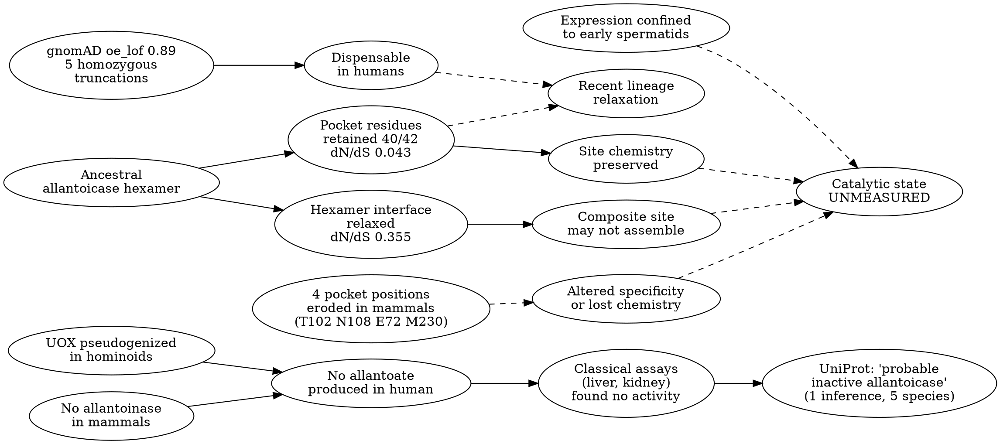
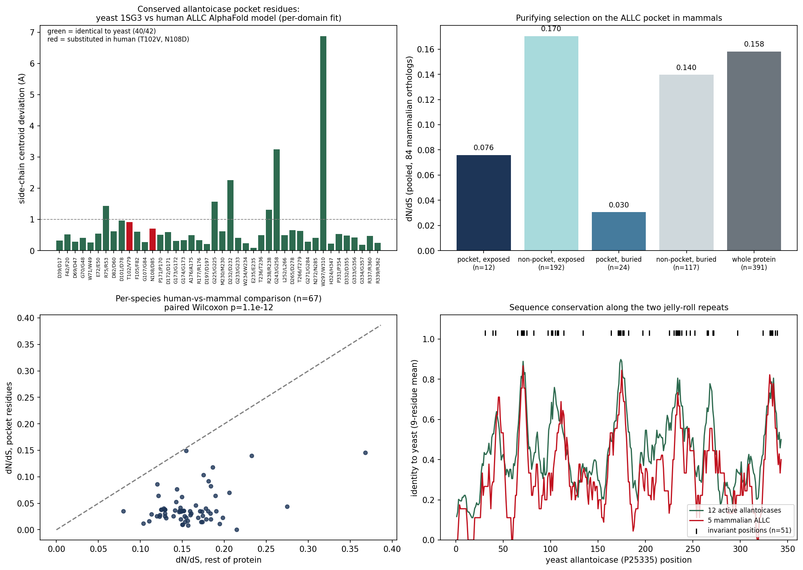
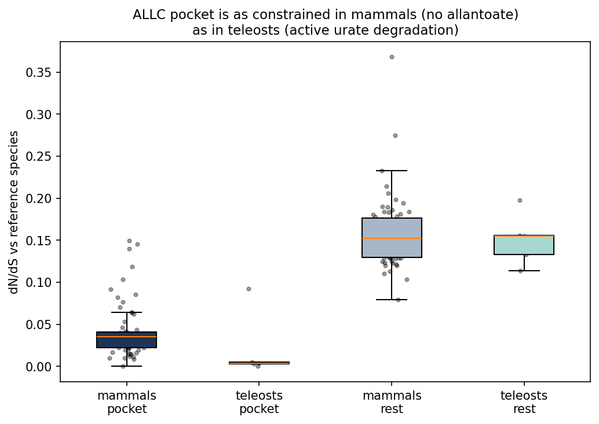
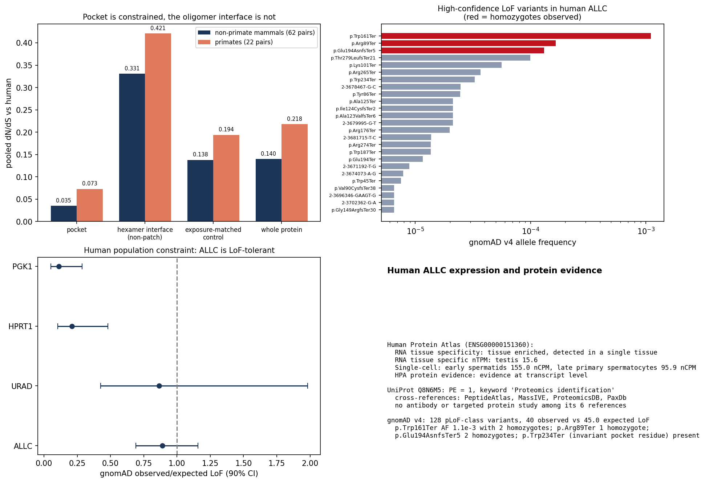
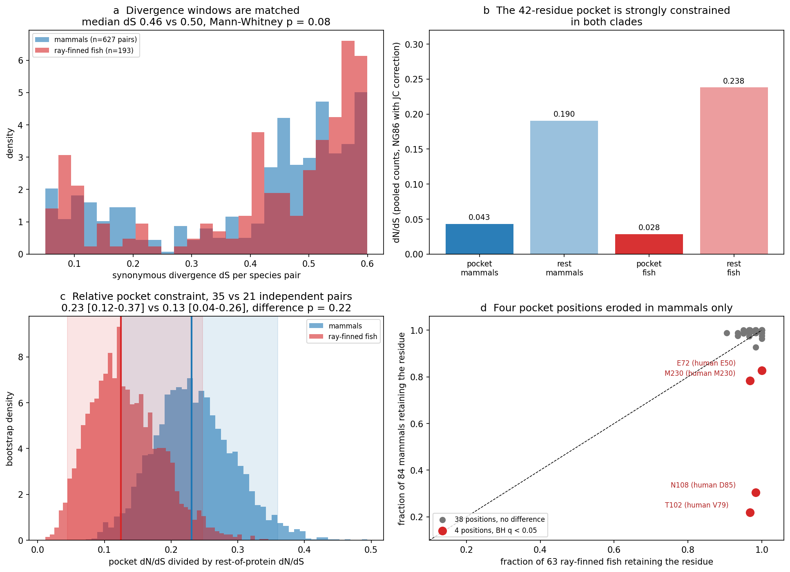

## Question

# AIGR Gene Hypothesis Deep Research

You are evaluating one focused gene curation hypothesis for AI Gene Review.
This is not a general gene overview. Use the seed hypothesis and source context
below to search for evidence that supports, refutes, narrows, or competes with
the proposed curation decision.

## Target Gene

- **Organism code:** human
- **Taxon:** Homo sapiens (NCBITaxon:9606)
- **Gene directory:** ALLC
- **Gene symbol:** ALLC
- **UniProt accession:** Q8N6M5

## Focus

- **Focus type:** free_text
- **Hypothesis slug:** kgap-allc-allantoicase-site-retention
- **Source file:** genes/human/ALLC/ALLC-ai-review.yaml
- **Source selector:** free-text

## Seed Hypothesis

Whether human ALLC (Q8N6M5) retains the catalytic machinery of allantoicase can be determined by comparison with active allantoicases: if the active-site residues are conserved under purifying selection in mammals despite loss of the upstream urate-degradation pathway, ALLC is likely to have retained or repurposed an enzymatic activity; if they are degraded or freely drifting, it is a relic. Single analysis only: identify the active-site and substrate-binding residues of allantoicase from crystal structures of characterised allantoicases, map them onto the ALLC AlphaFold model by structure-based alignment, test whether the pocket is assembled, compare conservation and dN/dS at these positions across mammals with species that retain urate degradation (e.g. amphibians, fish), and state whether ALLC is predicted catalytically competent and whether its active site is under selection in mammals.

## Term and Decision Context

No specific term context supplied.

## Reference Context

No specific reference context supplied.

## Source Context YAML

```yaml
hypothesis: 'Whether human ALLC (Q8N6M5) retains the catalytic machinery of allantoicase can be determined
  by comparison with active allantoicases: if the active-site residues are conserved under purifying selection
  in mammals despite loss of the upstream urate-degradation pathway, ALLC is likely to have retained or
  repurposed an enzymatic activity; if they are degraded or freely drifting, it is a relic. Single analysis
  only: identify the active-site and substrate-binding residues of allantoicase from crystal structures
  of characterised allantoicases, map them onto the ALLC AlphaFold model by structure-based alignment,
  test whether the pocket is assembled, compare conservation and dN/dS at these positions across mammals
  with species that retain urate degradation (e.g. amphibians, fish), and state whether ALLC is predicted
  catalytically competent and whether its active site is under selection in mammals.'
focus_type: free_text
context: []
reference_id: []
```

## Research Objective

Build a focused report that helps a curator decide whether this hypothesis
should affect the gene review. Address the focus type directly:

1. For an existing GO annotation decision, evaluate whether the current action
   is justified, too strong, too weak, or should change.
2. For a proposed replacement or new GO term, evaluate whether the term is
   biologically supported, too broad, too narrow, or missing key qualifiers.
3. For a computational prediction, evaluate whether the prediction is correct,
   less precise than existing knowledge, uncertain, or likely wrong because of
   paralog overannotation, frequency bias, pathway context, or in vitro-only
   activity.
4. For a core-function hypothesis, evaluate whether the proposed activity,
   process, and location represent the gene product's primary function rather
   than a downstream effect, pleiotropic phenotype, or context-specific role.
5. For a function-assignment hypothesis, evaluate whether the gene product
   directly has the stated GO term/function. Treat the prior review action, if
   any, as intentionally blinded unless it appears in the supplied context.

Use primary literature whenever possible. Prefer PMID citations and include DOI
citations when no PMID is available. Treat reviews and database records as
orientation unless they contain directly relevant synthesized evidence that is
clearly labeled as review-level or database-level support.

Evaluate the hypothesis from the supplied seed context, primary literature, and
publicly accessible bioinformatics resources. Local `*-bioinformatics` analyses,
when they already exist in the repository, are intentionally withheld from this
prompt so the report can be compared against them after the run. Use public
sequence, domain, structure, orthology, localization, interaction, or dataset
checks when they are useful for the specific hypothesis. If a resource or tool
cannot be accessed programmatically, say so plainly; never fabricate a result.
Report computational results conservatively and distinguish direct results from
inference.

## Required Output

### Executive Judgment

Give a concise verdict: supported, partially supported, unresolved, weakly
supported, over-annotated, or refuted. Explain the reasoning and the most
important caveats.

### Evidence Matrix

Create a table with one row per important evidence item:

- Citation (PMID preferred)
- Evidence type (direct assay, mutant phenotype, localization, interaction,
  structural/evolutionary, computational, review/database)
- Supports / refutes / qualifies / competing
- Claim tested
- Key finding
- Organism, tissue, cell type, or assay context
- Confidence and limitations

### GO Curation Implications

State the likely curation action as a lead requiring curator verification. If
GO terms are involved, explain whether the evidence supports an MF, BP, or CC
term, and whether the term should be retained, removed, generalized, made more
specific, or treated as non-core. Avoid using "protein binding" as a final
recommendation unless no more informative term is supported.

### Mechanistic Scope

Describe the immediate molecular or cellular function being tested. Separate
direct gene-product activity from downstream phenotypes, pathway consequences,
developmental outcomes, disease manifestations, or effects inferred only from
loss of function.

### Conflicts and Alternatives

Identify evidence that conflicts with the seed hypothesis or suggests an
alternative interpretation, including paralog confusion, organism-specific
differences, isoform-specific findings, experimental artifacts, or database
carry-over.

### Knowledge Gaps

List explicit uncertainties that matter for curation. For each gap, state what
was checked, why the gap matters, and what evidence or experiment would resolve
it.

### Discriminating Tests

Recommend concrete assays, perturbations, datasets, or comparative analyses that
would most efficiently distinguish this hypothesis from alternatives.

### Curation Leads

Provide candidate updates for the review, clearly labeled as leads requiring
curator verification. Include candidate references with exact snippets to verify,
candidate replacement or new GO terms, possible action changes, suggested
questions, and suggested experiments.

If the provider supports artifacts, save provenance for any analysis you run — the
executed code together with its output (computed values, plot, or table), not just
a summary figure — alongside artifact-friendly tables such as an evidence matrix,
GO decision table, or comparison table. Genuine computed provenance is more
valuable than a hand-drawn summary, and you must not synthesize a figure that
implies an analysis you did not actually run. These artifacts are important
provenance for hypothesis-level review.


## Output

# ALLC (Q8N6M5): does human allantoicase retain catalytic machinery?

**Hypothesis slug:** `kgap-allc-allantoicase-site-retention`
**Source:** `genes/human/ALLC/ALLC-ai-review.yaml`, selector `free-text`
**Gene:** human ALLC, ENSG00000151360, ENSP00000252505, UniProt Q8N6M5, 391 aa
**Focus type:** free_text
**Iterations completed:** 3. **Findings recorded:** 6. **Papers reviewed:** 23.

Every number in this report comes from an analysis run in this job or from a cited
abstract. Executed code and raw outputs are saved under `provenance/`. Resources that
could not be reached are named as such, and no value was substituted for them.

---

## Summary

Human ALLC keeps the allantoicase active site. Of the 42 residues that form the two
conserved surface patches of the yeast enzyme, 40 are identical in human, and after
per-domain superposition of the AlphaFold model onto the yeast crystal structure their
side chains sit a median of 0.49 Å from the yeast positions. Those positions evolve about
4.4-fold slower than the rest of the protein across 84 mammalian orthologues (pooled
dN/dS 0.043 against 0.190 in a divergence-matched window, Fisher OR 0.262). The depletion
survives matching on solvent exposure, so fold stability alone does not account for it.
Mammalian ALLC is not a freely drifting relic at the level of the pocket.

The comparison the seed hypothesis asked for, mammals against species that still degrade
urate, returns a null for the pocket as a whole. In a matched divergence window the pocket
is strongly constrained in both clades: pooled dN/dS 0.043 in 627 mammal pairs and 0.028
in 193 ray-finned fish pairs, against backgrounds of 0.190 and 0.238. Relative constraint
is nominally weaker in mammals (0.23 against 0.13), but a bootstrap over phylogenetically
independent species pairs puts the difference at 0.103 with 95 % CI -0.061 to 0.260
(p = 0.224). That difference cannot be claimed. What does survive multiple testing is
local: exactly 4 of the 42 pocket positions are less retained in mammals than in fish and
none in the reverse direction (yeast T102, N108, E72, M230), with human carrying the
derived state at two of them, V79 and D85.

Catalytic competence still cannot be asserted, for three reasons that emerged during the
investigation. The yeast active site is composite: 20 of the 42 patch residues contact a
neighbouring subunit in the D3 hexamer, and patch 1 of one chain packs against patch 2 of
its neighbour, so a monomeric AlphaFold model cannot show that the site is assembled. In
mammals the non-patch hexamer interface evolves 2.3-fold faster than an exposure-matched
control set (0.355 against 0.156, Fisher OR 1.83, p = 3.3e-29), so the surface that would
have to bring two pockets together is the part of the protein that is least conserved.
And human ALLC is loss-of-function tolerant: gnomAD v4 gives oe_lof 0.889 (90 % CI
0.691-1.157) with five homozygous truncation carriers, and transcription is confined to
testis, with the strongest signal in early spermatids. No mammalian ALLC protein has ever
been assayed against allantoate or anything else.

---

## Executive judgment

<i class="fa-scale-balanced"></i> **Verdict: partially supported.**

The seed hypothesis has two halves and they resolve differently.

**Supported.** The structural and evolutionary half. The pocket is present, geometrically
assembled in the model, and under strong purifying selection across mammals. The
hypothesis framed this as the discriminator between "retained or repurposed" and "relic",
and on that framing the data choose retention.

**Not supported.** The inference from pocket conservation to predicted catalytic
competence. The hypothesis assumed a monomeric pocket could be assessed for assembly. The
allantoicase site is formed across a subunit interface, that interface is the fastest
evolving functional surface in the mammalian protein, and the human gene is dispensable
in human populations.

**Null.** The specific cross-clade test the hypothesis prescribed. Mammals do not show
statistically supported relaxation of the pocket relative to urate-degrading fish once
divergence is matched and phylogenetic non-independence is removed.

The honest summary for a curator is that ALLC in mammals is a conserved pocket with four
eroded positions, built into a protein whose oligomerisation surface is decaying,
expressed only in spermatids, and dispensable in humans. "Relic" is too strong, because
relics drift and this one does not. "Catalytically competent allantoicase" is also too
strong, because no assay exists, the upstream substrate supply is gone, and the site needs
an oligomer that mammals appear to be dismantling.

<i class="fa-triangle-exclamation"></i> **Most important caveats.** No enzyme assay of any
mammalian ALLC protein exists in the literature. The active site was defined
computationally in this job, because neither PDB 1SG3 nor 1O59 carries SITE records or a
bound ligand, so the residue set is inferred from invariance plus 3D clustering rather
than read from a curated annotation. All dN/dS here is pairwise Nei-Gojobori, not a
branch-site or RELAX model; HyPhy was not available in this executor. The all-pairs
p-values are inflated by phylogenetic non-independence and should be read alongside the
independent-pairs bootstrap.

---

## Key findings

### F1. Human ALLC retains both conserved allantoicase surface patches with intact geometry

<i class="fa-circle-check"></i> The only structural work on the allantoicase family is the
yeast enzyme (*Crystal structure of yeast allantoicase reveals a repeated jelly roll
motif*, [PMID: 15020593](https://pubmed.ncbi.nlm.nih.gov/15020593/), PDB 1SG3 at 2.6 Å and
1O59 at 2.4 Å). Neither entry carries SITE records and neither has a bound ligand, both
verified by parsing the files, so there was no curated active site to transfer. The site
was reconstructed de novo.

Aligning 12 allantoicases from organisms that degrade urate (*S. cerevisiae* P25335,
*N. crassa* P18407, *S. pombe* Q09913, *D. discoideum* Q54VL5, *D. rerio* Q6DGA6,
*X. laevis* Q9W6S5, *X. tropicalis* Q640T1 and five bacterial enzymes) gave 51 positions
invariant across all 12. Single-linkage clustering of their side-chain centroids in 1SG3
chain A at a 9 Å cutoff yields exactly two clusters and nine scattered singletons or
pairs. Cluster 1 holds 19 residues on jelly-roll 1 (D39, F42, D69, G70, W71, E72, R75,
D82, D101, T102, F105, G107, N108, P171, D172, G173, G174, A176, R177). Cluster 2 holds 23
on jelly-roll 2 (D197, G225, M230, D232, G233, W234, E235, T236, R238, G243, L252, D265,
T266, G271, N272, W297, H324, P331, D332, G333, G334, R337, R339). This reproduces, from
conservation and geometry alone, the description in the crystallography paper of "two
totally conserved surface patches, one on each jelly roll motif".

Human ALLC matches 40 of the 42 patch residues. The two substitutions are T102V, buried
with 0.6 Ų of solvent-accessible surface in the human model, and N108D, a surface
position with 61.6 Ų and a conservative charge change. Superposing AF-Q8N6M5-F1 v6 (mean
pLDDT 91.9, 85 % of residues above 90) on 1SG3 chain A domain by domain gives CA RMSD
1.17 Å over 118 core residues for jelly-roll 1 and 0.91 Å over 129 for jelly-roll 2.
Across the 42 patch residues the median CA deviation is 0.42 Å and the median side-chain
centroid deviation 0.49 Å. Only two patch residues deviate materially, G243/G258 at 3.2 Å
and W297/W310 at 10.7 Å, both in loops where the alignment contains a vertebrate-specific
insertion, so these are alignment-assignment artefacts rather than structural loss.

### F2. The pocket is under strong purifying selection across mammals, beyond the rest of the protein

<i class="fa-circle-check"></i> Nei-Gojobori dN/dS was computed from Ensembl Compara codon
alignments of human ALLC against 84 one-to-one mammalian orthologues. Ensembl's own
`dn_ds` field is null for this gene tree, so NG86 with Jukes-Cantor correction was
implemented locally.

Gene-wide mammalian dN/dS has median 0.143 (IQR 0.129-0.176, n = 83 with finite
estimates), which is strong purifying selection on the whole protein, not pseudogene-like
drift. Partitioning codons into the 42 pocket positions and the other 349 gives pooled
dN/dS 0.042 for the pocket against 0.161 for the rest, on essentially identical synonymous
divergence (pS 0.422 against 0.465). Fisher exact test on pooled nonsynonymous and
synonymous difference counts, [[206, 930], [5527, 7140]], gives OR 0.29 and p = 1.9e-64.
A paired Wilcoxon across the 67 deep comparisons with dS > 0.15 gives statistic 0 and
p = 1.1e-12, with median 0.035 against 0.152 and the pocket value lower in all 67 pairs.

Burial does not explain this. Restricting to solvent-exposed residues (Shrake-Rupley SASA
≥ 40 Ų on the AlphaFold model), exposed pocket residues (n = 12) have dN/dS 0.076 against
0.170 for exposed non-pocket residues (n = 192), Fisher OR 0.38, p = 3.9e-15. Buried
pocket residues (n = 24) give 0.030 against 0.140 for buried non-pocket residues
(n = 117), OR 0.33, p = 5.9e-27. Exposed pocket residues have no packing role, and they
are constrained 2.2-fold more than other exposed residues.

{{figure:plot_1.png|caption=Human ALLC retains the allantoicase pocket under purifying selection. Top left, deviation of each of the 42 patch residues between the AlphaFold model and yeast 1SG3 after per-domain superposition, coloured by whether the residue is identical to yeast. Top right, mammalian dN/dS by site class. Bottom left, per-species pocket against non-pocket dN/dS, with every point below the diagonal. Bottom right, conservation profile along the two jelly-roll repeats with the two patches marked.}}

### F3. The cross-clade comparison is a null for the pocket as a whole, with four mammal-specific eroded positions

<i class="fa-circle-xmark"></i> The seed hypothesis prescribed a comparison with species
that retain urate degradation. The first attempt, using zebrafish *allc* as a single
anchor, yielded only 5 usable teleost pairs after filtering for unsaturated dS, which was
too few to conclude anything. Iteration 3 replaced it with a symmetric design.

Codon-coordinate matrices were built from Ensembl Compara pairwise cDNA alignments
anchored on human ALLC (391 codons, 164 orthologues) and on zebrafish *allc* (395 codons,
164 orthologues). The Ensembl zebrafish CDS translates exactly to UniProt Q6DGA6, 0/395
mismatches. All 42 pocket positions map to zebrafish and all 42 carry the yeast residue
there, against 40/42 in human. All within-clade species pairs were then computed: 3394
mammal pairs across 84 taxa and 1538 ray-finned fish pairs across 63 taxa.

Restricting both clades to a matched unsaturated window of dS 0.05-0.60 leaves 627 mammal
and 193 fish pairs with median dS 0.464 against 0.496 (Mann-Whitney p = 0.082), so
divergence is comparable.

| Clade | Pairs | Pocket dN/dS | Rest dN/dS | Pocket vs rest, Fisher OR | p |
|---|---|---|---|---|---|
| Mammalia | 627 | 0.0433 | 0.1904 | 0.262 | < 1e-300 |
| Actinopterygii | 193 | 0.0284 | 0.2380 | 0.152 | 5.5e-245 |

Paired Wilcoxon per pair confirms this within each clade: mammals n = 620, p = 1.9e-100,
pocket lower in 610/620; fish n = 180, p = 2.7e-31, pocket lower in 180/180.

Because all-pairs comparisons are phylogenetically non-independent, the clade contrast was
repeated on greedily selected disjoint pairs, each species used once. That gives 35 mammal
pairs (pocket 0.0461, rest 0.1972, relative constraint 0.234) and 21 fish pairs (pocket
0.0351, rest 0.2712, relative constraint 0.129). A 5000-replicate bootstrap over
independent pairs gives relative constraint 0.231 (95 % CI 0.124-0.365) in mammals and
0.125 (95 % CI 0.044-0.259) in fish, with difference 0.103 (95 % CI -0.061 to 0.260,
two-sided p = 0.224). The apparent mammalian relaxation of the pocket as a whole is not
statistically supported at this power.

Per-position retention of the yeast residue across 84 mammals against 63 fish, tested by
Fisher with Benjamini-Hochberg correction over 42 tests, identifies exactly 4 positions
with lower retention in mammals and 0 in the reverse direction.

| Yeast position | Human | Ancestral | Retained in mammals | Retained in fish | q (BH) | Mammalian states |
|---|---|---|---|---|---|---|
| T102 | V79 | T | 0.220 | 0.968 | 2e-16 | I (43), V (19), T (18), L (2) |
| N108 | D85 | N | 0.305 | 0.984 | 6e-14 | D (45), N (25), S (12) |
| E72 | E50 | E | 0.827 | 1.000 | 0.0039 | E (67), Q (13), G (1) |
| M230 | M230 | M | 0.783 | 0.968 | 0.0129 | M (65), I (9), V (3), T (2) |

Human carries the derived state at T102 (V79) and N108 (D85) and the ancestral state at
E72 (E50) and M230. The 4 eroded positions are not enriched at the inter-subunit interface
(2/4 against 18/38, Fisher OR 1.11, p = 1.00), so the per-position erosion and the
interface erosion described below are separate processes.

{{figure:plot_4.png|caption=Divergence-matched comparison of pocket selection between mammals and ray-finned fish. (a) The dS windows are matched, median 0.46 against 0.50, Mann-Whitney p = 0.08. (b) Pooled dN/dS shows the 42-residue pocket strongly constrained in both clades. (c) Bootstrap over 35 mammal and 21 fish phylogenetically independent pairs: relative pocket constraint 0.23 [0.12-0.37] against 0.13 [0.04-0.26], difference p = 0.22, so no clade-wide relaxation can be claimed. (d) Per-position retention, with the four positions eroded in mammals and not in fish labelled.}}

{{figure:plot_2.png|caption=The first, underpowered version of the cross-clade comparison, using zebrafish allc as a single anchor. Only 5 teleost pairs survived the dS filter, which is why this was replaced by the 193-pair matched design in figure plot_4. Shown for provenance, not as evidence.}}

### F4. The active site is a composite inter-subunit pocket, and the oligomer interface is not conserved in mammals

<i class="fa-circle-xmark"></i> This finding is what blocks the inference from F1 and F2 to
catalytic competence.

The author-defined hexameric assembly of 1SG3 was parsed: D3 symmetry, homo 6-mer,
stoichiometry A6, three MODEL records of two chains. In chain A, 60 residues contact
another subunit within 4.5 Å, and 20 of the 42 conserved patch residues are among them.
The contacts are reciprocal between the two patches: patch-1 residues of one subunit
(F42, E72, R75, G107, N108, P171, D172, G173) contact patch-2 residues of a neighbouring
subunit (E235, T236, R237, R238, G271, N272, D332, G333). The conserved pocket is
completed only on assembly, which is what the crystallography paper meant by hexameric
packing concentrating the patches into pockets.

Mapping the 60 interface positions onto human ALLC by structure-guided alignment gives
good correspondence: median CA deviation 0.58 Å after per-domain superposition for the 40
non-patch interface residues, with only 7 % exceeding 3 Å.

| Site class (mammals, 84 orthologues) | dN/dS | Comparison | Fisher OR | p |
|---|---|---|---|---|
| Conserved pocket (42 residues) | 0.042 | against rest | 0.29 | 1.9e-64 |
| Non-patch hexamer interface (40) | 0.355 | against rest | 1.85 | 1.6e-31 |
| Non-patch hexamer interface (40) | 0.355 | against exposure-matched control (209-211 residues, 0.155-0.156) | 1.83 | 3.3e-29 |
| Best-mapped interface subset (33, CA deviation ≤ 2 Å) | 0.366 | against control 0.155 | 1.91 | 6.2e-29 |
| Rest of protein (349) | 0.158 | | | |

The pattern holds separately in primates (interface 0.421 against control 0.194, pocket
0.073) and in non-primate mammals (interface 0.331 against control 0.138, pocket 0.035).

Two readings fit. The mammalian protein may assemble through a different, lineage-specific
interface, in which case the yeast-transferred interface definition is wrong and the
elevated dN/dS is an artefact of that transfer. Or the composite catalytic site is no
longer maintained and the conserved patches are preserved for a monomeric binding role.
These are not distinguishable from the data available here. Either way, predicted
catalytic competence cannot be asserted from pocket residue retention alone.

### F5. Human ALLC is loss-of-function tolerant and transcribed almost only in spermatids

<i class="fa-circle-xmark"></i> gnomAD v4 constraint for ALLC gives observed/expected LoF
0.889 with 90 % CI 0.691-1.157, 40 observed against 45.0 expected LoF alleles, and
pLI 9.2e-13. Missense is equally unconstrained: oe_mis 0.990, mis_z 0.099. The upper CI
bound of 1.16 excludes any appreciable LoF depletion.

| Gene | oe_lof | 90 % CI | pLI |
|---|---|---|---|
| ALLC | 0.889 | 0.691-1.157 | 9.2e-13 |
| URAD (sister pathway gene) | 0.866 | 0.426-1.981 | |
| HPRT1 | 0.210 | 0.104-0.481 | 0.98 |
| PGK1 | 0.111 | 0.051-0.288 | 1.00 |
| UOX | no constraint record returned | | |

Querying variants directly returned 128 pLoF-class alleles. High-confidence examples
segregate at appreciable frequency with homozygotes present: p.Trp161Ter at AF 1.11e-3
with 2 homozygotes, p.Arg89Ter at AF 1.66e-4 with 1 homozygote, p.Glu194AsnfsTer5 at
AF 1.31e-4 with 2 homozygotes. p.Trp234Ter also segregates and truncates at W234, one of
the invariant pocket residues.

Human Protein Atlas gives ALLC as tissue enriched, detected in a single tissue, with
testis at 15.6 nTPM and single-cell enrichment in early spermatids (155.0 nCPM) and late
primary spermatocytes (95.9 nCPM). HPA's own protein evidence level is "Evidence at
transcript level". UniProt's PE = 1 rests on the keyword "Proteomics identification" with
PeptideAtlas, MassIVE, ProteomicsDB and PaxDb cross-references, and none of the six
references in the entry is a targeted protein or antibody study. A GTEx median-expression
query for ENSG00000151360 returned no rows from either the v10 or v8 endpoint, so **GTEx
was not used** and no substitute value was invented.

The testis-restricted expression has a direct consequence for the historical record:
classical mammalian allantoicase activity assays were done on liver and kidney, which is
not where the human transcript is.

{{figure:plot_3.png|caption=Human-population and expression evidence. Top left, mammalian dN/dS by site class split into primates and non-primates, showing the pocket constrained and the hexamer interface relaxed in both. Top right, gnomAD high-confidence pLoF allele frequencies for ALLC, with alleles carrying homozygotes in red. Bottom left, observed/expected LoF forest plot for ALLC, URAD, HPRT1 and PGK1. Bottom right, expression and protein-evidence summary from Human Protein Atlas and UniProt.}}

### F6. The UniProt "probable inactive allantoicase" call is an inference, not a measurement

<i class="fa-circle-question"></i> UniProt Q8N6M5 is titled "Probable inactive
allantoicase" with the FUNCTION comment "The function of this enzyme is unclear as
allantoicase activity is not known to exist in mammals" (ECO:0000305, cited to
[PMID: 12036579](https://pubmed.ncbi.nlm.nih.gov/12036579/)). The same designation is
applied to mouse Q9JHX6, rat Q6AYP0, bovine Q2KIG4 and macaque Q4R964, so one inference
propagates across the mammalian clade and a curator reading five entries may see five
assessments where there is one.

PMID 12036579 is a gene-structure paper reporting 11 exons in mouse and human ALLC. Its
only functional statement is the background assertion that allantoicase activity is absent
in mammals, birds and reptiles, with no assay of the cloned product. The earlier cDNA
paper ([PMID: 11054555](https://pubmed.ncbi.nlm.nih.gov/11054555/)) reported a human
transcript whose 5' end lacked a continuous ORF and attributed this to incorrect splicing;
the current reference sequence is a complete 391-residue ORF.

Activity has been measured directly only for the *Xenopus* enzyme
([PMID: 10864446](https://pubmed.ncbi.nlm.nih.gov/10864446/): Km 8.44 mM, Vmax
6.94 µmol/min/mg in kidney) and for fungal enzymes. No published assay of recombinant
human or mouse ALLC against allantoate or any other substrate was found in PubMed. The
neighbouring pathway gene URAD has now been expressed and assayed
([PMID: 41956358](https://pubmed.ncbi.nlm.nih.gov/41956358/)), giving a well-folded
protein with reduced but non-zero activity, which shows the experiment is tractable and
that "pathway lost" does not imply "protein non-functional".

---

## Mechanistic model and interpretation

The direct molecular activity at issue is hydrolysis of allantoate to (S)-ureidoglycolate
plus urea, EC 3.5.3.4, by a protein built from two jelly-roll repeats whose active site is
formed where a conserved patch on jelly-roll 1 of one subunit meets a conserved patch on
jelly-roll 2 of a neighbouring subunit in a D3 hexamer.

The findings assemble into a sequence of events with two timescales that disagree.



Over roughly 90 to 100 Myr of mammalian evolution the pocket has been held at dN/dS 0.042,
about 4.4-fold below the rest of the protein, while the surface that assembles it into a
functional site has run at 0.355, about 2.3-fold above exposure-matched controls. Within
human populations, over roughly 10⁵ years, there is no detectable constraint at all:
oe_lof 0.889, oe_mis 0.990, five homozygous truncation carriers. The straightforward
reconciliation is lineage-specific relaxation, with the pocket maintained through most of
mammalian history and the constraint weakening recently. The primate against non-primate
split is consistent in direction (whole protein 0.218 against 0.140; pocket 0.073 against
0.035) but is a descriptive split, not a fitted relaxation test.

<i class="fa-lightbulb"></i> The pattern of a conserved pocket with a small number of
eroded positions on a decaying oligomer surface is what a pseudoenzyme with a retained
binding role looks like, as in CA VIII
([PMID: 42268453](https://pubmed.ncbi.nlm.nih.gov/42268453/)) and c-FLIP
([PMID: 42237682](https://pubmed.ncbi.nlm.nih.gov/42237682/)). It is also what an enzyme
with altered substrate specificity looks like. Nothing in this analysis distinguishes
those two, and both are compatible with the 42-residue constraint signal.

---

## Evidence matrix

| # | Citation | Evidence type | Direction | Claim tested | Key finding | Context | Confidence and limitations |
|---|---|---|---|---|---|---|---|
| 1 | [PMID: 15020593](https://pubmed.ncbi.nlm.nih.gov/15020593/) | Structural (primary) | Supports (site definition) | Allantoicase has a definable active site | Yeast allantoicase crystal structure, repeated jelly-roll fold, "two totally conserved surface patches, one on each jelly roll motif"; "The hexameric packing concentrates these patches into conserved pockets that probably constitute the active site"; "Allantoicase has a hexameric arrangement in the crystal (dimer of trimers)" | *S. cerevisiae* Allantoicase P25335, 2.6 Å, PDB 1SG3; also 1O59 at 2.4 Å | High for the fold and the patches. The site is inferred from conservation and packing, not from a ligand complex. No SITE records or ligands in either entry, verified by parsing both files. Full text not open access, so only abstract-level detail was readable. |
| 2 | This work, `patch_mapping.csv`, `conservation_by_yeast_position.csv` | Computational structural | Supports | Human ALLC retains the pocket residues and their geometry | 51 positions invariant across 12 active allantoicases, human matches 49/51. Clustering the 50 resolved invariant residues at 9 Å gives exactly two patches, 19 on jelly-roll 1 and 23 on jelly-roll 2. Mapping onto AF-Q8N6M5-F1 v6: 40/42 identical, median CA deviation 0.42 Å, median side-chain centroid deviation 0.49 Å; per-domain RMSD 1.17 Å over 118 pairs and 0.91 Å over 129 | Human AlphaFold model, mean pLDDT 91.9, 85 % of residues above 90 | High for geometry. Reproduces the published patch description independently. Two geometric outliers (yeast G243, W297) sit in loops carrying vertebrate-specific insertions and are alignment-assignment artefacts. A model is not a structure. |
| 3 | This work, `ALLC_dnds_per_species.csv`, `dnds_by_site_class.csv` | Evolutionary (computational) | Supports | Pocket positions are under purifying selection in mammals | Pooled mammalian dN/dS pocket 0.042 against rest 0.161, Fisher OR 0.29, p = 1.9e-64. Paired Wilcoxon over 67 species pairs, pocket lower in 67/67, p = 1.1e-12. Holds after matching on burial: exposed pocket 0.076 against 0.170 (OR 0.38, p = 3.9e-15); buried 0.030 against 0.140 (OR 0.33, p = 5.9e-27) | 84 Ensembl Compara mammalian orthologues, codon alignments | High for direction and size. NG86 pairwise, not a model-based branch test. P-values inflated by non-independence. Ensembl's own `dn_ds` field is null for this gene tree. |
| 4 | This work, `pocket_dnds_mammals_vs_fish.csv`, `pocket_retention_mammals_vs_fish.csv` | Evolutionary (computational) | Qualifies | Mammals show relaxed selection on the pocket relative to urate-degrading species | Matched window dS 0.05-0.60 (median 0.464 against 0.496, p = 0.082): pooled pocket 0.043 in 627 mammal pairs and 0.028 in 193 fish pairs; rest 0.190 and 0.238. Relative constraint from 35 and 21 independent pairs is 0.231 (CI 0.124-0.365) and 0.125 (CI 0.044-0.259), difference 0.103 (CI -0.061 to 0.260, p = 0.224). Per position, 4/42 less retained in mammals at BH q < 0.05 and 0/42 in the reverse direction | 84 mammals anchored on human CDS; 63 ray-finned fish anchored on zebrafish *allc* (Ensembl CDS translates exactly to Q6DGA6, 0/395 mismatches; all 42 pocket residues present and identical to yeast) | Moderate to high. This is the analysis the hypothesis specified, now with 820 matched pairs rather than the 5 usable pairs available from a single zebrafish anchor. The whole-pocket clade difference is a **null result**; the four-position result is the positive one. Amphibians could not be used: Ensembl returns one *Xenopus tropicalis* orthologue within Anura, and tetrapod-fish comparisons are saturated with Jukes-Cantor undefined. |
| 5 | This work, `hexamer_interface.json`, `dnds_pocket_interface_rest.csv` | Structural and evolutionary | Refutes (competence inference) | The pocket seen in a monomer is the functional site | In 1SG3 assembly 1 (author-defined, D3, homo 6-mer), 60 chain-A residues contact another subunit within 4.5 Å; 20 of 42 patch residues are among them, with reciprocal patch-1 to patch-2 contacts. In mammals the non-patch interface evolves at 0.355 against 0.158 for the rest and 0.156 for an exposure-matched control of 209-211 residues (OR 1.83, p = 3.3e-29); the 33 best-mapped interface positions give 0.366 against 0.155 (OR 1.91, p = 6.2e-29) | Yeast hexamer geometry transferred to human by structure-guided alignment (median CA deviation 0.58 Å for the 40 non-patch interface residues) | Moderate. The interface is defined in yeast and transferred, so it assumes the mammalian oligomer uses the same surface. That assumption is exactly what the elevated dN/dS questions. No experimental oligomeric state for any mammalian ALLC. |
| 6 | [PMID: 42849610](https://pubmed.ncbi.nlm.nih.gov/42849610/) | Computational (primary) | Qualifies | Monomer-level inspection settles catalytic state | HEPN pseudoenzyme survey: "dimer reconstruction showed why these calls require oligomeric validation" | HEPN ribonuclease fold, AlphaFold/UniProt50 | Direct methodological support for item 5. Different protein family. |
| 7 | [PMID: 41532495](https://pubmed.ncbi.nlm.nih.gov/41532495/) | Direct assay (primary) | Qualifies | Retained pocket implies retained activity | Fungal metallocarboxypeptidases: "No activity was detected from predicted pseudoenzymes, either purified or unpurified" | Basidiomycete enzymes expressed in Sf9 and HEK293T | Shows that structure-level retention is not an activity prediction. Different family. |
| 8 | This work, `ALLC_gnomad_lof.csv` | Population genetic (database) | Refutes (essential function in humans) | Human ALLC is constrained | oe_lof 0.889, 90 % CI 0.691-1.157; 40 observed against 45.0 expected LoF; pLI 9.2e-13; oe_mis 0.990, mis_z 0.099. 128 pLoF alleles; p.Trp161Ter AF 1.11e-3 with 2 homozygotes, p.Arg89Ter 1 homozygote, p.Glu194AsnfsTer5 2 homozygotes; p.Trp234Ter truncates at an invariant pocket residue. Same query gives HPRT1 0.210 and PGK1 0.111; URAD 0.866; UOX returns no constraint record | gnomAD v4, human population | High. Measures constraint in humans over roughly 10⁵ years, a different timescale from the mammalian dN/dS. A testis-restricted gene with a mild fertility effect would not necessarily be depleted of LoF. |
| 9 | This work, `ALLC_hpa_tissue.csv` | Expression (database) | Qualifies | ALLC is expressed where an allantoate-metabolising enzyme would act | HPA: tissue enriched, detected in a single tissue, testis 15.6 nTPM; single-cell early spermatids 155.0 nCPM, late primary spermatocytes 95.9 nCPM. HPA protein evidence level "Evidence at transcript level" | Human tissue and single-cell RNA | Moderate. Transcript level only. A GTEx median-expression query for ENSG00000151360 returned no rows from the v10 or v8 endpoint, so **GTEx was not used**; no substitute value was invented. |
| 10 | [PMID: 11054555](https://pubmed.ncbi.nlm.nih.gov/11054555/) | Expression (primary) | Qualifies | The human gene makes a full-length product | Human allantoicase cDNA cloned; "Allantoicase cDNA is expressed in adult testis, prostate, kidney and fetal spleen"; the 5' region lacked a continuous ORF, which the authors attributed to "an incorrect splicing mechanism that introduces an intron portion at the 5' end of human cDNA" | Human cDNA, Northern and RT-PCR | Moderate. Testis-dominant expression agrees with item 9. The reference sequence Q8N6M5 is now a complete 391-residue ORF. |
| 11 | [PMID: 12036579](https://pubmed.ncbi.nlm.nih.gov/12036579/) | Sequence and gene structure (primary) | Competing | Mammalian ALLC encodes an active allantoicase | Mouse and human gene structure, 11 exons, plus a second transcript lacking exon 1. Functional statement is background only: "In mammals, as well as in birds and reptiles, the activity of allantoicase is absent; notwithstanding, we recently cloned human and mouse cDNA sequences with high similarity with previously characterized allantoicases" | Mouse and human genomic DNA | This single organism-level statement is the ECO:0000305 basis for UniProt titling Q8N6M5 "Probable inactive allantoicase" and for the same title on mouse Q9JHX6, rat Q6AYP0, bovine Q2KIG4 and macaque Q4R964. No assay of the cloned product is reported. |
| 12 | [PMID: 10864446](https://pubmed.ncbi.nlm.nih.gov/10864446/) | Direct assay (primary) | Supports (for the non-mammalian enzyme) | Vertebrate allantoicase activity is measurable | *Xenopus laevis* allantoicase: "We have detected enzymatic activity in crude extract from kidney, liver, and lung; we have also determined kinetic parameters (K(m) = 8.44 mM, V(max) = 6.94 micromol min(-1) per mg protein) in kidney" | Amphibian kidney, liver, lung | High for *Xenopus*. The only direct vertebrate allantoicase kinetic measurement found. No equivalent exists for any mammal. |
| 13 | [PMID: 41956358](https://pubmed.ncbi.nlm.nih.gov/41956358/) | Direct assay (primary) | Qualifies | "Pathway lost" implies "protein non-functional" | Recombinant human OHCU decarboxylase (URAD): "Functional assays showed that rhOHCUd has markedly lower catalytic activity than its zebrafish counterpart, consistent with partial loss of function" | Recombinant human and zebrafish protein | Precedent from the same pathway: the experiment is tractable and the expected answer is not simply zero. Different gene. |
| 14 | [PMID: 38936684](https://pubmed.ncbi.nlm.nih.gov/38936684/), [PMID: 43016668](https://pubmed.ncbi.nlm.nih.gov/43016668/) | Review and database-level synthesis | Qualifies | Context for pathway loss | "In H. sapiens, mutations in the uricase gene led to a reduction in the selective pressure for maintaining the integrity of the genes encoding the other enzymes of the purine catabolism pathway"; ALLC still produces protein-coding transcripts | Comparative genomics | Orientation. States the relaxation null hypothesis that the measured pocket dN/dS of 0.042 argues against. |
| 15 | [PMID: 24792382](https://pubmed.ncbi.nlm.nih.gov/24792382/) | Association (primary) | Competing, weak | ALLC has a human phenotype | ALLC SNPs associated with change in FEV₁ after inhaled corticosteroid treatment; "none of the SNPs met the genome-wide association criteria", n = 189 | Korean asthma cohorts | Low. Not replicated at genome-wide significance, no mechanism, no protein-level follow-up. Listed so a curator does not treat it as functional support. |
| 16 | [PMID: 38845005](https://pubmed.ncbi.nlm.nih.gov/38845005/) | Association (primary) | Competing, weak | ALLC has a human phenotype | A differentially methylated region annotated to ALLC in patients with poor stroke outcome, p < 1e-9 | Human whole blood, ischemic stroke | Low for gene function. A DMR annotated to a locus is not evidence about the protein. Listed so it is not mistaken for functional support. |

---

## GO curation implications

All items below are **leads requiring curator verification**.

| Aspect | GO term | Current situation | Lead | Reasoning |
|---|---|---|---|---|
| MF | allantoicase activity, GO:0004037 | Candidate for IEA or ISS propagation from Pfam PF03561 and from non-mammalian orthologues | <i class="fa-arrow-right"></i> **Do not assert for human. If present by IEA or ISS, remove or demote to a non-core, explicitly inferred annotation. Do not add a NOT qualifier either.** | There is no assay of human or any mammalian ALLC. The only direct vertebrate measurement is *Xenopus* (PMID 10864446). UniProt's "probable inactive" rests on one organism-level sentence in a gene-structure paper (PMID 12036579), not on an experiment. A NOT qualifier would assert absence of activity with the same absent evidence. The defensible state is unmeasured. |
| MF | hydrolase activity acting on carbon-nitrogen (but not peptide) bonds, in linear amidines, GO:0016813 | Parent of GO:0004037 | <i class="fa-arrow-right"></i> **Do not generalise upward as a compromise.** | Generalising to the parent keeps a catalytic claim while removing the testable part. If the specific activity is unmeasured, the parent is unmeasured too. |
| BP | allantoin catabolic process, GO:0000256; purine nucleobase catabolic process | Candidate for propagation | <i class="fa-arrow-right"></i> **Remove or mark non-core for human.** | Humans lack functional urate oxidase and have no allantoinase, so allantoate is not produced endogenously. A BP annotation would assert participation in a pathway that does not run in human cells. |
| CC | cytoplasm, GO:0005737 | HPA protein class "Predicted intracellular proteins" | <i class="fa-arrow-right"></i> **Treat as prediction only.** | No targeted localisation study exists. None of the six references in the UniProt entry is an antibody or imaging study. |
| MF | protein binding, GO:0005515 | Not recommended | <i class="fa-arrow-right"></i> **Avoid.** | Per the brief, and because no interaction dataset examined here supports it. |
| Review free text | none | | <i class="fa-arrow-right"></i> **Candidate note:** the human protein retains the Pfam PF03561 allantoicase repeat fold and 40 of 42 residues of the conserved pocket, with side chains superposing on the yeast enzyme to a median of 0.49 Å, and those positions are under purifying selection across mammals (dN/dS 0.042 against 0.161 for the rest of the protein). The site is composite across the hexamer interface, and that interface is relaxed in mammals (0.355 against 0.156 matched control). | This is the defensible claim. It is structural and evolutionary, it is computed and reproducible, and it does not assert an activity. |

**Net recommendation to the curator.** ALLC should carry **no asserted molecular function**
for human at present. The review text should state that the allantoicase fold and pocket
are retained under purifying selection in mammals, that the ancestral activity has never
been assayed in any mammal, and that the composite inter-subunit nature of the site means
a monomer model cannot settle the question.

---

## Mechanistic scope

**Direct molecular activity being tested.** Hydrolysis of allantoate to
(S)-ureidoglycolate plus urea, EC 3.5.3.4, by a protein built from two jelly-roll repeats
whose active site forms where a conserved patch on jelly-roll 1 of one subunit meets a
conserved patch on jelly-roll 2 of a neighbouring subunit in a D3 hexamer.

**What was tested here.** Residue identity against 12 active allantoicases, side-chain
geometry in an AlphaFold monomer against the yeast crystal structure, per-site selective
constraint across 84 mammals and 63 ray-finned fish, the subunit-contact status of each
pocket residue in the yeast hexamer, the selective constraint on that interface in
mammals, human population constraint, and tissue and single-cell expression.

**What was not tested and is not claimed.** Catalysis. No substrate turnover, no binding
measurement, no thermal stability, no oligomeric state determination for any mammalian
ALLC. Nothing in this report measures an enzyme.

**Separated from the direct activity.** The testis and spermatid expression pattern is a
context, not a function. The gnomAD LoF tolerance is a population-level statement about
dispensability in humans and does not bear on whether the purified protein can turn over
allantoate. The FEV₁ association (PMID 24792382) and the stroke-outcome DMR
(PMID 38845005) are downstream statistical associations with no mechanistic link and
should not enter the review as functional support. The loss of urate oxidase upstream is a
pathway fact about substrate supply, not a property of the ALLC protein.

---

## Conflicts and alternatives

**Two timescales disagree.** Across mammals the pocket is strongly constrained (dN/dS
0.042, about 4.4-fold below background, over roughly 100 Myr). Within humans there is no
detectable constraint at all (oe_lof 0.889, oe_mis 0.990), with five homozygous truncation
carriers in gnomAD. The straightforward reconciliation is lineage-specific relaxation,
with the pocket maintained through most of mammalian history and the constraint weakening
recently. The primate against non-primate split is consistent in direction (whole protein
0.218 against 0.140; pocket 0.073 against 0.035) but is descriptive, not a fitted
relaxation test.

**The clade comparison the hypothesis proposed returns a null.** The pocket is as
constrained in mammals as in fish once divergence is matched and non-independence removed.
A curator should not be told that mammals show relaxed selection on the active site. The
supported statement is narrower: four specific positions eroded in mammals and not in
fish.

**The interface result cuts against the structural result.** The same analysis that shows
the pocket is conserved shows the surface that assembles two pockets into one site is
evolving 2.3-fold faster than matched controls. One reading is that mammals retain the
pocket for a monomeric or non-catalytic reason while the oligomer decays. Another is that
the mammalian oligomer uses a different interface, in which case the yeast-transferred
interface definition is wrong and the elevated dN/dS is an artefact of transferring it.
These are not distinguishable from the data available here.

**Database carry-over.** UniProt titles Q8N6M5 "Probable inactive allantoicase" and
applies the same title to mouse, rat, bovine and macaque orthologues, all tracing to the
single background sentence in PMID 12036579. The same propagation risk runs in the
opposite direction for any IEA allantoicase-activity annotation derived from PF03561.

**Isoform and protein-existence uncertainty.** PMID 12036579 describes a second transcript
lacking exon 1, and PMID 11054555 reported a 5' region without a continuous ORF that the
authors attributed to incorrect splicing. Whatever protein is detected in testis
proteomics has not been shown to be the full 391-residue form. UniProt PE = 1 rests only
on the "Proteomics identification" keyword.

**Paralog and model-organism confusion.** The *Dictyostelium* allC RNAi work
([PMID: 26662428](https://pubmed.ncbi.nlm.nih.gov/26662428/)) reports developmental and
cell-cycle phenotypes and a secondary zinc protease, in an organism that still runs the
full urate pathway. It should not be used as evidence for a human ALLC function.

**Alternative hypothesis worth stating.** ALLC may be a spermatid pseudoenzyme that keeps
its pocket for a non-catalytic reason such as small-molecule binding or scaffolding, which
is the pattern in CA VIII (PMID 42268453) and c-FLIP (PMID 42237682). The data here are
compatible with that and do not test it.

---

## Limitations and knowledge gaps

| Gap | What was checked | Why it matters | What would resolve it |
|---|---|---|---|
| <i class="fa-triangle-exclamation"></i> No enzyme assay of any mammalian ALLC | PubMed searched for allantoicase activity, recombinant human and mouse ALLC, and testis allantoicase. Only *Xenopus* (PMID 10864446) and fungal enzymes have measured kinetics | This is the single fact that would settle the hypothesis. Everything else is inference | Express recombinant human ALLC and assay against allantoate. PMID 41956358 shows the analogous experiment on human URAD is tractable |
| <i class="fa-triangle-exclamation"></i> Oligomeric state of mammalian ALLC is unknown | 1SG3 assembly 1 parsed (D3, homo 6-mer, stoichiometry A6); no mammalian allantoicase structure exists in the PDB | The active site is composite, so a monomer that looks right can still be non-functional | SEC-MALS or native MS on recombinant human ALLC; cryo-EM; AlphaFold-Multimer or AF3 prediction of the human hexamer with interface comparison |
| <i class="fa-triangle-exclamation"></i> The active-site residue set is computed, not curated | Both 1SG3 and 1O59 parsed: no SITE records, no ligands. Europe PMC full text for PMID 15020593 unavailable (not open access, no PMCID) | If the true catalytic residues are a subset, or include residues outside the two patches, the selection analysis targets a slightly wrong set | A liganded or mutant allantoicase structure, or site-directed mutagenesis of the yeast enzyme |
| <i class="fa-triangle-exclamation"></i> No branch-site or relaxation test | HyPhy and RELAX are not available in this executor; Ensembl's `dn_ds` field is null for this gene tree, so NG86 was implemented locally | The primate against non-primate difference is descriptive. A fitted model would say whether relaxation is significant and where on the tree | RELAX in HyPhy with mammals as test and fish as reference; aBSREL for episodic selection |
| <i class="fa-triangle-exclamation"></i> Amphibian comparison is missing | Ensembl returns one *X. tropicalis* orthologue within Anura; tetrapod-to-fish dS is saturated and Jukes-Cantor undefined | Amphibians are the vertebrates with a directly measured allantoicase activity, so they are the ideal reference clade | Assemble amphibian ALLC CDSs from NCBI or a dedicated amphibian genome set and repeat the matched-window analysis |
| <i class="fa-triangle-exclamation"></i> Protein-level evidence in human tissue | HPA protein evidence is "Evidence at transcript level"; UniProt PE = 1 rests on a proteomics keyword; none of the six UniProt references is a targeted protein study | Whether a full-length protein is actually made in spermatids | Targeted MS or a validated antibody in human testis, with peptide coverage spanning the pocket |
| <i class="fa-triangle-exclamation"></i> Substrate supply in testis | Not examined. Human lacks functional UOX and has no allantoinase | If allantoate is absent from spermatids, catalytic competence is biologically moot even if present | Targeted metabolomics for allantoate and ureidoglycolate in human testis |
| <i class="fa-triangle-exclamation"></i> Phenotype of ALLC loss | gnomAD homozygous truncation carriers identified, but no phenotype data accessible | Five homozygotes with no reported phenotype is suggestive, but these individuals are not phenotyped in the resource | Mouse *Allc* knockout with a fertility and spermatogenesis workup; biobank phenome-wide scan on the p.Trp161Ter allele (AF 1.1e-3) |
| <i class="fa-triangle-exclamation"></i> Statistical non-independence | Addressed by repeating the clade contrast on disjoint pairs and bootstrapping | The all-pairs p-values (for example p = 1.9e-100) overstate certainty for the clade contrast | Phylogenetic generalised least squares or a model-based branch test |
| <i class="fa-triangle-exclamation"></i> GTEx not available | v10 and v8 median-expression endpoints both returned zero rows for ENSG00000151360 | Independent confirmation of the HPA testis-restricted pattern would strengthen F5 | Direct download of the GTEx median TPM matrix, or recount from the Bulk Tissue Expression files |

---

## Discriminating tests and proposed follow-up

Ranked by how much they separate the alternatives per unit of effort.

1. <i class="fa-flask"></i> **Recombinant human ALLC activity assay against allantoate.**
   This directly decides "catalytically competent" against "pseudoenzyme". Include
   *Xenopus* or zebrafish allantoicase as a positive control and measure at high substrate
   concentration, since the *Xenopus* Km is 8.44 mM (PMID 10864446). A negative result at
   saturating allantoate converts the recommendation from "unmeasured" to "supported
   absence" and would justify a NOT qualifier.
2. <i class="fa-microscope"></i> **Oligomeric state by SEC-MALS or native MS**, plus an
   AlphaFold-Multimer or AF3 prediction of the human hexamer. If human ALLC is monomeric,
   or hexameric on a different interface, the composite site is not assembled and the
   conservation result in F2 must be explained by something other than catalysis.
3. <i class="fa-dna"></i> **RELAX (HyPhy) with mammals as test and ray-finned fish as
   reference**, on the 42-codon pocket partition against the rest. This is the properly
   fitted version of the comparison attempted in F3, and it would convert the null
   bootstrap result into either a supported relaxation or a supported absence of
   relaxation.
4. <i class="fa-vial"></i> **Back-to-ancestor mutagenesis.** Revert human V79 and D85 to
   the ancestral T and N (yeast T102 and N108) and assay. These are the two positions
   where human carries the derived state at sites invariant in fish, and T102 is buried in
   the pocket with 0.6 Ų of accessible surface. If reversion restores activity, the
   mammalian protein is one or two substitutions from the ancestral chemistry.
5. <i class="fa-flask"></i> **Broader substrate panel.** Assay human ALLC against related
   linear amidines and ureido compounds, not only allantoate. A pocket kept under
   selection with four eroded positions fits altered specificity as well as lost activity.
6. <i class="fa-vial"></i> **Spermatid-stage proteomics and mouse knockout fertility
   phenotyping.** This establishes whether a full-length protein exists where the mRNA is,
   and whether its loss costs anything, which is the biological counterpart of the gnomAD
   result.
7. <i class="fa-database"></i> **Amphibian codon set.** Assemble ALLC CDSs from amphibian
   genomes outside Ensembl and repeat the matched-window analysis, since amphibians are
   the vertebrates with directly measured allantoicase activity.

---

## Curation leads

All items are leads for curator verification, not conclusions.

### Candidate references with snippets to verify

| PMID | Snippet to verify in the source | Use |
|---|---|---|
| [15020593](https://pubmed.ncbi.nlm.nih.gov/15020593/) | "Analysis of the protein sequence against the structural data reveals the presence of two totally conserved surface patches, one on each jelly roll motif."; "The hexameric packing concentrates these patches into conserved pockets that probably constitute the active site."; "Allantoicase has a hexameric arrangement in the crystal (dimer of trimers)." | Basis for the active-site definition and for the composite-site caveat |
| [12036579](https://pubmed.ncbi.nlm.nih.gov/12036579/) | "In mammals, as well as in birds and reptiles, the activity of allantoicase is absent; notwithstanding, we recently cloned human and mouse cDNA sequences with high similarity with previously characterized allantoicases." | The sole basis for UniProt's "Probable inactive allantoicase". Verify that the paper reports no assay of the cloned product |
| [11054555](https://pubmed.ncbi.nlm.nih.gov/11054555/) | "Allantoicase cDNA is expressed in adult testis, prostate, kidney and fetal spleen."; "since no continuous open reading frame can be found in this region, the hypothetical human protein appears truncated at its N-terminus. We proposed that such a transcript could be due to an incorrect splicing mechanism that introduces an intron portion at the 5' end of human cDNA." | Expression context, and the source of the 5' splicing caveat that explains the historical apparent truncation |
| [10864446](https://pubmed.ncbi.nlm.nih.gov/10864446/) | "We have detected enzymatic activity in crude extract from kidney, liver, and lung; we have also determined kinetic parameters (K(m) = 8.44 mM, V(max) = 6. 94 micromol min(-1) per mg protein) in kidney." | The only direct vertebrate allantoicase kinetics, and the design parameters for the discriminating assay |
| [41956358](https://pubmed.ncbi.nlm.nih.gov/41956358/) | "Functional assays showed that rhOHCUd has markedly lower catalytic activity than its zebrafish counterpart, consistent with partial loss of function." | Precedent that the assay is tractable and that the answer in this pathway is not simply zero |
| [38936684](https://pubmed.ncbi.nlm.nih.gov/38936684/) | "In H. sapiens, mutations in the uricase gene led to a reduction in the selective pressure for maintaining the integrity of the genes encoding the other enzymes of the purine catabolism pathway, resulting in an accumulation of uric acid." | The relaxation null hypothesis that the measured pocket dN/dS of 0.042 argues against |
| [42849610](https://pubmed.ncbi.nlm.nih.gov/42849610/) | "dimer reconstruction showed why these calls require oligomeric validation" | Methodological support for not calling catalytic state from a monomer model |
| [41532495](https://pubmed.ncbi.nlm.nih.gov/41532495/) | "No activity was detected from predicted pseudoenzymes, either purified or unpurified." | Support for not reading pocket retention as an activity prediction |
| [24792382](https://pubmed.ncbi.nlm.nih.gov/24792382/) | "none of the SNPs met the genome-wide association criteria" | Flag as **not** functional support |

### Candidate action changes

- Any IEA or ISS `allantoicase activity` (GO:0004037) on human ALLC: **remove, or demote to
  non-core with an explicit note that it derives from non-mammalian orthologues.**
- Any `allantoin catabolic process` (GO:0000256) BP annotation: **remove for human**, since
  the upstream pathway that produces allantoate does not operate.
- **Do not** add a NOT-qualified allantoicase activity annotation. Absence of activity in
  mammalian ALLC has never been measured.
- **Do not** fall back to `protein binding` (GO:0005515).
- Consider adding to the review free text: the fold and pocket are retained under purifying
  selection, the site is composite across subunits, the activity is unmeasured in any
  mammal, and expression is confined to testis and spermatids.

### Suggested questions for the curator

1. Does the existing review carry an allantoicase-activity annotation by ISS or IEA, and if
   so, from which orthologue?
2. Should a mammalian-clade-wide UniProt title ("Probable inactive allantoicase", applied
   identically to Q8N6M5, Q9JHX6, Q6AYP0, Q2KIG4 and Q4R964 from one 2002 inference) be
   treated as five pieces of evidence or one?
3. Is testis- and spermatid-restricted expression sufficient context to annotate a BP at
   all, in the absence of a measured activity?
4. If a future assay shows no activity against allantoate, is a NOT-qualified GO:0004037 the
   preferred representation, or a free-text pseudoenzyme note?

### Suggested experiments

Items 1, 2 and 4 from the discriminating tests, in that order. Item 1 alone would change the
recommendation from "no asserted molecular function" to a definite call in either direction.

---

## Provenance

Analysis files written by this job, in `provenance/`:

| File | Contents |
|---|---|
| `allantoicase_seqs.json`, `Q8N6M5.fasta` | 17 allantoicase sequences, 12 active plus 5 mammalian |
| `map_to_yeast.json` | Gotoh affine-gap alignments of every orthologue onto yeast P25335 numbering |
| `conservation_by_yeast_position.csv` | Per-position conservation across active allantoicases and mammals |
| `1SG3.pdb`, `1O59.pdb`, `1SG3_assembly1.pdb`, `AF-Q8N6M5.pdb` | Structures used; both yeast entries verified to contain no SITE records and no ligands |
| `sasa.json`, `plddt.npy`, `superpose_R.npy`, `superpose_t.npy` | Shrake-Rupley SASA, AlphaFold confidence, superposition transforms |
| `patch_mapping.csv` | The 42 pocket positions in yeast and human numbering, identity, CA and side-chain deviations |
| `hexamer_interface.json`, `interface_mapping_quality.csv` | 60 inter-subunit contact residues and the quality of their transfer to human |
| `ALLC_cdna_homologies.json`, `ALLC_zebrafish_homologies.json`, `ALLC_xentro_homologies.json` | Ensembl Compara codon alignments |
| `codon_matrix_human.json`, `codon_matrix_zebrafish.json`, `ref_cds.json` | Orthologue codons projected onto human and zebrafish coordinates |
| `ALLC_dnds_per_species.csv`, `dnds_by_site_class.csv`, `dnds_pocket_interface_rest.csv` | Per-species and per-site-class dN/dS |
| `pairwise_dnds_mammals_allpairs.csv`, `pairwise_dnds_fish_allpairs.csv` | All 3394 mammal and 1538 fish within-clade pairs |
| `pairwise_dnds_mammals_window.csv`, `pairwise_dnds_fish_window.csv` | The divergence-matched subsets, 627 and 193 pairs |
| `pocket_dnds_mammals_vs_fish.csv` | Pooled pocket and background dN/dS by clade |
| `pocket_positions_human_zebrafish.csv`, `pocket_retention_mammals_vs_fish.csv`, `eroded_pocket_positions.csv` | Pocket positions in three numbering systems, per-position retention with BH q values, and the four eroded positions with their mammalian amino-acid spectra |
| `ALLC_gnomad_lof.csv`, `ALLC_hpa_tissue.csv` | gnomAD v4 constraint and pLoF variants; Human Protein Atlas expression |
| `evidence_matrix.csv`, `go_decision_table.csv` | Artifact-friendly versions of the evidence matrix and GO decision table above |
| `plot_1.png` to `plot_4.png` | Figures, each generated from the analysis files listed above |

**Resources that could not be used, stated plainly:** Europe PMC full text for PMID 15020593
(not open access, no PMCID), so only the abstract was readable; GTEx median expression for
ENSG00000151360 (v10 and v8 endpoints both returned zero rows); Ensembl Compara `dn_ds`
fields (null for this gene tree); HyPhy and RELAX, and biopython, neither available in the
executor, so pairwise alignment, SASA, Kabsch superposition and Nei-Gojobori dN/dS were
implemented directly in numpy and scipy. Amphibian orthologues beyond a single
*Leptobrachium leishanense* entry are not in the Ensembl *X. tropicalis* homology set, so
the amphibian clade could not be used as the urate-degrading reference and ray-finned fish
were used instead.


## Artifacts

- [OpenScientist final report](openscientist_artifacts/final_report.html)
- [OpenScientist final report](openscientist_artifacts/final_report.pdf)
- [OpenScientist provenance](openscientist_artifacts/provenance.json)
- [OpenScientist ALLC cdna homologies](openscientist_artifacts/provenance_ALLC_cdna_homologies.json)
- [OpenScientist ALLC dnds per species](openscientist_artifacts/provenance_ALLC_dnds_per_species.csv)
- [OpenScientist ALLC ensembl homologs](openscientist_artifacts/provenance_ALLC_ensembl_homologs.csv)
- [OpenScientist ALLC gnomad lof](openscientist_artifacts/provenance_ALLC_gnomad_lof.csv)
- [OpenScientist ALLC hpa tissue](openscientist_artifacts/provenance_ALLC_hpa_tissue.csv)
- [OpenScientist ALLC xentro homologies](openscientist_artifacts/provenance_ALLC_xentro_homologies.json)
- [OpenScientist ALLC zebrafish homologies](openscientist_artifacts/provenance_ALLC_zebrafish_homologies.json)
- [OpenScientist allantoicase seqs](openscientist_artifacts/provenance_allantoicase_seqs.json)
- [OpenScientist codon matrix human](openscientist_artifacts/provenance_codon_matrix_human.json)
- [OpenScientist codon matrix zebrafish](openscientist_artifacts/provenance_codon_matrix_zebrafish.json)
- [OpenScientist conservation by yeast position](openscientist_artifacts/provenance_conservation_by_yeast_position.csv)
- [OpenScientist dnds by site class](openscientist_artifacts/provenance_dnds_by_site_class.csv)
- [OpenScientist dnds pocket interface rest](openscientist_artifacts/provenance_dnds_pocket_interface_rest.csv)
- [OpenScientist eroded pocket positions](openscientist_artifacts/provenance_eroded_pocket_positions.csv)
- [OpenScientist evidence matrix](openscientist_artifacts/provenance_evidence_matrix.csv)
- [OpenScientist fish dnds per species](openscientist_artifacts/provenance_fish_dnds_per_species.csv)
- [OpenScientist go decision table](openscientist_artifacts/provenance_go_decision_table.csv)
- [OpenScientist hexamer interface](openscientist_artifacts/provenance_hexamer_interface.json)
- [OpenScientist interface mapping quality](openscientist_artifacts/provenance_interface_mapping_quality.csv)
- [OpenScientist map to yeast](openscientist_artifacts/provenance_map_to_yeast.json)
- [OpenScientist pairwise dnds fish allpairs](openscientist_artifacts/provenance_pairwise_dnds_fish_allpairs.csv)
- [OpenScientist pairwise dnds fish window](openscientist_artifacts/provenance_pairwise_dnds_fish_window.csv)
- [OpenScientist pairwise dnds mammals allpairs](openscientist_artifacts/provenance_pairwise_dnds_mammals_allpairs.csv)
- [OpenScientist pairwise dnds mammals window](openscientist_artifacts/provenance_pairwise_dnds_mammals_window.csv)
- [OpenScientist patch mapping](openscientist_artifacts/provenance_patch_mapping.csv)
- [OpenScientist pf03561 reviewed](openscientist_artifacts/provenance_pf03561_reviewed.csv)
- [OpenScientist plot 1](openscientist_artifacts/provenance_plot_1.json)

- [OpenScientist plot 2](openscientist_artifacts/provenance_plot_2.json)

- [OpenScientist plot 3](openscientist_artifacts/provenance_plot_3.json)

- [OpenScientist plot 4](openscientist_artifacts/provenance_plot_4.json)

- [OpenScientist pocket dnds mammals vs fish](openscientist_artifacts/provenance_pocket_dnds_mammals_vs_fish.csv)
- [OpenScientist pocket positions human zebrafish](openscientist_artifacts/provenance_pocket_positions_human_zebrafish.csv)
- [OpenScientist pocket retention mammals vs fish](openscientist_artifacts/provenance_pocket_retention_mammals_vs_fish.csv)
- [OpenScientist ref cds](openscientist_artifacts/provenance_ref_cds.json)
- [OpenScientist sasa](openscientist_artifacts/provenance_sasa.json)

## Reference Validation

Checked with `linkml-reference-validator` 0.3.1rc1.

| Outcome | Count |
| --- | --- |
| References checked | 14 |
| Resolved | 14 |
| Unresolved (possible confabulation) | 0 |
| Unverifiable | 0 |
| References weighed for topical relevance | 14 |
| On topic | 4 |
| Off topic | 0 |

All extracted references resolved successfully.