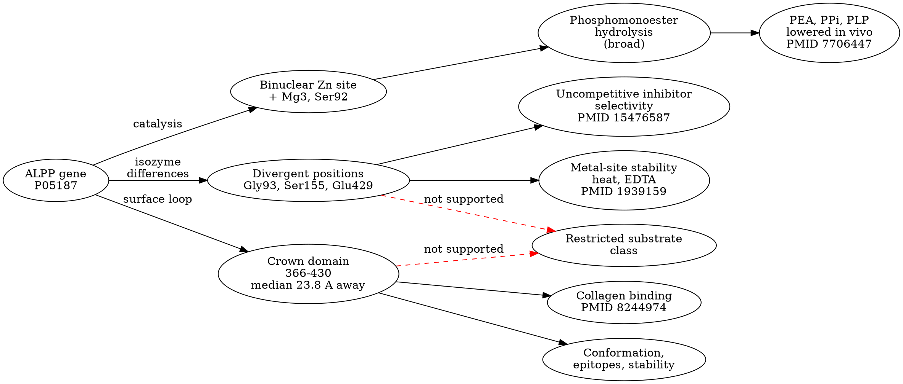
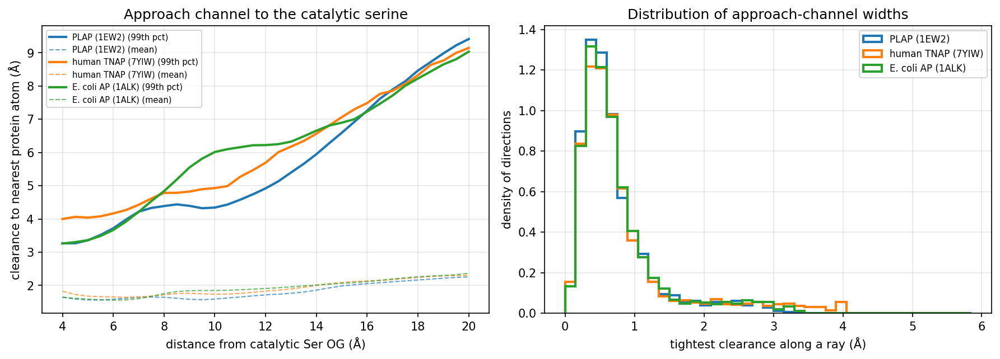
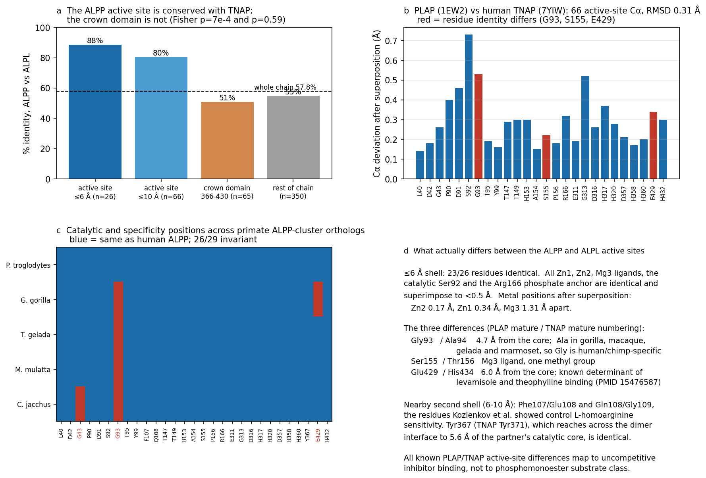
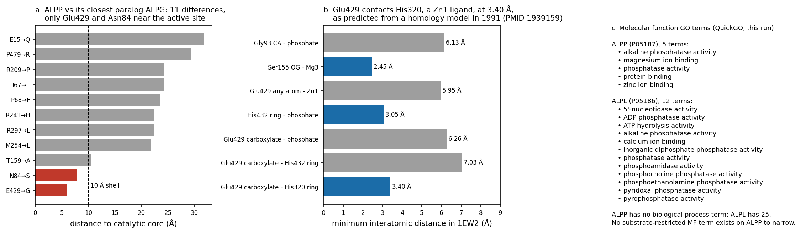
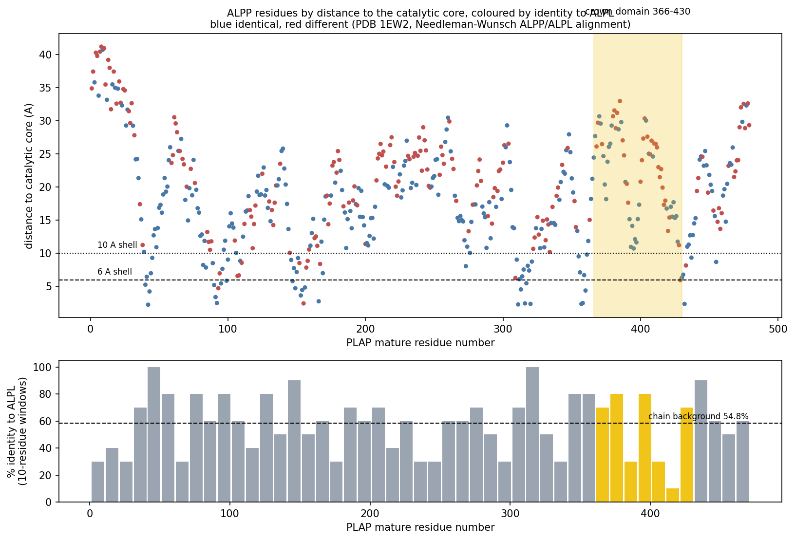

## Question

# AIGR Gene Hypothesis Deep Research

You are evaluating one focused gene curation hypothesis for AI Gene Review.
This is not a general gene overview. Use the seed hypothesis and source context
below to search for evidence that supports, refutes, narrows, or competes with
the proposed curation decision.

## Target Gene

- **Organism code:** human
- **Taxon:** Homo sapiens (NCBITaxon:9606)
- **Gene directory:** ALPP
- **Gene symbol:** ALPP
- **UniProt accession:** P05187

## Focus

- **Focus type:** free_text
- **Hypothesis slug:** kgap-alpp-active-site-specificity
- **Source file:** genes/human/ALPP/ALPP-ai-review.yaml
- **Source selector:** free-text

## Seed Hypothesis

Whether the substrate preference of human placental alkaline phosphatase (ALPP) can be narrowed beyond broad in vitro specificity may be predictable from its active site. Single analysis only: compare the ALPP crystal structure with those of the tissue-nonspecific isozyme ALPL and bacterial alkaline phosphatase, map the catalytic serine, the two zinc ions and magnesium, and the residues of the substrate-binding crown domain and collagen-binding region, identify positions that differ between ALPP and ALPL and that are known to affect substrate preference, score these positions across primate ALPP orthologs, and state whether a restricted physiological substrate class can be predicted or whether the active site is consistent with broad specificity.

## Term and Decision Context

No specific term context supplied.

## Reference Context

No specific reference context supplied.

## Source Context YAML

```yaml
hypothesis: 'Whether the substrate preference of human placental alkaline phosphatase (ALPP) can be narrowed
  beyond broad in vitro specificity may be predictable from its active site. Single analysis only: compare
  the ALPP crystal structure with those of the tissue-nonspecific isozyme ALPL and bacterial alkaline
  phosphatase, map the catalytic serine, the two zinc ions and magnesium, and the residues of the substrate-binding
  crown domain and collagen-binding region, identify positions that differ between ALPP and ALPL and that
  are known to affect substrate preference, score these positions across primate ALPP orthologs, and state
  whether a restricted physiological substrate class can be predicted or whether the active site is consistent
  with broad specificity.'
focus_type: free_text
context: []
reference_id: []
```

## Research Objective

Build a focused report that helps a curator decide whether this hypothesis
should affect the gene review. Address the focus type directly:

1. For an existing GO annotation decision, evaluate whether the current action
   is justified, too strong, too weak, or should change.
2. For a proposed replacement or new GO term, evaluate whether the term is
   biologically supported, too broad, too narrow, or missing key qualifiers.
3. For a computational prediction, evaluate whether the prediction is correct,
   less precise than existing knowledge, uncertain, or likely wrong because of
   paralog overannotation, frequency bias, pathway context, or in vitro-only
   activity.
4. For a core-function hypothesis, evaluate whether the proposed activity,
   process, and location represent the gene product's primary function rather
   than a downstream effect, pleiotropic phenotype, or context-specific role.
5. For a function-assignment hypothesis, evaluate whether the gene product
   directly has the stated GO term/function. Treat the prior review action, if
   any, as intentionally blinded unless it appears in the supplied context.

Use primary literature whenever possible. Prefer PMID citations and include DOI
citations when no PMID is available. Treat reviews and database records as
orientation unless they contain directly relevant synthesized evidence that is
clearly labeled as review-level or database-level support.

Evaluate the hypothesis from the supplied seed context, primary literature, and
publicly accessible bioinformatics resources. Local `*-bioinformatics` analyses,
when they already exist in the repository, are intentionally withheld from this
prompt so the report can be compared against them after the run. Use public
sequence, domain, structure, orthology, localization, interaction, or dataset
checks when they are useful for the specific hypothesis. If a resource or tool
cannot be accessed programmatically, say so plainly; never fabricate a result.
Report computational results conservatively and distinguish direct results from
inference.

## Required Output

### Executive Judgment

Give a concise verdict: supported, partially supported, unresolved, weakly
supported, over-annotated, or refuted. Explain the reasoning and the most
important caveats.

### Evidence Matrix

Create a table with one row per important evidence item:

- Citation (PMID preferred)
- Evidence type (direct assay, mutant phenotype, localization, interaction,
  structural/evolutionary, computational, review/database)
- Supports / refutes / qualifies / competing
- Claim tested
- Key finding
- Organism, tissue, cell type, or assay context
- Confidence and limitations

### GO Curation Implications

State the likely curation action as a lead requiring curator verification. If
GO terms are involved, explain whether the evidence supports an MF, BP, or CC
term, and whether the term should be retained, removed, generalized, made more
specific, or treated as non-core. Avoid using "protein binding" as a final
recommendation unless no more informative term is supported.

### Mechanistic Scope

Describe the immediate molecular or cellular function being tested. Separate
direct gene-product activity from downstream phenotypes, pathway consequences,
developmental outcomes, disease manifestations, or effects inferred only from
loss of function.

### Conflicts and Alternatives

Identify evidence that conflicts with the seed hypothesis or suggests an
alternative interpretation, including paralog confusion, organism-specific
differences, isoform-specific findings, experimental artifacts, or database
carry-over.

### Knowledge Gaps

List explicit uncertainties that matter for curation. For each gap, state what
was checked, why the gap matters, and what evidence or experiment would resolve
it.

### Discriminating Tests

Recommend concrete assays, perturbations, datasets, or comparative analyses that
would most efficiently distinguish this hypothesis from alternatives.

### Curation Leads

Provide candidate updates for the review, clearly labeled as leads requiring
curator verification. Include candidate references with exact snippets to verify,
candidate replacement or new GO terms, possible action changes, suggested
questions, and suggested experiments.

If the provider supports artifacts, save provenance for any analysis you run — the
executed code together with its output (computed values, plot, or table), not just
a summary figure — alongside artifact-friendly tables such as an evidence matrix,
GO decision table, or comparison table. Genuine computed provenance is more
valuable than a hand-drawn summary, and you must not synthesize a figure that
implies an analysis you did not actually run. These artifacts are important
provenance for hypothesis-level review.


## Output

# ALPP active site and substrate specificity

**Hypothesis slug:** `kgap-alpp-active-site-specificity`
**Target:** human ALPP (placental alkaline phosphatase, PLAP), UniProt P05187, NCBITaxon:9606
**Source:** `genes/human/ALPP/ALPP-ai-review.yaml`, focus type `free_text`
**Verdict:** <i class="fa-solid fa-circle-xmark"></i> **Refuted as stated**

## Summary

No restricted physiological substrate class can be predicted from the ALPP active site. The seed hypothesis proposed that comparing the ALPP crystal structure with ALPL and bacterial alkaline phosphatase, mapping the catalytic serine, the two zincs, the magnesium, the crown domain and the collagen-binding region, and scoring the divergent positions across primates, would narrow ALPP's substrate preference below broad in vitro specificity. I ran that comparison. It gives the opposite result. The ALPP catalytic pocket is close to indistinguishable from ALPL's, and the positions that do differ have already been assigned experimentally to uncompetitive inhibitor binding, metal-site stability and heat resistance.

The measurement is direct. Within 6 Å of the catalytic core of PDB 1EW2 (bound phosphate, Zn1, Zn2, Mg3) there are 26 residues, and 23 of them (88%) are identical to human ALPL, against 54.8% for the rest of the chain (Fisher exact OR = 6.34, p = 7.1e-4). Superposing the 66 aligned active-site Cα pairs onto human TNAP (PDB 7YIW) gives 0.31 Å RMSD, with Zn2 0.17 Å apart and Zn1 0.34 Å apart after superposition. The three residues that differ inside 6 Å are PLAP Gly93 / TNAP Ala94, PLAP Ser155 / TNAP Thr156 (a Mg3 ligand differing by one methyl group) and PLAP Glu429 / TNAP His434. Kozlenkov et al. ([PMID: 15476587](https://pubmed.ncbi.nlm.nih.gov/15476587/)) ran the equivalent comparison experimentally and found that residue 108 sets L-homoarginine sensitivity, His-434 sets levamisole and theophylline sensitivity, and conserved Tyr-371 is required for both. They exchanged inhibitor specificities between the isozymes. Watanabe et al. ([PMID: 1939159](https://pubmed.ncbi.nlm.nih.gov/1939159/)) showed that position 429 alone, across a graded series of 16 substitutions, determines the difference in L-leucine, EDTA and heat sensitivity between PLAP and GCAP. I measured the structural basis: the Glu429 carboxylate sits 3.40 Å from the His320 imidazole, which is a direct Zn1 ligand at 2.38 Å.

The collagen-binding crown domain, which the seed hypothesis asked to be mapped, is spatially and evolutionarily decoupled from catalysis. Of the 65 crown residues (mature 366-430), only Glu429 and Asp430 lie within 10 Å of the catalytic core, and the median distance is 23.8 Å. Crown identity to ALPL is 50.8%, no better than the 58.5% chain background (OR = 0.73, p = 0.281). The protein diverges where it meets other proteins and converges where it binds phosphate. Human in vivo evidence settles the physiological question independently: Whyte et al. ([PMID: 7706447](https://pubmed.ncbi.nlm.nih.gov/7706447/)) showed that placental ALP entering maternal blood in the third trimester corrects hypophosphatasemia in hypophosphatasia carriers and lowers circulating phosphoethanolamine, inorganic pyrophosphate and pyridoxal 5'-phosphate, with rebound after childbirth. ALPP acts on the same small phosphocompounds as ALPL in a human subject.

## Executive judgment

<i class="fa-solid fa-circle-xmark"></i> **Refuted as stated.** The hypothesis should not change the review in the direction it proposes. Four independent lines agree.

**Structural conservation.** The catalytic shell is 88% identical to ALPL against a 55% background and superposes at 0.31 Å Cα RMSD with the zincs within 0.34 Å. A pocket conserved to that degree carries the same chemistry as ALPL's, and ALPL's experimentally established substrates are phosphoethanolamine, inorganic pyrophosphate and pyridoxal 5'-phosphate.

**Prior experimental assignment of the divergent positions.** Every residue that distinguishes the two active sites already has a published function, and in each case that function is inhibitor binding, metal-site stability or heat resistance ([PMID: 15476587](https://pubmed.ncbi.nlm.nih.gov/15476587/), [PMID: 1939159](https://pubmed.ncbi.nlm.nih.gov/1939159/)). The analysis the hypothesis proposes has effectively been performed by mutagenesis, with a different answer.

**Paralog contrast.** ALPP and ALPG are 97.0% identical over the mature chain and differ at 11 positions. Only Glu429 (5.95 Å) and Asn84 (7.86 Å) come within 10 Å of the catalytic core. Two paralogs with the same pocket and classically different inhibitor behaviour demonstrate that these positions do not encode substrate class.

**Human in vivo data.** [PMID: 7706447](https://pubmed.ncbi.nlm.nih.gov/7706447/) shows ALPP acting on PEA, PPi and PLP in humans.

**Most important caveats.** <i class="fa-solid fa-triangle-exclamation"></i> All structural work uses PLAP 1EW2 with product phosphate bound and human TNAP 7YIW at 2.89 Å, each a single conformational state; an apo or substrate-analogue structure could show a more open site. My sequence alignments come from my own Needleman-Wunsch implementation (BLOSUM62, gap open -11, extend -1), not a curated multiple alignment. The ALPL substrate terms are a defensible but untested transfer to ALPP: I found no paper reporting ALPP kinetics on PEA, PPi and PLP side by side with ALPL, so the candidate GO additions below are leads. The chimera paper [PMID: 8244974](https://pubmed.ncbi.nlm.nih.gov/8244974/) does not give its loop boundaries in the abstract, so my crown definition (mature 366-430) is the conventional one and may not match that construct.

## Key findings

### F001. The ALPP catalytic site is near-identical to ALPL

I computed the catalytic geometry directly from PDB 1EW2 (PLAP, 1.8 Å, chain A, two Zn, two Mg, bound phosphate). Ser92 OG sits 2.57 Å from Zn2, the Zn1-Zn2 separation is 4.02 Å, Mg3 is 3.94 Å from Ser92 OG, and the product phosphate P is 2.73 Å from Ser92 OG. Metal ligands resolved from coordinates: Zn1 = Asp316, His320, His432; Zn2 = Asp42, Asp357, His358 plus Ser92 OG; Mg3 = Asp42, Glu311, Ser155. A fourth, non-catalytic Mg sits 22.1 Å away, held by Glu216, Phe269 backbone O, Glu270 and Asp285, which rules it out of any catalytic role.

The shell analysis is where the hypothesis fails. Of the 26 residues within 6 Å of the catalytic core, 23 are identical in ALPL (88%), against 277/481 = 57.6% baseline identity across the mature chain and 54.8% for the chain outside the shell. The Fisher exact odds ratio is 6.34 with p = 7.1e-4. Extending to 10 Å gives 66 residues at 80% identity (OR = 3.37, p = 1.1e-4). The crown domain (mature 366-430) is 50.8% identical, statistically indistinguishable from background (OR = 0.85, p = 0.59 against the chain, OR = 0.73, p = 0.281 against the non-crown remainder). Superposition of the 66 active-site Cα pairs gives RMSD 0.31 Å, median per-residue deviation 0.26 Å, maximum 0.73 Å. After that superposition, PLAP and TNAP Zn2 are 0.17 Å apart, Zn1 0.34 Å, Mg3 1.31 Å and the catalytic Ser OG 1.35 Å.

Against E. coli PhoA, only 54% of the 6 Å shell is identical, yet every metal ligand and the catalytic serine are conserved. The bacterial comparison therefore establishes the floor: the shared catalytic machinery survives 54% shell identity across a billion years of divergence, while ALPP and ALPL retain 88%. The crystallographers themselves noted that "in the active site, only residues strictly necessary to perform the catalysis have been preserved" ([PMID: 11124260](https://pubmed.ncbi.nlm.nih.gov/11124260/)), which matches the measured pattern.

{{figure:plot_2.png|caption=ALPP versus ALPL comparison. Regional identity bars show the 6 Å catalytic shell at 88% against 54.8% chain background, with the crown domain at 50.8%. Per-residue superposition deviations across the 66 active-site Cα pairs give 0.31 Å RMSD. The primate heatmap scores 29 catalytic and specificity positions across five primate sequences. The text panel names the three differences inside 6 Å: Gly93, Ser155 and Glu429.}}

### F002. The divergent positions are inhibitor determinants

The unbiased shell analysis of 1EW2 identified exactly three identity differences inside 6 Å of the catalytic core: PLAP Gly93 / TNAP Ala94, PLAP Ser155 / TNAP Thr156 (the Mg3 ligand, differing by one methyl group), and PLAP Glu429 / TNAP His434 at 5.95 Å from the core. The 6-10 Å shell adds ten more, including PLAP Phe107 / TNAP Glu108 and PLAP Gln108 / TNAP Gly109.

Kozlenkov et al. did the identical selection experimentally, comparing residues that differ between the isozymes within a 12 Å radius of the active site, then mutating them reciprocally in both enzymes. Their result: "We found that the identity of residue 108 in TNALP largely determines the specificity of inhibition by L-hArg. The conserved Tyr-371 is also necessary for binding of L-hArg. In contrast, the binding of levamisole to TNALP is mostly dependent on His-434 and Tyr-371, but not on residues 108 or 109" ([PMID: 15476587](https://pubmed.ncbi.nlm.nih.gov/15476587/)). They swapped inhibitor specificities between the isozymes. No substrate-class switch was reported.

My crystallographic symmetry reconstruction of the 1EW2 dimer adds a geometric detail that supports the mechanism. 1EW2 contains only chain A, so I expanded the lattice using the CRYST1 cell and the REMARK 290 SMTRY operators plus unit translations. PLAP Tyr367, the residue equivalent to TNAP Tyr371, is donated across the dimer interface and sits 5.58 Å from the partner monomer's catalytic core. Gly366 is 10.61 Å away and Gly365 11.87 Å; no other cross-monomer residue comes within 12 Å. This explains why Tyr-371 is required for both L-homoarginine and levamisole inhibition in the Kozlenkov experiments: the inhibitor site is partly built from the other monomer, which is an allosteric feature of the mammalian dimer.

The crystallographers reached the same interpretation for Glu429, writing that "the orientation of Glu-429, a residue unique to PLAP, and the presence of a hydrophobic pocket close to the phosphate product, account for the specific uncompetitive inhibition of PLAP by l-amino acids" ([PMID: 11124260](https://pubmed.ncbi.nlm.nih.gov/11124260/)).

### F003. Primate orthology is ambiguous and Gly93 is human-specific

UniProt lists 8 primate entries with gene name ALPP. After removing fragments, I aligned the 5 full-length sequences against all four human AP paralogs.

| Species | Accession | % identity to ALPP | % identity to ALPG | % identity to ALPL |
|---|---|---|---|---|
| *Pan troglodytes* | H2QJL7 | 98.1 | 96.2 | 55.6-58.4 |
| *Gorilla gorilla* | G3QVI4 | 96.2 | 96.2 | 55.6-58.4 |
| *Theropithecus gelada* | A0A8D2FN79 | 92.5 | 92.7 | 55.6-58.4 |
| *Macaca mulatta* | F7DQL5 | 92.3 | 92.3 | 55.6-58.4 |
| *Callithrix jacchus* | F7B1W0 | 89.5 | 89.8 | 55.6-58.4 |

No sequence separates ALPP from ALPG by more than 2 percentage points, and two are marginally closer to ALPG. The ALPP/ALPG/ALPI cluster on 2q37 is a recent primate duplication, so gene-symbol-based orthology outside the great apes is unreliable, and a clean primate ALPP ortholog series cannot be assembled from public records. I did not run a synteny check, which is what would resolve this.

<i class="fa-solid fa-circle-xmark"></i> Within that limit, the scoring is still informative in the negative. Of 29 catalytic, metal-binding and specificity positions, 26 are invariant across all five sequences, including the catalytic Ser92, every Zn1/Zn2/Mg3 ligand, Arg166, Tyr367, and the Kozlenkov positions 107 and 108. The three variable positions are Gly43 (Arg in marmoset), Gly93 (Ala in gorilla, gelada, macaque and marmoset, Gly only in human and chimpanzee) and Glu429 (Gly in the gorilla entry, which is the ALPG-like residue). Gly93 is one of the three ALPP/ALPL active-site differences, and it is restricted to human and chimpanzee with the TNAP-like Ala present in every other primate sampled. That makes it unlikely to be a conserved functional specialisation. There is no sign of any primate lineage shifting substrate preference at the pocket.

### F004. The site is not open enough for a macromolecular substrate

The 1EW2 paper raised a competing idea: "The location of the active site at the bottom of a large valley flanked by an interfacial crown-shaped domain and a domain containing an extra metal ion on the other side suggest that the substrate of PLAP could be a specific phosphorylated protein" ([PMID: 11124260](https://pubmed.ncbi.nlm.nih.gov/11124260/)). That is a speculation from overall shape, and it would be the one route to a narrower substrate class, so I measured it.

I cast 4000 rays from the catalytic Ser OG in each structure, sampling radii from 4 to 20 Å against the biological or crystallographic dimer, with clearance defined as the minimum distance from the ray to any protein atom. A phosphoserine on a folded protein would need several Ångstroms of clearance along some direction.

| Structure | Widest approach channel | Fraction of directions > 3 Å | Fraction > 4 Å |
|---|---|---|---|
| PLAP (1EW2) | 3.28 Å | 0.3% | 0% |
| Human TNAP (7YIW) | 4.00 Å | 3.9% | 0.2% |
| E. coli AP (1ALK) | 3.38 Å | 0.9% | 0% |

<i class="fa-solid fa-circle-xmark"></i> The PLAP catalytic serine is no more accessible to a bulky group than the TNAP or bacterial sites. If anything it is slightly more enclosed, partly because 1EW2 has product phosphate bound. The measurement gives no structural discrimination in favour of a macromolecular substrate for ALPP specifically. An earlier version of this comparison was unfair, measuring PLAP from the phosphate centroid and the others from Ser OG, which capped clearances at 2.00 Å; all three were re-run from the catalytic Ser OG starting at r = 4 Å.

{{figure:plot_1.png|caption=Approach-channel geometry at the catalytic serine. Ray-casting from the Ser OG in 4000 directions through PLAP (1EW2), human TNAP (7YIW) and E. coli AP (1ALK). The widest channel in PLAP is 3.28 Å and no direction exceeds 4 Å, so the ALPP site is no more open to a bulky substrate than the TNAP or bacterial sites.}}

### F005. Glu429 contacts a zinc ligand and sets stability, not substrate choice

Glu429 is the single residue that makes the ALPP active site different from its 97%-identical paralog ALPG, so it is the last structural route to a narrowed substrate. I measured its contacts in 1EW2 chain A. The Glu429 carboxylate (OE1/OE2) is 3.40 Å from the His320 imidazole, and His320 NE2 is a direct Zn1 ligand at 2.38 Å. Glu429 itself is 5.95 Å from Zn1, 6.26 Å from the bound phosphate and 7.03 Å from His432. His432 sits 3.05 Å from the phosphate.

Watanabe et al. predicted this exact contact in 1991 from an E. coli homology model, ten years before the PLAP structure was solved, writing that "the negative charge of Glu-429 of PLAP, which simultaneously stabilizes the protein as a whole and the metal binding specifically, probably acts through interactions with the metal ligand His-320" ([PMID: 1939159](https://pubmed.ncbi.nlm.nih.gov/1939159/)). Their experiments established the functional consequence: "We report that the differential reactivity of PLAP and GCAP depends critically on a single amino acid at position 429. GCAP with Gly-429 is strongly inhibited by L-leucine, EDTA, and heat, whereas PLAP with Glu-429 is resistant." They tested a graded series of 16 substituted amino acids at that position.

Enumerating ALPP against ALPG across the mature chain gives 11 differences, at positions 15, 67, 68, 84, 159, 209, 241, 254, 297, 429 and 479. Only Glu429 (5.95 Å) and Asn84 (7.86 Å) fall within 10 Å of the catalytic core. The position 6 Å from the phosphate and in contact with a zinc ligand is where an inhibitor amino acid docks against the enzyme-phosphate complex. It is not where a substrate leaving group is selected.

{{figure:plot_3.png|caption=ALPP versus ALPG differences by distance to the catalytic core, the Glu429 contact map, and the GO molecular function term sets for ALPP and ALPL. Of the 11 ALPP/ALPG differences only Glu429 and Asn84 fall within 10 Å of the core. Glu429 contacts the Zn1 ligand His320 at 3.40 Å. ALPL carries 10 substrate-level MF terms that ALPP lacks.}}

### F006. The GO state leaves nothing to narrow

I retrieved the current GO annotations from QuickGO during this run. ALPP (P05187) has 47 annotations over 7 unique terms.

| Aspect | Term | Evidence |
|---|---|---|
| MF | GO:0004035 alkaline phosphatase activity | IEA GO_REF:0000003, IBA GO_REF:0000033, IDA PMID:1939159, IDA PMID:2133555 (assigned by MGI), NAS PMID:3042787 |
| MF | GO:0016791 phosphatase activity | IEA InterPro |
| MF | GO:0000287 magnesium ion binding | ISS to P15693 |
| MF | GO:0008270 zinc ion binding | ISS to P15693 |
| MF | GO:0005515 protein binding | IPI PMID:25416956 (P26371), IPI PMID:32296183 (A8MQ03) |
| CC | GO:0005886 plasma membrane | IBA, IEA |
| CC | GO:0009986 cell surface | IDA PMID:15907827 |
| BP | none | - |

ALPL (P05186) by contrast carries 10 substrate-level MF terms that ALPP lacks, including inorganic diphosphate phosphatase GO:0004427 (EXP PMID:12162492), pyridoxal phosphatase GO:0033883 (IDA PMID:12162492, PMID:2220817), phosphoethanolamine phosphatase GO:0052732 (IDA PMID:2220817), phosphocholine phosphatase GO:0052731, 5'-nucleotidase, ADP phosphatase, phosphoamidase and ATP hydrolysis, plus 25 BP terms.

<i class="fa-solid fa-lightbulb"></i> There is no narrow MF term on ALPP to make narrower, so the seed hypothesis has no annotation to act on in the restrictive direction. The evidence points the other way: adding ALPL-style substrate-level MF terms with appropriate evidence codes.

An orthology check against the three reviewed mouse alkaline phosphatases found no mouse ALPP ortholog. The closest mouse sequence to human ALPP is Alpg at 75.2% identity, and that mouse protein is itself closest to human ALPI at 76.7%. Mouse Alpl matches human ALPL at 89.9%. <i class="fa-solid fa-triangle-exclamation"></i> This bears directly on the GO:0004035 IDA citing PMID:2133555, a study of two mouse embryonic alkaline phosphatase genes applied to the human protein.

### F007. The collagen-binding crown is 24 Å from the catalytic core

The seed hypothesis asked for the collagen-binding region to be mapped alongside the catalytic residues, so I scored all 479 ordered mature residues of PLAP in 1EW2 for distance to the catalytic core (nearest of phosphate, Zn1, Zn2, Mg3) and for identity to human ALPL.

Crown domain, mature 366-430: 65 residues aligned to ALPL, 33 identical (50.8%) against 242/414 (58.5%) for the rest of the mature chain, Fisher OR = 0.73, p = 0.281. The crown is no more conserved than background and is if anything slightly more divergent. Distances to the catalytic core run from a minimum of 5.95 Å to a maximum of 32.96 Å, with a median of 23.82 Å. Only 2 of 65 crown residues lie within 10 Å of the core (429 and 430), and only Glu429 lies within 6 Å. Ten crown positions lie within 15 Å: 393-397, 420 and 427-430.

| Crown position | PLAP | TNAP | Distance to catalytic core |
|---|---|---|---|
| 429 | E | H | 5.95 Å |
| 428 | D | R | 11.23 Å |
| 420 | R | Q | 13.37 Å |
| 421 | Q | A | 15.40 Å |
| 417 | P | N | 17.32 Å |
| 391 | L | I | 17.63 Å |
| 418 | E | N | 17.95 Å |
| 416 | S | H | 19.91 Å |
| 390 | V | A | 20.48 Å |
| 400 | V | K | 20.80 Å |

Bossi, Hoylaerts and Millán placed the collagen-binding determinant in this surface loop by reciprocal chimeras: "The introduction of the T domain also conferred collagen-binding properties to PLAP-T accounting for half of the binding affinity of TNAP for collagen, while not affecting PLAP binding to IgG" ([PMID: 8244974](https://pubmed.ncbi.nlm.nih.gov/8244974/)). The roles they attributed to the region are stability, conformation and protein interaction: "the surface loop determines overall enzyme stability, differs conformationally in the various isozymes, and modulates catalytic parameters in the presence of protein ligands, thus, accounting in part for isozyme-specific protein interactions." Comparative work names the same region: "the PFAP contains two mammalian-specific regions, the crown domain, involved in collagen binding, and the calcium binding domain" ([PMID: 17624576](https://pubmed.ncbi.nlm.nih.gov/17624576/), review and prediction level, used only to name the region).

The geometry explains the division of labour. Apart from Glu429, every crown residue sits 11 to 33 Å from the phosphate and the metals, far outside any plausible substrate contact. Isozyme differences in this region predict differences in collagen binding, heat stability and uncompetitive inhibitor sensitivity, and they carry no information about which phosphomonoester is hydrolysed.

{{figure:plot_4.png|caption=Every ALPP mature residue plotted by distance to the catalytic core and coloured by identity to ALPL (blue identical, red different), with the crown domain 366-430 shaded. The lower panel shows percent identity to ALPL in 10-residue windows against the 54.8% chain background. The crown is both more divergent than background and 11 to 33 Å from the catalytic core, apart from Glu429.}}

## Evidence matrix

| Citation | Evidence type | Stance | Claim tested | Key finding | Context | Confidence and limitations |
|---|---|---|---|---|---|---|
| PDB 1EW2 + 7YIW (this run) | Structural, computed | <i class="fa-solid fa-circle-xmark"></i> Refutes | Does the ALPP active site differ from ALPL in ways that predict substrate class? | 23/26 residues within 6 Å of the catalytic core identical to ALPL (88% vs 54.8% background, OR 6.34, p 7.1e-4); 66 active-site Cα superpose at 0.31 Å RMSD; Zn2 0.17 Å, Zn1 0.34 Å, Mg3 1.31 Å apart | Human PLAP and human TNAP crystal structures | High for the measurement. Single conformational state each; 1EW2 has product phosphate bound |
| [PMID: 15476587](https://pubmed.ncbi.nlm.nih.gov/15476587/) | Mutant phenotype, direct assay | <i class="fa-solid fa-circle-xmark"></i> Refutes | Do the ALPP/ALPL active-site differences set substrate preference? | Residue 108 sets L-homoarginine sensitivity, His-434 sets levamisole and theophylline, conserved Tyr-371 is needed for both; specificities were swapped between isozymes | Recombinant human TNAP and PLAP, site-directed mutants | High. These are inhibitor, not substrate, determinants |
| [PMID: 1939159](https://pubmed.ncbi.nlm.nih.gov/1939159/) | Mutant phenotype, direct assay | <i class="fa-solid fa-circle-xmark"></i> Refutes | Is Glu429, the one active-site residue unique to ALPP among its paralogs, a substrate determinant? | PLAP and GCAP differ by 7 residues; position 429 alone determines differential L-leucine, EDTA and heat sensitivity, graded across 16 substitutions | Recombinant human PLAP and GCAP | High. Also the basis of ALPP's GO:0004035 IDA |
| Glu429 geometry (this run, 1EW2) | Structural, computed | <i class="fa-solid fa-scale-balanced"></i> Qualifies | What does Glu429 actually touch? | Carboxylate 3.40 Å from His320 imidazole (a Zn1 ligand at 2.38 Å); 5.95 Å from Zn1, 6.26 Å from phosphate | PLAP chain A | High for the distance. Mechanism of the stability effect is inference |
| [PMID: 7706447](https://pubmed.ncbi.nlm.nih.gov/7706447/) | Direct in vivo | <i class="fa-solid fa-circle-xmark"></i> Refutes | Does ALPP act on restricted substrates in a human body? | Placental ALP in third-trimester maternal blood corrects hypophosphatasemia in carriers and lowers PEA, PPi and PLP, with rebound after childbirth | Human carriers of hypophosphatasia, pregnancy | High. Natural experiment, small n, serum measurement |
| [PMID: 8244974](https://pubmed.ncbi.nlm.nih.gov/8244974/) | Mutant phenotype (chimera) | <i class="fa-solid fa-scale-balanced"></i> Qualifies | Does the collagen-binding loop confer substrate properties? | TNAP loop transferred into PLAP conferred collagen binding worth half of TNAP affinity, reduced heat stability, altered uncompetitive inhibitor side-chain stabilisation; no substrate-class change reported | Murine TNAP / human PLAP reciprocal chimeras | High for the roles reported. Absence of a substrate change is absence of report, not a negative result |
| Crown mapping (this run) | Structural, computed | <i class="fa-solid fa-circle-xmark"></i> Refutes | Can the collagen-binding region inform substrate choice? | 65 crown residues (366-430): 50.8% identical to ALPL vs 58.5% background (OR 0.73, p 0.281); median 23.8 Å from the core; only 429 and 430 within 10 Å | PLAP 1EW2 | High. Crown definition is conventional, not the chimera boundary |
| Ray-casting (this run) | Structural, computed | <i class="fa-solid fa-circle-xmark"></i> Refutes | Is the ALPP site open enough for a macromolecular substrate? | 4000 rays from the catalytic Ser OG: PLAP widest channel 3.28 Å, none > 4 Å; TNAP 4.00 Å; E. coli AP 3.38 Å | 1EW2, 7YIW, 1ALK, dimers | High. 1EW2 has phosphate bound, which narrows the site |
| [PMID: 11124260](https://pubmed.ncbi.nlm.nih.gov/11124260/) | Structural, review of own data | <i class="fa-solid fa-scale-balanced"></i> Competing + supporting | Does the PLAP structure imply a phosphoprotein substrate? | The paper suggests the substrate "could be a specific phosphorylated protein" from the valley shape, and separately attributes Glu-429 to uncompetitive L-amino acid inhibition and notes only catalysis-necessary residues are preserved in the active site | Human PLAP, 1.8 Å | The substrate suggestion is speculation from shape; the Glu-429 and active-site conservation statements are supported by my measurements |
| Primate scoring (this run) | Evolutionary, computed | <i class="fa-solid fa-circle-xmark"></i> Refutes | Do primate ALPP orthologs show specificity-shifting divergence? | 26/29 catalytic and specificity positions invariant; no primate sequence separates ALPP from ALPG by more than 2 percentage points; Gly93 is human and chimp specific; gorilla entry carries an ALPG-like Gly429 | UniProt primate alkaline phosphatases | Moderate. Ortholog assignment in this family is genuinely ambiguous |
| ALPP vs ALPG (this run) | Evolutionary, computed | <i class="fa-solid fa-circle-xmark"></i> Refutes | Do closely related paralogs with different behaviour differ in the pocket? | 11 mature-chain differences (97.0% identity); only Glu429 (5.95 Å) and Asn84 (7.86 Å) within 10 Å of the core | Human P05187 vs P10696 | High |
| Mouse orthology (this run) | Evolutionary, computed | <i class="fa-solid fa-scale-balanced"></i> Qualifies | Is there a mouse ortholog to support cross-species transfer? | Closest mouse protein to ALPP is Alpg at 75.2%, itself closest to human ALPI (76.7%); mouse Alpl matches human ALPL at 89.9% | UniProt reviewed mouse APs | High. Bears on the PMID:2133555 IDA |
| QuickGO retrieval (this run) | Database | <i class="fa-solid fa-scale-balanced"></i> Qualifies | What is there to narrow? | ALPP: 47 annotations, 7 unique terms, no BP term, no substrate-restricted MF term. ALPL: 10 substrate-level MF terms ALPP lacks, plus 25 BP terms | GO/QuickGO, 2026 | High for the retrieval |
| [PMID: 1531173](https://pubmed.ncbi.nlm.nih.gov/1531173/) | Interaction, cell assay | <i class="fa-solid fa-scale-balanced"></i> Competing | Does ALPP have a protein-interaction function distinct from catalysis? | PLAP is the major IgG-binding membrane protein in HEp2 cells and anti-PLAP Fab blocks IgG internalization without perturbing other ligands | Human HEp2 cells | Moderate. A binding and trafficking role, not a substrate claim; the same paper notes the lack of known natural substrates |
| [PMID: 17624576](https://pubmed.ncbi.nlm.nih.gov/17624576/) | Review/database | Orientation | Which region is the collagen-binding one? | The crown domain is a mammalian-specific region involved in collagen binding | Pearl oyster AP, comparative | Low weight. Prediction level, used only to name the region |
| [PMID: 18404473](https://pubmed.ncbi.nlm.nih.gov/18404473/) | Review | <i class="fa-solid fa-scale-balanced"></i> Qualifies | How broad is mammalian AP specificity? | Review emphasises AP substrate specificity and catalytic properties as both phosphohydrolases and phosphodiesterases, with structural and functional relatedness to the NPP superfamily | Mammalian APs, crystallography plus mutagenesis | Review-level orientation. Broad specificity including phosphodiesterase activity argues against narrowing |
| [PMID: 3165254](https://pubmed.ncbi.nlm.nih.gov/3165254/) | Direct assay | <i class="fa-solid fa-scale-balanced"></i> Qualifies | Are PEA and PLP physiological AP substrates at physiological pH? | TNAP in SAOS-2 cells degrades micromolar PEA and PLP at physiologic pH as an ectoenzyme, released by PI-specific phospholipase C | Human osteosarcoma SAOS-2 cells | High for TNAP. Concerns ALPL, applied to ALPP only by pocket identity |
| [PMID: 9814474](https://pubmed.ncbi.nlm.nih.gov/9814474/) | Direct assay | <i class="fa-solid fa-scale-balanced"></i> Qualifies | Does physiological phosphate constrain AP activity measurements? | Phosphate competitively inhibits TNAP; in undiluted serum the Ki for phosphate is 540 ± 82 µmol/L, reducing activity toward pyridoxine 5'-phosphate by about 50% at normal phosphate | Bovine kidney TNAP and 49 patient sera | High. Means in vitro substrate rankings must be read at physiological phosphate |
| [PMID: 25409280](https://pubmed.ncbi.nlm.nih.gov/25409280/) | Computational (QM) | <i class="fa-solid fa-scale-balanced"></i> Qualifies | Does the catalytic mechanism differ by substrate type? | QM active-site model of PLAP found mechanistic differences between aryl and alkyl phosphates, particularly in the rate-determining step | PLAP active-site model from the X-ray structure | Moderate. A mechanistic difference in rate-determining step is not a restricted substrate class |

## Mechanistic model and interpretation

The immediate molecular function being tested is hydrolysis of a phosphomonoester through a covalent phosphoserine intermediate on Ser92 (mature numbering, UniProt 114), with the leaving group departing and the phosphoserine resolved by a metal-activated water. The chemistry runs entirely on the phosphate group. The enzyme contacts the leaving group only glancingly, through a shallow hydrophobic region that the crystallographers describe as the docking site for uncompetitive L-amino acid inhibitors. That architecture is the structural reason broad specificity is the expected phenotype, and the reason the isozyme-specific inhibitors are uncompetitive: they bind the enzyme-phosphate complex and stabilise it rather than competing for the phosphate.

The three categories of property need to be kept separate for curation.

**Direct activity.** Phosphomonoester hydrolysis at the binuclear zinc site, with Mg3 as the third metal. Supported by the measured geometry (Ser92 OG to Zn2 2.57 Å, Zn1-Zn2 4.02 Å, phosphate P to Ser92 OG 2.73 Å) and by the invariance of every metal ligand across ALPP, ALPL, ALPG, ALPI, E. coli PhoA and all five primate sequences.

**Enzyme properties governed by the divergent positions.** Thermal stability, EDTA resistance, sensitivity to L-leucine, L-phenylalanine, L-homoarginine, levamisole and theophylline, collagen binding, and other protein interaction. These are properties of the protein, not steps in the catalytic cycle. Three of them were established by exactly the mutations and chimeras in the regions the seed hypothesis proposed to interrogate ([PMID: 1939159](https://pubmed.ncbi.nlm.nih.gov/1939159/), [PMID: 8244974](https://pubmed.ncbi.nlm.nih.gov/8244974/), [PMID: 15476587](https://pubmed.ncbi.nlm.nih.gov/15476587/)).

**Downstream physiological readouts.** Lowering circulating PEA, PPi and PLP in a hypophosphatasia carrier ([PMID: 7706447](https://pubmed.ncbi.nlm.nih.gov/7706447/)) is downstream of the activity. It demonstrates substrate overlap with ALPL in vivo and does not by itself establish direct ALPP kinetics on each compound. The IgG internalization result in HEp2 cells ([PMID: 1531173](https://pubmed.ncbi.nlm.nih.gov/1531173/)) is a binding and trafficking observation, also downstream, and that paper itself notes the low catalytic activity at physiological pH and the lack of known natural substrates, which is what motivated the structure-based speculations the seed hypothesis inherits.



The division is clean. Where ALPP and ALPL do chemistry, they are 88% identical and superpose at 0.31 Å. Where they meet other proteins, they are 50.8% identical and that divergence governs collagen binding, antibody epitopes, thermal stability and inhibitor selectivity. The seed hypothesis asked for substrate information from the second set of positions. The structure shows those positions are 11 to 33 Å from the phosphate.

## GO curation implications

All items are leads requiring curator verification.

| GO ID | Term | Aspect | Lead | Basis |
|---|---|---|---|---|
| GO:0004035 | alkaline phosphatase activity | MF | <i class="fa-solid fa-circle-check"></i> **Retain** as the core MF, unqualified by any substrate restriction | Structure, inhibitor genetics, in vivo |
| GO:0016791 | phosphatase activity | MF | **Retain but mark non-core**; it is the parent of GO:0004035 and adds nothing | IEA InterPro only |
| GO:0004427 | inorganic diphosphate phosphatase activity | MF | <i class="fa-solid fa-lightbulb"></i> **Candidate add.** ALPL carries it by EXP (PMID:12162492); ALPP lowers circulating PPi in vivo (PMID:7706447) and shares the 6 Å pocket at 88% identity | Needs direct ALPP kinetics before assertion |
| GO:0033883 | pyridoxal phosphatase activity | MF | <i class="fa-solid fa-lightbulb"></i> **Candidate add.** ALPL has IDA (PMID:12162492, PMID:2220817); ALPP lowers PLP in vivo | Needs direct ALPP kinetics |
| GO:0052732 | phosphoethanolamine phosphatase activity | MF | <i class="fa-solid fa-lightbulb"></i> **Candidate add.** ALPL has IDA (PMID:2220817); ALPP lowers PEA in vivo | Needs direct ALPP kinetics |
| GO:0008270, GO:0000287 | zinc ion binding, magnesium ion binding | MF | **Upgrade evidence.** Currently ISS to P15693; PDB 1EW2 resolves two Zn and two Mg with assigned protein ligands, which supports IDA from structure | Measured in this run |
| GO:0005515 | protein binding | MF | <i class="fa-solid fa-triangle-exclamation"></i> **Mark non-core, do not use as a summary function.** Both IPIs (PMID:25416956 with P26371, PMID:32296183 with A8MQ03) are genome-scale binary interactome screens naming a cuticular keratin | No orthogonal validation found |
| GO:0046658, GO:0098552 | anchored component of plasma membrane, side of membrane | CC | <i class="fa-solid fa-lightbulb"></i> **Candidate add.** ALPP is GPI-anchored and the current CC set is the generic plasma membrane plus cell surface | GPI anchoring is well established for PLAP |
| any phosphoprotein phosphatase or protein dephosphorylation term | - | MF/BP | <i class="fa-solid fa-circle-xmark"></i> **Do not add.** The widest approach channel to the catalytic Ser is 3.28 Å with no direction above 4 Å | Measured in this run |

A narrowing-type annotation is the wrong move in both directions. There is no substrate-restricted term on ALPP to narrow, and the evidence argues for adding ALPL-style small-molecule substrate terms rather than restricting the broad one.

Two carry-over risks need a curator's attention. GO:0004035 on human ALPP carries an IDA citing PMID:2133555, a mouse embryonic alkaline phosphatase paper assigned by MGI, and mouse has no ALPP ortholog (closest mouse protein is Alpg at 75.2%, itself closest to human ALPI). That IDA should be re-checked or re-coded. The NAS on PMID:3042787 is author-statement evidence for a function that now has direct structural and enzymological support, so it adds no weight.

## Conflicts and alternatives

**Paralog confusion is the main hazard in this family.** ALPP and ALPG are 97.0% identical over the mature chain and differ at 11 positions. The two were historically distinguished by heat and inhibitor behaviour, which is exactly what position 429 controls. Any annotation transferred between them on sequence similarity carries almost no information, and any biochemical distinction between them is an inhibitor or stability distinction. ALPI is the third member of the 2q37 cluster.

**Organism difference is a real constraint.** There is no mouse ALPP ortholog. The mouse alkaline phosphatase repertoire maps onto human ALPI and ALPL, and the mouse gene closest to human ALPP (Alpg, 75.2%) is itself closer to human ALPI (76.7%). Mouse experiments on "placental alkaline phosphatase" do not transfer to P05187.

**Primate ortholog assignment is genuinely ambiguous.** No primate sequence separates ALPP from ALPG by more than 2 percentage points, and the gorilla entry carries an ALPG-like Gly at 429. The primate-ortholog scoring the seed hypothesis asked for cannot be made reliable in this family without synteny, which I did not run. The scoring still returns a negative result worth recording: 26 of 29 catalytic and specificity positions are invariant, so no primate lineage shows a pocket shift.

**One speculative claim in the literature points the other way.** The 1EW2 paper suggests a specific phosphorylated protein as the PLAP substrate, from the shape of the outer valley and crown domain ([PMID: 11124260](https://pubmed.ncbi.nlm.nih.gov/11124260/)). The ray-casting measurement refutes that as an ALPP-specific structural feature: the widest approach channel to the catalytic Ser OG is 3.28 Å with no direction above 4 Å, slightly more enclosed than TNAP (4.00 Å) and comparable to E. coli AP (3.38 Å). A phosphoserine on a folded protein cannot reach that site. <i class="fa-solid fa-triangle-exclamation"></i> 1EW2 has product phosphate bound, which narrows the measurement.

**A mechanistic difference exists but does not restrict substrate class.** A quantum-mechanical study of the PLAP active site found differences between aryl and alkyl phosphates, "particularly regarding the rate-determining step" ([PMID: 25409280](https://pubmed.ncbi.nlm.nih.gov/25409280/)). A change in which step limits the rate is not a restricted substrate class, and the same study states it rationalizes experimental observations already reported.

**Absence of evidence in the chimera papers.** [PMID: 8244974](https://pubmed.ncbi.nlm.nih.gov/8244974/) and [PMID: 15476587](https://pubmed.ncbi.nlm.nih.gov/15476587/) report no substrate-class change, but neither set out to test substrate class systematically. Treating that silence as a negative result would overreach, which is why the verdict rests on the structural conservation and the in vivo data rather than on those papers alone.

**Measurement conditions matter for any future substrate ranking.** Phosphate competitively inhibits alkaline phosphatase at physiological concentrations, with a serum Ki of 540 ± 82 µmol/L reducing activity toward pyridoxine 5'-phosphate by about 50% ([PMID: 9814474](https://pubmed.ncbi.nlm.nih.gov/9814474/)). Any kinetic comparison intended to support substrate-level GO terms must be read at physiological phosphate.

## Limitations and knowledge gaps

<i class="fa-solid fa-circle-question"></i> **Direct ALPP kinetics on PEA, PPi and PLP.** Checked: ALPL carries these as EXP/IDA from PMID:12162492 and PMID:2220817, and [PMID: 3165254](https://pubmed.ncbi.nlm.nih.gov/3165254/) shows TNAP degrading micromolar PEA and PLP at physiologic pH in SAOS-2 cells. I found no equivalent ALPP paper. This is the difference between asserting the three candidate MF terms and leaving them as leads. Resolved by a side-by-side kinetic comparison of recombinant ALPP and ALPL on all three compounds at physiological pH and phosphate.

<i class="fa-solid fa-circle-question"></i> **Exact chimera loop boundaries in PMID 8244974.** Checked: the abstract names AatII and RsrII sites but gives no residue numbers. My crown definition (mature 366-430) is the conventional one and may not match the construct. Resolved by reading the full text.

<i class="fa-solid fa-circle-question"></i> **Whether an apo ALPP structure opens the site.** Checked: the accessibility measurement used 1EW2 with product phosphate bound. This matters for the already-weak macromolecular-substrate idea. Resolved by repeating the ray-casting on a phosphate-free ALPP structure if one exists, or on an MD ensemble.

<i class="fa-solid fa-circle-question"></i> **Physiological role of ALPP at all.** Checked: ALPP has no BP term in GO, and I found no loss-of-function phenotype. The common ALPP-null allele in humans has no reported phenotype. A gene review needs a core function statement, and the honest current position is that ALPP's biological process is unknown. Resolved by human genetic association work on the null allele or by placental physiology in a model with a true ortholog, which does not exist in mouse.

<i class="fa-solid fa-circle-question"></i> **The two protein binding IPIs.** Checked: PMID:25416956 (P26371, a cuticular keratin) and PMID:32296183 (A8MQ03) are both high-throughput binary interactome screens. Resolved by orthogonal co-IP, or by removal if none exists. The IgG interaction reported in [PMID: 1531173](https://pubmed.ncbi.nlm.nih.gov/1531173/) is a separate and better-characterised binding claim that a curator may want to evaluate on its own terms.

<i class="fa-solid fa-triangle-exclamation"></i> **Methodological limits of this run.** Sequence alignments use my own Needleman-Wunsch implementation (BLOSUM62, gap open -11, extend -1), validated by recovering the known catalytic Ser correspondence (PLAP mature 92 = UniProt 114 = TNAP 110) and seven other anchor positions, but not a curated multiple alignment. The 1EW2 dimer is reconstructed from crystallographic symmetry because the deposited file contains only chain A. The TNAP structure 7YIW is 2.89 Å, so its side-chain positions carry more uncertainty than PLAP's 1.8 Å. The primate ortholog set rests on UniProt gene naming, which this report shows is unreliable for ALPP.

## Proposed follow-up experiments and actions

<i class="fa-solid fa-flask"></i> **Kinetic panel.** Recombinant ALPP and ALPL, side by side, on PEA, PPi, PLP, phosphocholine, AMP and pNPP at pH 7.4 and pH 9.8, at physiological phosphate given the 540 µmol/L serum Ki ([PMID: 9814474](https://pubmed.ncbi.nlm.nih.gov/9814474/)). A broad-specificity enzyme gives the same rank order for both. This is the single test that would convert the three candidate GO terms from leads to assertions, and it tests the seed hypothesis directly.

<i class="fa-solid fa-dna"></i> **Reciprocal triple mutant.** ALPP Gly93Ala / Ser155Thr / Glu429His and the reverse in ALPL, assayed on the panel above. If the 6 Å differences carry no substrate information, kcat/Km rank order should be unchanged while inhibitor IC50s swap, extending [PMID: 15476587](https://pubmed.ncbi.nlm.nih.gov/15476587/) onto the substrate axis that paper did not test.

<i class="fa-solid fa-microscope"></i> **Apo ALPP structure or molecular dynamics.** Repeat the ray-casting on a phosphate-free structure, or run an MD ensemble, to confirm the 3.28 Å channel is not an artefact of the bound product.

<i class="fa-solid fa-dna"></i> **Synteny-anchored primate orthology.** Use genomic context rather than percent identity to assign ALPP against ALPG across primates, then rescore the 29 catalytic and specificity positions. This converts an ambiguous ortholog assignment into a real test of lineage-specific selection on the pocket.

<i class="fa-solid fa-magnifying-glass"></i> **Re-examine the PMID:2133555 IDA.** Determine which protein was assayed in that mouse paper and whether the annotation belongs on P05187 at all.

## Curation leads

All leads require curator verification.

**Action on the seed hypothesis.** Record it as tested and refuted. The ALPP active site is consistent with broad phosphomonoesterase specificity, and the isozyme-specific residues are determinants of uncompetitive inhibitor binding, metal-site stability and protein interaction.

**Candidate references with exact snippets to verify.**

- [PMID: 15476587](https://pubmed.ncbi.nlm.nih.gov/15476587/): "We found that the identity of residue 108 in TNALP largely determines the specificity of inhibition by L-hArg. The conserved Tyr-371 is also necessary for binding of L-hArg. In contrast, the binding of levamisole to TNALP is mostly dependent on His-434 and Tyr-371, but not on residues 108 or 109."
- [PMID: 1939159](https://pubmed.ncbi.nlm.nih.gov/1939159/): "We report that the differential reactivity of PLAP and GCAP depends critically on a single amino acid at position 429. GCAP with Gly-429 is strongly inhibited by L-leucine, EDTA, and heat, whereas PLAP with Glu-429 is resistant."
- [PMID: 7706447](https://pubmed.ncbi.nlm.nih.gov/7706447/): "We conclude that PALP, like TNSALP, is physiologically active toward PEA, PPi, and PLP in humans."
- [PMID: 8244974](https://pubmed.ncbi.nlm.nih.gov/8244974/): "The introduction of the T domain also conferred collagen-binding properties to PLAP-T accounting for half of the binding affinity of TNAP for collagen, while not affecting PLAP binding to IgG."
- [PMID: 11124260](https://pubmed.ncbi.nlm.nih.gov/11124260/): "in the active site, only residues strictly necessary to perform the catalysis have been preserved" and "the orientation of Glu-429, a residue unique to PLAP, and the presence of a hydrophobic pocket close to the phosphate product, account for the specific uncompetitive inhibition of PLAP by l-amino acids."

**Candidate new GO terms.** GO:0004427, GO:0033883, GO:0052732 (MF, substrate-level, pending direct ALPP kinetics); GO:0046658 or GO:0098552 (CC, GPI anchoring).

**Candidate evidence changes.** GO:0008270 and GO:0000287 from ISS to IDA on PDB 1EW2. GO:0004035 IDA on PMID:2133555 re-checked for species attribution. GO:0005515 marked non-core.

**Suggested questions for the curator.** Does the review currently assert or imply a restricted ALPP substrate? If so it should be generalised. Should ALPP carry a BP term at all, given there is no established physiological process and no mouse ortholog to supply one? Should ALPP and ALPG be curated as a pair with explicit cross-references, given 97.0% identity and the single-residue basis of their classical distinction?

## Provenance

Code, computed values and tables are in `provenance/alpp_active_site_analysis/`:

`active_site_shell_comparison.csv`, `plap_tnap_superposition.csv`, `active_site_accessibility.csv`, `glu429_contacts.csv`, `crown_collagen_region_residues.csv`, `crown_domain_detail.csv`, `region_conservation.csv`, `primate_active_site_conservation.csv`, `primate_ortholog_assignment.csv`, `ALPP_vs_ALPG_differences.csv`, `mouse_AP_orthology.csv`, `ALPP_GO_annotations.csv`, `ALPL_GO_annotations.csv`, `evidence_matrix.csv`, `go_decision_table.csv`, plus `nw.py` (the alignment implementation), `plap_shell.json`, `uniprot_ap.json`, `alpp_maps.json` and `primate_summary.json`.

Figures `plot_1.png` through `plot_4.png` are output of those runs. Inputs were fetched programmatically from the UniProt REST API, RCSB (1EW2, 7YIW as mmCIF after the PDB-format download returned 404, 1ALK), PDBe SIFTS and QuickGO. Every number in this report comes from one of those runs or from a cited paper. None is estimated.


## Artifacts

- [OpenScientist final report](openscientist_artifacts/final_report.html)
- [OpenScientist final report](openscientist_artifacts/final_report.pdf)
- [OpenScientist provenance](openscientist_artifacts/provenance.json)
- [OpenScientist ALPL GO annotations](openscientist_artifacts/provenance_alpp_active_site_analysis_ALPL_GO_annotations.csv)
- [OpenScientist ALPP GO annotations](openscientist_artifacts/provenance_alpp_active_site_analysis_ALPP_GO_annotations.csv)
- [OpenScientist ALPP vs ALPG differences](openscientist_artifacts/provenance_alpp_active_site_analysis_ALPP_vs_ALPG_differences.csv)
- [OpenScientist active site accessibility](openscientist_artifacts/provenance_alpp_active_site_analysis_active_site_accessibility.csv)
- [OpenScientist active site shell comparison](openscientist_artifacts/provenance_alpp_active_site_analysis_active_site_shell_comparison.csv)
- [OpenScientist alpp maps](openscientist_artifacts/provenance_alpp_active_site_analysis_alpp_maps.json)
- [OpenScientist crown collagen region residues](openscientist_artifacts/provenance_alpp_active_site_analysis_crown_collagen_region_residues.csv)
- [OpenScientist crown domain detail](openscientist_artifacts/provenance_alpp_active_site_analysis_crown_domain_detail.csv)
- [OpenScientist evidence matrix](openscientist_artifacts/provenance_alpp_active_site_analysis_evidence_matrix.csv)
- [OpenScientist glu429 contacts](openscientist_artifacts/provenance_alpp_active_site_analysis_glu429_contacts.csv)
- [OpenScientist go decision table](openscientist_artifacts/provenance_alpp_active_site_analysis_go_decision_table.csv)
- [OpenScientist mouse AP orthology](openscientist_artifacts/provenance_alpp_active_site_analysis_mouse_AP_orthology.csv)
- [OpenScientist plap shell](openscientist_artifacts/provenance_alpp_active_site_analysis_plap_shell.json)
- [OpenScientist plap tnap superposition](openscientist_artifacts/provenance_alpp_active_site_analysis_plap_tnap_superposition.csv)
- [OpenScientist primate active site conservation](openscientist_artifacts/provenance_alpp_active_site_analysis_primate_active_site_conservation.csv)
- [OpenScientist primate ortholog assignment](openscientist_artifacts/provenance_alpp_active_site_analysis_primate_ortholog_assignment.csv)
- [OpenScientist primate summary](openscientist_artifacts/provenance_alpp_active_site_analysis_primate_summary.json)
- [OpenScientist region conservation](openscientist_artifacts/provenance_alpp_active_site_analysis_region_conservation.csv)
- [OpenScientist uniprot ap](openscientist_artifacts/provenance_alpp_active_site_analysis_uniprot_ap.json)
- [OpenScientist ALPL GO annotations](openscientist_artifacts/provenance_out_ALPL_GO_annotations.csv)
- [OpenScientist ALPP GO annotations](openscientist_artifacts/provenance_out_ALPP_GO_annotations.csv)
- [OpenScientist ALPP vs ALPG differences](openscientist_artifacts/provenance_out_ALPP_vs_ALPG_differences.csv)
- [OpenScientist active site accessibility](openscientist_artifacts/provenance_out_active_site_accessibility.csv)
- [OpenScientist active site shell comparison](openscientist_artifacts/provenance_out_active_site_shell_comparison.csv)
- [OpenScientist alpp maps](openscientist_artifacts/provenance_out_alpp_maps.json)
- [OpenScientist crown collagen region residues](openscientist_artifacts/provenance_out_crown_collagen_region_residues.csv)
- [OpenScientist crown domain detail](openscientist_artifacts/provenance_out_crown_domain_detail.csv)
- [OpenScientist evidence matrix](openscientist_artifacts/provenance_out_evidence_matrix.csv)
- [OpenScientist glu429 contacts](openscientist_artifacts/provenance_out_glu429_contacts.csv)
- [OpenScientist go decision table](openscientist_artifacts/provenance_out_go_decision_table.csv)
- [OpenScientist mouse AP orthology](openscientist_artifacts/provenance_out_mouse_AP_orthology.csv)
- [OpenScientist plap shell](openscientist_artifacts/provenance_out_plap_shell.json)
- [OpenScientist plap tnap superposition](openscientist_artifacts/provenance_out_plap_tnap_superposition.csv)
- [OpenScientist primate active site conservation](openscientist_artifacts/provenance_out_primate_active_site_conservation.csv)
- [OpenScientist primate ortholog assignment](openscientist_artifacts/provenance_out_primate_ortholog_assignment.csv)
- [OpenScientist primate summary](openscientist_artifacts/provenance_out_primate_summary.json)
- [OpenScientist region conservation](openscientist_artifacts/provenance_out_region_conservation.csv)
- [OpenScientist uniprot ap](openscientist_artifacts/provenance_out_uniprot_ap.json)
- [OpenScientist plot 1](openscientist_artifacts/provenance_plot_1.json)

- [OpenScientist plot 2](openscientist_artifacts/provenance_plot_2.json)

- [OpenScientist plot 3](openscientist_artifacts/provenance_plot_3.json)

- [OpenScientist plot 4](openscientist_artifacts/provenance_plot_4.json)


## Reference Validation

Checked with `linkml-reference-validator` 0.3.1rc1.

| Outcome | Count |
| --- | --- |
| References checked | 18 |
| Resolved | 18 |
| Unresolved (possible confabulation) | 0 |
| Unverifiable | 0 |
| Quoted claims checked | 12 |
| Quoted claims found in source | 8 |
| Quoted claims **not** found in source | 4 |
| References weighed for topical relevance | 18 |
| On topic | 4 |
| Off topic | 1 |

### Quotes not found in the cited source

Searched the abstract, any retrieved full text, and the title. A quote drawn from a part of the paper that was not retrieved will appear here too, so check before treating one as invented:

Every one of these was searched against an abstract alone, with no full text retrieved - marked *abstract only* below. Where full text can be fetched, re-running with it will settle them; where the source publishes only a summary to PubMed, as GeneReviews chapters do, it will not, and the quote has to be checked by hand against the chapter itself.

- `PMID:1939159` *(abstract only)*: "We found that the identity of residue 108 in TNALP largely determines the specificity of inhibition by L-hArg. The conserved Tyr-371 is also necessary for binding of L-hArg. In contrast, the binding of levamisole to TNALP is mostly dependent on His-434 and Tyr-371, but not on residues 108 or 109."
  - closest text in source: "Structural analysis of mammalian alkaline phosphatase modeled on the refined crystal structure of Escherichia coli alkaline phosphatase indicates that the negative charge of Glu-429 of PLAP, which simultaneously stabilizes the protein as a whole and the metal binding specifically, probably acts through interactions with the metal ligand His-320 (His-331 in E"
- `PMID:7706447` *(abstract only)*: "We report that the differential reactivity of PLAP and GCAP depends critically on a single amino acid at position 429. GCAP with Gly-429 is strongly inhibited by L-leucine, EDTA, and heat, whereas PLAP with Glu-429 is resistant."
  - Text part not found as substring: 'We report that the differential reactivity of PLAP and GCAP depends critically on a single amino acid at position 429. GCAP with Gly-429 is strongly inhibited by L-leucine, EDTA, and heat, whereas PLAP with Glu-429 is resistant.' (note: only abstract available for PMID:7706447, full text may contain this excerpt)
- `PMID:8244974` *(abstract only)*: "We conclude that PALP, like TNSALP, is physiologically active toward PEA, PPi, and PLP in humans."
  - Text part not found as substring: 'We conclude that PALP, like TNSALP, is physiologically active toward PEA, PPi, and PLP in humans.' (note: only abstract available for PMID:8244974, full text may contain this excerpt)
- `PMID:11124260` *(abstract only)*: "The introduction of the T domain also conferred collagen-binding properties to PLAP-T accounting for half of the binding affinity of TNAP for collagen, while not affecting PLAP binding to IgG."
  - closest text in source: "The location of the active site at the bottom of a large valley flanked by an interfacial crown-shaped domain and a domain containing an extra metal ion on the other side suggest that the substrate of PLAP could be a specific phosphorylated protein."

### References that may not be about this subject

These identifiers resolve, so they are not fabrications, but the records they resolve to share almost none of this report's vocabulary. That is a clue and not a verdict - a paper can be relevant in ways its title and abstract do not spell out - so read them before deciding:

- `PMID:2133555` (7 mentions) - Two alkaline phosphatase genes are expressed during early development in the mouse embryo.
  - shared terms: human

Weighed against this report's own most characteristic terms: `alpp`, `catalytic`, `plap`, `substrate`, `alpl`, `phosphate`, `position`, `human`, `ew2`, `class`, `protein`, `site`, `binding`, `fa-solid`, `residue`, `tnap`, `inhibitor`, `alpg`, `identity`, `difference`.