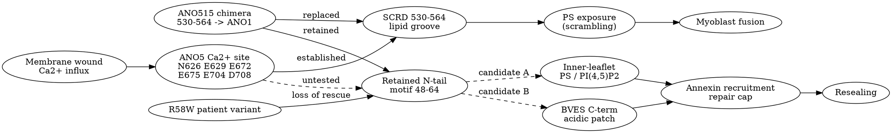
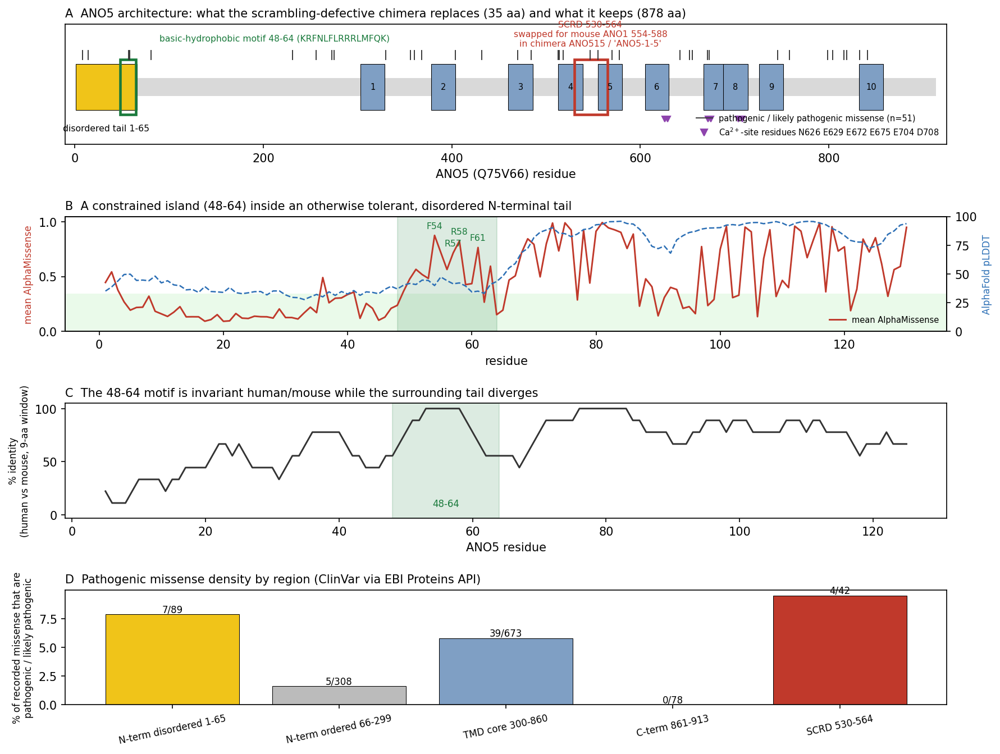
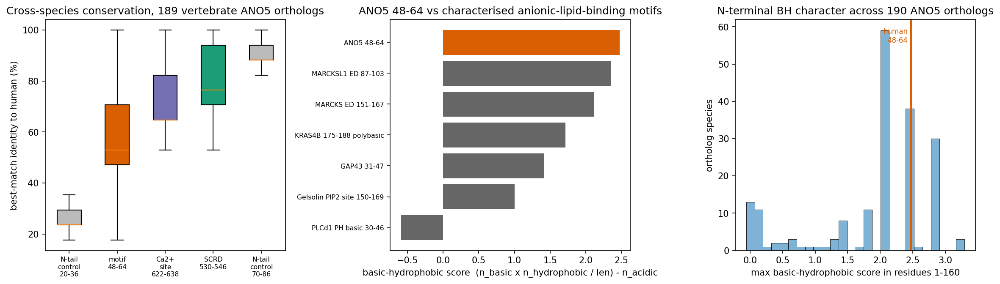
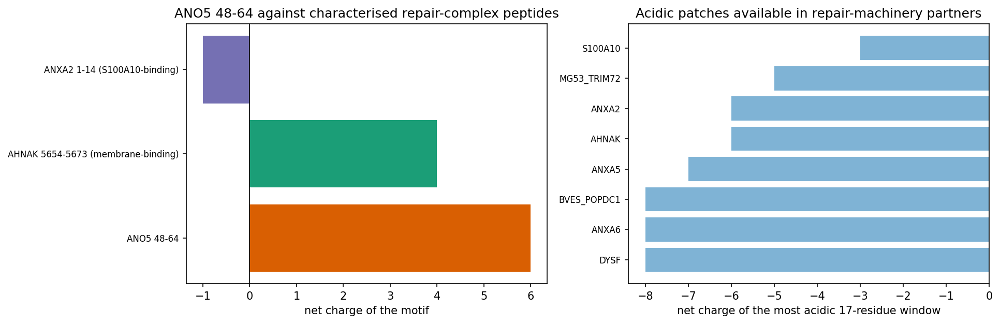
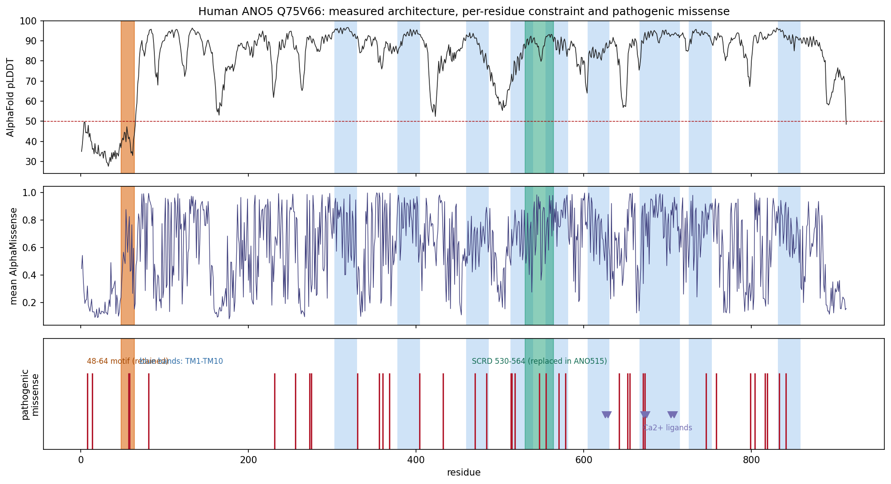

## Question

# AIGR Gene Hypothesis Deep Research

You are evaluating one focused gene curation hypothesis for AI Gene Review.
This is not a general gene overview. Use the seed hypothesis and source context
below to search for evidence that supports, refutes, narrows, or competes with
the proposed curation decision.

## Target Gene

- **Organism code:** human
- **Taxon:** Homo sapiens (NCBITaxon:9606)
- **Gene directory:** ANO5
- **Gene symbol:** ANO5
- **UniProt accession:** Q75V66

## Focus

- **Focus type:** free_text
- **Hypothesis slug:** kgap-ano5-nonscrambling-activity
- **Source file:** genes/human/ANO5/ANO5-ai-review.yaml
- **Source selector:** free-text

## Seed Hypothesis

Which part of human ANO5 (Q75V66) could perform a membrane-repair step independently of phospholipid scrambling may be narrowed by domain analysis. That ANO5 loss disrupts repair and annexin trafficking, and that a scrambling-defective chimera still restores repair, is already established, so do not re-derive the phenotype. Single analysis only: map the ANO5 architecture from sequence and predicted structure, giving the transmembrane topology, the cytosolic N- and C-terminal regions, the scramblase-associated groove and any calcium-binding or regulatory elements, and state which parts the published scrambling-defective chimera retains versus replaces, naming the construct boundaries and their source; identify in the retained parts any conserved surface, short linear motif, calcium-binding site or disordered segment that could mediate a protein-protein or membrane-curvature function rather than lipid transport; compare these features with other anoctamins whose non-scrambling activities are characterised, and with the dysferlin and annexin repair machinery for complementary interaction motifs; and report the positions of disease-causing ANO5 missense variants relative to both the scrambling groove and the retained regions. State which non-scrambling activity is most plausible, which residues would test it first, and say plainly if the architecture cannot distinguish candidate activities.

## Term and Decision Context

No specific term context supplied.

## Reference Context

No specific reference context supplied.

## Source Context YAML

```yaml
hypothesis: 'Which part of human ANO5 (Q75V66) could perform a membrane-repair step independently of phospholipid
  scrambling may be narrowed by domain analysis. That ANO5 loss disrupts repair and annexin trafficking,
  and that a scrambling-defective chimera still restores repair, is already established, so do not re-derive
  the phenotype. Single analysis only: map the ANO5 architecture from sequence and predicted structure,
  giving the transmembrane topology, the cytosolic N- and C-terminal regions, the scramblase-associated
  groove and any calcium-binding or regulatory elements, and state which parts the published scrambling-defective
  chimera retains versus replaces, naming the construct boundaries and their source; identify in the retained
  parts any conserved surface, short linear motif, calcium-binding site or disordered segment that could
  mediate a protein-protein or membrane-curvature function rather than lipid transport; compare these
  features with other anoctamins whose non-scrambling activities are characterised, and with the dysferlin
  and annexin repair machinery for complementary interaction motifs; and report the positions of disease-causing
  ANO5 missense variants relative to both the scrambling groove and the retained regions. State which
  non-scrambling activity is most plausible, which residues would test it first, and say plainly if the
  architecture cannot distinguish candidate activities.'
focus_type: free_text
context: []
reference_id: []
```

## Research Objective

Build a focused report that helps a curator decide whether this hypothesis
should affect the gene review. Address the focus type directly:

1. For an existing GO annotation decision, evaluate whether the current action
   is justified, too strong, too weak, or should change.
2. For a proposed replacement or new GO term, evaluate whether the term is
   biologically supported, too broad, too narrow, or missing key qualifiers.
3. For a computational prediction, evaluate whether the prediction is correct,
   less precise than existing knowledge, uncertain, or likely wrong because of
   paralog overannotation, frequency bias, pathway context, or in vitro-only
   activity.
4. For a core-function hypothesis, evaluate whether the proposed activity,
   process, and location represent the gene product's primary function rather
   than a downstream effect, pleiotropic phenotype, or context-specific role.
5. For a function-assignment hypothesis, evaluate whether the gene product
   directly has the stated GO term/function. Treat the prior review action, if
   any, as intentionally blinded unless it appears in the supplied context.

Use primary literature whenever possible. Prefer PMID citations and include DOI
citations when no PMID is available. Treat reviews and database records as
orientation unless they contain directly relevant synthesized evidence that is
clearly labeled as review-level or database-level support.

Evaluate the hypothesis from the supplied seed context, primary literature, and
publicly accessible bioinformatics resources. Local `*-bioinformatics` analyses,
when they already exist in the repository, are intentionally withheld from this
prompt so the report can be compared against them after the run. Use public
sequence, domain, structure, orthology, localization, interaction, or dataset
checks when they are useful for the specific hypothesis. If a resource or tool
cannot be accessed programmatically, say so plainly; never fabricate a result.
Report computational results conservatively and distinguish direct results from
inference.

## Required Output

### Executive Judgment

Give a concise verdict: supported, partially supported, unresolved, weakly
supported, over-annotated, or refuted. Explain the reasoning and the most
important caveats.

### Evidence Matrix

Create a table with one row per important evidence item:

- Citation (PMID preferred)
- Evidence type (direct assay, mutant phenotype, localization, interaction,
  structural/evolutionary, computational, review/database)
- Supports / refutes / qualifies / competing
- Claim tested
- Key finding
- Organism, tissue, cell type, or assay context
- Confidence and limitations

### GO Curation Implications

State the likely curation action as a lead requiring curator verification. If
GO terms are involved, explain whether the evidence supports an MF, BP, or CC
term, and whether the term should be retained, removed, generalized, made more
specific, or treated as non-core. Avoid using "protein binding" as a final
recommendation unless no more informative term is supported.

### Mechanistic Scope

Describe the immediate molecular or cellular function being tested. Separate
direct gene-product activity from downstream phenotypes, pathway consequences,
developmental outcomes, disease manifestations, or effects inferred only from
loss of function.

### Conflicts and Alternatives

Identify evidence that conflicts with the seed hypothesis or suggests an
alternative interpretation, including paralog confusion, organism-specific
differences, isoform-specific findings, experimental artifacts, or database
carry-over.

### Knowledge Gaps

List explicit uncertainties that matter for curation. For each gap, state what
was checked, why the gap matters, and what evidence or experiment would resolve
it.

### Discriminating Tests

Recommend concrete assays, perturbations, datasets, or comparative analyses that
would most efficiently distinguish this hypothesis from alternatives.

### Curation Leads

Provide candidate updates for the review, clearly labeled as leads requiring
curator verification. Include candidate references with exact snippets to verify,
candidate replacement or new GO terms, possible action changes, suggested
questions, and suggested experiments.

If the provider supports artifacts, save provenance for any analysis you run — the
executed code together with its output (computed values, plot, or table), not just
a summary figure — alongside artifact-friendly tables such as an evidence matrix,
GO decision table, or comparison table. Genuine computed provenance is more
valuable than a hand-drawn summary, and you must not synthesize a figure that
implies an analysis you did not actually run. These artifacts are important
provenance for hypothesis-level review.


## Output

# ANO5 (Q75V66): which retained part could carry a membrane-repair step independent of phospholipid scrambling

Hypothesis slug: `kgap-ano5-nonscrambling-activity`. Source: `genes/human/ANO5/ANO5-ai-review.yaml`, focus type `free_text`. Target: human ANO5, UniProt Q75V66, NCBITaxon:9606.

## Summary

The scrambling-defective construct behind the seed hypothesis is a 35-residue domain swap, not a point mutant. Whitlock et al. 2018 ([PMID: 30257928](https://pubmed.ncbi.nlm.nih.gov/30257928/)) built it as the chimera **ANO515**, written "ANO5-1-5" by Foltz et al. ([PMID: 33496727](https://pubmed.ncbi.nlm.nih.gov/33496727/)): human ANO5 residues 530-564 replaced by mouse ANO1 residues 554-588. That is 35 of 913 residues, 3.8% of the protein. The construct retains ANO5 1-529 and 565-913, which is 878 residues, 96.2%. Everything a curator might nominate as the non-scrambling element is still present in the rescuing construct: the 299-residue cytosolic N-terminus, TM1-TM3, TM6-TM10, the complete canonical Ca²⁺ site, and the 53-residue cytosolic C-terminus. Domain analysis therefore cannot narrow the activity by elimination. It can only exclude the lipid-permeation groove itself.

Positive narrowing does work, and it converges on one element. Residues **48-64** (`AKRFNLFLRRRLMFQKN`) rank first of all 897 overlapping 17-residue windows in ANO5 on a basic-hydrophobic score, above the MARCKS effector domain, MARCKSL1, K-Ras4B, GAP43 and the gelsolin PIP2 site. The equivalent N-terminal maximum is 0.41 in ANO6 and 1.47 in ANO1 against 2.47 here, so the element is specific to ANO5 among the paralogs tested and absent from the paralog with the best-characterised scramblase activity. The window is a local AlphaMissense constraint peak (0.529) inside a disordered tail that is otherwise tolerant (0.287, mean pLDDT 37.6). It holds two of the four pathogenic missense variants in that tail, R57W and R58W, and R58W is the patient variant that expresses in ANO5-knockout fibres yet fails to restore repair ([PMID: 33496727](https://pubmed.ncbi.nlm.nih.gov/33496727/)).

The hypothesis fails at the step it explicitly asks about. <i class="fa-scale-balanced"></i> **The architecture cannot distinguish the candidate non-scrambling activities.** The chemistry that makes 48-64 look like an inner-leaflet PI(4,5)P2 or phosphatidylserine binder is the same chemistry that makes it a plausible electrostatic docking site for an acidic partner surface. AHNAK 5654-5673 is the direct precedent for one short basic-aromatic peptide doing both jobs: it inserts into anionic phospholipid monolayers ([PMID: 31825630](https://pubmed.ncbi.nlm.nih.gov/31825630/)) and the same region binds S100A10-annexin A2 at about 30 nM ([PMID: 22940583](https://pubmed.ncbi.nlm.nih.gov/22940583/)). Two further results cut back the strongest reading of the hypothesis. Cross-species testing over 190 vertebrate orthologs puts the motif at 55.3% mean identity, below the SCRD at 80.2%, with no match in 25 species that have a full-length N-terminus. And the SCRD that the rescuing chimera replaces carries the highest pathogenic-variant density per annotated position of any element and the highest mean AlphaMissense of any non-transmembrane element, so a single rescue assay does not license demoting scramblase activity in the GO record.

**Verdict: partially supported.**

## Key findings

### F001: the chimera changes 3.8% of the protein, so elimination cannot narrow the activity

The construct boundaries were recovered verbatim from the Methods of Whitlock et al. 2018, *Anoctamin 5/TMEM16E facilitates muscle precursor cell fusion*, J Gen Physiol (PMC6219693): "For ANO151, amino acids 554-588 of ANO1 were replaced with amino acids 530-564 from ANO5, and for ANO515, amino acids 530-564 of ANO5 were replaced with amino acids 554-588 from ANO1." The template is mouse ANO1 and the ANO5 background is codon-optimised human Q75V66. Foltz et al. 2021 name the same construct and state its effect: "Replacement of this scrambling domain with the corresponding sequence from the Cl⁻ channel ANO1 to form chimeric 'ANO5-1-5' destroys ANO5-dependent PLS (Whitlock et al., 2018)."

A note for the curator on nomenclature: the Foltz abstract calls it a "scramblase-defective ANO5 mutant", which reads as a point substitution. It is a 35-residue cassette replacement, and that difference matters for how much the rescue result can carry.

The ANO5 SCRD sequence is 530-`NFFYEKISAWITKMEIPRTYQEYESSLTLKMFLFQ`-564, and the aligned human ANO1 sequence is `DEVYGCIARWLTKIEVPKTEKSFEERLIFKAFLLK`. Projecting the ten UniProt-annotated ANO6/TMEM16F transmembrane segments onto ANO5 by global BLOSUM62 alignment (51.4% identity over 878 aligned residues) places TM4 at 513-539 and TM5 at 555-581, so the SCRD covers the cytoplasmic half of TM4, the TM4-TM5 loop and the first third of TM5. That is the expected position of the lipid-permeation groove. In the AlphaFold model AF-Q75V66-F1 v6 (mean pLDDT 82.0) the minimum CB-CB distance from the SCRD to the Ca²⁺ site centroid is 15.2 Å, and no SCRD residue lies within 12 Å of it.

{{figure:plot_1.png|caption=ANO5 architecture, the ANO515 chimera boundaries, the constrained 48-64 N-terminal motif and the distribution of pathogenic missense variants. The swap affects 35 of 913 residues, leaving the cytosolic N- and C-termini and the calcium site intact.}}

### F003: a complete canonical Ca²⁺ site survives the swap, so calcium sensing is not excluded

Global BLOSUM62 alignment of ANO5 to ANO1 (43.5% identity over 875 aligned residues) and to ANO6 (51.4% over 878) projects the UniProt-annotated ANO1 calcium ligands N677, E680, E728, E731, E760 and D764 onto ANO5 **N626, E629, E672, E675, E704, D708**, with chemically identical residues at all six positions. The three ANO6 binding-site annotations E623, E666 and E669 map to the same E629, E672 and E675. In the AlphaFold model these six side chains form a single pocket: all pairwise CB-CB distances fall between 5.7 and 12.0 Å (N626-E629 5.7, E672-E675 5.9, E704-D708 6.1, maximum N626-E672 12.0). AlphaMissense at the six positions is high (0.712, 0.841, 0.900, 0.846, 0.872, 0.966). The ANO1 third-site residue D909 is replaced by alanine (A851) in ANO5, while E425 and D914 are conserved as E399 and D856.

The site sits in TM6, TM7 and TM8 by the projected topology, all retained in ANO515. A Ca²⁺-dependent but transport-independent step, for example a calcium-triggered conformational change that positions annexins or shapes the repair cap, is as live an alternative as the N-terminal motif and is not separated by the existing construct. Human genetics does not currently test the site: there are no pathogenic missense variants at any of the six ligands, only variants of uncertain significance (E672D, E675K, D708G, D708N).

<i class="fa-triangle-exclamation"></i> The topology and Ca²⁺-site assignments are projections from ANO1 and ANO6 annotations through pairwise alignment. No experimental ANO5 structure was found. UniProt Q75V66 still annotates only 8 transmembrane segments against the family architecture of 10, which is a stale prediction worth flagging separately.

### F002 and F006: the retained N-tail contains one constrained, ANO5-specific basic-hydrophobic island

Residues 1-65 are the only segment of ANO5 with pLDDT below 50 (mean 37.6 against 84.9 for 66-299 and 87.5 for the transmembrane domain), identifying a 65-residue intrinsically disordered cytosolic tail. AlphaMissense over 17,347 substitutions gives this tail a mean pathogenicity of 0.287 against 0.588 for residues 66-299 (Mann-Whitney on per-residue means, U = 3100, p = 2.8e-13), so the tail is broadly mutation-tolerant. Constraint inside it concentrates in one window: ranking all 65 positions by mean AlphaMissense puts F54 (0.877), R58 (0.826), F61 (0.766), L55 (0.721), R57 (0.716), K63 (0.595), F51 (0.566) and R56 (0.565) in the top eight, all inside residues 51-63.

Scanning all 897 overlapping 17-residue windows of ANO5 with a basic-hydrophobic (BH) score, defined as (n_K/R × n_F/W/Y/L/I/V/M)/length minus n_D/E, ranks window 48-64 first out of 897 at BH 2.471, with the four next-highest windows being the overlapping frames 45-61 to 49-65. The window carries net charge +6, six basic residues, three phenylalanines and no acidic residues. Scored identically, the reference anionic-lipid binders come out lower: MARCKSL1 87-103 at 2.353 (net +8), MARCKS effector domain 151-167 at 2.118 (net +9), K-Ras4B 175-188 polybasic at 1.714 (net +8), GAP43 31-47 at 1.412, gelsolin PIP2 site 150-169 at 1.000.

The paralog contrast is the sharpest part of this result. Restricting the same scan to residues 1-160 gives ANO5 2.47, ANO1 1.47, ANO10 1.18, ANO3 0.88, ANO6 0.41, ANO4 0.41. The element is absent from the N-terminus of ANO6/TMEM16F, the paralog with the best-characterised scramblase activity, so it is not generic anoctamin N-terminal chemistry. Global alignment also finds no alignable counterpart of ANO5 44-70 in ANO6, ANO1 or ANO10.

<i class="fa-triangle-exclamation"></i> The BH score is composition-based. A randomly shuffled version of 48-64 scores identically at 2.471, and the hydrophobic moment separates native from shuffled only weakly (0.304 against 0.269). The metric tests amino-acid chemistry, not sequence order, and that limit is stated here rather than buried.

{{figure:plot_3.png|caption=ANO5 48-64 scored against characterised membrane-binding peptides of the dysferlin repair complex, and the most acidic 17-residue window available in each cytosolic repair partner. A +6 motif is electrostatically compatible with every partner scanned, so charge complementarity nominates none of them.}}

### F007: the conservation claim does not survive broadening beyond human and mouse

Only two reviewed ANO5 orthologs exist, human Q75V66 (913 aa) and mouse Q75UR0 (904 aa), and the human-mouse pair looks striking: human 47-`PAKRFNLFLRRRLMFQKN`-64 against mouse 38-`PEKRFNLFLRRRLMFQRS`-55, with the `KRFNLFLRRRLMFQ` core invariant while flanking residues 1-46 diverge. Pulling 190 vertebrate ANO5 sequences, one per species (UniProt query gene:ANO5, taxonomy 7742, length 800-1000; 188 of them automatic TrEMBL models), changes the picture.

An ungapped BLOSUM62 best-match scan of five human query segments against each ortholog gives these mean best-match identities:

| Query segment | Mean identity | Median | Species at ≥80% |
|---|---|---|---|
| Residues 70-86 (folded N-region control) | 89.1% | 88.2% | 89.4% |
| SCRD 530-546 | 80.2% | 76.5% | 32.8% |
| Ca²⁺ site 622-638 | 71.4% | 64.7% | 29.6% |
| **Motif 48-64** | **55.3%** | **52.9%** | **21.2%** |
| N-tail control 20-36 | 31.6% | 23.5% | 4.2% |

The motif beats the adjacent disordered tail by a wide margin (U = 30337, p = 2.0e-33, Cohen d = 1.21 against 20-36) and loses to the SCRD (p = 1.7e-27) and the Ca²⁺ site (p = 1.2e-20). A degenerate consensus `[KRQ]x(0-3)[YF][NSTH]LFL[KQRH]x?RL`, built from the human, mouse, chicken, platypus and caecilian windows, matches 139 of 190 species (73.2%). Using the pan-anoctamin TM1 signature `[KR][TS][YF][FY][LV]KIH[AT]PW` (human position 127) as an anchor to exclude N-terminally truncated gene models, the motif is present in 58 of 82 species (70.7%) that carry at least 90 residues upstream of TM1. Twenty-five species have a full-length N-terminus and no match, including *Bos taurus*, *Felis catus*, *Equus caballus*, *Sarcophilus harrisii*, *Phascolarctos cinereus*, *Xenopus tropicalis*, *Crocodylus porosus*, *Terrapene triunguis* and *Thamnophis sirtalis*.

Chemistry persists more widely than sequence. 75.3% of the 190 orthologs carry an N-terminal (1-160) window with BH score at or above 1.5 (median 2.12, IQR 1.68-2.47), with substitutions that keep the basic-plus-Phe pattern: mouse `KRFNLFLRRRLMFQRS`, chicken `GRRYNLFLKRRLRI`, platypus `KKYNLFLKRRLMF`, caecilian `GKYSLFLQHRLRI`. Conserved chemistry with drifting sequence fits a charge-driven surface interaction better than a sequence-read short linear motif. The reduced strength of this claim should be carried into the review.

{{figure:plot_2.png|caption=Cross-species conservation of five ANO5 query segments across 189 vertebrate orthologs (left), the basic-hydrophobic benchmark against characterised anionic-lipid-binding motifs (centre), and the distribution of N-terminal BH character across 190 orthologs with the human 48-64 value marked (right).}}

### F008: lipid binding and protein docking cannot be separated by sequence

<i class="fa-scale-balanced"></i> On the lipid side, AHNAK 5654-5673 (`GKVTFPKMKIPKFTFSGREL`) has the same basic-residues-interleaved-with-phenylalanine pattern as ANO5 48-64, net charge +4 against +6, BH 0.75 against 2.47. That peptide was shown by Langmuir monolayer and ³¹P solid-state NMR to insert preferentially into negatively charged phospholipids ([PMID: 31825630](https://pubmed.ncbi.nlm.nih.gov/31825630/)).

On the protein side, scanning the cytosolic repair-machinery partners for their most acidic 17-residue window gives BVES/POPDC1 334-350 `PIEEGAEDDDDVFEPAS` at net -8, which sits within the BVES C-terminus that Li et al. mapped as the ANO5 N-terminus binding site ([PMID: 34963485](https://pubmed.ncbi.nlm.nih.gov/34963485/)). The rest of the scan: dysferlin 146-162 net -8, annexin A6 167-183 net -8, annexin A5 128-144 net -7, annexin A2 181-197 net -6, MG53/TRIM72 84-100 net -5, S100A10 29-45 net -3. A +6 motif is compatible with all of these, so the electrostatic-complementarity argument proves nothing about which partner is real.

One comparator points weakly the other way. The characterised protein-docking peptide in this complex, annexin A2 residues 1-14 (`MSTVHEILCKLSLE`, net -1, BH -1.57), uses the opposite chemistry, which argues against reading ANO5 48-64 as a docking peptide of that class. That is a single comparator and does not settle the question.

The decisive precedent is that the same AHNAK region does both jobs: it binds anionic lipid and it arches across the S100A10-annexin A2 heterotetramer at about 30 nM affinity ([PMID: 22940583](https://pubmed.ncbi.nlm.nih.gov/22940583/)). The two activities are also not mutually exclusive, since a basic motif can be competed off lipid by a partner and the reverse.

### F004 and F009: variant positions place weight on the retained motif and on the replaced SCRD

Mapping 51 pathogenic or likely pathogenic missense variants (UniProt/EBI variation API for Q75V66; 1,297 unique missense in total) onto the architecture gives:

| Element | Residues | Pathogenic missense | Recorded missense | Mean AlphaMissense |
|---|---|---|---|---|
| Disordered N-tail | 1-65 | 4 (E8K/E8Q, R14W, R57W, R58W) | 89 | 0.287 |
| **Motif 48-64** | 48-64 | **2 (R57W, R58W)** | – | **0.529** |
| Folded cytosolic N-region | 66-299 | 5 | 308 | 0.588 |
| TM4 | 513-539 | 3 | – | 0.656 |
| **SCRD (replaced in ANO515)** | 530-564 | **4 at 2 positions (R547G/Q, S555I/N)** | **42** | **0.720** |
| TM5 | 555-581 | 3 | – | 0.828 |
| Transmembrane domain overall | 300-860 | 39 | 673 | – |
| Cytosolic C-terminal region | 861-913 | 0 | 78 | 0.430 |

Regional enrichment by Fisher exact test against the rest of the protein: transmembrane domain odds ratio 3.14, p = 3.0e-4; region 66-299 depleted at odds ratio 0.34, p = 0.018; disordered tail odds ratio 2.26, p = 0.079; C-terminal region odds ratio 0, p = 0.069. The full pathogenic position list is 8, 14, 57, 58, 81, 231, 256, 273, 275, 330, 356, 360, 368, 404, 432, 470, 484, 513, 514, 518, 547, 555, 570, 578, 642, 652, 655, 671, 673, 746, 758, 799, 804, 816, 819, 833, 841. The gnathodiaphyseal dysplasia cluster C356R/G/Y and C360R lies in the TM1-TM2 extracellular loop, away from both the SCRD and the N-terminal motif.

Two readings follow. Disease genetics places functional weight on the retained N-terminal motif, which carries the only two tail variants outside the extreme N-terminus, and essentially none on the retained cytosolic C-terminus, which has zero pathogenic variants among 78 recorded missense. <i class="fa-scale-balanced"></i> The same analysis produces the strongest internal conflict: the SCRD that the rescuing chimera replaces has the highest pathogenic density per annotated position (4 in 42, 9.5%) and the highest AlphaMissense of any non-transmembrane element.

{{figure:plot_4.png|caption=Measured ANO5 tracks: AlphaFold pLDDT, mean AlphaMissense per position and pathogenic missense positions, plotted against the ten projected transmembrane segments (blue), the replaced SCRD 530-564 (green) and the retained 48-64 motif (orange). Purple markers show the six calcium ligands.}}

## Mechanistic model

The immediate molecular question is whether a retained ANO5 element engages the inner leaflet or a partner protein at the wound site, without moving lipids across the bilayer. That is separable from the downstream phenotypes the seed correctly rules out of scope: failed resealing, annexin mistrafficking, and LGMD-R12 muscle pathology.



What the data support directly: the construct boundaries, the position of the groove and the Ca²⁺ site, the per-residue constraint profile, the R58W loss of rescue, and the paralog-specific BVES interaction mapped to a broad N-terminal fragment. What is inference: that 48-64 binds anything at all. No lipid-binding or peptide-binding assay has been run on any ANO5 fragment in the literature searched. The BVES contact is mapped to "the N terminus", not to residues 48-64, so assigning that contact to this motif is a lead, not a result.

The two branches of the diagram are drawn dashed because the architecture does not choose between them, and because they are not mutually exclusive.

## Evidence base

| Citation | Evidence type | Stance | Claim tested | Key finding | Context | Confidence and limitations |
|---|---|---|---|---|---|---|
| [PMID: 30257928](https://pubmed.ncbi.nlm.nih.gov/30257928/) | Construct / direct assay | <i class="fa-circle-check"></i> Supports | Boundaries of the scrambling-defective chimera | ANO515: ANO5 530-564 replaced by mouse ANO1 554-588; reciprocal ANO151. The same paper shows ANO5 overexpression "confers Ca2+-dependent phospholipid scrambling to HEK-293 cells" | HEK293, codon-optimised human ANO5 | High. Boundaries taken verbatim from Methods |
| [PMID: 33496727](https://pubmed.ncbi.nlm.nih.gov/33496727/) | Mutant phenotype | <i class="fa-circle-check"></i> Supports | A scrambling-defective ANO5 still restores repair | "abnormal repair is rescued by overexpression of a scramblase-defective ANO5 mutant, suggesting a novel, scramblase-independent role of ANO5 in repair" | Mouse myofibres, FM1-43 | Moderate. Rescue is qualitative and ANO5-1-5 expressed below wild type |
| [PMID: 33496727](https://pubmed.ncbi.nlm.nih.gov/33496727/) | Mutant phenotype | <i class="fa-circle-check"></i> Supports | A residue in the retained N-tail is required for repair | p.R58W patient myocytes take up 2.5x more FM1-43 at 2 min; ANO5-R58W-mCherry expresses in ANO5-KO fibres but does not restore repair | Human patient myocytes; mouse ANO5-KO fibres | High for R58W. One variant, so it does not isolate the motif |
| [PMID: 34963485](https://pubmed.ncbi.nlm.nih.gov/34963485/) | Interaction | <i class="fa-circle-check"></i> Supports | The retained N-terminus mediates a protein contact | "Mass spectrometry identified 41 unique proteins including BVES and POPDC3 specifically from ANO5-BioID2 samples, but not from BioID2 fused with ANO6 or MG53." Co-IP maps the contact to the ANO5 N-terminus and the BVES C-terminus | C2C12 myoblasts | Moderate. Proximity labelling plus co-IP, no direct binding measurement |
| [PMID: 26057829](https://pubmed.ncbi.nlm.nih.gov/26057829/) | Direct assay | <i class="fa-circle-check"></i> Supports | The SCRD is a transplantable scrambling element | "By analyzing ANO1-ANO6 chimeric proteins, we identify a domain in ANO6 necessary for PLS and sufficient to confer this function on ANO1, which normally does not scramble." | HEK293 | High. Defines the element the chimera swaps |
| [PMID: 31825630](https://pubmed.ncbi.nlm.nih.gov/31825630/) | Direct assay | <i class="fa-scale-balanced"></i> Qualifies | Basic/aromatic repair-complex peptides bind anionic lipid | "pAHNAK preferentially and strongly interacted with phospholipids that comprised negatively charged polar head groups with unsaturated lipids." | Synthetic 20-mer, Langmuir monolayers and ³¹P ssNMR | High for AHNAK. Extension to ANO5 48-64 is inference from chemistry |
| [PMID: 22940583](https://pubmed.ncbi.nlm.nih.gov/22940583/) | Structural | <i class="fa-scale-balanced"></i> Competing | The same peptide class can instead be a protein-docking site | "The AHNAK peptide adopts a coil conformation that arches across the heterotetramer contacting both annexin A2 and S100A10 protomers with tight affinity (~30 nM)" | X-ray, 3.5 Å | High. The direct precedent that sequence cannot assign lipid versus protein |
| [PMID: 31061173](https://pubmed.ncbi.nlm.nih.gov/31061173/) | Mutant phenotype | <i class="fa-circle-check"></i> Supports | An anoctamin can act without lipid transport | "we identified Anoctamin 8 (ANO8) as a key tether in the formation of the ER/PM junctions that is essential for STIM1-STIM1 interaction and STIM1-Orai1 interaction" | HEK293/HeLa | Moderate. Different paralog, precedent only |
| [PMID: 30257928](https://pubmed.ncbi.nlm.nih.gov/30257928/) | Mutant phenotype | <i class="fa-scale-balanced"></i> Competing | Scrambling supports a separate muscle function | "MPCs isolated from adult Ano5 -/- mice exhibit defective cell fusion in culture and produce muscle fibers with significantly fewer nuclei compared with controls." | Mouse muscle precursor cells | High. Argues against demoting scramblase activity |
| [PMID: 15052337](https://pubmed.ncbi.nlm.nih.gov/15052337/) | Review | <i class="fa-circle-check"></i> Supports | Basic effector domains bind acidic phospholipids and are PKC-switched | "a central basic effector domain (ED) that binds F-actin, Ca2+-calmodulin, and acidic phospholipids; phosphorylation of key serine residues within the ED by protein kinase C (PKC) prevents the above interactions" | Review of the MARCKS family | Review-level. Frames the regulatory test proposed below |
| [PMID: 36292621](https://pubmed.ncbi.nlm.nih.gov/36292621/) | Review | Context | Inheritance modes behind the variant distribution | "Monoallelic mutations in ANO5 give rise to an autosomal dominant skeletal dysplastic syndrome (gnathodiaphyseal dysplasia or GDD), while its biallelic mutations underlie a continuum of four autosomal recessive muscle phenotypes" | Narrative review | Review-level. Used only to interpret variant classes |
| Computed here | Computational (structural/evolutionary) | <i class="fa-circle-check"></i> Supports | 48-64 is the strongest membrane-binding-type element retained | BH rank 1 of 897, net +6, above MARCKS ED, MARCKSL1, K-Ras4B, GAP43, gelsolin; paralog N-terminal maxima ANO1 1.47, ANO6 0.41 | UniProt human sequences | Moderate. Composition-based score, shuffled control scores identically |
| Computed here | Computational (evolutionary) | <i class="fa-circle-xmark"></i> Qualifies | 48-64 is a deeply conserved functional island | 55.3% mean ortholog identity against 80.2% SCRD and 89.1% for residues 70-86; no match in 25 full-length models; chemistry retained in 75.3% | 190 vertebrate ANO5 sequences, 188 TrEMBL | Moderate. Automatic gene models, some absences may be mispredicted first exons |
| Computed here | Computational (genetics) | <i class="fa-scale-balanced"></i> Qualifies | Disease variants avoid the replaced SCRD | SCRD holds the highest pathogenic density per annotated position (4/42) and the highest non-TM AlphaMissense (0.720) | UniProt/EBI variation, 1297 missense, 51 pathogenic | Moderate. Strong clinical ascertainment bias |
| Computed here | Computational (genetics) | <i class="fa-circle-check"></i> Supports | Pathogenic burden concentrates in the TMD | TMD 39/673 (5.8%, OR 3.14, p = 3.0e-4); 66-299 5/308 (1.6%, OR 0.34, p = 0.018); C-terminal 861-913 0/78 | Same variant set | Moderate |

## GO curation implications

All entries below are **leads requiring curator verification**, not decided actions.

| Aspect | Term | Lead | Basis |
|---|---|---|---|
| MF | GO:0017128 phospholipid scramblase activity | **Retain.** Do not demote on the strength of the ANO515 rescue alone. A qualifying note that scrambling is not required in the FM1-43 resealing assay is appropriate | [PMID: 26057829](https://pubmed.ncbi.nlm.nih.gov/26057829/), [PMID: 30257928](https://pubmed.ncbi.nlm.nih.gov/30257928/), [PMID: 33496727](https://pubmed.ncbi.nlm.nih.gov/33496727/); the SCRD is the most constrained non-TM element and supports myoblast fusion |
| BP | GO:0001778 plasma membrane repair | **Retain as core** | [PMID: 33496727](https://pubmed.ncbi.nlm.nih.gov/33496727/) |
| MF | GO:0005509 calcium ion binding | **Retain**, now with residue-level support for N626, E629, E672, E675, E704, D708 | ANO1 ligand projection, six-for-six chemical identity, CB-CB 5.7-12.0 Å |
| MF | GO:0005543 phospholipid binding, or the child GO:0005546 PI(4,5)P2 binding | **Do not add.** Computational lead only. No binding assay on any ANO5 fragment exists | BH rank 1 of 897 at 48-64 |
| MF | A term for the BVES/POPDC1 contact | **Avoid "protein binding" as a final recommendation.** The evidence is proximity labelling plus co-IP mapped to a broad fragment. Wait for a direct binding measurement before choosing an informative child term | [PMID: 34963485](https://pubmed.ncbi.nlm.nih.gov/34963485/) |
| CC | GO:0005789 ER membrane against GO:0005886 plasma membrane | **Curator check of the primary localisation source.** This determines whether 48-64 faces the cytosol at the wound | Conflicting reports in the literature surveyed |
| Annotation hygiene | UniProt Q75V66 transmembrane annotation | **Flag.** UniProt records 8 TM segments against the family architecture of 10. Any topology-dependent annotation inherited from that record should be re-derived | ANO6 projection, 51.4% identity |

The seed's framing invites demoting scramblase activity as non-core. The variant and constraint data argue against that, and the myoblast-fusion phenotype in *Ano5*-null precursor cells gives scrambling an independent muscle function to account for.

## Conflicts and alternatives

<i class="fa-scale-balanced"></i> **The replaced domain is the most constrained non-transmembrane element.** R547G, R547Q, S555I and S555N are pathogenic, giving 4 pathogenic in 42 recorded missense, with mean AlphaMissense 0.720. Point substitutions inside the SCRD cause disease while wholesale replacement of the same 35 residues by the ANO1 cassette still rescues laser-injury repair. These are compatible if SCRD point mutants destabilise or mistraffic the protein whereas the ANO1 cassette folds, but a curator should not read the chimera rescue as evidence that the groove is unimportant.

**Scrambling has a separate muscle function.** Whitlock et al. report that *Ano5*-null muscle precursor cells "exhibit defective cell fusion in culture and produce muscle fibers with significantly fewer nuclei compared with controls" ([PMID: 30257928](https://pubmed.ncbi.nlm.nih.gov/30257928/)). Removing scramblase activity from the GO record would lose this.

**R58W may not report on the motif.** It is one substitution at one position, and arginine to tryptophan changes both charge and bulk. ANO5 has at least two mechanistically distinct missense classes: the European cohort study records c.2272C>T (p.Arg758Cys) in 11.1% of 234 patients ([PMID: 36913258](https://pubmed.ncbi.nlm.nih.gov/36913258/)), and that variant has been reported to act through protein degradation rather than through a localised interaction surface.

**The conservation evidence is weaker than the reviewed-ortholog pair suggests.** 188 of the 190 sequences carrying the cross-species signal are automatic TrEMBL predictions, and first-exon misprediction is the known failure mode for exactly this kind of N-terminal element. Against that, 25 species with a full-length N-terminus carry no match, which is hard to explain away entirely.

**Paralog carry-over risk.** Most ANO5 topology and calcium-site assignments in databases derive from ANO1 and ANO6 structures. The projections here inherit that dependency.

**Electrostatic complementarity proves little.** A +6 motif is compatible with the most acidic window of BVES (-8), dysferlin (-8), annexin A6 (-8), annexin A5 (-7), annexin A2 (-6) and MG53 (-5) alike.

## Limitations and knowledge gaps

| Gap | What was checked | Why it matters for curation | What would resolve it |
|---|---|---|---|
| <i class="fa-circle-question"></i> Does ANO5 48-64 bind lipid at all? | No ANO5 lipid-binding assay found in the literature searched | The entire lipid interpretation rests on sequence chemistry | Liposome co-sedimentation or SPR with a synthetic 48-64 peptide against PS and PI(4,5)P2 versus neutral vesicles |
| <i class="fa-circle-question"></i> Is the BVES contact at 48-64? | [PMID: 34963485](https://pubmed.ncbi.nlm.nih.gov/34963485/) maps it to the N-terminus without sub-regional resolution | Decides whether the motif is a docking site or a lipid site, and whether an informative MF term is available | Co-IP with an ANO5 construct deleted for 48-64 only, and with charge-neutralised R56/R57/R58 |
| <i class="fa-triangle-exclamation"></i> Is the motif conserved or an artifact of automatic gene models? | 190 orthologs, anchored on the TM1 signature; absent in 25 full-length models | A motif lost in cow, cat, horse and *Xenopus* is hard to call essential | Curated RefSeq or Ensembl first-exon verification in the motif-negative mammals |
| <i class="fa-triangle-exclamation"></i> Does ANO515 reach the plasma membrane at wild-type density? | Foltz et al. report lower expression; no surface quantification found | A partial rescue with unequal expression cannot cleanly separate the two activities | Surface biotinylation or quantitative imaging of ANO515 against wild type, with rescue normalised to surface density |
| <i class="fa-circle-question"></i> Which membrane does ANO5 act from? | Conflicting ER and plasma-membrane reports; one study describes ANO5 as "localized to the sarcolemma and sarcoplasmic reticulum of muscle fibers" ([PMID: 42973608](https://pubmed.ncbi.nlm.nih.gov/42973608/)) | Determines whether 48-64 faces the cytosol at the wound, and which CC term applies | Split-fluorophore topology reporters in myofibres during laser wounding |
| <i class="fa-circle-question"></i> Does the motif sense curvature? | Not tested. Hydrophobic moment 0.304 is modest for an amphipathic helix | Curvature sensing is the third candidate activity and was not excluded | Tethered-vesicle or GUV tube-pulling assay with the 48-64 peptide across a curvature range |
| <i class="fa-triangle-exclamation"></i> No experimental ANO5 structure | RCSB searched; topology and Ca²⁺ site projected from ANO1 and ANO6 | Every structural statement here is a projection, not an observation | Cryo-EM of full-length human ANO5 |

Method limitations carried through the whole report: the BH score is composition-based and does not test sequence order; AlphaMissense and pLDDT are predictions used as constraint and disorder proxies; the variant set carries clinical ascertainment bias, so regional densities compare annotation effort as much as biology; the alignment used a hand-implemented Needleman-Wunsch with BLOSUM62 and affine gaps because biopython was unavailable in the executor. All executed code, computed values and output tables are saved under `provenance/`, including `TABLE_ANO5_architecture_map.csv`, `TABLE_ANO5_GO_decision.csv`, `TABLE_ANO5_evidence_matrix.csv`, `ANO5_ortholog_region_conservation.csv`, `ANO5_BH_motif_comparison.csv`, `ANO5_pathogenic_enrichment_by_region.csv` and `repair_partner_acidic_windows.csv`.

## Proposed follow-up experiments and actions

Ranked by how cleanly each separates the alternatives.

<i class="fa-flask"></i> **1. Parallel lipid and partner assay on one mutant panel.** Build R56A/R57A/R58A (charge removal) and F51A/F54A/F61A (aromatic removal) and test each for PS and PI(4,5)P2 liposome binding and for BVES co-immunoprecipitation, with R58W as the positive control for repair incompetence. Charge mutants losing lipid binding while keeping BVES binding favours the lipid interpretation; the reverse favours docking; losing both means the motif is a shared interface.

<i class="fa-flask"></i> **2. Minimal swap.** Replace ANO5 48-64 with the MARCKS effector domain in the full-length protein. Preserved repair rescue means the function is generic basic-hydrophobic lipid engagement. Lost rescue means it is sequence-specific and points at a partner.

<i class="fa-flask"></i> **3. Rescue normalised to surface density.** Repeat the ANO515 rescue with surface expression measured rather than assumed, to convert the qualitative rescue into a quantitative comparison. This is the single change that would most strengthen or weaken the seed hypothesis.

<i class="fa-vial"></i> **4. Separate the two muscle phenotypes.** Test ANO515 for myoblast fusion alongside resealing. Fusion failing while resealing is rescued would cleanly separate the scrambling-dependent and retained-region functions, and would settle the GO question of whether scramblase activity is core.

<i class="fa-dna"></i> **5. First-exon verification.** Check curated RefSeq and Ensembl models for the 25 motif-negative species with full-length N-termini. If the absences are annotation artifacts, the conservation claim recovers much of its original strength.

<i class="fa-flask"></i> **6. PKC regulation as a falsifiable difference.** MARCKS-type effector domains are switched off by PKC phosphorylation of embedded serines ([PMID: 15052337](https://pubmed.ncbi.nlm.nih.gov/15052337/)). ANO5 48-64 contains no serine, so this control is predicted absent. A cheap test that would distinguish ANO5 48-64 from a true MARCKS-class effector domain.

<i class="fa-microscope"></i> **7. Topology at the wound.** Split-fluorophore reporters in myofibres during laser wounding, to establish whether the N-terminal motif is cytosol-facing at the plasma membrane or confined to the sarcoplasmic reticulum.

## Curation leads

Labelled as leads for curator verification.

The most plausible non-scrambling activity is direct engagement of the cytosolic leaflet, or of an acidic partner surface, by the retained basic-hydrophobic element at 48-64. It is stated at that strength because the data cannot choose between the two readings.

The first residues to test are R58 (already known to be repair-incompetent as R58W, and 2nd of 65 by AlphaMissense within the tail), then R57 (5th of 65), then F54 (1st of 65 at 0.877), with F51 and F61 as the aromatic control set.

Candidate references with exact snippets to verify: [PMID: 30257928](https://pubmed.ncbi.nlm.nih.gov/30257928/) for the construct boundaries in Methods; [PMID: 33496727](https://pubmed.ncbi.nlm.nih.gov/33496727/) for "abnormal repair is rescued by overexpression of a scramblase-defective ANO5 mutant, suggesting a novel, scramblase-independent role of ANO5 in repair"; [PMID: 34963485](https://pubmed.ncbi.nlm.nih.gov/34963485/) for "Mass spectrometry identified 41 unique proteins including BVES and POPDC3 specifically from ANO5-BioID2 samples, but not from BioID2 fused with ANO6 or MG53."; [PMID: 31825630](https://pubmed.ncbi.nlm.nih.gov/31825630/) and [PMID: 22940583](https://pubmed.ncbi.nlm.nih.gov/22940583/) as the AHNAK lipid-versus-protein pair; [PMID: 31061173](https://pubmed.ncbi.nlm.nih.gov/31061173/) for ANO8 as the comparator anoctamin with a characterised non-transport activity.

A question for the curator: does the review intend "membrane repair" as a consequence of scramblase activity or as a separable activity? The evidence here supports keeping both on the record and marking the relationship as unresolved, pending the surface-density-normalised rescue and the fusion-versus-resealing comparison.

The open annotation risk is that the seed's framing invites demoting scramblase activity on the basis of one chimera rescue. The variant density, the AlphaMissense constraint and the myoblast-fusion phenotype all argue against that action.


## Artifacts

- [OpenScientist final report](openscientist_artifacts/final_report.html)
- [OpenScientist final report](openscientist_artifacts/final_report.pdf)
- [OpenScientist provenance](openscientist_artifacts/provenance.json)
- [OpenScientist plot 1](openscientist_artifacts/provenance_plot_1.json)

- [OpenScientist plot 2](openscientist_artifacts/provenance_plot_2.json)

- [OpenScientist plot 3](openscientist_artifacts/provenance_plot_3.json)

- [OpenScientist plot 4](openscientist_artifacts/provenance_plot_4.json)

- [OpenScientist ANO5 AF plddt](openscientist_artifacts/provenance_prov_ANO5_AF_plddt.csv)
- [OpenScientist ANO5 BH motif comparison](openscientist_artifacts/provenance_prov_ANO5_BH_motif_comparison.csv)
- [OpenScientist ANO5 BH scan](openscientist_artifacts/provenance_prov_ANO5_BH_scan.csv)
- [OpenScientist ANO5 Ca site distance matrix](openscientist_artifacts/provenance_prov_ANO5_Ca_site_distance_matrix.csv)
- [OpenScientist ANO5 Ca site projection](openscientist_artifacts/provenance_prov_ANO5_Ca_site_projection.csv)
- [OpenScientist ANO5 Nterm charge moment scan](openscientist_artifacts/provenance_prov_ANO5_Nterm_charge_moment_scan.csv)
- [OpenScientist ANO5 TM projection](openscientist_artifacts/provenance_prov_ANO5_TM_projection.csv)
- [OpenScientist ANO5 all missense](openscientist_artifacts/provenance_prov_ANO5_all_missense.csv)
- [OpenScientist ANO5 alphamissense](openscientist_artifacts/provenance_prov_ANO5_alphamissense.csv)
- [OpenScientist ANO5 alphamissense by region](openscientist_artifacts/provenance_prov_ANO5_alphamissense_by_region.csv)
- [OpenScientist ANO5 missense variants uniprot](openscientist_artifacts/provenance_prov_ANO5_missense_variants_uniprot.csv)
- [OpenScientist ANO5 motif presence orthologs](openscientist_artifacts/provenance_prov_ANO5_motif_presence_orthologs.csv)
- [OpenScientist ANO5 ortholog Nterm BH](openscientist_artifacts/provenance_prov_ANO5_ortholog_Nterm_BH.csv)
- [OpenScientist ANO5 ortholog Nterm length](openscientist_artifacts/provenance_prov_ANO5_ortholog_Nterm_length.csv)
- [OpenScientist ANO5 ortholog region conservation](openscientist_artifacts/provenance_prov_ANO5_ortholog_region_conservation.csv)
- [OpenScientist ANO5 orthologs reviewed](openscientist_artifacts/provenance_prov_ANO5_orthologs_reviewed.json)
- [OpenScientist ANO5 orthologs trembl](openscientist_artifacts/provenance_prov_ANO5_orthologs_trembl.json)
- [OpenScientist ANO5 pathogenic enrichment by region](openscientist_artifacts/provenance_prov_ANO5_pathogenic_enrichment_by_region.csv)
- [OpenScientist ANO5 pathogenic missense](openscientist_artifacts/provenance_prov_ANO5_pathogenic_missense.csv)
- [OpenScientist ANO5 region summary](openscientist_artifacts/provenance_prov_ANO5_region_summary.csv)
- [OpenScientist ANO5 vs repair motifs](openscientist_artifacts/provenance_prov_ANO5_vs_repair_motifs.csv)
- [OpenScientist TABLE ANO5 GO decision](openscientist_artifacts/provenance_prov_TABLE_ANO5_GO_decision.csv)
- [OpenScientist TABLE ANO5 architecture map](openscientist_artifacts/provenance_prov_TABLE_ANO5_architecture_map.csv)
- [OpenScientist TABLE ANO5 evidence matrix](openscientist_artifacts/provenance_prov_TABLE_ANO5_evidence_matrix.csv)
- [OpenScientist ano5 alignments](openscientist_artifacts/provenance_prov_ano5_alignments.json)
- [OpenScientist anoctamin seqs](openscientist_artifacts/provenance_prov_anoctamin_seqs.json)
- [OpenScientist repair machinery seqs](openscientist_artifacts/provenance_prov_repair_machinery_seqs.json)
- [OpenScientist repair partner acidic windows](openscientist_artifacts/provenance_prov_repair_partner_acidic_windows.csv)

## Reference Validation

Checked with `linkml-reference-validator` 0.3.1rc1.

| Outcome | Count |
| --- | --- |
| References checked | 12 |
| Resolved | 12 |
| Unresolved (possible confabulation) | 0 |
| Unverifiable | 0 |
| Quoted claims checked | 4 |
| Quoted claims found in source | 2 |
| Quoted claims **not** found in source | 2 |
| References weighed for topical relevance | 12 |
| On topic | 0 |
| Off topic | 0 |

### Quotes not found in the cited source

Searched the abstract, any retrieved full text, and the title. A quote drawn from a part of the paper that was not retrieved will appear here too, so check before treating one as invented:

Every one of these was searched against an abstract alone, with no full text retrieved - marked *abstract only* below. Where full text can be fetched, re-running with it will settle them; where the source publishes only a summary to PubMed, as GeneReviews chapters do, it will not, and the quote has to be checked by hand against the chapter itself.

- `PMID:34963485` *(abstract only)*: "abnormal repair is rescued by overexpression of a scramblase-defective ANO5 mutant, suggesting a novel, scramblase-independent role of ANO5 in repair"
  - closest text in source: "CONCLUSIONS: Taken together, these data suggest that BVES is a novel interacting protein of ANO5, involved in regulation of muscle differentiation."
- `PMID:31825630` *(abstract only)*: "Mass spectrometry identified 41 unique proteins including BVES and POPDC3 specifically from ANO5-BioID2 samples, but not from BioID2 fused with ANO6 or MG53."
  - closest text in source: "However, no molecular data are available for the membrane binding of the various proteins involved in this complex"