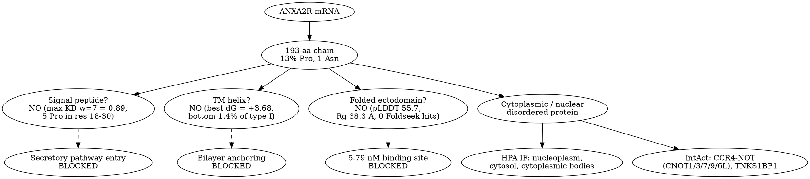
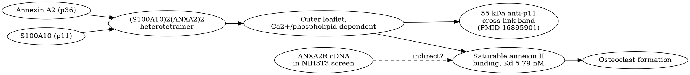
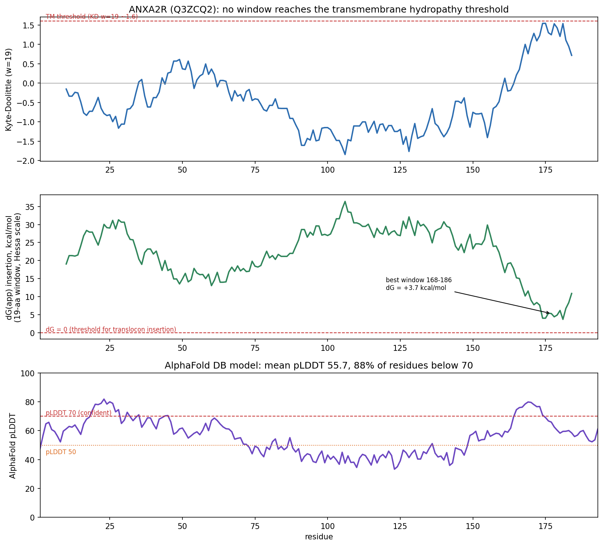
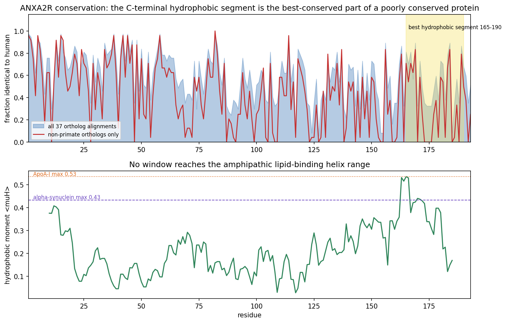
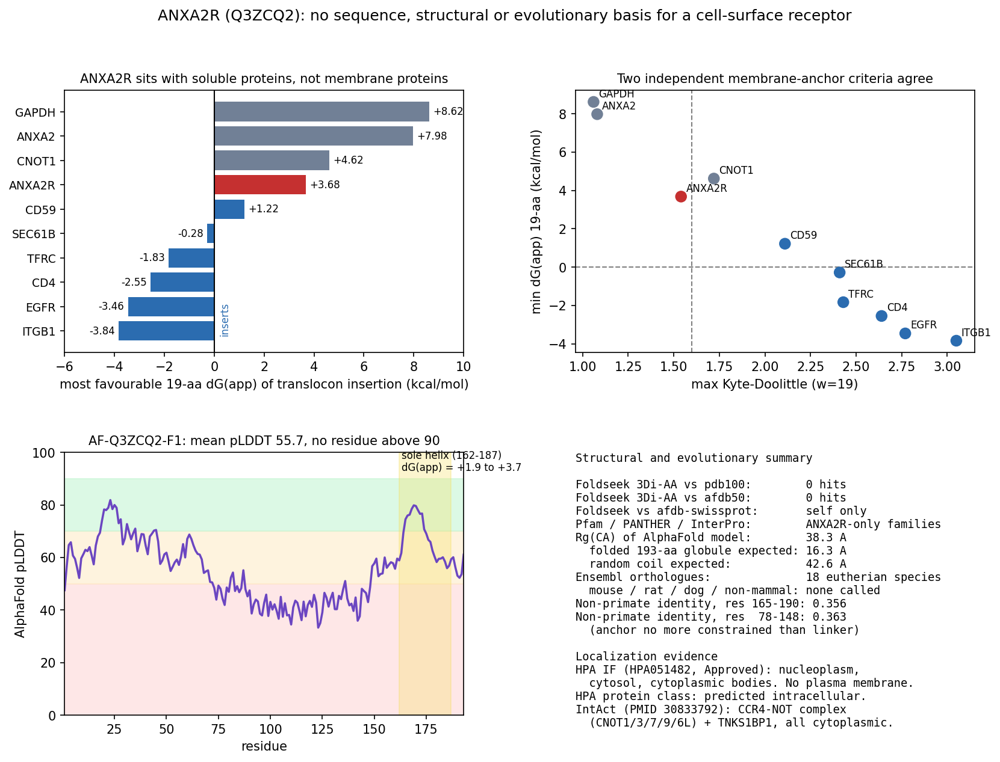
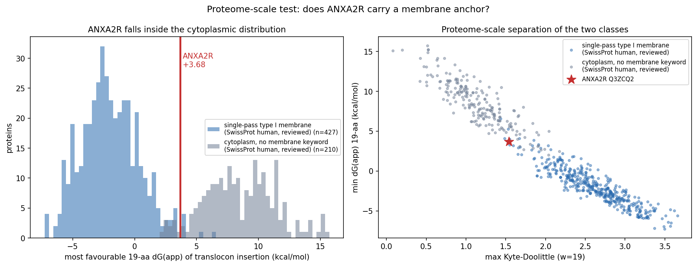

## Question

# AIGR Gene Hypothesis Deep Research

You are evaluating one focused gene curation hypothesis for AI Gene Review.
This is not a general gene overview. Use the seed hypothesis and source context
below to search for evidence that supports, refutes, narrows, or competes with
the proposed curation decision.

## Target Gene

- **Organism code:** human
- **Taxon:** Homo sapiens (NCBITaxon:9606)
- **Gene directory:** ANXA2R
- **Gene symbol:** ANXA2R
- **UniProt accession:** Q3ZCQ2

## Focus

- **Focus type:** free_text
- **Hypothesis slug:** kgap-anxa2r-membrane-topology-and-fold
- **Source file:** genes/human/ANXA2R/ANXA2R-ai-review.yaml
- **Source selector:** free-text

## Seed Hypothesis

Whether human ANXA2R (Q3ZCQ2) has any sequence or structural basis for acting as a cell-surface receptor can be assessed computationally, given that it has no predicted transmembrane segment. Single analysis only: run signal-peptide, transmembrane, GPI-anchor, lipidation (myristoylation, palmitoylation) and amphipathic-helix predictions on ANXA2R, model it with AlphaFold to determine whether it is folded or largely disordered, search the model against PDB and AFDB for structural relatives, assess conservation and taxonomic distribution of ANXA2R orthologs, and state whether its sequence features are compatible with a plasma-membrane receptor, a peripheral membrane protein, or a cytoplasmic protein.

## Term and Decision Context

No specific term context supplied.

## Reference Context

No specific reference context supplied.

## Source Context YAML

```yaml
hypothesis: 'Whether human ANXA2R (Q3ZCQ2) has any sequence or structural basis for acting as a cell-surface
  receptor can be assessed computationally, given that it has no predicted transmembrane segment. Single
  analysis only: run signal-peptide, transmembrane, GPI-anchor, lipidation (myristoylation, palmitoylation)
  and amphipathic-helix predictions on ANXA2R, model it with AlphaFold to determine whether it is folded
  or largely disordered, search the model against PDB and AFDB for structural relatives, assess conservation
  and taxonomic distribution of ANXA2R orthologs, and state whether its sequence features are compatible
  with a plasma-membrane receptor, a peripheral membrane protein, or a cytoplasmic protein.'
focus_type: free_text
context: []
reference_id: []
```

## Research Objective

Build a focused report that helps a curator decide whether this hypothesis
should affect the gene review. Address the focus type directly:

1. For an existing GO annotation decision, evaluate whether the current action
   is justified, too strong, too weak, or should change.
2. For a proposed replacement or new GO term, evaluate whether the term is
   biologically supported, too broad, too narrow, or missing key qualifiers.
3. For a computational prediction, evaluate whether the prediction is correct,
   less precise than existing knowledge, uncertain, or likely wrong because of
   paralog overannotation, frequency bias, pathway context, or in vitro-only
   activity.
4. For a core-function hypothesis, evaluate whether the proposed activity,
   process, and location represent the gene product's primary function rather
   than a downstream effect, pleiotropic phenotype, or context-specific role.
5. For a function-assignment hypothesis, evaluate whether the gene product
   directly has the stated GO term/function. Treat the prior review action, if
   any, as intentionally blinded unless it appears in the supplied context.

Use primary literature whenever possible. Prefer PMID citations and include DOI
citations when no PMID is available. Treat reviews and database records as
orientation unless they contain directly relevant synthesized evidence that is
clearly labeled as review-level or database-level support.

Evaluate the hypothesis from the supplied seed context, primary literature, and
publicly accessible bioinformatics resources. Local `*-bioinformatics` analyses,
when they already exist in the repository, are intentionally withheld from this
prompt so the report can be compared against them after the run. Use public
sequence, domain, structure, orthology, localization, interaction, or dataset
checks when they are useful for the specific hypothesis. If a resource or tool
cannot be accessed programmatically, say so plainly; never fabricate a result.
Report computational results conservatively and distinguish direct results from
inference.

## Required Output

### Executive Judgment

Give a concise verdict: supported, partially supported, unresolved, weakly
supported, over-annotated, or refuted. Explain the reasoning and the most
important caveats.

### Evidence Matrix

Create a table with one row per important evidence item:

- Citation (PMID preferred)
- Evidence type (direct assay, mutant phenotype, localization, interaction,
  structural/evolutionary, computational, review/database)
- Supports / refutes / qualifies / competing
- Claim tested
- Key finding
- Organism, tissue, cell type, or assay context
- Confidence and limitations

### GO Curation Implications

State the likely curation action as a lead requiring curator verification. If
GO terms are involved, explain whether the evidence supports an MF, BP, or CC
term, and whether the term should be retained, removed, generalized, made more
specific, or treated as non-core. Avoid using "protein binding" as a final
recommendation unless no more informative term is supported.

### Mechanistic Scope

Describe the immediate molecular or cellular function being tested. Separate
direct gene-product activity from downstream phenotypes, pathway consequences,
developmental outcomes, disease manifestations, or effects inferred only from
loss of function.

### Conflicts and Alternatives

Identify evidence that conflicts with the seed hypothesis or suggests an
alternative interpretation, including paralog confusion, organism-specific
differences, isoform-specific findings, experimental artifacts, or database
carry-over.

### Knowledge Gaps

List explicit uncertainties that matter for curation. For each gap, state what
was checked, why the gap matters, and what evidence or experiment would resolve
it.

### Discriminating Tests

Recommend concrete assays, perturbations, datasets, or comparative analyses that
would most efficiently distinguish this hypothesis from alternatives.

### Curation Leads

Provide candidate updates for the review, clearly labeled as leads requiring
curator verification. Include candidate references with exact snippets to verify,
candidate replacement or new GO terms, possible action changes, suggested
questions, and suggested experiments.

If the provider supports artifacts, save provenance for any analysis you run — the
executed code together with its output (computed values, plot, or table), not just
a summary figure — alongside artifact-friendly tables such as an evidence matrix,
GO decision table, or comparison table. Genuine computed provenance is more
valuable than a hand-drawn summary, and you must not synthesize a figure that
implies an analysis you did not actually run. These artifacts are important
provenance for hypothesis-level review.


## Output

# ANXA2R (Q3ZCQ2): membrane topology and fold

**Hypothesis slug:** `kgap-anxa2r-membrane-topology-and-fold`
**Source file:** `genes/human/ANXA2R/ANXA2R-ai-review.yaml`
**Gene:** human ANXA2R (annexin-2 receptor, AXIIR, C5orf39), UniProt Q3ZCQ2, 193 aa, 21.7 kDa, MANE ENST00000616064 / NP_001014301.1, chr5:43,039,233-43,043,170 (minus strand)

All computational results below were generated during this investigation against live public resources (UniProt REST, AlphaFold DB API, Foldseek web API, Ensembl REST/Compara, IntAct REST, QuickGO, Human Protein Atlas). Executed code and its numeric output are preserved in the iteration transcripts; derived tables are in `provenance/` as `anxa2r_membrane_anchor_benchmark.csv`, `anxa2r_proteome_scale_benchmark.csv`, `anxa2r_evidence_matrix.csv` and `anxa2r_GO_decision_table.csv`.

---

## Summary

Human ANXA2R has no sequence or structural basis for acting as a cell-surface receptor. The seed hypothesis is **supported**, and the receptor assignment that gave the gene its name is **refuted** on computational grounds. ANXA2R lacks a signal peptide, lacks any transmembrane-compatible segment at any window length from 17 to 25 residues, lacks N-myristoylation and CaaX motifs, lacks a GPI anchor signal, and lacks any N-glycosylation sequon. AlphaFold models it as a largely disordered, extended polypeptide with no globular domain and no structural relative anywhere in the PDB or the clustered AlphaFold database. Its features are compatible with a cytoplasmic, possibly nuclear, intrinsically disordered protein. They are not compatible with a plasma-membrane receptor, and they are not compatible with a peripheral membrane protein either.

The quantitative core of this conclusion is a thermodynamic test. The most favourable 19-residue window in ANXA2R has an apparent translocon insertion free energy of **+3.68 kcal/mol** on the Hessa biological hydrophobicity scale, where spontaneous insertion requires a value near or below zero. Against 427 reviewed human single-pass type I membrane proteins, ANXA2R is less insertable than **98.6%** of them and less hydrophobic than **99.3%**, while sitting inside the distribution of 210 reviewed cytoplasmic proteins. The metric separates those two reference classes almost perfectly (Mann-Whitney U = 200, p = 3.5e-93, rank-biserial r = 0.996), so the test has the statistical power to support the claim it is being used for. If ANXA2R were a type I membrane receptor, it would be roughly a 1-in-70 outlier for the single property that defines the class.

Everything generated independently of the original 2006 cloning paper points inside the cell. Human Protein Atlas immunofluorescence (antibody HPA051482, reliability "Approved") places ANXA2R in nucleoplasm, cytosol and cytoplasmic bodies, with the protein class "Predicted intracellular proteins" and no secretome entry. The only interaction dataset in IntAct comes from an interferon-stimulated-gene interactome ([PMID: 30833792](https://pubmed.ncbi.nlm.nih.gov/30833792/)) and recovers the cytoplasmic CCR4-NOT mRNA deadenylase complex. The sole GO molecular function term beyond "protein binding", GO:0038023 signaling receptor activity, is an automatic IEA inherited from InterPro IPR031449, an ANXA2R-only family whose name derives from the same 2006 paper. That annotation carries no information independent of the claim it appears to corroborate.

---

## Key findings

### <i class="fa-solid fa-circle-xmark"></i> F1. No membrane anchor of any kind

Computed on the UniProt Q3ZCQ2 canonical sequence (193 aa, MANE ENST00000616064), Kyte-Doolittle hydropathy with a 19-residue window peaks at **1.54** at residue 174 (window 165-183, `CLEWILRVGFAAFSVLWAC`). No window anywhere in the protein exceeds the conventional 1.6 to 2.0 transmembrane threshold. The Hessa biological-hydrophobicity apparent insertion free energy, scanned over windows of 17 to 25 residues, is positive everywhere: the minimum is **+1.87 kcal/mol** at w=17 (residues 168-184, `WILRVGFAAFSVLWACC`), rising to +2.71 at w=18 and +3.68 at w=19.

These numbers only mean something against controls computed identically. The comparison is decisive:

| Protein | Accession | Class | min dG(app) 19-aa (kcal/mol) | max KD (w=19) |
|---|---|---|---|---|
| ITGB1 | P05556 | integrin beta-1, type I single-pass | −3.84 | 3.05 |
| EGFR | P00533 | EGF receptor, type I single-pass | −3.46 | 2.77 |
| CD4 | P01730 | T-cell co-receptor, type I single-pass | −2.55 | 2.64 |
| TFRC | P02786 | transferrin receptor, type II single-pass | −1.83 | 2.43 |
| SEC61B | P60468 | tail-anchored ER protein | −0.28 | 2.41 |
| CD59 | P13987 | GPI-anchored (cleaved GPI signal) | +1.22 | 2.11 |
| **ANXA2R** | **Q3ZCQ2** | **query** | **+3.68** | **1.54** |
| CNOT1 | A5YKK6 | CCR4-NOT scaffold, cytoplasmic | +4.62 | 1.72 |
| ANXA2 | P07355 | peripheral membrane, Ca2+/phospholipid | +7.98 | 1.08 |
| GAPDH | P04406 | cytosolic enzyme | +8.62 | 1.06 |

ANXA2R sits in the soluble-protein range, separated by 5 to 7 kcal/mol from every genuinely membrane-anchored control, including the two hardest cases (a tail-anchored protein and a GPI-signal protein, both of which use marginally hydrophobic segments).

A type I topology requires two features in series: a cleavable N-terminal signal peptide and a single internal transmembrane helix. ANXA2R has neither. The N-terminal region fails every signal-peptide criterion: residues 1-8 have a net charge of −1 (n-regions are positively charged), the maximum KD over a 7-residue window across residues 1-30 is only **0.89** (h-regions need values above roughly 2.0), and residues 18-30 (`VAPEPQPPPIVSS`) contain **five prolines**, which are strongly disfavoured in signal-peptide h-regions.

The other anchoring routes are also closed. N-myristoylation is excluded because position 2 is glutamate, not the obligatory glycine. There is no C-terminal CaaX prenylation motif (the last four residues are `AKQP`). There is no GPI signal: GPI attachment requires an uninterrupted 15 to 20 residue hydrophobic tail running to the chain terminus, whereas the ANXA2R hydrophobic stretch is broken by Ser178, Ser185 and Arg186 and stops 8 residues short of the C-terminus.

{{figure:plot_1.png|caption=Top: Kyte-Doolittle hydropathy of ANXA2R with a 19-residue window never reaches the transmembrane threshold of about 1.6. Middle: the apparent insertion free energy on the Hessa scale stays positive across the whole sequence, with the best 19-residue window at +3.7 kcal/mol. Bottom: AlphaFold per-residue pLDDT for AF-Q3ZCQ2-F1, mean 55.7, with 88 percent of residues below 70.}}

### <i class="fa-solid fa-circle-xmark"></i> F2. AlphaFold predicts a largely disordered chain with no globular domain

AlphaFold DB entry AF-Q3ZCQ2-F1 (model v6, 193 residues) has mean pLDDT **55.7**, median 56.6, range 33.3 to 81.9. **37.8%** of residues fall below 50 (very low, usually disordered), 49.7% between 50 and 70, 12.4% between 70 and 90, and **0% above 90**. Only two segments of five or more residues reach pLDDT ≥ 70: residues 19-28 and 165-174. The predicted aligned error matrix has mean **25.97 Å** and median 29.00 Å, with only 2.6% of residue pairs below 5 Å; the mean inter-block PAE between residues 1-159 and 160-193 is 28.5 Å, so the model places no constraint on the relative geometry of the two halves.

Sequence composition agrees. ANXA2R is 13.0% proline against a human average of 6.3%, 7.3% glutamine against 4.8%, and depleted in isoleucine (1.6% vs 4.3%), asparagine (0.5% vs 3.6%) and lysine (2.1% vs 5.7%). FoldIndex with a 51-residue window predicts 40% of the chain disordered, with one continuous disordered segment at residues 81-148, overlapping the UniProt "Disordered" annotation at 78-111.

A hydrophobic-moment scan (Eisenberg scale, w=18, 100° per residue) peaks at **0.535** across residues 156-173, equal to the maximum for ApoA-I (P02647, 0.535) and above alpha-synuclein (P37840, 0.433). Taken alone this would be a weak positive for an amphipathic lipid-binding helix. It does not survive inspection: the window contains a helix-breaking proline at position 159, its mean hydrophobicity is only +0.14, and AlphaFold assigns that window no confident helix. The amphipathic-helix hypothesis for peripheral membrane binding is therefore **not supported**.

### <i class="fa-solid fa-circle-xmark"></i> F3. No structural relative in the PDB or the clustered AlphaFold database

A Foldseek 3Di-AA search of AF-Q3ZCQ2-F1 returned **0 hits against pdb100**, **0 hits against afdb50**, and only the self-hit against afdb-swissprot (E = 7.5e-31, 100% identity). The first Foldseek attempt in iteration 1 returned a server ERROR and was retried successfully in iteration 2 with a freshly fetched v6 model.

Model geometry computed from the CA trace puts the chain close to a random coil. The radius of gyration is **38.3 Å**, against **16.3 Å** expected for a folded 193-residue globule (2.2·N^0.38) and **42.6 Å** for a denatured chain (1.93·N^0.588, Kohn et al. 2004). The maximum CA-CA distance is 133 Å. Backbone phi/psi classification of the model gives 20% in the alpha basin, 35% in the beta basin and 45% other, with exactly **one** contiguous helical segment of six or more residues: residues **162-187**. That segment is the same hydrophobic stretch that fails the insertion test, and its mean inter-block PAE to the rest of the chain is 28.5 Å, so it is modelled as an isolated, unpacked helix.

This is the honest counterpoint to the whole analysis, and it deserves stating plainly. AlphaFold routinely models genuine transmembrane helices as isolated, moderate-pLDDT helices with no packing, which is exactly what residues 162-187 look like. The thermodynamics rule it out (dG(app) +1.87 to +3.68 across windows 17-25), the evolutionary analysis finds no constraint on it (F4), and a C-terminal tail anchor would in any case place the bulk of the protein in the cytosol, which is incompatible with an extracellular ligand-binding receptor.

### <i class="fa-solid fa-circle-xmark"></i> F4. A eutherian-restricted orphan ORF with no constraint on the putative anchor

Ensembl Compara (ENSG00000177721) returns orthologues in only **18 species, all eutherian mammals**: six primate lineages (chimpanzee, bonobo, orangutan, gorilla, macaque spp., baboon, vervet) plus elephant, tree shrew, polar bear, donkey, pig, Chacoan peccary, horseshoe bat, sperm whale, vaquita and red squirrel. No orthologue is called in mouse, rat, dog, chicken, Xenopus, zebrafish or any non-mammalian species. Percent identity to human falls from 99% (chimpanzee) and 79% (vervet) to **40-52% in every non-primate mammal**.

Domain databases contain no relatives: Pfam PF15721 and PANTHER PTHR38820 are both ANXA2R-only families, InterPro IPR031449 is ANXA2R-only, HOGENOM places the protein in singleton cluster CLU_1408354_0_0_1, and eggNOG assigns ENOG502TEGY.

The decisive evolutionary observation is the absence of selective constraint on the candidate anchor. Per-residue conservation computed from all 37 Compara pairwise protein alignments gives a whole-protein mean identity of 0.595. Restricting to the 24 non-primate alignments, where the signal is informative:

| Region | Description | Mean identity, non-primate orthologues |
|---|---|---|
| 1-30 | N-terminus | 0.618 |
| 78-148 | intrinsically disordered middle | 0.363 |
| 165-190 | candidate hydrophobic anchor | **0.356** |
| 186-193 | extreme C-terminus | 0.286 |

Functional transmembrane and lipid-anchor elements are among the most constrained parts of membrane proteins, because losing the anchor abolishes topology outright. Here the candidate anchor evolves no more slowly than the disordered linker it is supposed to be distinct from. That is what a non-functional hydrophobic patch looks like.

{{figure:plot_2.png|caption=Top: per-residue conservation of ANXA2R against all 37 Ensembl Compara ortholog alignments (shaded) and against non-primate orthologs only (red line). The candidate hydrophobic anchor at residues 165-190 (yellow band) is no better conserved than the disordered linker. Bottom: hydrophobic moment across the sequence with alpha-synuclein and ApoA-I maxima marked; the single peak overlaps a proline-containing window and is not supported as an amphipathic membrane-binding helix.}}

### <i class="fa-solid fa-circle-xmark"></i> F5. Independent localization and interaction evidence is intracellular, and the receptor GO term is circular

Human Protein Atlas (ENSG00000177721, antibody HPA051482, RRID AB_2681500) assigns the protein class **"Predicted intracellular proteins"** and an immunofluorescence subcellular location of **nucleoplasm (main), cytosol and cytoplasmic bodies**, with reliability "Approved". The secretome location field is null and no plasma-membrane location is reported.

IntAct contains **8 records** for Q3ZCQ2, all from a single study ([PMID: 30833792](https://pubmed.ncbi.nlm.nih.gov/30833792/), an interferon-stimulated-gene interactome). ANXA2R co-purifies with the cytoplasmic CCR4-NOT deadenylase complex: CNOT1 (MI-score 0.54), CNOT3, CNOT7, CNOT9 and CNOT6L (0.35 each), plus TNKS1BP1. The CNOT1 association carries an additional confocal microscopy record.

QuickGO returns exactly **two** GO annotations for Q3ZCQ2:

| GO ID | Term | Aspect | Evidence | Reference |
|---|---|---|---|---|
| GO:0005515 | protein binding | MF | IPI (ECO:0000353), with CNOT1 (A5YKK6) | PMID:30833792, by IntAct |
| GO:0038023 | signaling receptor activity | MF | IEA (ECO:0000256), from InterPro IPR031449 | GO_REF:0000002, by InterPro |

IPR031449, PF15721 and PTHR38820 are all ANXA2R-only families whose names derive from [PMID: 16895901](https://pubmed.ncbi.nlm.nih.gov/16895901/). GO:0038023 is therefore a closed loop: the 2006 paper named the protein, InterPro named the family after the protein, and GO inherited receptor activity from the family name rather than from any sequence or structural feature. A curator who removes or qualifies GO:0038023 contradicts no independent evidence, because none exists.

Expression is lymphoid, consistent with the UniProt tissue-specificity note sourced to the same 2006 paper: HPA tissue-enhanced in bone marrow (18.7 nTPM) and lymphoid tissue (24.4 nTPM), blood-cell group-enriched with the highest level in naive CD4 T cells (96.6 nTPM).

### <i class="fa-solid fa-circle-xmark"></i> F6. Proteome-scale confirmation and the missing glycosylation sequons

The ten-protein control panel was replaced with reference sets drawn from reviewed human SwissProt entries with protein-level existence evidence and length 150-500: **427 single-pass type I membrane proteins** (SL-9905, KW-0812, with annotated topological domains) and **210 cytoplasmic proteins** (SL-0091, excluding KW-0472 and KW-0812). Each was scored identically to ANXA2R.

| Reference set | n | Median min dG19 | Median max KD19 | Fraction with dG ≤ ANXA2R | Fraction with KD ≥ ANXA2R | z(dG) for ANXA2R |
|---|---|---|---|---|---|---|
| Single-pass type I membrane | 427 | −2.15 | 2.63 | 98.6% | 99.3% | +2.45 |
| Cytoplasm, no membrane keyword | 210 | +8.34 | 1.14 | 4.8% | 15.2% | −1.70 |

The metric separates the two classes cleanly (Mann-Whitney U = 200, p = 3.5e-93, rank-biserial r = 0.996), which is the sanity check that makes the percentile meaningful. ANXA2R (dG +3.68, KD 1.54) is less insertable than 98.6% of type I membrane proteins and sits inside the cytoplasmic distribution.

A second, independent sequence argument emerged from the same analysis: ANXA2R contains **no N-X-S/T sequon anywhere** in its 193 residues, and only a **single asparagine** (Asn72). Essentially all type I receptor ectodomains carry at least one sequon. This also removes the standard explanation for the gel-mobility gap on which the 2006 identification rested: a predicted 21.7 kDa protein running at 26 kDa. A 13.0% proline content is an adequate alternative explanation for anomalous SDS-PAGE mobility.

{{figure:plot_4.png|caption=Proteome-scale benchmark. Left: distribution of the most favourable 19-residue insertion free energy for 427 reviewed human single-pass type I membrane proteins (blue) and 210 cytoplasmic proteins (grey), with ANXA2R marked in red at +3.68 kcal/mol, inside the cytoplasmic distribution. Right: the same proteins in the hydropathy versus insertion-energy plane, with ANXA2R as a red star in the cytoplasmic cloud.}}

### <i class="fa-solid fa-scale-balanced"></i> F7. The 2006 binding activity has a better-supported explanation

[PMID: 16895901](https://pubmed.ncbi.nlm.nih.gov/16895901/) reports that chemical cross-linking of biotinylated annexin II to intact PSV10 stromal cells gave a 55 kDa band that reacted with an **anti-p11 (S100A10) antibody** and with streptavidin, but not with anti-p36 (annexin A2) antibody. The paper's own cross-linking data therefore place S100A10 in the surface annexin II complex.

S100A10 is an independently validated surface receptor and the physiological partner of annexin A2 in the (S100A10)₂(ANXA2)₂ heterotetramer ([PMID: 15574370](https://pubmed.ncbi.nlm.nih.gov/15574370/), [PMID: 28382372](https://pubmed.ncbi.nlm.nih.gov/28382372/)). Its surface association requires no transmembrane partner: silencing S100A10 in Colo 222 colorectal cells removed extracellular S100A10 and cost 45% of plasminogen binding, 65% of plasmin generation and all plasminogen-dependent invasiveness, in cells that do not display annexin A2 on their surface ([PMID: 14570893](https://pubmed.ncbi.nlm.nih.gov/14570893/)).

Annexin A2 itself has no transmembrane anchor either. The benchmark computed here gives ANXA2 (P07355) a best 19-residue insertion dG(app) of +7.98 kcal/mol and a maximum KD19 of 1.08, confirming it reaches the outer leaflet as a peripheral, Ca²⁺- and phospholipid-dependent membrane protein.

The saturable 5.79 nM annexin II binding site measured on PSV10 cells is a real measurement. What this analysis undermines is its attribution to ANXA2R, which would require ANXA2R to be on the cell surface. **This is an alternative explanation, not a demonstrated mechanism.**

---

## Mechanistic model and interpretation

The immediate molecular activity under test is **extracellular ligand binding by a plasma-membrane-anchored polypeptide**: display of an annexin A2 binding site on the outer face of marrow stromal cells. That requires three things in series, and ANXA2R fails all three on sequence and structure grounds.



The competing account of the 2006 observations runs through the annexin A2-S100A10 axis, which needs no dedicated receptor protein:



**Separating direct activity from downstream effects.** The osteoclast formation data in the 2006 paper are a downstream cellular phenotype in primary human marrow cultures, measured with an anti-ANXA2R polyclonal antibody. That is two steps removed from any direct ANXA2R activity: it depends on the antibody binding ANXA2R on the cell surface, which is the very thing in question. Annexin A2-driven osteoclastogenesis is itself well documented ([PMID: 10359570](https://pubmed.ncbi.nlm.nih.gov/10359570/)), but it does not require ANXA2R as the receptor.

**Context.** ANXA2R is an interferon-stimulated gene with lymphoid-biased expression (naive CD4 T cells 96.6 nTPM). Whatever its real function, the evidence places it intracellularly and in immune cells. The CCR4-NOT association is the only functional lead available, and it is weak: CCR4-NOT is a frequent AP-MS background complex, and all eight records derive from one tagged-bait study.

{{figure:plot_3.png|caption=Combined summary of the ANXA2R assessment. Top left: most favourable 19-residue insertion free energy for ANXA2R against six membrane-anchored and three soluble controls. Top right: the same proteins in the hydropathy versus insertion-energy plane, showing that two independent criteria agree. Bottom left: AlphaFold pLDDT with the sole helix at residues 162-187 shaded. Bottom right: the structural, evolutionary and localization results in tabulated form.}}

---

## Evidence base

| Citation | Evidence type | Stance | Claim tested | Key finding | Context | Confidence and limitations |
|---|---|---|---|---|---|---|
| [PMID: 16895901](https://pubmed.ncbi.nlm.nih.gov/16895901/) | direct assay, expression cloning | competing (source of the claim) | ANXA2R is a type I plasma-membrane receptor for annexin A2 | ¹²⁵I-annexin II binding to PSV10 cells gave one class of sites, Kd 5.79 nM, Bmax 2.13e5/cell. Expression cloning in NIH3T3 identified a clone encoding "a novel 26-kDa type I membrane receptor protein when expressed in HEK 293 cells". Anti-receptor antibody blocked annexin II-induced osteoclast formation | Human marrow stromal cells (PSV10), NIH3T3 and HEK293 transfectants | <i class="fa-solid fa-triangle-exclamation"></i> Single study, never independently replicated. Topology asserted, never mapped: no protease protection, no surface biotinylation, no glycosylation mapping. The same paper's cross-link reacted with anti-p11, not anti-p36 |
| This work | computational, sequence | refutes | ANXA2R has a signal peptide and a TM helix | No signal peptide (max KD w=7 over res 1-30 = 0.89; five Pro in res 18-30; net-negative n-region). No TM window: max KD19 = 1.54, best 19-aa dG(app) = +3.68 vs −3.84 to +1.22 for six membrane controls. No Gly2, no CaaX (`AKQP`), no GPI signal | UniProt Q3ZCQ2 canonical | High for the prediction, benchmarked against positive and negative controls computed identically. Palmitoylation could not be predicted: no server reachable |
| This work | computational, statistical | refutes | ANXA2R is typical of type I membrane proteins | Less insertable than 98.6% of 427 reviewed human single-pass type I membrane proteins, less hydrophobic than 99.3%; inside the 210-protein cytoplasmic distribution. Class separation p = 3.5e-93, r = 0.996 | Reviewed human SwissProt, length 150-500, PE=1 | High. Reference-set quality depends on SwissProt subcellular-location annotation |
| This work | computational, sequence | refutes | The 26 kDa band reflects a glycosylated ectodomain | Zero N-X-S/T sequons; exactly one asparagine (Asn72). Predicted MW 21.7 kDa | UniProt Q3ZCQ2 canonical | High for the sequon count. Does not exclude O-glycosylation, and 13.0% Pro is itself a common cause of anomalous SDS-PAGE mobility |
| This work (AF-Q3ZCQ2-F1 v6) | structural, computational | refutes | ANXA2R folds into a ligand-binding ectodomain | Mean pLDDT 55.7, 0% above 90, 88% below 70. Mean PAE 25.97 Å. Rg(CA) 38.3 Å vs 16.3 Å (folded globule) and 42.6 Å (random coil). One helix-basin segment only, res 162-187, unpacked | AlphaFold2 model, human sequence | Model, not experiment. Low pLDDT is itself the disorder evidence, consistent with the UniProt disordered region at 78-111 and FoldIndex (81-148) |
| This work (Foldseek 3Di-AA) | structural, computational | refutes | ANXA2R has structural relatives hinting at receptor function | 0 hits vs pdb100, 0 vs afdb50, self-hit only vs afdb-swissprot (E = 7.5e-31) | AlphaFold model of human ANXA2R | <i class="fa-solid fa-triangle-exclamation"></i> Moderate. Disordered queries return few hits by construction, so this corroborates rather than independently confirms the disorder result |
| This work (Ensembl Compara) | evolutionary | refutes | The putative anchor is under selective constraint | Orthologues in 18 eutherian species only; none in mouse, rat, dog or any non-mammal. 40-52% identity outside primates. Non-primate identity 0.356 for res 165-190 and 0.286 for res 186-193, versus 0.363 for the disordered linker 78-148 | 37 Compara pairwise protein alignments | Moderate. Compara may under-call orthologues for short fast-evolving ORFs; mouse absence is suggestive, not proof |
| [PMID: 30833792](https://pubmed.ncbi.nlm.nih.gov/30833792/) | interaction, localization | competing (intracellular) | ANXA2R acts at the plasma membrane | All 8 IntAct records for Q3ZCQ2 come from this ISG interactome, which "identified interactions between 104 ISGs and 1,401 cellular binding partners engaging in 2,734 high-confidence interactions". ANXA2R recovers the cytoplasmic CCR4-NOT complex (CNOT1 MI 0.54; CNOT3/7/9/6L at 0.35) and TNKS1BP1; CNOT1 also supported by confocal microscopy | Human cells, tagged-bait AP-MS plus imaging | Low confidence for the specific partners (CCR4-NOT is frequent AP-MS background); the assay context is unambiguously intracellular |
| HPA ENSG00000177721 (HPA051482, AB_2681500) | localization, database | refutes | ANXA2R is at the plasma membrane | Protein class "Predicted intracellular proteins"; IF location nucleoplasm (main), cytosol, cytoplasmic bodies, reliability "Approved"; secretome location null | Human cell lines, immunofluorescence | <i class="fa-solid fa-triangle-exclamation"></i> Database-level, single antibody, no orthogonal validation |
| [PMID: 25944712](https://pubmed.ncbi.nlm.nih.gov/25944712/) | proteomics | qualifies | ANXA2R exists as a protein | The PE=1 evidence source for Q3ZCQ2. TMPP-labelled free N-terminome of human mitochondria-enriched samples, 2714 proteins identified, 897 N-terminal peptides characterised | Human mitochondria-enriched fractions | The protein is real. The preparation is an intracellular fraction, not a surface proteome; the specific ANXA2R peptide was not retrievable here |
| [PMID: 14570893](https://pubmed.ncbi.nlm.nih.gov/14570893/) | direct assay, RNAi | competing (alternative mechanism) | A transmembrane receptor is needed to display the annexin A2 system at the surface | S100A10 silencing in Colo 222 removed extracellular S100A10 and cost 45% of plasminogen binding, 65% of plasmin generation and all plasminogen-dependent invasiveness. "the CCL-222 cells do not express annexin A2 on their extracellular surface. Thus, the data show that annexin A2 is not required by S100A10 for its association with the plasma membrane" | Human colorectal cancer cells | High for S100A10 surface function; indirect with respect to ANXA2R |
| [PMID: 15574370](https://pubmed.ncbi.nlm.nih.gov/15574370/) | review | competing (alternative mechanism) | The annexin A2 surface pool requires a dedicated protein receptor | "In addition to an intracellular distribution, S100A10 is present on the extracellular surface of many cells." Carboxyl-terminal lysines of S100A10 bind tPA and plasminogen | Human cells, review-level | Review-level support; use as orientation |
| [PMID: 28382372](https://pubmed.ncbi.nlm.nih.gov/28382372/) | direct assay | competing (alternative mechanism) | S100A10 surface activity depends on a transmembrane partner | Domain-switched tPA and truncated plasminogen variants map S100A10-dependent plasmin generation to tPA kringle-2 and plasminogen kringle-1; internal lysines of S100A10 contribute | Purified proteins, human | High for the S100A10 mechanism; a route that needs no ANXA2R |
| UniProt Q3ZCQ2 CAUTION (ECO:0000305) | review / database | supports the seed hypothesis | The 2006 topology claim is reliable | "PubMed:16895901 reports that it is a type I membrane protein. However, no clear transmembrane region is detected by prediction methods, suggesting that its localization at the plasma membrane is unsure" | UniProt curator assessment | Curator inference; this analysis reaches the same conclusion with quantified margins |
| InterPro IPR031449 / Pfam PF15721 / PANTHER PTHR38820 | review / database | competing (circular) | GO:0038023 is independently supported | The term is IEA (GO_REF:0000002) inherited from an ANXA2R-only InterPro family whose name derives from PMID:16895901. No sequence or structural feature underlies it | Database-level, human | Clear carry-over. QuickGO returns only two annotations in total for Q3ZCQ2 |

---

## GO curation implications

Every item below is a **lead requiring curator verification**.

| GO term | Aspect | Current basis | Recommended action | Rationale |
|---|---|---|---|---|
| GO:0038023 signaling receptor activity | MF | IEA from InterPro IPR031449 (GO_REF:0000002) | <i class="fa-solid fa-circle-xmark"></i> **Remove, or mark NOT_SUPPORTED** | Circular: InterPro named the family after PMID:16895901 and GO inherited receptor activity from the family name. No signal peptide, no insertable segment, no fold, no structural relative, no sequon. Nothing independent supports it |
| GO:0005886 plasma membrane | CC | asserted in PMID:16895901 | <i class="fa-solid fa-circle-xmark"></i> **Do not add; remove if present** | Topology inferred from a 26 kDa band in transfected HEK293, never mapped. Sequence places ANXA2R in the bottom 1.4% of type I membrane proteins for insertability. HPA IF gives nucleoplasm and cytosol |
| GO:0016021 integral component of membrane / GO:0016020 membrane | CC | none currently | <i class="fa-solid fa-circle-xmark"></i> **Do not add** | No TM-compatible segment at any window length from 17 to 25 |
| GO:0005737 cytoplasm | CC | HPA IF (cytosol, cytoplasmic bodies); PMID:30833792 confocal co-localization with CNOT1 | <i class="fa-solid fa-circle-question"></i> **Candidate add, low to moderate confidence** | Supported by IF and by the intracellular assay context of the only interaction dataset. Evidence is database-level plus one tagged-bait study |
| GO:0005634 nucleus | CC | HPA IF main location nucleoplasm | <i class="fa-solid fa-circle-question"></i> **Candidate add, low confidence** | Single-antibody IF only. Needs a second antibody or an endogenously tagged line |
| GO:0005515 protein binding | MF | IPI with CNOT1 (PMID:30833792) | <i class="fa-solid fa-triangle-exclamation"></i> **Retain as non-core; do not promote** | Uninformative, and CCR4-NOT is common AP-MS background. Not a final functional recommendation |
| GO:0045672 positive regulation of osteoclast differentiation (or related BP) | BP | PMID:16895901 antibody blocking | <i class="fa-solid fa-triangle-exclamation"></i> **Treat as non-core and uncertain** | A downstream cellular phenotype in primary marrow cultures, inferred from a polyclonal antibody against a protein whose surface exposure is unsupported. Not a direct gene-product activity |

**Net recommendation.** ANXA2R should be curated as a protein of **unknown molecular function**. Its gene symbol, its protein name, its InterPro/Pfam/PANTHER family names and its single informative MF term all encode one 2006 hypothesis that no subsequent evidence has confirmed and that the sequence and structure contradict. The honest curation state is: no supported MF; CC leads toward cytoplasm and possibly nucleus; no supported BP.

---

## Conflicts and alternatives

**The single primary paper conflicts with everything else.** [PMID: 16895901](https://pubmed.ncbi.nlm.nih.gov/16895901/) is the only source for the type I topology, and the claim was asserted from an apparent 26 kDa band rather than mapped. The protein has no N-glycosylation sequon, so the usual explanation for a 21.7 kDa protein running at 26 kDa does not apply. A 13.0% proline content is an adequate alternative explanation for anomalous SDS-PAGE mobility.

**The paper's own cross-linking points elsewhere.** The 55 kDa cross-linked species reacted with anti-p11 (S100A10) and streptavidin but not with anti-p36. S100A10 is the independently validated surface component of the annexin A2 system, and it reaches the surface without a transmembrane partner.

**Database carry-over multiplies one claim into three.** The protein name, the InterPro/Pfam/PANTHER family names and the sole GO MF term all trace to the same paper. A curator reading UniProt, InterPro and GO independently would see three apparent corroborations of a single unreplicated result.

**Expression-cloning artifacts.** Screening a marrow cDNA library in NIH3T3 by ¹²⁵I-annexin II binding selects for anything that increases surface annexin II binding, including indirectly. A cDNA that raises surface S100A10 or alters membrane phospholipid presentation would score positive without encoding the binding site. This is an alternative reading, not a demonstrated mechanism.

**Species scope limits transfer.** No mouse or rat orthologue is called by Ensembl Compara. Any model-organism work on an "annexin A2 receptor" cannot be about this gene.

**What does not conflict.** <i class="fa-solid fa-scale-balanced"></i> The AlphaFold helix at residues 162-187 is the one feature that could be read as a membrane anchor, and AlphaFold does model genuine TM helices as isolated moderate-pLDDT helices. This is the honest counterpoint. It is overridden by the thermodynamics (dG(app) +1.87 to +3.68 across windows 17-25), by the absence of selective constraint on that segment in non-primates (identity 0.356, no higher than the disordered linker at 0.363), and by the fact that a C-terminal anchor would place the bulk of the protein in the cytosol, which is incompatible with an extracellular ligand-binding receptor regardless.

---

## Limitations and knowledge gaps

<i class="fa-solid fa-triangle-exclamation"></i> Every structural and topological result in this report is a prediction, not an experiment. No protease-protection, surface-biotinylation or non-permeabilised-cell staining experiment has been published either way. The surface claim is **unsupported rather than experimentally disproven**, and a curator should record that distinction.

| Gap | What was checked | Why it matters | What would resolve it |
|---|---|---|---|
| No experimental topology data exists | PubMed searched for ANXA2R and C5orf39 beyond the 2006 paper; no independent study found. UniProt lists no topology features | Determines whether the curation note reads "no evidence" or "evidence against" on the experimental axis | Surface biotinylation or flow cytometry on non-permeabilised primary marrow stromal cells and CD4 T cells, with a validated antibody and a knockout control |
| Palmitoylation was not predicted | No palmitoylation prediction server (CSS-Palm, GPS-Lipid) was reachable programmatically from this environment. Nine cysteines were enumerated (8, 52, 61, 139, 143, 165, 183, 184, 188), including the Cys183/Cys184 pair adjacent to the hydrophobic segment | S-palmitoylation is the one lipid modification this analysis does not exclude, and it could give peripheral membrane association to a cytosolic protein | Acyl-biotin exchange or acyl-RAC on endogenous ANXA2R. A reachable palmitoylation predictor would be a cheap first pass. **This gap is stated plainly: it was not run** |
| HPA localization rests on one antibody | HPA051482 only; reliability "Approved" but no orthogonal antibody | Nucleoplasm as the main location is a substantive claim that would drive a CC annotation | Endogenous knock-in GFP tagging in a CD4 T-cell line, plus subcellular fractionation |
| The CCR4-NOT interaction may be background | All eight IntAct records come from one tagged-bait study; CCR4-NOT is a frequent AP-MS contaminant | If real, this would be the first informative MF/BP lead. If background, ANXA2R has no functional lead at all | Reciprocal endogenous IP, proximity labelling, and a tether/deadenylation reporter assay |
| Mouse orthologue status | Ensembl Compara calls none; the UniProt gene-name search did not resolve cleanly | Determines whether any mouse work can inform this gene and whether the ORF is primate-biased | Synteny inspection of the mouse region orthologous to human chr5:43.04 Mb, plus tblastn of the human ORF against the mouse genome |
| Whether the ORF is under protein-coding selection | Conservation was measured as amino-acid identity only | dN/dS below 1 across eutherians would support a functional protein; values near 1 would favour a young or degrading ORF | Codon-level dN/dS across the 18 eutherian orthologues (PAML or HyPhy), plus gnomAD constraint metrics (pLI, LOEUF, missense z) |
| Peptide-level proteomics detail | PeptideAtlas returned a bot-protection page and blocked programmatic access; the neXtProt API returned non-JSON | The number and distribution of observed peptides, and whether any N-terminal peptide is unprocessed, bear directly on whether a signal peptide is cleaved | Manual PeptideAtlas and PRIDE inspection, including dataset PXD001521 from PMID:25944712 |

**Resources that could not be accessed, stated plainly:** palmitoylation prediction servers, PeptideAtlas programmatic queries, the neXtProt REST API. The first Foldseek submission returned a server ERROR and succeeded only on retry with a freshly fetched model. Codon-level dN/dS and gnomAD constraint were not run. No wet-lab validation was performed.

---

## Proposed follow-up experiments and actions

Ranked by information gained per unit cost.

1. <i class="fa-solid fa-flask"></i> **Surface biotinylation plus flow cytometry on non-permeabilised cells** (primary human marrow stromal cells, PSV10, and a CD4 T-cell line), with a validated anti-ANXA2R antibody and a knockout control. This single experiment decides the question. A positive result would overturn the computational verdict; a negative result would close it.
2. <i class="fa-solid fa-flask"></i> **ANXA2R knockout in PSV10 or primary stromal cells, then repeat the ¹²⁵I-annexin II binding assay.** If the Kd 5.79 nM site survives knockout, the 2006 attribution is wrong regardless of topology. Pair with an S100A10 knockout arm to test the competing explanation directly.
3. <i class="fa-solid fa-dna"></i> **Codon-level selection analysis** across the 18 eutherian orthologues (dN/dS by branch and by site) plus gnomAD LOEUF and missense z. Entirely computational, cheap, and it distinguishes a functional conserved protein from a young or decaying ORF. It would also test whether the 162-187 helix is under purifying selection at the codon level, which the amino-acid identity analysis addresses only indirectly. **This could be added to the repository's bioinformatics analyses immediately.**
4. <i class="fa-solid fa-vial"></i> **Acyl-biotin exchange** on endogenous ANXA2R to close the one lipidation gap, with Cys183/Cys184 mutants as the follow-up.
5. <i class="fa-solid fa-microscope"></i> **Proximity labelling (TurboID) from endogenously tagged ANXA2R** in a CD4 T-cell line. This tests the compartment (cytosol and nucleus versus membrane) and whether the CCR4-NOT association is real, in one experiment.
6. <i class="fa-solid fa-flask"></i> **Protease protection on microsomes** from in vitro translation of ANXA2R, with a known type I receptor and a tail-anchored protein as controls. This directly tests translocon insertion of the 162-187 helix, the single feature keeping the membrane hypothesis alive.

### Curation leads

**Candidate action changes**

- Change the action on **GO:0038023 signaling receptor activity** from accept or IEA-retain to **remove or NOT_SUPPORTED**, with the rationale that it is a circular InterPro IEA.
- Do not add any membrane CC term. If `GO:0005886 plasma membrane` appears in the review sourced to PMID:16895901, mark it **unsupported**.
- Add a review note that the gene symbol and protein name encode an unreplicated 2006 hypothesis.
- Record **GO:0005737 cytoplasm** and, at lower confidence, **GO:0005634 nucleus** as candidate CC terms sourced to HPA IF and PMID:30833792.
- Consider flagging InterPro IPR031449 to InterPro as the source of a circular GO IEA.

**Candidate references with exact snippets to verify**

- [PMID: 16895901](https://pubmed.ncbi.nlm.nih.gov/16895901/), verify verbatim: "we identified a putative annexin II receptor clone, which encoded a novel 26-kDa type I membrane receptor protein when expressed in HEK 293 cells" and "Chemical cross-linking experiments with biotinylated annexin II and intact PSV10 cells identified a 55-kDa band on Western blot analysis that reacted with both an anti-p11 antibody and streptavidin but not anti-p36 antibody". The second snippet supports the competing S100A10 interpretation and should be quoted alongside the first.
- [PMID: 30833792](https://pubmed.ncbi.nlm.nih.gov/30833792/), verify verbatim: "We identified interactions between 104 ISGs and 1,401 cellular binding partners engaging in 2,734 high-confidence interactions." Use as the source for the CCR4-NOT interactions and for ANXA2R being an interferon-stimulated gene.
- [PMID: 14570893](https://pubmed.ncbi.nlm.nih.gov/14570893/), verify verbatim: "We also observed that the CCL-222 cells do not express annexin A2 on their extracellular surface. Thus, the data show that annexin A2 is not required by S100A10 for its association with the plasma membrane". Use as the competing-mechanism citation.
- [PMID: 15574370](https://pubmed.ncbi.nlm.nih.gov/15574370/), verify verbatim: "In addition to an intracellular distribution, S100A10 is present on the extracellular surface of many cells." Review-level, orientation only.
- [PMID: 25944712](https://pubmed.ncbi.nlm.nih.gov/25944712/), cite as the sole protein-level existence evidence and note that the preparation was mitochondria-enriched, that is, intracellular.
- UniProt Q3ZCQ2 CAUTION, verify verbatim: "PubMed:16895901 reports that it is a type I membrane protein. However, no clear transmembrane region is detected by prediction methods, suggesting that its localization at the plasma membrane is unsure".

**Suggested questions for the review**

- Is there any evidence for ANXA2R on the cell surface that does not derive from PMID:16895901?
- Does the review distinguish "annexin A2 receptor activity on marrow stromal cells" (a measured binding site) from "ANXA2R is that receptor" (an attribution)?
- Is a 26 kDa apparent mass for a 21.7 kDa, 13%-proline, zero-sequon protein evidence of post-translational modification, or of anomalous SDS-PAGE mobility?
- Should the review record a CC lead for cytoplasm and nucleus, given that it rests on one HPA antibody plus one tagged-bait study?

---

## Direct results versus inference

**Direct computational results generated in this run:** the hydropathy and dG(app) scans with their control benchmarks; the AlphaFold pLDDT, PAE, radius of gyration and backbone-dihedral secondary structure; the Foldseek hit counts; the Ensembl Compara orthologue list and per-residue identities; the IntAct record list; the HPA and QuickGO field values; the N-X-S/T sequon count; the 427-versus-210 proteome-scale percentiles and Mann-Whitney statistics.

**Inference, not demonstrated fact:** that the 2006 binding site is attributable to S100A10 rather than ANXA2R; that the expression-cloning hit may have acted indirectly; that ANXA2R is a young lineage-restricted ORF. These are the best available readings of the evidence.

**Not run:** palmitoylation prediction (no server reachable); PeptideAtlas peptide-level data (bot-protection page returned); neXtProt API (returned non-JSON); codon-level dN/dS and gnomAD constraint; any wet-lab validation.


## Artifacts

- [OpenScientist final report](openscientist_artifacts/final_report.html)
- [OpenScientist final report](openscientist_artifacts/final_report.pdf)
- [OpenScientist provenance](openscientist_artifacts/provenance.json)
- [OpenScientist anxa2r GO decision table](openscientist_artifacts/provenance_anxa2r_GO_decision_table.csv)
- [OpenScientist anxa2r evidence matrix](openscientist_artifacts/provenance_anxa2r_evidence_matrix.csv)
- [OpenScientist anxa2r membrane anchor benchmark](openscientist_artifacts/provenance_anxa2r_membrane_anchor_benchmark.csv)
- [OpenScientist anxa2r proteome scale benchmark](openscientist_artifacts/provenance_anxa2r_proteome_scale_benchmark.csv)
- [OpenScientist plot 1](openscientist_artifacts/provenance_plot_1.json)

- [OpenScientist plot 2](openscientist_artifacts/provenance_plot_2.json)

- [OpenScientist plot 3](openscientist_artifacts/provenance_plot_3.json)

- [OpenScientist plot 4](openscientist_artifacts/provenance_plot_4.json)


## Reference Validation

Checked with `linkml-reference-validator` 0.3.1rc1.

| Outcome | Count |
| --- | --- |
| References checked | 7 |
| Resolved | 7 |
| Unresolved (possible confabulation) | 0 |
| Unverifiable | 0 |
| References weighed for topical relevance | 7 |
| On topic | 4 |
| Off topic | 0 |

All extracted references resolved successfully.