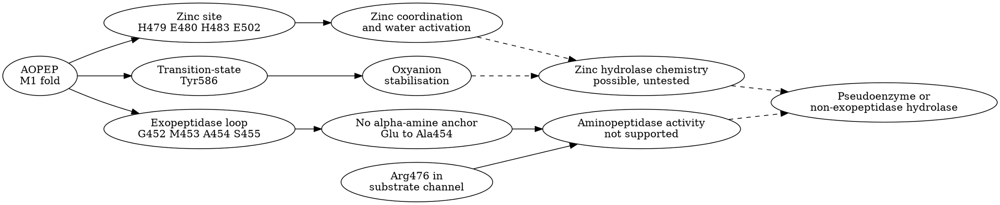
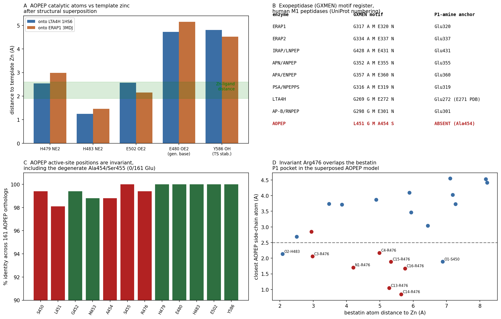
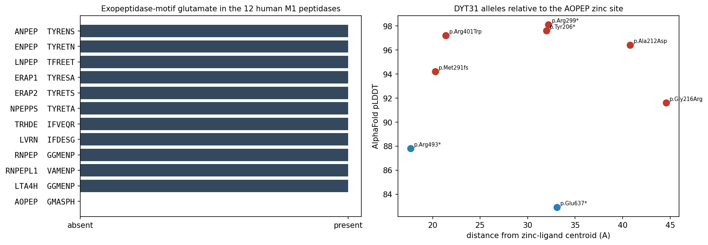
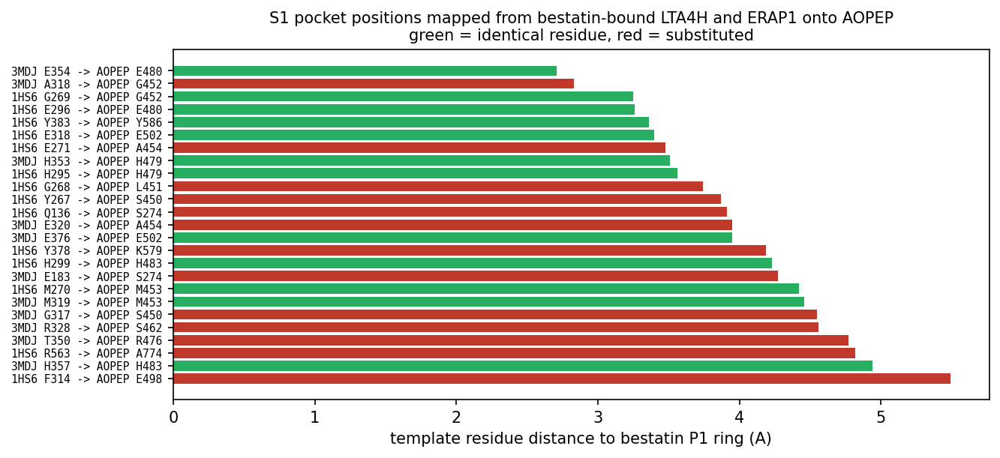
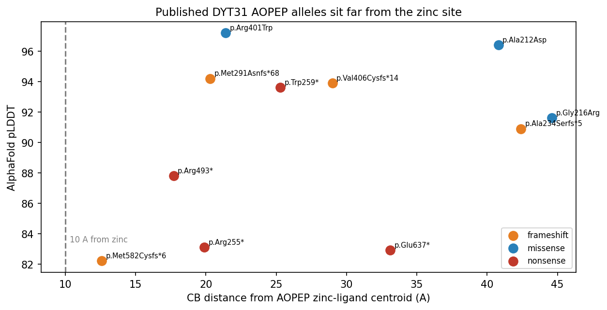

## Question

# AIGR Gene Hypothesis Deep Research

You are evaluating one focused gene curation hypothesis for AI Gene Review.
This is not a general gene overview. Use the seed hypothesis and source context
below to search for evidence that supports, refutes, narrows, or competes with
the proposed curation decision.

## Target Gene

- **Organism code:** human
- **Taxon:** Homo sapiens (NCBITaxon:9606)
- **Gene directory:** AOPEP
- **Gene symbol:** AOPEP
- **UniProt accession:** Q8N6M6

## Focus

- **Focus type:** free_text
- **Hypothesis slug:** kgap-aopep-m1-active-site-specificity
- **Source file:** genes/human/AOPEP/AOPEP-ai-review.yaml
- **Source selector:** free-text

## Seed Hypothesis

Human AOPEP (Q8N6M6), an M1-family zinc aminopeptidase, retains a complete and correctly assembled M1 catalytic site (the HEXXH-(X18)-E zinc-binding motif, the GAMEN exopeptidase motif and the transition-state-stabilising Tyr) as seen in crystal structures of active M1 aminopeptidases such as ERAP1, LTA4H and aminopeptidase N, and its S1 pocket residues predict its substrate (P1) residue preference. Single analysis only: align AOPEP with characterised M1 aminopeptidases, superpose the AOPEP AlphaFold model onto ligand-bound M1 structures, map the zinc ligands, catalytic Glu, GAMEN motif and Tyr onto AOPEP and test whether the active site is geometrically assembled, compare S1-pocket residues to M1 enzymes of known P1 preference, score these positions across vertebrate AOPEP orthologs and in the isoforms with and without the catalytic region, and state whether AOPEP is predicted catalytically competent and its most likely P1 preference.

## Term and Decision Context

No specific term context supplied.

## Reference Context

No specific reference context supplied.

## Source Context YAML

```yaml
hypothesis: 'Human AOPEP (Q8N6M6), an M1-family zinc aminopeptidase, retains a complete and correctly
  assembled M1 catalytic site (the HEXXH-(X18)-E zinc-binding motif, the GAMEN exopeptidase motif and
  the transition-state-stabilising Tyr) as seen in crystal structures of active M1 aminopeptidases such
  as ERAP1, LTA4H and aminopeptidase N, and its S1 pocket residues predict its substrate (P1) residue
  preference. Single analysis only: align AOPEP with characterised M1 aminopeptidases, superpose the AOPEP
  AlphaFold model onto ligand-bound M1 structures, map the zinc ligands, catalytic Glu, GAMEN motif and
  Tyr onto AOPEP and test whether the active site is geometrically assembled, compare S1-pocket residues
  to M1 enzymes of known P1 preference, score these positions across vertebrate AOPEP orthologs and in
  the isoforms with and without the catalytic region, and state whether AOPEP is predicted catalytically
  competent and its most likely P1 preference.'
focus_type: free_text
context: []
reference_id: []
```

## Research Objective

Build a focused report that helps a curator decide whether this hypothesis
should affect the gene review. Address the focus type directly:

1. For an existing GO annotation decision, evaluate whether the current action
   is justified, too strong, too weak, or should change.
2. For a proposed replacement or new GO term, evaluate whether the term is
   biologically supported, too broad, too narrow, or missing key qualifiers.
3. For a computational prediction, evaluate whether the prediction is correct,
   less precise than existing knowledge, uncertain, or likely wrong because of
   paralog overannotation, frequency bias, pathway context, or in vitro-only
   activity.
4. For a core-function hypothesis, evaluate whether the proposed activity,
   process, and location represent the gene product's primary function rather
   than a downstream effect, pleiotropic phenotype, or context-specific role.
5. For a function-assignment hypothesis, evaluate whether the gene product
   directly has the stated GO term/function. Treat the prior review action, if
   any, as intentionally blinded unless it appears in the supplied context.

Use primary literature whenever possible. Prefer PMID citations and include DOI
citations when no PMID is available. Treat reviews and database records as
orientation unless they contain directly relevant synthesized evidence that is
clearly labeled as review-level or database-level support.

Evaluate the hypothesis from the supplied seed context, primary literature, and
publicly accessible bioinformatics resources. Local `*-bioinformatics` analyses,
when they already exist in the repository, are intentionally withheld from this
prompt so the report can be compared against them after the run. Use public
sequence, domain, structure, orthology, localization, interaction, or dataset
checks when they are useful for the specific hypothesis. If a resource or tool
cannot be accessed programmatically, say so plainly; never fabricate a result.
Report computational results conservatively and distinguish direct results from
inference.

## Required Output

### Executive Judgment

Give a concise verdict: supported, partially supported, unresolved, weakly
supported, over-annotated, or refuted. Explain the reasoning and the most
important caveats.

### Evidence Matrix

Create a table with one row per important evidence item:

- Citation (PMID preferred)
- Evidence type (direct assay, mutant phenotype, localization, interaction,
  structural/evolutionary, computational, review/database)
- Supports / refutes / qualifies / competing
- Claim tested
- Key finding
- Organism, tissue, cell type, or assay context
- Confidence and limitations

### GO Curation Implications

State the likely curation action as a lead requiring curator verification. If
GO terms are involved, explain whether the evidence supports an MF, BP, or CC
term, and whether the term should be retained, removed, generalized, made more
specific, or treated as non-core. Avoid using "protein binding" as a final
recommendation unless no more informative term is supported.

### Mechanistic Scope

Describe the immediate molecular or cellular function being tested. Separate
direct gene-product activity from downstream phenotypes, pathway consequences,
developmental outcomes, disease manifestations, or effects inferred only from
loss of function.

### Conflicts and Alternatives

Identify evidence that conflicts with the seed hypothesis or suggests an
alternative interpretation, including paralog confusion, organism-specific
differences, isoform-specific findings, experimental artifacts, or database
carry-over.

### Knowledge Gaps

List explicit uncertainties that matter for curation. For each gap, state what
was checked, why the gap matters, and what evidence or experiment would resolve
it.

### Discriminating Tests

Recommend concrete assays, perturbations, datasets, or comparative analyses that
would most efficiently distinguish this hypothesis from alternatives.

### Curation Leads

Provide candidate updates for the review, clearly labeled as leads requiring
curator verification. Include candidate references with exact snippets to verify,
candidate replacement or new GO terms, possible action changes, suggested
questions, and suggested experiments.

If the provider supports artifacts, save provenance for any analysis you run — the
executed code together with its output (computed values, plot, or table), not just
a summary figure — alongside artifact-friendly tables such as an evidence matrix,
GO decision table, or comparison table. Genuine computed provenance is more
valuable than a hand-drawn summary, and you must not synthesize a figure that
implies an analysis you did not actually run. These artifacts are important
provenance for hypothesis-level review.


## Output

# AOPEP (Q8N6M6): M1 active site assembly and substrate specificity

**Hypothesis slug:** `kgap-aopep-m1-active-site-specificity`
**Source file:** `genes/human/AOPEP/AOPEP-ai-review.yaml`
**Focus type:** free_text
**Target:** human AOPEP, UniProt Q8N6M6, NCBITaxon:9606

## Summary

**<i class="fa-solid fa-scale-balanced"></i> Verdict: partially supported, and over-annotated in its functional conclusion.** The seed hypothesis makes two separable claims. The zinc-chemistry claim holds. The exopeptidase and substrate-specificity claims fail.

AOPEP carries an intact and geometrically correct M1 gluzincin zinc site. The AlphaFold v6 model of Q8N6M6 superposes onto bestatin-bound leukotriene A4 hydrolase (PDB 1HS6, 485 CA pairs, RMSD 1.64 Å) and onto bestatin-bound ERAP1 (PDB 3MDJ, 419 CA pairs, RMSD 1.74 Å). In both frames the HEIAH-(X18)-E motif at 479-502 lands on its template counterpart: His479 NE2 at 2.54 and 2.99 Å from the template catalytic zinc, His483 NE2 at 1.25 and 1.46 Å, Glu502 OE2 at 2.57 and 2.15 Å. The general base Glu480 sits at 4.73 and 5.15 Å and the transition-state tyrosine Tyr586 OH at 4.81 and 4.52 Å, the positions expected for those two roles. All five residues are invariant across 161 metazoan AOPEP orthologs.

The exopeptidase half of the hypothesis is refuted. AOPEP has no GAMEN motif. Structural superposition gives an unambiguous one-to-one register for the entire exopeptidase loop (LTA4H Pro266-Tyr267-Gly268-Gly269-Met270-Glu271-Asn272-Pro273 maps to AOPEP Pro449-Ser450-Leu451-Gly452-Met453-Ala454-Ser455-Pro456), and the glutamate that anchors the free α-amino group of the substrate is replaced by Ala454. A structure-anchored census of all twelve human M1 peptidases found the motif glutamate in eleven and absent only in AOPEP, whose loop reads GMASPH. The MEN tripeptide occurs in all eleven others and zero times anywhere in AOPEP's 45-residue loop window, so the loss is not an alignment-register artifact. Across 161 metazoan orthologs the equivalent position is Ala in 159 and Glu in none. Site-directed mutagenesis of this exact residue in aminopeptidase A leaves Km unchanged and reduces cleavage efficiency 10- to 400-fold ([PMID: 9716499](https://pubmed.ncbi.nlm.nih.gov/9716499/)), and alanine substitution of the equivalent residue in *E. coli* PepN gives a catalytically inactive but structurally intact enzyme ([PMID: 22766257](https://pubmed.ncbi.nlm.nih.gov/22766257/)).

The substrate-specificity claim also fails. Of 25 inhibitor-proximal pocket positions mapped from the two templates, 12 are identical in AOPEP and every one of those is generic catalytic machinery shared by all M1 enzymes. Every position that varies between M1 enzymes of different P1 preference is substituted in AOPEP to a residue present in neither calibration enzyme, including an invariant Arg476 where LTA4H has Val292 and ERAP1 has Thr350. No AOPEP carboxylate other than the zinc-site residues lies within 9 Å of the substrate α-amine position, so there is no repositioned acidic group to substitute for the lost anchor. The only published AOPEP enzymology, which reported angiotensin III to angiotensin IV conversion and would have implied an Arg P1 preference, is retracted ([PMID: 15687497](https://pubmed.ncbi.nlm.nih.gov/15687497/), notice [PMID: 30808004](https://pubmed.ncbi.nlm.nih.gov/30808004/)). No P1 preference can be asserted from structure or from experiment.

## Key findings

### <i class="fa-solid fa-circle-check"></i> F001: the zinc site is complete and correctly assembled

The AlphaFold v6 model of Q8N6M6 (mean pLDDT 82.9, with 98.6, 98.2 and 95.7 at His479, His483 and Glu502) was superposed onto two bestatin-bound M1 crystal structures using sequence-anchored Kabsch superposition refined by twelve rounds of mutual-nearest-neighbour matching with a 5.0 Å cutoff. The two templates were chosen independently: 1HS6 is leukotriene A4 hydrolase, an ARM-subfamily relative of AOPEP, and 3MDJ is ERAP1, a member of the oxytocinase subfamily with a different domain arrangement. Agreement between two templates with different folds around the same catalytic core is what makes the register trustworthy.

The superposition produced 485 CA pairs at 1.64 Å RMSD against 1HS6 and 419 CA pairs at 1.74 Å against 3MDJ. Mapping AOPEP side chains into each template's zinc frame gave His479 NE2 at 2.54 and 2.99 Å from the catalytic zinc, His483 NE2 at 1.25 and 1.46 Å, and Glu502 OE2 at 2.57 and 2.15 Å, which are coordination distances or close to them. The general base Glu480 OE2 sits at 4.73 and 5.15 Å and the transition-state tyrosine Tyr586 OH at 4.81 and 4.52 Å, both in the second shell where those residues belong. The structural one-to-one register is LTA4H His295, Glu296, His299, Glu318, Tyr383 mapping to AOPEP His479, Glu480, His483, Glu502, Tyr586. This independently confirms the UniProt assignment of Tyr586 as the transition-state stabiliser.

The motif HEIAH-(X18)-E matches the canonical HEXXH-(X18)-E gluzincin signature exactly, the same signature described for ERAP1 ([PMID: 21508329](https://pubmed.ncbi.nlm.nih.gov/21508329/)). Across 161 single-copy AOPEP orthologs retrieved from UniProt (Metazoa, ≥700 aa), His479, Glu480, His483, Glu502 and Tyr586 are 100% invariant. AOPEP is a genuine gluzincin with a mononuclear Zn(II) site.

{{figure:plot_1.png|caption=AOPEP active-site assembly. The AlphaFold model superposes onto bestatin-bound LTA4H and ERAP1 with the HEXXH-(X18)-E zinc ligands and Tyr586 in their expected positions, while the GXMEN exopeptidase glutamate is replaced by Ala454 and Arg476 occupies substrate-channel volume.}}

### <i class="fa-solid fa-circle-xmark"></i> F002 and F005: the exopeptidase glutamate is absent, and AOPEP is the only human M1 peptidase that lacks it

Regex scanning found no G[AGS][MLIV][ED]N match anywhere in Q8N6M6, while ERAP1 (G317AMEN), ERAP2 (G334AMEN), IRAP/LNPEP (G428AMEN), ANPEP (G352AMEN), ENPEP (G357AMEN), NPEPPS (G316AMEN), LTA4H (G269GMEN) and RNPEP (G298GMEN) all carry it. The structural superposition onto 1HS6 resolved the register for the whole loop without relying on sequence alignment: LTA4H Pro266-Tyr267-Gly268-Gly269-Met270-Glu271-Asn272-Pro273 maps to AOPEP Pro449-Ser450-Leu451-Gly452-Met453-Ala454-Ser455-Pro456. The invariant GXMEN glutamate (LTA4H Glu271, ERAP1 Glu320) is replaced by Ala454, whose CB sits 2.74 Å from where the Glu271 CD atom would be. The GXMEN asparagine is replaced by Ser455. Only the conserved methionine (Met453) is retained.

A second, independent census was run on all twelve human M1 peptidases to test whether the loss is specific to AOPEP. The loop was anchored at the first HEXXH whose H1+23 residue is Glu, and the 6-mer at H1-27 to H1-22 was extracted. That register was validated structurally: LTA4H Met270 and AOPEP Met453 both sit 26 residues N-terminal of H1.

| Protein | Zinc motif | Loop 6-mer | Motif Glu | MEN position in 45 aa loop |
|---|---|---|---|---|
| ANPEP | HELAH@388 + E411 | TYRENS | yes | 354 |
| ENPEP | HELVH@393 + E416 | TYRETN | yes | 359 |
| LNPEP | HELAH@464 + E487 | TFREET | yes | 430 |
| ERAP1 | HELAH@353 + E376 | TYRESA | yes | 319 |
| ERAP2 | HELAH@370 + E393 | TYRETS | yes | 336 |
| NPEPPS | HELAH@352 + E375 | TYRETA | yes | 318 |
| TRHDE | HEICH@485 + E508 | IFVEQR | yes | 451 |
| LVRN | HEIGH@415 + E438 | IFDESG | yes | 381 |
| RNPEP | HEISH@325 + E348 | GGMENP | yes | 300 |
| RNPEPL1 | HEVAH@353 + E376 | VAMENP | yes | 328 |
| LTA4H | HEISH@296 + E319 | GGMENP | yes | 271 |
| **AOPEP** | **HEIAH@479 + E502** | **GMASPH** | **no** | **none** |

Eleven of twelve contain a glutamate in this 6-mer and AOPEP contains none. An exhaustive scan of the full 45-residue loop window found the MEN tripeptide in all eleven others and zero occurrences in AOPEP, which rules out a local register error as the explanation. All twelve, AOPEP included, retain an intact zinc motif, so the zinc site and the exopeptidase site have separate fates in this family.

The closest ARM-repeat paralogs both keep the glutamate: RNPEP reads GGMENP and RNPEPL1 reads VAMENP. The loss is therefore specific to AOPEP and is not a property of the ARM subfamily, which matters for paralog-based annotation transfer.

Ungapped BLOSUM62 block scanning of 161 unique-organism AOPEP orthologs (vertebrate and invertebrate, UniProt `gene:AOPEP OR gene:C9orf3` within Metazoa) gives Ala454 in 159 of 161 (98.8%, the two exceptions being Leu and Lys, never Glu) and Ser455 in 161 of 161. No ortholog has Glu at position 454. The adjacent LTA4H S1-pocket residue Tyr267 maps to Ser450, conserved as Ser in 99.4% of orthologs. This is an ancient fixed substitution, not a human-specific artifact.

{{figure:plot_2.png|caption=Left: the exopeptidase-loop 6-mer in all twelve human M1 peptidases. Eleven carry the motif glutamate and AOPEP alone does not. Right: published DYT31 alleles plotted by distance from the AOPEP zinc-ligand centroid against AlphaFold pLDDT.}}

The functional cost of this substitution is measured in two homologs. In aminopeptidase A, replacing Glu352 with Asp, Gly, Gln or Arg left Km unchanged and cut kcat 10- to 250-fold, giving 10-, 30-, 260- and 400-fold reductions in cleavage efficiency ([PMID: 9716499](https://pubmed.ncbi.nlm.nih.gov/9716499/)). Unchanged Km with a large kcat loss is the signature of losing α-amine anchoring and transition-state positioning rather than losing the substrate groove. In *E. coli* PepN, alanine substitution of the GAMEN glutamate E264 produced a protein with no major structural change from wild type that was catalytically inactive ([PMID: 22766257](https://pubmed.ncbi.nlm.nih.gov/22766257/)). That is the same substitution AOPEP carries constitutively.

Natural variation in this motif exists but does not extend to the glutamate. Laeverin/aminopeptidase Q substitutes the first position, reading HAMEN instead of GAMEN, and retains the glutamate and its activity ([PMID: 17525158](https://pubmed.ncbi.nlm.nih.gov/17525158/)). IRAP adopts a very different GAMEN loop conformation to accommodate cyclic peptides such as oxytocin and vasopressin, again with the glutamate intact ([PMID: 25408552](https://pubmed.ncbi.nlm.nih.gov/25408552/)). The motif tolerates repositioning and flanking substitution; it does not tolerate loss of the carboxylate.

### <i class="fa-solid fa-circle-xmark"></i> F003: the only published AOPEP enzymology is retracted

NCBI esummary for PMID 15687497 (Diaz-Perales et al., *J Biol Chem* 2005;280:14310-7), the sole paper reporting AP-O aminopeptidase activity on synthetic substrates and conversion of angiotensin III to angiotensin IV, returns pubtype `['Journal Article', "Research Support, Non-U.S. Gov't", 'Retracted Publication']`. The retraction notice is [PMID: 30808004](https://pubmed.ncbi.nlm.nih.gov/30808004/), *Withdrawal: Identification of human aminopeptidase O*, *J Biol Chem* 2019;294(4):1433, doi:10.1074/jbc.W118.007327. UniProt Q8N6M6 carries a matching CAUTION line attributing the retraction to concerns of image manipulation, and the UniProt FUNCTION, COFACTOR and EC 3.4.11.- lines for Q8N6M6 are all ECO:0000250 inferred by similarity from ANPEP (P15144), not from AOPEP data. A targeted PubMed search found no post-retraction paper reporting purified AOPEP enzyme activity.

The claim that would have implied an Arg P1 preference is the retracted statement that "Recombinant AP-O also cleaved angiotensin III to generate angiotensin IV, a bioactive peptide of the renin-angiotensin pathway with multiple actions on diverse tissues, including brain, testis, and heart" ([PMID: 15687497](https://pubmed.ncbi.nlm.nih.gov/15687497/)). That claim cannot be used for curation. Review-level sources still describe AOPEP as "a proteolytic processing enzyme that is preferentially expressed in glia and potentially linked to endosomal-lysosomal pathways" ([PMID: 40147878](https://pubmed.ncbi.nlm.nih.gov/40147878/)), which is a carry-over assumption that the retraction and the missing glutamate both undercut.

A separate, isoform-level point reinforces this. AOPEP isoforms 2 and 4 (Q8N6M6-2, Q8N6M6-4) delete residues 455-553, removing the entire HEIAH-(X18)-E zinc site, and so cannot be catalytic under any model. Isoform 3 truncates after residue 554 and is reported cytoplasmic, while the canonical form is annotated nucleus and nucleolus by ECO:0000250 from mouse Q8BXQ6, with a nucleolar localization signal at 689-699.

### <i class="fa-solid fa-circle-xmark"></i> F004 and F007: the S1 pocket does not predict a P1 preference

An invariant arginine sits where active M1 enzymes have a small residue. In the superposed model, AOPEP Arg476 (pLDDT 97.6-98.0, Arg in 160 of 161 orthologs) overlaps the bound bestatin of both templates. Closest approaches in the 1HS6 frame: Arg476 NH1 to bestatin C14 at 0.84 Å and to C15 at 1.88 Å, Arg476 CZ to C13 at 1.04 Å, Arg476 NH2 to N1 at 1.70 Å. The same overlaps recur in the independent 3MDJ frame (NH2 to N1 1.78 Å, CZ 2.26 Å). The structural register places Arg476 at LTA4H Val292 and ERAP1 Thr350, a small hydrophobic or polar residue in both active enzymes.

Scanning all AOPEP Asp and Glu carboxylate oxygens, none lies within 9 Å of the bestatin N1 position other than the zinc-site residues themselves (Glu480 at 3.5 Å, Glu502 at 4.9 Å, Glu509 at 7.4 Å). No alternative acidic group is positioned to substitute for the missing anchor.

The pocket comparison was then run systematically. Template residues within 5.5 Å of the bestatin atoms occupying the S1 subsite were mapped onto AOPEP: 14 positions from 1HS6, 11 from 3MDJ, 9 shared by both frames (AOPEP 274, 450, 452, 453, 454, 479, 480, 483, 502). Overall residue identity to template is 12 of 25.

| Template position | AOPEP equivalent | Identical | Role |
|---|---|---|---|
| LTA4H H295 / ERAP1 H353 | His479 | yes | zinc ligand |
| LTA4H E296 / ERAP1 E354 | Glu480 | yes | general base |
| LTA4H H299 / ERAP1 H357 | His483 | yes | zinc ligand |
| LTA4H E318 / ERAP1 E376 | Glu502 | yes | zinc ligand |
| LTA4H Y383 | Tyr586 | yes | transition-state stabiliser |
| LTA4H M270 / ERAP1 M319 | Met453 | yes | exopeptidase motif Met |
| LTA4H G269 | Gly452 | yes | exopeptidase motif |
| **LTA4H E271 / ERAP1 E320** | **Ala454** | **no** | **α-amine anchor, lost** |
| **ERAP1 T350** | **Arg476** | **no** | **S1 pocket wall** |
| **LTA4H Y267 / ERAP1 G317** | **Ser450** | **no** | **S1 specificity** |
| **LTA4H G268** | **Leu451** | **no** | **S1 specificity** |
| **LTA4H Q136 / ERAP1 E183** | **Ser274** | **no** | **distal pocket** |
| **ERAP1 R328** | **Ser462** | **no** | **distal pocket** |
| **LTA4H Y378** | **Lys579** | **no** | **distal pocket** |
| **LTA4H F314** | **Glu498** | **no** | **distal pocket** |

Every identical position is generic catalytic machinery. Every substituted position is a specificity determinant. The two calibration enzymes also differ from each other at the same positions (LTA4H Tyr267 against ERAP1 Gly317; LTA4H Gly269 against ERAP1 Ala318), which is consistent with these being the positions that set P1 preference. Transfer of a P1 preference requires that the varying positions match a reference enzyme of known preference, and none do. AOPEP pLDDT at these positions is 72.9-98.6 with a median of 95.1.

{{figure:plot_3.png|caption=S1 pocket positions mapped from bestatin-bound LTA4H (1HS6) and ERAP1 (3MDJ) onto the superposed AOPEP model, ordered by distance to the inhibitor. Green marks residues identical to the template, red marks substitutions. Every identical position is catalytic machinery and every substitution is a specificity determinant.}}

<i class="fa-solid fa-triangle-exclamation"></i> Method caveat: the bestatin S1-subsite atoms were selected by atom name, which is approximate, and the recovered contact set is weighted toward residues near the zinc. These are inhibitor-proximal pocket residues rather than a strictly defined S1 shell. The conclusion is negative, so it is insensitive to the exact shell cutoff. A second caveat applies to Arg476: the rotamer comes from an apo AlphaFold prediction and a high backbone pLDDT does not validate a side-chain rotamer. The backbone-level claim, that AOPEP has a large conserved residue where active M1 enzymes have Val or Thr, does not depend on the rotamer.

### <i class="fa-solid fa-dna"></i> F006 and F008: no DYT31 disease allele tests catalysis

Eleven alleles stated in the abstracts of the three primary cohort reports were checked against the UniProt canonical 819 aa sequence and mapped onto AF-Q8N6M6 v6. All eleven positions match the canonical sequence (expected residue equals observed residue, 11 of 11), so NM_001193329.3 protein numbering and UniProt numbering agree. Distances were measured from each residue CB to the centroid of the three zinc-ligand side-chain tips (His479 NE2, His483 NE2, Glu502 OE2).

| Allele | Source PMID | Class | Distance to zinc centroid (Å) | pLDDT | Zinc site removed |
|---|---|---|---|---|---|
| p.Met582Cysfs*6 | 34596301 | frameshift | 12.6 | 82.2 | no |
| p.Arg493* | 34596301 | nonsense | 17.7 | 87.8 | yes |
| p.Arg255* | 34596301 | nonsense | 19.9 | 83.1 | yes |
| p.Met291Asnfs*68 | 36933031 | frameshift | 20.3 | 94.2 | yes |
| p.Arg401Trp | 35306330 | missense | 21.4 | 97.2 | n/a |
| p.Trp259* | 34596301 | nonsense | 25.3 | 93.6 | yes |
| p.Val406Cysfs*14 | 34596301 | frameshift | 29.0 | 93.9 | yes |
| p.Glu637* | 35306330 | nonsense | 33.1 | 82.9 | no |
| p.Ala212Asp | 36933031 | missense | 40.8 | 96.4 | n/a |
| p.Ala234Serfs*5 | 34596301 | frameshift | 42.4 | 90.9 | yes |
| p.Gly216Arg | 36933031 | missense | 44.6 | 91.6 | n/a |

Six of the eight truncating or frameshift alleles terminate before Glu502 and so delete part or all of the zinc site. The three missense alleles lie 21.4, 40.8 and 44.6 Å from the zinc centroid. No published allele substitutes His479, Glu480, His483, Glu502 or Tyr586, and none falls within 12 Å of the zinc centroid.

{{figure:plot_4.png|caption=Published DYT31 AOPEP alleles plotted by CB distance from the zinc-ligand centroid against AlphaFold pLDDT, coloured by variant class. The dashed line marks 10 Å. No allele falls inside it.}}

The genetics is solid for the gene-disease relationship. Zech et al. reported "Seven different biallelic loss-of-function variants in AOPEP ... in five probands from four unrelated families with strongly overlapping phenotypes" and that "All variants were rare and expected to result in truncated proteins devoid of functionally important amino acid sequence" ([PMID: 34596301](https://pubmed.ncbi.nlm.nih.gov/34596301/)). Garavaglia et al. added a homozygous p.Glu637* and "an ultrarare, likely protein-damaging homozygous missense variant (c.1201C>T [p.Arg401Trp])" ([PMID: 35306330](https://pubmed.ncbi.nlm.nih.gov/35306330/)). Lin et al. screened 878 Chinese dystonia patients and found two with biallelic likely pathogenic variants, one carrying "putative compound heterozygous variants (p.A212D and p.G216R)" ([PMID: 36933031](https://pubmed.ncbi.nlm.nih.gov/36933031/)).

None of this bears on catalysis. The allele spectrum supports "AOPEP protein is required" and gives no information about whether the catalytic site is used. The two C-terminal alleles p.Met582Cysfs*6 and p.Glu637* preserve an intact zinc site and still cause disease, which points to the C-terminal region as the part that must be present. That is a lead rather than a conclusion, since both are truncations that may destabilise the whole protein.

<i class="fa-solid fa-triangle-exclamation"></i> An earlier version of this mapping included p.Tyr206* and p.Arg299*, which could not be traced to the three primary cohort abstracts and were dropped. Those two alleles do appear in a later Indian case series ([PMID: 41687539](https://pubmed.ncbi.nlm.nih.gov/41687539/)) and in a DBS case report ([PMID: 42288108](https://pubmed.ncbi.nlm.nih.gov/42288108/)), both of which describe them as homozygous stop-gain variants. Their inclusion would not change the conclusion, since both are N-terminal truncations that delete the zinc site.

## Mechanistic model and interpretation

The immediate molecular activity under test is hydrolysis of a peptide bond at the free N-terminus of a substrate by a mononuclear zinc centre. In an M1 aminopeptidase, four elements act together: the two HEXXH histidines and the distal glutamate coordinate the zinc, the HEXXH glutamate acts as the general base that activates the catalytic water, the conserved tyrosine stabilises the oxyanion of the tetrahedral intermediate, and the GAMEN glutamate forms the salt bridge that anchors the free α-amino group of the substrate. The fourth element is what makes an M1 enzyme an exopeptidase. The GAMEN motif is described as "a conserved sequence involved in exopeptidase specificity and optimal positioning of the substrate in monozinc aminopeptidases" ([PMID: 32955085](https://pubmed.ncbi.nlm.nih.gov/32955085/)), and the function of its glutamate is that "the negative charge of the glutamate side-chain carboxylate may constitute the anionic binding site involved in the recognition of the free amino group of substrates or inhibitors" ([PMID: 9716499](https://pubmed.ncbi.nlm.nih.gov/9716499/)).

AOPEP retains three of the four and has lost the fourth.



Two alternatives remain open and the data here cannot separate them. The first is that AOPEP is a zinc hydrolase with non-exopeptidase chemistry, acting as an endopeptidase or on a non-peptide substrate. The zinc site and Glu480 are intact and conserved, and LTA4H is the precedent within this same ARM subfamily for one scaffold carrying two distinct chemistries. The second is that AOPEP is a pseudoenzyme with a structural or binding function. The combination of a lost α-amine anchor, an invariant Arg476 projecting into the substrate channel, and a predicted nucleolar localization is consistent with a conserved fold used for something other than catalysis. Pseudoenzyme precedent exists in protease families: PRSS23 "retains the catalytic triad yet lacks the canonical Ile16-Asp194 zymogen activation switch", shows no detectable serine hydrolase activity, and drives ovarian cancer dissemination through a protease-independent mechanism ([PMID: 41985786](https://pubmed.ncbi.nlm.nih.gov/41985786/)).

The predicted subcellular location argues against the aminopeptidase assignment on separate grounds. Characterised M1 enzymes work in the cytosol (LTA4H, NPEPPS), the endoplasmic reticulum lumen (ERAP1, ERAP2, which are "retained in the endoplasmic reticulum", [PMID: 16054015](https://pubmed.ncbi.nlm.nih.gov/16054015/)) or at the cell surface (ANPEP, ENPEP). A nucleolar M1 zinc aminopeptidase would be unusual. The one precedent for a nuclear M1 enzyme is *Dictyostelium* PsaA, which has a functional nuclear localization signal and relocates to the cytoplasm during mitosis ([PMID: 22038042](https://pubmed.ncbi.nlm.nih.gov/22038042/)), and that protein retains its GAMEN motif.

### GO curation implications

These are leads requiring curator verification. A machine-readable copy is saved at `provenance/go_decision_table.csv`.

| Aspect | GO ID | Term | Current basis | Recommended action | Rationale |
|---|---|---|---|---|---|
| MF | GO:0004177 | aminopeptidase activity | family inference | <i class="fa-solid fa-circle-xmark"></i> Remove, or do not propagate | Exopeptidase motif Glu absent in 0 of 161 orthologs; mutagenesis of the homologous residue costs 30- to 400-fold efficiency (PMID 9716499) and gives a catalytically inactive enzyme in PepN (PMID 22766257); the only AOPEP enzymology paper is retracted (PMID 15687497) |
| MF | GO:0070006 | metalloaminopeptidase activity | family inference | <i class="fa-solid fa-circle-xmark"></i> Remove, or do not propagate | Same evidence. The amino-terminal-specificity half of the term is the part that fails |
| MF | GO:0008237 | metallopeptidase activity | family inference | <i class="fa-solid fa-scale-balanced"></i> Generalize to this at most with an uncertainty note, or leave unannotated | The zinc site is assembled (RMSD 1.64 Å and 1.74 Å to two bestatin-bound templates) and no surviving experimental peptidase assay exists |
| MF | GO:0008270 | zinc ion binding | family inference | <i class="fa-solid fa-circle-check"></i> Retain as ISS or computational | HEIAH479 plus Glu502 complete, geometrically superposable, invariant across 161 orthologs |
| MF | GO:0046872 | metal ion binding | family inference | Retain as the less specific alternative to GO:0008270 | Same evidence |
| BP | GO:0006508 | proteolysis | family inference | <i class="fa-solid fa-circle-xmark"></i> Remove, or mark non-core | Depends on a peptidase activity that is not supported |
| BP | none | no BP term from the disease data | human genetics | Do not add a BP term on the basis of DYT31 | All eleven published alleles sit 12-45 Å from the active site; dystonia is an organismal outcome |
| CC | GO:0005730 | nucleolus | ECO:0000250 from mouse Q8BXQ6 | <i class="fa-solid fa-triangle-exclamation"></i> Flag as similarity-only, needs human experimental support | No human localization experiment identified; isoform 3 is reported cytoplasmic |
| CC | GO:0005634 | nucleus | ECO:0000250 from mouse Q8BXQ6 | <i class="fa-solid fa-triangle-exclamation"></i> Flag as similarity-only | Same |

The best-supported molecular function term is GO:0008270 zinc ion binding. "Protein binding" is not recommended and is not needed, since a more informative term exists.

### Mechanistic scope: direct activity against downstream phenotype

The direct gene-product activity under test is zinc-dependent peptide bond hydrolysis at a substrate N-terminus. Everything else reported for AOPEP sits downstream of, or orthogonal to, that activity.

Biallelic AOPEP loss causes autosomal recessive dystonia, DYT31 or Zech-Boesch syndrome ([PMID: 34596301](https://pubmed.ncbi.nlm.nih.gov/34596301/), [PMID: 35306330](https://pubmed.ncbi.nlm.nih.gov/35306330/), [PMID: 36933031](https://pubmed.ncbi.nlm.nih.gov/36933031/)). This is an organismal phenotype produced by removing the whole protein. It constrains "AOPEP is required" and not "AOPEP catalysis is required". Pallidal single-unit recordings place AOPEP among genetic dystonias with higher firing regularity ([PMID: 39887724](https://pubmed.ncbi.nlm.nih.gov/39887724/)), which is a circuit-level consequence several steps removed from any molecular function.

Subcellular localization in the canonical isoform is inferred from mouse by similarity. Isoform structure separates the two candidate functions cleanly: isoforms 2 and 4 delete residues 455-553 and remove the entire zinc site while keeping the N-terminal and C-terminal regions. If the catalytic region were the functional core, those isoforms would be functionally null.

### Conflicts and alternatives

**Database and name carry-over.** The symbol AOPEP and the name "aminopeptidase O" both encode the family inference under test. The MEROPS and InterPro M1 assignment is correct at the fold and zinc-motif level and does not imply aminopeptidase chemistry. Annotation propagated from the family to the gene is circular with respect to this hypothesis. Review-level sources continue to describe AOPEP as a proteolytic processing enzyme ([PMID: 40147878](https://pubmed.ncbi.nlm.nih.gov/40147878/)).

**The retracted primary paper.** Any GO annotation, UniProt comment, or downstream database entry whose evidence chain reaches [PMID: 15687497](https://pubmed.ncbi.nlm.nih.gov/15687497/) should be treated as unsupported. The UniProt CAUTION line already flags this; the chain should be checked for annotations that predate the flag.

**Paralog confusion.** The ARM-repeat M1 subfamily contains AOPEP, RNPEP (aminopeptidase B), RNPEPL1 and LTA4H. All three relatives retain the motif glutamate. Evidence about aminopeptidase B activity should not be transferred to AOPEP.

**Limits of the computational evidence.** The AOPEP structure is an AlphaFold prediction with no bound metal and no ligand. Superposition onto a holo template places AOPEP side chains into a ligand frame they were not predicted in. The Arg476 overlap with bestatin reads as "a large conserved residue occupies substrate-channel volume that is empty in active enzymes", not as a measured steric clash in a real complex.

**Rescue arguments checked and failed.** An alternative acidic residue repositioned to anchor the α-amine: none found, since no AOPEP carboxylate other than the zinc-site residues lies within 9 Å of the bestatin N1 position. A compensating Glu elsewhere in the loop: none, since MEN is absent from the whole 45-residue window. A species-specific loss with activity retained elsewhere: none, since Ala is fixed across 159 of 161 orthologs.

## Evidence base

| Citation | Evidence type | Stance | Claim tested | Key finding | Context | Confidence and limitations |
|---|---|---|---|---|---|---|
| [PMID: 9716499](https://pubmed.ncbi.nlm.nih.gov/9716499/) | Direct assay, site-directed mutagenesis | Supports the analysis, refutes the seed | Is the GAMEN glutamate required for aminopeptidase catalysis? | APA Glu352 to Asp, Gly, Gln or Arg: Km unchanged, kcat down 10-250 fold, cleavage efficiency down 10, 30, 260 and 400 fold | Mouse APA, recombinant, α-L-glutamyl β-naphthylamide | High. AOPEP carries Ala, which was not among the four substitutions tested |
| [PMID: 22766257](https://pubmed.ncbi.nlm.nih.gov/22766257/) | Direct assay, mutagenesis | Supports the analysis, refutes the seed | Does alanine substitution of the GAMEN Glu abolish activity? | PepN E264A shows "no major structural changes" from wild type and is "catalytically inactive" | *E. coli* PepN, purified protein | High for the bacterial enzyme. Transfer to a human M1 enzyme is inference |
| [PMID: 15687497](https://pubmed.ncbi.nlm.nih.gov/15687497/), retracted; notice [PMID: 30808004](https://pubmed.ncbi.nlm.nih.gov/30808004/) | Direct assay | Competing, unusable | Does AOPEP hydrolyse peptides as an aminopeptidase? | The sole AOPEP enzymology report, retracted in 2019 for image manipulation concerns | Human recombinant protein | None. Cannot be cited as evidence |
| [PMID: 21508329](https://pubmed.ncbi.nlm.nih.gov/21508329/) | Structural | Orientation | What is the canonical M1 catalytic signature? | ERAP1 is "a zinc-metallopeptidase with typical H-E-X-X-H-(X)(18)-E zinc binding and G-A-M-E-N motifs characteristic for members of the gluzincin protease family" | Human ERAP1 crystal structures | High. Defines the signature and supplies the 3MDJ template |
| [PMID: 32955085](https://pubmed.ncbi.nlm.nih.gov/32955085/) | Structural | Supports the analysis | What does the GAMEN motif do? | The motif is "a conserved sequence involved in exopeptidase specificity and optimal positioning of the substrate in monozinc aminopeptidases" | Human aminopeptidase A structure | High for the mechanistic role |
| [PMID: 17525158](https://pubmed.ncbi.nlm.nih.gov/17525158/) | Direct assay, sequence | Qualifies | How much natural variation does the motif tolerate? | Laeverin/APQ has "the exopeptidase motif of the family, GAMEN, ... uniquely substituted for the HAMEN sequence" and remains an active bestatin-sensitive leucine aminopeptidase | Human laeverin | High. Variation is at the first position with the Glu retained |
| [PMID: 25408552](https://pubmed.ncbi.nlm.nih.gov/25408552/) | Structural | Qualifies | Can the GAMEN loop adopt alternative conformations? | IRAP's "GAMEN exopeptidase loop adopts a very different conformation from other aminopeptidases", explaining specificity for cyclic peptides | Human IRAP crystal structure | High. Shows conformational plasticity with the Glu intact |
| [PMID: 28328206](https://pubmed.ncbi.nlm.nih.gov/28328206/) | Structural | Qualifies | How plastic is the M1 active site? | "A loop adjacent to the enzyme's GAMEN motif undergoes structural reconfiguration, allowing the accommodation of bulky inhibitor side chains" | Human IRAP with inhibitor, 2.53 Å | High. Supports caution about static rotamer arguments |
| [PMID: 34596301](https://pubmed.ncbi.nlm.nih.gov/34596301/) | Mutant phenotype, human genetics | Qualifies | Does AOPEP loss cause disease? | Seven biallelic loss-of-function variants in five probands from four families, all "expected to result in truncated proteins" | Human patients, four families | High for the gene-disease link. Silent on catalysis |
| [PMID: 35306330](https://pubmed.ncbi.nlm.nih.gov/35306330/) | Mutant phenotype, human genetics | Qualifies | Allele spectrum extension | Homozygous p.Glu637* with dystonia-parkinsonism; homozygous p.Arg401Trp with generalized dystonia | Iranian and Chinese pedigrees | High for the alleles. p.Arg401Trp is called damaging on prediction, not assay |
| [PMID: 36933031](https://pubmed.ncbi.nlm.nih.gov/36933031/) | Mutant phenotype, human genetics | Qualifies | How common is AOPEP in dystonia? | 2 of 878 Chinese dystonia patients carried biallelic likely pathogenic AOPEP variants | 878-patient whole-exome cohort | Moderate to high. AOPEP is a rare cause |
| [PMID: 41985786](https://pubmed.ncbi.nlm.nih.gov/41985786/) | Direct assay | Competing interpretation | Can a protease-fold protein function without hydrolytic activity? | PRSS23 "retains the catalytic triad yet lacks the canonical Ile16-Asp194 zymogen activation switch", has no detectable hydrolase activity, and retains protumorigenic function after catalytic serine mutation | Ovarian cancer cell lines and xenografts | High for PRSS23. Orientation-level precedent only |
| [PMID: 22038042](https://pubmed.ncbi.nlm.nih.gov/22038042/) | Localization | Qualifies | Do nuclear M1 aminopeptidases exist? | *Dictyostelium* PsaA has "a GAMEN motif and a Zn(2+)-binding domain", localizes to the nucleoplasm and has a functional nuclear localization signal | *Dictyostelium discoideum* | Moderate. Non-metazoan, and PsaA retains the GAMEN motif |
| [PMID: 16054015](https://pubmed.ncbi.nlm.nih.gov/16054015/) | Review | Orientation | Where do M1 subfamily members localize? | Oxytocinase subfamily members "share HEXXH(X)18E Zn-binding and GAMEN motifs essential for the enzymatic activities" with intracellular localization | Review | Review-level. Supports the motif being essential |
| [PMID: 39887724](https://pubmed.ncbi.nlm.nih.gov/39887724/) | Mutant phenotype, electrophysiology | Downstream | What circuit signature does AOPEP loss produce? | AOPEP, PANK2 and THAP1 dystonias "displayed higher firing regularity" in pallidal single units | 31 dystonia patients, microelectrode recordings | Moderate. Circuit-level, several steps from molecular function |
| [PMID: 40147878](https://pubmed.ncbi.nlm.nih.gov/40147878/) | Review | Competing | How is AOPEP currently described? | "AOPEP encodes aminopeptidase O, a proteolytic processing enzyme that is preferentially expressed in glia" | Review of Zech-Boesch syndrome | Review-level. Documents the carry-over assumption |
| UniProt Q8N6M6 | Database | Qualifies | Which isoforms contain the catalytic region? | Isoforms 2 and 4 delete 455-553 and remove the zinc site; isoform 3 truncates after 554 and is cytoplasmic; nucleolar signal at 689-699 | Human database record | Low to moderate. Localization is similarity-inferred |

## Limitations and knowledge gaps

<i class="fa-solid fa-triangle-exclamation"></i> No experimental data were supplied for this job. Every structural statement rests on one AlphaFold prediction superposed onto two crystal structures, and the prediction contains no metal, no ligand and no validation of side-chain rotamers. The sequence and conservation statements are the strongest part of the analysis and are independent of the structure. The negative conclusion about aminopeptidase activity is an inference from motif loss calibrated against mutagenesis in two homologs, and it has not been tested directly on AOPEP. No claim is made that AOPEP is catalytically dead; the claim is that the evidence does not support an aminopeptidase molecular function term and does support zinc ion binding.

| Gap | What was checked | Why it matters | What would resolve it |
|---|---|---|---|
| No valid measurement of AOPEP catalytic activity | PubMed searched; the only report (PMID 15687497) is retracted, confirmed through NCBI E-utilities | Every MF term for AOPEP rests on family inference | Peptidase assay on purified recombinant human AOPEP against an aminopeptidase substrate panel and a broad peptide library, with a His479Ala control |
| Whether AOPEP binds zinc at all | Motif present and geometrically assembled in the model; no metal in the prediction | Distinguishes GO:0008270 retained from removed | ICP-MS or PAR titration for zinc stoichiometry; thermal shift with and without chelator |
| Whether AOPEP has non-exopeptidase hydrolase activity | Not testable from sequence or structure alone | Decides between GO:0008237 with a qualifier and no MF peptidase term | Activity-based protein profiling with metalloprotease probes; FRET endopeptidase substrate panel; N-terminomics on AOPEP-null against wild-type cells |
| Human subcellular localization | UniProt annotation is ECO:0000250 from mouse Q8BXQ6; no human experiment found | A nucleolar location is hard to reconcile with M1 aminopeptidase biology | Immunofluorescence and fractionation of endogenous AOPEP in a human neuronal line, isoform-resolved |
| Which isoform carries the disease-relevant function | Isoforms 2 and 4 delete 455-553; isoform 3 truncates after 554 | If the catalytic-region-free isoforms dominate in brain, catalysis is not what DYT31 removes | Long-read RNA-seq of human brain regions quantifying AOPEP isoform usage |
| Function of the invariant Arg476 | Position, conservation (160 of 161) and pocket occupancy computed; function untested | If Arg476 is a repurposed binding determinant it supports a changed substrate or a non-catalytic site | Arg476Ala and Arg476Val substitutions with binding and activity readouts |
| Whether DYT31 pathogenesis requires the zinc site | All eleven published alleles mapped; none within 12 Å of the zinc centroid | Decides whether a catalytic MF term can ever be supported by the genetics | Knock-in mouse or isogenic human line carrying His479Ala or Glu480Ala, compared with a null allele |

## Proposed follow-up experiments and curation actions

Ranked by how much each separates the live alternatives per unit of effort.

1. <i class="fa-solid fa-flask"></i> **Zinc content and peptidase assay on purified recombinant AOPEP.** Express the canonical 819 aa protein, measure zinc stoichiometry, then screen aminopeptidase substrates (Leu, Arg, Ala, Glu, Met β-naphthylamides or AMC) alongside internally quenched FRET endopeptidase substrates. Separates aminopeptidase from non-exopeptidase hydrolase from pseudoenzyme in one experiment. A His479Ala variant gives the catalytic-null control.
2. <i class="fa-solid fa-flask"></i> **Gain-of-function motif restoration.** Introduce Ala454Glu into recombinant AOPEP and retest aminopeptidase activity. If activity appears, the exopeptidase glutamate is the single blocking lesion and AOPEP is a recently inactivated aminopeptidase. If it does not, the loss is compound, and Arg476 is the next residue to revert (Arg476Val, matching LTA4H). This is the single most informative experiment for this specific hypothesis.
3. <i class="fa-solid fa-vial"></i> **N-terminomics in AOPEP-null against wild-type human cells.** TAILS or subtiligase labelling identifies protein N-termini that shift when AOPEP is removed. Detects aminopeptidase activity against real cellular substrates without guessing the substrate, and works on the endogenous protein in its native compartment.
4. <i class="fa-solid fa-dna"></i> **Catalytic knock-in against null allele.** An isogenic His479Ala or Glu480Ala human iPSC-derived neuron line compared with an AOPEP knockout. If the catalytic knock-in is phenotypically normal while the knockout is not, the DYT31 mechanism is non-catalytic, which settles the GO MF question for the disease context.
5. <i class="fa-solid fa-database"></i> **Isoform-resolved brain expression.** Long-read RNA-seq across human brain regions, quantifying the fraction of AOPEP transcripts that encode the 455-553 catalytic region. Partly answerable from existing data.
6. <i class="fa-solid fa-microscope"></i> **Endogenous localization.** Immunofluorescence and subcellular fractionation of endogenous human AOPEP, isoform-resolved, to replace the ECO:0000250 nucleus and nucleolus annotations with human experimental evidence.

### Curation leads requiring curator verification

<i class="fa-solid fa-arrow-right"></i> Change GO:0004177 aminopeptidase activity and GO:0070006 metalloaminopeptidase activity from retained to removed, or to not-propagated, recording the rationale as loss of the exopeptidase-motif glutamate plus retraction of the only enzymology reference.

<i class="fa-solid fa-arrow-right"></i> Generalize any retained peptidase MF to GO:0008237 metallopeptidase activity with an explicit uncertainty note, or leave AOPEP without a peptidase MF term until an assay exists.

<i class="fa-solid fa-arrow-right"></i> Retain GO:0008270 zinc ion binding with ISS or computational evidence. This is the best-supported MF term.

<i class="fa-solid fa-arrow-right"></i> Mark GO:0006508 proteolysis as non-core or remove it.

<i class="fa-solid fa-arrow-right"></i> Add a note that the gene name "aminopeptidase O" conflicts with the sequence evidence, so the name should not be used as supporting evidence for any annotation.

<i class="fa-solid fa-arrow-right"></i> Flag GO:0005730 nucleolus and GO:0005634 nucleus as mouse-similarity-only and request human experimental support.

<i class="fa-solid fa-circle-question"></i> Questions for the curator: Does any existing AOPEP GO annotation have an evidence chain that reaches PMID 15687497? Does the review currently treat DYT31 dystonia as support for a molecular function term? Should AOPEP be recorded as a candidate M1 pseudopeptidase pending assay, so that automated family propagation does not restore aminopeptidase terms?

## Computational provenance

All analyses ran inside the code executor with network access to UniProt REST, the AlphaFold prediction API, RCSB and NCBI E-utilities. The host shell had no network access, which is recorded here plainly rather than worked around. Biopython was unavailable, so the Smith-Waterman and Needleman-Wunsch aligners, the PDB parser and the Kabsch superposition were written in numpy for this analysis.

Artifacts saved under `provenance/`:

- `evidence_matrix.csv`, the evidence matrix reproduced above
- `go_decision_table.csv`, the GO decision table reproduced above
- `S1_pocket_comparison.csv`, the per-residue S1 pocket mapping from 1HS6 and 3MDJ onto AOPEP
- `dyt31_allele_mapping.csv`, the eleven published alleles with canonical-sequence checks, distances to the zinc-ligand centroid and pLDDT
- `plot_1.png` through `plot_4.png`, the figures embedded above, each generated from the computation it illustrates

Methods. AOPEP and the twelve human M1 sequences were fetched from UniProt REST. The AlphaFold model was fetched through `https://alphafold.ebi.ac.uk/api/prediction/Q8N6M6` (model v6; the hard-coded v4 URL returns NoSuchKey). Templates 1HS6 and 3MDJ were fetched from RCSB. Superposition used catalytic-landmark anchors verified against the deposited residue names (1HS6: His295, Glu296, His299, Glu318, Tyr383, Gly269, Met270, Pro273; 3MDJ: His353, Glu354, His357, Glu376, Tyr438, Met319), followed by twelve rounds of mutual-nearest-neighbour Kabsch refinement with a 5.0 Å cutoff. The exopeptidase loop was anchored at the first HEXXH whose H1+23 residue is Glu, and the 6-mer at H1-27 to H1-22 was extracted, a register confirmed structurally because LTA4H Met270 and AOPEP Met453 both sit 26 residues N-terminal of H1. The ortholog census used a vectorized ungapped BLOSUM62 block scan over 161 unique organisms retrieved with the UniProt query `(gene:AOPEP OR gene:aopep OR gene:C9orf3) AND (taxonomy_id:33208)`. The retraction status of PMID 15687497 was confirmed by NCBI esummary and efetch.


## Artifacts

- [OpenScientist final report](openscientist_artifacts/final_report.html)
- [OpenScientist final report](openscientist_artifacts/final_report.pdf)
- [OpenScientist provenance](openscientist_artifacts/provenance.json)
- [OpenScientist plot 1](openscientist_artifacts/provenance_plot_1.json)

- [OpenScientist plot 2](openscientist_artifacts/provenance_plot_2.json)

- [OpenScientist plot 3](openscientist_artifacts/provenance_plot_3.json)

- [OpenScientist plot 4](openscientist_artifacts/provenance_plot_4.json)

- [OpenScientist S1 pocket comparison](openscientist_artifacts/provenance_provenance_S1_pocket_comparison.csv)
- [OpenScientist dyt31 allele mapping](openscientist_artifacts/provenance_provenance_dyt31_allele_mapping.csv)
- [OpenScientist evidence matrix](openscientist_artifacts/provenance_provenance_evidence_matrix.csv)
- [OpenScientist go decision table](openscientist_artifacts/provenance_provenance_go_decision_table.csv)

## Reference Validation

Checked with `linkml-reference-validator` 0.3.1rc1.

| Outcome | Count |
| --- | --- |
| References checked | 20 |
| Resolved | 20 |
| Unresolved (possible confabulation) | 0 |
| Unverifiable | 0 |
| Quoted claims checked | 8 |
| Quoted claims found in source | 8 |
| Quoted claims **not** found in source | 0 |
| References weighed for topical relevance | 20 |
| On topic | 8 |
| Off topic | 0 |

All extracted references resolved successfully.