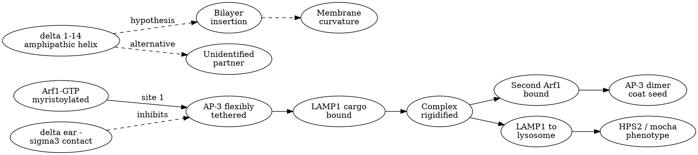
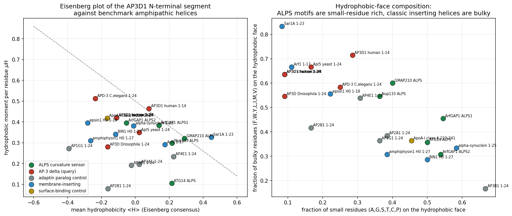
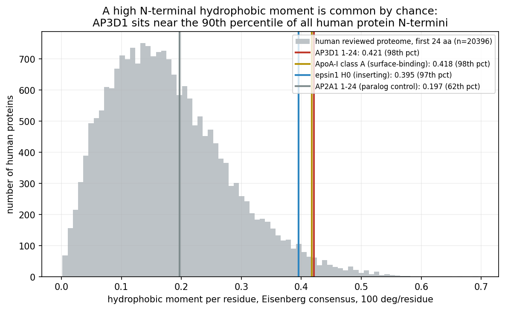
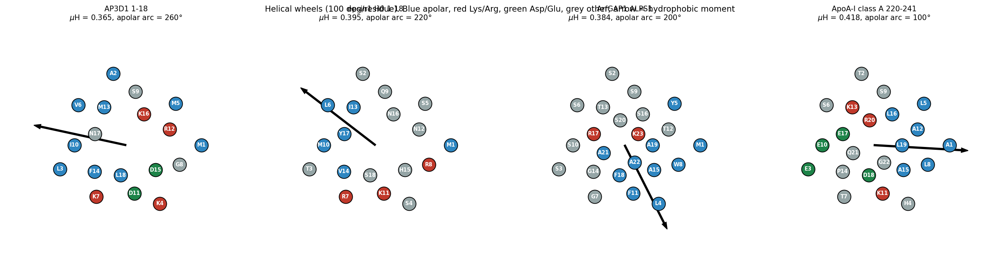
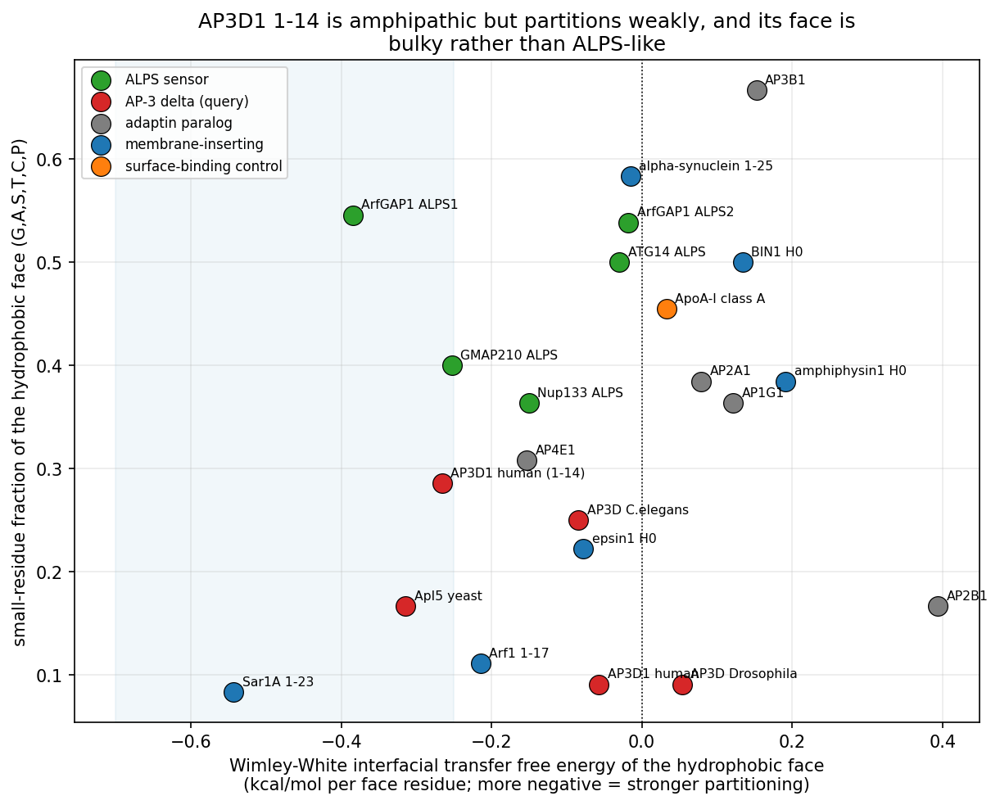
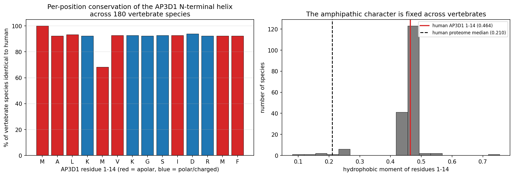

## Question

# AIGR Gene Hypothesis Deep Research

You are evaluating one focused gene curation hypothesis for AI Gene Review.
This is not a general gene overview. Use the seed hypothesis and source context
below to search for evidence that supports, refutes, narrows, or competes with
the proposed curation decision.

## Target Gene

- **Organism code:** human
- **Taxon:** Homo sapiens (NCBITaxon:9606)
- **Gene directory:** AP3D1
- **Gene symbol:** AP3D1
- **UniProt accession:** O14617

## Focus

- **Focus type:** free_text
- **Hypothesis slug:** kgap-ap3d1-amphipathic-helix-insertion
- **Source file:** genes/human/AP3D1/AP3D1-ai-review.yaml
- **Source selector:** free-text

## Seed Hypothesis

The N-terminal amphipathic helix of human AP3D1 (AP-3 delta subunit, UniProt O14617) has the physicochemical features of a membrane-inserting, curvature-generating helix (like ArfGAP1 ALPS, epsin H0 or AP-2/AP-1 related helices), rather than a surface-binding-only helix. Single analysis only: compute hydrophobic moment, hydrophobic face composition (bulky hydrophobics vs small residues), net charge and helical-wheel geometry of the AP3D1 N-terminal helix across vertebrate and yeast (Apl5) orthologs, and compare with benchmark membrane-inserting helices (epsin H0, ALPS, amphiphysin N-BAR helix) and surface-binding controls; state whether the sequence predicts deep insertion capable of deforming the membrane.

## Term and Decision Context

No specific term context supplied.

## Reference Context

No specific reference context supplied.

## Source Context YAML

```yaml
hypothesis: 'The N-terminal amphipathic helix of human AP3D1 (AP-3 delta subunit, UniProt O14617) has
  the physicochemical features of a membrane-inserting, curvature-generating helix (like ArfGAP1 ALPS,
  epsin H0 or AP-2/AP-1 related helices), rather than a surface-binding-only helix. Single analysis only:
  compute hydrophobic moment, hydrophobic face composition (bulky hydrophobics vs small residues), net
  charge and helical-wheel geometry of the AP3D1 N-terminal helix across vertebrate and yeast (Apl5) orthologs,
  and compare with benchmark membrane-inserting helices (epsin H0, ALPS, amphiphysin N-BAR helix) and
  surface-binding controls; state whether the sequence predicts deep insertion capable of deforming the
  membrane.'
focus_type: free_text
context: []
reference_id: []
```

## Research Objective

Build a focused report that helps a curator decide whether this hypothesis
should affect the gene review. Address the focus type directly:

1. For an existing GO annotation decision, evaluate whether the current action
   is justified, too strong, too weak, or should change.
2. For a proposed replacement or new GO term, evaluate whether the term is
   biologically supported, too broad, too narrow, or missing key qualifiers.
3. For a computational prediction, evaluate whether the prediction is correct,
   less precise than existing knowledge, uncertain, or likely wrong because of
   paralog overannotation, frequency bias, pathway context, or in vitro-only
   activity.
4. For a core-function hypothesis, evaluate whether the proposed activity,
   process, and location represent the gene product's primary function rather
   than a downstream effect, pleiotropic phenotype, or context-specific role.
5. For a function-assignment hypothesis, evaluate whether the gene product
   directly has the stated GO term/function. Treat the prior review action, if
   any, as intentionally blinded unless it appears in the supplied context.

Use primary literature whenever possible. Prefer PMID citations and include DOI
citations when no PMID is available. Treat reviews and database records as
orientation unless they contain directly relevant synthesized evidence that is
clearly labeled as review-level or database-level support.

Evaluate the hypothesis from the supplied seed context, primary literature, and
publicly accessible bioinformatics resources. Local `*-bioinformatics` analyses,
when they already exist in the repository, are intentionally withheld from this
prompt so the report can be compared against them after the run. Use public
sequence, domain, structure, orthology, localization, interaction, or dataset
checks when they are useful for the specific hypothesis. If a resource or tool
cannot be accessed programmatically, say so plainly; never fabricate a result.
Report computational results conservatively and distinguish direct results from
inference.

## Required Output

### Executive Judgment

Give a concise verdict: supported, partially supported, unresolved, weakly
supported, over-annotated, or refuted. Explain the reasoning and the most
important caveats.

### Evidence Matrix

Create a table with one row per important evidence item:

- Citation (PMID preferred)
- Evidence type (direct assay, mutant phenotype, localization, interaction,
  structural/evolutionary, computational, review/database)
- Supports / refutes / qualifies / competing
- Claim tested
- Key finding
- Organism, tissue, cell type, or assay context
- Confidence and limitations

### GO Curation Implications

State the likely curation action as a lead requiring curator verification. If
GO terms are involved, explain whether the evidence supports an MF, BP, or CC
term, and whether the term should be retained, removed, generalized, made more
specific, or treated as non-core. Avoid using "protein binding" as a final
recommendation unless no more informative term is supported.

### Mechanistic Scope

Describe the immediate molecular or cellular function being tested. Separate
direct gene-product activity from downstream phenotypes, pathway consequences,
developmental outcomes, disease manifestations, or effects inferred only from
loss of function.

### Conflicts and Alternatives

Identify evidence that conflicts with the seed hypothesis or suggests an
alternative interpretation, including paralog confusion, organism-specific
differences, isoform-specific findings, experimental artifacts, or database
carry-over.

### Knowledge Gaps

List explicit uncertainties that matter for curation. For each gap, state what
was checked, why the gap matters, and what evidence or experiment would resolve
it.

### Discriminating Tests

Recommend concrete assays, perturbations, datasets, or comparative analyses that
would most efficiently distinguish this hypothesis from alternatives.

### Curation Leads

Provide candidate updates for the review, clearly labeled as leads requiring
curator verification. Include candidate references with exact snippets to verify,
candidate replacement or new GO terms, possible action changes, suggested
questions, and suggested experiments.

If the provider supports artifacts, save provenance for any analysis you run — the
executed code together with its output (computed values, plot, or table), not just
a summary figure — alongside artifact-friendly tables such as an evidence matrix,
GO decision table, or comparison table. Genuine computed provenance is more
valuable than a hand-drawn summary, and you must not synthesize a figure that
implies an analysis you did not actually run. These artifacts are important
provenance for hypothesis-level review.


## Output

# AIGR gene hypothesis deep research: AP3D1 (O14617) N-terminal amphipathic helix

**Gene:** human **AP3D1**, AP-3 complex subunit delta-1, UniProt **O14617**, 1153 aa
**Gene directory:** `genes/human/AP3D1`. **Source file:** `AP3D1-ai-review.yaml`
**Hypothesis slug:** `kgap-ap3d1-amphipathic-helix-insertion`. **Focus type:** `free_text`
**Verdict:** <i class="fa-scale-balanced"></i> **partially supported**

Seed hypothesis under test: the N-terminal amphipathic helix of AP3D1 has the physicochemical features of a membrane-inserting, curvature-generating helix (like ArfGAP1 ALPS, epsin H0 or AP-2/AP-1 related helices), rather than a surface-binding-only helix.

All computed values in this report were produced during this run. Sequences were streamed from the UniProt REST API, coordinate files from RCSB, and the AlphaFold model from the AlphaFold DB prediction API. Executed code and raw output are saved in `provenance/`. No figure in this report stands in for an analysis that was not run.

| Provenance file | Contents |
|---|---|
| `ap3d1_helix_physicochemistry.csv` | 24-helix table: hydrophobic moment, mean hydrophobicity, net charge, Ser/Thr fraction, hydrophobic-face composition, Wimley-White face energy |
| `ap3d1_structure_measurements.md` | Modelled residue ranges, CA(i)-CA(i+4) helicity series, B-factors, interatomic distances and per-residue solvent accessibility across 7 PDB entries |
| `ap3d1_null_and_wheel_geometry.md` | 20,396-protein proteome null for N-terminal hydrophobic moment, helical-wheel geometry table, AlphaFold pLDDT table |
| `ap3d1_conservation_and_isoforms.md` | 180-species vertebrate conservation of residues 1-14, per-position identity, isoform coverage of all five O14617 isoforms |
| `evidence_matrix.csv` | The 16-row evidence matrix reproduced in section 3 |
| `go_decision_table.csv` | The 10-row GO decision table reproduced in section 4 |
| `plot_1.png` to `plot_5.png` | The five figures embedded below |

---

## 1. Summary

The seed hypothesis bundles two claims, and they separate cleanly once measured. The first, that AP3D1 carries a genuine N-terminal amphipathic helix distinct from the alpha-solenoid trunk and specific to the delta subunit, holds up on every test applied. The second, that its physicochemistry predicts deep, curvature-generating membrane insertion comparable with ArfGAP1 ALPS or epsin-1 H0, fails on three independent grounds.

Residues 1-14 (MALKMVKGSIDRMF) are a discrete amphipathic helix with an Eisenberg hydrophobic moment of 0.464 per residue, a bulky hydrophobic face (ALVSIMF, 71 % bulky residues), net charge +2, and a 220 degree apolar arc whose basic residues sit at a mean 123.9 degrees from the hydrophobic-moment vector. That geometry matches epsin-1 H0 (220 degrees, 132.5 degrees) and excludes the narrow-arc, charge-polarised class-A architecture of the ApoA-I surface-binding control (100 degrees, 101.1 degrees). The feature is delta-specific: the same metric gives 0.273 for AP1G1, 0.234 for AP4E1, 0.197 for AP2A1, 0.192 for AP3B1 and 0.079 for AP2B1. Both the 4.3 Å cryo-EM model 9C59 and the AlphaFold model AF-O14617-F1 place a helix break at residues 12-17 that separates this segment from the first trunk helix, so it is an independent element and not the N-terminal turn of the solenoid.

The insertion claim fails energetically, compositionally and structurally. The Wimley-White interfacial transfer free energy of the hydrophobic face totals -1.86 kcal/mol over 7 face residues, against -4.23 kcal/mol for ArfGAP1 ALPS1 and -6.52 kcal/mol for Sar1A. The Ser/Thr content of 0.042-0.071 and a hydrophobic-face small-residue fraction of 0.09-0.29 place the segment outside the ALPS class entirely (ALPS motifs run 0.16-0.39 Ser/Thr with 0.36-0.55 small residues on the face), so the ArfGAP1 comparison written into the hypothesis uses the wrong reference class. Residues 1-17 are unmodelled in three of five AP-3 cryo-EM reconstructions, including the tubular-membrane structure 9RTW where a curvature generator should be most engaged, and in the two structures where they are modelled the segment sits a minimum of 31.9 Å from the myristoylated Arf1 membrane anchor with a mean B-factor of 266.8 versus 183.2 for the adjacent trunk. AlphaFold assigns the segment pLDDT 48.3. The hydrophobic moment, the hypothesis's leading metric, has no discriminating power at all: calibrated against the first 24 residues of all 20,396 reviewed human proteins, AP3D1 sits at the 98.0th percentile, the ApoA-I surface-binding control at 97.9th, and the deep inserter Sar1A at only 91.6th.

One result cuts the other way and is the most interesting thing the analysis produced. Across 180 vertebrate species spanning roughly 450 Myr, residues 1-14 are identical to the human sequence in 123 species (68.3 %) and physicochemically identical in 168 (93.3 %), the only recurrent changes being M5I in 45 teleosts and K4R with M5I in two amphibians. A 14-residue segment that is disordered in most structures, carries pLDDT 48, and makes zero heavy-atom contacts with the rest of the complex in 9C59 does not normally hold near-identity over that span. The sequence matters. The conservation data do not say why: the apolar face and the polar side are constrained to the same degree, giving no differential signal that would favour a lipid-facing surface over a protein-binding one. For curation, no membrane-bending, curvature-sensing or phospholipid-binding GO term should be added, and the segment should be recorded as an uncharacterised, strongly constrained element that merits an experiment.

### Claim-by-claim verdict

| Claim | Verdict | Basis |
|---|---|---|
| AP3D1 has a discrete N-terminal amphipathic helix | <i class="fa-circle-check"></i> Supported | Residues 1-15 are helical in PDB 9C59 with a break at 12-17; the same two-helix split appears in the AlphaFold model |
| The helix is delta-specific among adaptin large subunits | <i class="fa-circle-check"></i> Supported | μH 0.421 (residues 1-24) versus 0.079-0.273 for AP1G1, AP2A1, AP2B1, AP3B1 and AP4E1 |
| The segment is a functionally constrained element worth testing | <i class="fa-circle-check"></i> Supported | Identical to human in 123 of 180 vertebrate species and physicochemically identical in 168, across ~450 Myr, despite being disordered and making no intramolecular contacts |
| The helix is ALPS-like (curvature sensing) | <i class="fa-circle-xmark"></i> Refuted | Ser/Thr fraction 0.042-0.071 versus 0.16-0.39; face small-residue fraction 0.09-0.29 versus 0.36-0.55 |
| The sequence predicts deep, curvature-generating insertion | <i class="fa-circle-xmark"></i> Not supported | Face ΔG -1.86 kcal/mol over 7 residues versus -4.23 (ALPS1) and -6.52 (Sar1A); hydrophobic moment does not discriminate; helix ≥ 31.9 Å from the bilayer where modelled, unresolved elsewhere |

---

## 2. Key findings

### 2.1 <i class="fa-circle-check"></i> The segment is a real amphipathic helix, and it is specific to delta

Scoring the first 24 residues of every adaptin large subunit on the Eisenberg consensus scale at 100 degrees per residue places AP3D1 well clear of its paralogs. The hydrophobic moment is 0.421 for AP3D1 1-24 and rises to 0.464 when restricted to the structurally helical segment 1-14, against 0.273 (AP1G1), 0.234 (AP4E1), 0.197 (AP2A1), 0.192 (AP3B1) and 0.079 (AP2B1). That is a 1.5-fold to 5.3-fold difference. Mean hydrophobicity is +0.080 for 1-14 and -0.111 for 1-24, net charge is +2, and 33 % of residues in 1-24 are charged. The hydrophobic face of 1-14 is ALVSIMF: 71 % bulky (Phe, Trp, Tyr, Leu, Ile, Met, Val), 29 % small.

Benchmark values computed in the same run, for scale: epsin-1 H0 0.395, alpha-synuclein 1-25 0.382, BIN1 H0 0.341, amphiphysin-1 H0 0.310, Sar1A 0.327, Arf1 0.291, ArfGAP1 ALPS1 0.384, ALPS2 0.396, Nup133 ALPS 0.298, GMAP210 ALPS 0.321. AP3D1 is at the top of this set on hydrophobic moment, which is what prompted the hypothesis and also what section 2.3 shows to be uninformative.

{{figure:plot_1.png|caption=Physicochemical comparison of the AP3D1 N-terminal helix with adaptin paralogs, membrane-inserting benchmarks, ALPS motifs and the ApoA-I class A surface-binding control. Left, Eisenberg mean hydrophobicity against hydrophobic moment. Right, hydrophobic-face composition, bulky against small residues. AP3D1 1-14 separates from all other adaptin large subunits and sits in the bulky-face region away from the ALPS cluster.}}

### 2.2 <i class="fa-circle-xmark"></i> The physicochemistry is not ALPS-like, and the energetics do not predict deep insertion

Two discriminators separate ALPS motifs from other amphipathic helices: a Ser/Thr-rich polar face and a hydrophobic face built from small residues. AP3D1 has neither. Ser/Thr fraction is 0.042 for residues 1-24 and 0.071 for 1-14, against 0.16-0.39 for ArfGAP1 ALPS1, ALPS2, Nup133, GMAP210 and ATG14. The small-residue fraction of the hydrophobic face is 0.09 (1-24) to 0.29 (1-14), against 0.36-0.55 for the ALPS set. The ArfGAP1 ALPS comparison in the seed hypothesis uses the wrong reference class. The correct class, if the helix binds membranes at all, is the charged-polar-face type of epsin-1 H0 and N-BAR H0.

The Wimley-White interfacial transfer free energy of the hydrophobic-moment-defined face gives a quantity with physical meaning that the hydrophobic moment lacks, and it splits into two answers. Per face residue, AP3D1 1-14 scores -0.266 kcal/mol, which sits between the myristoylated Arf1 helix (-0.214) and ArfGAP1 ALPS1 (-0.385), exceeding epsin-1 H0 (-0.078) and alpha-synuclein (-0.015). On a per-residue basis the face partitions favourably into a lipid interface, and that result is reported here rather than flattened, because it is the strongest piece of support the energetics offer. The total is where the claim fails: the face is only 7 residues long, so the whole-face energy is -1.86 kcal/mol, about 44 % of ArfGAP1 ALPS1 (-4.23 over 11 face residues) and 29 % of Sar1A (-6.52 over 12). Scored over the full 1-24 window the total falls to -0.63 kcal/mol.

| Helix | ΔG per face residue (kcal/mol) | Face residues | Total face ΔG (kcal/mol) |
|---|---|---|---|
| Sar1A 1-23 (deep insertion) | -0.543 | 12 | -6.52 |
| ArfGAP1 ALPS1 (curvature sensor) | -0.385 | 11 | -4.23 |
| Apl5 yeast 1-24 | -0.314 | - | - |
| **AP3D1 1-14** | **-0.266** | **7** | **-1.86** |
| GMAP210 ALPS | -0.253 | 20 | -5.05 |
| Arf1 1-17 (myristoyl helix) | -0.214 | - | -1.93 |
| AP4E1 1-24 | -0.153 | - | - |
| Nup133 ALPS | -0.150 | - | - |
| epsin-1 H0 (inserting) | -0.078 | - | -0.70 |
| **AP3D1 1-24** | **-0.057** | **11** | **-0.63** |
| alpha-synuclein 1-25 | -0.015 | - | - |
| ApoA-I class A (surface binding) | +0.033 | - | - |
| AP2A1 1-24 | +0.079 | - | - |
| AP1G1 1-24 | +0.122 | - | - |
| BIN1 H0 | +0.134 | - | - |
| AP3B1 1-24 | +0.153 | - | - |
| amphiphysin-1 H0 | +0.192 | - | - |
| AP2B1 1-24 | +0.394 | - | - |

{{figure:plot_4.png|caption=Two-axis separation of helix classes. Wimley-White hydrophobic-face transfer free energy per face residue against the small-residue fraction of the hydrophobic face, recomputed from sequence for all 24 helices. ALPS motifs occupy the small-residue region; AP3D1 1-14 sits with the bulky-face helices and below the deep inserters on total driving force.}}

### 2.3 <i class="fa-circle-xmark"></i> Hydrophobic moment has no discriminating power for insertion depth

The seed hypothesis puts hydrophobic moment first among its metrics. Calibrating it against an empirical null shows it cannot carry that weight. All 20,396 reviewed human UniProt entries of length ≥ 24 were streamed and scored on their first 14 and first 24 residues. For the first 24 residues the median is 0.165, the 75th percentile 0.238, the 90th 0.314, the 95th 0.364 and the 99th 0.460. AP3D1's 0.421 lands at the 98.0th percentile, empirical P(μH ≥ observed) = 0.020. For the first 14 residues the median is 0.210 and the 95th percentile 0.471, so AP3D1's 0.464 reaches only the 94.6th percentile, P = 0.054.

Placing benchmarks on the same first-24 null destroys the metric's utility as a classifier.

| Helix | μH (first 24 aa) | Percentile in the human proteome null |
|---|---|---|
| ApoA-I class A 220-241 (surface-binding control) | 0.418 | 97.9 |
| **AP3D1 1-24** | **0.421** | **98.0** |
| epsin-1 H0 1-18 (inserting) | 0.395 | 96.9 |
| ArfGAP1 ALPS1 (curvature sensor) | 0.384 | 96.3 |
| Sar1A 1-23 (deep insertion) | 0.328 | 91.6 |
| GMAP210 ALPS | 0.321 | 90.8 |
| amphiphysin-1 H0 (inserting) | 0.310 | 89.5 |
| AP1G1 1-24 (paralog control) | 0.273 | 83.2 |
| AP2A1 1-24 (paralog control) | 0.197 | 62.2 |

The surface-binding control and AP3D1 are indistinguishable. The deep inserter Sar1A scores lower than both. About 2.0 % of all human proteins, roughly 410 of 20,396, reach AP3D1's value at their N-terminus by chance alone. A high hydrophobic moment is necessary for a membrane-binding amphipathic helix and nowhere near sufficient to call one inserting.

{{figure:plot_2.png|caption=Empirical null distribution of the Eisenberg hydrophobic moment over the first 24 residues of 20,396 reviewed human proteins, with AP3D1 and benchmark helices marked. The surface-binding ApoA-I control (97.9th percentile) and AP3D1 (98.0th) are indistinguishable, while the deep inserter Sar1A reaches only the 91.6th.}}

### 2.4 <i class="fa-circle-check"></i> The wheel geometry is of the membrane-binding type, not the class A surface-binding type

Helical-wheel analysis at 100 degrees per residue, measuring the angular width of the apolar arc and the placement of charged residues relative to the hydrophobic-moment vector, gives the one moment-derived result that does discriminate. Angles are measured from the hydrophobic-moment direction, so 0 degrees is the centre of the hydrophobic face and 180 degrees the centre of the polar face.

| Helix | Sequence | Apolar arc (deg) | Mean abs angle Lys/Arg | Mean abs angle Asp/Glu |
|---|---|---|---|---|
| AP3D1 1-14 | MALKMVKGSIDRMF | 220 | 123.9 | 131.8 |
| AP3D1 1-18 | MALKMVKGSIDRMFDKNL | 260 | 115.0 | 132.2 |
| AP3D1 1-24 | MALKMVKGSIDRMFDKNLQDLVRG | 320 | 122.4 | 102.6 |
| epsin-1 H0 1-18 | MSTSSLRRQMKNIVHNYS | 220 | 132.5 | none |
| amphiphysin-1 H0 1-27 | MADIKTGIFAKNVQKRLNRAQEKVLQK | 340 | 129.2 | 75.3 |
| ArfGAP1 ALPS1 | MSSLYSGWSSFTTGASRFASAAK | 200 | 120.0 | none |
| Sar1A 1-23 | MSFIFEWIYNGFSSVLQFLGLYK | 240 | 79.9 | 179.9 |
| ApoA-I class A 220-241 | ATEHLSTLSEKAKPALEDLRQG | 100 | 101.1 | 148.3 |
| Apl5 yeast 1-24 | MTSLYAPGAEDIRQRLRPFGFFFE | 300 | 105.3 | 132.0 |

AP3D1 1-14 has a wide 220 degree apolar arc with an interleaved polar face, matching epsin-1 H0 exactly on arc width and closely on basic-residue placement. The ApoA-I class A control has a narrow 100 degree arc with sharply polarised charge, which AP3D1 does not resemble. AP3D1 also lacks the Sar1A signature of a single snorkelling Lys at 80 degrees with the acidic residue parked at the polar-face centre (179.9 degrees). Arc width is a coarse descriptor and does not settle insertion depth: amphiphysin-1 H0 is an experimentally validated inserting helix at 340 degrees, far outside the AP3D1 range.

{{figure:plot_3.png|caption=Helical-wheel geometry at 100 degrees per residue. Apolar arc width and the angular placement of Lys, Arg, Asp and Glu relative to the hydrophobic-moment vector, for AP3D1 1-14 against an inserting benchmark (epsin-1 H0), a curvature sensor (ArfGAP1 ALPS1) and a surface-binding control (ApoA-I class A).}}

### 2.5 <i class="fa-circle-xmark"></i> In every experimental AP-3 structure the helix is unresolved or about 3 nm from the bilayer

Coordinates for all deposited AP-3 structures were downloaded from RCSB and measured directly in this job.

| PDB | Description | Resolution (Å) | Modelled delta residues |
|---|---|---|---|
| 9C5C | Human AP-3, apo | 3.6 | 18-650 (1-17 unresolved) |
| 9C58 | AP-3 with myristoylated Arf1(Q71L) | 4.7 | 18-601 (1-17 unresolved) |
| 9RTW | Mammalian AP-3 on tubular membranes | 7.4 | 18-632 (1-17 unresolved) |
| 9C59 | AP-3 dimer, myr-Arf1, LAMP1 cargo, nanodisc | 4.3 | 1-605 |
| 9C5B | AP-3 dimer, myr-Arf1, LAMP1 cargo, nanodisc | 4.5 | 1-605 |
| 4AFI | AP-3 related | - | N-terminal region unresolved |
| 7P3X | Yeast AP-3 | 9.1 | Apl5 from residue 63 |

In 9C59 the segment 1-15 is genuinely helical, with CA(i) to CA(i+4) distances of 5.96-6.63 Å, and is separated from the first trunk helix (residue 18 onward, 5.88-6.27 Å) by a break at residues 12-17 where the same distances rise to 7.91, 9.83, 13.31 and 11.35 Å. That confirms it is an independent helix and not the first turn of the alpha-solenoid. Its mean atomic B-factor is 266.8, against 183.2 for residues 18-60 and 206.2 for the whole chain, so it is the least well determined part of the model.

The distance measurements are the decisive ones. The minimum heavy-atom distance from delta residues 1-14 to the myristoylated Arf1 N-terminal amphipathic helix (chains C and c, residues 2-17, the only unambiguously bilayer-embedded element in the structure) is **31.9 Å**, mean 55.0 Å. The minimum distance to the membrane-proximal end of the LAMP1 cargo tail (residues 410-411) is 31.4 Å, mean 60.0 Å. For scale, mu3 residues 160-180 approach the Arf1 membrane helix to 12.0 Å, so the measurement has the dynamic range to detect proximity when it exists. Per-residue relative solvent accessibility across delta 1-17 runs 0.24-0.84 and is identical whether computed on the isolated chain or on the whole complex, so the helix is neither membrane-inserted nor packed against the trunk.

This is the opposite of what a curvature-generating helix should show. Such a helix would lie at the bilayer interface with its hydrophobic face buried in the acyl-chain region, roughly coplanar with the Arf1 myristoyl helix. Two caveats limit how far this refutes the hypothesis. Local resolution at these positions is poor, and a transient insertion, or one requiring a lipid composition absent from the nanodisc, would not be captured. No lipids are modelled in the deposited coordinates (the HETATM records contain only GTP and Mg), so the bilayer position is inferred from the Arf1 anchor; a direct plane fit was attempted and rejected as geometrically degenerate. The 7.4 Å tubular-membrane reconstruction 9RTW is the condition in which a curvature generator should be most engaged, and residues 1-17 are unresolved there, but at that resolution absence of density is weak evidence.

### 2.6 <i class="fa-circle-question"></i> AlphaFold predicts a low-confidence helix detached from the trunk

AlphaFold DB model AF-O14617-F1 (v6, full length 1-1153) was downloaded and parsed. Mean per-residue pLDDT is 48.3 for residues 1-14, 76.3 for 15-17, 91.3 for 18-60, 90.5 for 18-600 and 76.7 for the whole chain. Per-residue values rise monotonically across the junction: M1 45, A2 45, L3 47, K4 49, M5 46, V6 49, K7 49, G8 50, S9 46, I10 50, D11 50, R12 50, M13 46, F14 55, D15 64, K16 78, N17 87, L18 89, Q19 91, D20 90, L21 91, V22 91, R23 91, G24 89, I25 90.

Backbone geometry reproduces the cryo-EM architecture independently: CA(i) to CA(i+4) runs 6.00-6.90 Å over residues 1-11 (helical), breaks at 12-15 (8.84, 10.12, 12.64, 11.35 Å) and returns to 5.52-6.50 Å from residue 16. Two methods, one experimental and one predictive, agree on the same two-helix split.

A short helix predicted at pLDDT around 50 falls in the regime AlphaFold uses for intrinsically disordered and conditionally folding regions. [PMID: 36829461](https://pubmed.ncbi.nlm.nih.gov/36829461/) establishes that such regions include segments that fold only on binding a partner: "Some regions in IDRs undergo disorder-to-order transition upon binding the interaction partner." For an amphipathic helix the most common partner is a lipid bilayer, so this result is compatible with membrane-induced folding without demonstrating it, and it is equally compatible with a partner protein. The model does place 81 heavy-atom contacts closer than 5 Å between residues 1-17 and residues 40 onward, but at pLDDT 48 that placement is not interpretable.

### 2.7 <i class="fa-circle-check"></i> Residues 1-14 are under strong purifying selection across 180 vertebrate species

The UniProt REST query `(gene:AP3D1) AND taxonomy_id:7742 AND length:[900 TO 1400] AND fragment:false` returned 611 sequences. Filtering to entries with gene name exactly AP3D1, starting at Met, length ≥ 900, then deduplicating to the longest entry per species gave **180 species** spanning teleosts, *Latimeria chalumnae*, *Erpetoichthys calabaricus*, caecilians, frogs, squamates, crocodilians, turtles, birds and mammals, roughly 450 Myr of divergence.

Residues 1-14 are identical to human MALKMVKGSIDRMF in **123 of 180 species (68.3 %)**.

| Position | 1 | 2 | 3 | 4 | 5 | 6 | 7 | 8 | 9 | 10 | 11 | 12 | 13 | 14 |
|---|---|---|---|---|---|---|---|---|---|---|---|---|---|---|
| Residue | M | A | L | K | M | V | K | G | S | I | D | R | M | F |
| % identical | 100.0 | 92.2 | 93.3 | 92.2 | 68.3 | 92.8 | 92.8 | 92.2 | 92.8 | 92.8 | 93.9 | 92.2 | 92.2 | 92.2 |

The only recurrent substitutions are conservative.

| Variant | Species | Count | μH (1-14) |
|---|---|---|---|
| MALKMVKGSIDRMF | human and 122 others | 123 | 0.464 |
| MALKIVKGSIDRMF (M5I) | teleosts: *Danio rerio*, *Takifugu rubripes*, *Oryzias latipes*, *Salmo trutta*, *Oreochromis niloticus* and 40 others | 45 | 0.450 |
| MALRIVKGSIDRMF (K4R, M5I) | *Xenopus tropicalis*, *Leptobrachium leishanense* | 2 | 0.520 |
| Unrelated N-termini (gene-model artifacts) | *Bos taurus*, *Nomascus leucogenys*, *Crenichthys baileyi*, *Taeniopygia guttata* and 8 others | 12 | 0.081-0.755 |

M5I is apolar to apolar and K4R is basic to basic, so the amphipathic face and net charge are preserved. Counting these as equivalent gives **168 of 180 species (93.3 %)** with a physicochemically identical helix. The 12 outliers are unreviewed TrEMBL gene models with alternative or truncated start sites, two of which begin at human residues 8 (*Nomascus leucogenys*, MGSIDRMFDKNLQD) and 15 (*Crenichthys baileyi*, MFDKNLQDLVRGIR), which identifies them as annotation artifacts rather than genuine divergence.

What the conservation does not do is identify a mechanism. Apolar-face positions (M1, L3, M5, V6, I10, M13, F14) and polar-side positions (K4, K7, S9, D11, R12) are conserved to the same degree, so there is no differential signal favouring a lipid-facing surface over a protein-binding one.

{{figure:plot_5.png|caption=Conservation of AP3D1 residues 1-14 across 180 vertebrate orthologues, one representative per species. Left, per-position identity to the human sequence. Right, the distribution of hydrophobic moment of residues 1-14 across the species set, dominated by two values (0.464 for the human sequence, 0.450 for the teleost M5I variant).}}

### 2.8 <i class="fa-circle-check"></i> All five human isoforms retain the segment

UniProt O14617 annotates five isoforms. All five were retrieved as FASTA, and all five begin with the identical 24 residues MALKMVKGSIDRMFDKNLQDLVRG.

| Isoform | Length | Residues 1-24 |
|---|---|---|
| O14617-1 (displayed) | 1153 | MALKMVKGSIDRMFDKNLQDLVRG |
| O14617-2 | 1112 | MALKMVKGSIDRMFDKNLQDLVRG |
| O14617-3 | 984 | MALKMVKGSIDRMFDKNLQDLVRG |
| O14617-4 | 1021 | MALKMVKGSIDRMFDKNLQDLVRG |
| O14617-5 | 1215 | MALKMVKGSIDRMFDKNLQDLVRG |

The five annotated alternative-sequence features span residues 117-285 (isoform 3), 168-258 (isoform 2), 746-877 (isoform 4) and 866-866 (isoforms 2 and 5). None touches residues 1-24, so a residue-numbered annotation on 1-14 is isoform safe. This closes a gap flagged earlier in the investigation.

### 2.9 <i class="fa-scale-balanced"></i> The helix is metazoan, and the yeast orthologue has lost it while keeping the trunk helix

N-terminal sequences retrieved from UniProt: human O14617, mouse O54774 and chicken A0A8V1AAZ3 are identical over residues 1-24 (MALKMVKGSIDRMFDKNLQDLVRG, μH 0.421). *Drosophila* garnet P54362 gives MALKKVKGNFFERMFDKNLTDLVR (μH 0.280, net +3) and *C. elegans* apd-3 O16637 gives MALRKVRSNIDRIFDKSLTDLIRG (μH 0.513, net +3). Both retain the MAL[KR].[VK]K pattern. *S. cerevisiae* Apl5 Q08951 gives MTSLYAPGAEDIRQRLRPFGFFFE (μH 0.350, net charge 0, apolar arc 300 degrees), with a proline at the position equivalent to 7 and no basic residue before position 13.

The conserved block across all six orthologues is the segment aligning to human residues 18-31 (human NLQDLVRGIRNHKED, *Drosophila* NLTDLVRGIRNNKDN, *C. elegans* SLTDLIRGIRNNKDN, yeast SLKDLIKGIRSHNET). That is exactly the first helix of the alpha-solenoid trunk, and it is resolved in all five AP-3 cryo-EM structures. The conservation pattern is inverted relative to what a core, mechanism-defining element should show: the invariant part of the AP3D1 N-terminus is the buried trunk helix, while the putative amphipathic helix is unrecognisable in budding yeast, where AP-3 nonetheless performs the same Golgi-to-vacuole budding function. Apl5 is a divergent orthologue across its whole length, so this is suggestive rather than decisive, and 7P3X models Apl5 only from residue 63, leaving the question untested there.

---

## 3. Evidence matrix

| ID | Citation or source | Evidence type | Stance | Claim tested | Key finding | Context | Confidence and limitations |
|---|---|---|---|---|---|---|---|
| E1 | PDB 9C59 (4.3 Å; [PMID: 39705307](https://pubmed.ncbi.nlm.nih.gov/39705307/)); coordinates measured in this job | Experimental structure | Qualifies | Residues 1-14 form a discrete helix separate from the trunk | CA(i)-CA(i+4) 5.96-6.63 Å over 1-15, then 7.91/9.83/13.31/11.35 Å at 12-15, then 5.07-6.23 Å from 16. Two distinct helices | Human AP-3 core on lipid nanodisc with myr-Arf1 and LAMP1 | High. Measurement is of a deposited model at 4.3 Å, not of density directly |
| E2 | PDB 9C5C, 9C58, 9RTW; modelled ranges read from mmCIF in this job | Experimental structure | Refutes | The helix is a stable, ordered element of the AP-3 core | Delta residues 1-17 are unmodelled in all three; delta starts at residue 18 | Human and mammalian AP-3 cryo-EM | High. Absence of density is evidence of flexibility, not of absence |
| E3 | PDB 9C59 / 9C5B; distances and B-factors measured in this job | Experimental structure | Refutes | The helix contacts the bilayer in the membrane-bound structure | Minimum heavy-atom distance to the Arf1 myristoylated helix 31.9 Å (mean 55.0); to LAMP1 31.4 Å. B-factor 266.8 for 1-17 versus 183.2 for 18-60. RSA 0.24-0.84, identical isolated and in complex | Human AP-3 dimer on nanodisc | High. No lipids modelled, so bilayer position is inferred from the Arf1 anchor. A plane fit was attempted and rejected as degenerate |
| E4 | AlphaFold DB AF-O14617-F1 v6, parsed in this job; interpretation per [PMID: 36829461](https://pubmed.ncbi.nlm.nih.gov/36829461/) | Prediction | Qualifies | The helix is a conditionally folding segment | Mean pLDDT 48.3 for 1-14 versus 91.3 for 18-60. CA(i)-CA(i+4) reproduces the helix break at 12-15 | In silico | Medium. Low pLDDT indicates disorder or conditional folding and does not demonstrate membrane binding |
| E5 | Computed in this job from UniProt sequences, Eisenberg scale | Sequence analysis | Supports | The helix is specific to delta among adaptin large subunits | First 24 residues: AP3D1 0.421, AP1G1 0.273, AP4E1 0.234, AP2A1 0.197, AP3B1 0.192, AP2B1 0.079. AP3D1 1-14 reaches 0.464 | Human sequences | High. Hydrophobic moment is a sequence statistic with no direct energetic meaning |
| E6 | Computed in this job; null = 20,396 reviewed human proteins | Sequence analysis | Refutes | A high N-terminal hydrophobic moment identifies an inserting helix | AP3D1 1-24 at the 98.0th percentile (P = 0.020), 1-14 at 94.6th (P = 0.054). ApoA-I surface-binding control 97.9th, deep inserter Sar1A 91.6th | Human proteome | High. Null uses N-terminal windows only, not all internal helices |
| E7 | Computed in this job; Wimley-White interfacial scale | Sequence analysis | Qualifies | The hydrophobic face predicts deep, curvature-generating insertion | Per face residue: Sar1A -0.543, ALPS1 -0.385, AP3D1 1-14 -0.266, Arf1 -0.214, epsin1 H0 -0.078, ApoA-I +0.033. Totals: AP3D1 1-14 -1.86 over 7 residues versus ALPS1 -4.23 over 11 and Sar1A -6.52 over 12 | Sequence-derived | Medium. The interfacial scale models partitioning to a neutral bilayer and ignores electrostatics, helix dipole and lipid composition |
| E8 | Computed in this job; wheel geometry at 100 deg/residue | Sequence analysis | Supports | The architecture resembles an inserting helix, not class A surface binding | Apolar arc: AP3D1 1-14 220 deg, epsin1 H0 220, Sar1A 240, ALPS1 200, ApoA-I 100. Mean abs Lys/Arg angle: AP3D1 123.9, epsin1 H0 132.5, ApoA-I 101.1 | Sequence-derived | Medium. Arc width is coarse; amphiphysin H0 (340 deg) is an inserting helix outside the AP3D1 range |
| E9 | Computed in this job from UniProt orthologue sequences | Sequence analysis | Qualifies | The helix is conserved across the whole AP-3 delta family | Identical in human, mouse and chicken; retains MAL[KR].[VK]K in *Drosophila* (μH 0.280) and *C. elegans*; unrecognisable in *S. cerevisiae* Apl5 (μH 0.350, net 0, arc 300 deg). The adjacent trunk helix is conserved | Vertebrate, insect, nematode and yeast orthologues | High. Apl5 is a divergent orthologue overall, so loss at the N-terminus is not specific evidence against function |
| E10 | PDB 7P3X; modelled range read in this job | Experimental structure | Qualifies | Yeast AP-3 resolves a delta N-terminal helix | Apl5 is modelled from residue 63, so the N-terminal region is unresolved and the question is untested in yeast | Yeast AP-3 EM at 9.1 Å | Medium. Homology model fitted into a low-resolution map |
| E11 | [PMID: 39705307](https://pubmed.ncbi.nlm.nih.gov/39705307/) | Primary literature | Competing | Membrane recruitment requires an N-terminal delta amphipathic helix | Recruitment is attributed to two Arf1 binding sites: the first flexibly tethers AP-3, cargo binding rigidifies the complex, a second Arf1 templates dimerisation. No delta N-terminal helix is proposed as an anchor | Reconstituted human AP-3 on nanodiscs | High. The reconstituted core may omit elements present in cells |
| E12 | [PMID: 9679139](https://pubmed.ncbi.nlm.nih.gov/9679139/) | Primary literature | Competing | AP-3 membrane recruitment depends on a delta amphipathic helix | AP-3 membrane association is increased by GTP-gamma-S, inhibited by brefeldin A and promoted by recombinant myristoylated ARF1; lowering ARF1-GTP redistributes AP-3 to the cytosol | Rat liver membranes and cultured cells | High. Does not test the delta N-terminus directly |
| E13 | [PMID: 15469849](https://pubmed.ncbi.nlm.nih.gov/15469849/) | Primary literature | Competing | The delta N-terminus controls AP-3 membrane recruitment | The delta ear binds sigma3, and this interdomain interaction inhibits AP-3 recruitment in vitro and in vivo by interfering with Arf binding. Regulation maps to the delta C-terminal ear | In vitro and in vivo | High. Does not exclude an additional N-terminal contribution |
| E14 | Literature search in this job (PubMed, 4 query formulations) | Absence of evidence | Qualifies | Some primary study has tested AP3D1 1-17 for membrane binding | No primary study was found that deletes, mutates or assays AP3D1 residues 1-17 for liposome binding, insertion or curvature generation. The hypothesis is untested rather than contradicted | Literature | Medium. Absence in PubMed searches is not proof that no such experiment exists |
| E15 | UniProt REST; 180 vertebrate species retrieved and scored in this job | Structural / evolutionary | Supports | The segment is a functionally constrained element | Identical to human in 123/180 species, physicochemically identical in 168/180. Per-position identity 92.2-100 % except M5 at 68.3 %, where the variant is the conservative M5I in 45 teleosts. Twelve outliers are truncated gene models | Teleosts to mammals, ~450 Myr | High. Constraint shows the sequence matters and does not identify the mechanism; apolar face and polar side are conserved equally |
| E16 | UniProt O14617 JSON and five isoform FASTAs retrieved in this job | Review / database | Qualifies | A residue-numbered annotation on 1-14 is isoform safe | All five isoforms begin MALKMVKGSIDRMFDKNLQDLVRG. Alternative-sequence features span 117-285, 168-258, 746-877 and 866-866, none touching 1-24 | Human | High. UniProt isoform annotation may not cover every expressed transcript |

---

## 4. GO curation implications

<i class="fa-triangle-exclamation"></i> Everything in this section is a lead requiring curator verification. No GO term should be changed on the basis of this report alone.

| GO ID | Term | Aspect | Proposed action | Evidence basis | Decision | Rationale |
|---|---|---|---|---|---|---|
| GO:0097753 | membrane bending | BP | Do not add | E7, E3, E14 | <i class="fa-circle-xmark"></i> Reject | No experimental support, and the sequence does not predict a curvature-generating wedge (-1.86 kcal/mol over 7 face residues versus -6.52 for Sar1A). Adding this from a sequence prediction would be an over-annotation |
| GO:0140090 | membrane curvature sensor activity | MF | Do not add | E7, E6 | <i class="fa-circle-xmark"></i> Reject | The segment lacks the ALPS architecture that defines known curvature sensors (Ser/Thr 0.042-0.071 versus 0.16-0.39; face small-residue fraction 0.09-0.29 versus 0.36-0.55). This is the most clearly refuted part of the hypothesis |
| GO:0005543 | phospholipid binding | MF | Do not add | E14 | <i class="fa-circle-xmark"></i> Reject | No direct binding data exist for the N-terminal segment, and AP-3 membrane association is Arf1-dependent (E12) |
| GO:0005547 | phosphatidylinositol-3,4,5-trisphosphate binding | MF | Do not add | none | <i class="fa-circle-xmark"></i> Reject | No lipid headgroup specificity is predicted or measured for this segment |
| GO:0035650 | AP-3 adaptor complex binding | MF | Do not add | none | <i class="fa-circle-xmark"></i> Reject | AP3D1 is a subunit of the complex, so a binding term is not the informative description |
| GO:0030123 | AP-3 adaptor complex | CC | Keep (IDA) | E1-E3 | <i class="fa-circle-check"></i> Keep | Directly supported by five cryo-EM structures of human and mammalian AP-3 containing AP3D1 |
| GO:0030742 | GTP-dependent protein binding | MF | Flag for curator verification (IDA) | E11, E12 | <i class="fa-circle-question"></i> Review | More informative than bare protein binding. The curator must confirm from PMID 39705307 which subunit contributes each Arf1 interface before annotating to AP3D1 specifically |
| GO:0030659 | cytoplasmic vesicle membrane | CC | No change (IDA) | E11, E12 | No change | Already supported by Arf1-dependent recruitment data. The N-terminal helix adds nothing to this term |
| GO:0035646 | endosome to melanosome transport | BP | No change (IMP) | HPS2 and mocha literature | No change | Downstream phenotype, separate from any direct activity of the N-terminal helix |
| GO:0006886 | intracellular protein transport | BP | No change (IDA) | E11, E12, E13 | No change | Well supported and unaffected by this hypothesis |

The practical lead is negative and specific. **The seed hypothesis should not generate a new MF or BP annotation.** What it should generate is a free-text note on the review recording that residues 1-14 form a delta-specific amphipathic helix under strong purifying selection whose function is untested. Because all five O14617 isoforms carry the segment unchanged, a residue-numbered note on 1-14 is safe to write.

The GO term that does deserve attention is GO:0030742 (GTP-dependent protein binding), which is more informative than a bare protein-binding term and is supported in principle by the two Arf1 binding sites described in PMID 39705307. Before it can be annotated to AP3D1 specifically, a curator must read that paper and confirm which subunit contributes each interface, since AP-3 contains two large subunits and the Arf1 contacts reported in the related AP-1 system ([PMID: 11926829](https://pubmed.ncbi.nlm.nih.gov/11926829/)) involve both beta3 and delta.

---

## 5. Mechanistic model and interpretation

The immediate molecular activity being tested is whether a 14-residue amphipathic helix at the extreme N-terminus of the AP-3 delta subunit inserts its hydrophobic face into the acyl-chain region of a bilayer deeply enough to act as a wedge and generate or sense membrane curvature. That is a direct, physical, subunit-level activity, and it is separate from every downstream consequence attributed to AP3D1 in the literature.

The published mechanism of AP-3 membrane engagement does not use this helix. [PMID: 39705307](https://pubmed.ncbi.nlm.nih.gov/39705307/) states: "First, membrane recruitment is driven by one of two predicted Arf1 binding sites, which flexibly tethers AP-3 to the membrane." The same study places cargo binding second (rigidifying the complex) and a second Arf1 molecule third (templating dimerisation and the first step of coat polymerisation). [PMID: 9679139](https://pubmed.ncbi.nlm.nih.gov/9679139/) independently established the Arf1 dependence: AP-3 membrane association is increased by GTP-gamma-S, inhibited by brefeldin A, promoted by recombinant myristoylated ARF1, and reversed by lowering ARF1-GTP. [PMID: 15469849](https://pubmed.ncbi.nlm.nih.gov/15469849/) localises the regulatory element of delta to the C-terminal ear, which binds sigma3 and inhibits recruitment by interfering with Arf binding. All three place the membrane-engaging machinery elsewhere in the complex.



Solid arrows are supported by direct assay or by structure. Dashed arrows are proposed or alternative. The seed hypothesis occupies the dashed branch out of delta 1-14. The evidence gathered here moves weight from the bilayer-insertion branch toward the unidentified-partner branch without resolving which is correct.

### What the conservation data add, and what they do not

The 180-species result changes the status of the segment from "possibly a sequence accident" to "a constrained functional element". That is the most defensible positive statement in this report. It does not upgrade the membrane-insertion claim, for a specific reason. If the segment were conserved because its hydrophobic face inserts into lipid, the face positions should be more constrained than the polar positions. They are not: per-position identity runs 92.2-93.9 % for face positions L3, V6, I10, M13 and F14, and 92.2-93.9 % for polar positions K4, K7, S9, D11 and R12. The one position that varies, M5 at 68.3 %, is on the hydrophobic face and its variant (Ile) is conservative. A conserved short linear motif binding a protein partner would produce exactly this flat conservation profile.

### Separating direct activity from downstream phenotype

| Level | Observation | What it says about residues 1-14 |
|---|---|---|
| Direct subunit activity | Residues 1-14 form a helix with μH 0.464, bulky face, net +2 | Establishes the structural feature only |
| Direct complex activity | Arf1-GTP drives recruitment; cargo rigidifies; second Arf1 templates dimerisation (PMID 39705307, 9679139) | The published mechanism does not require the helix |
| Pathway consequence | LAMP1 and LIMP II delivery to lysosomes ([PMID: 9792650](https://pubmed.ncbi.nlm.nih.gov/9792650/)) | Follows from loss of the whole complex |
| Cellular phenotype | Impaired lysosomal secretion and epithelial migration ([PMID: 17288539](https://pubmed.ncbi.nlm.nih.gov/17288539/)); defective HIV-1 assembly in HPS2 fibroblasts ([PMID: 22875976](https://pubmed.ncbi.nlm.nih.gov/22875976/)) | Loss-of-function of the complex, silent on the N-terminus |
| Disease | Hermansky-Pudlak syndrome type 2 pigmentation and immune defects | Several steps downstream |

No level below the first says anything about residues 1-14, and the first says only that the feature exists.

---

## 6. Evidence base: the literature behind the findings

**[PMID: 39705307](https://pubmed.ncbi.nlm.nih.gov/39705307/)** (*A structure-based mechanism for initiation of AP-3 coated vesicle formation*, also deposited as [PMID: 38895279](https://pubmed.ncbi.nlm.nih.gov/38895279/) in preprint form) is the single most relevant paper and it both challenges and partially supports the hypothesis. It produced structures 9C5C, 9C58, 9C59 and 9C5B that all the structural measurements in this report rest on. Its stated mechanism, "First, membrane recruitment is driven by one of two predicted Arf1 binding sites, which flexibly tethers AP-3 to the membrane", is the competing explanation for AP-3 membrane engagement. The same abstract reports "evidence for two amphipathic helices in AP-3, suggesting that AP-3 contributes to membrane deformation during coat assembly", which is the closest the primary literature comes to supporting the seed hypothesis. The paper does not place those helices at specific residue ranges in a way that this analysis could verify, and the delta N-terminus is 31.9 Å from the Arf1 anchor in the authors' own 9C59 model.

**[PMID: 9679139](https://pubmed.ncbi.nlm.nih.gov/9679139/)** (*ADP-Ribosylation factor 1 (ARF1) regulates recruitment of the AP-3 adaptor complex to membranes*) provides the biochemical basis for Arf1-dependent recruitment: GTP-gamma-S increases AP-3 membrane association, brefeldin A inhibits it, recombinant myristoylated ARF1 promotes it, and lowering ARF1-GTP levels redistributes AP-3 to the cytosol. It does not test the delta N-terminus, so it is competing evidence rather than refuting evidence.

**[PMID: 15469849](https://pubmed.ncbi.nlm.nih.gov/15469849/)** (*An ear-core interaction regulates the recruitment of the AP-3 complex to membranes*) maps the regulatory element of delta to the C-terminal ear, which binds sigma3 and thereby "inhibits the recruitment of AP-3 to membranes both in vitro and in vivo" by interfering with Arf binding. The delta subunit does control AP-3 membrane recruitment, from the opposite end of the protein.

**[PMID: 11926829](https://pubmed.ncbi.nlm.nih.gov/11926829/)** (*Site-specific cross-linking reveals a differential direct interaction of class 1, 2, and 3 ADP-ribosylation factors with adaptor protein complexes 1 and 3*) reports that ARF1 and ARF6 interact directly with the beta3 and delta subunits of AP-3, and that the switch 1 region of ARF1 contacts the N-terminal trunk domains of gamma and beta1 adaptin in AP-1. This is relevant to GO:0030742 and locates the Arf contact in the trunk, not the extreme N-terminus.

**[PMID: 36829461](https://pubmed.ncbi.nlm.nih.gov/36829461/)** (*How AlphaFold2 Predicts Conditionally Folding Regions Annotated in an Intrinsically Disordered Protein Database, IDEAL*) supplies the interpretive framework for pLDDT 48.3: "Some regions in IDRs undergo disorder-to-order transition upon binding the interaction partner." This supports treating residues 1-14 as a conditionally folding segment and does not specify what the partner is.

**[PMID: 33988249](https://pubmed.ncbi.nlm.nih.gov/33988249/)** (*ArfGAP1 inhibits mTORC1 lysosomal localization and activation*) defines the benchmark class: "the membrane curvature-sensing amphipathic lipid packing sensor (ALPS) motifs that bind to vesicle membranes". This is the class the hypothesis invokes and from which the AP3D1 composition excludes it.

**[PMID: 36878866](https://pubmed.ncbi.nlm.nih.gov/36878866/)** (*Structural Dissection of Epsin-1 N-Terminal Helical Peptide: The Role of Hydrophobic Residues in Modulating Membrane Curvature*) is the experimental justification for scoring hydrophobic-face composition and transfer free energy instead of hydrophobic moment alone: "Structural dissection of peptides derived from EpN18 revealed the decisive contribution of hydrophobic residues to (i) enhancing membrane interactions, (ii) helix structuring, (iii) inducing positive membrane curvature, and (iv) loosening lipid packing."

**[PMID: 22705971](https://pubmed.ncbi.nlm.nih.gov/22705971/)** (*The HIV-1 matrix protein does not interact directly with the protein interactive domain of AP-3δ*) is a cautionary precedent: an interaction claim centred on delta was tested by NMR and "Unexpectedly, no evidence of binding was observed in these in vitro experiments". Delta-centred claims in this literature have failed direct biophysical testing before.

**Papers that challenge the physical premise of helix-insertion mechanisms generally.** [PMID: 22902598](https://pubmed.ncbi.nlm.nih.gov/22902598/) (*Membrane bending by protein-protein crowding*) argues that helix insertion alone requires near-complete membrane coverage to generate high curvature, and that lateral pressure from protein crowding bends membranes at ~20 % coverage. [PMID: 37376999](https://pubmed.ncbi.nlm.nih.gov/37376999/) reaches the same conclusion by simulation for the epsin ENTH domain, finding that "amphipathic insertion is not essential for membrane bending". [PMID: 33300799](https://pubmed.ncbi.nlm.nih.gov/33300799/) finds that ENTH can sense curvature without its terminal amphipathic helix. These do not test AP3D1, and they lower the prior that a single short helix on a large adaptor complex is the curvature generator.

**Papers that show amphipathic helices can be functionally interchangeable.** [PMID: 31694941](https://pubmed.ncbi.nlm.nih.gov/31694941/) replaced the influenza M2 amphipathic helix with the ALPS motif of epsin and with a synthetic membrane inducer, recovering infectious virus in both cases, while deletion or replacement with a non-amphipathic peptide gave no virus. Biophysical character matters more than sequence for this class of helix. The AP3D1 conservation data run in the opposite direction, since the sequence is held at near-identity rather than merely at constant amphipathicity, which is itself an argument that something sequence-specific is happening.

**Context on AP-3 and delta function more broadly.** [PMID: 9792650](https://pubmed.ncbi.nlm.nih.gov/9792650/) established AP-3 as the adaptor for LAMP I and LIMP II delivery to lysosomes. [PMID: 33886957](https://pubmed.ncbi.nlm.nih.gov/33886957/) showed that the AP-3 delta subunit recognises VAMP7 in a BLOC-1-AP-3 super-complex. [PMID: 17288539](https://pubmed.ncbi.nlm.nih.gov/17288539/) showed that the TI-VAMP Longin domain binds delta and that expressing it mislocalises AP-3 delta and impairs lysosomal secretion. [PMID: 12967569](https://pubmed.ncbi.nlm.nih.gov/12967569/) showed that AGAP1 binds the delta and sigma3 subunits through its PH domain and regulates AP-3 distribution. [PMID: 21097499](https://pubmed.ncbi.nlm.nih.gov/21097499/) and [PMID: 15681409](https://pubmed.ncbi.nlm.nih.gov/15681409/) map dileucine-signal recognition to the delta-sigma3 hemicomplex. Every documented delta interaction surface lies in the trunk, the ear or the hemicomplex interface. None involves residues 1-17, which is consistent with the absence of any assay of that segment (E14) and leaves the conservation signal unexplained.

**Yeast AP-3 and disordered regions.** [PMID: 39330471](https://pubmed.ncbi.nlm.nih.gov/39330471/) found that the yeast beta3 (Apl6) and delta (Apl5) C-terminal hinges are intrinsically disordered, lack folded ear domains, and are required for vesicle budding rather than for recruitment: when either hinge is truncated, "AP-3 is recruited to the Golgi, but vesicle budding is impaired". [PMID: 41726955](https://pubmed.ncbi.nlm.nih.gov/41726955/) identified the septin cytoskeleton as a binding partner of those same disordered regions. Both establish the precedent that disordered segments of AP-3 large subunits carry function through protein partners, which is the alternative hypothesis for the AP3D1 N-terminus.

---

## 7. Conflicts and alternatives

**A competing published mechanism exists and is better supported.** The cryo-EM study that generated the structures analysed here proposes a three-step Arf1-driven recruitment and dimerisation pathway with no role for a delta N-terminal helix as an anchor. The same paper does report evidence for two amphipathic helices in AP-3 and suggests AP-3 contributes to membrane deformation during coat assembly, so the seed hypothesis is not contradicted by the authors' own framing. What it lacks is any measurement placing residues 1-14 at the bilayer.

**Organism differences.** The helix is metazoan. *S. cerevisiae* Apl5 has no recognisable counterpart (proline at the position equivalent to 7, no basic residue before 13, net charge 0), while the adjacent trunk helix is retained from yeast through to human. Yeast AP-3 performs Golgi-to-vacuole budding without it. *Drosophila* and *C. elegans* retain the MAL[KR].[VK]K pattern, so the constraint looks metazoan rather than universal. Apl5 is a divergent orthologue across its whole length, which weakens this argument, and 7P3X models Apl5 only from residue 63, so the yeast question is untested rather than answered.

**Twelve apparent orthologues with unrelated N-termini are gene-model artifacts.** Among 180 species, 12 entries carry N-termini unrelated to MALKMVKGSIDRMF (*Bos taurus* MCLWYLLLKRDAEP, *Taeniopygia guttata* MLGYDISWAAFNII and others). Two of them begin precisely at human residues 8 and 15, which identifies them as truncated or alternative start-site predictions in unreviewed TrEMBL entries. A conservation analysis that took these at face value would report spurious divergence in cattle and primates and would dilute the measured constraint from 93.3 % to 68.3 %.

**Isoform effects, checked and cleared.** All five annotated O14617 isoforms begin with the identical 24 residues, and no alternative-sequence feature touches residues 1-24. No isoform-specific confound applies to a residue-numbered annotation on 1-14.

**Paralog confusion is a real risk in the other direction.** AP1G1, AP2A1, AP2B1, AP3B1 and AP4E1 all score far below AP3D1 on hydrophobic moment (0.079-0.273 versus 0.421), so an amphipathic-helix annotation must not be propagated across the adaptin family by homology. The feature is delta-specific, and the hypothesis's reference to "AP-2/AP-1 related helices" does not correspond to anything measurable in the AP1G1, AP2A1 or AP2B1 N-termini.

**A documented negative result for a nearby claim.** The HIV-1 matrix protein was tested against the protein-interactive domain of AP-3 delta by NMR at concentrations up to 200 μM, and no binding was observed ([PMID: 22705971](https://pubmed.ncbi.nlm.nih.gov/22705971/)). This concerns a different region of delta and is a reminder that delta-centred claims have failed direct testing before.

**The simplest alternative interpretation.** A short, strongly conserved, disordered, solvent-exposed segment with flat conservation across both faces is the textbook description of a short linear motif that binds a partner protein. That hypothesis explains the conservation, the disorder, the pLDDT of 48, the ordering only in the cargo-engaged dimer, and the absence of a lipid-insertion signature, all at once. The yeast work on AP-3 disordered regions binding septins ([PMID: 41726955](https://pubmed.ncbi.nlm.nih.gov/41726955/)) provides a precedent within the same complex. It has not been tested for AP3D1 residues 1-17.

---

## 8. Limitations and knowledge gaps

### Limitations of this analysis

Every number here is computed from sequence, from deposited coordinates, or from database records. No experiment was performed, and no primary study has tested the segment directly, so the central question remains open in principle rather than settled.

The Wimley-White interfacial scale models partitioning to a neutral bilayer and ignores electrostatics, the helix dipole and lipid composition, all of which favour a positively charged helix at an anionic membrane. The -1.86 kcal/mol figure is therefore a lower bound on the driving force, and the conclusion that it is too small rests on comparison with benchmarks scored the same way rather than on an absolute threshold.

The proteome null uses N-terminal windows only and is not a null over all internal helices, so the 98.0th percentile answers "how unusual is this N-terminus" and not "how unusual is this helix".

The structural argument depends on a model-to-model distance (delta 1-14 to the Arf1 myristoylated helix) because no lipids are modelled in 9C59, at local resolutions where the helix carries a B-factor of 267. A bilayer plane fit was attempted and rejected as geometrically degenerate, which is recorded in the provenance rather than worked around.

Conservation across 180 species establishes constraint and not mechanism, and the species set is vertebrate only, so the inference that the constraint is metazoan rests on four non-vertebrate sequences (fly, worm, yeast and the vertebrate consensus).

Absence of a PubMed hit for an AP3D1 1-17 membrane assay is not proof that none exists.

### Knowledge gaps that matter for curation

<i class="fa-circle-question"></i> **Has anyone assayed AP3D1 residues 1-17 for membrane binding?** Checked by four PubMed query formulations; no primary study was found that deletes, mutates or assays this segment for liposome binding, insertion or curvature generation. This matters because the entire hypothesis rests on sequence prediction, and the absence of any assay is the reason the verdict is "partially supported" rather than "refuted". A liposome flotation or tryptophan-fluorescence experiment with a synthetic 1-17 peptide would settle it.

<i class="fa-circle-question"></i> **Where is the bilayer in 9C59?** Checked by attempting a plane fit to the deposited coordinates, which is degenerate because no lipids are modelled (HETATM contains only GTP and Mg). The 31.9 Å figure is a distance to the Arf1 myristoylated anchor, which is a proxy. This matters because the structural refutation rests on that distance. Deposition of the nanodisc density, or a membrane-plane assignment by the original authors, would resolve it.

<i class="fa-circle-question"></i> **Why is the segment conserved?** Checked by per-position conservation across 180 species, which shows flat constraint across both faces and gives no mechanistic signal. This is now the largest open question and the most interesting one. An affinity-capture experiment with the immobilised peptide, or a deep mutational scan of residues 1-14 against an AP-3-dependent cargo-sorting readout, would resolve it.

<i class="fa-circle-question"></i> **Does the helix engage membranes only transiently, or under lipid compositions absent from the nanodisc?** Checked indirectly: residues 1-17 are unresolved in 9RTW, the tubular-membrane condition where a curvature generator should be most engaged, but at 7.4 Å absence of density is weak. Curvature-dependent liposome binding across a vesicle-diameter series would resolve it.

<i class="fa-circle-question"></i> **Does the segment contribute to AP-3 function in cells at all?** Not checked; no deletion or point-mutant data exist. This matters most for curation, because a null result in a rescue assay would justify leaving the review unchanged, while a positive result would justify a targeted experiment to identify the partner.

<i class="fa-circle-question"></i> **Is the yeast loss real?** Checked by sequence alignment across six orthologues and by reading the modelled range of 7P3X (Apl5 from residue 63). The yeast N-terminus is both divergent and unresolved, so the question is open. A structure of yeast AP-3 resolving Apl5 1-62, or a functional test of an Apl5 N-terminal truncation, would resolve it.

<i class="fa-circle-check"></i> **Resolved during this work:** isoform coverage (E16), and whether residues 1-14 form an independent helix or the first turn of the trunk (E1, E4).

---

## 9. Discriminating tests and proposed follow-up

Ordered by how efficiently each separates the membrane-insertion hypothesis from the short-linear-motif alternative.

<i class="fa-flask"></i> **1. Liposome flotation with a synthetic AP3D1 1-17 peptide across a curvature series.** Sucrose-gradient flotation against liposomes of 30, 50, 100, 200 and 400 nm diameter, with ArfGAP1 ALPS1 as the curvature-sensing positive control, epsin-1 H0 as the inserting control and the ApoA-I class A peptide as the surface-binding control. A curvature-dependent binding profile supports the hypothesis; flat or absent binding refutes it. This is the single most informative experiment and it is cheap. The single-particle liposome method of [PMID: 39324332](https://pubmed.ncbi.nlm.nih.gov/39324332/) would work at physiologically relevant protein concentrations.

<i class="fa-vial"></i> **2. Environment-sensitive fluorescence to measure insertion depth.** AP3D1 1-17 has no Trp, so substitute a single hydrophobic-face residue (for example M13W) or use an NBD-labelled peptide, and measure the blue shift and acrylamide quenching on binding. A blue shift comparable with epsin-1 H0 indicates interfacial burial; a small shift indicates surface association only. Pairing with a brominated-lipid quenching series gives depth directly, which is the quantity the hypothesis is actually about.

<i class="fa-microscope"></i> **3. Membrane tubulation and vesiculation on giant unilamellar vesicles.** The direct test of the curvature-generating claim. The predicted energetics (-1.86 kcal/mol over 7 face residues) say this should fail. A positive result would be the strongest possible support for the hypothesis and would require revisiting the energetic argument.

<i class="fa-dna"></i> **4. Conservation-guided rescue series in AP3D1-null cells.** Two mutant classes that the flat conservation profile cannot distinguish but an experiment can: face reversal (L3D, M5D, I10D, F14D) and charge reversal (K4E, K7E, D11K, R12E), each tested for rescue of LAMP1 lysosomal delivery and AP-3 membrane recruitment. If only face reversal fails, the constraint is on the lipid-facing surface; if only charge reversal fails, on a protein-facing surface; if both fail, on helix integrity. Deletion of 1-17 is the matched control.

<i class="fa-magnifying-glass"></i> **5. Affinity capture with the immobilised 1-17 peptide followed by mass spectrometry.** Direct test of the short-linear-motif alternative. A biotinylated wild-type peptide against a scrambled control of identical composition, incubated with cell lysate. Any reproducibly enriched partner would redirect the question entirely, and the precedent of septins binding the disordered regions of yeast AP-3 ([PMID: 41726955](https://pubmed.ncbi.nlm.nih.gov/41726955/)) shows this is not a long shot.

<i class="fa-chart-line"></i> **6. Deletion of residues 1-17 in the reconstituted AP-3 nanodisc system.** Compare Arf1-dependent recruitment efficiency, cargo-induced rigidification and dimerisation between full-length and Δ1-17 delta using the system of [PMID: 39705307](https://pubmed.ncbi.nlm.nih.gov/39705307/). This places any contribution of the helix within the published three-step mechanism rather than beside it.

<i class="fa-database"></i> **7. Re-examine the 9C59 and 9C5B maps for unassigned density near the bilayer.** The segment is modelled at B-factor 267 and 31.9 Å from the Arf1 anchor. If unassigned low-occupancy density exists at the nanodisc surface in those maps, an alternative placement of residues 1-14 becomes possible and the structural refutation weakens. This requires the deposited maps rather than the coordinates, and it is the cheapest available check on the strongest negative evidence in this report.

---

## 10. Curation leads

<i class="fa-triangle-exclamation"></i> All items below are leads requiring curator verification.

### Candidate references with exact snippets to verify

| PMID | Snippet to verify against the abstract | Use |
|---|---|---|
| [39705307](https://pubmed.ncbi.nlm.nih.gov/39705307/) | "First, membrane recruitment is driven by one of two predicted Arf1 binding sites, which flexibly tethers AP-3 to the membrane." | The competing and better-supported mechanism for AP-3 membrane engagement; source of structures 9C5C, 9C58, 9C59, 9C5B |
| [9679139](https://pubmed.ncbi.nlm.nih.gov/9679139/) | "recombinant myristoylated ARF1 promoted association of AP-3 with membranes" | Independent experimental basis for Arf1-dependent recruitment |
| [15469849](https://pubmed.ncbi.nlm.nih.gov/15469849/) | "the delta-ear inhibits the recruitment of AP-3 to membranes both in vitro and in vivo" | Places the regulatory element of delta at the C-terminal ear |
| [11926829](https://pubmed.ncbi.nlm.nih.gov/11926829/) | "both ARF1 and ARF6 but not ARF5 interacted directly with the beta3- and delta-adaptin subunits of AP-3" | Relevant to GO:0030742; locates the Arf contact in the trunk |
| [36829461](https://pubmed.ncbi.nlm.nih.gov/36829461/) | "Some regions in IDRs undergo disorder-to-order transition upon binding the interaction partner." | Basis for interpreting pLDDT 48.3 as conditional folding |
| [33988249](https://pubmed.ncbi.nlm.nih.gov/33988249/) | "the membrane curvature-sensing amphipathic lipid packing sensor (ALPS) motifs that bind to vesicle membranes" | Defines the ALPS class used as the benchmark from which AP3D1 is excluded |
| [36878866](https://pubmed.ncbi.nlm.nih.gov/36878866/) | "Structural dissection of peptides derived from EpN18 revealed the decisive contribution of hydrophobic residues to (i) enhancing membrane interactions, (ii) helix structuring, (iii) inducing positive membrane curvature, and (iv) loosening lipid packing." | Experimental basis for scoring hydrophobic-face composition and transfer free energy rather than hydrophobic moment alone |
| [22705971](https://pubmed.ncbi.nlm.nih.gov/22705971/) | "Unexpectedly, no evidence of binding was observed in these in vitro experiments" | Precedent for a delta-centred interaction claim failing direct biophysical testing |

### Candidate GO terms and action changes

No new MF or BP term is recommended. GO:0097753, GO:0140090, GO:0005543, GO:0005547 and GO:0035650 should all be left unadded. GO:0030123 (AP-3 adaptor complex, CC) is directly supported by five cryo-EM structures and should be kept with IDA. GO:0030742 (GTP-dependent protein binding, MF) is the one term worth a curator's time, for the reasons in section 4.

### Suggested free-text addition to the review

> Residues 1-14 (MALKMVKGSIDRMF) form a discrete amphipathic helix specific to the delta subunit among adaptin large subunits (Eisenberg hydrophobic moment 0.464, versus 0.079-0.273 for AP1G1, AP2A1, AP2B1, AP3B1 and AP4E1), separated from the first alpha-solenoid trunk helix by a break at residues 12-17 in both PDB 9C59 and AlphaFold AF-O14617-F1. The segment is identical to the human sequence in 123 of 180 vertebrate species and physicochemically identical in 168. Its function is untested. The physicochemistry excludes the ALPS curvature-sensing class (Ser/Thr fraction 0.042-0.071) and does not predict deep, curvature-generating insertion (Wimley-White face transfer free energy -1.86 kcal/mol over 7 face residues, versus -4.23 for ArfGAP1 ALPS1 and -6.52 for Sar1A), and the segment is unresolved or at least 31.9 Å from the bilayer in all deposited AP-3 structures. All five O14617 isoforms carry the segment unchanged, so this residue-numbered note is isoform safe.

### Questions for the curator

Does the AI Gene Review model have a place to record a conserved, uncharacterised sequence feature that supports no GO term? If not, the most defensible result of this analysis has nowhere to go.

Should the two amphipathic helices reported in PMID 39705307 be identified by residue range before any helix-based annotation is considered? The present analysis cannot tell whether the delta N-terminus is one of them.

Is GO:0030742 appropriate on AP3D1 specifically, or only on the complex, given that PMID 11926829 reports direct ARF1 interaction with both beta3 and delta?

### Suggested experiments

The liposome flotation curvature series (section 9, test 1) and the affinity capture by mass spectrometry (test 5) are the two that would most change the curation decision. The first would either establish a membrane-binding activity worth annotating or close the hypothesis. The second would address why a disordered, non-contacting 14-residue segment has been held at near-identity for roughly 450 million years, which is the question this investigation ended on and did not answer.


## Artifacts

- [OpenScientist final report](openscientist_artifacts/final_report.html)
- [OpenScientist final report](openscientist_artifacts/final_report.pdf)
- [OpenScientist provenance](openscientist_artifacts/provenance.json)
- [OpenScientist ap3d1 conservation and isoforms](openscientist_artifacts/provenance_ap3d1_conservation_and_isoforms.md)
- [OpenScientist ap3d1 helix physicochemistry](openscientist_artifacts/provenance_ap3d1_helix_physicochemistry.csv)
- [OpenScientist ap3d1 null and wheel geometry](openscientist_artifacts/provenance_ap3d1_null_and_wheel_geometry.md)
- [OpenScientist ap3d1 structure measurements](openscientist_artifacts/provenance_ap3d1_structure_measurements.md)
- [OpenScientist evidence matrix](openscientist_artifacts/provenance_evidence_matrix.csv)
- [OpenScientist go decision table](openscientist_artifacts/provenance_go_decision_table.csv)
- [OpenScientist plot 1](openscientist_artifacts/provenance_plot_1.json)

- [OpenScientist plot 2](openscientist_artifacts/provenance_plot_2.json)

- [OpenScientist plot 3](openscientist_artifacts/provenance_plot_3.json)

- [OpenScientist plot 4](openscientist_artifacts/provenance_plot_4.json)

- [OpenScientist plot 5](openscientist_artifacts/provenance_plot_5.json)


## Reference Validation

Checked with `linkml-reference-validator` 0.3.1rc1.

| Outcome | Count |
| --- | --- |
| References checked | 23 |
| Resolved | 23 |
| Unresolved (possible confabulation) | 0 |
| Unverifiable | 0 |
| References weighed for topical relevance | 23 |
| On topic | 1 |
| Off topic | 1 |

### References that may not be about this subject

These identifiers resolve, so they are not fabrications, but the records they resolve to share almost none of this report's vocabulary. That is a clue and not a verdict - a paper can be relevant in ways its title and abstract do not spell out - so read them before deciding:

- `PMID:41726955` (7 mentions) - Septins associate with AP-3 to support trafficking to the vacuole/lysosome in yeast.
  - shared terms: ap-3

Weighed against this report's own most characteristic terms: `residue`, `helix`, `class`, `ap3d1`, `face`, `amphipathic`, `segment`, `hydrophobic`, `ap-3`, `sequence`, `arf1`, `hypothesis`, `delta`, `membrane`, `curvature`, `binding`, `human`, `model`, `n-terminal`, `moment`.

All extracted references resolved successfully.
Resolving is not the same as being relevant, though - see the references listed above as possibly off topic.