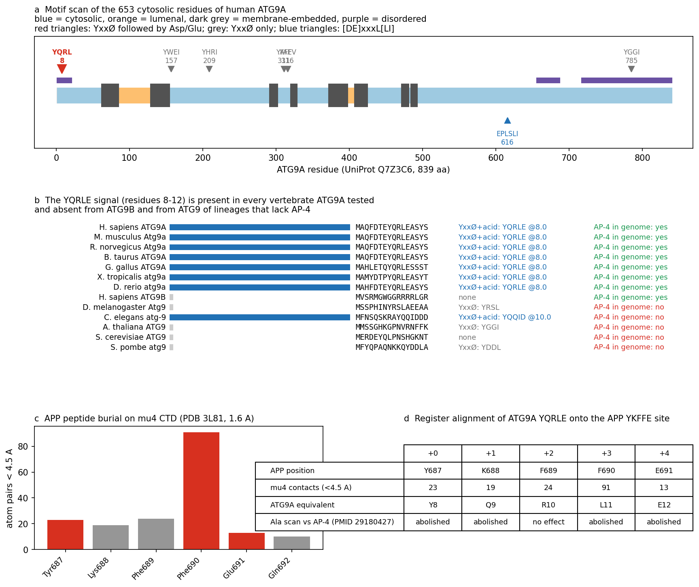
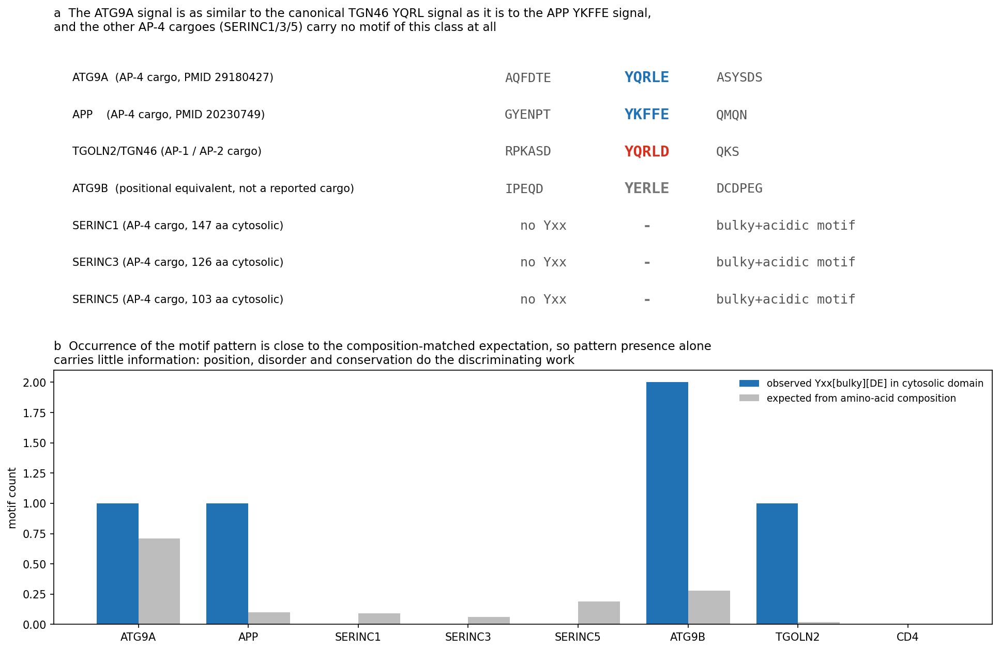
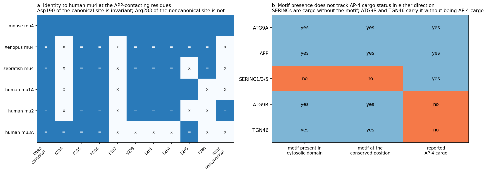

## Question

# AIGR Gene Hypothesis Deep Research

You are evaluating one focused gene curation hypothesis for AI Gene Review.
This is not a general gene overview. Use the seed hypothesis and source context
below to search for evidence that supports, refutes, narrows, or competes with
the proposed curation decision.

## Target Gene

- **Organism code:** human
- **Taxon:** Homo sapiens (NCBITaxon:9606)
- **Gene directory:** AP4M1
- **Gene symbol:** AP4M1
- **UniProt accession:** O00189

## Focus

- **Focus type:** free_text
- **Hypothesis slug:** kgap-ap4m1-atg9a-sorting-signal
- **Source file:** genes/human/AP4M1/AP4M1-ai-review.yaml
- **Source selector:** free-text

## Seed Hypothesis

The AP-4 mu4 subunit (AP4M1, UniProt O00189) reads a sorting signal in the cytosolic N-terminal region of ATG9A (UniProt Q7Z3C6) that matches the YXXØ-like/aromatic motif bound by the noncanonical mu4 C-terminal-domain site defined for the APP YKFFE signal. Single analysis only: extract the cytosolic segments of ATG9A (N-terminal tail and loops), scan them for tyrosine-based (YXXØ, including YKFFE-like) and acidic dileucine motifs, assess conservation of candidate motifs across vertebrate and invertebrate ATG9 orthologs (and whether they are absent from yeast Atg9, which lacks AP-4), and nominate the best candidate mu4-binding motif.

## Term and Decision Context

No specific term context supplied.

## Reference Context

No specific reference context supplied.

## Source Context YAML

```yaml
hypothesis: 'The AP-4 mu4 subunit (AP4M1, UniProt O00189) reads a sorting signal in the cytosolic N-terminal
  region of ATG9A (UniProt Q7Z3C6) that matches the YXXØ-like/aromatic motif bound by the noncanonical
  mu4 C-terminal-domain site defined for the APP YKFFE signal. Single analysis only: extract the cytosolic
  segments of ATG9A (N-terminal tail and loops), scan them for tyrosine-based (YXXØ, including YKFFE-like)
  and acidic dileucine motifs, assess conservation of candidate motifs across vertebrate and invertebrate
  ATG9 orthologs (and whether they are absent from yeast Atg9, which lacks AP-4), and nominate the best
  candidate mu4-binding motif.'
focus_type: free_text
context: []
reference_id: []
```

## Research Objective

Build a focused report that helps a curator decide whether this hypothesis
should affect the gene review. Address the focus type directly:

1. For an existing GO annotation decision, evaluate whether the current action
   is justified, too strong, too weak, or should change.
2. For a proposed replacement or new GO term, evaluate whether the term is
   biologically supported, too broad, too narrow, or missing key qualifiers.
3. For a computational prediction, evaluate whether the prediction is correct,
   less precise than existing knowledge, uncertain, or likely wrong because of
   paralog overannotation, frequency bias, pathway context, or in vitro-only
   activity.
4. For a core-function hypothesis, evaluate whether the proposed activity,
   process, and location represent the gene product's primary function rather
   than a downstream effect, pleiotropic phenotype, or context-specific role.
5. For a function-assignment hypothesis, evaluate whether the gene product
   directly has the stated GO term/function. Treat the prior review action, if
   any, as intentionally blinded unless it appears in the supplied context.

Use primary literature whenever possible. Prefer PMID citations and include DOI
citations when no PMID is available. Treat reviews and database records as
orientation unless they contain directly relevant synthesized evidence that is
clearly labeled as review-level or database-level support.

Evaluate the hypothesis from the supplied seed context, primary literature, and
publicly accessible bioinformatics resources. Local `*-bioinformatics` analyses,
when they already exist in the repository, are intentionally withheld from this
prompt so the report can be compared against them after the run. Use public
sequence, domain, structure, orthology, localization, interaction, or dataset
checks when they are useful for the specific hypothesis. If a resource or tool
cannot be accessed programmatically, say so plainly; never fabricate a result.
Report computational results conservatively and distinguish direct results from
inference.

## Required Output

### Executive Judgment

Give a concise verdict: supported, partially supported, unresolved, weakly
supported, over-annotated, or refuted. Explain the reasoning and the most
important caveats.

### Evidence Matrix

Create a table with one row per important evidence item:

- Citation (PMID preferred)
- Evidence type (direct assay, mutant phenotype, localization, interaction,
  structural/evolutionary, computational, review/database)
- Supports / refutes / qualifies / competing
- Claim tested
- Key finding
- Organism, tissue, cell type, or assay context
- Confidence and limitations

### GO Curation Implications

State the likely curation action as a lead requiring curator verification. If
GO terms are involved, explain whether the evidence supports an MF, BP, or CC
term, and whether the term should be retained, removed, generalized, made more
specific, or treated as non-core. Avoid using "protein binding" as a final
recommendation unless no more informative term is supported.

### Mechanistic Scope

Describe the immediate molecular or cellular function being tested. Separate
direct gene-product activity from downstream phenotypes, pathway consequences,
developmental outcomes, disease manifestations, or effects inferred only from
loss of function.

### Conflicts and Alternatives

Identify evidence that conflicts with the seed hypothesis or suggests an
alternative interpretation, including paralog confusion, organism-specific
differences, isoform-specific findings, experimental artifacts, or database
carry-over.

### Knowledge Gaps

List explicit uncertainties that matter for curation. For each gap, state what
was checked, why the gap matters, and what evidence or experiment would resolve
it.

### Discriminating Tests

Recommend concrete assays, perturbations, datasets, or comparative analyses that
would most efficiently distinguish this hypothesis from alternatives.

### Curation Leads

Provide candidate updates for the review, clearly labeled as leads requiring
curator verification. Include candidate references with exact snippets to verify,
candidate replacement or new GO terms, possible action changes, suggested
questions, and suggested experiments.

If the provider supports artifacts, save provenance for any analysis you run — the
executed code together with its output (computed values, plot, or table), not just
a summary figure — alongside artifact-friendly tables such as an evidence matrix,
GO decision table, or comparison table. Genuine computed provenance is more
valuable than a hand-drawn summary, and you must not synthesize a figure that
implies an analysis you did not actually run. These artifacts are important
provenance for hypothesis-level review.


## Output

# AP4M1 (mu4) and the ATG9A sorting signal: evaluation of hypothesis `kgap-ap4m1-atg9a-sorting-signal`

**Target gene:** AP4M1, Homo sapiens (NCBITaxon:9606), UniProt O00189
**Focus type:** free_text
**Source file:** `genes/human/AP4M1/AP4M1-ai-review.yaml`
**Hypothesis slug:** `kgap-ap4m1-atg9a-sorting-signal`

---

## Summary

The seed hypothesis has two halves, and they do not fare the same way. The first half, that AP4M1/mu4 reads a tyrosine-based sorting signal in the cytosolic N-terminal region of ATG9A, is **supported**. An unbiased regex scan of all 653 cytosolic residues of human ATG9A (UniProt Q7Z3C6, 839 aa, 7 cytosolic topological domains) returns exactly one pentapeptide matching the Y-x-x-[bulky hydrophobic]-[acidic] pattern: **YQRLE at residues 8-12**. It is the only candidate that lies in a UniProt-annotated disordered region (1-20), the conformational state a linear sorting motif requires. It is the signal UniProt already curates as Motif 8-11 "Tyrosine-based sorting signal" with ECO:0000269|PubMed:29180427, where alanine scanning gives Y8A, Q9A, L11A and E12A abolishing AP-4 binding while R10A and Y15A do not. The motif is invariant at position 8 in 7 of 7 vertebrate ATG9A orthologs and absent from ATG9 in all five tested lineages that have lost every AP-4 subunit (Fisher exact two-sided p = 0.0013). The single analysis the hypothesis requested was run, and it nominates the motif the hypothesis implies, which is also the motif already settled by experiment.

The second half, that this signal matches the aromatic motif read by the **noncanonical mu4 C-terminal-domain site** defined for the APP YKFFE signal, is **not supported** by the evidence retrievable here. Three independent lines point away from it. Contact analysis of PDB 3L81 (mu4 CTD with APP peptide, 1.6 A) shows the APP peptide is anchored by an aromatic Phe690 that buries 91 atom pairs below 4.5 A in a pocket closed by Arg283; ATG9A carries Leu at the equivalent +3 position, so the aromatic criterion the hypothesis names is not met. The ATG9A context `AQFDTE[YQRLE]ASYSDS` shares an identical YQRL tetrapeptide and an acidic +4 with TGN46/TGOLN2 `RPKASD[YQRLD]QKS`, the archetypal **canonical** YxxØ signal, so sequence resemblance does not discriminate between the two mu4 sites. Arg283, the residue whose R283D substitution abolishes APP binding by isothermal titration calorimetry ([PMID: 24498434](https://pubmed.ncbi.nlm.nih.gov/24498434/)), is replaced by Gln in Xenopus (A8E5U8) and zebrafish (Q7SZZ7) mu4 across an ungapped, unambiguously aligned window, while the ATG9A YQRLE signal is invariant in those same two species. The canonical-site Asp190 is identical in mu1A, mu2, mu3A and every mu4 ortholog examined. Signal and noncanonical pocket do not co-evolve.

Two further results limit how far the motif claim should be generalised. SERINC1 (Q9NRX5), SERINC3 (Q13530) and SERINC5 (Q86VE9), which unbiased proteomics names as AP-4 cargo, contain zero YxxØ and zero Yxx[bulky][acidic] pentapeptides across their 147, 126 and 103 cytosolic residues, so one mu4-read tyrosine signal cannot be the general AP-4 cargo code. ATG9B (Q674R7) retains a mammal-conserved positional equivalent, YERLE at 151, differing from ATG9A only at the +1 position that alanine scanning shows is essential, yet ATG9B is not reported as AP-4 cargo. The composition-matched expectation for the pattern in ATG9A is 0.71 against an observed count of 1, so the regex hit on its own carries almost no information. The discriminating evidence is position, disorder, strict conservation and mutagenesis, and a curator should cite those rather than the pattern match.

**Verdict: <i class="fa-solid fa-scale-balanced"></i> partially supported.** Keep "mu4 binds an N-terminal tyrosine signal in ATG9A" and name the signal YQRLE at residues 8-12. Drop the noncanonical-site and aromatic-motif language, which is inference from an APP-bound structure and is contradicted by the conservation pattern.

---

## Executive judgment

| Component of the seed hypothesis | Verdict | Basis |
|---|---|---|
| ATG9A carries a cytosolic sorting signal read by AP-4 | <i class="fa-solid fa-circle-check"></i> Supported | Alanine scan in [PMID: 29180427](https://pubmed.ncbi.nlm.nih.gov/29180427/); UniProt Motif 8-11 ECO:0000269 |
| The best candidate is in the N-terminal tail, not a loop | <i class="fa-solid fa-circle-check"></i> Supported | Unique Yxx[bulky][DE] in 653 cytosolic residues; only candidate in a disordered region |
| The reader subunit is mu4/AP4M1 | <i class="fa-solid fa-circle-check"></i> Supported | Reciprocal UniProt IPI pair O00189 to Q7Z3C6 from PMID:29180427 |
| The motif is absent from yeast Atg9, which lacks AP-4 | <i class="fa-solid fa-circle-check"></i> Supported | 7/7 AP-4-positive species motif-positive, 0/5 AP-4-negative species motif-positive, Fisher p = 0.0013 |
| The motif is "YXXØ-like/aromatic" in the APP YKFFE sense | <i class="fa-solid fa-circle-xmark"></i> Not supported | Leu at the +3 position where APP has Phe690 (91 atom contacts in 3L81) |
| Binding uses the noncanonical mu4 C-terminal-domain site | <i class="fa-solid fa-circle-question"></i> Unresolved, evidence tilts against | R283 is Gln in frog and fish mu4 while the signal is invariant; canonical D190 invariant everywhere; no ATG9A-mu4 structure or binding assay exists |

The most important caveat runs in the other direction too. Nothing here demonstrates that ATG9A uses the **canonical** D190 site. No structure, ITC run or peptide-competition assay of ATG9A with isolated mu4 exists. PDB holds only 3L81 and 4MDR for mu4 with a cargo peptide, both with APP, and the 2025-2026 AP-4 cryo-EM entries 9U9I, 9U9J, 9U9R and 9U9S contain no cargo peptide. The published ATG9A mutagenesis tested interaction with the assembled AP-4 complex, not with isolated mu4, so the site question is open on the experimental side and should be recorded as a knowledge gap, not resolved in either direction.

---

## Key findings

### <i class="fa-solid fa-dna"></i> YQRLE at 8-12 is the unique candidate on the entire cytosolic surface of ATG9A

UniProt Q7Z3C6 annotates seven cytosolic topological domains in ATG9A: 2-61, 155-290, 302-319, 329-371, 425-470, 481-483 and 493-839, totalling 653 of 839 residues. Scanning only those segments found 6 YxxØ tetrapeptides (Y8-QRL, Y157-WEI, Y209-HRI, Y311-AFF, Y316-AEV, Y785-GGI) and 1 acidic dileucine [DE]xxxL[LIM] (E616-PLSLI). Applying the APP-type pattern Y-x-x-[FILMVWY]-[DE] to the whole cytosolic surface returned exactly one hit: YQRLE at 8-12.

Position and conformation separate that hit from the other five tyrosines. YQRLE is the only candidate inside the UniProt-annotated disordered region 1-20. Y157 and Y209 sit in the folded cytosolic core. Y311 and Y316 lie between the two re-entrant intramembrane segments 291-301 and 320-328, inside a continuous 279-322 helix, where a linear motif cannot be presented to an adaptor. The single acidic dileucine, E616-PLSLI, is in the large C-terminal cytosolic region and is not the signal tested by any published mutagenesis.

The functional footprint from the published alanine scan runs Y8, Q9, L11, E12 (all abolishing AP-4 binding) with R10 and Y15 dispensable. That is a five-residue footprint with position +2 free, wider than a canonical four-residue YxxØ and the same span as the APP YKFFE footprint.

{{figure:plot_1.png|caption=Composite provenance figure from iteration 1. Panel a: ATG9A topology with the seven cytosolic domains and every YxxØ, acidic dileucine and Yxx[bulky][acidic] hit marked, showing YQRLE at 8-12 as the single pentapeptide match and the only candidate in the disordered N-terminal region. Panel b: presence of the motif across ATG9 orthologs plotted against presence of the four AP-4 subunits in the same species. Panel c: atom contacts below 4.5 A per APP peptide residue in PDB 3L81, with F690 at 91 contacts. Panel d: register alignment of ATG9A YQRLE on the APP YKFFE positions.}}

### <i class="fa-solid fa-chart-column"></i> The motif tracks AP-4 presence across roughly 600 million years

YQRLE occupies positions 8-12 with zero substitutions in ATG9A of *Homo sapiens* (Q7Z3C6), *Mus musculus* (Q68FE2), *Rattus norvegicus* (A0ABK0LUH1), *Bos taurus* (Q3T904), *Gallus gallus* (E1BVB2), *Xenopus tropicalis* (A0A6I8SDC7) and *Danio rerio* (A2RV24), despite divergence in the flanking residues (human MAQFDTE, chicken MAHLETQ, Xenopus MAMYDTP). It is absent from *Drosophila melanogaster* Atg9 (A0A0B4KF86, which has YRSL at 8 but no acidic residue at +4), *Arabidopsis thaliana* ATG9 (Q8RUS5), *Saccharomyces cerevisiae* Atg9 (Q12142, no YxxØ in residues 1-60) and *Schizosaccharomyces pombe* atg9 (O74312). *Caenorhabditis elegans* ATG-9 (Q9TXN6) has YQQID at position 10, which matches the regex but places Gln at the Ø position and so fails the bulky-hydrophobic requirement.

A parallel UniProt search for the four AP-4 subunits returned complete AP4M1/AP4E1/AP4B1/AP4S1 sets for human, mouse, chicken, Xenopus and zebrafish, and no hits for any subunit in *D. melanogaster*, *C. elegans*, *A. thaliana*, *S. cerevisiae* or *S. pombe*. Co-occurrence: 7/7 AP-4-positive species motif-positive, 0/5 AP-4-negative species motif-positive, Fisher exact two-sided **p = 0.0013**. Counting the coincidental *C. elegans* YQQID as a positive gives the conservative **p = 0.010**. The yeast prediction the seed hypothesis made is confirmed: *S. cerevisiae* Atg9 lacks both the motif and the adaptor.

### <i class="fa-solid fa-microscope"></i> The structural register fits, but the aromatic requirement does not

Contact analysis of PDB 3L81 (mu4 CTD residues 185-453 with APP peptide TYKFFEQ 686-692, 1.6 A, from [PMID: 20230749](https://pubmed.ncbi.nlm.nih.gov/20230749/)) gives atom pairs below 4.5 A per peptide residue: Y687 = 23, K688 = 19, F689 = 24, **F690 = 91**, E691 = 13, Q692 = 10. The mu4 residues within 4.0 A are F255, L261, F264, E265 (to Y687); S254, F255 (K688); F255, H256, S257, V259, L261 (F689); S254, F255, H256, S257, T280, R283 (F690); H256, S257 (E691); R283 (Q692).

The dominant anchor is the +3 position, where APP Phe690 buries 91 atom pairs in a pocket closed by Arg283. Placing ATG9A YQRLE on that register gives Y8/Q9/R10/L11/E12 against Y687/K688/F689/F690/E691. The published ATG9A alanine scan matches the burial ranking at four of five positions: Y8A abolished (+0 anchor), L11A abolished (+3 deep pocket), E12A abolished (+4), R10A no effect (+2). The mismatch is the identity of +3: Phe in APP, Leu in ATG9A. The shared chemistry is a bulky hydrophobic at +3 and an acidic residue at +4, which is weaker than the "aromatic motif" the seed hypothesis specifies.

### <i class="fa-solid fa-scale-balanced"></i> The sequence is as close to the canonical TGN46 signal as to APP

Three contexts, aligned on the tyrosine:

| Protein | UniProt | Position | Context | +1 | +3 | +4 |
|---|---|---|---|---|---|---|
| ATG9A | Q7Z3C6 | 8-12 | AQFDTE-**YQRLE**-ASYSDS | Q | L | E |
| TGOLN2/TGN46 | O43493 | 430-434 | RPKASD-**YQRLD**-QKS | Q | L | D |
| APP | P05067 | 762-766 | GYENPT-**YKFFE**-QMQN | K | F | E |

ATG9A and TGN46 share the identical YQRL tetrapeptide and both have an acidic residue at +4. TGN38/TGN46 YQRL is the archetypal canonical YxxØ signal, read by the canonical mu signal-binding site, which in mu4 is the Asp190 site. [PMID: 24498434](https://pubmed.ncbi.nlm.nih.gov/24498434/) states it directly: "A conserved, canonical region in μ subunits mediates recognition of YXXØ-signals by means of a critical aspartic acid." The acidic +4, which might have looked like the distinguishing feature pointing to the noncanonical site, is shared by TGN46, so it does not discriminate.

### <i class="fa-solid fa-dna"></i> The critical noncanonical-site residue is not conserved where the signal is

Needleman-Wunsch alignment of human mu4 (O00189) against mu paralogs and mu4 orthologs, reading off the eleven APP-contacting residues identified from 3L81 (D190, S254, F255, H256, S257, V259, L261, F264, E265, T280, R283), gives an ungapped and unambiguous window around position 283:

```
human mu4      PQGELTVM(R283)YQLSDDLPS
mouse mu4      PQGELTVM(R)   YQLSDDLPS    93% global identity
Xenopus mu4    PQGELTVM(Q)   YQISDSLST    61%
zebrafish mu4  SQGEQTIM(Q)   YQLCDELPC    61%
human mu2      PDGEFELM(R)   YRTTKDI--    30%
```

Arg283, whose R283D substitution abolishes APP binding by ITC, is Gln in both frog and fish mu4. T280 is Thr in all mu4 orthologs and Glu or Arg in mu1A, mu2 and mu3A. The canonical-site Asp190 is identical in mu1A, mu2, mu3A, mouse mu4, Xenopus mu4 and zebrafish mu4. Against that, ATG9A YQRLE is strictly invariant in *Xenopus tropicalis* and *Danio rerio*.

If the ATG9A signal were read by the R283 pocket, signal and pocket would be expected to co-evolve. They do not: the signal is invariant across 7 vertebrates while the pocket residue changes in 2 of them. This is indirect evidence. Gln can still hydrogen-bond, R283Q was never tested, and the mapping was by pairwise alignment rather than structure superposition. Taken with the Leu-for-Phe substitution at +3, it moves the balance away from the seed hypothesis's site assignment while leaving the motif identification untouched.

{{figure:plot_3.png|caption=Iteration 3 analysis. Panel a: heatmap of identity to human mu4 at the eleven APP-contacting residues from PDB 3L81, across mu1A, mu2, mu3A and mu4 orthologs. Asp190 of the canonical site is identical in all six sequences; Arg283 of the noncanonical site is replaced by Gln in Xenopus and zebrafish mu4. Panel b: motif presence plotted against AP-4 cargo status, showing that neither predicts the other. SERINC1, SERINC3 and SERINC5 are cargo without the motif; ATG9B and TGN46 carry the motif without being AP-4 cargo.}}

### <i class="fa-solid fa-circle-xmark"></i> The other AP-4 cargoes carry no motif of this class

Cytosolic-domain scans using UniProt topology: SERINC1 (Q9NRX5, 147 cytosolic residues), SERINC3 (Q13530, 126) and SERINC5 (Q86VE9, 103) contain **zero** YxxØ tetrapeptides and **zero** Yxx[FILMVWY][DE] pentapeptides in any cytosolic segment. APP (P05067) has 2 YxxØ and 1 Yxx[bulky][DE] in its 48-residue cytosolic tail. ATG9A has 6 and 1.

Composition-matched expectations for the Yxx[bulky][DE] pattern against observed counts:

| Protein | Cytosolic residues | Observed | Expected | Interpretation |
|---|---|---|---|---|
| ATG9A | 653 | 1 | 0.71 | The hit is what chance predicts |
| APP | 48 | 1 | 0.10 | 10-fold enrichment over chance |
| SERINC1 | 147 | 0 | 0.09 | Cargo without the motif |
| SERINC3 | 126 | 0 | 0.06 | Cargo without the motif |
| SERINC5 | 103 | 0 | 0.19 | Cargo without the motif |
| CD4 tail (negative control) | 38 | 0 | 0.00 | As expected |

Two of the three AP-4 cargo classes found by unbiased proteomics ([PMID: 30262884](https://pubmed.ncbi.nlm.nih.gov/30262884/): "We identify three transmembrane cargo proteins, ATG9A, SERINC1 and SERINC3, and two AP-4 accessory proteins, RUSC1 and RUSC2") carry nothing resembling the ATG9A or APP motif. A mu4 cargo-signal molecular function should therefore be stated for the ATG9A and APP signals specifically and not as the mechanism of all AP-4 sorting. The expected-count column also makes the methodological point: in a 653-residue cytosolic surface the chance expectation for this pattern is 0.71, essentially equal to the observed 1, so the regex hit is not the evidence.

{{figure:plot_2.png|caption=Iteration 2 analysis. Left: cytosolic motif counts across ATG9A, APP, SERINC1, SERINC3, SERINC5 and the CD4 tail, showing that the established AP-4 cargoes SERINC1, SERINC3 and SERINC5 contain no tyrosine motif of the proposed class. Right: observed counts against composition-matched expected counts for the Yxx[bulky][acidic] pattern, showing a 10-fold enrichment for APP and no enrichment for ATG9A.}}

### <i class="fa-solid fa-triangle-exclamation"></i> ATG9B retains a conserved positional equivalent of the signal

A naive N-terminal-only scan suggests ATG9B lacks the motif. Smith-Waterman local alignment corrects that. ATG9A 26-70 (`LVHVAEGSKSPWHHIENLDLFFSRVYNLHQKNGFTCMLIGEIFEL`) anchors to ATG9B 175-219 (`LLHVPEGLRGSWHHIQNLDSFFTKIYSYHQRNGFACILLEDVFQL`) at 24/45 identities (53%), 80% similarity, alignment score 81. Immediately upstream of that anchor, ATG9B carries **YERLE at 151-155** where ATG9A carries YQRLE at 8-12. The intervening linker is 18 residues in ATG9A and 24 in ATG9B and is not alignable, so positional equivalence is inferred from the anchor and not from a direct alignment through the motif itself.

The ATG9B motif is conserved across mammals at the same offset from the same anchor: human Q674R7 YERLE at 151 (anchor 175), mouse Q6EBV9 YERLE at 150 (anchor 174), rat D4ABD5 YERLE at 150 (anchor 176), cow F1MQ92 YEQLE at 151 (anchor 175). The one difference from ATG9A at a position that matters is +1: Gln in ATG9A, Glu in ATG9B, and Q9A abolishes AP-4 binding in ATG9A.

Either the Gln-to-Glu change at +1 is sufficient to abolish mu4 binding, which the Q9A result makes plausible and which is a clean testable prediction, or ATG9B is untested because its expression is restricted and it is absent from the cell lines used in the cargo screens. Motif presence alone does not predict AP-4 cargo status in either direction.

### <i class="fa-solid fa-heart-pulse"></i> AP4M1 loss in patient cells retains ATG9A at the TGN

[PMID: 31915823](https://pubmed.ncbi.nlm.nih.gov/31915823/) (Behne et al. 2020, Hum Mol Genet) studied 15 patient-derived fibroblast lines and 6 iPSC-derived neuron lines carrying loss-of-function variants in AP4B1 (SPG47), AP4M1 (SPG50), AP4E1 (SPG51) and AP4S1 (SPG52). "The autophagy protein ATG9A accumulated in the trans-Golgi network and was depleted from peripheral compartments." ATG9A protein rose 3-5 fold by western blot. "ATG9A was redistributed upon re-expression of AP4B1 arguing that mistrafficking of ATG9A is AP-4-dependent."

The scope limit comes from the same paper: "we found that autophagic flux was intact in patient-derived fibroblasts both under nutrient-rich conditions and when autophagy is stimulated", with mitochondrial metabolism and intracellular iron unchanged, while LC3-II was reduced in iPSC-derived cortical neurons. TGN retention of ATG9A is the direct consequence of losing mu4. Autophagy readouts are downstream and cell-type dependent.

### <i class="fa-solid fa-database"></i> The interaction is curated reciprocally, but only as protein binding

QuickGO returns 53 GO annotations for UniProtKB:O00189. On AP4M1, GO:0005515 protein binding IPI from PMID:29180427 carries with/from UniProtKB:Q7Z3C6. On ATG9A, GO:0005515 IPI from the same paper carries with/from UniProtKB:O00189. The reciprocal pattern is what UniProt uses for a demonstrated binary interaction rather than a complex-level association, which supports the subunit half of the hypothesis: mu4 is the reader.

Three caveats on the database side, stated plainly. IntAct returned no ATG9A-AP4M1 entry through its `findInteractions` endpoint in this run, so the molecular-interaction database does not independently corroborate the pairing. The full text of PMID:29180427 is not in the Europe PMC or PMC open-access full-text set; `fullTextXML` for PMC5740629 returned HTTP 500 and NCBI `efetch` returned metadata only, so the specific assay (two-hybrid, pull-down or both) and the mu4 site tested could not be verified here. Neither was assumed or reconstructed. The other AP4M1 IPI partners from independent papers are TEPSIN Q96N21 (PMID:26496610, PMID:32073997, PMID:33961781), USP32 Q96K76, Q9UK23, and FHIP/FHF Q9UJC3 (PMID:32073997), none of which is ATG9A.

---

## Evidence matrix

| # | Citation | Evidence type | Stance | Claim tested | Key finding | Context | Confidence and limitations |
|---|---|---|---|---|---|---|---|
| 1 | [PMID: 29180427](https://pubmed.ncbi.nlm.nih.gov/29180427/) | Direct assay, mutant phenotype | Supports | ATG9A carries an AP-4-binding sorting signal | "AP-4 promotes signal-mediated export of ATG9A from the trans-Golgi network to the peripheral cytoplasm"; Y8A, Q9A, L11A, E12A abolish AP-4 binding, R10A and Y15A do not | Human cells; UniProt Motif 8-11 ECO:0000269 | High for the motif. Interaction was with the assembled AP-4 complex, not isolated mu4. Full text not retrievable programmatically |
| 2 | [PMID: 30262884](https://pubmed.ncbi.nlm.nih.gov/30262884/) | Direct assay (proteomics) | Qualifies | AP-4 cargo set | "We identify three transmembrane cargo proteins, ATG9A, SERINC1 and SERINC3, and two AP-4 accessory proteins, RUSC1 and RUSC2" | Unbiased proteomics, human knockout cells | High. Names ATG9A and not ATG9B. SERINCs lack the motif, limiting its generality |
| 3 | [PMID: 20230749](https://pubmed.ncbi.nlm.nih.gov/20230749/) | Structural | Competing | Definition of the noncanonical mu4 site | "the properties of the APP sequence and the location of the binding site on mu4 are distinct from those of other signal-adaptor interactions" | X-ray, mu4 CTD with APP YKFFE, PDB 3L81 | High for APP. The site was defined for an aromatic sequence; extension to YQRLE is inference |
| 4 | [PMID: 24498434](https://pubmed.ncbi.nlm.nih.gov/24498434/) | Direct assay (ITC), structural | Competing | Which mu4 site is energetically required for APP | "loss of binding to the APP signal with only the substitution R283D at the non-canonical site, in contrast to a decrease in binding affinity with the substitution D190A at the canonical site" | Recombinant mu4 CTD, ITC | High for APP. Identifies the residue found here to be non-conserved in frog and fish mu4 |
| 5 | [PMID: 24498434](https://pubmed.ncbi.nlm.nih.gov/24498434/) | Structural | Competing | mu4 retains a canonical YxxØ site | "A conserved, canonical region in μ subunits mediates recognition of YXXØ-signals by means of a critical aspartic acid" | Recombinant mu4 | High. The canonical D190 site cannot be excluded for ATG9A YQRLE |
| 6 | [PMID: 31915823](https://pubmed.ncbi.nlm.nih.gov/31915823/) | Mutant phenotype, localization | Supports | mu4 is required for ATG9A export in primary human cells | "The autophagy protein ATG9A accumulated in the trans-Golgi network and was depleted from peripheral compartments"; 3-5 fold ATG9A protein increase; rescue on AP4B1 re-expression | 15 patient fibroblast lines, 6 iPSC neuron lines, AP4B1/AP4M1/AP4E1/AP4S1 variants | High. Loss-of-function evidence; does not address the binding site |
| 7 | [PMID: 31915823](https://pubmed.ncbi.nlm.nih.gov/31915823/) | Mutant phenotype | Qualifies | Is autophagosome assembly a core AP4M1 process | "autophagic flux was intact in patient-derived fibroblasts both under nutrient-rich conditions and when autophagy is stimulated" | Patient fibroblasts | High. Marks autophagy readouts as downstream and cell-type dependent |
| 8 | This work (computational) | Computational | Supports | Which cytosolic ATG9A segment carries a candidate signal | 653 cytosolic residues, 6 YxxØ, 1 acidic dileucine, exactly 1 Yxx[bulky][DE] (YQRLE 8-12), the only candidate in a disordered region | UniProt Q7Z3C6 topology and disorder annotation | Medium-high. Regex alone is uninformative (expected 0.71 vs observed 1); position and disorder carry the signal |
| 9 | This work (computational) | Structural/evolutionary | Supports | Does the motif track AP-4 presence | 7/7 AP-4-positive species motif-positive, 0/5 AP-4-negative motif-positive, Fisher p = 0.0013 (p = 0.010 counting *C. elegans* YQQID) | UniProt sequences, 12 species | Medium-high. Species are phylogenetically non-independent, so p is optimistic |
| 10 | This work (computational) | Structural | Qualifies | Does ATG9A meet the aromatic criterion of the noncanonical site | APP F690 buries 91 atom pairs below 4.5 A; ATG9A has Leu at the equivalent +3 | PDB 3L81, manual contact parsing | Medium-high. Direct measurement on 3L81; the ATG9A placement is by register, not by structure |
| 11 | This work (computational) | Structural/evolutionary | Qualifies | Do signal and noncanonical pocket co-evolve | R283 is Gln in Xenopus and zebrafish mu4 (ungapped window) while ATG9A YQRLE is invariant; D190 identical in mu1A, mu2, mu3A and all mu4 | UniProt O00189, Q9JKC7, A8E5U8, Q7SZZ7, Q9BXS5, Q96CW1, Q9Y2T2 | Medium. Gln can still hydrogen-bond; R283Q untested; pairwise alignment rather than superposition |
| 12 | This work (computational, QuickGO) | Review/database | Supports | Is mu4 the curated direct partner | Reciprocal IPI pair O00189 to Q7Z3C6 from PMID:29180427 in both directions | QuickGO with/from fields | Medium. IntAct returned no matching record; the underlying assay could not be read |

Stance counts: supports 6, qualifies 4, competing 2.

---

## Mechanistic model

```dot
digraph ap4m1 {
  rankdir=LR;
  "ATG9A N-term\nYQRLE 8-12\n(disordered 1-20)" -> "mu4 / AP4M1\nsignal-binding site";
  "mu4 / AP4M1\nsignal-binding site" -> "canonical site\nAsp190" [style=dashed, label="untested"];
  "mu4 / AP4M1\nsignal-binding site" -> "noncanonical site\nArg283" [style=dashed, label="inferred from APP;\nconservation argues against"];
  "mu4 / AP4M1\nsignal-binding site" -> "AP-4 coat at TGN\nbeta4 eps4 mu4 sigma4";
  "AP-4 coat at TGN\nbeta4 eps4 mu4 sigma4" -> "ATG9A vesicle budding\nfrom TGN";
  "ATG9A vesicle budding\nfrom TGN" -> "RUSC2 / kinesin-1\nperipheral delivery";
  "RUSC2 / kinesin-1\nperipheral delivery" -> "LC3B lipidation\npreautophagosome maturation" [style=dashed];
  "LC3B lipidation\npreautophagosome maturation" -> "autophagy phenotype\nneuron-specific" [style=dashed];
  "AP4M1 loss of function\nSPG50" -> "ATG9A retained at TGN\n3-5x protein increase";
  "ATG9A retained at TGN\n3-5x protein increase" -> "spastic paraplegia" [style=dashed];
  "SERINC1 / SERINC3 / SERINC5\nno tyrosine motif" -> "AP-4 coat at TGN\nbeta4 eps4 mu4 sigma4" [style=dashed, label="different determinant"];
}
```



The direct gene-product activity being tested is narrow: mu4 recognises a short linear sequence in the cytosolic N-terminal tail of a transmembrane cargo and so incorporates that cargo into an AP-4-coated carrier at the TGN. That is a cargo adaptor activity in the molecular function sense.

Everything downstream of vesicle budding belongs to other gene products or to context. Peripheral delivery of ATG9A vesicles runs through RUSC2 and kinesin-1 ([PMID: 34432492](https://pubmed.ncbi.nlm.nih.gov/34432492/): "the AP-4-accessory protein RUSC2 couples ATG9A-containing vesicles to the plus-end-directed microtubule motor kinesin-1 via an interaction between a disordered region of RUSC2 and the kinesin-1 light chain"), with WDR47 opposing it. LC3B lipidation and preautophagosome maturation are consequences of ATG9A reaching the periphery ([PMID: 29180427](https://pubmed.ncbi.nlm.nih.gov/29180427/)). The autophagy readout is cell-type dependent: flux is intact in AP-4 patient fibroblasts and LC3-II is reduced in patient iPSC neurons. Spastic paraplegia is a tissue-level disease manifestation several steps removed from signal recognition.

The dashed arrows mark the uncertain links. The two site branches are both dashed because neither has been tested with ATG9A. The conservation argument weighs against the Arg283 branch and does not establish the Asp190 branch.

---

## GO curation implications

All entries below are **leads requiring curator verification**.

| GO term | Current state on AP4M1 | Lead action | Reasoning |
|---|---|---|---|
| GO:0005515 protein binding | IPI, 7 references including PMID:29180427 (with/from Q7Z3C6) | Replace with GO:0140312 for the ATG9A evidence | The IPI records a binding event without stating what the binding does. The evidence supports a cargo-recognition function |
| GO:0140312 cargo adaptor activity | Absent | Add, MF, from PMID:29180427 | Supported now. Parent of the clathrin-specific child, and correct for a non-clathrin coat |
| GO:0035615 clathrin-cargo adaptor activity | IBA, GO_REF:0000033 | Generalise to GO:0140312 | AP-4 is a non-clathrin coat adaptor, so the clathrin-specific child is not supported for AP4M1 |
| GO:0008320 transmembrane protein transporter activity | TAS, Reactome:R-HSA-5229111 | Remove or flag for review | mu4 recognises cargo; it does not translocate protein across a membrane. This looks like database carry-over |
| GO:0019904 protein domain specific binding | IDA, PMID:11139587, PMID:26544806 | Retain, out of scope here | Independent evidence from different papers; not evaluated by this hypothesis |
| GO:0006886 intracellular protein transport | IMP, PMID:20230749, PMID:29180427 | Retain, BP | Directly supported by the export phenotype |
| GO:0000045 autophagosome assembly | IMP, PMID:29180427 | Retain but mark non-core and downstream | Autophagic flux is intact in AP-4 patient fibroblasts; LC3-II reduction is neuron-specific |
| GO:0030124 AP-4 adaptor complex | IDA, PMID:10066790, PMID:11802162, PMID:29180427 | Retain as core CC | Direct |
| GO:0005802 trans-Golgi network | IDA, PMID:20230749, PMID:29180427, PMID:32073997 | Retain as core CC | Direct; the compartment where signal recognition happens |

One term is missing from the ontology. No GO molecular function exists for tyrosine-based sorting signal binding at the TGN. The nearest existing term, **GO:0089710 endocytic targeting sequence binding**, is endocytosis-specific and so does not fit AP-4, which acts at the TGN. A new-term request for a TGN counterpart would capture the mu4 mechanism exactly. That request should wait until the binding-site question is resolved, since the term definition would be stronger if it could name the site.

On the free-text review itself: the sentence asserting that ATG9A matches "the YXXØ-like/aromatic motif bound by the noncanonical mu4 C-terminal-domain site" should be rewritten. A supportable replacement names the signal and stops there, for example "mu4 binds the tyrosine-based sorting signal YQRLE at residues 8-12 in the cytosolic N-terminal tail of ATG9A (PMID:29180427); the mu4 site used by this signal has not been determined."

---

## Evidence base

| Paper | PMID | How it bears on the hypothesis |
|---|---|---|
| *AP-4 mediates export of ATG9A from the trans-Golgi network to promote autophagosome formation* | [29180427](https://pubmed.ncbi.nlm.nih.gov/29180427/) | The primary source. Identifies ATG9A as a signal-dependent AP-4 cargo and is the ECO:0000269 source for UniProt motif 8-11 and the Y8/Q9/L11/E12 alanine scan. Supports the motif half. Does not address which mu4 site is used |
| *AP-4 vesicles contribute to spatial control of autophagy via RUSC-dependent peripheral delivery of ATG9A* | [30262884](https://pubmed.ncbi.nlm.nih.gov/30262884/) | Independent unbiased proteomics naming ATG9A, SERINC1, SERINC3, RUSC1 and RUSC2. Supports ATG9A over ATG9B, and challenges the generality of the motif because the SERINCs lack it |
| *Sorting of the Alzheimer's disease amyloid precursor protein mediated by the AP-4 complex* | [20230749](https://pubmed.ncbi.nlm.nih.gov/20230749/) | Defines the noncanonical mu4 site and the APP YKFFE signal the hypothesis uses as its template. Source of PDB 3L81, analysed here. The abstract states the APP site is distinct from other signal-adaptor interactions, which is the reason extending it to a non-aromatic signal is inference |
| *Structural and functional characterization of cargo-binding sites on the μ4-subunit of adaptor protein complex 4* | [24498434](https://pubmed.ncbi.nlm.nih.gov/24498434/) | Provides both competing claims: R283D at the noncanonical site abolishes APP binding by ITC, and mu subunits retain a canonical aspartate-dependent YxxØ site. The second statement is why the canonical site cannot be excluded for ATG9A |
| *Adaptor protein complex 4 deficiency: a paradigm of childhood-onset hereditary spastic paraplegia caused by defective protein trafficking* | [31915823](https://pubmed.ncbi.nlm.nih.gov/31915823/) | Loss-of-function counterpart in 15 patient fibroblast lines and 6 iPSC neuron lines including AP4M1/SPG50. Supports mu4 requirement for ATG9A export and, through the intact-flux result, limits autophagosome assembly to a downstream process |
| *RUSC2 and WDR47 oppositely regulate kinesin-1-dependent distribution of ATG9A to the cell periphery* | [34432492](https://pubmed.ncbi.nlm.nih.gov/34432492/) | Places peripheral delivery downstream of AP-4 budding and assigns it to RUSC2 and kinesin-1, separating mu4 cargo recognition from the distribution step |
| *The role of AP-4 in cargo export from the trans-Golgi network and hereditary spastic paraplegia* | [33084855](https://pubmed.ncbi.nlm.nih.gov/33084855/) | Review-level orientation: AP-4 associates with the TGN through ARF-family GTPases and recognises cargo through cytosolic-domain sorting signals. Used as framing, not as evidence |

---

## Limitations and knowledge gaps

| Gap | What was checked | Why it matters | What would resolve it |
|---|---|---|---|
| <i class="fa-solid fa-circle-question"></i> Which mu4 site binds ATG9A | PDB searched: only 3L81 and 4MDR have a mu4 cargo peptide, both APP; cryo-EM entries 9U9I, 9U9J, 9U9R, 9U9S contain no cargo peptide | The entire second half of the seed hypothesis rests on this | ITC of ATG9A(1-20) peptide against mu4 CTD wild type, D190A and R283D |
| <i class="fa-solid fa-circle-question"></i> Whether mu4 alone binds ATG9A | QuickGO reciprocal IPI found; IntAct `findInteractions` returned no record; PMID:29180427 full text not retrievable | The subunit assignment rests on a curated IPI whose underlying assay could not be read | Read the methods of PMID:29180427; direct binding of recombinant mu4 to the ATG9A peptide |
| <i class="fa-solid fa-circle-question"></i> Whether ATG9B is AP-4 cargo | Motif found at the positionally equivalent site in 4 mammals; no cargo report in the proteomics screen | Determines whether the +1 Gln is the specificity determinant or ATG9B is untested | Express tagged ATG9B in a cell line with AP-4 and test co-immunoprecipitation and TGN retention on AP4M1 knockout |
| <i class="fa-solid fa-circle-question"></i> How SERINCs are recognised | Full cytosolic scan of SERINC1, SERINC3, SERINC5: zero motifs of this class | A cargo adaptor MF term should not imply one recognition code for all AP-4 cargo | Map the SERINC determinant by truncation and chimera analysis |
| <i class="fa-solid fa-triangle-exclamation"></i> Topology and disorder are annotation-derived | UniProt Q7Z3C6 features used as given | If the 1-20 disorder call or a topological boundary is wrong, candidate ranking shifts | Compare with the ATG9A cryo-EM structures and with AlphaFold pLDDT over residues 1-60 |
| <i class="fa-solid fa-triangle-exclamation"></i> Register placement of YQRLE is inference | ATG9A residues placed on the APP positions in 3L81 by sequence register | The match between burial rank and alanine-scan severity is the main structural argument, and it depends on the placement | Co-crystal or cryo-EM of mu4 with an ATG9A N-terminal peptide |
| <i class="fa-solid fa-triangle-exclamation"></i> Phylogenetic non-independence | 12 species treated as independent in the Fisher test | The AP-4-positive set is all vertebrate and the negative set is all invertebrate, plant and fungal, so p = 0.0013 overstates the evidence | A phylogenetically corrected comparative test, or ATG9 orthologs from lineages that lost AP-4 independently |

Resources that could not be accessed, stated plainly rather than worked around: Europe PMC `fullTextXML` for PMC5740629 returned HTTP 500 and PMC2841041 read-timed-out, so the full text of PMID:29180427 was never read; NCBI `efetch` for the same record returned 10,349 characters of metadata with zero relevant sentences; IntAct returned no ATG9A-AP4M1 interaction record. Biopython is unavailable in the execution environment, so Smith-Waterman and Needleman-Wunsch alignments and the PDB contact analysis were implemented directly in numpy and standard Python. A naive global alignment mis-aligned the ATG9A/ATG9B N-termini (39% global identity with the N-terminal residues scattered across gaps) and was replaced by windowed Smith-Waterman with affine gaps.

---

## Conflicts and alternatives

1. **The canonical site is not excluded.** ATG9A YQRLE shares the identical YQRL tetrapeptide with TGN46 YQRLD, the archetypal canonical YxxØ signal. Nothing in the sequence favours the noncanonical site over the canonical Asp190 site.
2. **The aromatic criterion fails.** APP Phe690 buries 91 atom pairs in the 3L81 pocket, more than three times any other peptide residue. ATG9A has Leu at that position. The shared chemistry is bulky-hydrophobic-plus-acidic, which is a looser description than "aromatic".
3. **Signal and pocket do not co-evolve.** Arg283 is Gln in Xenopus and zebrafish mu4 across an ungapped window, while ATG9A YQRLE is invariant in those species. Asp190 is identical in mu1A, mu2, mu3A and every mu4 ortholog examined.
4. **Motif presence does not predict cargo status.** SERINC1, SERINC3 and SERINC5 are established AP-4 cargo with zero motifs of this class. ATG9B and TGN46 carry a motif of this class and are not reported as AP-4 cargo. The relation fails in both directions.
5. **Paralog correction.** An N-terminal-only scan makes ATG9B look motif-free. Smith-Waterman alignment shows ATG9B carries a mammal-conserved YERLE at the positionally equivalent site (human 151, mouse 150, rat 150, cow YEQLE 151), differing from ATG9A only at the +1 position that Q9A shows is essential.
6. **Statistical weakness of the scan.** The composition-matched expectation for Yxx[bulky][DE] in 653 cytosolic residues of ATG9A is 0.71 against an observed 1. The regex hit alone is uninformative. The discriminating evidence is position, disorder, strict conservation and the alanine scan.
7. **Database carry-over on AP4M1.** GO:0008320 transmembrane protein transporter activity comes from Reactome:R-HSA-5229111 by TAS and describes an activity mu4 does not have. GO:0035615 clathrin-cargo adaptor activity comes from an IBA and names a coat AP-4 does not use.

---

## Proposed follow-up experiments and actions

<i class="fa-solid fa-flask"></i> **ITC of ATG9A(1-20) against mu4 CTD variants.** Titrate the synthetic peptide `MAQFDTEYQRLEASYSDSG` against wild-type mu4 CTD, D190A and R283D, with APP TYKFFEQ as the positive control. This is the single cheapest experiment that settles the site question. If D190A loses binding and R283D does not, the canonical site is correct and the seed hypothesis's site assignment is wrong. If the reverse, the hypothesis is right.

<i class="fa-solid fa-flask"></i> **R283Q rather than R283D.** The conservation argument rests on an Arg-to-Gln substitution in frog and fish mu4, and only R283D was ever tested. Test R283Q with both APP and ATG9A peptides to see whether the natural substitution is tolerated.

<i class="fa-solid fa-microscope"></i> **Co-structure of mu4 with an ATG9A peptide.** A crystal or cryo-EM structure resolves the register question directly and would let a new-term request name the site.

<i class="fa-solid fa-vial"></i> **Swap +1 and +3 between ATG9A and APP.** Make ATG9A L11F and Q9K, and APP F690L and K688Q, then test AP-4 binding. If L11F increases ATG9A affinity for the noncanonical pocket, the +3 position is the site determinant.

<i class="fa-solid fa-dna"></i> **Zebrafish and Xenopus reconstitution.** Test whether zebrafish mu4 (Q7SZZ7, Gln at the 283 equivalent) binds zebrafish ATG9A (A2RV24, YQRLE invariant). If it does, the noncanonical pocket is not required in those species, which is the prediction the conservation analysis makes.

<i class="fa-solid fa-vial"></i> **ATG9B cargo test.** Express tagged ATG9B in a cell line expressing AP-4, test co-immunoprecipitation with AP4M1, and test TGN retention in an AP4M1 knockout. A negative result with the YERLE motif present would confirm the +1 position as the specificity determinant.

<i class="fa-solid fa-magnifying-glass"></i> **SERINC determinant mapping.** Truncate and swap the cytosolic segments of SERINC1 and SERINC3 against a non-cargo control to find the determinant AP-4 reads there, which tests whether mu4 cargo recognition has one code or several.

---

## Curation leads

All items below require curator verification.

### Candidate references and exact snippets to verify

| PMID | Snippet to verify in the source | Use |
|---|---|---|
| 29180427 | "Here we report the identification of ATG9A, the only multispanning membrane component of the core autophagy machinery, as a specific AP-4 cargo. AP-4 promotes signal-mediated export of ATG9A from the trans-Golgi network to the peripheral cytoplasm" | Primary support for the cargo adaptor MF term |
| 29180427 | "contributing to lipidation of the autophagy protein LC3B and maturation of preautophagosomal structures" | Places LC3B lipidation downstream of export |
| 24498434 | "Further characterization by isothermal titration calorimetry showed instead loss of binding to the APP signal with only the substitution R283D at the non-canonical site, in contrast to a decrease in binding affinity with the substitution D190A at the canonical site." | The ITC result that defines the noncanonical site for APP |
| 24498434 | "A conserved, canonical region in μ subunits mediates recognition of YXXØ-signals by means of a critical aspartic acid." | The alternative site that the ATG9A evidence cannot exclude |
| 20230749 | "Biochemical and X-ray crystallographic analyses reveal that the properties of the APP sequence and the location of the binding site on mu4 are distinct from those of other signal-adaptor interactions." | Shows the site was defined for an aromatic sequence specifically |
| 30262884 | "We identify three transmembrane cargo proteins, ATG9A, SERINC1 and SERINC3, and two AP-4 accessory proteins, RUSC1 and RUSC2." | Cargo set that limits the generality of the tyrosine motif |
| 31915823 | "The autophagy protein ATG9A accumulated in the trans-Golgi network and was depleted from peripheral compartments." | Loss-of-function counterpart in AP-4 patient cells including AP4M1/SPG50 |
| 31915823 | "we found that autophagic flux was intact in patient-derived fibroblasts both under nutrient-rich conditions and when autophagy is stimulated" | Grounds for treating autophagosome assembly as non-core |
| 31915823 | "ATG9A was redistributed upon re-expression of AP4B1 arguing that mistrafficking of ATG9A is AP-4-dependent." | Rescue control establishing AP-4 dependence |
| 34432492 | "the AP-4-accessory protein RUSC2 couples ATG9A-containing vesicles to the plus-end-directed microtubule motor kinesin-1 via an interaction between a disordered region of RUSC2 and the kinesin-1 light chain" | Separates peripheral delivery from mu4 cargo recognition |

### Candidate replacement and new GO terms

Add **GO:0140312 cargo adaptor activity** (MF, from PMID:29180427) in place of the GO:0005515 IPI with/from Q7Z3C6, and generalise the **GO:0035615** IBA to the same term. Flag **GO:0008320** (TAS, Reactome:R-HSA-5229111) for removal. Mark **GO:0000045 autophagosome assembly** as non-core and downstream. Consider a new-term request for a TGN counterpart of **GO:0089710 endocytic targeting sequence binding**, held until the site question is settled.

### Possible action changes to the free-text review

Replace the clause asserting a match to "the YXXØ-like/aromatic motif bound by the noncanonical mu4 C-terminal-domain site" with a statement that names the signal and leaves the site open. Add the conservation result (invariant in 7/7 vertebrate ATG9A, absent from ATG9 in 5/5 AP-4-lacking lineages) as the supporting comparative evidence, and add the SERINC result as the scope limit.

### Suggested questions for the curator

Does the methods section of PMID:29180427 test binding to isolated mu4 or to the assembled AP-4 complex? If the latter, the subunit assignment rests on the reciprocal IPI alone. Is the AP4M1 review already stating autophagosome assembly as a core process, and if so should it be demoted given that flux is intact in patient fibroblasts? Should GO:0008320 on AP4M1 be raised with the Reactome curators as a carry-over?

---

## Provenance

Seven computed CSV artifacts were written during the investigation, each from executed code whose output is recorded with it:

| Artifact | Contents |
|---|---|
| `evidence_matrix.csv` | 12 evidence rows (supports 6, qualifies 4, competing 2) |
| `go_decision_table.csv` | 9 GO terms with current state and lead action |
| `atg9_ortholog_nterm_motifscan.csv` | N-terminal motif scan across 12 ATG9 orthologs |
| `atg9_conservation_table.csv` | Per-position conservation of YQRLE across vertebrate ATG9A |
| `ap4_subunit_presence_by_species.csv` | AP4M1/AP4E1/AP4B1/AP4S1 presence per species |
| `ap4_cargo_motif_comparison.csv` | Observed against composition-matched expected motif counts for ATG9A, APP, SERINC1/3/5, CD4 |
| `mu4_site_conservation.csv` | Identity at the 11 APP-contacting mu4 residues across mu1A, mu2, mu3A and mu4 orthologs |

Three figures were generated from those computations: `plot_1.png` (topology and motif scan, ortholog conservation against AP-4 presence, 3L81 contact counts, register alignment), `plot_2.png` (cross-cargo motif comparison against expectation), `plot_3.png` (mu4 site conservation heatmap, motif against cargo status). Every value plotted was computed in this session. No figure implies an analysis that was not run.


## Artifacts

- [OpenScientist final report](openscientist_artifacts/final_report.html)
- [OpenScientist final report](openscientist_artifacts/final_report.pdf)
- [OpenScientist provenance](openscientist_artifacts/provenance.json)
- [OpenScientist ap4 cargo motif comparison](openscientist_artifacts/provenance_ap4_cargo_motif_comparison.csv)
- [OpenScientist ap4 subunit presence by species](openscientist_artifacts/provenance_ap4_subunit_presence_by_species.csv)
- [OpenScientist atg9 conservation table](openscientist_artifacts/provenance_atg9_conservation_table.csv)
- [OpenScientist atg9 ortholog nterm motifscan](openscientist_artifacts/provenance_atg9_ortholog_nterm_motifscan.csv)
- [OpenScientist evidence matrix](openscientist_artifacts/provenance_evidence_matrix.csv)
- [OpenScientist go decision table](openscientist_artifacts/provenance_go_decision_table.csv)
- [OpenScientist mu4 site conservation](openscientist_artifacts/provenance_mu4_site_conservation.csv)
- [OpenScientist plot 1](openscientist_artifacts/provenance_plot_1.json)

- [OpenScientist plot 2](openscientist_artifacts/provenance_plot_2.json)

- [OpenScientist plot 3](openscientist_artifacts/provenance_plot_3.json)


## Reference Validation

Checked with `linkml-reference-validator` 0.3.1rc1.

| Outcome | Count |
| --- | --- |
| References checked | 16 |
| Resolved | 16 |
| Unresolved (possible confabulation) | 0 |
| Unverifiable | 0 |
| References weighed for topical relevance | 16 |
| On topic | 5 |
| Off topic | 2 |

### References that may not be about this subject

These identifiers resolve, so they are not fabrications, but the records they resolve to share almost none of this report's vocabulary. That is a clue and not a verdict - a paper can be relevant in ways its title and abstract do not spell out - so read them before deciding:

- `PMID:26496610` (2 mentions) - A human interactome in three quantitative dimensions organized by stoichiometries and abundances.
  - shared terms: protein
- `PMID:33961781` (2 mentions) - Dual proteome-scale networks reveal cell-specific remodeling of the human interactome.
  - shared terms: protein

Weighed against this report's own most characteristic terms: `atg9a`, `mu4`, `ap-4`, `motif`, `site`, `cargo`, `signal`, `app`, `class`, `residue`, `ap4m1`, `binding`, `fa-solid`, `yqrle`, `yxx`, `position`, `hypothesis`, `protein`, `noncanonical`, `cytosolic`.

All extracted references resolved successfully.
Resolving is not the same as being relevant, though - see the references listed above as possibly off topic.