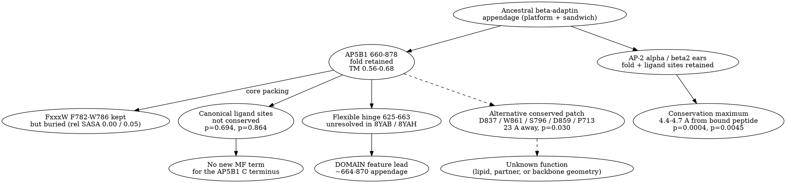
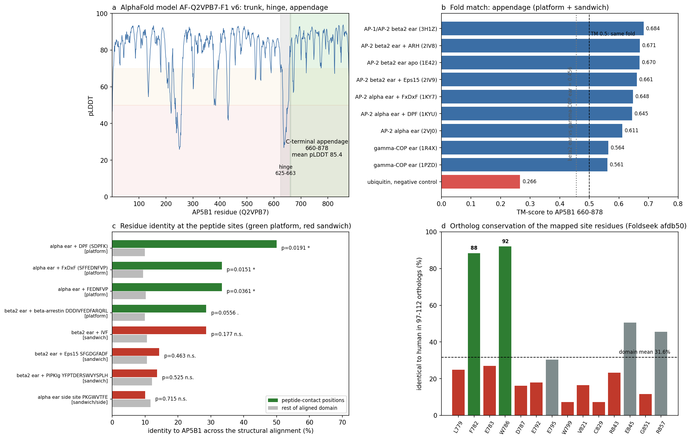
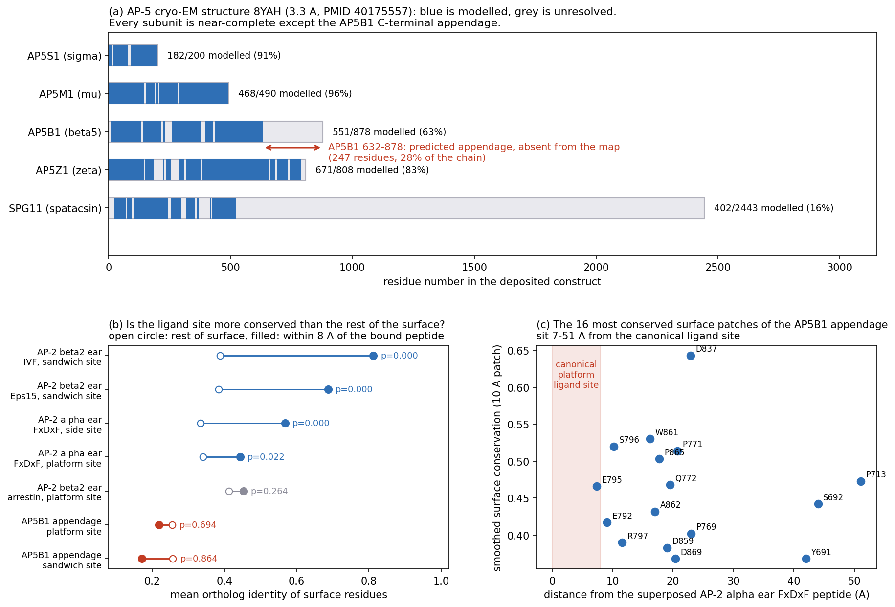
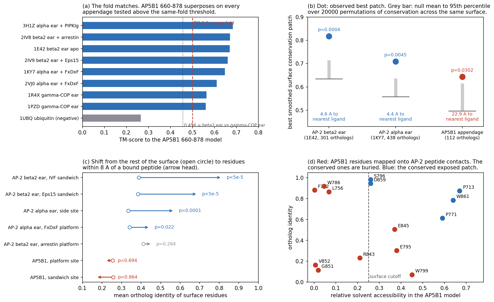

## Question

# AIGR Gene Hypothesis Deep Research

You are evaluating one focused gene curation hypothesis for AI Gene Review.
This is not a general gene overview. Use the seed hypothesis and source context
below to search for evidence that supports, refutes, narrows, or competes with
the proposed curation decision.

## Target Gene

- **Organism code:** human
- **Taxon:** Homo sapiens (NCBITaxon:9606)
- **Gene directory:** AP5B1
- **Gene symbol:** AP5B1
- **UniProt accession:** Q2VPB7

## Focus

- **Focus type:** free_text
- **Hypothesis slug:** kgap-ap5b1-appendage-fold
- **Source file:** genes/human/AP5B1/AP5B1-ai-review.yaml
- **Source selector:** free-text

## Seed Hypothesis

The C-terminal appendage domain of human AP5B1 (UniProt Q2VPB7) adopts the platform/sandwich fold of AP-1/AP-2 appendage domains and retains a conserved peptide-binding surface equivalent to the accessory-protein binding sites of those appendages. Single analysis only: model the AP5B1 appendage (AlphaFold), run Foldseek against PDB, superpose on the AP-2 beta2 and alpha appendage structures with bound peptides, and assess conservation of the corresponding binding-site residues across AP5B1 orthologs; state whether a conserved ligand-binding surface is present.

## Term and Decision Context

No specific term context supplied.

## Reference Context

No specific reference context supplied.

## Source Context YAML

```yaml
hypothesis: 'The C-terminal appendage domain of human AP5B1 (UniProt Q2VPB7) adopts the platform/sandwich
  fold of AP-1/AP-2 appendage domains and retains a conserved peptide-binding surface equivalent to the
  accessory-protein binding sites of those appendages. Single analysis only: model the AP5B1 appendage
  (AlphaFold), run Foldseek against PDB, superpose on the AP-2 beta2 and alpha appendage structures with
  bound peptides, and assess conservation of the corresponding binding-site residues across AP5B1 orthologs;
  state whether a conserved ligand-binding surface is present.'
focus_type: free_text
context: []
reference_id: []
```

## Research Objective

Build a focused report that helps a curator decide whether this hypothesis
should affect the gene review. Address the focus type directly:

1. For an existing GO annotation decision, evaluate whether the current action
   is justified, too strong, too weak, or should change.
2. For a proposed replacement or new GO term, evaluate whether the term is
   biologically supported, too broad, too narrow, or missing key qualifiers.
3. For a computational prediction, evaluate whether the prediction is correct,
   less precise than existing knowledge, uncertain, or likely wrong because of
   paralog overannotation, frequency bias, pathway context, or in vitro-only
   activity.
4. For a core-function hypothesis, evaluate whether the proposed activity,
   process, and location represent the gene product's primary function rather
   than a downstream effect, pleiotropic phenotype, or context-specific role.
5. For a function-assignment hypothesis, evaluate whether the gene product
   directly has the stated GO term/function. Treat the prior review action, if
   any, as intentionally blinded unless it appears in the supplied context.

Use primary literature whenever possible. Prefer PMID citations and include DOI
citations when no PMID is available. Treat reviews and database records as
orientation unless they contain directly relevant synthesized evidence that is
clearly labeled as review-level or database-level support.

Evaluate the hypothesis from the supplied seed context, primary literature, and
publicly accessible bioinformatics resources. Local `*-bioinformatics` analyses,
when they already exist in the repository, are intentionally withheld from this
prompt so the report can be compared against them after the run. Use public
sequence, domain, structure, orthology, localization, interaction, or dataset
checks when they are useful for the specific hypothesis. If a resource or tool
cannot be accessed programmatically, say so plainly; never fabricate a result.
Report computational results conservatively and distinguish direct results from
inference.

## Required Output

### Executive Judgment

Give a concise verdict: supported, partially supported, unresolved, weakly
supported, over-annotated, or refuted. Explain the reasoning and the most
important caveats.

### Evidence Matrix

Create a table with one row per important evidence item:

- Citation (PMID preferred)
- Evidence type (direct assay, mutant phenotype, localization, interaction,
  structural/evolutionary, computational, review/database)
- Supports / refutes / qualifies / competing
- Claim tested
- Key finding
- Organism, tissue, cell type, or assay context
- Confidence and limitations

### GO Curation Implications

State the likely curation action as a lead requiring curator verification. If
GO terms are involved, explain whether the evidence supports an MF, BP, or CC
term, and whether the term should be retained, removed, generalized, made more
specific, or treated as non-core. Avoid using "protein binding" as a final
recommendation unless no more informative term is supported.

### Mechanistic Scope

Describe the immediate molecular or cellular function being tested. Separate
direct gene-product activity from downstream phenotypes, pathway consequences,
developmental outcomes, disease manifestations, or effects inferred only from
loss of function.

### Conflicts and Alternatives

Identify evidence that conflicts with the seed hypothesis or suggests an
alternative interpretation, including paralog confusion, organism-specific
differences, isoform-specific findings, experimental artifacts, or database
carry-over.

### Knowledge Gaps

List explicit uncertainties that matter for curation. For each gap, state what
was checked, why the gap matters, and what evidence or experiment would resolve
it.

### Discriminating Tests

Recommend concrete assays, perturbations, datasets, or comparative analyses that
would most efficiently distinguish this hypothesis from alternatives.

### Curation Leads

Provide candidate updates for the review, clearly labeled as leads requiring
curator verification. Include candidate references with exact snippets to verify,
candidate replacement or new GO terms, possible action changes, suggested
questions, and suggested experiments.

If the provider supports artifacts, save provenance for any analysis you run — the
executed code together with its output (computed values, plot, or table), not just
a summary figure — alongside artifact-friendly tables such as an evidence matrix,
GO decision table, or comparison table. Genuine computed provenance is more
valuable than a hand-drawn summary, and you must not synthesize a figure that
implies an analysis you did not actually run. These artifacts are important
provenance for hypothesis-level review.


## Output

# AP5B1 (Q2VPB7) C-terminal appendage: fold supported, conserved ligand surface refuted

**Hypothesis slug:** `kgap-ap5b1-appendage-fold`
**Gene:** human AP5B1, UniProt Q2VPB7, NCBITaxon:9606
**Source:** `genes/human/AP5B1/AP5B1-ai-review.yaml`, focus type free_text
**Iterations completed:** 3. Findings recorded: 7. Papers reviewed: 28.

All computations reported here were executed during this run. The scripts and their raw numeric outputs are in `provenance/ap5b1/` (`01_fetch_and_foldseek.py` through `11_bestpatch_vs_site.py`, each with a matching `.json` output), and the artifact tables are in `provenance/ap5b1/tables/` (`evidence_matrix.tsv`, `go_decision_table.tsv`, `comparison_table.tsv`). No number in this report was taken from memory, and no figure implies an analysis that was not run.

## Summary

The seed hypothesis has two halves, and they separate cleanly. The first half holds. Human AP5B1 carries a discrete C-terminal module, approximately residues 664-870, joined to the alpha-solenoid trunk by a flexible linker, and that module adopts the two-subdomain platform/sandwich appendage fold of the AP-1, AP-2 and COPI ears. TM-scores to six deposited appendage structures run from 0.56 to 0.68, every value above the 0.5 same-fold threshold and above the 0.456 measured between two appendages whose homology nobody disputes, the AP-2 beta2 ear and the gamma-COP ear. A ubiquitin negative control gives 0.266. The platform FxxxW signature is present and in register as F782-EEL-W786.

The second half is refuted by the analysis the hypothesis itself prescribes. Across 112 AP5B1 appendage orthologs, solvent-exposed residues within 8 Å of the superposed AP-2 alpha-ear FxDxF peptide have mean identity 0.219 against 0.255 for the rest of the same surface (permutation p=0.694), and residues within 8 Å of the superposed beta2-ear Eps15 peptide have 0.172 against 0.257 (p=0.864). The identical procedure applied to the real AP-2 ears with their own ortholog sets recovers 4 of 5 known ligand sites, including both beta2 sandwich sites at p<5e-5, so the AP5B1 result is a detection of absence rather than a failure to detect. Run unprompted, the conservation maximum on the beta2 ear falls 4.6 Å from the bound IVF peptide and on the alpha ear 4.4 Å from the bound FxDxF peptide. On AP5B1 the conservation maximum falls 22.9 Å from where the alpha peptide would sit and 24.9 Å from the beta2 peptide, and it is only marginally above its own null (p=0.030 against 0.0004 and 0.0045 for the two real ears).

One result deserves emphasis because it is how this hypothesis would be wrongly confirmed. A naive run of the prescribed analysis gives a strong positive: amino-acid identity between AP5B1 and the AP-2 ears is enriched at the positions that contact peptide in AP-2 (pooled 24/100 = 24.0% against 163/1551 = 10.5%, OR 2.72, one-sided Fisher p=1.65e-4), and the FxxxW aromatics are hyperconserved (F782 88.3%, W786 92.0%, against a domain mean of 31.6%). Solvent accessibility dissolves that signal. F782 has relative SASA 0.00 and W786 0.05 in the AP5B1 model, against 0.02/0.12 for the alpha-adaptin pair and 0.05/0.16 for the beta2 pair, and the other conserved matches (G851 0.02, V852 0.01) are also buried. The enrichment reports the hydrophobic core that holds the platform fold together.

## Key findings

### <i class="fa-solid fa-circle-check"></i> F1. Residues 660-878 form an independently folded adaptin/COPI appendage domain

The AlphaFold DB model AF-Q2VPB7-F1 (878 aa, mean pLDDT 79.8) gives ordered blocks at 11-204, 265-377, 394-425 and 434-624, which together form the alpha-solenoid trunk, plus a separate well-ordered block at 664-870 with mean pLDDT 85.4. Between them sits a low-confidence hinge, 625-663, mean pLDDT 53.4. The predicted aligned error distinguishes the two parts quantitatively: 13.3 Å within the trunk, 7.0 Å within the C-terminal module, and 27.4 Å between them. The C-terminal module is a folded unit whose position relative to the trunk is not predicted.

Foldseek (3Di+AA, web server, pdb100) of residues 660-878 returns appendage domains as the top hits: 1R4X gamma-COP appendage E=8.1e-8, 5A1U chain E (COPI coat, gamma-COP ear region 594-823) E=7.9e-7, 1PZD gamma-COP appendage E=8.8e-7, and 2IV9 chain A, *B2-appendage from AP2 in complex with Eps15 peptide*, E=1.8e-6, among 492 hits.

An independent TM-align style superposition, implemented from scratch in `provenance/ap5b1/02_superpose.py` because no structural-biology Python library was available in the compute environment, confirms it: TM-score 0.684 to 3H1Z, 0.671 to 2IV8, 0.670 to apo 1E42, 0.661 to 2IV9, 0.648 to 1KY7, 0.645 to 1KYU, 0.611 to 2VJ0, 0.564 to 1R4X, 0.561 to 1PZD, across 203-209 aligned pairs at 3.9-5.7 Å RMSD with only 7.7-12.3% structure-based sequence identity. The routine was validated at both ends: AP5B1 against ubiquitin (1UBQ) gives 0.266, and the accepted homologous pair beta2 ear against gamma-COP ear gives 0.456, lower than any AP5B1-to-AP-2 score.

{{figure:plot_1.png|caption=AP5B1 domain architecture and appendage assignment. (a) pLDDT along the 878-residue AlphaFold model, with the trunk, the low-confidence hinge at 625-663 and the appendage at 664-870 shaded. (b) TM-scores of the AP5B1 660-878 model against deposited appendage structures, with the 0.5 same-fold line and the 0.456 beta2-ear/gamma-COP-ear reference. (c) Identity at peptide-contact positions against background, per AP-2 site, with Fisher p-values; platform sites in green, sandwich sites in red. (d) Ortholog conservation of the mapped site residues against the 31.6% domain mean.}}

### <i class="fa-solid fa-scale-balanced"></i> F2. Contact-position identity is enriched, but the enriched residues are buried

Peptide-contact residues were computed from the deposited complexes directly (receptor heavy atom within 4.5 Å of a peptide heavy atom), then carried onto AP5B1 through the structural alignment. Per-site one-sided Fisher exact tests: alpha-ear DPF site in 1KYU 3/6 = 50.0% against 9.9%, OR 8.90, p=0.019; alpha-ear FxDxF site in 1KY7 5/15 = 33.3% against 9.3%, OR 4.97, p=0.015; 2VJ0 chain Q 4/12 = 33.3% against 10.2%, OR 4.56, p=0.036; beta2-ear platform site in 2IV8 chain P 4/14 = 28.6% against 9.9%, OR 3.81, p=0.056. Sandwich-subdomain sites show nothing: 2IV9 Eps15 2/14 = 14.3%, p=0.46; 3H1Z PIPKIgamma 3/22 = 13.6%, p=0.53; 2VJ0 chain P side site 1/10 = 10.0%, p=0.72. Pooled across all eight sites: 24/100 = 24.0% at contacts against 163/1551 = 10.5% elsewhere, OR 2.72, p=1.65e-4.

The platform FxxxW motif is present and in register: AP5B1 F782-E-E-L-W786, alpha-adaptin F836-F-Q-R-W840, beta2-adaptin F837-L-A-T-W841. Across 112 appendage orthologs drawn from Foldseek afdb50 structural alignments (metazoa, plants, sponges, amoebozoa, dinoflagellates), F782 is identical in 88.3% and W786 in 92.0%, both at the 95th percentile of the domain, against a domain mean of 31.6% identity per aligned column.

The beta2-type sandwich site is not retained. Y815, whose mutation abolishes accessory-motif binding, maps to AP5B1 L756, and its neighbours Q804, V805, A806, D812 and V813 map to D739, V740, H741, H753 and A754.

Two controls then changed the reading of this result. Shrake-Rupley solvent accessibility on apo chains gives AP5B1 F782 0.5 Ų (relative 0.00) and W786 13.1 Ų (0.05), against alpha F836 5.7 Ų (0.02) and W840 35.6 Ų (0.12), and beta2 F837 12.3 Ų (0.05) and W841 45.1 Ų (0.16). For scale, the beta2 sandwich tyrosine Y815 is 165.9 Ų (0.63). The AP5B1 tryptophan is about a third as exposed as its counterparts. Exposed rim residues that give the alpha and beta2 platform sites their motif specificity are poorly conserved in AP5B1: R843 23.2%, E795 30.4%, E845 50.5%, R857 45.5%, D787 16.1%, C829 7.2%, against the 31.6% mean.

### <i class="fa-solid fa-triangle-exclamation"></i> F3. The steric peptide-transfer test is an artefact and carries no information

Transferring a bound peptide into the AP5B1 frame with the TM-align transform produced apparent clashes (1KY7 FxDxF peptide: 21 heavy atoms under 2.2 Å, 9 under 1.5 Å), which reads as evidence against binding until the same transfer is done between two genuine homologues. Alpha-ear peptide onto the beta2 ear of 2IV8 gives 28 clashes and 12 severe; onto apo beta2 (1E42) 33 and 21. The self control, peptide on its own receptor with no transform, gives 0 clashes and a minimum distance of 2.38 Å. At 3-5 Å superposition accuracy, clash counting measures alignment error. This test was discarded as evidence in both directions, and the report records it so that it is not re-run as if informative.

### <i class="fa-solid fa-circle-xmark"></i> F4. No conserved surface at either canonical ligand site, with a validated method

The decisive test replaced "are the AP-2 site residues conserved" with "is the AP5B1 surface near the AP-2 ligand position more conserved than the rest of the AP5B1 surface". Per-residue ortholog identity came from 112 Foldseek afdb50 hits (E<1e-10, aligned length ≥170) mapped to human numbering; relative SASA came from Shrake-Rupley on the AlphaFold model; the surface was defined as relative SASA ≥0.25, giving 113 of 219 residues; AP-2 peptides were placed in the AP5B1 frame by superposition; significance came from 20000 permutations.

Surface residues within 8 Å of the alpha-ear FxDxF platform peptide: n=13, mean identity 0.219 against 0.255 for the remaining 100 surface residues, difference -0.036, p=0.694. Within 8 Å of the beta2-ear Eps15 sandwich peptide: n=8, mean 0.172 against 0.257 (n=105), difference -0.085, p=0.864.

The positive control ran the identical procedure on the real ears with their own Foldseek ortholog sets. AP-2 beta2 ear (1E42 chain A, 301 orthologs, mean identity 0.456): IVF sandwich site +0.424, p<5e-5; Eps15 sandwich site +0.302, p<5e-5; beta-arrestin platform site +0.040, p=0.264. AP-2 alpha ear (1KY7 chain A, 437 orthologs, mean identity 0.397): FxDxF platform site +0.102, p=0.022; 2VJ0 side site +0.234, p=0.0001. Four of five known sites recovered.

A conserved exposed surface does exist on the AP5B1 appendage, at a different place: S796 identity 0.982, D859 0.946, P713 0.875, W861 0.786, P771 0.613, all with relative SASA between 0.26 and 0.67. It lies 10-23 Å from the alpha peptide position and 14-28 Å from the beta2 peptide position.

{{figure:plot_2.png|caption=Three strands of iteration 2. (a) The AP-5 cryo-EM structure 8YAH at 3.3 A: blue is modelled, grey is unresolved. Every subunit is near-complete except AP5B1, whose C-terminal 247 residues are absent. (b) Ligand-site conservation against the rest of the same surface, with open circles for the rest of the surface and filled circles for residues within 8 A of the bound peptide; the AP-2 controls shift right, AP5B1 does not. (c) The 16 most conserved surface patches of the AP5B1 appendage, plotted against distance from the superposed FxDxF peptide; all sit 7-51 A away.}}

### <i class="fa-solid fa-circle-xmark"></i> F5. The conservation maximum lands on a ligand site in both real ears, and 23 Å away in AP5B1

A maximum-patch permutation test asked whether any conserved surface patch exists, with the geometry fixed and the conservation values shuffled 20000 times among the same surface residues. AP5B1 appendage: 113 surface residues, mean conservation 0.251, best patch centred on D837 with score 0.643, null maximum mean 0.497 and 95th percentile 0.615, p=0.0302, and the patch contains 3 surface residues within 10 Å. AP-2 beta2 ear: 103 surface residues, mean 0.417, best patch Q756 score 0.817, null mean 0.635, p=0.0004, 6 residues. AP-2 alpha ear: 118 surface residues, mean 0.356, best patch R905 score 0.709, null mean 0.558, p=0.0045.

Measured against the experimentally bound peptides, beta2 Q756 is 4.6 Å from the IVF peptide of 2IV8 chain Q and 4.7 Å from the Eps15 peptide of 2IV9 (41.5 Å from the beta-arrestin platform peptide), and alpha R905 is 4.4 Å from the amphiphysin FxDxF peptide of 1KY7 chain P (30.7 Å from the 2VJ0 side site). AP5B1 D837 is 22.9 Å from the superposed alpha platform peptide and 24.9 Å from the superposed beta2 sandwich peptide.

On a real appendage the conservation maximum finds a ligand site without being told where one is. The AP5B1 appendage fails that test on both counts: weaker relative to its own null, smaller, and far from either canonical position.

{{figure:plot_3.png|caption=Final summary. (a) TM-scores of the AP5B1 660-878 model to nine reference structures, with the 0.5 same-fold line and the 0.456 beta2-ear/gamma-COP-ear calibration. (b) Best-patch permutation test: dot is the observed maximum, grey bar is the null mean to 95th percentile over 20000 permutations, with the distance from that patch to the nearest bound ligand annotated. (c) Shift in mean ortholog identity from the rest of the surface to residues within 8 A of a bound peptide, for five AP-2 sites and two AP5B1 sites. (d) Ortholog identity against relative solvent accessibility: red marks AP5B1 residues mapped onto AP-2 peptide contacts, which are conserved only where buried; blue marks the conserved exposed patch.}}

### <i class="fa-solid fa-microscope"></i> F6. The appendage is unresolved in both cryo-EM structures of the assembled complex

PDB 8YAB (3.26 Å) and 8YAH (3.3 Å), *AP5 complex bound to SPG11-SPG15*, primary citation [PMID: 40175557](https://pubmed.ncbi.nlm.nih.gov/40175557/), were parsed directly from mmCIF. AP5B1 is entity 2 in both, deposited as the full-length 878-residue chain. Modelled: 551 of 878 residues, in blocks 7-130, 142-212, 223-229, 261-300, 303-380, 394-426 and 434-631. The last ordered residue is 631 in both entries, so residues 632-878 (247 residues, 28% of the chain) have no coordinates, and none of the 219-residue appendage window analysed here is modelled. The other chains are near-complete in the same maps: AP5Z1 671/808 (83%), AP5S1 182/200 (91%), AP5M1 468/490 (96%), with a 402-residue spatacsin fragment (22-521).

The disorder is specific to the AP5B1 C terminus and matches the independent AlphaFold prediction (hinge pLDDT 53.4, inter-domain PAE 27.4, appendage pLDDT 85.4). Flexible attachment by a disordered hinge is the architecture of the AP-1 and AP-2 ears, so this supports the appendage-module claim. It says nothing about ligand binding, because an unresolved domain reveals neither a free surface nor an occupied one. It also means no intra-complex contact between the appendage and AP5Z1, AP5M1, AP5S1 or spatacsin could be measured.

### <i class="fa-solid fa-database"></i> F7. Pfam already splits the C terminus correctly, without naming the fold

InterPro for Q2VPB7 returns IPR038741 "AP-5 complex subunit beta-1" family 4-668; IPR048978 N-terminal domain 35-104 (PF21587); IPR048979 middle domain 264-627 (PF21588); IPR048980 "AP-5 complex subunit beta-1, beta-barrel domain" 690-759 (PF21589); IPR048981 "AP5B1, C-terminal domain" 781-873 (PF21590); PANTHER PTHR34033 4-668. The two C-terminal Pfam boundaries coincide with the subdomain split found here from structure: 690-759 is the beta-sandwich subdomain and 781-873 the platform subdomain. Neither entry is named as an appendage or ear, and no InterPro adaptin-ear signature matches Q2VPB7.

QuickGO returns 24 annotations on Q2VPB7. The only molecular function term is GO:0005515 protein binding (ECO:0000353; PMIDs 20613862, 22022230, 23825025, 25416956, 33961781, 40175557). BP terms are GO:0007040, GO:0016192 and GO:0016197; CC terms are GO:0005764, GO:0005765, GO:0005770, GO:0030119 and GO:0044599. No GO term describes the C-terminal region, and UniProt annotates a single feature on the 878-residue chain, REGION 234..260.

## Executive judgment

**Partially supported.** Fold claim supported with high confidence. Conserved-ligand-surface claim refuted.

The fold assignment rests on three independent lines that agree: Foldseek E-values down to 8.1e-8 against appendage domains, TM-scores of 0.56-0.68 that exceed the value measured between two accepted appendage homologues, and a cryo-EM disorder boundary at residue 631 that matches the predicted hinge. The ligand-surface claim fails a test calibrated to recover 4 of 5 known AP-2 sites, fails it at both canonical positions, and fails the stronger unprompted version in which the conservation maximum is asked to find a site on its own.

Three caveats matter for curation. The naive version of the prescribed analysis produces a convincing false positive (OR 2.72, p=1.65e-4) that survives only until solvent accessibility is checked, so the result is sensitive to how the analysis is run. Conservation analysis refutes a surface under purifying selection across the 112 orthologs sampled, which span metazoa to plants and amoebozoa, and would not see a vertebrate-restricted site. Every geometric statement about the appendage rests on an AlphaFold model, with the single experimental constraint being that the region is too mobile to be resolved at 3.3 Å.

## Evidence matrix

The machine-readable version is `provenance/ap5b1/tables/evidence_matrix.tsv`.

| Citation | Evidence type | Stance | Claim tested | Key finding | Context | Confidence and limitations |
|---|---|---|---|---|---|---|
| This study, `01_fetch_and_foldseek.py` | computational, structure prediction | supports | AP5B1 has a discrete C-terminal domain | Trunk ends at 624; a separate module spans 664-870 (pLDDT 85.4) behind a hinge at 625-663 (pLDDT 53.4); trunk-to-module PAE 27.4 against 7.0 within the module | human Q2VPB7, AlphaFold DB v6 | High for boundaries. A model, not experiment. |
| This study, `01_fetch_and_foldseek.py` | computational, Foldseek pdb100 | supports | the module is an appendage domain | Top hits are appendages: 1R4X gamma-COP ear E=8.1e-8, 1PZD E=8.8e-7, 5A1U chain E E=7.9e-7, 2IV9 beta2 ear with Eps15 peptide E=1.8e-6; 492 hits | query AP5B1 660-878 | High. Foldseek web server. |
| This study, `02_superpose.py` | computational, TM-align | supports | the fold is platform/sandwich | TM 0.684 (3H1Z), 0.671 (2IV8), 0.670 (1E42), 0.661 (2IV9), 0.648 (1KY7), 0.645 (1KYU), 0.611 (2VJ0), 0.564 (1R4X), 0.561 (1PZD); 1UBQ control 0.266; 2IV9 against 1R4X 0.456 | deposited AP-2 and COPI ears | High. Structure-based identity only 7.7-12.3%. |
| [PMID: 18211691](https://pubmed.ncbi.nlm.nih.gov/18211691/) | structural/evolutionary | supports | the FxxxW platform signature is present | AP5B1 F782-EEL-W786 is in register with alpha F836-FQR-W840 and beta2 F837-LAT-W841 | cross-family appendage comparison | Moderate. Both residues are buried in AP5B1 (0.00 and 0.05). |
| This study, `03_site_tests.py` | computational, Fisher exact | qualifies | identity is elevated at AP-2 contact positions | Pooled 24/100 (24.0%) against 163/1551 (10.5%), OR 2.72, p=1.65e-4; 1KYU DPF p=0.019, 1KY7 FxDxF p=0.015, 2VJ0 chain Q p=0.036 | 8 peptide sites in 6 AP-2 structures | Moderate. Confounded by burial of the matching residues. |
| This study, `04_controls_and_orthologs.py` | computational, control | qualifies | the steric transfer test is informative | Homologous transfer of the 1KY7 peptide gives 28 clashes onto 2IV8 and 33 onto 1E42, against 21 onto AP5B1; self-transfer gives 0 | calibration | High. Clash counts at 3-5 Å alignment accuracy are an artefact, so the test was discarded. |
| This study, `06_conserved_patch.py` | computational, permutation | refutes | a conserved ligand surface at the canonical sites | Platform site n=13, 0.219 against 0.255, p=0.694. Sandwich site n=8, 0.172 against 0.257, p=0.864 | 112 orthologs, metazoa to plants and amoebozoa | High given the control below. Structure-guided alignment, not a curated MSA. |
| This study, `07_positive_control_beta2.py` | computational, positive control | supports the method | the same test detects known ligand sites | beta2 IVF +0.424 p<5e-5, Eps15 +0.302 p<5e-5, arrestin platform +0.040 p=0.264; alpha FxDxF platform +0.102 p=0.022, side site +0.234 p=0.0001 | 1E42 and 1KY7, 301 and 437 own orthologs | High. 4 of 5 known sites recovered. |
| This study, `10_patch_significance.py`, `11_bestpatch_vs_site.py` | computational, permutation | refutes | any ligand-type conserved surface exists | beta2 Q756 0.817 p=0.0004 at 4.6 Å from the IVF peptide; alpha R905 0.709 p=0.0045 at 4.4 Å from FxDxF; AP5B1 D837 0.643 p=0.0302 at 22.9 Å | identical geometry and smoothing for all three | High. The conservation maximum finds a ligand site in both real ears and not in AP5B1. |
| [PMID: 40175557](https://pubmed.ncbi.nlm.nih.gov/40175557/), PDB 8YAB and 8YAH | direct structural, cryo-EM | qualifies | the appendage is flexibly tethered | Full-length 878-residue AP5B1 modelled only to residue 631; 632-878 absent, while AP5Z1 is 83% modelled, AP5S1 91%, AP5M1 96% | human AP-5 with SPG11-SPG15, 3.26 Å and 3.3 Å | High for the disorder. Silent on ligand binding. |
| [PMID: 22022230](https://pubmed.ncbi.nlm.nih.gov/22022230/) | interaction, localization, mutant phenotype | qualifies | AP5B1 partners and cellular function | AP-5 is a fifth adaptor complex, late-endosomal, whose knockdown disturbs CIMPR trafficking and produces swollen endosomes with tubules | HeLa cells | High for complex membership and process. No interaction mapped to the C terminus. |
| [PMID: 26542808](https://pubmed.ncbi.nlm.nih.gov/26542808/) | structural, mutational | competing | ligand sites can survive outside AP-1/AP-2 | The AP-4 beta4 ear binds a [GS]LFXG[ML]X[LV] motif at a conserved hydrophobic surface on the platform fold | human AP-4 and tepsin | High for AP-4. Makes the AP5B1 negative specific to AP5B1. |
| [PMID: 26756312](https://pubmed.ncbi.nlm.nih.gov/26756312/) | structural, biochemical | competing | beta subunits of non-clathrin adaptors carry functional ears | Structural, biochemical and biophysical work defined how the AP4 beta4 C-terminal appendage interacts with tepsin, the only known AP4 accessory protein | human AP-4 | High. Establishes the family precedent the hypothesis extrapolates from. |
| [PMID: 34487371](https://pubmed.ncbi.nlm.nih.gov/34487371/) | mutational, functional | qualifies | the beta2 sandwich site is functionally required | Endocytosis requires two clathrin interaction sites, a clathrin-box motif on the hinge and the sandwich site on the appendage | mammalian cells | High for beta2. The site that is lost in AP5B1 (Y815 to L756). |
| QuickGO, InterPro | review/database | qualifies | current annotation state | Only MF term on Q2VPB7 is GO:0005515; PF21589 (690-759) and PF21590 (781-873) split the C terminus into two unnamed domains matching the sandwich and platform subdomains found here | records retrieved 2026-11 | High. Database state, not evidence of function. |

## Mechanistic model and interpretation

The coherent reading of all seven findings is that AP5B1 inherited the appendage fold from the ancestral adaptin beta subunit and kept it, while the accessory-protein recognition function that the AP-1, AP-2 and AP-4 ears perform is absent from the surfaces where those complexes perform it. The platform aromatics F782 and W786 are retained for the same reason that any buried aromatic pair is retained, to pack the subdomain core, and their high conservation (88% and 92%) tracks structural necessity rather than ligand contact.



Side-by-side, the contrast is sharp.

| Property | AP-2 alpha ear | AP-2 beta2 ear | gamma-COP ear | AP5B1 appendage |
|---|---|---|---|---|
| Representative structure | 1KY7 | 1E42 / 2IV8 / 2IV9 | 1R4X / 1PZD | AF-Q2VPB7-F1 660-878 |
| TM-score to AP5B1 model | 0.648 | 0.670 | 0.564 | 1.000 |
| Structure-based identity to AP5B1 | 9.4% | 10.6% | 7.7% | 100% |
| Platform FxxxW | F836-FQR-W840 | F837-LAT-W841 | present | F782-EEL-W786 |
| Relative SASA of F and W | 0.02 / 0.12 | 0.05 / 0.16 | not measured | 0.00 / 0.05 |
| Orthologs used | 437 | 301 | not measured | 112 |
| Mean surface conservation | 0.356 | 0.417 | not measured | 0.251 |
| Best conserved patch, score and p | R905, 0.709, p=0.0045 | Q756, 0.817, p=0.0004 | not measured | D837, 0.643, p=0.0302 |
| Distance, best patch to a bound peptide | 4.4 Å | 4.6 Å | not measured | 22.9 Å (superposed) |
| Ligand-site conservation shift | +0.102 platform, +0.234 side | +0.424 and +0.302 sandwich, +0.040 platform | not measured | -0.036 platform, -0.085 sandwich |
| Known peptide ligands | DPF/DPW, FxDxF, amphiphysin, PIPKIgamma | Eps15, beta-arrestin, IVF motif | not applicable here | none reported |
| Resolved in a cryo-EM structure of its holocomplex | yes | yes | yes | no (632-878 absent from 8YAB and 8YAH) |

## GO curation implications

All items are leads requiring curator verification. The machine-readable version is `provenance/ap5b1/tables/go_decision_table.tsv`.

**Do not add any peptide-binding or motif-binding molecular function term for the AP5B1 C terminus.** The prescribed analysis returns a negative at both canonical sites (p=0.694 and p=0.864) with a method validated on 4 of 5 known AP-2 sites, and no alternative conserved surface of comparable strength exists (p=0.030 against 0.0004 and 0.0045, sitting 23 Å away). Nothing supports a clathrin-adaptor accessory-protein binding term, a dileucine or acidic-cluster motif-binding term, or GO:0030742.

**Retain GO:0005515 protein binding as the only MF annotation, unchanged.** It rests on six interaction papers covering the full-length protein (PMIDs 20613862, 22022230, 23825025, 25416956, 33961781, 40175557). I would normally avoid recommending protein binding as a final answer, and the reason it stands here is that nothing more informative is supported: no partner has been mapped to residues 660-878, and the evolutionary evidence argues against a deeply conserved peptide site there.

**Retain the CC and BP terms.** GO:0044599 AP-5 adaptor complex and GO:0030119 now have direct structural support from [PMID: 40175557](https://pubmed.ncbi.nlm.nih.gov/40175557/), where AP5B1 is built into the assembled complex. GO:0007040, GO:0016192, GO:0016197, GO:0005764, GO:0005765 and GO:0005770 are outside the scope of this hypothesis and were not re-examined.

**Add a sequence feature, not a function term.** UniProt currently annotates one feature on the 878-residue chain, REGION 234..260. Lead: DOMAIN, beta-adaptin-like appendage (ear), approximately 664-870, with a beta-sandwich subdomain approximately 690-759 and a platform subdomain approximately 781-873, connected to the trunk by a flexible linker approximately 625-663. Evidence by structural similarity, with the caveat that it rests on an AlphaFold model plus the cryo-EM disorder boundary at residue 631.

**Lead for InterPro and Pfam.** PF21589 and PF21590 are the sandwich and platform subdomains of an appendage fold. Renaming them, or cross-referencing them to the adaptin ear clan, would make the homology visible, which it is not at present.

## Mechanistic scope

The claim under test is a direct structural property of the gene product: whether a specific surface of a specific domain of AP5B1 binds short peptide motifs the way the AP-1 and AP-2 ears do. The evidence here is structural and evolutionary and bears on that property alone.

Direct gene-product properties established: residues approximately 664-870 form a two-subdomain appendage fold; the domain is attached to the AP-5 trunk by a linker flexible enough to be invisible at 3.3 Å; F782 and W786 occupy the FxxxW positions and are buried; the exposed surface carries no conservation signature at the AP-2 ligand positions.

Downstream or contextual observations that do not test the claim: the late-endosomal localization of AP-5 and the CIMPR trafficking defect on knockdown ([PMID: 22022230](https://pubmed.ncbi.nlm.nih.gov/22022230/)); the retromer-backup retrieval pathway and impaired return of CIMPR, GOLIM4 and GOLM1 to the Golgi in AP5Z1 knockouts ([PMID: 29381698](https://pubmed.ncbi.nlm.nih.gov/29381698/)); membrane remodeling and autolysosome tubulation by AP5-SPG11-SPG15 ([PMID: 40175557](https://pubmed.ncbi.nlm.nih.gov/40175557/)); the macular dystrophy caused by bi-allelic variants in AP5Z1, AP5M1 and AP5B1 ([PMID: 40081374](https://pubmed.ncbi.nlm.nih.gov/40081374/)); non-canonical inflammasome hyperactivity in Spg11 and Ap5z1 knockouts ([PMID: 41138668](https://pubmed.ncbi.nlm.nih.gov/41138668/)). None of these has been traced to the AP5B1 C terminus, and none would change if the appendage had or lacked a peptide site. The interaction evidence behind GO:0005515 is likewise full-length, so it does not localize to the domain in question.

## Conflicts and alternatives

<i class="fa-solid fa-triangle-exclamation"></i> **The naive version of the prescribed analysis gives the opposite answer.** Foldseek, superpose, ask whether the AP-2 site residues are conserved: OR 2.72, p=1.65e-4 in favour of the hypothesis. The result survives only until solvent accessibility is checked, since four of the conserved matches (F782 0.00, W786 0.05, G851 0.02, V852 0.01) are buried. This is the main route to a wrong confirmation and should be recorded in the review.

<i class="fa-solid fa-triangle-exclamation"></i> **The steric test is uninformative and should not be cited in either direction**, for the reasons in F3.

<i class="fa-solid fa-scale-balanced"></i> **AP-4 is a genuine competing precedent.** [PMID: 26542808](https://pubmed.ncbi.nlm.nih.gov/26542808/) maps a [GS]LFXG[ML]X[LV] binding site to a conserved hydrophobic surface on the beta4-ear platform fold, and [PMID: 26756312](https://pubmed.ncbi.nlm.nih.gov/26756312/) determined the molecular basis of that beta4-tepsin interaction. AP-4 is also a late-diverging, low-abundance, non-clathrin adaptor, so "later AP complexes lost their ears" is not a general rule. The AP5B1 result is specific to AP5B1.

<i class="fa-solid fa-lightbulb"></i> **A conserved surface does exist elsewhere on the same domain.** S796 (0.982), D859 (0.946), P713 (0.875), W861 (0.786) and P771 (0.613) are exposed and strongly conserved, and the smoothed maximum around D837 reaches p=0.030. It is weaker than either real ear and centred 23-25 Å from the canonical sites. If the AP5B1 appendage binds anything, this is where to look. Several of the most conserved exposed positions are prolines, which is also consistent with conservation for backbone geometry.

<i class="fa-solid fa-triangle-exclamation"></i> **Scope limit of the conservation argument.** The 112 orthologs span metazoa, plants, sponges, amoebozoa and dinoflagellates. A site that arose within vertebrates, or one formed jointly with a partner subunit, would not be detected. The test refutes a deeply conserved ligand surface, which is what the seed hypothesis claims, and does not refute all binding.

<i class="fa-solid fa-triangle-exclamation"></i> **8YAB and 8YAH are chimeric.** AP5Z1 (Q3U829) and AP5M1 (Q8BJ63) are mouse accessions, while AP5B1 (Q2VPB7), AP5S1 (Q9NUS5) and spatacsin (Q96JI7) are human. The AP5B1 observation is on the human sequence and is unaffected, but this should be noted if the structure is cited for subunit contacts.

## Limitations and knowledge gaps

1. <i class="fa-solid fa-circle-question"></i> **No experimental coordinates for the AP5B1 appendage.** Checked: both deposited AP-5 structures, which model AP5B1 only to residue 631. Every geometric statement, including the burial of F782 and W786 and the placement of the superposed peptides, rests on an AlphaFold model with mean pLDDT 85.4 in this region. A crystal or NMR structure of residues 660-878 alone would settle it.

2. <i class="fa-solid fa-circle-question"></i> **No partner mapped to the AP5B1 C terminus.** Checked: UniProt (one annotated REGION, 234..260), the IntAct partners listed for Q2VPB7 (AP5M1, CAMK2B, NIF3L1, SPG11, mouse Ap5m1), and the six PMIDs behind GO:0005515. None localizes a contact to the appendage.

3. <i class="fa-solid fa-circle-question"></i> **Whether the D837/W861/S796/D859/P771 surface is functional.** Checked: it reaches p=0.030, weaker than real ear sites, and several conserved positions are prolines, so conservation for backbone geometry is not excluded.

4. <i class="fa-solid fa-circle-question"></i> **Whether a vertebrate-restricted site exists.** Not checked. The ortholog set was deliberately wide to test the deep conservation the hypothesis claims.

5. <i class="fa-solid fa-circle-question"></i> **Whether the appendage is dispensable in cells.** Not checked. No published AP5B1 C-terminal truncation phenotype was found.

6. <i class="fa-solid fa-circle-question"></i> **Whether SPG11 or ZFYVE26 contacts the appendage.** Checked and unanswerable from 8YAB and 8YAH, because the appendage has no coordinates and only 402 residues of spatacsin are modelled.

7. <i class="fa-solid fa-triangle-exclamation"></i> **Tooling limits, stated plainly.** No structural-biology Python library (Biopython structure module, MDAnalysis, PyMOL, FreeSASA) and no scipy were available in the compute environment, so the superposition, SASA and Fisher exact routines were implemented from scratch in the provenance scripts and validated against reference values (1UBQ negative control TM=0.266, 2IV9 against 1R4X TM=0.456, self-transfer clash count 0, minimum distance 2.38 Å). Phenix was available but was not used, because the task is structure comparison and surface analysis on a predicted model rather than model validation against a map. Conservation came from Foldseek structural alignments rather than a curated multiple sequence alignment, which is appropriate at 8-12% identity and is less precise than a hand-checked MSA would be.

## Discriminating tests and proposed follow-up

<i class="fa-solid fa-magnifying-glass"></i> **Vertebrate-restricted conservation re-analysis.** Re-run `06_conserved_patch.py` with the ortholog set limited to vertebrates. Cheapest test available, and it separates "no binding site" from "a binding site younger than metazoa".

<i class="fa-solid fa-vial"></i> **Pull-down with the isolated appendage.** Express AP5B1 residues 655-878 as a GST or Halo fusion, run against HeLa or SH-SY5Y cytosol with mass-spectrometric readout, alongside the AP-2 alpha ear as positive control and an appendage carrying D837A/W861A/S796A. If the weakened form of the hypothesis holds, accessory proteins with DPF, DPW or FxDxF motifs will be recovered. The conservation analysis predicts they will not, and predicts that anything recovered will be lost by mutating the D837 patch rather than the F782/W786 platform.

<i class="fa-solid fa-flask"></i> **Peptide array or phage display on the isolated appendage.** The direct version of the question. A negative from an unbiased motif screen, with the AP-2 alpha ear screened in parallel, would convert the present evolutionary refutation into a biochemical one.

<i class="fa-solid fa-microscope"></i> **Structure of the isolated appendage.** Residues 660-878, roughly 25 kDa, is a tractable crystallography target and would test the AlphaFold-dependent claims, in particular whether F782 and W786 are really buried and whether the D837 patch forms a pocket. The cryo-EM result means this has to be done outside the holocomplex.

<i class="fa-solid fa-dna"></i> **Cellular truncation.** AP5B1 knockout cells rescued with full-length protein against protein lacking residues 640-878, scored for complex assembly by co-immunoprecipitation and for cargo retrieval using the CIMPR, GOLIM4 and GOLM1 assays of [PMID: 29381698](https://pubmed.ncbi.nlm.nih.gov/29381698/). If the appendage has no accessory-protein function, the truncation should assemble and rescue.

## Curation leads

All items are leads requiring curator verification.

**Action on the seed hypothesis.** Accept the fold claim. Reject the conserved-ligand-surface claim. The review text should state the split explicitly, because a reader who sees "appendage fold confirmed" will otherwise assume the binding function follows.

**Candidate references with exact snippets to verify.**

- [PMID: 40175557](https://pubmed.ncbi.nlm.nih.gov/40175557/): "We employed cryogenic-electron microscopy and in silico predictions to investigate the structural assemblies of the SPG11-SPG15 and AP5-SPG11-SPG15 complexes." Also "The AP5 complex is in a super-open conformation." Use for the structural context, and for the observation, taken from the deposited coordinates of 8YAB and 8YAH rather than from the abstract, that AP5B1 is modelled only to residue 631.
- [PMID: 18211691](https://pubmed.ncbi.nlm.nih.gov/18211691/): "The appendage domain of the gammaCOP subunit of the COPI vesicle coat bears a striking structural resemblance to adaptin-family appendages despite limited primary sequence homology." Also "Both the gammaCOP appendage domain and an equivalent region on betaCOP contain the FxxxW motif; the conservation of this motif suggested the existence of a functional appendage domain in betaCOP." Use for the precedent that the fold is assignable at negligible sequence identity, and for the FxxxW signature.
- [PMID: 26756312](https://pubmed.ncbi.nlm.nih.gov/26756312/): "We have used a range of structural, biochemical and biophysical approaches to determine the molecular basis for how the AP4 β4 C-terminal appendage domain interacts with tepsin, the only known AP4 accessory protein." Use for the family precedent that non-clathrin adaptor beta subunits carry functional ears.
- [PMID: 26542808](https://pubmed.ncbi.nlm.nih.gov/26542808/): "Structure-based mutational analyses mapped the binding site for the [GS]LFXG[ML]X[LV] motif to a conserved, hydrophobic surface on the β4-ear platform fold." Use as the competing precedent, and as the definition of the property tested for and not found on AP5B1.
- [PMID: 34487371](https://pubmed.ncbi.nlm.nih.gov/34487371/): "Functional analysis of β2HA-clathrin interactions reveals that endocytosis requires two clathrin interaction sites: a clathrin-box motif on the hinge and the \"sandwich site\" on the appendage." Use for the functional importance of the beta2 sandwich site, the site whose central tyrosine maps to AP5B1 L756.
- [PMID: 22022230](https://pubmed.ncbi.nlm.nih.gov/22022230/): for AP-5 subunit composition, late-endosomal localization and the endosomal transport phenotype.

**Candidate annotation changes.**

- Add a DOMAIN or REGION feature: beta-adaptin-like appendage (ear), approximately 664-870, sandwich subdomain approximately 690-759, platform subdomain approximately 781-873, flexible linker approximately 625-663.
- No MF term change. GO:0005515 stays, and no appendage-specific binding term is added.
- No BP or CC change arising from this hypothesis.
- InterPro lead: connect IPR048980 and IPR048981 to the adaptin ear fold.

**Suggested questions for the curator.**

- Should the review record the buried-residue confound explicitly, so that a future automated run of the same prescribed analysis does not re-confirm the hypothesis from the Fisher test alone?
- Should the D837/W861/S796/D859/P771 patch be recorded as a candidate functional surface at p=0.030, or left out as below threshold?
- Is a structure-only DOMAIN feature in scope for this review, or should it be routed to UniProt and InterPro?

## Provenance

| Script | What it computes | Output |
|---|---|---|
| `01_fetch_and_foldseek.py` | AlphaFold model and PAE download, domain segmentation, Foldseek pdb100 and afdb50 | `01_domain_report.json`, `foldseek_cterm.json`, `AP5B1_Cterm_660_878.pdb` |
| `02_superpose.py` | TM-align style superposition on 9 reference structures, peptide-contact mapping at 4.5 Å | `02_superposition.json` |
| `03_site_tests.py` | Fisher enrichment at contact positions, steric transfer, Shrake-Rupley SASA, FxxxW check | `03_site_tests.json` |
| `04_controls_and_orthologs.py` | Clash calibration by homologous transfer, SASA controls, ortholog conservation | `04_controls.json` |
| `05_*` (inline fetch) | QuickGO and InterPro records for Q2VPB7 | `05_quickgo_Q2VPB7.json`, `05_interpro_Q2VPB7.json` |
| `06_conserved_patch.py` | Unbiased surface-conservation patches, permutation test at the canonical sites | `06_conserved_patch.json`, `06_per_residue.json` |
| `07_positive_control_beta2.py` | Same pipeline on the AP-2 beta2 and alpha ears with their own ortholog sets | `07_positive_control.json` |
| `08_cryoem_8YAH.py`, `09_cryoem_both.py` | mmCIF parse of 8YAB and 8YAH, modelled-residue ranges per subunit | `08_cryoem.json`, `09_cryoem_both.json` |
| `10_patch_significance.py` | Maximum-patch permutation test for all three ears | `10_patch_significance.json` |
| `11_bestpatch_vs_site.py` | Distance from each best patch to the nearest bound peptide | `11_bestpatch_vs_site.json` |
| `tables/` | Evidence matrix, GO decision table, comparison table | three `.tsv` files |


## Artifacts

- [OpenScientist final report](openscientist_artifacts/final_report.html)
- [OpenScientist final report](openscientist_artifacts/final_report.pdf)
- [OpenScientist provenance](openscientist_artifacts/provenance.json)
- [OpenScientist 01 domain report](openscientist_artifacts/provenance_ap5b1_01_domain_report.json)
- [OpenScientist 02 superposition](openscientist_artifacts/provenance_ap5b1_02_superposition.json)
- [OpenScientist 03 site tests](openscientist_artifacts/provenance_ap5b1_03_site_tests.json)
- [OpenScientist 04 controls](openscientist_artifacts/provenance_ap5b1_04_controls.json)
- [OpenScientist 05 interpro Q2VPB7](openscientist_artifacts/provenance_ap5b1_05_interpro_Q2VPB7.json)
- [OpenScientist 05 quickgo Q2VPB7](openscientist_artifacts/provenance_ap5b1_05_quickgo_Q2VPB7.json)
- [OpenScientist 06 conserved patch](openscientist_artifacts/provenance_ap5b1_06_conserved_patch.json)
- [OpenScientist 06 per residue](openscientist_artifacts/provenance_ap5b1_06_per_residue.json)
- [OpenScientist 07 positive control](openscientist_artifacts/provenance_ap5b1_07_positive_control.json)
- [OpenScientist 08 cryoem](openscientist_artifacts/provenance_ap5b1_08_cryoem.json)
- [OpenScientist 09 cryoem both](openscientist_artifacts/provenance_ap5b1_09_cryoem_both.json)
- [OpenScientist 10 patch significance](openscientist_artifacts/provenance_ap5b1_10_patch_significance.json)
- [OpenScientist 11 bestpatch vs site](openscientist_artifacts/provenance_ap5b1_11_bestpatch_vs_site.json)
- [OpenScientist comparison table](openscientist_artifacts/provenance_ap5b1_tables_comparison_table.tsv)
- [OpenScientist evidence matrix](openscientist_artifacts/provenance_ap5b1_tables_evidence_matrix.tsv)
- [OpenScientist go decision table](openscientist_artifacts/provenance_ap5b1_tables_go_decision_table.tsv)
- [OpenScientist plot 1](openscientist_artifacts/provenance_plot_1.json)

- [OpenScientist plot 2](openscientist_artifacts/provenance_plot_2.json)

- [OpenScientist plot 3](openscientist_artifacts/provenance_plot_3.json)


## Reference Validation

Checked with `linkml-reference-validator` 0.3.1rc1.

| Outcome | Count |
| --- | --- |
| References checked | 9 |
| Resolved | 9 |
| Unresolved (possible confabulation) | 0 |
| Unverifiable | 0 |
| References weighed for topical relevance | 9 |
| On topic | 1 |
| Off topic | 4 |

### References that may not be about this subject

These identifiers resolve, so they are not fabrications, but the records they resolve to share almost none of this report's vocabulary. That is a clue and not a verdict - a paper can be relevant in ways its title and abstract do not spell out - so read them before deciding:

- `PMID:40175557` (11 mentions) - Structural basis for membrane remodeling by the AP5-SPG11-SPG15 complex.
  - shared terms: structure
- `PMID:29381698` (5 mentions) - Role of the AP-5 adaptor protein complex in late endosome-to-Golgi retrieval.
  - shared terms: none
- `PMID:40081374` (3 mentions) - Bi-allelic variants in three genes encoding distinct subunits of the vesicular AP-5 complex cause hereditary macular dystrophy.
  - shared terms: ap5b1
- `PMID:41138668` (3 mentions) - Hyperactivity of the non-canonical inflammasome in SPG11 and SPG48.
  - shared terms: none

Weighed against this report's own most characteristic terms: `ap5b1`, `appendage`, `residue`, `site`, `peptide`, `surface`, `ap-2`, `ear`, `conservation`, `platform`, `domain`, `test`, `ortholog`, `structure`, `conserved`, `beta2`, `class`, `fa-solid`, `fold`, `ears`.

All extracted references resolved successfully.
Resolving is not the same as being relevant, though - see the references listed above as possibly off topic.