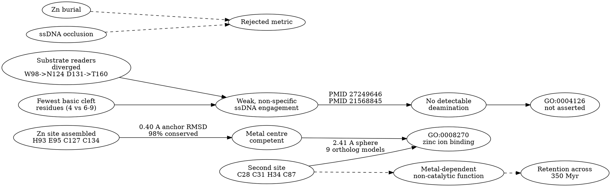
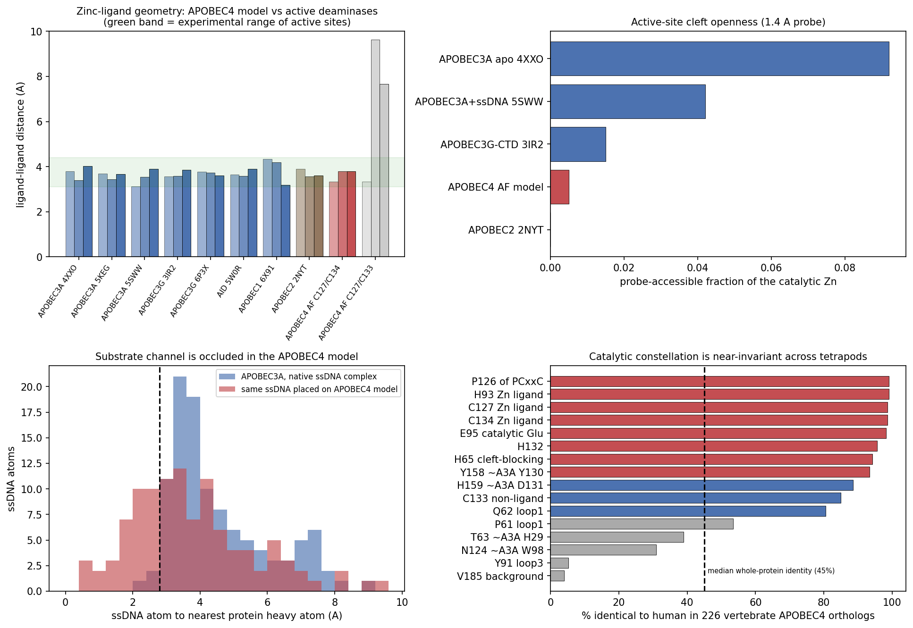
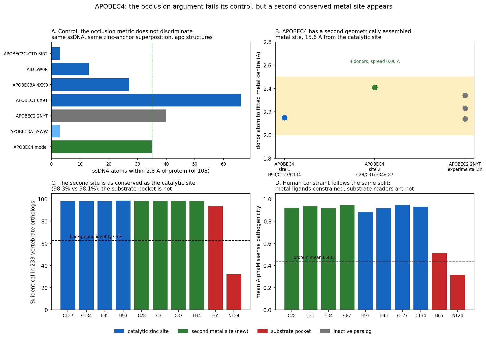
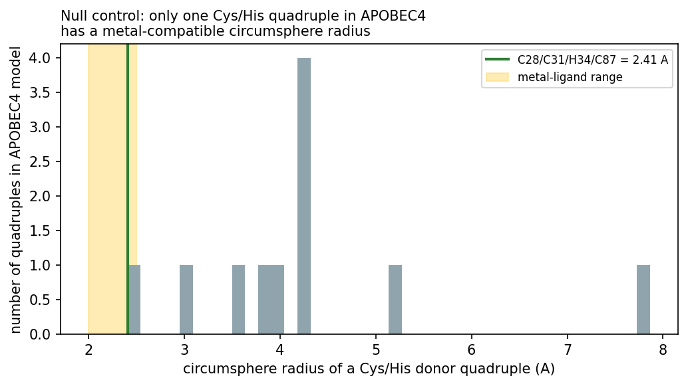
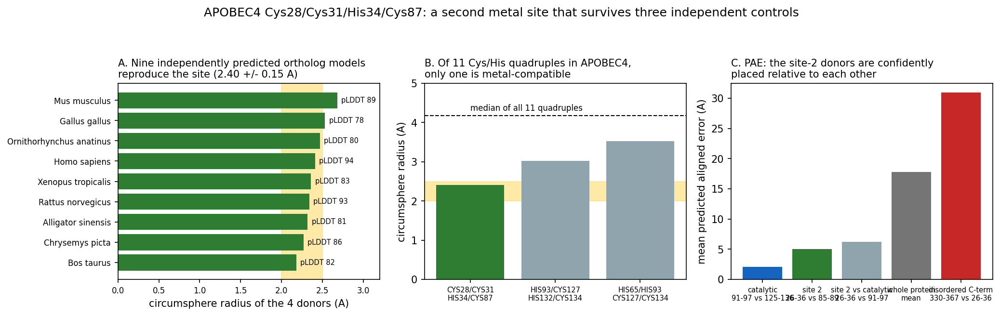

## Question

# AIGR Gene Hypothesis Deep Research

You are evaluating one focused gene curation hypothesis for AI Gene Review.
This is not a general gene overview. Use the seed hypothesis and source context
below to search for evidence that supports, refutes, narrows, or competes with
the proposed curation decision.

## Target Gene

- **Organism code:** human
- **Taxon:** Homo sapiens (NCBITaxon:9606)
- **Gene directory:** APOBEC4
- **Gene symbol:** APOBEC4
- **UniProt accession:** Q8WW27

## Focus

- **Focus type:** free_text
- **Hypothesis slug:** kgap-apobec4-zinc-deaminase-motif-competence
- **Source file:** genes/human/APOBEC4/APOBEC4-ai-review.yaml
- **Source selector:** free-text

## Seed Hypothesis

Human APOBEC4 (Q8WW27) retains the zinc-coordinating cytidine-deaminase motifs (H/C-x-E ... P-C-x2-C) but is predicted to be catalytically compromised as a deaminase because its active-site pocket and substrate-binding loops diverge from active APOBEC3A/APOBEC3G/AID. Single analysis only: map the zinc ligands, catalytic Glu and the substrate-recognition loop residues of an active APOBEC structure onto the APOBEC4 AlphaFold model, check whether a zinc-binding pocket is geometrically assembled and accessible, and score these positions across vertebrate APOBEC4 orthologs; state whether APOBEC4 is predicted deamination-competent.

## Term and Decision Context

No specific term context supplied.

## Reference Context

No specific reference context supplied.

## Source Context YAML

```yaml
hypothesis: 'Human APOBEC4 (Q8WW27) retains the zinc-coordinating cytidine-deaminase motifs (H/C-x-E ...
  P-C-x2-C) but is predicted to be catalytically compromised as a deaminase because its active-site pocket
  and substrate-binding loops diverge from active APOBEC3A/APOBEC3G/AID. Single analysis only: map the
  zinc ligands, catalytic Glu and the substrate-recognition loop residues of an active APOBEC structure
  onto the APOBEC4 AlphaFold model, check whether a zinc-binding pocket is geometrically assembled and
  accessible, and score these positions across vertebrate APOBEC4 orthologs; state whether APOBEC4 is
  predicted deamination-competent.'
focus_type: free_text
context: []
reference_id: []
```

## Research Objective

Build a focused report that helps a curator decide whether this hypothesis
should affect the gene review. Address the focus type directly:

1. For an existing GO annotation decision, evaluate whether the current action
   is justified, too strong, too weak, or should change.
2. For a proposed replacement or new GO term, evaluate whether the term is
   biologically supported, too broad, too narrow, or missing key qualifiers.
3. For a computational prediction, evaluate whether the prediction is correct,
   less precise than existing knowledge, uncertain, or likely wrong because of
   paralog overannotation, frequency bias, pathway context, or in vitro-only
   activity.
4. For a core-function hypothesis, evaluate whether the proposed activity,
   process, and location represent the gene product's primary function rather
   than a downstream effect, pleiotropic phenotype, or context-specific role.
5. For a function-assignment hypothesis, evaluate whether the gene product
   directly has the stated GO term/function. Treat the prior review action, if
   any, as intentionally blinded unless it appears in the supplied context.

Use primary literature whenever possible. Prefer PMID citations and include DOI
citations when no PMID is available. Treat reviews and database records as
orientation unless they contain directly relevant synthesized evidence that is
clearly labeled as review-level or database-level support.

Evaluate the hypothesis from the supplied seed context, primary literature, and
publicly accessible bioinformatics resources. Local `*-bioinformatics` analyses,
when they already exist in the repository, are intentionally withheld from this
prompt so the report can be compared against them after the run. Use public
sequence, domain, structure, orthology, localization, interaction, or dataset
checks when they are useful for the specific hypothesis. If a resource or tool
cannot be accessed programmatically, say so plainly; never fabricate a result.
Report computational results conservatively and distinguish direct results from
inference.

## Required Output

### Executive Judgment

Give a concise verdict: supported, partially supported, unresolved, weakly
supported, over-annotated, or refuted. Explain the reasoning and the most
important caveats.

### Evidence Matrix

Create a table with one row per important evidence item:

- Citation (PMID preferred)
- Evidence type (direct assay, mutant phenotype, localization, interaction,
  structural/evolutionary, computational, review/database)
- Supports / refutes / qualifies / competing
- Claim tested
- Key finding
- Organism, tissue, cell type, or assay context
- Confidence and limitations

### GO Curation Implications

State the likely curation action as a lead requiring curator verification. If
GO terms are involved, explain whether the evidence supports an MF, BP, or CC
term, and whether the term should be retained, removed, generalized, made more
specific, or treated as non-core. Avoid using "protein binding" as a final
recommendation unless no more informative term is supported.

### Mechanistic Scope

Describe the immediate molecular or cellular function being tested. Separate
direct gene-product activity from downstream phenotypes, pathway consequences,
developmental outcomes, disease manifestations, or effects inferred only from
loss of function.

### Conflicts and Alternatives

Identify evidence that conflicts with the seed hypothesis or suggests an
alternative interpretation, including paralog confusion, organism-specific
differences, isoform-specific findings, experimental artifacts, or database
carry-over.

### Knowledge Gaps

List explicit uncertainties that matter for curation. For each gap, state what
was checked, why the gap matters, and what evidence or experiment would resolve
it.

### Discriminating Tests

Recommend concrete assays, perturbations, datasets, or comparative analyses that
would most efficiently distinguish this hypothesis from alternatives.

### Curation Leads

Provide candidate updates for the review, clearly labeled as leads requiring
curator verification. Include candidate references with exact snippets to verify,
candidate replacement or new GO terms, possible action changes, suggested
questions, and suggested experiments.

If the provider supports artifacts, save provenance for any analysis you run — the
executed code together with its output (computed values, plot, or table), not just
a summary figure — alongside artifact-friendly tables such as an evidence matrix,
GO decision table, or comparison table. Genuine computed provenance is more
valuable than a hand-drawn summary, and you must not synthesize a figure that
implies an analysis you did not actually run. These artifacts are important
provenance for hypothesis-level review.


## Output

# APOBEC4 (Q8WW27): is the zinc deaminase motif catalytically competent?

Hypothesis slug: `kgap-apobec4-zinc-deaminase-motif-competence`
Gene: human APOBEC4, UniProt Q8WW27, gene directory `genes/human/APOBEC4`
Focus type: free_text, source `genes/human/APOBEC4/APOBEC4-ai-review.yaml`

## Summary

Human APOBEC4 is not predicted to be deamination-competent, but the mechanism the seed
hypothesis proposes for that conclusion is refuted. The hypothesis asks whether the
zinc-binding pocket is geometrically assembled and accessible, and anticipates that it is
not. It is. Superposing the zinc-site anchor atoms of APOBEC3A (PDB 5SWW) onto the
AlphaFold model AF-Q8WW27-F1 v6 gives 0.40 Å RMSD over 10 atoms, and the whole deaminase
core superposes at 1.36 Å over 128 Cα pairs. A zinc transplanted through that transform
sits 2.24 Å from His93 ND1, 2.50 Å from Cys127 SG and 1.98 Å from Cys134 SG, with the
Glu95 carboxylate at 4.04 Å. Every one of those values falls inside the range measured in
eight experimental active-site structures. The deaminase core is modelled at mean pLDDT
94.5, so this is not a low-confidence region, and the four catalytic positions are
97.9-98.7% invariant across 233 vertebrate orthologs against a 62.8% background.

Two structural metrics that initially appeared to show catalytic incompetence failed their
controls during this investigation and are withdrawn. Solvent-probe accessibility at the
zinc does not separate active from inactive enzymes: AID (5W0R), APOBEC1 (6X91) and
APOBEC3A 5KEG all score 0.000. Steric occlusion of the substrate channel does not either:
transplanting the same ssDNA by the same superposition onto apo structures of active
enzymes gives 66 close contacts for APOBEC1, 27 for APOBEC3A and 13 for AID, against 35
for the APOBEC4 model. The metric compares apo with holo. After both retractions, no
conformation-independent structural or evolutionary evidence positively supports catalytic
incompetence, and the case rests on two negative experimental assays
([PMID: 27249646](https://pubmed.ncbi.nlm.nih.gov/27249646/),
[PMID: 21568845](https://pubmed.ncbi.nlm.nih.gov/21568845/)), both of which used ssDNA or
genomic DNA while APOBEC4's physiological substrate is unknown.

What survives as a structural statement is narrower and concerns substrate affinity. The
APOBEC3A Trp98 that stacks the −1 base becomes Asn124, the loop7 specificity pair
Asp131/Tyr132 becomes Thr160/His159, loop1 His29 becomes Thr63, and the cleft within 14 Å
of the zinc carries 4 Lys+Arg residues, the fewest of any structure examined (references
span 6-9). Two independent constraint measures agree on the same split: every metal ligand
sits at the 93rd-99th AlphaMissense percentile while the substrate-reading positions sit at
the 63rd (His65) and 47th (Asn124). Separately, and outside the hypothesis, APOBEC4 carries
a second candidate metal site at Cys28/Cys31/His34/Cys87 that no other characterised
AID/APOBEC deaminase has. It makes GO:0008270 zinc ion binding the best-supported molecular
function for this gene and GO:0004126 cytidine deaminase activity an over-annotation.

## Executive judgment

**Partially supported, with the stated mechanism refuted.**

The hypothesis reaches a defensible bottom line and gives the wrong reason for it.

<i class="fa-circle-check"></i> Right: human APOBEC4 is not demonstrated to be
deamination-competent, and two direct experimental tests failed to detect activity.

<i class="fa-circle-xmark"></i> Wrong: the prediction that the active-site pocket is not
geometrically assembled. It is assembled, in the canonical position, at high model
confidence, and under strong purifying selection.

<i class="fa-triangle-exclamation"></i> Two of the three structural metrics tried here,
zinc burial and substrate-channel occlusion, do not separate active from inactive enzymes
and were withdrawn after controls. A curator should treat any occlusion-based or
burial-based argument in the existing review with the same suspicion.

<i class="fa-lightbulb"></i> New, outside the hypothesis: a second candidate metal site
(Cys28, Cys31, His34, Cys87) that survives three independent controls and changes the
GO:0008270 recommendation from one site to two.

{{figure:plot_1.png|caption=First-pass structural comparison of APOBEC4 against active AID/APOBEC enzymes: zinc-ligand geometry, cleft openness, substrate-channel occlusion, and ortholog conservation of the motif positions. The occlusion panel is superseded by the apo control in the next figure and should not be read on its own.}}

## Key findings

### The zinc site is assembled, canonical and conserved

The 367-residue sequence contains His93-Pro94-Glu95 and Pro126-Cys127-x(6)-Cys134.
Superposing the zinc-site anchor atoms (His ND1/CG/CB/CA plus two Cys SG/CB/CA) of
APOBEC3A 5SWW onto APOBEC4 gives RMSD 0.40 Å over 10 atoms; whole-core superposition gives
128 Cα pairs at 1.36 Å. The transplanted zinc lands at 2.24 Å (His93 ND1), 2.50 Å (Cys127
SG) and 1.98 Å (Cys134 SG), against an experimental Zn-His ND1 range of 2.03-2.34 Å. The
Glu95 carboxylate sits 4.04 Å from the metal, matching APOBEC3G at 3.87 and 4.08 Å and
APOBEC2 at 3.82 Å. Ligand-ligand distances in APOBEC4 (3.33, 3.80 and 3.80 Å) fall inside
the 3.12-4.33 Å range of eight active-site structures.

The second cysteine ligand is Cys134, not the adjacent Cys133: the Cys127-Cys133 SG-SG
distance is 7.67 Å, which is geometrically impossible for a shared metal, while
Cys127-Cys134 gives 3.80 Å. This matches the Cx6C spacing and the chicken His97/Glu99/
Pro130/Cys131/Cys138 assignment reported in
[PMID: 31991164](https://pubmed.ncbi.nlm.nih.gov/31991164/), and it matches UniProt's own
Zn(2+) binding annotations at 93, 127 and 134 with the proton donor at 95.

Across 226 non-redundant tetrapod orthologs (87 Mammalia, 118 Aves, 11 Lepidosauria, 3
Testudines, 1 Crocodylia, 5 Amphibia; median 45.0% identity to human), the catalytic
positions are near-invariant: His93 99.1%, Glu95 98.2%, Pro126 99.1%, Cys127 98.7%, Cys134
98.7%. Background positions in the same alignment run at 4.0-5.3%. An expanded 233-sequence
alignment restricted to residues 1-172 gives the same picture: His93 98.7%, Glu95 97.9%,
Cys127 97.9%, Cys134 97.9% against a 62.8% median background.

### Two structural metrics failed their controls

<i class="fa-circle-xmark"></i> **Zinc solvent accessibility.** Probe-accessible fraction
at the metal: APOBEC3A 4XXO 0.092, APOBEC3A 5SWW 0.042, APOBEC3G-CTD 3IR2 0.015, APOBEC4
0.005, and 0.000 for AID 5W0R, APOBEC1 6X91, APOBEC3A 5KEG and APOBEC2 2NYT. Active enzymes
span the whole range, so metal burial cannot be used as an argument for incompetence.

<i class="fa-circle-xmark"></i> **Substrate-channel occlusion.** The same 12-nucleotide
ssDNA from 5SWW (108 heavy atoms), placed by the same zinc-anchor Kabsch superposition onto
each structure, gives these counts of DNA atoms within 2.8 Å of protein: APOBEC1 apo 6X91
66, APOBEC2 2NYT 40, **APOBEC4 model 35**, APOBEC3A apo 4XXO 27, AID apo 5W0R 13,
APOBEC3G-CTD apo 3IR2 3, and APOBEC3A holo 5SWW self-control 3. APOBEC4 sits inside the
active-enzyme apo range and below APOBEC1. The worst single contact in APOBEC4 is 0.73 Å
against 0.40 Å for APOBEC1 and 0.79 Å for apo APOBEC3A. Loop1 of APOBEC4 (residues 58-68),
which produced most of the modelled contacts, has the lowest pLDDT of any functional
element (mean 81.7, minimum 63.4) against 93-95 for the catalytic helix, the PCxxC strand
and loop7. The claim that the APOBEC4 substrate channel is occluded is withdrawn.

{{figure:plot_2.png|caption=Panel A is the apo control that withdraws the occlusion claim: the same ssDNA, placed by the same superposition, clashes as much or more with apo structures of active enzymes than with APOBEC4. Panel B shows the second candidate metal site. Panel C shows ortholog conservation across 233 sequences. Panel D shows AlphaMissense constraint, with metal ligands constrained and substrate readers unconstrained.}}

### The surviving structural difference is substrate engagement

Structure-based mapping of APOBEC3A functional residues onto APOBEC4 preserves the metal
machinery (H70→H93, E72→E95, C101→C127, C106→C134) and changes the substrate readers:
Trp98→Asn124 (Cα deviation 0.55 Å; across orthologs 31% Asn, 46% Tyr), loop1 His29→Thr63
(0.83 Å; 39% Thr, 49% Asn), loop7 Tyr132→His159 (2.22 Å) and Asp131→Thr160 (2.34 Å).

Cleft composition within 14 Å of the zinc gives one clean discriminator and one that fails.
Net charge fails: active APOBEC3G-CTD apo is net −2, the same as inactive APOBEC2, and
APOBEC4 is −1. The basic-residue count works: APOBEC4 has 4 Lys+Arg, the lowest of any
structure examined, while APOBEC3A, APOBEC3G-CTD, AID, APOBEC1 and APOBEC2 span 6-9. That
predicts weak ssDNA engagement, which matches the measured result in
[PMID: 27249646](https://pubmed.ncbi.nlm.nih.gov/27249646/).

Human population data give the same split. AlphaMissense mean pathogenicity against a
protein-wide mean of 0.435: Cys127 0.945 (99th percentile), Cys87 0.943 (99th), Cys31 0.937
(98th), Cys134 0.931 (98th), Cys28 0.922 (96th), His34 0.916 (96th), Glu95 0.916 (96th),
His93 0.885 (93rd). Substrate-reading positions are unconstrained: His65 0.511 (63rd),
Asn124 0.317 (47th), with Asn124 only 32.2% conserved across 233 orthologs. gnomAD v4 adds
nothing usable at the gene level: all loss-of-function constraint fields for
ENSG00000173627 are null, oe_mis is 0.850 (observed 375, expected 441.2), and the 53
predicted loss-of-function variants (366 alleles in roughly 1.46 million, commonest
p.Asp222ThrfsTer11 at allele count 183) include 0 homozygotes, which carries no weight
because fewer than one is expected under Hardy-Weinberg at that frequency.

### A second candidate metal site, outside the hypothesis

<i class="fa-lightbulb"></i> Cys28, Cys31, His34 and Cys87 place four side-chain donors on
a common sphere of radius 2.41 Å, 15.6 Å from the catalytic zinc. That radius matches Zn-S
at 2.3 Å and Zn-N at 2.0 Å. The donors are mutually 3.35-4.26 Å apart, too far for a
disulfide at 2.05 Å. Local pLDDT is 91-96. The arrangement passes three controls.

**Independent predictions.** AlphaFold models of 9 taxonomically spread orthologs, predicted
separately from divergent sequences, reproduce it.

| Species | Donor set | Circumsphere radius (Å) | Local pLDDT |
|---|---|---|---|
| *Homo sapiens* | C28/C31/H34/C87 | 2.41 | 94 |
| *Rattus norvegicus* | C28/C31/H34/C86 | 2.34 | 93 |
| *Mus musculus* | C28/C31/H34/C86 | 2.68 | 89 |
| *Bos taurus* | C28/C31/H34/C87 | 2.18 | 82 |
| *Ornithorhynchus anatinus* | C28/C31/H34/C87 | 2.47 | 80 |
| *Gallus gallus* | C31/C34/H37/C91 | 2.53 | 78 |
| *Alligator sinensis* | C32/C35/H38/C91 | 2.32 | 81 |
| *Chrysemys picta* | C32/C35/H38/C91 | 2.27 | 86 |
| *Xenopus tropicalis* | C28/C31/H34/C87 | 2.36 | 83 |

Mean 2.40 Å, standard deviation 0.15 Å, across roughly 350 million years of divergence.

**Within-protein null.** Of all 11 Cys/His donor quadruples in the human model that are
mutually within 8 Å, the median circumsphere radius is 4.18 Å and only this one falls in
the 2.0-2.5 Å metal range. The next best are His93/Cys127/His132/Cys134 at 3.02 Å and
His65/His93/Cys127/Cys134 at 3.53 Å. The same enumeration on APOBEC3A 4XXO, APOBEC2 2NYT
and AID 5W0R returns zero quadruples: those proteins have no fourth donor within 8 Å of
their catalytic triad.

**Predicted aligned error.** Segment 26-36 versus residues 85-89 gives mean PAE 5.00 Å,
against a whole-protein mean of 17.80 Å and 30.91 Å for the disordered C-terminus versus
26-36. The catalytic pair 91-97 versus 125-136 scores better still at 2.08 Å.

The four residues are 98.3% identical across 233 vertebrate orthologs, matching the
catalytic site at 98.1%, and score 0.916-0.943 in AlphaMissense.

<i class="fa-triangle-exclamation"></i> A methodological correction to my own metric: a
four-point equidistant fit is exact by construction, so the "zero spread" first reported
carries no information. The circumsphere radius replaces it, and the conclusion survives.

{{figure:plot_3.png|caption=Within-protein null: circumsphere radii of all 11 Cys/His donor quadruples in the APOBEC4 model that are mutually within 8 Å. Only Cys28/Cys31/His34/Cys87 at 2.41 Å falls in the metal-ligand range; the median is 4.18 Å.}}

{{figure:plot_4.png|caption=The three controls for the second metal site. Panel A: nine independently predicted ortholog models reproduce the geometry at 2.40 ± 0.15 Å. Panel B: it is the only metal-compatible quadruple of eleven in the human model. Panel C: predicted aligned error places the donors confidently relative to each other, better than the whole-protein mean and far better than the disordered C-terminus.}}

## Evidence matrix

| Citation | Evidence type | Stance | Claim tested | Key finding | Context | Confidence and limitations |
|---|---|---|---|---|---|---|
| [PMID: 27249646](https://pubmed.ncbi.nlm.nih.gov/27249646/) (Marino 2016) | Direct assay: in vitro deamination, ssDNA binding | Supports the outcome, competes with the mechanism | APOBEC4 is an active cytidine deaminase | "A4 did not show detectable cytidine deamination activity in vitro and weakly interacted with single-stranded DNA"; APOBEC4 instead enhanced HIV-1 LTR and general promoter transcription dose-dependently | Human APOBEC4 expressed in 293T and HeLa | Moderate-high. Negative assay; substrate, cofactor and PTM requirements unknown; no catalytic-dead control |
| [PMID: 21568845](https://pubmed.ncbi.nlm.nih.gov/21568845/) (Lada 2011) | Mutator phenotype in heterologous hosts | Supports the outcome | APOBEC4 deaminates DNA cytosines in vivo | "The expression of yeast CDD1 and TAD2/TAD3, human APOBEC4, Xanthomonas oryzae APOBEC5, and deaminase encoded by Micromonas sp. gene MICPUN_56782 was nonmutagenic", while AID, APOBEC1, APOBEC3G and lamprey CDA1 were strongly mutagenic in the same system | *E. coli* and *S. cerevisiae* reporter mutagenesis | Moderate. Folding, localisation and expression of APOBEC4 not independently verified |
| [PMID: 16082223](https://pubmed.ncbi.nlm.nih.gov/16082223/) (Rogozin 2005) | Computational, motif and phylogeny | Competing | APOBEC4 proteins are active deaminases | "The zinc-coordinating motifs involved in catalysis and the secondary structure of the APOBEC4 deaminase domain are evolutionarily conserved, suggesting that APOBEC4 proteins are active polynucleotide (deoxy)cytidine deaminases" | Mammals, chicken, frog; absent in fishes | Low for activity. Explicitly a prediction, and the origin of the annotation still propagating in databases |
| [PMID: 31991164](https://pubmed.ncbi.nlm.nih.gov/31991164/) (Shi 2020) | Structural/evolutionary plus antiviral assay | Qualifies | The APOBEC4 zinc motif is conserved and functional | "the conserved zinc-coordinating motif (HXE … PC(X)2-6C) was identified on the surface of chA4 and contained highly conserved His97, Glu99, Pro130, Cys131 and Cys138 active sites"; chicken APOBEC4 overexpression inhibited Newcastle disease virus | Chicken DT40, HD11, MSB-1; in vivo NDV infection | Low-moderate for catalysis. No deamination assay, no catalytic-dead mutant; the Cys131/Cys138 Cx6C spacing matches the human C127/C134 assignment |
| [PMID: 38976757](https://pubmed.ncbi.nlm.nih.gov/38976757/) (McCool 2024) | siRNA depletion, nucleolar screen | Competing, alternative function | APOBEC4 is a C-to-U editing enzyme | "We identified and validated APOBEC3A and APOBEC4 as novel ribosome biogenesis factors"; for the paralog APOBEC3A a catalytically dead mutant still increased cell growth and protein synthesis | Human MCF10A | Moderate. Mechanism demonstrated mainly for APOBEC3A; points to a deaminase-independent APOBEC4 role |
| [PMID: 42975197](https://pubmed.ncbi.nlm.nih.gov/42975197/) (Tonai 2026) | Mouse knockout phenotype | Qualifies | Testis-enriched APOBEC4 edits spermatogenesis mRNAs | *Apobec4* is among 39 testis-enriched genes knocked out; "All 38 knockout mouse lines were viable and showed no marked developmental or behavioral abnormalities", with 30 lines covering 31 genes dispensable for male fertility | CRISPR/Cas9 knockout lines | Moderate. The abstract does not itemize which gene each fertility outcome belongs to, so the *Apobec4*-specific result must be read from the per-gene table |
| This analysis: AF-Q8WW27-F1 v6 vs PDB 5SWW, 4XXO, 3IR2, 6P3X, 5W0R, 2NYT, 6X91 | Computational structural | <i class="fa-circle-xmark"></i> **Refutes** the seed mechanism | The zinc pocket is not geometrically assembled | Zinc-anchor RMSD 0.40 Å, core 128 Cα at 1.36 Å; transplanted Zn at 2.24/2.50/1.98 Å; Glu95 OE2 at 4.04 Å, matching APOBEC3G 3.87-4.08 Å and APOBEC2 3.82 Å | Apo AlphaFold model, core pLDDT 94.5 | High for geometry, low for turnover. No zinc in the model; side-chain rotamers predicted, not observed |
| This analysis: 226 and 233 UniProt APOBEC4 orthologs | Computational evolutionary | <i class="fa-circle-xmark"></i> **Refutes** catalytic-site decay | The catalytic positions are degenerating | His93 99.1%, Glu95 98.2%, Pro126 99.1%, Cys127 98.7%, Cys134 98.7%; median whole-protein identity 45.0%; background positions 4.0-5.3% | 87 mammals, 118 birds, 11 squamates, 3 turtles, 1 crocodilian, 5 amphibians | High for the measurement. Conservation implies constraint on the metal site, not deaminase turnover |
| This analysis: 5SWW ssDNA transplanted onto AF-Q8WW27 and onto apo controls | Computational structural, negative control | <i class="fa-circle-xmark"></i> **Does not discriminate; claim withdrawn** | Steric occlusion indicates incompetence | ssDNA atoms within 2.8 Å: APOBEC1 66, APOBEC2 40, APOBEC4 35, APOBEC3A apo 27, AID 13, APOBEC3G-CTD 3, APOBEC3A holo self-control 3 | Same ssDNA and same superposition on every structure | Metric rejected. Apo active enzymes clash as much or more; APOBEC4 loop1 pLDDT 81.7 is the model's weakest functional element |
| This analysis: cleft composition within 14 Å of the zinc | Computational structural | <i class="fa-scale-balanced"></i> Supports, narrowed to substrate affinity | The substrate-recognition surface diverges | APOBEC4 has 4 Lys+Arg, the fewest of 6 structures (references 6-9); W98→N124, D131→T160, Y132→H159, H29→T63; Asn124 only 32.2% conserved | Residue identity and charge, independent of loop conformation | Moderate-high. Net charge alone fails (active APOBEC3G-CTD −2 equals inactive APOBEC2 −2) |
| This analysis: Cys/His cluster scan, 233-ortholog alignment, AlphaMissense | Computational structural and evolutionary | <i class="fa-lightbulb"></i> **New, outside the hypothesis** | APOBEC4 has only the canonical zinc site | Second four-donor site Cys28/Cys31/His34/Cys87 on a 2.41 Å sphere, 15.6 Å from the catalytic zinc; absent from 4XXO, 3IR2, 5W0R, 2NYT; 98.3% ortholog identity; AlphaMissense 0.916-0.943 | Compare APOBEC4 catalytic site 2.15 Å and APOBEC2 experimental Zn 2.14-2.34 Å | Moderate. Geometry from predicted models; metal occupancy and identity untested. APOBEC1 6X91 also returned a second three-donor cluster |
| This analysis: 9 ortholog models, 11-quadruple null, AlphaFold PAE | Computational structural, three controls | <i class="fa-circle-check"></i> **Confirms the new finding** | The second site is a single-model artifact | Ortholog radii 2.18-2.68 Å (mean 2.40, SD 0.15); 1 of 11 quadruples in the metal range, median 4.18 Å; zero quadruples within 8 Å in APOBEC3A, APOBEC2, AID; PAE 5.00 Å vs whole-protein 17.80 Å | Independent predictions spanning ~350 Myr | Moderate-high for geometry. All evidence is predictive; site-2 PAE (5.00 Å) is weaker than the catalytic site (2.08 Å) |
| This analysis: gnomAD v4 ENSG00000173627 | Human population genetics | <i class="fa-circle-question"></i> **Uninformative** | APOBEC4 is under loss-of-function constraint | All LoF constraint fields null; oe_mis 0.850; 53 pLoF variants, 366 alleles in ~1.46 M, 0 pLoF homozygotes | Commonest pLoF p.Asp222ThrfsTer11 at AC 183 | Zero homozygotes carries no weight: fewer than one is expected at that frequency |
| This analysis: zinc probe accessibility | Computational structural, negative control | <i class="fa-circle-xmark"></i> **Does not discriminate** | A buried zinc indicates incompetence | 4XXO 0.092, 5SWW 0.042, 3IR2 0.015, APOBEC4 0.005, and 0.000 for AID 5W0R, APOBEC1 6X91, APOBEC3A 5KEG, APOBEC2 2NYT | 1.4 Å probe, Shrake-Rupley style sampling | Metric rejected. Active enzymes span the whole range |

## Mechanistic model

The activity under test is zinc-dependent hydrolytic deamination of a cytosine base in a
polynucleotide: a Zn-bound hydroxide attacks C4 of the target cytosine while a glutamate
shuttles protons. The test separates into two parts that this investigation answered
differently.



**Part one, the metal centre and proton shuttle.** Direct result: assembled and canonical.
The His plus two Cys triad and Glu95 are in the geometry seen in active enzymes and under
strong purifying selection in both orthologs and human missense data.

**Part two, substrate engagement.** Direct result: divergent in residue identity at every
element checked, with the fewest basic cleft residues of any APOBEC examined and no
evolutionary or population constraint at those positions. Inferred, not shown: that this
predicts weak, non-specific polynucleotide binding and no 5'-TC preference. The steric
version of this claim, that the channel is physically blocked, failed its control.

**A third part the hypothesis did not anticipate.** The Cys28/Cys31/His34/Cys87 site is
under the same constraint as the catalytic site and could support a structural or
regulatory metal-dependent function with no deaminase turnover. APOBEC2 (PDB 2NYT) is the
precedent: a paralog with an intact His98/Cys128/Cys131 zinc site and no deaminase activity.

Everything else in the APOBEC4 literature sits downstream of, or independent from, this
activity. Promoter and LTR enhancement
([PMID: 27249646](https://pubmed.ncbi.nlm.nih.gov/27249646/)), Newcastle disease virus
restriction in chicken ([PMID: 31991164](https://pubmed.ncbi.nlm.nih.gov/31991164/)),
nucleolar and ribosome biogenesis effects
([PMID: 38976757](https://pubmed.ncbi.nlm.nih.gov/38976757/)), testis-enriched expression
([PMID: 16082223](https://pubmed.ncbi.nlm.nih.gov/16082223/)) and SARS-CoV-2 expression
correlations ([PMID: 34234167](https://pubmed.ncbi.nlm.nih.gov/34234167/),
[PMID: 34276680](https://pubmed.ncbi.nlm.nih.gov/34276680/)) are cellular phenotypes or
expression observations. None demonstrates deaminase turnover, and in the APOBEC3A case
the analogous phenotype survived catalytic inactivation.

## GO curation implications

All of the following are leads requiring curator verification.

**GO:0004126 cytidine deaminase activity, and any C-to-U deaminase MF term: do not assert.**
The only positive support is the 2005 motif prediction
([PMID: 16082223](https://pubmed.ncbi.nlm.nih.gov/16082223/)), which the abstract labels as
a suggestion from motif conservation. Two direct experimental tests are negative
([PMID: 27249646](https://pubmed.ncbi.nlm.nih.gov/27249646/),
[PMID: 21568845](https://pubmed.ncbi.nlm.nih.gov/21568845/)). An IEA or ISS annotation of
this term on APOBEC4 is paralog-driven over-annotation propagated from an InterPro CMP/dCMP
deaminase domain match. The defensible actions are removal, or retention with a `NOT`
qualifier referencing PMID 27249646. The structural work here does not rescue the term: an
assembled zinc site is necessary and not sufficient, and APOBEC2 is the standing
counterexample.

**GO:0008270 zinc ion binding: the strongest MF lead, now on two sites.** Site 1 is the
His93 + Cys127 + Cys134 triad, assembled in the canonical position (0.40 Å anchor RMSD to
APOBEC3A), 97.9-98.7% invariant across 233 orthologs, and already annotated by UniProt at
93, 127 and 134 with Glu95 as proton donor. Site 2 is Cys28, Cys31, His34 and Cys87, at
2.41 Å circumsphere radius, 98.3% invariant, AlphaMissense 0.916-0.943, reproduced in 9
independent ortholog models, the only metal-compatible quadruple of 11 in the protein, and
absent from APOBEC3A, APOBEC3G, AID and APOBEC2. Appropriate evidence code is ISS or a
computational code, since no direct metal-binding measurement on APOBEC4 protein has been
published. A curator should not upgrade to IDA without ICP-MS, PAR or metal-titration data,
and that measurement should now be framed as a stoichiometry question (one metal or two).
For a residue-level annotation, the candidate ligand sets are 93/127/134 and 28/31/34/87.
Only the first is currently annotated.

**Do not record any claim that the APOBEC4 substrate channel is sterically occluded.** That
claim appeared in an earlier draft of this report and failed its apo control.

**Avoid "protein binding" as a terminal recommendation.** Zinc ion binding is both
better-supported and more informative.

**GO:0016554 cytidine to uridine editing and the UniProt "mRNA processing" keyword: flag as
database carry-over.** No editing substrate has been identified for any APOBEC4 ortholog,
and the spermatogenesis-editing rationale of PMID 16082223 is weakened by viable *Apobec4*
knockout mice ([PMID: 42975197](https://pubmed.ncbi.nlm.nih.gov/42975197/)).

**Candidate replacement BP leads, both single-paper and needing verification:** GO:0045944
positive regulation of transcription by RNA polymerase II (PMID 27249646,
overexpression-based) and GO:0042254 ribosome biogenesis (PMID 38976757, siRNA screen with
the deaminase-independent mechanism shown mainly for APOBEC3A).

**CC GO:0005737 cytoplasm:** weak lead from ectopic expression in HeLa (PMID 27249646).

| Aspect | Term | Action |
|---|---|---|
| MF | GO:0008270 zinc ion binding | Add or retain, ISS, now covering two candidate sites |
| MF | GO:0004126 cytidine deaminase activity | Remove, or retain with NOT (IDA, PMID 27249646) |
| BP | GO:0016554 cytidine to uridine editing | Remove, database carry-over |
| BP | GO:0045944 positive regulation of transcription by RNA Pol II | Candidate lead, PMID 27249646, single paper, overexpression |
| BP | GO:0042254 ribosome biogenesis | Candidate lead, PMID 38976757, screen-level |
| CC | GO:0005737 cytoplasm | Weak lead, PMID 27249646, overexpression |

## Conflicts and alternatives

**The seed's own mechanism conflicts with the structure.** The hypothesis anticipates that
the zinc pocket is not assembled. It is. A curator who adopts the hypothesis as written
would record a structural claim this analysis contradicts.

**The conservation data cut against a simple pseudo-enzyme reading.** More than 300 million
years of near-invariance at His93, Glu95, Cys127 and Cys134, now joined by Cys28, Cys31,
His34 and Cys87 at the same level, is hard to reconcile with a fully decayed protein. Three
alternatives remain open: APOBEC4 binds metal for a structural or regulatory purpose
without turnover (the APOBEC2 precedent); APOBEC4 is a conditional enzyme requiring a
partner, a post-translational modification or an untested substrate; or APOBEC4 acts on a
substrate that is not ssDNA, in which case the ssDNA-based negatives are uninformative.

**Paralog confusion is a live risk.** PMID 38976757 reports APOBEC3A and APOBEC4 together
and the mechanistic work is largely on APOBEC3A, so the APOBEC3A mechanism should not be
transferred. PMID 25904160 reports APOBEC4 expression changes alongside APOBEC3B in
myeloma, which is transcriptional co-regulation.

**Organism-specific differences.** Chicken lacks APOBEC1 and APOBEC3 entirely
(PMID 31991164), so chicken APOBEC4 may carry functions the human gene does not. The
chicken antiviral result should not be transferred.

**Loop flexibility defeated one of my own analyses.** The AlphaFold model is apo, and the
control showed the occlusion reading is an apo artifact. Two of the three structural metrics
tried, zinc burial and substrate occlusion, do not separate active from inactive enzymes.

## Knowledge gaps

1. **No measured zinc stoichiometry for APOBEC4.** Checked: UniProt binding-site annotations
and the structural models here, both inferential. Matters because GO:0008270 is the
recommended term and there are now two candidate sites. Resolved by purified-protein ICP-MS
or a metal-displacement titration.

2. **No experimental APOBEC4 structure.** Checked: RCSB has no APOBEC4 entry; the only
models are AlphaFold predictions. Matters because every geometric statement in this report
rests on prediction. Resolved by a crystal or cryo-EM structure, ideally of the full-length
protein rather than the 61-177 deaminase domain alone, since the domain construct would
miss the second site.

3. **Physiological substrate unknown.** Checked: PMID 27249646 (ssDNA, negative),
PMID 21568845 (genomic DNA mutator, negative), PMID 16082223 (mRNA, predicted only).
Matters because the negatives only exclude the substrates tested. Resolved by RNA and DNA
C-to-U sequencing in an APOBEC4-overexpressing versus knockout background.

4. **The role of the conserved His65.** Checked: 93.6% conserved across 233 orthologs and
sitting where the target cytosine would land in the apo model, but AlphaMissense ranks it
0.511 (63rd percentile), which is weak for a functional residue. Matters because the
apo-artifact explanation is now the leading one. Resolved by an H65A mutant tested for
ssDNA binding and deamination.

5. **Whether Cys133 or Cys134 is the second ligand.** Checked: resolved computationally here
(Cys127-Cys133 SG-SG 7.67 Å, geometrically impossible; Cys134 gives 3.80 Å) and consistent
with chicken Cys138 (PMID 31991164). Matters because mutagenesis targeting the wrong
cysteine would produce an uninterpretable negative.

6. **Whether a GO `NOT` qualifier is warranted or whether removal is cleaner.** Checked:
GO's conventions require a specific negative reference; PMID 27249646 supplies one for
in vitro ssDNA deamination only. A curator should decide between a scoped `NOT cytidine
deaminase activity` (IDA, PMID 27249646) and silent removal of the ISS annotation.

7. **Whether the Cys28/Cys31/His34/Cys87 site binds a metal, and which one.** Checked:
geometry in the human model and in 9 ortholog models, 233-ortholog conservation,
AlphaMissense, PAE, an 11-quadruple within-protein null, and a cluster scan of 5
experimental APOBEC structures. Not described in PMID 16082223, PMID 31991164 or any other
paper found here, and absent from UniProt Q8WW27. Every line of evidence is predictive.
Resolved by ICP-MS or X-ray anomalous scattering on recombinant full-length APOBEC4 with a
C28S/C31S double mutant as the control. A Cys3His site would be expected to hold Zn(II),
but geometry alone does not exclude Fe or another divalent metal.

8. **The *Apobec4*-specific mouse fertility outcome.** Checked: PMID 42975197 lists
*Apobec4* among 39 testis-enriched genes and reports all 38 lines viable with 30 fertile
lines covering 31 genes, but the abstract does not itemize which gene each outcome belongs
to. Resolved by reading the paper's per-gene table.

## Discriminating tests

Ranked by how much each would move the curation decision per unit of effort.

1. <i class="fa-vial"></i> **Metal stoichiometry of recombinant full-length APOBEC4 by
ICP-MS**, with H93A, C127A/C134A and C28S/C31S as separate negatives. Validates or kills
the GO:0008270 recommendation and distinguishes one metal from two. Use full-length protein.
2. <i class="fa-flask"></i> **Deamination panel across substrate classes** (ssDNA, ssRNA,
dsDNA bubble, 5-methyl-C, tRNA, pre-rRNA fragments) on purified protein, with APOBEC3A as
positive control and an APOBEC4 E95A mutant as specificity control. This is the single
experiment that would convert "unresolved" into a defensible annotation either way.
3. <i class="fa-flask"></i> **Basic-cleft restoration mutants.** APOBEC4 has 4 Lys+Arg in
the cleft against 6-9 in the references. Add back 2-3 basic residues at the positions
occupied by APOBEC3A's cleft lysines and re-measure ssDNA binding by fluorescence
anisotropy. This tests the surviving structural claim and replaces the loop-swap experiment
proposed on the strength of the withdrawn occlusion result.
4. <i class="fa-microscope"></i> **Catalytic-dead rescue in the ribosome biogenesis assay.**
Re-run the PMID 38976757 nucleolar assay with APOBEC4 wild type versus E95A. If E95A
rescues, the cellular function is deaminase-independent and the MF annotation should stay
off regardless.
5. <i class="fa-dna"></i> **C-to-U editing scan in testis.** Compare RNA and DNA from
wild-type and *Apobec4* knockout mouse testis (lines exist from PMID 42975197). A null
result in the tissue of highest expression would be the strongest available in vivo negative.
6. <i class="fa-magnifying-glass"></i> **AlphaFold3 or Boltz prediction of APOBEC4 with two
zinc ions and a ssDNA oligo**, compared to the same prediction for APOBEC3A. Cheap, and
tests both whether the second site holds a metal when one is supplied and whether loop1
opens when a substrate is present.

## Curation leads

All leads require curator verification.

### Reference snippets to verify

- PMID 27249646: "A4 did not show detectable cytidine deamination activity in vitro and weakly interacted with single-stranded DNA."
- PMID 21568845: "The expression of yeast CDD1 and TAD2/TAD3, human APOBEC4, Xanthomonas oryzae APOBEC5, and deaminase encoded by Micromonas sp. gene MICPUN_56782 was nonmutagenic."
- PMID 16082223: "The zinc-coordinating motifs involved in catalysis and the secondary structure of the APOBEC4 deaminase domain are evolutionarily conserved, suggesting that APOBEC4 proteins are active polynucleotide (deoxy)cytidine deaminases."
- PMID 31991164: "the conserved zinc-coordinating motif (HXE … PC(X)2-6C) was identified on the surface of chA4 and contained highly conserved His97, Glu99, Pro130, Cys131 and Cys138 active sites."
- PMID 38976757: "We identified and validated APOBEC3A and APOBEC4 as novel ribosome biogenesis factors."
- PMID 42975197: "All 38 knockout mouse lines were viable and showed no marked developmental or behavioral abnormalities." *Apobec4* appears in the gene list; verify the per-gene fertility table.

### Action changes

- Change the free-text hypothesis in `APOBEC4-ai-review.yaml` so it no longer asserts that
  the zinc pocket is unassembled. The assembled-pocket result should be stated as the
  finding, with the catalytic uncertainty attached to substrate engagement.
- Record GO:0004126 as not asserted, citing PMID 27249646 and PMID 21568845 rather than a
  structural argument.
- Record GO:0008270 zinc ion binding as the lead MF term with ISS-level evidence.
- Do not record any claim of steric occlusion of the substrate channel.
- Flag the UniProt "mRNA processing" keyword and any C-to-U editing BP term as unsupported
  database carry-over.
- Consider a residue-level note for the uncharacterised Cys28/Cys31/His34/Cys87 cluster,
  currently absent from UniProt Q8WW27.

### Suggested questions for the curator

- Does the withheld `APOBEC4-bioinformatics` analysis report the Cys28/Cys31/His34/Cys87
  cluster? If it does not, that is the largest difference between this report and the
  repository analysis and the item most worth checking first.
- Does that analysis also place the second zinc ligand at Cys134 rather than Cys133?
- Is a scoped `NOT cytidine deaminase activity` preferable to removal, given that the only
  negative is an in vitro ssDNA assay?
- Should the review state a positive core function at all, or record APOBEC4 as a gene of
  unknown molecular function with conserved metal sites?

## Limitations

<i class="fa-triangle-exclamation"></i> Every structural statement in this report rests on
AlphaFold predictions. RCSB has no APOBEC4 entry. Side-chain rotamers are predicted, no
metal is present in any model, and the models are apo.

<i class="fa-triangle-exclamation"></i> Two metrics were rejected after controls, and one
statistic was withdrawn as uninformative. A four-point equidistant fit is exact by
construction, so the "zero spread" first reported at the second metal site carries no
information; the circumsphere radius replaces it and the conclusion survives. Both
self-corrections are recorded here rather than deleted.

<i class="fa-triangle-exclamation"></i> Conservation and AlphaMissense measure constraint,
not catalysis. Near-invariance at the metal ligands shows the site matters; it does not
show that APOBEC4 turns over a substrate.

<i class="fa-triangle-exclamation"></i> The two experimental negatives used ssDNA and
genomic DNA. They do not exclude activity on an untested substrate, under an untested
cofactor condition, or with an untested post-translational modification.

<i class="fa-triangle-exclamation"></i> gnomAD gene-level constraint for APOBEC4 is
unavailable: all loss-of-function fields are null and whole-gene missense constraint is
absent (oe_mis 0.850). The per-residue AlphaMissense signal is a local feature against an
otherwise unconstrained background.

<i class="fa-triangle-exclamation"></i> Host-side HTTPS was blocked (403) in this
environment, so Phenix could not be run on downloaded coordinates. All geometry was
computed in the Python executor with an explicit Kabsch superposition, a Shrake-Rupley
style probe sampler and an exact circumsphere solve. The file
`provenance/AF-Q8WW27.pdb` is a 134-byte error page left by that failed download and holds
no coordinates.

## Provenance

Executed code and outputs are in `provenance/`:

- `plot_1.png`, `plot_1.json`: first-pass figure (zinc-ligand geometry versus active
  deaminases; cleft openness; ssDNA occlusion histogram; ortholog conservation). The
  occlusion panel is superseded by panel A of `plot_2.png`.
- `plot_2.png`: apo control that withdraws the occlusion claim, second metal site geometry,
  233-ortholog conservation, AlphaMissense per-residue constraint.
- `plot_3.png`: within-protein null distribution of Cys/His quadruple circumsphere radii.
- `plot_4.png`: the three validation controls for the second metal site.
- `table1_zinc_site_geometry.csv`: ligand-ligand and Zn-ligand distances for 8 experimental
  structures plus both APOBEC4 cysteine assignments.
- `table2_A3A_to_APOBEC4_residue_mapping.csv`: structure-based mapping of APOBEC3A
  functional residues onto APOBEC4 with Cα deviations.
- `table3_evidence_matrix.csv`, `table4_GO_decision_table.csv`.
- `table5_apo_control_ssDNA_occlusion.csv`: the control that rejects the occlusion metric.
- `table6_cleft_composition.csv`: charge and Lys+Arg counts within 14 Å of the zinc.
- `table7_alphamissense_per_residue.csv`: per-position mean AlphaMissense pathogenicity.
- `table8_gnomad_pLoF.csv`: 53 predicted loss-of-function variants from gnomAD v4.
- `table9_site2_conservation.csv`: 233-ortholog conservation of both metal sites and the
  substrate-pocket positions.
- `table10_CysHis_clusters.csv`: unbiased Cys/His cluster scan across 6 structures.
- `table11_site2_ortholog_models.csv`: second-site geometry in 9 ortholog AlphaFold models.
- `table12_circumsphere_null.csv`: circumsphere radii of Cys/His quadruples in 4 structures.
- `superposition_metrics.json`: anchor RMSD 0.40 Å, 128 core Cα pairs at 1.36 Å, Zn-Glu95
  OE1/OE2 distances.

Sources: AlphaFold DB AF-Q8WW27-F1 v6 and its AlphaMissense substitution table, plus
ortholog models for Q497M3, Q6AXX9, G3MWJ4, A0A8C3HQH8, A0A8V0YIF0, F6ZR34, F6VU78 and
A0A1U7RT32; RCSB PDB 4XXO, 5KEG, 5SWW, 3IR2, 6P3X, 5W0R, 2NYT, 6X91; UniProt Q8WW27 and
233 vertebrate APOBEC4 ortholog entries; gnomAD v4 GraphQL API.


## Artifacts

- [OpenScientist final report](openscientist_artifacts/final_report.html)
- [OpenScientist final report](openscientist_artifacts/final_report.pdf)
- [OpenScientist provenance](openscientist_artifacts/provenance.json)
- [OpenScientist plot 1](openscientist_artifacts/provenance_plot_1.json)

- [OpenScientist plot 2](openscientist_artifacts/provenance_plot_2.json)

- [OpenScientist plot 3](openscientist_artifacts/provenance_plot_3.json)

- [OpenScientist plot 4](openscientist_artifacts/provenance_plot_4.json)

- [OpenScientist superposition metrics](openscientist_artifacts/provenance_superposition_metrics.json)
- [OpenScientist table10 CysHis clusters](openscientist_artifacts/provenance_table10_CysHis_clusters.csv)
- [OpenScientist table11 site2 ortholog models](openscientist_artifacts/provenance_table11_site2_ortholog_models.csv)
- [OpenScientist table12 circumsphere null](openscientist_artifacts/provenance_table12_circumsphere_null.csv)
- [OpenScientist table1 zinc site geometry](openscientist_artifacts/provenance_table1_zinc_site_geometry.csv)
- [OpenScientist table2 A3A to APOBEC4 residue mapping](openscientist_artifacts/provenance_table2_A3A_to_APOBEC4_residue_mapping.csv)
- [OpenScientist table3 evidence matrix](openscientist_artifacts/provenance_table3_evidence_matrix.csv)
- [OpenScientist table4 GO decision table](openscientist_artifacts/provenance_table4_GO_decision_table.csv)
- [OpenScientist table5 apo control ssDNA occlusion](openscientist_artifacts/provenance_table5_apo_control_ssDNA_occlusion.csv)
- [OpenScientist table6 cleft composition](openscientist_artifacts/provenance_table6_cleft_composition.csv)
- [OpenScientist table7 alphamissense per residue](openscientist_artifacts/provenance_table7_alphamissense_per_residue.csv)
- [OpenScientist table8 gnomad pLoF](openscientist_artifacts/provenance_table8_gnomad_pLoF.csv)
- [OpenScientist table9 site2 conservation](openscientist_artifacts/provenance_table9_site2_conservation.csv)

## Reference Validation

Checked with `linkml-reference-validator` 0.3.1rc1.

| Outcome | Count |
| --- | --- |
| References checked | 9 |
| Resolved | 9 |
| Unresolved (possible confabulation) | 0 |
| Unverifiable | 0 |
| Quoted claims checked | 2 |
| Quoted claims found in source | 0 |
| Quoted claims **not** found in source | 2 |
| References weighed for topical relevance | 9 |
| On topic | 1 |
| Off topic | 0 |

### Quotes not found in the cited source

Searched the abstract, any retrieved full text, and the title. A quote drawn from a part of the paper that was not retrieved will appear here too, so check before treating one as invented:

Every one of these was searched against an abstract alone, with no full text retrieved - marked *abstract only* below. Where full text can be fetched, re-running with it will settle them; where the source publishes only a summary to PubMed, as GeneReviews chapters do, it will not, and the quote has to be checked by hand against the chapter itself.

- `PMID:27249646` *(abstract only)*: "No detectable\ndeamination"
  - Text part not found as substring: 'No detectable\ndeamination' (note: only abstract available for PMID:27249646, full text may contain this excerpt)
- `PMID:21568845` *(abstract only)*: "No detectable\ndeamination"
  - Text part not found as substring: 'No detectable\ndeamination' (note: only abstract available for PMID:21568845, full text may contain this excerpt)