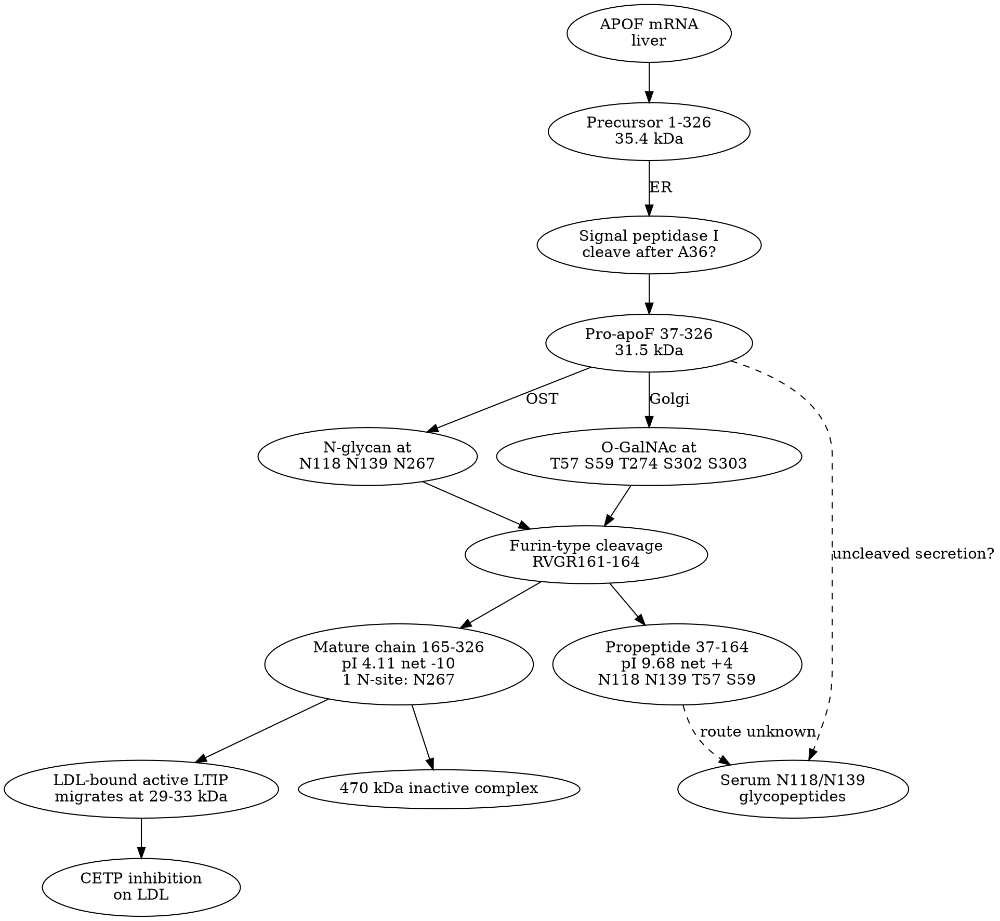
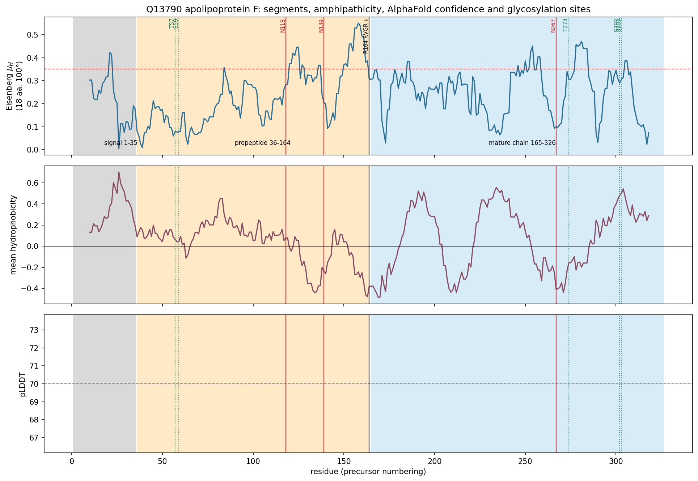
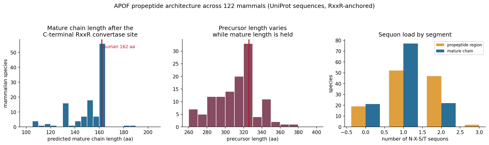
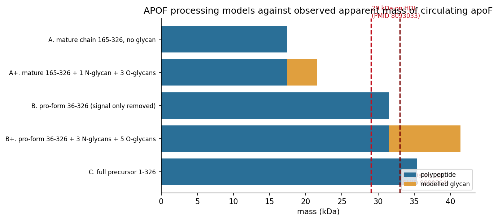
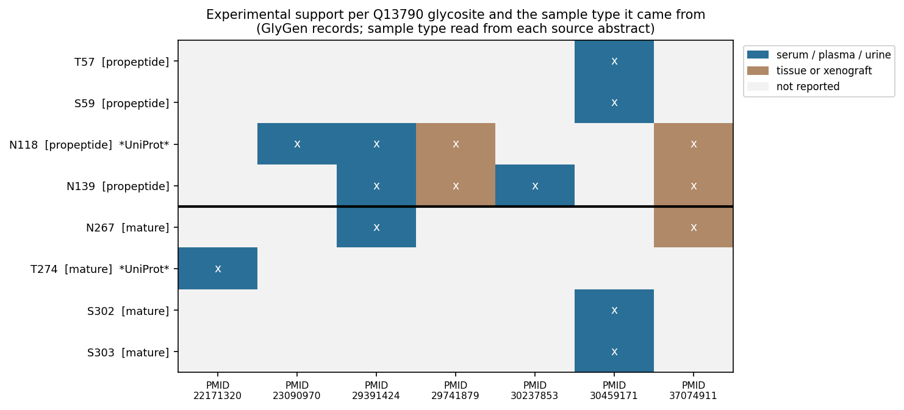
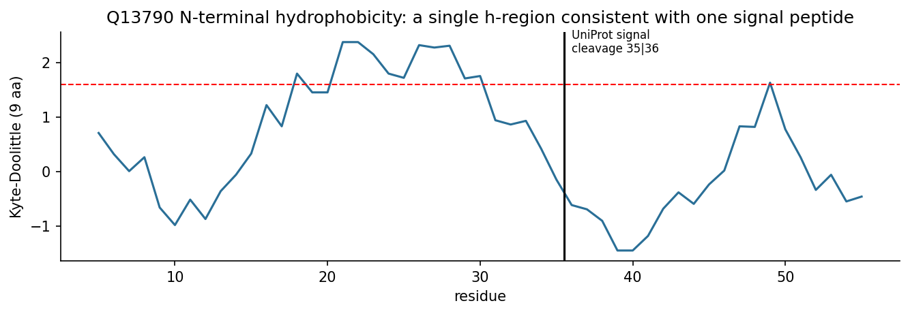

## Question

# AIGR Gene Hypothesis Deep Research

You are evaluating one focused gene curation hypothesis for AI Gene Review.
This is not a general gene overview. Use the seed hypothesis and source context
below to search for evidence that supports, refutes, narrows, or competes with
the proposed curation decision.

## Target Gene

- **Organism code:** human
- **Taxon:** Homo sapiens (NCBITaxon:9606)
- **Gene directory:** APOF
- **Gene symbol:** APOF
- **UniProt accession:** Q13790

## Focus

- **Focus type:** free_text
- **Hypothesis slug:** kgap-apof-glycosylation-maturation
- **Source file:** genes/human/APOF/APOF-ai-review.yaml
- **Source selector:** free-text

## Seed Hypothesis

The post-translational maturation of human apolipoprotein F (Q13790) is only partly captured in UniProt. Single analysis only: from the Q13790 sequence, determine the propeptide and mature chain boundaries reported in the literature, enumerate every N-X-S/T sequon and every predicted O-glycosylation site, state which lie in the propeptide and which in the mature circulating chain, and compare this with the single N-glycosylation site UniProt annotates. Predict the signal peptide, the propeptide cleavage site and any convertase consensus, estimate the glycan contribution to mass and to the protein's acidic character, and assess by conservation across bony vertebrates which sequons are conserved. State which glycosylation sites should be annotated on the mature protein and whether any lies in a region predicted to form the lipoprotein-binding amphipathic surface.

## Term and Decision Context

No specific term context supplied.

## Reference Context

No specific reference context supplied.

## Source Context YAML

```yaml
hypothesis: 'The post-translational maturation of human apolipoprotein F (Q13790) is only partly captured
  in UniProt. Single analysis only: from the Q13790 sequence, determine the propeptide and mature chain
  boundaries reported in the literature, enumerate every N-X-S/T sequon and every predicted O-glycosylation
  site, state which lie in the propeptide and which in the mature circulating chain, and compare this
  with the single N-glycosylation site UniProt annotates. Predict the signal peptide, the propeptide cleavage
  site and any convertase consensus, estimate the glycan contribution to mass and to the protein''s acidic
  character, and assess by conservation across bony vertebrates which sequons are conserved. State which
  glycosylation sites should be annotated on the mature protein and whether any lies in a region predicted
  to form the lipoprotein-binding amphipathic surface.'
focus_type: free_text
context: []
reference_id: []
```

## Research Objective

Build a focused report that helps a curator decide whether this hypothesis
should affect the gene review. Address the focus type directly:

1. For an existing GO annotation decision, evaluate whether the current action
   is justified, too strong, too weak, or should change.
2. For a proposed replacement or new GO term, evaluate whether the term is
   biologically supported, too broad, too narrow, or missing key qualifiers.
3. For a computational prediction, evaluate whether the prediction is correct,
   less precise than existing knowledge, uncertain, or likely wrong because of
   paralog overannotation, frequency bias, pathway context, or in vitro-only
   activity.
4. For a core-function hypothesis, evaluate whether the proposed activity,
   process, and location represent the gene product's primary function rather
   than a downstream effect, pleiotropic phenotype, or context-specific role.
5. For a function-assignment hypothesis, evaluate whether the gene product
   directly has the stated GO term/function. Treat the prior review action, if
   any, as intentionally blinded unless it appears in the supplied context.

Use primary literature whenever possible. Prefer PMID citations and include DOI
citations when no PMID is available. Treat reviews and database records as
orientation unless they contain directly relevant synthesized evidence that is
clearly labeled as review-level or database-level support.

Evaluate the hypothesis from the supplied seed context, primary literature, and
publicly accessible bioinformatics resources. Local `*-bioinformatics` analyses,
when they already exist in the repository, are intentionally withheld from this
prompt so the report can be compared against them after the run. Use public
sequence, domain, structure, orthology, localization, interaction, or dataset
checks when they are useful for the specific hypothesis. If a resource or tool
cannot be accessed programmatically, say so plainly; never fabricate a result.
Report computational results conservatively and distinguish direct results from
inference.

## Required Output

### Executive Judgment

Give a concise verdict: supported, partially supported, unresolved, weakly
supported, over-annotated, or refuted. Explain the reasoning and the most
important caveats.

### Evidence Matrix

Create a table with one row per important evidence item:

- Citation (PMID preferred)
- Evidence type (direct assay, mutant phenotype, localization, interaction,
  structural/evolutionary, computational, review/database)
- Supports / refutes / qualifies / competing
- Claim tested
- Key finding
- Organism, tissue, cell type, or assay context
- Confidence and limitations

### GO Curation Implications

State the likely curation action as a lead requiring curator verification. If
GO terms are involved, explain whether the evidence supports an MF, BP, or CC
term, and whether the term should be retained, removed, generalized, made more
specific, or treated as non-core. Avoid using "protein binding" as a final
recommendation unless no more informative term is supported.

### Mechanistic Scope

Describe the immediate molecular or cellular function being tested. Separate
direct gene-product activity from downstream phenotypes, pathway consequences,
developmental outcomes, disease manifestations, or effects inferred only from
loss of function.

### Conflicts and Alternatives

Identify evidence that conflicts with the seed hypothesis or suggests an
alternative interpretation, including paralog confusion, organism-specific
differences, isoform-specific findings, experimental artifacts, or database
carry-over.

### Knowledge Gaps

List explicit uncertainties that matter for curation. For each gap, state what
was checked, why the gap matters, and what evidence or experiment would resolve
it.

### Discriminating Tests

Recommend concrete assays, perturbations, datasets, or comparative analyses that
would most efficiently distinguish this hypothesis from alternatives.

### Curation Leads

Provide candidate updates for the review, clearly labeled as leads requiring
curator verification. Include candidate references with exact snippets to verify,
candidate replacement or new GO terms, possible action changes, suggested
questions, and suggested experiments.

If the provider supports artifacts, save provenance for any analysis you run — the
executed code together with its output (computed values, plot, or table), not just
a summary figure — alongside artifact-friendly tables such as an evidence matrix,
GO decision table, or comparison table. Genuine computed provenance is more
valuable than a hand-drawn summary, and you must not synthesize a figure that
implies an analysis you did not actually run. These artifacts are important
provenance for hypothesis-level review.


## Output

# APOF (Q13790): post-translational maturation and glycosylation

**Hypothesis slug:** `kgap-apof-glycosylation-maturation`
**Source:** `genes/human/APOF/APOF-ai-review.yaml`, free-text focus
**Target:** human apolipoprotein F, UniProt Q13790, 326 aa, NCBITaxon:9606
**Iterations completed:** 3. **Findings recorded:** 8. **Papers reviewed:** 20.

All numeric values below come from code executed during this run against live UniProt, GlyGen, QuickGO, NCBI eutils and AlphaFold endpoints on 2026-11-25. Saved artifacts: `apof_sequon_conservation.csv`, `apof_mammal_architecture.csv`, `apof_mammal_mature_sequons.csv`, `apof_glygen_sites.csv`, `apof_glycosite_provenance.csv`, `apof_tryptic_glycopeptides.csv`, `apof_mass_models.csv`, `apof_go_annotations.csv`, `apof_go_decision_table.csv`, `apof_evidence_matrix.csv`, plus the five figures embedded below.

## Summary

The seed hypothesis is **supported**, and its central consequence is sharper than the hypothesis states. Q13790 contains exactly three canonical N-X-S/T sequons: **N118 (NAT), N139 (NVS) and N267 (NIS)**, with no non-canonical N-X-C sites. UniProt annotates N-glycosylation at one of them, N118, and does so with ECO:0000255 (sequence-analysis prediction) even though four independent glycoproteomics studies report glycopeptides at that residue. **N118 lies inside the propeptide 36-164 and is therefore absent from the circulating mature chain.** The single sequon on the mature chain, **N267, is not annotated at all**. The same asymmetry holds for O-glycosylation: UniProt annotates T274 only, while public site-specific data also localise T57 and S59 (propeptide) and S302 and S303 (mature chain). UniProt's own cross-reference strings already declare "26 N-linked glycans (3 sites)" and "7 O-linked glycans (6 sites)" against a feature table that carries two glycosylation features. The gap is a checkable annotation deficit, not an inference.

Three further results came out of the sequence analysis. The propeptide boundary is well supported mechanistically: **RVGR161-164 is the only R-X-X-R motif in the protein outside the signal peptide**, and cleavage after R164 reproduces exactly the mature N-terminus S165 fixed by Edman sequencing in two independent studies. An R-X-X-R in the equivalent positional window is present in 120 of 122 mammalian APOF sequences (98%), and although precursor length ranges from 260 to 400 aa across those species, the resulting mature chain is held at a median of 158 aa (IQR 144-162; human 162). The charge split across the boundary is sharp: propeptide pI 9.68 with net charge +4, mature chain pI 4.11 with net charge -10.

Two components of the seed hypothesis did not survive testing. First, **no mature-chain glycosite sits in an amphipathic segment**: Eisenberg hydrophobic moments (18-residue window, 100 degrees per residue) are 0.10 at N267, 0.31 at T274, 0.29 at S302 and 0.31 at S303, against a mature-chain maximum of 0.47 at residue 281. That agrees with the published prediction that apoF lacks strong amphipathic alpha helices ([PMID: 22363685](https://pubmed.ncbi.nlm.nih.gov/22363685/)), so the model in which glycans decorate a lipoprotein-binding amphipathic face is not supported by the sequence. Second, **glycan mass cannot close the gap** between the 17.4 kDa mature polypeptide and the 29-33 kDa apparent masses reported from HDL and LDL; a maximal sialylated model reaches only 21.6 kDa, leaving at least 7.4 kDa unexplained. Separately, a conflict remains open: glycopeptides covering the propeptide sites N118 and N139 are reported from human serum and plasma, which is hard to reconcile with complete removal of the propeptide before secretion, and no reported tryptic peptide spans the R164 junction that would settle it.

## Key findings

### <i class="fa-solid fa-circle-check"></i> F1. The single annotated N-glycosite lies on a fragment that is cut away

Scanning the 326-residue Q13790 sequence for `N[^P][ST]` returns three matches and no more: N118 in the context NAT, N139 in NVS, and N267 in NIS. A parallel scan for the non-canonical N-X-C sequon returns nothing. The UniProt feature table assigns Signal 1-35 (ECO:0000255), Propeptide 36-164 (ECO:0000269) and Chain 165-326 "Apolipoprotein F". Mapping the three sequons onto those segments puts N118 and N139 inside the propeptide and leaves N267 as the only sequon in the mature chain. UniProt annotates N-glycosylation at N118 alone, with ECO:0000255, and O-glycosylation at T274 alone, with ECO:0000269 citing [PMID: 22171320](https://pubmed.ncbi.nlm.nih.gov/22171320/).

The chain boundary rests on two independent experimental determinations. Day and colleagues purified apoF from human HDL and reported that *"The cDNA encodes apolipoprotein F, which is composed of 162 amino acids, and predicts that apolipoprotein F is a proteolytic product of a larger protein"* ([PMID: 8093033](https://pubmed.ncbi.nlm.nih.gov/8093033/)). 162 residues is exactly the length of 165-326. Wang and colleagues then excised the 33 kDa LDL-associated band and found that *"The 14-amino acid sequence obtained showed complete homology with the sequence deduced for apolipoprotein F (apoF) cDNA isolated from Hep G2 cells"* ([PMID: 9880564](https://pubmed.ncbi.nlm.nih.gov/9880564/)). Residues 165-178 are SLPTEDCENEKEQA.

The consequence for curation is direct. A curator reading the Q13790 entry would attribute one N-glycosylation site to circulating apolipoprotein F, and that site is removed with the propeptide before the protein reaches plasma. Any feature-level or review-level statement linking apoF N-glycosylation to its lipoprotein-associated function currently points at the wrong residue.

{{figure:plot_1.png|caption=Mature-chain APOF glycan accounting. Segment map of Q13790 with signal peptide, propeptide and mature chain, overlaid with the three N-X-S/T sequons and five experimentally localised O-sites; Eisenberg hydrophobic moment profile (18-residue window, 100 degrees per residue) showing N267 at 0.10 against a mature-chain maximum of 0.47 at residue 281; and AlphaFold AF-Q13790-F1-v6 per-residue pLDDT, mean 53.9 across the signal peptide, 71.7 across the propeptide and 64.5 across the mature chain.}}

### <i class="fa-solid fa-circle-check"></i> F2. Public glycoproteomics supports eight sites; UniProt annotates two

The GlyGen API record for Q13790 (`api.glygen.org/protein/detail/Q13790/`, retrieved 2026-11-25) returns 52 site-specific glycosylation records. The N-linked set covers all three sequons: N118 with 20 distinct GlyTouCan structures from four studies, N139 with 11 structures from four studies, and N267 with 2 structures from two studies. The O-linked set covers five residues: T57 and S59 from an EXoO study, T274 from urinary glycoproteomics, and S302 and S303 from the same EXoO study, plus a range-level assignment across 251-279 from a human serum O-GalNAc survey.

| Site | Type | Segment | UniProt feature | Supporting PMIDs | Structures |
|---|---|---|---|---|---|
| T57 | O-GalNAc | propeptide | none | 30459171 | 1 |
| S59 | O-GalNAc | propeptide | none | 30459171 | 1 |
| N118 | N-X-T | propeptide | annotated, ECO:0000255 | 23090970, 29391424, 29741879, 37074911 | 20 |
| N139 | N-X-S | propeptide | none | 29391424, 29741879, 30237853, 37074911 | 11 |
| **N267** | N-X-S | **mature 165-326** | **none** | 29391424, 37074911 | 2 |
| T274 | O-core 1 | mature | annotated, ECO:0000269 | 22171320 | 2 |
| S302 | O-GalNAc | mature | none | 30459171 | 1 |
| S303 | O-GalNAc | mature | none | 30459171 | 1 |

Four experimentally supported glycosites fall on the mature circulating chain (N267, T274, S302, S303) against one currently annotated. The arithmetic is confirmed by UniProt's own cross-reference strings, which record "GlyConnect: 16 N-Linked glycans (3 sites), 1 O-Linked glycan (1 site)" and "GlyGen: 9 sites, 26 N-linked glycans (3 sites), 7 O-linked glycans (6 sites)" on an entry whose feature table carries two glycosylation features. The glycan classes assigned at T274 come from CID and ECD analysis of urinary glycopeptides, where *"In CID-MS(2), Hex(5)HexNAc(4)-N-Asn and HexHexNAc-O-Ser/Thr were typically observed, in agreement with known N-linked biantennary complex-type and O-linked core 1-like structures, respectively"* ([PMID: 22171320](https://pubmed.ncbi.nlm.nih.gov/22171320/)).

### <i class="fa-solid fa-circle-check"></i> F3. A furin-type RVGR motif explains the propeptide boundary and is conserved in 120 of 122 mammals

Scanning Q13790 for the minimal convertase consensus R-X-X-R returns two matches. RGLR at 13-16 lies inside the signal peptide and is not accessible to a convertase in the secretory pathway. RVGR at 161-164 is the only other match, and cleavage after R164 generates exactly the mature N-terminus S165 determined by Edman sequencing. The prediction and the experiment agree to the residue.

Across 122 mammalian APOF sequences retrieved from UniProt (one per species, precursor length 260-400 aa), an R-X-X-R motif is present in the 35-70% positional window in 120 of 122 (98%). Precursor length varies by 140 residues across those species while the resulting mature chain is held at a median of 158 aa (IQR 144-162), with 63 of 120 species between 155 and 165 aa. The human mature chain at 162 aa sits in the middle of that distribution. Mature-chain sequon load is close to one per species: 99 of 120 mature chains carry at least one N-sequon (81%), mean 1.01 per mature chain against 1.27 per propeptide.

The physicochemical split across the boundary is large. The propeptide 36-164 computes to 14.1 kDa with pI 9.68 and net charge +4. The mature chain 165-326 computes to 17.4 kDa with pI 4.11 and net charge -10. Independent support comes from the hamster ortholog, where *"Hamster LTIP mRNA, exclusively detected in the liver, defined a predicted LTIP protein that is 69% homologous to human, with an isoelectric point of 4.15 and Mr = approximately 16.4 kDa"* ([PMID: 19008550](https://pubmed.ncbi.nlm.nih.gov/19008550/)). Those values match the human mature chain (pI 4.11, 17.4 kDa) and not the 35.4 kDa full precursor. AlphaFold AF-Q13790-F1-v6 gives mean pLDDT 53.9 for the signal peptide, 71.7 for the propeptide and 64.5 for the mature chain, so the model is low-confidence throughout and was used only for context.

{{figure:plot_2.png|caption=Conservation of the APOF convertase site and mature-chain architecture across 122 mammalian orthologs. Distribution of mature chain length after the predicted R-X-X-R cleavage, median 158 aa with IQR 144-162 and 63 of 120 species between 155 and 165 aa; distribution of precursor length, spanning 260-400 aa; and N-X-S/T sequon load by segment, mean 1.27 per propeptide against 1.01 per mature chain, with 99 of 120 mature chains carrying at least one sequon.}}

<i class="fa-solid fa-triangle-exclamation"></i> Conservation beyond Mammalia could not be assessed reliably. Entries annotated "apolipoprotein F" in teleosts, birds and reptiles are 384-472 aa and align to human at only 19-38% identity in the anchor windows surrounding the sequons and the convertase site. Either the gene family has a different architecture outside mammals or these are automated mis-assignments. The seed hypothesis asked for a bony-vertebrate sequon conservation verdict; this run can answer it only for mammals, and says so plainly.

### <i class="fa-solid fa-circle-xmark"></i> F4. No mature-chain glycosite sits on an amphipathic surface, and glycan mass does not explain the apparent mass

The mature chain 165-326 has a computed peptide mass of 17,425 Da. A maximal glycan model, placing one disialyl biantennary Hex5HexNAc4NeuAc2 at N267 plus three sialylated core-1 HexHexNAc-NeuAc glycans at T274, S302 and S303, adds 4,176 Da for a total of 21.6 kDa. A minimal model gives 19.4 kDa. The observed apparent masses are 29 kDa on HDL by two-dimensional electrophoresis, where *"Apolipoprotein F, with an apparent molecular mass of 29 kilodaltons, was purified from human high density lipoproteins using a modified two dimensional electrophoresis procedure"* ([PMID: 8093033](https://pubmed.ncbi.nlm.nih.gov/8093033/)), and 33 kDa on LDL by SDS-PAGE ([PMID: 9880564](https://pubmed.ncbi.nlm.nih.gov/9880564/)). Even the maximal glycan model leaves 7.4 to 11.4 kDa unexplained.

Sialic acid addition raises mature-chain net negative charge from -10 to between -11 and -15, an increase of up to 50%. That is consistent with anomalous SDS-PAGE migration of a strongly acidic sialoglycoprotein, and with the observation that *"A rabbit antibody against bacterially produced recombinant LTIP detected two LTIP isoforms in plasma differing in carbohydrate content"* ([PMID: 17901467](https://pubmed.ncbi.nlm.nih.gov/17901467/)), which establishes glycan heterogeneity on the circulating protein directly.

On the amphipathic question, the Eisenberg moments at the four mature-chain glycosites are low to moderate: N267 0.10, T274 0.31, S302 0.29, S303 0.31, against a mature-chain maximum of 0.47 at residue 281. N267, the only N-glycosylation site on circulating apoF, sits in the least amphipathic context measured anywhere on the mature chain. AlphaFold pLDDT at these residues is 63.6 (N267), 37.2 (T274), 28.8 (S302) and 31.7 (S303), so none is in a confidently modelled element. The computed profile agrees with the published statement that *"In contrast to other apolipoproteins, ApoF is predicted to lack strong amphipathic alpha helices and its true physiological function remains unknown"* ([PMID: 22363685](https://pubmed.ncbi.nlm.nih.gov/22363685/)). The seed hypothesis asked whether any glycosite lies in a region predicted to form the lipoprotein-binding amphipathic surface. The answer from this analysis is no, and the premise that such a surface exists is itself doubtful.

### <i class="fa-solid fa-scale-balanced"></i> F5. Propeptide glycopeptides circulate, and no reported peptide spans R164

Reading the sample source from each GlyGen source abstract gives a mixed picture. N118 glycopeptides come from breast cancer cell-line secretome plus human plasma ([PMID: 23090970](https://pubmed.ncbi.nlm.nih.gov/23090970/)), from 24 human serum samples (PMID 29391424), from breast tumour and xenograft tissue (PMID 29741879) and from clear cell renal cell carcinoma tissue (PMID 37074911). N139 comes from serum (PMID 29391424), urine (PMID 30237853) and two tissue studies. T57 and S59 come from an EXoO study of kidney tissue, T cells and serum (PMID 30459171). The mature-chain sites are equally body-fluid supported: N267 from serum (PMID 29391424) and ccRCC tissue (PMID 37074911), T274 from urine ([PMID: 22171320](https://pubmed.ncbi.nlm.nih.gov/22171320/)), S302 and S303 from PMID 30459171.

Detection of N118 and N139 glycopeptides in serum and plasma conflicts with complete pre-secretory propeptide removal. The plasma component is explicit in the source: *"We then used the super-SILAC mix in plasma, which led to the quantification of a large number of the previously identified N-glycopeptides in this important body fluid"* ([PMID: 23090970](https://pubmed.ncbi.nlm.nih.gov/23090970/)). The tissue-derived identifications (PMID 29741879, PMID 37074911) are fully consistent with intracellular precursor and do not conflict at all.

In silico tryptic digestion with up to one missed cleavage explains why the published data cannot settle this. Every reported glycosite lies on a peptide wholly contained within one segment: N118 on QGGVNATQVLIQHLR (114-128), N139 on NVSVEALASALQLLAR (139-154), N267 and T274 together on DANISQPETTK (265-275), and S302/S303 on AISDVSDLEETTTLASFISEVVSSAPYWGWAIIK (280-313). No reported glycopeptide spans R164. Trypsin cleaves after R164 whether or not a convertase already did, so routine shotgun glycoproteomics is structurally blind to the question. Peptides that would span the junction require a missed cleavage: VGRSLPTEDCENEK (162-175) or EQQSTGRVGRSLPTEDCENEK (155-175).

Three scenarios remain open and the published data cannot separate them: an uncleaved proapoF circulating alongside the mature chain, a released propeptide fragment circulating independently, or liver-derived precursor leaking into plasma and urine. This is the single largest unresolved issue for curating APOF maturation.

{{figure:plot_4.png|caption=Provenance matrix of every reported Q13790 glycosite against its source PMID, coloured by sample type. Propeptide sites N118 and N139 are supported from serum and plasma as well as from tumour and kidney tissue, which is the conflict with complete pre-secretory propeptide removal. Mature-chain sites N267, T274, S302 and S303 are equally body-fluid supported.}}

### <i class="fa-solid fa-scale-balanced"></i> F6. The apparent mass fits an unglycosylated pro-form, but two Edman sequences outweigh it

Five processing states were modelled against the two published apparent masses.

| Model | Computed mass | vs 29 kDa (HDL) | vs 33 kDa (LDL) |
|---|---|---|---|
| Mature chain 165-326, unglycosylated | 17.4 kDa | -11.6 kDa | -15.6 kDa |
| Mature chain + 1 N-glycan + 3 O-glycans | 21.6 kDa | -7.4 kDa | -11.4 kDa |
| Pro-form 36-326, unglycosylated | 31.5 kDa | +2.5 kDa | -1.5 kDa |
| Pro-form 36-326 + all 8 reported glycans | 41.4 kDa | +12.4 kDa | +8.4 kDa |
| Full precursor 1-326, unglycosylated | 35.4 kDa | +6.4 kDa | +2.4 kDa |

The unglycosylated pro-form is the only model whose mass brackets both observations. Against that, two independent N-terminal determinations place the mature N-terminus at the same internal position, and UniProt cites both as ECO:0000269 evidence for Propeptide 36-164. Two direct sequences outweigh an apparent-mass argument, so the 165-326 boundary should stand. Reconciling it requires roughly 1.7-fold anomalous migration, which is expected for a polypeptide of pI 4.11 and net charge -10 carrying sialylated glycans, and which both original papers implicitly accepted.

The corollary matters for curation: glycan occupancy on the mature chain is probably underestimated by the four sites currently in public data, and the circulating protein carries more carbohydrate than the single annotated T274 implies.

{{figure:plot_3.png|caption=Five APOF processing models compared against the two published apparent masses. Bars give computed mass for the mature chain alone, the mature chain with a maximal glycan load, the unglycosylated pro-form, the fully glycosylated pro-form and the full precursor; horizontal lines mark 29 kDa from HDL (PMID 8093033) and 33 kDa from LDL (PMID 9880564). Only the unglycosylated pro-form brackets both observations, which conflicts with two independent Edman determinations of the mature N-terminus.}}

<i class="fa-solid fa-triangle-exclamation"></i> PeptideAtlas could not be queried programmatically from this environment. The first endpoint timed out at the 60-second executor limit and the second returned HTTP 404. No peptide-level coverage was retrieved, and no substitute was fabricated.

### <i class="fa-solid fa-circle-question"></i> F7. APOF carries no glycosylation GO term, and its only IPI partner is GALNT4

QuickGO returns 14 annotations on UniProtKB:Q13790.

| Aspect | GO ID | Term | Evidence |
|---|---|---|---|
| BP | GO:0006629 | lipid metabolic process | TAS, PMID 8093033 |
| BP | GO:0006869 | lipid transport | TAS, PMID 6816269 |
| BP | GO:0008203 | cholesterol metabolic process | TAS PMID 6816269; IBA GO_REF:0000033 |
| CC | GO:0005576 | extracellular region | EXP PMID 204339, EXP PMID 8093033, IDA PMID 28935895, IBA, IEA |
| MF | GO:0005102 | signaling receptor binding | TAS, PMID 8093033 |
| MF | GO:0005319 | lipid carrier activity | TAS, PMID 6816269 |
| MF | GO:0015485 | cholesterol binding | TAS, PMID 6816269 |
| MF | GO:0005515 | protein binding | IPI, PMID 28514442 and PMID 33961781, with UniProtKB:Q8N4A0 |

No glycosylation term (GO:0006487, GO:0006493) is present, and none should be: GO assigns glycosylation processes to the transferase, not to the substrate. The glycosylation hypothesis therefore has no direct GO consequence and belongs in the UniProt feature table and in the review's description of the mature protein.

Two indirect GO consequences did surface. The CC set is limited to the generic extracellular region, despite apoF being isolated in discrete particles from plasma: *"The three ApoF-containing lipoproteins were identified as LpF:A-I:A-II (lipoprotein containing ApoF, ApoA-I, and ApoA:II), LpF:A-I (lipoprotein containing ApoF and ApoA-I), and LpF (lipoprotein containing only ApoF)"* ([PMID: 6816269](https://pubmed.ncbi.nlm.nih.gov/6816269/)), and shown to be *"associated almost exclusively with LDL, identical to the distribution of LTIP activity"* ([PMID: 9880564](https://pubmed.ncbi.nlm.nih.gov/9880564/)). Lipoprotein-particle CC terms are better supported than the retained GO:0005576.

The sole IPI partner Q8N4A0 is **polypeptide N-acetylgalactosaminyltransferase 4 (GALNT4)**, an O-GalNAc transferase. That is a tempting mechanistic link to the O-sites at T57, S59, T274, S302 and S303. Both supporting references are proteome-scale BioPlex affinity-purification mass spectrometry surveys in HEK293T and HCT116 cells, which cannot distinguish a transferase-substrate encounter from secretory-pathway co-purification. It should stay non-core.

### <i class="fa-solid fa-lightbulb"></i> F8. The annotated signal peptide boundary violates the von Heijne rule by one residue

Q13790 has a canonical tripartite signal architecture: n-region 1-16 (MTGLCGYSAPDMRGLR, net charge +1), h-region 17-32 (LIMIPVELLLCYLLLH, mean Kyte-Doolittle +2.16), then a c-region. UniProt annotates Signal 1-35 with ECO:0000255 and no experimental support. That places -1 = D35 and -3 = P33. Signal peptidase I requires a small neutral residue (A, G, S or C) at -1 and disallows proline at -3, so the 35|36 boundary fails both constraints.

Scanning residues 20-45 for sites that satisfy the -3/-1 rule returns three candidates:

| Cleavage after | Context | -1 | -3 | Upstream h-region KD |
|---|---|---|---|---|
| A36 | PVDA\|TSY | A | V | +2.14 |
| S38 | DATS\|YGK | S | A | +1.66 |
| G40 | TSYG\|KQT | G | S | +1.66 |

Cleavage after A36 is immediately adjacent to the annotated boundary, has the strongest upstream hydrophobic region, and gives an A-X-A-type site. Downstream boundaries are unaffected: the propeptide would become 37-164 and the mature chain stays 165-326. This is a one-residue off-by-one in a prediction-only feature. It does not change the biology or the glycosite assignments, but it is cheap for a curator to check and every propeptide coordinate in the entry is anchored to it.

<i class="fa-solid fa-triangle-exclamation"></i> SignalP, Phobius and DeepTMHMM web servers could not be reached programmatically from this environment. This is a hand-implemented von Heijne check, not a SignalP score, and should be verified against a running SignalP 6.0 instance before any edit.

{{figure:plot_5.png|caption=Kyte-Doolittle hydropathy profile across the APOF N-terminal region with the tripartite signal architecture marked, and the three candidate cleavage sites satisfying the von Heijne -3/-1 rule. The UniProt boundary at 35 and 36 places proline at -3 and aspartate at -1, both disallowed for signal peptidase I; cleavage after A36 satisfies both constraints and has the strongest upstream h-region.}}

## Executive judgment

<i class="fa-solid fa-circle-check"></i> **Verdict: supported**, with one component refuted and one question left open.

**Supported:** the claim that UniProt captures APOF maturation only partly. Three sequons exist; one is annotated and only by prediction; that one lies on the removed propeptide; the mature chain's only sequon is unannotated; four of five experimentally localised O-sites are unannotated.

<i class="fa-solid fa-circle-xmark"></i> **Refuted:** the amphipathic-surface component. No mature-chain glycosite lies at an amphipathic maximum, and N267 (moment 0.10) sits in the least amphipathic context measured. The premise that apoF has a lipoprotein-binding amphipathic surface is itself contradicted by the published prediction in [PMID: 22363685](https://pubmed.ncbi.nlm.nih.gov/22363685/) and by the computed moment profile.

<i class="fa-solid fa-circle-question"></i> **Unresolved:** whether the propeptide is fully removed before secretion. Serum and plasma glycopeptides at N118 and N139 argue against it; two Edman sequences and a conserved convertase motif argue for it; no reported peptide spans R164.

<i class="fa-solid fa-triangle-exclamation"></i> **Not answerable here:** sequon conservation across bony vertebrates. Non-mammalian entries align at 19-38% identity in the relevant windows, which is too low for positional mapping. The verdict is restricted to Mammalia.

## Evidence matrix

| Citation | Evidence type | Stance | Claim tested | Key finding | Context | Confidence and limitations |
|---|---|---|---|---|---|---|
| [PMID: 8093033](https://pubmed.ncbi.nlm.nih.gov/8093033/) | Direct assay: purification + cDNA | Supports | apoF circulates as a proteolytic product of a larger precursor | 29 kDa apoF purified from human HDL; cDNA encodes a 162-aa protein that is "a proteolytic product of a larger protein" | Human plasma HDL; Hep G2 cDNA library | High. The 162 aa vs 29 kDa discrepancy is left unexplained in the abstract |
| [PMID: 9880564](https://pubmed.ncbi.nlm.nih.gov/9880564/) | Direct assay: Edman sequencing | Supports | Mature N-terminus is internal to the precursor | 14-residue N-terminal sequence from the 33 kDa LDL band matches apoF cDNA; apoF almost exclusively on LDL | Human LDL, SDS-PAGE | High. Exact residue numbers not given in the abstract |
| This work (computational) | Computational, deterministic | Supports | Only three N-X-S/T sequons exist, one in the mature chain | N118, N139 in propeptide; N267 sole mature-chain sequon; no N-X-C | Q13790, 326 aa | High. Regex enumeration, no ambiguity |
| This work (computational) | Structural/evolutionary | Supports | The propeptide boundary is a furin-type convertase site | RVGR161-164 is the only R-X-X-R outside the signal peptide; present in 120/122 mammals; mature length held at median 158 aa | 122 mammalian UniProt APOF sequences | Medium-high. Motif-based, no protease assay |
| GlyGen / GlyConnect (database) | Review/database | Supports | UniProt under-annotates APOF glycosylation | 52 site-specific records covering N118, N139, N267, T57, S59, T274, S302, S303; UniProt lists 2 | Aggregated human glycoproteomics | Medium. Site-localisation quality varies by source study |
| PMID 29391424 | Direct assay: intact glycopeptide MS | Qualifies | Propeptide-region sites are glycosylated on circulating material | N118, N139 and N267 glycopeptides in 24 human serum samples | Human serum | Medium. Cannot show the propeptide is still attached |
| [PMID: 23090970](https://pubmed.ncbi.nlm.nih.gov/23090970/) | Direct assay: N-glyco FASP, super-SILAC | Qualifies | N118 glycopeptide is present in plasma | N-glycopeptides quantified in human plasma and breast cancer secretome | Human plasma; cell lines | Medium |
| [PMID: 22171320](https://pubmed.ncbi.nlm.nih.gov/22171320/) | Direct assay: CID/ECD glycopeptide MS | Supports | T274 on the mature chain is O-glycosylated | Core-1-like HexHexNAc-O-Ser/Thr assigned at T274 | Human urine | Medium-high. The one ECO:0000269 glyco feature in UniProt |
| PMID 30459171 | Direct assay: EXoO O-glycoproteomics | Supports | Additional O-sites exist on both segments | T57, S59 (propeptide); S302, S303 (mature) | Human kidney tissue, T cells, serum | Medium |
| PMID 37074911 | Direct assay: TMT glycoproteomics | Qualifies | Glycosites detected in tissue rather than plasma | N118, N139, N267 in ccRCC tumour and normal kidney | 103 tumours, 80 normal adjacent | Medium. Tissue origin is consistent with intracellular precursor |
| [PMID: 17901467](https://pubmed.ncbi.nlm.nih.gov/17901467/) | Direct assay: immunoassay/Western | Supports | Circulating apoF is glycan-heterogeneous | Two plasma LTIP isoforms differing in carbohydrate content | Human plasma | Medium-high |
| [PMID: 19008550](https://pubmed.ncbi.nlm.nih.gov/19008550/) | Structural/evolutionary | Supports | The acidic mature chain is the physiological product | Hamster LTIP predicted pI 4.15, Mr ~16.4 kDa, matching the human mature chain (pI 4.11, 17.4 kDa) | Hamster liver mRNA | Medium. Prediction from cDNA |
| [PMID: 22363685](https://pubmed.ncbi.nlm.nih.gov/22363685/) | Computational (published) | Refutes the amphipathic component | A glycosite decorates a lipoprotein-binding amphipathic helix | apoF predicted to lack strong amphipathic alpha helices; the computed moment profile agrees | Mouse and human apoF | Medium-high |
| [PMID: 6816269](https://pubmed.ncbi.nlm.nih.gov/6816269/) | Direct assay: immunosorbent isolation | Supports a CC lead | apoF resides in discrete lipoprotein particles | LpF, LpF:A-I and LpF:A-I:A-II isolated from normolipidemic plasma | Human plasma | High for particle residence |
| PMID 28514442, PMID 33961781 | Interaction: high-throughput AP-MS | Competing / weak | APOF interacts with GALNT4 | BioPlex association; sole basis of GO:0005515 on Q13790 | HEK293T, HCT116 | Low as a substrate claim |

## Mechanistic model

The processing chain, with the uncertain branch marked.



The solid path is supported: liver synthesis, signal peptide removal, glycosylation of all three sequons and five O-sites, convertase cleavage at RVGR161-164 producing an acidic 162-residue chain, and association with LDL where the protein is active as a CETP inhibitor. The dashed branches are the unresolved part. Serum N118 and N139 glycopeptides must arrive by one of two routes that this analysis cannot separate: secretion of an uncleaved pro-form, or independent circulation of the released propeptide. A third possibility, leakage of intracellular precursor from liver or kidney into plasma and urine, is equally consistent with the data.

## Evidence base

| Paper | PMID | Role in this report |
|---|---|---|
| *Purification and molecular cloning of human apolipoprotein F* | [8093033](https://pubmed.ncbi.nlm.nih.gov/8093033/) | Anchors the 162-residue mature chain and supplies the 29 kDa HDL apparent mass. Also the TAS source for GO:0006629 and GO:0005102 |
| *Molecular cloning and expression of lipid transfer inhibitor protein reveals its identity with apolipoprotein F* | [9880564](https://pubmed.ncbi.nlm.nih.gov/9880564/) | Edman N-terminus from the 33 kDa LDL band; establishes near-exclusive LDL association, which drives the GO:0034362 lead |
| *Human urinary glycoproteomics; attachment site specific analysis of N- and O-linked glycosylations by CID and ECD* | [22171320](https://pubmed.ncbi.nlm.nih.gov/22171320/) | The single ECO:0000269 glycosylation feature on Q13790, at T274, with core-1-like glycan class |
| *The effects of apolipoprotein F deficiency on high density lipoprotein cholesterol metabolism in mice* | [22363685](https://pubmed.ncbi.nlm.nih.gov/22363685/) | Independent prediction that apoF lacks strong amphipathic alpha helices, agreeing with the computed moment profile and refuting the amphipathic component |
| *Lipid transfer inhibitor protein (apolipoprotein F) concentration in normolipidemic and hyperlipidemic subjects* | [17901467](https://pubmed.ncbi.nlm.nih.gov/17901467/) | Two plasma LTIP isoforms differing in carbohydrate content: direct evidence of glycan heterogeneity on circulating apoF |
| *Molecular cloning of hamster lipid transfer inhibitor protein (apolipoprotein F) and regulation of its expression by hyperlipidemia* | [19008550](https://pubmed.ncbi.nlm.nih.gov/19008550/) | Hamster ortholog pI 4.15 and Mr ~16.4 kDa match the human mature chain, not the precursor |
| *Isolation and characterization of simple and complex lipoproteins containing apolipoprotein F from human plasma* | [6816269](https://pubmed.ncbi.nlm.nih.gov/6816269/) | Discrete LpF, LpF:A-I and LpF:A-I:A-II particles; supports the GO:0034364 lead and is the TAS source for GO:0006869, GO:0005319 and GO:0015485 |
| N-glyco FASP / super-SILAC plasma glycoproteomics | [23090970](https://pubmed.ncbi.nlm.nih.gov/23090970/) | Places the N118 propeptide-region glycopeptide in human plasma, the core of the unresolved conflict |
| *Control of cholesteryl ester transfer protein activity by sequestration of lipid transfer inhibitor protein in an inactive complex* | [18369235](https://pubmed.ncbi.nlm.nih.gov/18369235/) | Active LTIP localises to LDL while a 470 kDa complex is inactive; context for why mature-chain surface properties matter |
| *Conversion of lipid transfer inhibitor protein (apolipoprotein F) to its active form depends on LDL composition* | [21937674](https://pubmed.ncbi.nlm.nih.gov/21937674/) | LTIP translocation depends on LDL lipid composition, the point where glycan-driven charge could matter |
| *Lipid transfer inhibitor protein defines the participation of high density lipoprotein subfractions in lipid transfer reactions mediated by CETP* | [12907677](https://pubmed.ncbi.nlm.nih.gov/12907677/) | Establishes LDL-preferential CETP inhibition, the documented activity of the mature chain |
| *Apolipoprotein F: a natural inhibitor of cholesteryl ester transfer protein and a key regulator of lipoprotein metabolism* | [32520778](https://pubmed.ncbi.nlm.nih.gov/32520778/) | Review-level orientation on apoF as a CETP inhibitor preferential for LDL |
| *Overexpression of apolipoprotein F reduces HDL cholesterol levels in vivo* | [19008531](https://pubmed.ncbi.nlm.nih.gov/19008531/) | Organism-level phenotype, outside the mechanistic scope of this hypothesis |

GlyGen, GlyConnect, QuickGO and AlphaFold were used as database-level orientation and are labelled as such throughout. The 20 papers reviewed include further LTIP physiology (PMID 11597939, PMID 10903478, PMID 15254877), transcriptional regulation (PMID 25726912, PMID 24211198), disease association (PMID 31687155, PMID 22761838) and CETP background (PMID 12588754). None of those bears on the maturation question and none was used to support a finding here.

## Limitations and knowledge gaps

<i class="fa-solid fa-triangle-exclamation"></i> **Tools that could not be reached.** SignalP, Phobius, DeepTMHMM, NetNGlyc, NetOGlyc and the BioPlex web interface were not accessible programmatically from this environment. PeptideAtlas timed out at 60 seconds on one endpoint and returned HTTP 404 on another, so no peptide-level coverage was retrieved. The signal-peptide assessment is a hand-implemented von Heijne -3/-1 check, not a SignalP score. No O-glycosite prediction algorithm was run; the O-sites reported here are experimental localisations from GlyGen, not predictions. No substitute results were fabricated for any of these.

<i class="fa-solid fa-triangle-exclamation"></i> **Method limitations.** Cross-species sequon mapping used a BLOSUM62 ungapped anchor-window method rather than a full multiple alignment, after a Needleman-Wunsch implementation exceeded the executor time limit. The method is reliable within Mammalia (window identity 52-82%) and unreliable outside it (19-38%), which is why the conservation verdict is restricted to mammals. Glycan mass estimates assume one disialyl biantennary N-glycan and sialyl core-1 O-glycans; the structures actually reported in GlyConnect are heterogeneous. AlphaFold pLDDT is 28-64 at the mature-chain glycosites, so no structural claim rests on the model. No wet-lab data were generated.

| Gap | What was checked | Why it matters | What would resolve it |
|---|---|---|---|
| <i class="fa-solid fa-circle-question"></i> Is the propeptide removed before secretion? | In silico tryptic digestion of Q13790; sample source of all 16 GlyGen glycosite records | Determines whether N118 and N139 belong to circulating apoF at all, the core of the hypothesis | Detection of a junction-spanning peptide (VGRSLPTEDCENEK 162-175 or EQQSTGRVGRSLPTEDCENEK 155-175) in plasma, or N-terminomics showing a free S165 alpha-amine |
| <i class="fa-solid fa-circle-question"></i> Does a free propeptide circulate? | Literature search; no report found | Would explain serum N118 and N139 without disturbing the chain boundary | Immunoblot of plasma with a propeptide-specific antibody; targeted PRM for QGGVNATQVLIQHLR in size-fractionated plasma |
| <i class="fa-solid fa-circle-question"></i> Which convertase cuts RVGR161-164? | Motif scan: only R-X-X-R outside the signal peptide; conserved in 120/122 mammals | Assigns the processing step to a named enzyme | Furin, PCSK5 or PCSK7 knockdown, or dec-RVKR-CMK inhibitor, in HepG2 with apoF Western blot |
| <i class="fa-solid fa-circle-question"></i> Is N267 occupied on circulating apoF specifically? | Two sources: PMID 29391424 serum, PMID 37074911 tissue | The only candidate N-glycan on the functional molecule | PNGase F mobility shift on plasma-purified apoF; N267Q mutant secreted from HepG2 |
| <i class="fa-solid fa-circle-question"></i> Does the 1.7-fold migration anomaly hide extra glycan? | Five mass models against two published apparent masses | Decides whether four mature-chain glycosites is the full set | Intact-mass MS of plasma apoF before and after PNGase F and sialidase |
| <i class="fa-solid fa-circle-question"></i> Is the signal peptide 1-35 or 1-36? | Hand-implemented von Heijne check; SignalP unreachable | Every propeptide coordinate in the entry is anchored to it | Run SignalP 6.0; or Edman and N-terminomics on secreted proapoF |
| <i class="fa-solid fa-circle-question"></i> Does glycosylation affect CETP inhibition? | Not tested; no literature found | Would connect the PTM to the gene product's documented activity | Compare CETP-inhibition activity of plasma-derived apoF, deglycosylated apoF and bacterially expressed recombinant LTIP |
| <i class="fa-solid fa-circle-question"></i> Are sequons conserved outside Mammalia? | Anchor-window mapping; 19-38% identity, unusable | The seed hypothesis asked for a bony-vertebrate verdict | MAFFT or MUSCLE multiple alignment of curated orthologs, after verifying orthology of the non-mammalian entries |

## Conflicts and alternatives

1. **Serum and plasma detection of propeptide glycopeptides.** The strongest conflict. Three readings remain open (uncleaved proapoF in circulation, an independently circulating propeptide, or precursor leakage from liver and kidney) and the published data cannot separate them. The tissue-derived studies conflict with nothing.
2. **Apparent mass.** Only the unglycosylated pro-form (31.5 kDa) brackets both 29 kDa and 33 kDa. Two direct N-terminal determinations outweigh a gel-mobility argument, so the 165-326 boundary stands, with a roughly 1.7-fold migration anomaly attributed to pI 4.11 and net charge -10 plus sialylation.
3. **Non-mammalian orthologs.** Entries annotated "apolipoprotein F" outside Mammalia are 384-472 aa and align at 19-38% in the windows of interest. Treat any bony-vertebrate conservation claim as unresolved and re-examine the orthology assignments.
4. **Database carry-over.** The N118 feature carries ECO:0000255 while four experimental studies support it. A curator could read the prediction flag as weakness rather than as a stale evidence code.
5. **GALNT4 interaction.** Tempting as a mechanism for the five O-GalNAc sites, but BioPlex AP-MS cannot distinguish a transferase-substrate encounter from secretory-pathway co-purification.

## Mechanistic scope

The events under test are co- and post-translational modifications of the gene product itself: signal peptidase cleavage in the ER, N-glycan transfer at N118, N139 and N267, O-GalNAc addition at T57, S59, T274, S302 and S303, and endoproteolytic release of the propeptide at RVGR161-164 giving the 162-residue circulating chain.

Separate from this, and not tested here: inhibition of CETP-mediated lipid transfer, preferential suppression of transfer events involving LDL ([PMID: 12907677](https://pubmed.ncbi.nlm.nih.gov/12907677/)), partitioning between an LDL-bound active pool and a 470 kDa inactive complex ([PMID: 18369235](https://pubmed.ncbi.nlm.nih.gov/18369235/), [PMID: 21937674](https://pubmed.ncbi.nlm.nih.gov/21937674/)), and organism-level lipid phenotypes from overexpression or knockout in mice ([PMID: 19008531](https://pubmed.ncbi.nlm.nih.gov/19008531/), [PMID: 22363685](https://pubmed.ncbi.nlm.nih.gov/22363685/)). None depends on the glycosylation question, and none has been tested against a glycosylation-null apoF.

The one point of contact is charge. Sialylation raises the mature chain's net charge from -10 toward -15 in a maximal model, an increase of up to 50%, in a protein whose association with LDL depends on lipoprotein surface composition ([PMID: 21937674](https://pubmed.ncbi.nlm.nih.gov/21937674/)). That is a hypothesis, not a result.

## GO curation implications

All items below are leads requiring curator verification.

**The glycosylation hypothesis has no direct GO consequence.** GO assigns GO:0006487 (protein N-linked glycosylation) and GO:0006493 (protein O-linked glycosylation) to the transferase, not to the substrate. Do not add either term to APOF. The hypothesis belongs in the UniProt feature table and in the review's description of the mature protein.

| GO ID | Aspect | Term | Current state | Lead action | Rationale |
|---|---|---|---|---|---|
| GO:0005576 | CC | extracellular region | EXP, IDA, IBA, IEA | Retain | Correct but generic; should be read as applying to the mature chain 165-326 |
| GO:0034362 | CC | low-density lipoprotein particle | absent | <i class="fa-solid fa-arrow-right"></i> Add (lead) | PMID 9880564: apoF "almost exclusively with LDL"; PMID 18369235 locates the active pool on LDL |
| GO:0034364 | CC | high-density lipoprotein particle | absent | <i class="fa-solid fa-arrow-right"></i> Add (lead) | PMID 8093033 purified apoF from HDL; PMID 6816269 isolated LpF:A-I and LpF:A-I:A-II |
| GO:0005102 | MF | signaling receptor binding | TAS, PMID 8093033 | Re-examine or remove | That paper reports purification, cDNA cloning and chromosomal mapping, with no receptor-binding assay |
| GO:0015485 | MF | cholesterol binding | TAS, PMID 6816269 | Re-examine | 1982 particle lipid composition, not a binding assay |
| GO:0005515 | MF | protein binding (with GALNT4) | IPI, BioPlex | Leave non-core | High-throughput AP-MS only; not informative as a final recommendation |
| GO:0006487 | BP | protein N-linked glycosylation | absent | Do not add | GO annotates the transferase, not the substrate |
| GO:0006493 | BP | protein O-linked glycosylation | absent | Do not add | Same reason |

A more informative MF for apoF's documented activity would be an inhibitor term applied to CETP-mediated transfer, supported by PMID 9880564, PMID 12907677 and PMID 32520778. Resolving the exact term is outside the scope of this glycosylation-focused hypothesis and is flagged for a separate pass.

## Curation leads

### Feature-table leads (UniProt Q13790)

- Add `CARBOHYD 267 N-linked (GlcNAc...) asparagine`, ECO:0000269, PMID 29391424 and PMID 37074911. Note that this is the only N-glycosylation site on the mature chain.
- Add `CARBOHYD 139 N-linked (GlcNAc...) asparagine`, ECO:0000269, PMID 29391424, PMID 29741879, PMID 30237853, PMID 37074911. Note that it lies in the propeptide.
- Upgrade `CARBOHYD 118` from ECO:0000255 to ECO:0000269 with PMID 23090970, PMID 29391424, PMID 29741879 and PMID 37074911. Note that it lies in the propeptide.
- Add `CARBOHYD 302` and `CARBOHYD 303` O-linked (GalNAc...) serine, ECO:0000269, PMID 30459171.
- Consider `CARBOHYD 57` and `CARBOHYD 59`, ECO:0000269, PMID 30459171, both in the propeptide.
- Consider a `SITE 164-165` feature or a PTM comment recording the furin-type RVGR161-164 consensus, labelled as sequence-analysis inference.
- Re-check `SIGNAL 1-35`. Cleavage after A36 satisfies the von Heijne -3/-1 rule while 35 and 36 (-3 = Pro, -1 = Asp) does not. Verify with SignalP 6.0 before editing.
- Consider a PTM comment stating that the mature chain migrates at 29-33 kDa against a 17.4 kDa theoretical mass and circulates as two isoforms differing in carbohydrate content (PMID 17901467).

### Candidate references with exact snippets to verify

- PMID 8093033: "The cDNA encodes apolipoprotein F, which is composed of 162 amino acids, and predicts that apolipoprotein F is a proteolytic product of a larger protein."
- PMID 8093033: "Apolipoprotein F, with an apparent molecular mass of 29 kilodaltons, was purified from human high density lipoproteins using a modified two dimensional electrophoresis procedure."
- PMID 9880564: "The protein migrating at a molecular mass of approximately 33 kDa was excised from the gel and its N-terminal amino acid sequence determined. The 14-amino acid sequence obtained showed complete homology with the sequence deduced for apolipoprotein F (apoF) cDNA isolated from Hep G2 cells."
- PMID 9880564: "apoF was shown to be associated almost exclusively with LDL, identical to the distribution of LTIP activity."
- PMID 22171320: "In CID-MS(2), Hex(5)HexNAc(4)-N-Asn and HexHexNAc-O-Ser/Thr were typically observed, in agreement with known N-linked biantennary complex-type and O-linked core 1-like structures, respectively."
- PMID 17901467: "A rabbit antibody against bacterially produced recombinant LTIP detected two LTIP isoforms in plasma differing in carbohydrate content."
- PMID 19008550: "Hamster LTIP mRNA, exclusively detected in the liver, defined a predicted LTIP protein that is 69% homologous to human, with an isoelectric point of 4.15 and Mr = approximately 16.4 kDa."
- PMID 22363685: "In contrast to other apolipoproteins, ApoF is predicted to lack strong amphipathic alpha helices and its true physiological function remains unknown."
- PMID 6816269: "The three ApoF-containing lipoproteins were identified as LpF:A-I:A-II (lipoprotein containing ApoF, ApoA-I, and ApoA:II), LpF:A-I (lipoprotein containing ApoF and ApoA-I), and LpF (lipoprotein containing only ApoF)."
- PMID 23090970: "We then used the super-SILAC mix in plasma, which led to the quantification of a large number of the previously identified N-glycopeptides in this important body fluid."

### Suggested questions for the review

- Should the review's text on apoF glycosylation state that the circulating protein carries one N-glycan (N267) and at least three O-glycans (T274, S302, S303), with N118 and N139 belonging to the propeptide?
- Should the review state that apoF's lipoprotein-binding region is not an amphipathic helix and that no glycosite lies on an amphipathic segment?
- Should the unresolved propeptide-in-serum conflict be recorded as an open question in the review rather than asserted either way?
- Should the review note the GALNT4 BioPlex association as a candidate mechanism for the O-GalNAc sites while declining to treat it as a substrate claim?

## Proposed follow-up experiments

Ranked by how much each separates the live alternatives per unit of effort.

1. <i class="fa-solid fa-vial"></i> **Targeted PRM for the junction peptide in plasma.** Monitor VGRSLPTEDCENEK (162-175) and EQQSTGRVGRSLPTEDCENEK (155-175) with heavy-labelled standards. Detection means uncleaved proapoF circulates; confident absence against a spiked standard means the propeptide is removed. This single experiment resolves the largest open conflict.
2. <i class="fa-solid fa-vial"></i> **N-terminomics on plasma apoF.** TAILS or dimethyl labelling tests directly whether S165 carries a free alpha-amine in circulation, and simultaneously checks for a circulating propeptide.
3. <i class="fa-solid fa-flask"></i> **Deglycosylation ladder on immunopurified plasma apoF.** Sequential PNGase F, sialidase and O-glycosidase with intact-mass readout. Quantifies the glycan contribution and tests whether the 29-33 kDa band collapses toward 17.4 kDa (mature) or 31.5 kDa (pro-form).
4. <i class="fa-solid fa-flask"></i> **Convertase assignment in HepG2.** dec-RVKR-CMK or furin siRNA, then Western blot for a mobility shift. Confirms the RVGR161-164 prediction and names the enzyme.
5. <i class="fa-solid fa-dna"></i> **Site-directed mutants secreted from HepG2.** N267Q, T274A and S302A/S303A, each assayed for secretion, LDL association and CETP inhibition. Connects the PTM to the documented function.
6. <i class="fa-solid fa-magnifying-glass"></i> **Proper multiple alignment of APOF orthologs.** Build an MAFFT or MUSCLE alignment of curated mammalian sequences rather than the anchor-window mapping used here, and re-score sequon conservation. Re-examine the non-mammalian entries for orthology before including them.
7. <i class="fa-solid fa-magnifying-glass"></i> **Run SignalP 6.0 on Q13790.** Settles the 1-35 versus 1-36 signal peptide question that could not be checked from this environment.


## Artifacts

- [OpenScientist final report](openscientist_artifacts/final_report.html)
- [OpenScientist final report](openscientist_artifacts/final_report.pdf)
- [OpenScientist provenance](openscientist_artifacts/provenance.json)
- [OpenScientist apof evidence matrix](openscientist_artifacts/provenance_apof_evidence_matrix.csv)
- [OpenScientist apof glycosite provenance](openscientist_artifacts/provenance_apof_glycosite_provenance.csv)
- [OpenScientist apof glygen sites](openscientist_artifacts/provenance_apof_glygen_sites.csv)
- [OpenScientist apof go annotations](openscientist_artifacts/provenance_apof_go_annotations.csv)
- [OpenScientist apof go decision table](openscientist_artifacts/provenance_apof_go_decision_table.csv)
- [OpenScientist apof mammal architecture](openscientist_artifacts/provenance_apof_mammal_architecture.csv)
- [OpenScientist apof mammal mature sequons](openscientist_artifacts/provenance_apof_mammal_mature_sequons.csv)
- [OpenScientist apof mass models](openscientist_artifacts/provenance_apof_mass_models.csv)
- [OpenScientist apof sequon conservation](openscientist_artifacts/provenance_apof_sequon_conservation.csv)
- [OpenScientist apof tryptic glycopeptides](openscientist_artifacts/provenance_apof_tryptic_glycopeptides.csv)
- [OpenScientist plot 1](openscientist_artifacts/provenance_plot_1.json)

- [OpenScientist plot 2](openscientist_artifacts/provenance_plot_2.json)

- [OpenScientist plot 3](openscientist_artifacts/provenance_plot_3.json)

- [OpenScientist plot 4](openscientist_artifacts/provenance_plot_4.json)

- [OpenScientist plot 5](openscientist_artifacts/provenance_plot_5.json)


## Reference Validation

Checked with `linkml-reference-validator` 0.3.1rc1.

| Outcome | Count |
| --- | --- |
| References checked | 30 |
| Resolved | 29 |
| Unresolved (possible confabulation) | 1 |
| Unverifiable | 0 |
| References weighed for topical relevance | 29 |
| On topic | 1 |
| Off topic | 0 |

### Unresolved references

These identifiers did not resolve to a record and may be fabricated. A lookup that failed for transport reasons is indistinguishable from one that failed because the record does not exist, so spot-check before acting on them:

- `PMID:18369235` (5 mentions) - Identifier did not resolve to a record