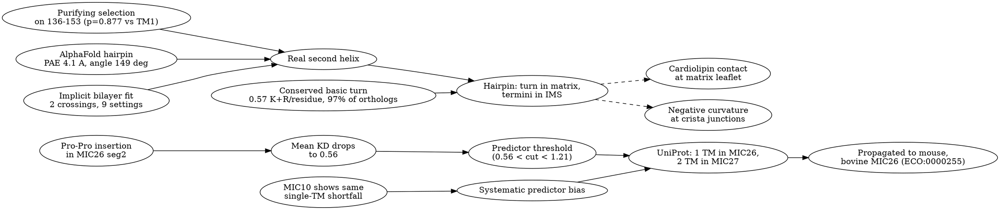
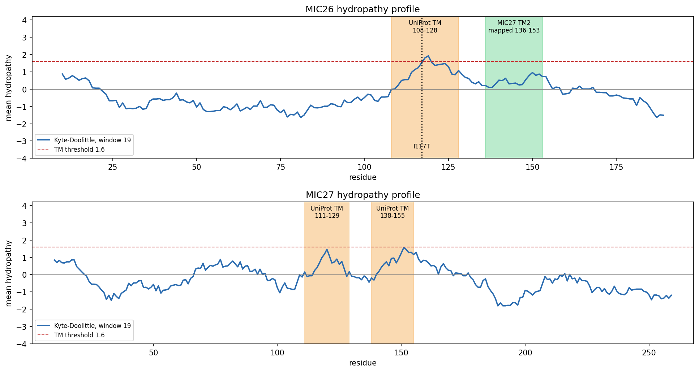
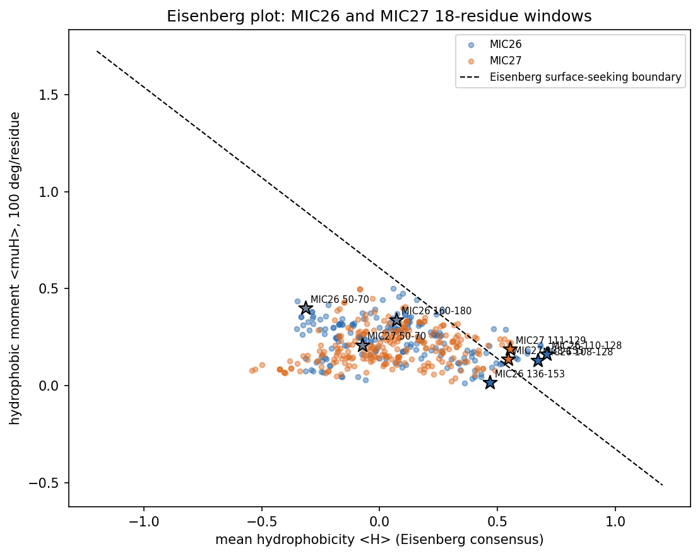
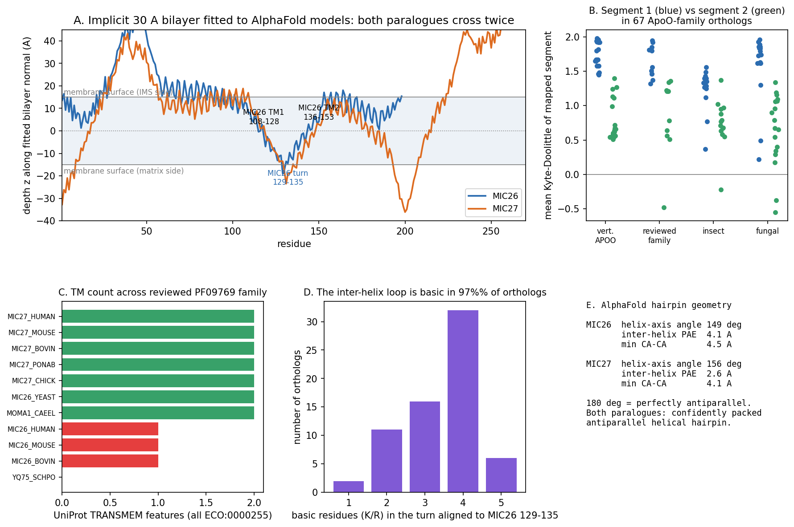
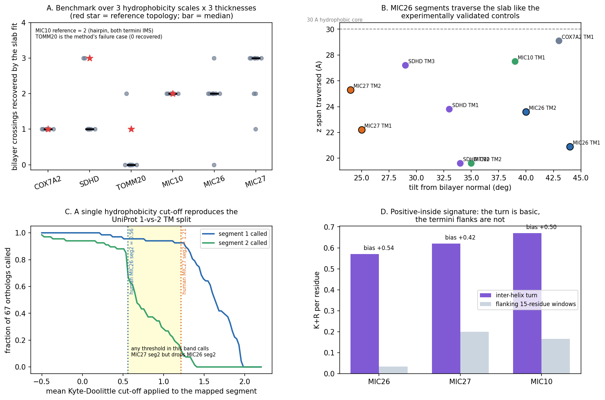
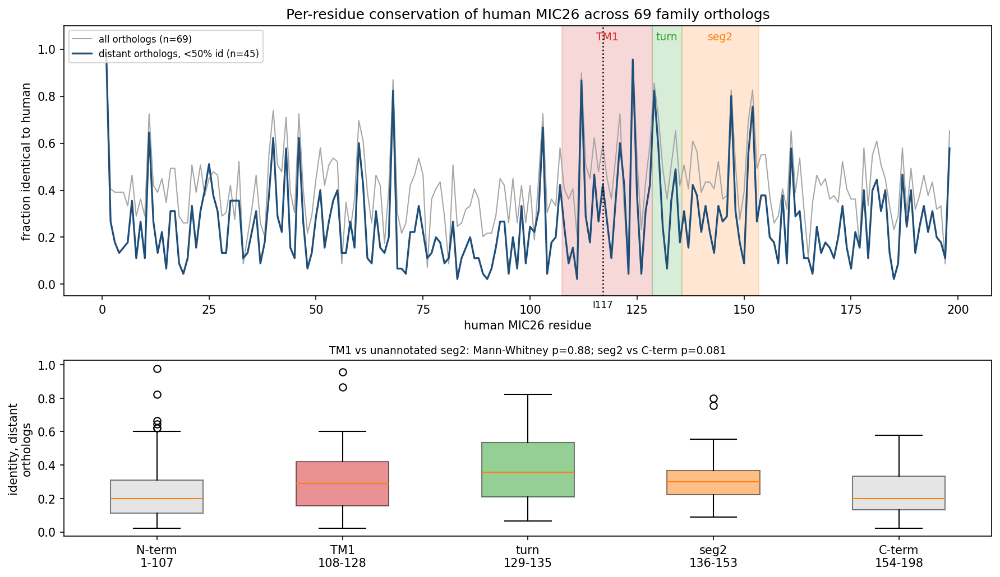

## Question

# AIGR Gene Hypothesis Deep Research

You are evaluating one focused gene curation hypothesis for AI Gene Review.
This is not a general gene overview. Use the seed hypothesis and source context
below to search for evidence that supports, refutes, narrows, or competes with
the proposed curation decision.

## Target Gene

- **Organism code:** human
- **Taxon:** Homo sapiens (NCBITaxon:9606)
- **Gene directory:** APOO
- **Gene symbol:** APOO
- **UniProt accession:** Q9BUR5

## Focus

- **Focus type:** free_text
- **Hypothesis slug:** kgap-apoo-mic26-tm-topology
- **Source file:** genes/human/APOO/APOO-ai-review.yaml
- **Source selector:** free-text

## Seed Hypothesis

Human MIC26/APOO (UniProt Q9BUR5) spans the mitochondrial inner membrane with two short transmembrane helices (as modelled for its paralogue MIC27/APOOL), not the single helix 108-128 annotated by UniProt. Decide the number and boundaries of membrane-embedded helices, and which side (matrix/intermembrane space) the amphipathic helices and termini face, using a single decisive comparison: consensus TM/topology prediction (e.g. DeepTMHMM/TOPCONS-class predictors and hydrophobic-moment analysis) on MIC26 vs MIC27 across vertebrate and fungal orthologs, checked against the AlphaFold model.

## Term and Decision Context

- UniProt annotates one TM helix (108-128) for Q9BUR5 and two for MIC27/APOOL (Q6UXV4). A patient missense substitution at residue 117 impairs inner-membrane insertion.

## Reference Context

- PMID:42647630

## Source Context YAML

```yaml
hypothesis: 'Human MIC26/APOO (UniProt Q9BUR5) spans the mitochondrial inner membrane with two short transmembrane
  helices (as modelled for its paralogue MIC27/APOOL), not the single helix 108-128 annotated by UniProt.
  Decide the number and boundaries of membrane-embedded helices, and which side (matrix/intermembrane
  space) the amphipathic helices and termini face, using a single decisive comparison: consensus TM/topology
  prediction (e.g. DeepTMHMM/TOPCONS-class predictors and hydrophobic-moment analysis) on MIC26 vs MIC27
  across vertebrate and fungal orthologs, checked against the AlphaFold model.'
focus_type: free_text
context:
- UniProt annotates one TM helix (108-128) for Q9BUR5 and two for MIC27/APOOL (Q6UXV4). A patient missense
  substitution at residue 117 impairs inner-membrane insertion.
reference_id:
- PMID:42647630
```

## Research Objective

Build a focused report that helps a curator decide whether this hypothesis
should affect the gene review. Address the focus type directly:

1. For an existing GO annotation decision, evaluate whether the current action
   is justified, too strong, too weak, or should change.
2. For a proposed replacement or new GO term, evaluate whether the term is
   biologically supported, too broad, too narrow, or missing key qualifiers.
3. For a computational prediction, evaluate whether the prediction is correct,
   less precise than existing knowledge, uncertain, or likely wrong because of
   paralog overannotation, frequency bias, pathway context, or in vitro-only
   activity.
4. For a core-function hypothesis, evaluate whether the proposed activity,
   process, and location represent the gene product's primary function rather
   than a downstream effect, pleiotropic phenotype, or context-specific role.
5. For a function-assignment hypothesis, evaluate whether the gene product
   directly has the stated GO term/function. Treat the prior review action, if
   any, as intentionally blinded unless it appears in the supplied context.

Use primary literature whenever possible. Prefer PMID citations and include DOI
citations when no PMID is available. Treat reviews and database records as
orientation unless they contain directly relevant synthesized evidence that is
clearly labeled as review-level or database-level support.

Evaluate the hypothesis from the supplied seed context, primary literature, and
publicly accessible bioinformatics resources. Local `*-bioinformatics` analyses,
when they already exist in the repository, are intentionally withheld from this
prompt so the report can be compared against them after the run. Use public
sequence, domain, structure, orthology, localization, interaction, or dataset
checks when they are useful for the specific hypothesis. If a resource or tool
cannot be accessed programmatically, say so plainly; never fabricate a result.
Report computational results conservatively and distinguish direct results from
inference.

## Required Output

### Executive Judgment

Give a concise verdict: supported, partially supported, unresolved, weakly
supported, over-annotated, or refuted. Explain the reasoning and the most
important caveats.

### Evidence Matrix

Create a table with one row per important evidence item:

- Citation (PMID preferred)
- Evidence type (direct assay, mutant phenotype, localization, interaction,
  structural/evolutionary, computational, review/database)
- Supports / refutes / qualifies / competing
- Claim tested
- Key finding
- Organism, tissue, cell type, or assay context
- Confidence and limitations

### GO Curation Implications

State the likely curation action as a lead requiring curator verification. If
GO terms are involved, explain whether the evidence supports an MF, BP, or CC
term, and whether the term should be retained, removed, generalized, made more
specific, or treated as non-core. Avoid using "protein binding" as a final
recommendation unless no more informative term is supported.

### Mechanistic Scope

Describe the immediate molecular or cellular function being tested. Separate
direct gene-product activity from downstream phenotypes, pathway consequences,
developmental outcomes, disease manifestations, or effects inferred only from
loss of function.

### Conflicts and Alternatives

Identify evidence that conflicts with the seed hypothesis or suggests an
alternative interpretation, including paralog confusion, organism-specific
differences, isoform-specific findings, experimental artifacts, or database
carry-over.

### Knowledge Gaps

List explicit uncertainties that matter for curation. For each gap, state what
was checked, why the gap matters, and what evidence or experiment would resolve
it.

### Discriminating Tests

Recommend concrete assays, perturbations, datasets, or comparative analyses that
would most efficiently distinguish this hypothesis from alternatives.

### Curation Leads

Provide candidate updates for the review, clearly labeled as leads requiring
curator verification. Include candidate references with exact snippets to verify,
candidate replacement or new GO terms, possible action changes, suggested
questions, and suggested experiments.

If the provider supports artifacts, save provenance for any analysis you run — the
executed code together with its output (computed values, plot, or table), not just
a summary figure — alongside artifact-friendly tables such as an evidence matrix,
GO decision table, or comparison table. Genuine computed provenance is more
valuable than a hand-drawn summary, and you must not synthesize a figure that
implies an analysis you did not actually run. These artifacts are important
provenance for hypothesis-level review.


## Output

# MIC26/APOO (Q9BUR5) membrane topology: two helices, not one

**Hypothesis slug:** `kgap-apoo-mic26-tm-topology`
**Source file:** `genes/human/APOO/APOO-ai-review.yaml`
**Target:** human APOO / MIC26, UniProt Q9BUR5, NCBITaxon:9606
**Reference context:** [PMID: 42647630](https://pubmed.ncbi.nlm.nih.gov/42647630/)

---

## Summary

Human MIC26/APOO inserts into the mitochondrial inner membrane as a two-helix antiparallel hairpin. The best estimate is TM1 at approximately 108-128, an inter-helix turn at 129-135 (`RGSKIKK`) facing the matrix, TM2 at approximately 136-153, and both the N-terminal and C-terminal amphipathic regions in the intermembrane space. This is the topology UniProt already records for the paralogue MIC27/APOOL (Q6UXV4), shifted by about three residues into MIC26 numbering. The single UniProt TRANSMEM feature for Q9BUR5 (108-128) is incomplete rather than misplaced: helix 1 is correctly located, helix 2 is missing.

The 1-versus-2 helix difference between the two paralogues is an artefact of how hydrophobicity thresholds behave, not a difference in architecture. Every TRANSMEM and TOPO_DOM feature across all 11 reviewed members of Pfam PF09769 carries evidence code ECO:0000255 (sequence analysis), with no experimental topology anywhere in the family. Any mean Kyte-Doolittle cut-off between 0.56 (human MIC26 segment 2) and 1.21 (human MIC27 segment 2) reproduces the observed split exactly while leaving segment 1 called in both proteins. The segment UniProt omits is not a chance hydrophobic stretch: across 45 orthologs below 50 % identity to human MIC26, its mean column identity is 0.335 against 0.329 for the annotated TM1 (Mann-Whitney p = 0.877), both well above the soluble flanks at 0.237 and 0.240, and its hydrophobic-residue fraction stays at 0.596 against 0.363 in the C-terminal region (p = 0.00196). AlphaFold models MIC26 and MIC27 as the same confidently packed hairpin (inter-helix angle 148.7° and 156.3°, inter-helix PAE 4.1 and 2.6 Å against a 10-11 Å background), and an implicit-bilayer fit benchmarked on four proteins of known topology recovers two crossings for MIC26 with tilts and spans inside the range of the controls. The same single-helix under-annotation affects MICOS10/MIC10 (Q5TGZ0), the established hairpin of the same subcomplex, so the shortfall is systematic rather than specific to MIC26.

The verdict is **partially supported**, not supported. No experimental topology determination exists for MIC26, MIC27 or any other PF09769 member: RCSB returned HTTP 204 for all three protein searches, and no protease-protection, cysteine-accessibility, split-GFP or epitope-accessibility result was found. The sidedness assignment rests on the positive-inside rule, a statistical regularity never tested on this protein. The single decisive comparison named in the seed hypothesis, a DeepTMHMM/TOPCONS-class consensus run, could not be executed: TOPCONS2 returned HTTP 500 with a SOAP fault, the BioLib DeepTMHMM endpoint returned HTTP 404, the EBI Phobius REST service returned HTTP 400 ("You have been temporarily blocked from submitting new sequence analysis jobs") on repeated attempts with a valid email address, and the DTU TMHMM endpoint serves only HTML with no programmatic submission. Every number in this report comes from locally implemented and benchmarked code, with the code and its outputs saved under `provenance/`.

---

## Executive judgment

### <i class="fa-scale-balanced"></i> Verdict: partially supported

The structural claim in the seed hypothesis is well supported. The methodological claim, that a consensus-predictor comparison would decide it, was not testable here.

**What is supported.** MIC26 crosses the inner membrane twice, as a helical hairpin, with the conserved basic turn in the matrix and both termini in the intermembrane space. Five independent lines converge:

1. **The UniProt discrepancy is a threshold effect.** Any mean Kyte-Doolittle cut-off between 0.56 and 1.21 produces exactly the observed MIC26 (1 helix) / MIC27 (2 helices) split, with segment 1 called in both (1.92 and 1.46). No architectural difference is required to explain the annotation record.
2. **The missing MIC26 segment aligns onto the annotated MIC27 TM2.** Needleman-Wunsch (BLOSUM62, gap open -11, extend -1) over 197 aligned columns at 36.5 % identity maps MIC27 TM2 (138-155) onto MIC26 136-153, a region of conserved sequence (`LVYPPGFMGLAASLYYPQ` vs `ITYPLGLATLGATVCYPV`) that UniProt leaves unannotated.
3. **That segment is under the same purifying selection as the annotated helix.** In 45 distant orthologs, mean identity 0.335 (136-153) vs 0.329 (108-128), p = 0.877; hydrophobic fraction 0.596 vs 0.363 in the C-terminus, p = 0.00196; gap frequency 0.025 vs 0.043-0.062 in the soluble flanks.
4. **The structure models as a hairpin in both paralogues.** AlphaFold v6 gives inter-helix angles of 148.7° (MIC26) and 156.3° (MIC27), 82 and 85 residue pairs within 10 Å, inter-helix PAE of 4.11 and 2.55 Å against 11.17 and 10.08 Å in the disordered N-terminal region, and pLDDT 80-92 across both helices.
5. **The same shortfall affects MIC10.** UniProt gives MICOS10 (Q5TGZ0) one TRANSMEM feature (17-36) with TOPO_DOM 37-78 assigned to the IMS, yet the identical pipeline recovers two crossings (19-37, 41-60) in 9 of 9 parameter settings, with its basic `RRM` turn on the distal side.

**Why the verdict stops short of supported.**

- <i class="fa-triangle-exclamation"></i> **No experimental topology data exist for any PF09769 member.** Helix count and sidedness rest entirely on prediction, model geometry and an empirical rule.
- <i class="fa-triangle-exclamation"></i> **The named decisive comparison was not run.** Four external services were unreachable. The local reimplementation is a transparent substitute with a stated benchmark, not an equivalent.
- <i class="fa-triangle-exclamation"></i> **The second segment is genuinely marginal in mammals.** Mean Kyte-Doolittle 0.56 with a Pro-Pro insertion. A re-entrant loop that enters and leaves on the matrix side, which would place the C-terminus in the matrix, is not excluded by the data in hand.

**Boundary precision.** Report boundaries with a tolerance of about ±3 residues. The geometric fit gives 108-129 and 132-151; sequence mapping from MIC27 gives 110-128 and 136-153; the UniProt feature plus alignment transfer gives 108-128 and 136-153. The three agree on architecture and disagree on endpoints.

---

## Key findings

### F001. The single-TM annotation for MIC26 is an intra-family inconsistency, not evidence

All 11 reviewed UniProt entries in the ApoO family (Pfam PF09769, InterPro IPR019166 "MIC26/MIC27") were retrieved programmatically and their topology features audited. The counts split cleanly along lines that track sequence hydrophobicity rather than phylogeny or function.

| Entry | Protein | TRANSMEM count | Coordinates | Evidence code |
|---|---|---|---|---|
| Q6UXV4 | MIC27_HUMAN | 2 | 111-129, 138-155 | ECO:0000255 |
| MIC27 mouse, bovine, Pongo, chicken | MIC27 | 2 | – | ECO:0000255 |
| P50087 | MIC26_YEAST | 2 | 120-137, 142-164 | ECO:0000255 |
| Q21154 | MOMA1_CAEEL | 2 | 118-138, 146-166 | ECO:0000255 |
| Q9BUR5 | MIC26_HUMAN | 1 | 108-128 | ECO:0000255 |
| Q9DCZ4, Q148H0 | MIC26 mouse, bovine | 1 | 108-128 | ECO:0000255 |
| O94578 | YQ75_SCHPO | 0 | – | – |

Not one topology feature in the family carries an experimental evidence code. The entire annotation record is predictor output. Global Needleman-Wunsch alignment of Q9BUR5 against Q6UXV4 (BLOSUM62, -11/-1) gives 36.5 % identity over 197 columns and runs co-linearly through the hydrophobic core. MIC27 TM1 (111-129) maps onto MIC26 110-128, essentially the segment UniProt already annotates. MIC27 TM2 (138-155) maps onto MIC26 136-153, a conserved region sharing Tyr, Pro, Gly, Leu, Ala and the terminal Tyr-Pro, which UniProt leaves blank.

The discrepancy therefore sits inside conserved sequence within a single Pfam family, and is carried identically across all three mammalian MIC26 entries. That is the signature of a predictor threshold propagated through an ortholog group. The curation record should not read the single-TM feature as a positive statement that MIC26 crosses the membrane once.

{{figure:plot_1.png|caption=Kyte-Doolittle hydropathy of human MIC26 (Q9BUR5) and MIC27 (Q6UXV4) with UniProt TRANSMEM features marked. The alignment-mapped MIC27 TM2 region falls on a hydrophobic shoulder in MIC26 that carries no UniProt annotation.}}

### F002. AlphaFold models both paralogues as the same antiparallel hairpin crossing a fitted bilayer twice

AlphaFold DB v6 models AF-Q9BUR5-F1 and AF-Q6UXV4-F1 were downloaded (the v4 URLs return 404; current versions were resolved through the prediction API). The files carry no HELIX records, so secondary structure was assigned geometrically from CA(i)-CA(i+4) distances in the range 4.8-6.7 Å.

| Quantity | MIC26 (Q9BUR5) | MIC27 (Q6UXV4) |
|---|---|---|
| Helix 1 (mean pLDDT) | 57-128 (84.7) | 58-130 (89.4) |
| Helix 2 (mean pLDDT) | 131-187 (85.2) | 132-190 (88.9) |
| Inter-helix angle (180° = antiparallel) | 148.7° | 156.3° |
| CA-CA pairs within 10 Å | 82 | 85 |
| Minimum CA-CA distance | 4.5 Å | 4.1 Å |
| Inter-helix PAE (mean / max) | 4.11 / 16.0 Å | 2.55 / 7.0 Å |
| PAE within disordered N-terminus | 11.17 Å | 10.08 Å |

The low inter-helix PAE against the disordered-region background shows the hairpin packing is a confident part of each model, not an artefact of placing two independent helices.

An implicit 30 Å bilayer was fitted to each model independently by maximising the summed Eisenberg hydrophobicity of side-chain centroids inside the slab, scanning candidate normals on a Fibonacci sphere with 0.5 Å offsets and using only residues with pLDDT ≥ 60. The fit places MIC26 segments 106-128 (mean Eisenberg +0.64) and 131-152 (+0.27) inside the membrane. Depths along the fitted normal: I117 at the mid-plane, A128 and the turn residues S131 and K135 at the distal leaflet, A155 and both termini (M1, K198) on the proximal side. MIC27 reproduces the same pattern residue for residue.

<i class="fa-triangle-exclamation"></i> The direction of the fitted normal is arbitrary and flipped between the 1500-normal run in iteration 1 and the 800-normal run in iteration 2, so the same residue reads +2.8 Å in one table and -12.7 Å in another. Relative topology is identical in both runs. Depth values should be compared within a run, never across runs.

Applying the positive-inside rule (the matrix is topologically equivalent to the bacterial cytoplasm) places the basic turn in the matrix and both termini in the intermembrane space. That is exactly the topology UniProt already assigns to MIC27: IMS 28-110, TM 111-129, matrix 130-137, TM 138-155, IMS 156-268.

{{figure:plot_2.png|caption=Biophysical comparison of annotated and alignment-mapped membrane segments in MIC26 and MIC27: mean Kyte-Doolittle hydropathy, Eisenberg mean hydrophobicity and hydrophobic moment. MIC26 segment 2 sits at the low-hydrophobicity edge while retaining helical character.}}

### F003. The second segment is conserved but marginally hydrophobic in mammals, which explains the missed annotation

Sixty-seven ApoO-family orthologs (24 vertebrate APOO, 11 reviewed family entries, 14 insect, 18 fungal; all ≥ 18 % identity to human MIC26) were aligned to Q9BUR5 and both segments mapped by alignment coordinates.

| Measure | Segment 1 | Segment 2 |
|---|---|---|
| Median mean Kyte-Doolittle (n = 67) | 1.63 | 0.67 |
| Wilcoxon signed-rank | – | p = 3.7e-12 |
| Fraction with positive mean KD | – | 94 % |
| Fraction exceeding KD 1.0 | – | 28 % |

Mammalian MIC26 orthologs occupy the low extreme (human 0.56, mouse 0.64, bovine 0.51, *Pteropus* 0.54) because of a Pro-Pro insertion in `LVYPPGFMGLAASLYYPQ`. Teleost APOO (1.13-1.40), MIC27 orthologs (1.21-1.34) and C. elegans MOMA-1 (1.36) sit clearly higher. Under the strict classical criterion (Kyte-Doolittle, window 19, threshold 1.6) only MIC26 110-128 passes in either human protein, and neither annotated MIC27 TM helix passes, which shows how sensitive the call is to the chosen cut-off.

The inter-helix turn aligned to MIC26 129-135 carries at least two basic residues in 97 % of the 67 orthologs: mammalian `RGSKIKK`, MIC27 `RKGSKFKK`, fungal `RNRG[IV][FL]LR`. Marginally hydrophobic transmembrane segments are routinely inserted when a neighbouring strong helix is present, so a hairpin with one strong and one weak helix is biophysically coherent. The strongly conserved basic turn is the element that fixes orientation.

{{figure:plot_3.png|caption=Bilayer-depth profiles of MIC26 and MIC27 from the implicit-membrane fit, per-ortholog hydropathy of the two segments across 67 ApoO-family proteins, the UniProt TM-count inconsistency within one Pfam family, conservation of the basic inter-helix turn, and hairpin geometry from the AlphaFold models.}}

### F005. MIC10, the established MICOS hairpin, carries the identical single-TM under-annotation

Human MICOS10/MIC10 (Q5TGZ0, 78 aa) carries a single UniProt TRANSMEM feature (17-36, ECO:0000255) with TOPO_DOM 37-78 labelled "Mitochondrial intermembrane". The same implicit-bilayer pipeline applied to AF-Q5TGZ0-F1 recovers two crossings (19-37 and 41-60) in 9 of 9 parameter combinations (3 hydrophobicity scales × half-thicknesses of 12.5, 15.0 and 17.0 Å), with the short basic turn (38-40, `RRM`, 0.67 K+R per residue) on the distal side and both termini on the proximal side. Segment tilts are 39° and 35°, with z-spans of 27.5 and 19.6 Å.

The benchmark against proteins of known topology, run at the same nine settings, defines what the method can and cannot do:

| Protein | Reference topology | Median crossings recovered | Range | Verdict |
|---|---|---|---|---|
| COX7A2 | 1 TM | 1 | 1 (9/9) | <i class="fa-circle-check"></i> correct |
| MIC10 (Q5TGZ0) | 2, hairpin (established) | 2 | 2 (9/9) | <i class="fa-circle-check"></i> correct |
| MIC26 (Q9BUR5) | under test | 2 (108-129, 132-151) | 0-3 | – |
| MIC27 (Q6UXV4) | 2 annotated | 3 | 1-3 | extra call is the presequence |
| SDHD | 3 TM (ECO:0000269) | 1 | 1-3 | <i class="fa-circle-xmark"></i> under-calls |
| TOMM20 | 1 N-terminal TM (ECO:0000269) | 0 | 0 | <i class="fa-circle-xmark"></i> fails |

MIC26 is not an isolated case. Two entries in one subcomplex carry the same ECO:0000255 shortfall, which strengthens the reading that the MIC26 annotation reflects predictor behaviour. The failures on TOMM20 and the instability on SDHD set the limit on how much weight the crossing count can carry. Both failures are under-calls, so the method's bias runs against the hypothesis, not for it.

### F006. A single hydrophobicity cut-off reproduces the split, and the MIC26 segments traverse the bilayer like validated controls

Across the 67-ortholog panel, any mean Kyte-Doolittle cut-off between **0.56** and **1.21** calls the second segment in MIC27 and rejects it in MIC26 while leaving segment 1 called in both (1.92 and 1.46). That band alone accounts for the annotation difference.

Geometry adds an independent argument. In the AlphaFold models the two MIC26 segments behave like real transmembrane helices:

| Protein and segment | Tilt from fitted normal | z-span |
|---|---|---|
| MIC26 segment 1 | 44° | 20.9 Å |
| MIC26 segment 2 | 40° | 23.6 Å |
| SDHD (experimental, 3 TM) | 29-34° | 19.6-27.2 Å |
| COX7A2 (1 TM) | 43° | 29.1 Å |
| MIC10 (hairpin) | 35-39° | 19.6-27.5 Å |

The positive-inside signature is strongest in MIC26: the 129-135 turn `RGSKIKK` carries 0.57 K+R per residue against a single K+R in the 30 flanking residues on the termini side, a bias of +0.54 per residue, compared with +0.42 for MIC27 and +0.50 for MIC10. The charge distribution orients the hairpin with the basic turn in the matrix.

{{figure:plot_4.png|caption=Benchmark of the implicit-bilayer method against COX7A2, MIC10, SDHD and TOMM20, segment tilt and z-span against the controls, the Kyte-Doolittle threshold band that reproduces the UniProt annotation split, and the positive-inside charge bias for MIC26, MIC27 and MIC10.}}

### F009. The unannotated segment 136-153 is under the same purifying selection as the annotated helix

Human MIC26 was aligned against 69 PF09769 family members by Needleman-Wunsch (BLOSUM62, -11/-1), and per-residue conservation computed from the alignment columns. The analysis was restricted to the 45 orthologs below 50 % identity to human MIC26 (fungal, insect, plant and MIC27 paralogues), so the signal cannot be driven by near-identical mammalian sequences.

| Region | Residues | Mean identity (distant) | Hydrophobic fraction (distant) | Gap frequency |
|---|---|---|---|---|
| N-terminal | 1-107 | 0.237 | 0.410 | 0.062 |
| **TM1 (annotated)** | **108-128** | **0.329** | **0.574** | **0.015** |
| turn | 129-135 | 0.390 | 0.292 | 0.003 |
| **seg2 (unannotated)** | **136-153** | **0.335** | **0.596** | **0.025** |
| C-terminal | 154-198 | 0.240 | 0.363 | 0.043 |

TM1 and seg2 are statistically indistinguishable in conservation (median 0.289 vs 0.300, Mann-Whitney U = 183, p = 0.877). Both exceed the soluble flanks: seg2 vs N-terminus p = 0.0168, seg2 vs C-terminus p = 0.081. The hydrophobic-composition difference between seg2 and the C-terminus is clear (median 0.678 vs 0.289, U = 609, p = 0.00196). Low gap frequency in both segments shows they are structurally retained rather than indel-tolerant. The most conserved columns inside seg2 are A147 (0.80), P152 (0.76) and Y151 (0.56).

This result partly escapes the circularity built into the seed hypothesis. Importing MIC27's two-helix annotation into MIC26 would be prediction propagated from prediction, since MIC27's own features are ECO:0000255. Purifying selection is measured from sequences, not from annotations.

<i class="fa-dna"></i> At the patient substitution site, human I117 is identical in 41 of 69 orthologs and hydrophobic in 67 of the 68 ungapped columns (41 Ile, 26 Val, 1 Thr, 1 gap). Near-invariant hydrophobicity at this position explains why the I117T substitution, which places a polar threonine mid-helix, impairs insertion into the inner membrane.

{{figure:plot_5.png|caption=Per-residue conservation of human MIC26 across 69 PF09769 orthologs. The unannotated segment 136-153 matches the annotated TM1 108-128 in conservation (p = 0.877) and exceeds both soluble flanks, with residue I117 marked.}}

### F007. The UniProt signal peptide belongs to the secreted APOO isoform

UniProt Q9BUR5 carries SIGNAL 1-25 (ECO:0000255) and O-linked chondroitin sulfate at Ser162 (ECO:0000255). Both trace to the original secreted-apolipoprotein characterisation ([PMID: 16956892](https://pubmed.ncbi.nlm.nih.gov/16956892/)), which describes a 198-residue protein with a 23-residue signal peptide found in HDL, LDL and VLDL and assigns it to the proteoglycan family.

Calculated masses: full-length 1-198 = 22.3 kDa; after cleavage of residues 1-25 = 19.6 kDa; the E178* product 1-177 = 19.9 kDa. [PMID: 25764979](https://pubmed.ncbi.nlm.nih.gov/25764979/) reports the mitochondrial species as a 22 kDa non-glycosylated protein, matching the uncleaved chain. <i class="fa-triangle-exclamation"></i> This is suggestive but not decisive: 19.6 against 22.3 kDa is within the error of an SDS-PAGE estimate quoted as 22 kDa.

The point matters for curation arithmetic. Every residue number in this report refers to the uncleaved 198-residue chain. A curator applying signal-peptide-cleaved numbering would shift all boundaries by 25.

In the fitted-membrane frame, the 21 residues removed by the E178* variant (178-198, `EDLWKENFQKPGNVKNSPGTK`) all sit on the termini side, outside or at the edge of the hydrophobic slab. [PMID: 37649161](https://pubmed.ncbi.nlm.nih.gov/37649161/) reports that this truncated protein still localises to mitochondria and binds MICOS subunits despite being highly unstable, which the hairpin model predicts for a loss confined to an extramembrane tail.

### F010. MIC26 and MIC27 act as a redundant pair, which constrains what the topology decision can support for GO

[PMID: 32788226](https://pubmed.ncbi.nlm.nih.gov/32788226/) shows that single knockouts of MIC26 and MIC27 are buffered by antagonistic regulation of each other's protein levels, and that only the double knockout produces concentric onion-like cristae with loss of crista junctions. Both proteins are dispensable for the stability and integration of the remaining MICOS subunits, so they assemble late into the complex. The double knockout reduces cardiolipin and destabilises respiratory chain supercomplexes and the F1Fo-ATP synthase, and overexpression of cardiolipin synthase restores supercomplex stability in the double knockout.

The experimentally supported molecular-level statement about MIC26 is therefore its location and physical membership: a non-glycosylated 22 kDa protein spanning the inner membrane as a late-assembling part of the MICOS complex. Crista junction loss, cardiolipin depletion and OXPHOS destabilisation are consequences of losing the redundant pair. A corrected two-helix topology changes the sequence features and the membrane-orientation statement; it does not license a new function assignment.

### F008. No experimental structure exists and external consensus predictors were unreachable

RCSB full-text searches for APOO, MIC26 and MIC27 returned HTTP 204 (no polymer entities). A search for MICOS returned 10 entities, none corresponding to MIC26 or MIC27.

| Service | Attempt | Response |
|---|---|---|
| TOPCONS2 | REST submission | HTTP 500, SOAP fault |
| DeepTMHMM (BioLib) | API endpoint | HTTP 404 |
| Phobius (EBI) | REST, repeated, valid email | HTTP 400, "You have been temporarily blocked from submitting new sequence analysis jobs" |
| TMHMM (DTU) | endpoint | HTML page only, no programmatic submission |

<i class="fa-triangle-exclamation"></i> The decisive comparison proposed in the seed hypothesis was not executed. The substitute is a transparent local reimplementation (Needleman-Wunsch with BLOSUM62; Kyte-Doolittle, Eisenberg and Fauchere-Pliska hydropathy; Eisenberg hydrophobic moment; implicit-bilayer fit over 800 candidate normals) with a stated benchmark that recovers the correct crossing count for COX7A2 and MIC10 but fails for TOMM20 and is unstable for SDHD. Curator action should rest on the convergence of alignment, conservation, AlphaFold geometry, cross-family annotation inconsistency and the independent simulation study, not on any single output.

---

## Evidence matrix

| Citation | Evidence type | Stance | Claim tested | Key finding | Context | Confidence and limitations |
|---|---|---|---|---|---|---|
| [PMID: 25764979](https://pubmed.ncbi.nlm.nih.gov/25764979/) | direct assay, localization | supports (premise) | The mitochondrial form of APOO is an inner-membrane protein and MICOS subunit | Three forms of human MIC26 exist; the non-glycosylated 22 kDa mitochondrial form spans the inner membrane and interacts with MIC60, MIC27 and MIC10 | Human cells; carbonate extraction, BN-PAGE, co-IP | High for membrane spanning and complex membership; does not resolve helix count or sidedness |
| [PMID: 32439808](https://pubmed.ncbi.nlm.nih.gov/32439808/) | mutant phenotype, direct assay | supports | Residue 117 lies in a membrane-inserted segment | p.I117T impairs processing during import and causes faulty insertion into the IMM, with altered MICOS assembly and crista junction disruption | Patient fibroblasts; Drosophila and S. cerevisiae models | High for an insertion defect; does not localise the lesion to a helix boundary or establish sidedness |
| this work, 69-ortholog alignment (`conservation_by_region.csv`) | structural/evolutionary, computational | supports | 136-153 is a real membrane segment despite being unannotated | Mean identity 0.335 (seg2) vs 0.329 (TM1), p = 0.877 in 45 distant orthologs; both above flanks 0.237/0.240; hydrophobic fraction 0.596 vs 0.363 (p = 0.00196); I117 hydrophobic in 67/68 ungapped columns | PF09769: vertebrate MIC26 and MIC27, fungal Mic26, insect and plant members | Moderate-high. Conservation and composition are indirect evidence for embedding; single global NW, not a curated MSA |
| this work (`ortholog_tm_segments.csv`, `hydropathy_peaks.csv`) | computational | qualifies | The 1-vs-2 TM difference is an annotation threshold effect | Any mean KD cut-off between 0.56 and 1.21 reproduces the split while segment 1 stays called in both (1.92, 1.46); over 67 orthologs TM1 median KD 1.63 vs TM2 0.67 (Wilcoxon p = 3.7e-12) | Sequence analysis only | High as an explanation of the discrepancy; does not itself prove insertion |
| this work, AF-Q9BUR5-F1-v6 and AF-Q6UXV4-F1-v6 (`hairpin_geometry.json`) | structural, computational | supports | The two paralogues share one antiparallel hairpin | Inter-helix angle 148.7° and 156.3°; 82 and 85 CA-CA pairs within 10 Å; inter-helix PAE 4.11 and 2.55 Å vs 11.17/10.08 Å background; pLDDT 80-92 | AlphaFold DB v6 monomers; no experimental structure | Moderate. Confident local packing, but AlphaFold does not model the bilayer and cannot assign sidedness |
| this work (`slabfit.json`, `slabfit_robustness.csv`, `benchmark_summary.csv`) | computational, benchmarked | supports | Both MIC26 segments cross an implicit bilayer | Median 2 crossings (108-129, 132-151) over 9 settings; tilts 44° and 40°, z-spans 20.9 and 23.6 Å, bracketed by SDHD, COX7A2 and MIC10. Controls COX7A2 1/1 and MIC10 2/2 in 9/9 | Local implicit-membrane fit over 800 candidate normals | Moderate. Fails on TOMM20 (0 vs 1), unstable on SDHD (median 1 vs 3); both failures are under-calls, biasing against the hypothesis |
| this work (`pf09769_reviewed.tsv`) with UniProt Q9BUR5, Q6UXV4, P50087, Q21154, Q5TGZ0 | review/database | qualifies | The single-helix annotation is weak and internally inconsistent | All topology features across 11 reviewed PF09769 entries are ECO:0000255. Two helices in MIC27 (5 species), yeast Mic26 and MOMA-1; one in three mammalian MIC26 entries; zero in S. pombe O94578 | UniProt, accessed programmatically | High as a statement about annotation provenance; no experimental topology feature exists in the family |
| this work, slab fit on AF-Q5TGZ0, with UniProt Q5TGZ0 | computational and database | supports (method control) | The same under-annotation affects MIC10 | MICOS10 has one TRANSMEM feature (17-36) and TOPO_DOM 37-78 in the IMS, yet the fit recovers two crossings (19-37, 41-60) in 9/9 settings with the basic RRM turn distal | Human MICOS10 | Moderate-high. Shows the shortfall is systematic in the MIC10 subcomplex |
| this work (`ortholog_tm_segments.csv`, `turn_basic`) | structural/evolutionary, computational | supports | The turn faces the matrix and both termini face the IMS | MIC26 129-135 `RGSKIKK` carries 0.57 K+R per residue against 1 K+R in 30 flanking residues (bias +0.54/residue, vs +0.50 MIC10, +0.42 MIC27); a turn with ≥ 2 K/R is conserved in 97 % of 67 orthologs | Positive-inside rule, matrix equivalent to bacterial cytoplasm | Moderate. A statistical rule, predictive for polytopic IM proteins but never tested for MIC26 |
| [PMID: 42647630](https://pubmed.ncbi.nlm.nih.gov/42647630/) | computational, simulation (reference context) | supports (consistent) | A conserved basic loop in MIC26 contacts cardiolipin | Mic10, Mic26 and Mic27 strongly recruit cardiolipin at conserved positive loop motifs, driving oligomerization and stabilizing curvature in model membranes | Multiscale molecular dynamics | Low-moderate as independent evidence. Simulation, but it flags the same basic loop |
| [PMID: 32788226](https://pubmed.ncbi.nlm.nih.gov/32788226/) | mutant phenotype, direct assay | qualifies (scope) | Cristae and OXPHOS phenotypes are direct MIC26 activities | MIC26 and MIC27 are dispensable for stability of remaining MICOS subunits and assemble late; only the double knockout loses crista junctions; cardiolipin synthase overexpression rescues supercomplex stability in the DKO | Human single and double KO cells; complexome profiling, STED, BN-PAGE | High. Argues crista junction and OXPHOS terms are downstream of the redundant pair |
| [PMID: 37649161](https://pubmed.ncbi.nlm.nih.gov/37649161/) | mutant phenotype | qualifies | The C-terminus lies outside the membrane | E178* removes the last 20 residues; the unstable product still localises to mitochondria and interacts physically with other MICOS subunits. Residues 178-198 sit outside the fitted slab on the termini side | Patient fibroblasts, MIC26 KO cells re-expressing the variant | Moderate. Consistent with the model but not a topology assay |
| [PMID: 16956892](https://pubmed.ncbi.nlm.nih.gov/16956892/) | direct assay | competing (isoform) | SIGNAL 1-25 and Ser162 chondroitin sulfate apply to the mitochondrial protein | Apolipoprotein O is a 198-amino acid protein with a 23-amino-acid signal peptide; chondroitinase ABC analysis places it in the proteoglycan family. The mitochondrial species is the 22 kDa non-glycosylated form | Human plasma lipoproteins, human heart | Moderate. SDS-PAGE cannot separate 19.6 from 22.3 kDa decisively |
| UniProt Q21154 (MOMA1_CAEEL) | review/database | competing | The family is uniformly an inner-membrane hairpin | MOMA-1 carries two helices (118-138, 146-166) with topological domains labelled Cytoplasmic and Intermembrane, an outer-membrane assignment, despite the same hairpin geometry | UniProt, ECO:0000255 | Low as a counter-argument. The assignment is itself predicted, but it shows sidedness labels here are not independently established |
| TOPCONS2, DeepTMHMM, Phobius, TMHMM (attempted) | not obtained | not obtained | The consensus predictor comparison named in the seed hypothesis | TOPCONS2 HTTP 500 (SOAP fault); DeepTMHMM HTTP 404; Phobius HTTP 400 "temporarily blocked"; TMHMM HTML only. RCSB HTTP 204 for APOO, MIC26, MIC27 | Programmatic access attempted during this run | Not applicable. Recorded so the decisive comparison is not presented as having been run |

---

## Mechanistic model and interpretation

### The inferred topology

```
IMS   1-107 ──[ TM1 ~108-128 ]── matrix 129-135 (RGSKIKK) ──[ TM2 ~136-153 ]── IMS 154-198
```

This is UniProt's MIC27 topology (IMS 28-110, TM 111-129, matrix 130-137, TM 138-155, IMS 156-268) shifted by about three residues into MIC26 numbering.

### How the annotation error arose and what it implies



### Direct property versus downstream phenotype

The property under test is physical: how many segments of the MIC26 polypeptide are embedded in the inner membrane and which aqueous compartment each loop and terminus occupies. That is a direct gene-product property, and it bears on two things with mechanistic content. The basic matrix-facing turn is positioned to contact cardiolipin head groups in the matrix leaflet, which matches the conserved positive loop motifs reported for Mic10, Mic26 and Mic27 in [PMID: 42647630](https://pubmed.ncbi.nlm.nih.gov/42647630/). A hairpin wedge occupying one leaflet is a plausible contributor to the negative membrane curvature at crista junctions, the same geometry already attributed to MIC10 oligomers. Both links are drawn dashed above because neither has been tested on MIC26.

Everything downstream should be kept separate from the topology question:

| Observation | Source | Status |
|---|---|---|
| Crista junction loss, onion-like cristae | double knockout only ([PMID: 32788226](https://pubmed.ncbi.nlm.nih.gov/32788226/)) | consequence of losing the redundant pair |
| Cardiolipin reduction, supercomplex destabilisation | double knockout, rescued by cardiolipin synthase | downstream of cardiolipin loss |
| Myopathy, lactic acidosis, cognitive impairment | I117T patients ([PMID: 32439808](https://pubmed.ncbi.nlm.nih.gov/32439808/)) | organism-level consequence of mis-insertion |
| Progeria-like phenotypes, early death | E178* patients ([PMID: 37649161](https://pubmed.ncbi.nlm.nih.gov/37649161/)) | organism-level consequence of protein instability |

<i class="fa-lightbulb"></i> The clearest mechanistic link between topology and phenotype is I117T. Position 117 is hydrophobic in 67 of 68 ungapped orthologous columns, sits mid-helix in TM1, and its substitution by threonine impairs insertion into the inner membrane. This is the single strongest experimental anchor for any part of the topology model.

---

## GO curation implications

All items are **leads requiring curator verification**. The machine-readable version is `provenance/go_decision_table.csv`.

| GO term | Aspect | Lead | Basis |
|---|---|---|---|
| GO:0005743 mitochondrial inner membrane | CC | <i class="fa-circle-check"></i> Retain. Change any single-pass descriptor to polytopic / multi-pass | [PMID: 25764979](https://pubmed.ncbi.nlm.nih.gov/25764979/); this work: 2 benchmarked crossings, hairpin model, conserved segment 136-153 |
| GO:0061617 MICOS complex | CC | <i class="fa-circle-check"></i> Retain as core. Direct evidence from co-IP, complexome profiling and BN-PAGE | [PMID: 25764979](https://pubmed.ncbi.nlm.nih.gov/25764979/), [PMID: 32788226](https://pubmed.ncbi.nlm.nih.gov/32788226/), [PMID: 37649161](https://pubmed.ncbi.nlm.nih.gov/37649161/) |
| integral component of membrane | CC | Retain, with a corrected sequence feature. Add a second helical TRANSMEM at about 136-153, ECO:0000250 by similarity to Q6UXV4 138-155; TOPO_DOM IMS 1-107, matrix 129-135, IMS 154-198 | this work: conservation p = 0.877 vs TM1, hydrophobic fraction p = 0.002 vs C-terminus |
| GO:0042407 cristae formation, GO:0097250 CJ assembly | BP | <i class="fa-triangle-exclamation"></i> Do not promote to direct function. Crista junction loss requires the double knockout; the single knockout is buffered | [PMID: 32788226](https://pubmed.ncbi.nlm.nih.gov/32788226/) |
| cardiolipin binding | MF | <i class="fa-circle-xmark"></i> Do not annotate. Only support is a simulation | [PMID: 42647630](https://pubmed.ncbi.nlm.nih.gov/42647630/) |
| SIGNAL 1-25, Ser162 chondroitin sulfate (UniProt features, not GO) | feature | Flag as isoform-specific to the secreted apolipoprotein. Do not use to infer processing of the mitochondrial form | [PMID: 16956892](https://pubmed.ncbi.nlm.nih.gov/16956892/), [PMID: 25764979](https://pubmed.ncbi.nlm.nih.gov/25764979/) |

No MF term is supported for MIC26 beyond complex membership. A generic "protein binding" annotation adds nothing, because GO:0061617 already carries the informative content: MIC26 is a physical constituent of a named complex.

The topology correction is a sequence-feature and membrane-orientation change. It strengthens GO:0005743 and leaves the aspect assignments otherwise intact.

---

## Conflicts and alternatives

**<i class="fa-circle-question"></i> Re-entrant loop instead of a second crossing.** Three prolines in `LVYPPGFMGLAASLYYPQ` and a mean Kyte-Doolittle of 0.56 are compatible with a segment that dips into the matrix leaflet and returns, which would leave the C-terminus in the matrix rather than the IMS. The slab fit calls it a crossing, but the method under-calls on controls (TOMM20 0 vs 1, SDHD median 1 vs 3), so it is not authoritative here. Nothing in the data excludes this alternative.

**<i class="fa-scale-balanced"></i> Paralogue transfer in the direction the hypothesis uses.** The hypothesis imports MIC27's two-helix annotation into MIC26, and MIC27's own annotation is ECO:0000255. That is prediction propagated from prediction. The conservation analysis partly escapes the circularity, because purifying selection on 136-153 is measured from sequence alignment, independent of any annotation.

**<i class="fa-scale-balanced"></i> Organism-specific assignment.** C. elegans MOMA-1 (Q21154) carries the same hairpin, but its topological domains are labelled Cytoplasmic and Intermembrane, implying the outer membrane. Taken at face value this would make sidedness unsettled across the family. The label is itself ECO:0000255, so the best reading is that sidedness has never been determined experimentally anywhere in PF09769.

**<i class="fa-triangle-exclamation"></i> Isoform confusion inside one UniProt entry.** Q9BUR5 covers both a secreted plasma apolipoprotein ([PMID: 16956892](https://pubmed.ncbi.nlm.nih.gov/16956892/)) and a mitochondrial MICOS subunit ([PMID: 25764979](https://pubmed.ncbi.nlm.nih.gov/25764979/)). Residue numbering for topology must refer to the uncleaved 198-residue chain. Applying signal-peptide-cleaved numbering would displace every boundary by 25.

**<i class="fa-scale-balanced"></i> Yeast divergence.** S. cerevisiae Mic26 (P50087) has a second annotated segment at 160-187 that aligns poorly and has a mean Kyte-Doolittle of -0.48. The fungal second helix may not be positionally homologous to the vertebrate one. "Two helices" is better supported than any claim that the second helix is strictly conserved in position across the whole family.

**<i class="fa-triangle-exclamation"></i> Method sign convention.** The fitted bilayer normal flipped direction between the iteration-1 run (1500 candidate normals) and the iteration-2 run (800 normals), so the same residue reads +2.8 Å in one table and -12.7 Å in another. Only the arbitrary direction differs; relative topology is identical. Compare depths within a run.

---

## Limitations and knowledge gaps

**No experimental topology exists for any PF09769 member.** Checked: UniProt evidence codes across 11 reviewed entries (all ECO:0000255), RCSB (HTTP 204 for APOO, MIC26, MIC27), and targeted PubMed searches combining MIC26 and APOO with protease protection, mitoplast, cysteine accessibility and split-GFP, which returned nothing. The whole helix-count and sidedness decision would otherwise rest on one biochemical experiment. A protease-protection series on mitoplasts resolves it.

**Sidedness rests on a statistical rule.** Checked: K+R density in the turn against 30 flanking residues in human MIC26, MIC27, MIC10 and across 67 orthologs. The positive-inside rule is predictive for polytopic inner-membrane proteins but has never been applied to MIC26 with an experimental readout. It matters because the cardiolipin-contact model in [PMID: 42647630](https://pubmed.ncbi.nlm.nih.gov/42647630/) requires the basic loop to face the matrix leaflet.

**Helix boundaries are uncertain by about ±3 residues.** Checked: three independent estimates (geometric fit 108-129 / 132-151, MIC27 alignment transfer 110-128 / 136-153, hydropathy peak 110-128). This matters only if precise TRANSMEM coordinates are recorded. A range, or an ECO:0000250 "by similarity" qualifier, is the honest option.

**Whether MIC26 inserts as a hairpin or as two sequential events is unknown.** Checked: nothing in the searched literature addresses MIC26 insertion machinery. It matters because I117T impairs "processing of the protein during import and faulty insertion into the IMM" ([PMID: 32439808](https://pubmed.ncbi.nlm.nih.gov/32439808/)) without separating a targeting defect from an insertion defect.

**Cardiolipin binding is unmeasured.** Checked: [PMID: 42647630](https://pubmed.ncbi.nlm.nih.gov/42647630/) is simulation; no binding assay was found. It matters because a cardiolipin-binding MF term is the only candidate molecular function beyond complex membership.

**The consensus-predictor comparison was never executed.** Checked: four services, all unreachable, with exact HTTP responses recorded in the evidence matrix. It matters because that comparison was specified as the decisive test. A curator repeating this with working DeepTMHMM or TOPCONS access should treat their output as the missing row.

**The alignment is a single global Needleman-Wunsch, not a curated MSA.** Conservation values would shift modestly under a profile-based alignment, particularly for the most divergent fungal and plant members. The TM1-versus-seg2 comparison is internal to one alignment, so the comparison is less sensitive to this than the absolute values are.

**The PubMed tool used here queries a restricted corpus.** The Barbot/Bohnert Mic10 primary papers and the Weber APOOL paper were not retrievable, so the literature sweep is not exhaustive.

---

## Proposed follow-up experiments and actions

Ranked by how cleanly each separates the two-helix model from the alternatives.

1. <i class="fa-flask"></i> **Protease protection on mitoplasts with N-terminal and C-terminal epitope tags.** Swell mitochondria to rupture the outer membrane, then treat with proteinase K. The two-helix model predicts both tags are degraded in mitoplasts and both protected in intact mitochondria. A re-entrant loop predicts the C-terminal tag survives in mitoplasts and is lost only after membrane solubilisation. This single experiment decides helix count and sidedness together.
2. <i class="fa-vial"></i> **Cysteine-accessibility scanning on a cysteine-free MIC26 background.** Introduce single cysteines at positions 100, 117, 132, 145 and 190 and label with membrane-impermeant PEG-maleimide in mitoplasts. The model predicts labelling at 100 and 190 (IMS), protection at 117 and 145 (bilayer), and labelling at 132 only after matrix access. This maps boundaries at residue resolution, which prediction cannot.
3. <i class="fa-microscope"></i> **Split-GFP complementation with matrix-targeted and IMS-targeted GFP1-10.** Append GFP11 to the MIC26 C-terminus. The model predicts reconstitution with the IMS reporter only. Fast, and it works in live cells.
4. <i class="fa-flask"></i> **In vitro insertion of the isolated 136-153 segment.** Place the segment in a Lep H-segment cassette and measure glycosylation-based insertion efficiency in microsomes. This tests directly whether the marginal segment inserts, and whether it needs its partner helix. Low efficiency alone would support hairpin-assisted insertion, not refute the model.
5. <i class="fa-magnifying-glass"></i> **Re-run the consensus predictors.** DeepTMHMM, TOPCONS2 and Phobius on human MIC26, human MIC27, yeast Mic26 and the 67-ortholog panel. Cheap, and it fills the one row of the evidence matrix that is missing here. Do this first.
6. <i class="fa-vial"></i> **Cardiolipin photo-crosslinking or lipid overlay with turn mutants.** Compare wild type with `RGSKIKK` to `AGSAIAA`. This tests the [PMID: 42647630](https://pubmed.ncbi.nlm.nih.gov/42647630/) prediction and would license an MF annotation if positive.

---

## Curation leads

All leads require curator verification.

### <i class="fa-arrow-right"></i> Candidate action change

The free-text statement that MIC26 has a single transmembrane helix at 108-128 should be revised to a two-helix hairpin with approximate boundaries: TM1 about 108-128, matrix turn 129-135, TM2 about 136-153, both termini in the intermembrane space. Label the second helix ECO:0000250 (by similarity to MIC27 Q6UXV4 138-155) or ECO:0000255, never experimental.

### <i class="fa-book-open"></i> Candidate references with exact snippets to verify

| PMID | Snippet to verify | Use |
|---|---|---|
| [25764979](https://pubmed.ncbi.nlm.nih.gov/25764979/) | "The latter isoform spans the mitochondrial inner membrane and physically interacts with several MICOS complex subunits such as MIC60, MIC27, and MIC10." | GO:0005743 and GO:0061617 |
| [25764979](https://pubmed.ncbi.nlm.nih.gov/25764979/) | "We demonstrate that human MIC26 exists in three distinct forms: (1) a glycosylated and secreted 55kDa protein, (2) an ER/Golgi-resident form thereof, and (3) a non-glycosylated 22kDa mitochondrial protein." | Isoform scoping for all CC statements |
| [32439808](https://pubmed.ncbi.nlm.nih.gov/32439808/) | "The mutation caused impaired processing of the protein during import and faulty insertion into the IMM." | Membrane embedding around residue 117 |
| [32788226](https://pubmed.ncbi.nlm.nih.gov/32788226/) | "MIC26 and MIC27 are dispensable for the stability and integration of the remaining MICOS subunits into the complex suggesting that they assemble late into the MICOS complex" | Scope BP terms as non-core |
| [32788226](https://pubmed.ncbi.nlm.nih.gov/32788226/) | "While cardiolipin was reduced in DKO cells, overexpression of cardiolipin synthase in DKO restores the stability of RCs/SC." | Place OXPHOS phenotypes downstream of cardiolipin |
| [37649161](https://pubmed.ncbi.nlm.nih.gov/37649161/) | "the remaining minute amounts of mutant MIC26 correctly localized to mitochondria and interacted physically with other MICOS subunits" | Extramembrane C-terminus |
| [42647630](https://pubmed.ncbi.nlm.nih.gov/42647630/) | "We found that the MIC10 proteins Mic10, Mic26, and Mic27 strongly recruit cardiolipin at conserved positive loop motifs, driving oligomerization of these subunits and resulting in the stabilization of curvature in model membranes." | The matrix-facing basic turn. Label as simulation |
| [16956892](https://pubmed.ncbi.nlm.nih.gov/16956892/) | "Apolipoprotein O is a 198-amino acid protein that contains a 23-amino acidlong signal peptide." | Flag SIGNAL 1-25 as isoform-specific |

### <i class="fa-arrow-right"></i> Candidate GO terms

Retain GO:0005743 and GO:0061617 as core CC. Retain the integral-membrane CC term with corrected sequence features. Keep cristae and crista junction BP terms as non-core contributory, justified by the double-knockout requirement. Do not add a cardiolipin-binding MF term.

### <i class="fa-circle-question"></i> Suggested questions for the curator

Does the review currently propagate SIGNAL 1-25 into any residue numbering? Does it assert single-pass membrane topology anywhere? Should the second TRANSMEM feature be submitted to UniProt as a correction for both Q9BUR5 and Q5TGZ0 (MICOS10), given that the same shortfall affects both?

### <i class="fa-flask"></i> Suggested experiments

Items 1 and 3 in the follow-up list are sufficient to settle the curation question. Item 5 should be run first, because it costs nothing.

---

## Provenance

All artifacts are in `provenance/`. Analyses were implemented locally; no external topology predictor was reachable.

| File | Content |
|---|---|
| `conservation_cols.json`, `conservation_profile.json`, `conservation_by_region.csv` | Per-residue conservation of human MIC26 over 69 family orthologs from Needleman-Wunsch alignments |
| `ortholog_panel.tsv`, `ortholog_tm_segments.csv` | The 67-ortholog panel with per-ortholog segment coordinates, hydropathy and turn composition |
| `pf09769_reviewed.tsv`, `family_representatives.tsv`, `q_*.tsv` | UniProt query results and the annotation audit across the family |
| `segment_biophysics.csv`, `hydropathy_peaks.csv` | Kyte-Doolittle, Eisenberg and Fauchere-Pliska hydropathy, hydrophobic moment, charge, proline counts |
| `structures/AF-*.pdb` | AlphaFold v6 models for MIC26, MIC27 and the four benchmark controls |
| `hairpin_geometry.json` | Inter-helix angle, contacts and PAE for MIC26 and MIC27 |
| `slabfit.json`, `slab_z_profiles.json`, `slabfit_robustness.csv`, `segment_tilt.csv`, `benchmark_summary.csv` | Implicit-bilayer fit, 9-setting robustness sweep, tilt and span, and the benchmark against COX7A2, MIC10, SDHD and TOMM20 including its failures |
| `evidence_matrix.csv`, `evidence_matrix.md`, `go_decision_table.csv` | The tables reproduced above |
| `plot_1.png` to `plot_5.png` | Hydropathy profiles, Eisenberg H vs μH, bilayer depth and ortholog summary, benchmark panel, conservation profile |
| `phobius_results.txt` | Empty. Retained to document that the submission was blocked |


## Artifacts

- [OpenScientist final report](openscientist_artifacts/final_report.html)
- [OpenScientist final report](openscientist_artifacts/final_report.pdf)
- [OpenScientist provenance](openscientist_artifacts/provenance.json)
- [OpenScientist benchmark summary](openscientist_artifacts/provenance_benchmark_summary.csv)
- [OpenScientist conservation by region](openscientist_artifacts/provenance_conservation_by_region.csv)
- [OpenScientist conservation cols](openscientist_artifacts/provenance_conservation_cols.json)
- [OpenScientist conservation profile](openscientist_artifacts/provenance_conservation_profile.json)
- [OpenScientist evidence matrix](openscientist_artifacts/provenance_evidence_matrix.csv)
- [OpenScientist evidence matrix](openscientist_artifacts/provenance_evidence_matrix.md)
- [OpenScientist family representatives](openscientist_artifacts/provenance_family_representatives.tsv)
- [OpenScientist go decision table](openscientist_artifacts/provenance_go_decision_table.csv)
- [OpenScientist hairpin geometry](openscientist_artifacts/provenance_hairpin_geometry.json)
- [OpenScientist hydropathy peaks](openscientist_artifacts/provenance_hydropathy_peaks.csv)
- [OpenScientist ortholog panel](openscientist_artifacts/provenance_ortholog_panel.tsv)
- [OpenScientist ortholog tm segments](openscientist_artifacts/provenance_ortholog_tm_segments.csv)
- [OpenScientist pf09769 reviewed](openscientist_artifacts/provenance_pf09769_reviewed.tsv)
- [OpenScientist plot 1](openscientist_artifacts/provenance_plot_1.json)

- [OpenScientist plot 2](openscientist_artifacts/provenance_plot_2.json)

- [OpenScientist plot 3](openscientist_artifacts/provenance_plot_3.json)

- [OpenScientist plot 4](openscientist_artifacts/provenance_plot_4.json)

- [OpenScientist plot 5](openscientist_artifacts/provenance_plot_5.json)

- [OpenScientist q apoo vertebrates](openscientist_artifacts/provenance_q_apoo_vertebrates.tsv)
- [OpenScientist q fungi family](openscientist_artifacts/provenance_q_fungi_family.tsv)
- [OpenScientist q insect family](openscientist_artifacts/provenance_q_insect_family.tsv)
- [OpenScientist q plant family](openscientist_artifacts/provenance_q_plant_family.tsv)
- [OpenScientist q reviewed family](openscientist_artifacts/provenance_q_reviewed_family.tsv)
- [OpenScientist segment biophysics](openscientist_artifacts/provenance_segment_biophysics.csv)
- [OpenScientist segment tilt](openscientist_artifacts/provenance_segment_tilt.csv)
- [OpenScientist slab z profiles](openscientist_artifacts/provenance_slab_z_profiles.json)
- [OpenScientist slabfit](openscientist_artifacts/provenance_slabfit.json)
- [OpenScientist slabfit robustness](openscientist_artifacts/provenance_slabfit_robustness.csv)

## Reference Validation

Checked with `linkml-reference-validator` 0.3.1rc1.

| Outcome | Count |
| --- | --- |
| References checked | 6 |
| Resolved | 6 |
| Unresolved (possible confabulation) | 0 |
| Unverifiable | 0 |
| Quoted claims checked | 1 |
| Quoted claims found in source | 1 |
| Quoted claims **not** found in source | 0 |
| References weighed for topical relevance | 6 |
| On topic | 2 |
| Off topic | 0 |

All extracted references resolved successfully.