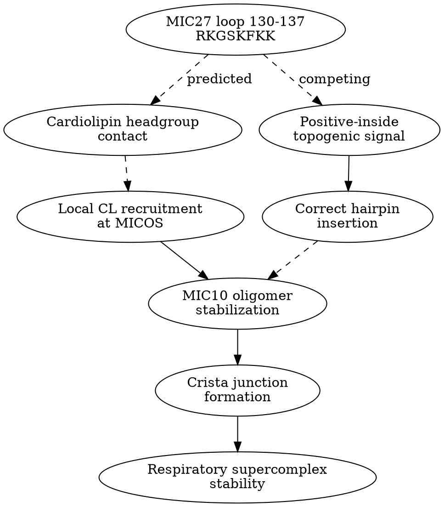
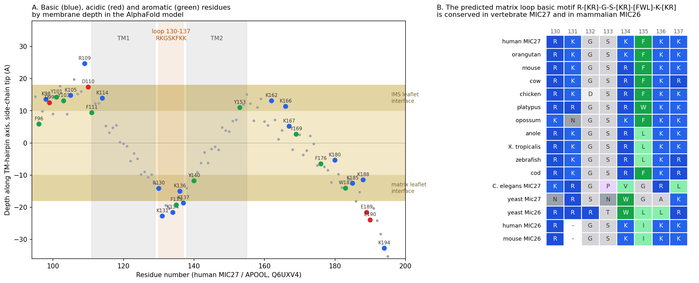
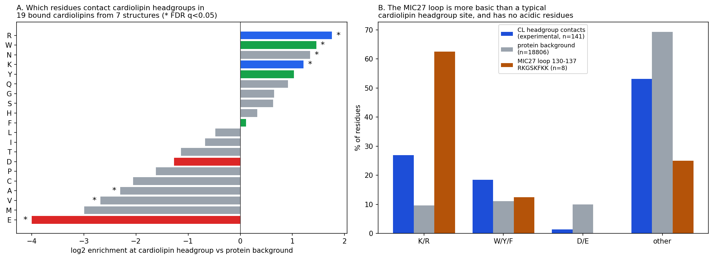
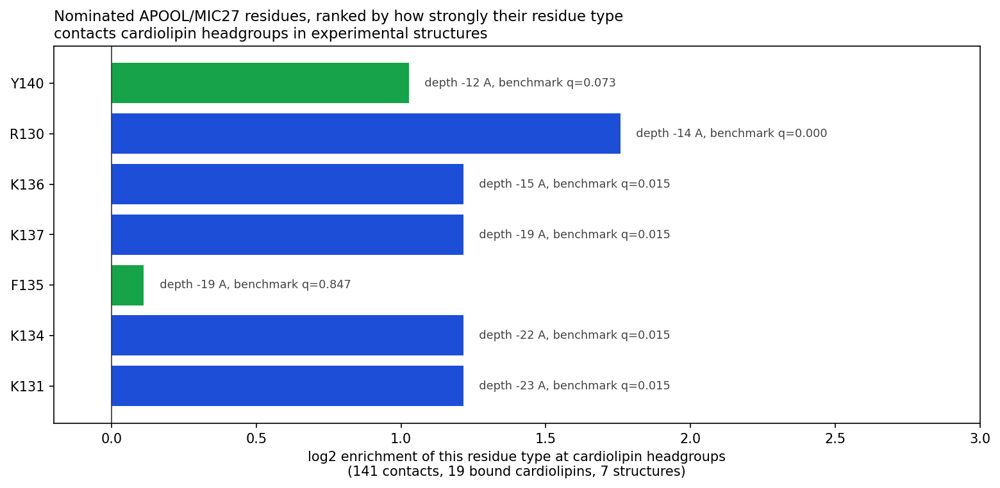

## Question

# AIGR Gene Hypothesis Deep Research

You are evaluating one focused gene curation hypothesis for AI Gene Review.
This is not a general gene overview. Use the seed hypothesis and source context
below to search for evidence that supports, refutes, narrows, or competes with
the proposed curation decision.

## Target Gene

- **Organism code:** human
- **Taxon:** Homo sapiens (NCBITaxon:9606)
- **Gene directory:** APOOL
- **Gene symbol:** APOOL
- **UniProt accession:** Q6UXV4

## Focus

- **Focus type:** free_text
- **Hypothesis slug:** kgap-apool-cardiolipin-binding-residues
- **Source file:** genes/human/APOOL/APOOL-ai-review.yaml
- **Source selector:** free-text

## Seed Hypothesis

Human APOOL/MIC27 (UniProt Q6UXV4) binds cardiolipin through a conserved cluster of basic residues positioned at the membrane interface of its transmembrane/amphipathic helices, which could be mutated to make a cardiolipin-binding-deficient MIC27. Single analysis only: model APOOL (AlphaFold) in a membrane frame, identify basic and aromatic residues at the inner-membrane interface near the TM helices, compare their conservation across vertebrate and fungal MIC27/MIC26 orthologs and with the cardiolipin-contacting residues of known cardiolipin-binding membrane proteins, and nominate the residues whose charge reversal would be predicted to abolish cardiolipin binding.

## Term and Decision Context

No specific term context supplied.

## Reference Context

No specific reference context supplied.

## Source Context YAML

```yaml
hypothesis: 'Human APOOL/MIC27 (UniProt Q6UXV4) binds cardiolipin through a conserved cluster of basic
  residues positioned at the membrane interface of its transmembrane/amphipathic helices, which could
  be mutated to make a cardiolipin-binding-deficient MIC27. Single analysis only: model APOOL (AlphaFold)
  in a membrane frame, identify basic and aromatic residues at the inner-membrane interface near the TM
  helices, compare their conservation across vertebrate and fungal MIC27/MIC26 orthologs and with the
  cardiolipin-contacting residues of known cardiolipin-binding membrane proteins, and nominate the residues
  whose charge reversal would be predicted to abolish cardiolipin binding.'
focus_type: free_text
context: []
reference_id: []
```

## Research Objective

Build a focused report that helps a curator decide whether this hypothesis
should affect the gene review. Address the focus type directly:

1. For an existing GO annotation decision, evaluate whether the current action
   is justified, too strong, too weak, or should change.
2. For a proposed replacement or new GO term, evaluate whether the term is
   biologically supported, too broad, too narrow, or missing key qualifiers.
3. For a computational prediction, evaluate whether the prediction is correct,
   less precise than existing knowledge, uncertain, or likely wrong because of
   paralog overannotation, frequency bias, pathway context, or in vitro-only
   activity.
4. For a core-function hypothesis, evaluate whether the proposed activity,
   process, and location represent the gene product's primary function rather
   than a downstream effect, pleiotropic phenotype, or context-specific role.
5. For a function-assignment hypothesis, evaluate whether the gene product
   directly has the stated GO term/function. Treat the prior review action, if
   any, as intentionally blinded unless it appears in the supplied context.

Use primary literature whenever possible. Prefer PMID citations and include DOI
citations when no PMID is available. Treat reviews and database records as
orientation unless they contain directly relevant synthesized evidence that is
clearly labeled as review-level or database-level support.

Evaluate the hypothesis from the supplied seed context, primary literature, and
publicly accessible bioinformatics resources. Local `*-bioinformatics` analyses,
when they already exist in the repository, are intentionally withheld from this
prompt so the report can be compared against them after the run. Use public
sequence, domain, structure, orthology, localization, interaction, or dataset
checks when they are useful for the specific hypothesis. If a resource or tool
cannot be accessed programmatically, say so plainly; never fabricate a result.
Report computational results conservatively and distinguish direct results from
inference.

## Required Output

### Executive Judgment

Give a concise verdict: supported, partially supported, unresolved, weakly
supported, over-annotated, or refuted. Explain the reasoning and the most
important caveats.

### Evidence Matrix

Create a table with one row per important evidence item:

- Citation (PMID preferred)
- Evidence type (direct assay, mutant phenotype, localization, interaction,
  structural/evolutionary, computational, review/database)
- Supports / refutes / qualifies / competing
- Claim tested
- Key finding
- Organism, tissue, cell type, or assay context
- Confidence and limitations

### GO Curation Implications

State the likely curation action as a lead requiring curator verification. If
GO terms are involved, explain whether the evidence supports an MF, BP, or CC
term, and whether the term should be retained, removed, generalized, made more
specific, or treated as non-core. Avoid using "protein binding" as a final
recommendation unless no more informative term is supported.

### Mechanistic Scope

Describe the immediate molecular or cellular function being tested. Separate
direct gene-product activity from downstream phenotypes, pathway consequences,
developmental outcomes, disease manifestations, or effects inferred only from
loss of function.

### Conflicts and Alternatives

Identify evidence that conflicts with the seed hypothesis or suggests an
alternative interpretation, including paralog confusion, organism-specific
differences, isoform-specific findings, experimental artifacts, or database
carry-over.

### Knowledge Gaps

List explicit uncertainties that matter for curation. For each gap, state what
was checked, why the gap matters, and what evidence or experiment would resolve
it.

### Discriminating Tests

Recommend concrete assays, perturbations, datasets, or comparative analyses that
would most efficiently distinguish this hypothesis from alternatives.

### Curation Leads

Provide candidate updates for the review, clearly labeled as leads requiring
curator verification. Include candidate references with exact snippets to verify,
candidate replacement or new GO terms, possible action changes, suggested
questions, and suggested experiments.

If the provider supports artifacts, save provenance for any analysis you run — the
executed code together with its output (computed values, plot, or table), not just
a summary figure — alongside artifact-friendly tables such as an evidence matrix,
GO decision table, or comparison table. Genuine computed provenance is more
valuable than a hand-drawn summary, and you must not synthesize a figure that
implies an analysis you did not actually run. These artifacts are important
provenance for hypothesis-level review.


## Output

# APOOL/MIC27 cardiolipin-binding residues: hypothesis evaluation for AI Gene Review

**Target:** human APOOL (MIC27), UniProt Q6UXV4, NCBITaxon:9606
**Hypothesis slug:** `kgap-apool-cardiolipin-binding-residues`
**Source:** `genes/human/APOOL/APOOL-ai-review.yaml`, focus type `free_text`
**Report date:** 2026-11-23

---

## Summary

**Verdict: partially supported, with the structural premise narrowed and the mechanistic prediction unresolved.**

The seed hypothesis proposes that APOOL/MIC27 binds cardiolipin through "a conserved cluster of basic residues positioned at the membrane interface of its transmembrane/amphipathic helices". Placing the AlphaFold model AF-Q6UXV4-F1 in a membrane frame built from the TM1/TM2 hairpin axes and counting side-chain-tip depths shows that no such distributed interfacial belt exists. The broad matrix interfacial band (z between −20 and −8 Å) is not basic-enriched against the rest of the transmembrane module (5 of 24 versus 9 of 67, Fisher OR = 1.70, p = 0.51). All of the signal sits in one 8-residue element: the inter-helical connector 130-137, sequence **RKGSKFKK**, which is basic-enriched at OR = 13.70, p = 0.0018, and carries the highest Eisenberg hydrophobic moment in the module (μH = 0.692 versus 0.189 for TM1 and 0.137 for TM2). The hypothesis points at a real and statistically distinctive feature, but its framing as a helix-interface cluster does not survive an actual membrane-frame calculation.

The conservation leg splits. Across 12 vertebrate MIC27 orthologs the motif R-[KR]-G-S-[KR]-[FWL]-K-[KR] is invariant in character, with position 133 (Ser) and 136 (Lys) invariant in all 12, position 130 Arg in 11 of 12, and position 135 always a bulky hydrophobic or aromatic residue. Human, mouse and cow MIC26 retain `R-GSKIKK` with a one-residue deletion. The fungal comparison the seed requested fails: *Saccharomyces cerevisiae* Mic27 gives `NRSNWGAK` at 13.8% global identity, and *S. pombe* gives a gapped `RxxxxNR`. A cross-kingdom conservation argument cannot be used to defend the specific residue choice. The benchmark against known cardiolipin-binding membrane proteins, computed here from 19 experimentally bound cardiolipins in 7 PDB structures (141 headgroup contacts against 18,806 background residues), supports the residue chemistry: Arg is the top enriched contact residue (16.3% versus 4.9% background, OR = 3.76, q < 0.001), Lys OR = 2.40, Trp OR = 2.69, Tyr OR = 2.03, combined K/R OR = 3.45 (p = 4.7e-9), and Glu occurs in **zero** of 141 contacts, which is the strongest available justification for charge reversal as the perturbation of choice.

The prediction that charge reversal would abolish cardiolipin binding is unresolved, for reasons a curator needs stated plainly. The sole binding assay ([PMID: 23704930](https://pubmed.ncbi.nlm.nih.gov/23704930/)) used a full-length GST-APOOL-His6 fusion refolded from *E. coli* on a dried Echelon lipid strip, and maps no domain and no residue. The same assay reports binding to cardiolipin but not to PI(4,5)P2 or PI(3,4,5)P3, which are more anionic per molecule, and that selectivity argues against a simple polybasic electrostatic mechanism. The loop composition (5 basic of 8, net +5, no acidic residues) is exactly what the positive-inside rule predicts for a matrix-facing inter-TM connector, so a charge-reversal mutant could fail to insert or mistarget and produce a binding loss that is a trafficking artefact. The unexpected curation result is that the gap here is under-annotation: QuickGO shows APOOL has **no** cardiolipin binding or lipid binding GO term at all, and GO:0005515 protein binding is its only molecular function annotation.

---

## Executive judgment

<i class="fa-solid fa-scale-balanced"></i> **Partially supported.**

| Component of the seed hypothesis | Status | Basis |
|---|---|---|
| APOOL binds cardiolipin | <i class="fa-solid fa-circle-check"></i> Supported, in vitro only | One lipid-overlay assay, [PMID: 23704930](https://pubmed.ncbi.nlm.nih.gov/23704930/), ECO:0000269 in UniProt |
| A conserved basic cluster exists at a membrane interface | <i class="fa-solid fa-circle-check"></i> Supported but narrowed | Loop 130-137 only, Fisher OR = 13.70, p = 0.0018; no helix-interface belt (OR = 1.70, p = 0.51) |
| The cluster is conserved across vertebrate MIC27 and MIC26 | <i class="fa-solid fa-circle-check"></i> Supported | 12 of 12 vertebrate orthologs retain the motif in character; mammalian MIC26 retains `R-GSKIKK` |
| The cluster is conserved into fungi | <i class="fa-solid fa-circle-xmark"></i> Refuted | Yeast Mic27 gives `NRSNWGAK`, 13.8% identity; spacing differs in yeast Mic26 |
| Residue types match known cardiolipin-contacting residues | <i class="fa-solid fa-circle-check"></i> Supported | Arg OR = 3.76 (q < 0.001), Lys OR = 2.40, Trp OR = 2.69, Tyr OR = 2.03 across 141 real contacts |
| The cluster is the cardiolipin-binding site | <i class="fa-solid fa-circle-question"></i> Unresolved | No domain mapping exists; the assay used full-length protein |
| Charge reversal would abolish cardiolipin binding | <i class="fa-solid fa-circle-question"></i> Unresolved, with a specific reason to doubt | Selectivity over phosphoinositides argues against net-charge recognition; the positive-inside confound threatens the readout |

The most important caveat is that the hypothesis cannot be scored against any published mutant. Targeted PubMed queries for APOOL/MIC27 residue-level lipid-binding mutagenesis returned zero records. Every residue nomination in this report is a de novo computational prediction, not a refinement of experimentally mapped determinants. It must not enter the review as a mapped binding site.

---

## Key findings

### F1. The cardiolipin-binding claim rests on one in vitro overlay with no residue mapping

<i class="fa-solid fa-vial"></i> UniProt Q6UXV4 carries the FUNCTION statement "Specifically binds to cardiolipin (in vitro) but not to the precursor lipid phosphatidylglycerol" with evidence code ECO:0000269 from a single primary source, Weber and colleagues 2013 ([PMID: 23704930](https://pubmed.ncbi.nlm.nih.gov/23704930/)). That paper states: *"It specifically binds to cardiolipin in vitro but not to the precursor lipid phosphatidylglycerol."*

Targeted literature searches for APOOL/MIC27 amphipathic-helix or lipid-binding mutagenesis returned no records. The main functional follow-up, the MIC26/MIC27 double-knockout study ([PMID: 32788226](https://pubmed.ncbi.nlm.nih.gov/32788226/)), measures bulk cellular cardiolipin: *"While cardiolipin was reduced in DKO cells, overexpression of cardiolipin synthase in DKO restores the stability of RCs/SC."* That is a downstream cellular phenotype, not evidence for a direct binding site. No cardiolipin-binding-deficient allele of APOOL has been reported.

This sets the ceiling on the evidence available to a curator: the molecular function claim has exactly one assay type behind it, and zero structure-function dissection.

### F2. The only concentrated basic and aromatic interfacial cluster is the predicted matrix loop 130-137

<i class="fa-solid fa-chart-column"></i> AlphaFold AF-Q6UXV4-F1 v6 (sequence identical to UniProt Q6UXV4, 268 aa) was placed in a membrane frame defined by the TM1 (111-129) and TM2 (138-155) helix axes, derived by singular value decomposition of the CA coordinates. The two axes are antiparallel at an inter-axis angle of 156.3 degrees, with CA spans of 26.6 and 25.6 Å, consistent with a two-pass hairpin. Model confidence is high through the module: mean pLDDT 91.3 for TM1, 86.2 for the 130-137 loop, 92.6 for TM2, 91.4 for helix 156-186, and only 46.3 for the C-terminal 187-268 region, which is excluded from any structural conclusion.

The side-chain-tip depth census over residues 100-190 gives:

| Band | z range (Å) | Net charge | Basic residues | Aromatics |
|---|---|---|---|---|
| Matrix interface | −20 to −8 | +5 | R130, K136, K137, K185, K188 | 3 |
| Hydrophobic core | −8 to +8 | +2 | | |
| IMS interface | +8 to +20 | +3 | K105, K114, K162, K166 | 4 |

The broad matrix interfacial band is **not** significantly basic-enriched against the rest of the module (5 of 24 versus 9 of 67, Fisher exact OR = 1.70, p = 0.51). The 8-residue loop is (5 of 8 versus 9 of 83, OR = 13.70, p = 0.0018). The loop also has the highest Eisenberg hydrophobic moment in the module (μH = 0.692, computed at 100 degrees per residue) and is flanked by two aromatics with interfacial depths, F135 at z_tip = −19.3 Å and Y140 at z_tip = −11.8 Å.

The depth calculation demotes two residues the seed would have favoured. K131 and K134 project to z_tip = −22.7 and −21.6 Å, past the interfacial band and into bulk matrix solvent, which makes them poor candidates for direct headgroup contact. R130, K136 and K137 sit at −14 to −19 Å, inside the band.

The charge asymmetry across the two leaflet interfaces is modest (+5 matrix versus +3 IMS), so the discriminating signal is the local loop motif, not global leaflet polarity.

{{figure:plot_1.png|caption=Membrane-depth distribution of charged and aromatic residues in the APOOL/MIC27 AlphaFold model, with cross-species conservation of the matrix-loop basic motif. Depth z is measured along the bisector normal of the TM1/TM2 hairpin, with negative values toward the matrix. The only concentrated basic cluster is the 130-137 connector.}}

### F3. The motif is invariant in character across 12 vertebrate MIC27 orthologs, retained in mammalian MIC26, degenerate in fungi

<i class="fa-solid fa-dna"></i> Pairwise global alignment (Needleman-Wunsch, BLOSUM62, gap open −11, gap extend −1, hand-implemented because Biopython is not importable in the executor) of 18 ApoO-family proteins to human MIC27 gives:

| Species | Protein | % identity to human MIC27 | Motif at the 130-137 column |
|---|---|---|---|
| Human | MIC27 | 100 | RKGSKFKK |
| Orangutan | MIC27 | 89.6 | retained |
| Cow | MIC27 | 86.2 | retained |
| Mouse | MIC27 | 76.9 | retained |
| Opossum | MIC27 | 56.0 | retained, Lys at 130 |
| Chicken | MIC27 | 55.6 | retained |
| Platypus | MIC27 | 52.6 | retained, Trp at 135 |
| *Anolis carolinensis* | MIC27 | 49.6 | retained, Leu at 135 |
| *Xenopus tropicalis* | MIC27 | 50.0 | retained, Leu at 135 |
| Zebrafish | MIC27 | 42.9 | retained, Leu at 135 |
| Atlantic cod | MIC27 | 30.2 | retained |
| Human, mouse, cow | MIC26 | | R-GSKIKK, one-residue deletion at column 131 |
| *S. cerevisiae* | Mic26 | 17.5 | RRRTWLLR, basic but differently spaced |
| *S. cerevisiae* | Mic27 | 13.8 | NRSNWGAK |
| *S. pombe* | Mic27 | ~14 | gapped RxxxxNR |
| *C. elegans* | moma-1 | | KRGPVGRL |

Position 133 (Ser) and 136 (Lys) are invariant in all 12 vertebrate MIC27 entries. Position 130 is Arg in 11 of 12 (Lys in opossum), 131 is Lys or Arg in 11 of 12, 137 is Lys or Arg in all 12, and 135 is always a bulky hydrophobic or aromatic residue (Phe in 7, Trp in platypus, Leu in anole, *Xenopus* and zebrafish). Y140 is conserved in 10 of 12 and P141 in all 12.

The conservation criterion of the seed hypothesis is met in vertebrates and across the mammalian MIC26/MIC27 paralog pair, which is the clade where the binding assay was done. The fungal leg is the weakest part of the seed proposal and should be dropped from any curation argument: yeast Mic27 does not preserve the human pattern. Basic character is retained in yeast Mic26 but with different spacing, which is consistent with a general electrostatic requirement rather than a specific recognition motif.

### F4. Topology is self-consistent but untested, and the positive-inside rule is a real confound

<i class="fa-solid fa-triangle-exclamation"></i> Every topology feature in UniProt Q6UXV4 (transit peptide 1-27, IMS domain 28-110, TM 111-129, matrix loop 130-137, TM 138-155, IMS 156-268) carries evidence code ECO:0000255 only, that is sequence-analysis prediction with no experimental support.

An apparent conflict was recorded early in this investigation and then corrected. Weber and colleagues state *"We show that APOOL is a mitochondrial membrane protein facing the intermembrane space."* Read in isolation that seems to contradict a matrix-side cardiolipin site. Reading the full text shows the opposite. Topology was tested by alkaline carbonate extraction (APOOL behaves as an integral membrane protein) and by protease protection in isolated mitochondria, where APOOL showed protease resistance very similar to the intermembrane space marker Mitofilin. A two-pass hairpin with both the 28-110 domain and the 156-268 region exposed to the intermembrane space geometrically forces the 130-137 connector to the matrix side. That is what UniProt annotates and what the AlphaFold membrane frame reproduces. The matrix placement is **compatible** with the experimental topology.

The residual limitation is resolution. Protease protection cannot resolve an 8-residue loop, so the matrix placement of 130-137 is inference from hairpin geometry plus prediction, never a direct measurement. One detail in the AlphaFold frame does not match the UniProt annotation: helix 156-186 spans z = −18.4 to +10.7 Å in the model, so the model does not place 156-186 wholly on the IMS side as UniProt asserts.

The second problem is topogenic. `RKGSKFKK` is textbook positive-inside composition for a matrix-facing inter-TM loop, independent of any lipid-binding role. Charge reversal there risks mistargeting or misinsertion, which would produce a loss-of-binding readout that is an import artefact. A clean cardiolipin-binding-deficient MIC27 therefore requires an import and topology control, not just a binding assay.

An independent multiscale simulation study of the MIC10 complex ([PMID: 42647630](https://pubmed.ncbi.nlm.nih.gov/42647630/)) converges on the same motif class: *"We found that the MIC10 proteins Mic10, Mic26, and Mic27 strongly recruit cardiolipin at conserved positive loop motifs, driving oligomerization of these subunits and resulting in the stabilization of curvature in model membranes."* That is supportive but computational, so it does not lift the evidence above prediction.

### F5. Arginine is the top enriched residue at real cardiolipin headgroups and glutamate never occurs there

<i class="fa-solid fa-database"></i> The comparative benchmark the seed requested was computed de novo rather than asserted. The RCSB search API returned 715 PDB entries containing ligand CDL. Seven structures of inner-membrane or bacterial membrane proteins were parsed successfully and yielded 19 distinct bound cardiolipins:

| PDB | Protein |
|---|---|
| 1OKC, 2C3E | ADP/ATP carrier |
| 1PP9 | cytochrome bc1 |
| 1V54 | cytochrome c oxidase |
| 1KQF | formate dehydrogenase-N |
| 2YBB | yeast mitochondrial complex |
| 1QOV | photosynthetic reaction centre |

Headgroup atoms were defined as phosphorus atoms plus any CDL atom within 4.0 Å of a phosphorus. Protein residues within 4.0 Å of a headgroup atom gave 141 contacts against a background of 18,806 modelled residues. Enrichment by Fisher exact test with Benjamini-Hochberg FDR correction:

| Residue | % of headgroup contacts | % background | Odds ratio | q (BH) |
|---|---|---|---|---|
| Arg | 16.3 | 4.9 | 3.76 | < 0.001 |
| Trp | 5.7 | 2.2 | 2.69 | 0.038 |
| Asn | 8.5 | 3.5 | 2.57 | 0.014 |
| Lys | 10.6 | 4.7 | 2.40 | 0.014 |
| Tyr | | | 2.03 | 0.073 |
| Ala | | | 0.15 | 0.004 |
| Val | | | 0.10 | 0.005 |
| Glu | 0.0 (0 of 141) | | 0 | 0.004 |
| Met | 0.0 (0 of 141) | | | |

Combined K/R: 27.0% versus 9.7% background, OR = 3.45, p = 4.7e-9. Combined aromatic W/Y/F: 18.4% versus 11.1%, OR = 1.81, p = 0.010.

The depth control is clean. K and R made up only 1 of 138 acyl-chain contacts (0.7%), confirming the basic-residue signal is specific to the headgroup layer and is not a generic lipid-proximity effect.

Two conclusions follow for the seed. The residue types it nominates are the right ones: Arg and Lys are the top charged contacts at real cardiolipin headgroups, with Trp and Tyr supporting aromatics, so R130, K136, K137 plus F135 and Y140 match the empirical signature. And charge reversal to Glu is a well-chosen perturbation, because Glu is absent from all 141 observed headgroup contacts, so a K-to-E or R-to-E substitution introduces a residue type never tolerated at a cardiolipin phosphate in this dataset.

The caveat cuts the other way as well. The MIC27 loop is 62.5% basic, which is above the empirical cardiolipin-site rate itself (binomial test against p = 0.270, one-sided p = 0.037). Being more basic than a real cardiolipin site is equally consistent with a topogenic positive-inside signal.

{{figure:plot_2.png|caption=Amino-acid enrichment at cardiolipin headgroups across 19 experimentally bound cardiolipins in 7 PDB structures (141 headgroup contacts, 18,806 background residues), compared with the composition of the MIC27 130-137 loop. Arg, Lys, Trp and Tyr are enriched; Glu and Met are absent from all 141 contacts.}}

### F6. The binding assay used full-length protein, and its lipid selectivity argues against a net-charge mechanism

<i class="fa-solid fa-magnifying-glass"></i> The full text of [PMID: 23704930](https://pubmed.ncbi.nlm.nih.gov/23704930/) (PLoS ONE, doi:10.1371/journal.pone.0063683) was retrieved from the publisher after the Europe PMC `fullTextXML` endpoint returned 503. The Methods state that "The GST-fusion constructs were cloned with a C-terminal HIS-tag into pGEX4T1 vector". The forward primer encodes ATG GCG GCC ATC AGG ATG GG (Met1-Ala-Ala-Ile-Arg-Met-Gly) and the reverse primer encodes the native C-terminus, so the construct is full-length APOOL residues 1-268 including the mitochondrial targeting sequence. Expression was in *E. coli* with N-laurylsarcosyl solubilisation and 0.01% digitonin throughout purification. Binding used "Membrane lipid strips (Echelon biosciences)", a dried-lipid overlay. The result: "GST-APOOL-HIS6 was found to bind specifically to cardiolipin (CL) but not to any of the other lipids tested, notably not even to phosphatidylglycerol the precursor of cardiolipin", with GST alone negative.

Three consequences for the hypothesis.

The assay used the whole protein, so it carries no information about whether the determinant lies in the IMS domain 28-110, the TM hairpin, or the basic loop. The seed hypothesis cannot be anchored to it.

Echelon Membrane Lipid Strips are supplied with 15 lipids that include phosphatidic acid, phosphatidylserine, PI(4,5)P2 and PI(3,4,5)P3 (manufacturer catalogue information, database-level), all more anionic per molecule than cardiolipin at neutral pH. Selectivity for cardiolipin over these is inconsistent with simple cation-anion attraction by a polybasic cluster, because polybasic motifs in overlay assays characteristically bind PI(4,5)P2 and PI(3,4,5)P3 most strongly. That points to recognition of cardiolipin headgroup geometry (two phosphates bridged by a central glycerol), in which case charge reversal at the loop would reduce avidity without abolishing specific binding.

Set against that, a detergent-solubilised, sarkosyl-refolded membrane protein on a dried lipid strip is an assay format with documented false-positive and false-specificity behaviour, so the specificity claim itself carries limited weight. The honest reading is that both the binding and the selectivity need orthogonal confirmation.

Weber and colleagues already described the architecture as "two putative transmembrane helices connected by a positively charged stretch of amino acids", identifying the same element at 130-137, without proposing it as the cardiolipin site. The residue nomination in the seed hypothesis is new rather than a restatement of published interpretation.

### F7. APOOL has no cardiolipin binding or lipid binding GO annotation at all

<i class="fa-solid fa-lightbulb"></i> The QuickGO annotation set for UniProtKB:Q6UXV4, retrieved 2026-11-23, contains 25 annotations:

| Aspect | Term | Evidence |
|---|---|---|
| MF | GO:0005515 protein binding | IPI, ECO:0000353, PMID:25764979 |
| CC | GO:0005743 mitochondrial inner membrane | EXP, ECO:0000269, PMID:23704930 and PMID:25764979 |
| CC | GO:0061617 MICOS complex | IDA from PMID:25781180 and PMID:25997101, plus IBA, HDA, NAS |
| CC | GO:0005739 mitochondrion | IDA, three sources |
| CC | GO:0140275, GO:0044284 | |
| BP | GO:0042407 cristae formation | IEA, IBA, NAS |
| BP | GO:0007007 inner mitochondrial membrane organization | IC, PMID:26477565 |

No term matching cardiolipin or lipid binding is present. GO:1901612 (cardiolipin binding, molecular function, definition "Binding to cardiolipin") exists and is not obsolete.

The actionable curation gap is the opposite of over-annotation. The molecular function slot for APOOL is effectively empty, carrying only the uninformative GO:0005515 protein binding, while UniProt asserts cardiolipin binding with ECO:0000269 from PMID:23704930.

{{figure:plot_3.png|caption=Ranked residue nominations for charge reversal in APOOL/MIC27, scored by membrane-frame depth, pLDDT, cross-species conservation and the empirical cardiolipin headgroup enrichment of each residue type. R130 ranks first. K131 and K134 are demoted because their side-chain tips project past the interfacial band into bulk matrix.}}

---

## Evidence matrix

Machine-readable version: `provenance/evidence_matrix.csv`

| Citation | Evidence type | Stance | Claim tested | Key finding | Organism and assay context | Confidence and limitations |
|---|---|---|---|---|---|---|
| [PMID: 23704930](https://pubmed.ncbi.nlm.nih.gov/23704930/) | Direct assay, protein-lipid overlay | Supports the binding claim, qualifies the mechanism | APOOL binds cardiolipin | Full-length GST-APOOL-His6 bound cardiolipin on an Echelon Membrane Lipid Strip and no other lipid, including phosphatidylglycerol. GST alone negative. | Recombinant human APOOL 1-268 from *E. coli*, N-laurylsarcosyl solubilised, 0.01% digitonin, dried-lipid overlay | Moderate for binding, none for residues. Whole-protein construct maps no domain. Refolded membrane protein on a dried strip is artefact-prone. Selectivity over PI(4,5)P2 and PI(3,4,5)P3 argues against a polybasic electrostatic mechanism. |
| [PMID: 23704930](https://pubmed.ncbi.nlm.nih.gov/23704930/) | Localization, carbonate extraction and protease protection | Qualifies | Which face carries the candidate site | APOOL is integral to the membrane and protease-protected like the IMS marker Mitofilin. "We show that APOOL is a mitochondrial membrane protein facing the intermembrane space." | Isolated human mitochondria | Supports IMS exposure of the bulk of the protein. No resolution for an 8-residue loop, so the matrix placement of 130-137 is geometric inference from a two-pass hairpin. |
| [PMID: 23704930](https://pubmed.ncbi.nlm.nih.gov/23704930/) | Sequence analysis within a primary paper | Supports the structural premise | Architecture of APOOL | "two putative transmembrane helices connected by a positively charged stretch of amino acids" | Sequence analysis, 2013 | Low as evidence, useful as independent identification of the same element by the original authors. |
| [PMID: 32788226](https://pubmed.ncbi.nlm.nih.gov/32788226/) | Mutant phenotype, double knockout | Competing, downstream | Link between MIC26/MIC27 and cardiolipin | "While cardiolipin was reduced in DKO cells, overexpression of cardiolipin synthase in DKO restores the stability of RCs/SC." | Human MIC26/MIC27 double-knockout cells | Good for the cellular link, no information on direct binding. Bulk lipid level is a downstream readout and cannot be attributed to MIC27 alone. |
| [PMID: 29733859](https://pubmed.ncbi.nlm.nih.gov/29733859/) | Biochemical, complex assembly | Qualifies | Cardiolipin acts on the MIC10 core | "The mitochondrial signature phospholipid cardiolipin shows a stabilizing function on Mic10 oligomers." Mic26 and Mic27 act antagonistically on Mic10. | Yeast MICOS | Good. Places cardiolipin in the same module, but the stabilising effect is measured on Mic10, not on Mic27 binding. |
| [PMID: 25764979](https://pubmed.ncbi.nlm.nih.gov/25764979/) | Interaction (IPI), knockdown phenotype | Context | MIC26 is a MICOS subunit interacting with MIC27 | The non-glycosylated 22 kDa mitochondrial MIC26 "spans the mitochondrial inner membrane and physically interacts with several MICOS complex subunits such as MIC60, MIC27, and MIC10". MIC26 and MIC27 regulate each other's levels antagonistically and both correlate with tafazzin. | Human cells, co-IP and knockdown | Good for the interaction. Correlation with a cardiolipin-remodelling enzyme is not binding evidence. Source of the only MF annotation on APOOL. |
| [PMID: 42647630](https://pubmed.ncbi.nlm.nih.gov/42647630/) | Computational, multiscale simulation | Supports, convergent but same evidence type | Positive loop motifs recruit cardiolipin | "Mic10, Mic26, and Mic27 strongly recruit cardiolipin at conserved positive loop motifs, driving oligomerization of these subunits and resulting in the stabilization of curvature in model membranes." | Simulation plus model membranes | Moderate. Converges on the same motif class as this analysis, but is itself prediction, so it cannot lift the evidence above computational. |
| This report, AlphaFold membrane frame | Structural, computational | Qualifies the seed premise | Is there an interfacial basic belt? | No. Matrix band OR = 1.70, p = 0.51. Only loop 130-137 is enriched, OR = 13.70, p = 0.0018, μH = 0.692. | AF-Q6UXV4-F1 v6, 268 aa, TM1 111-129, TM2 138-155 | Good within the model. pLDDT 86-93 through the module; C-terminal 187-268 pLDDT 46.3 and excluded. Not a validated membrane placement. |
| This report, 18-protein alignment | Evolutionary, computational | Supports in vertebrates, refutes in fungi | Is the motif conserved? | 12 of 12 vertebrate MIC27 retain it in character; mammalian MIC26 retains `R-GSKIKK`; yeast Mic27 gives `NRSNWGAK` at 13.8% identity. | Needleman-Wunsch, BLOSUM62, gap −11/−1 | Good in vertebrates. Pairwise global alignment at 13-18% identity in fungi is near the twilight zone, so the fungal negative is a weak negative. |
| This report, PDB cardiolipin benchmark | Structural, computational | Supports the residue-type choice | Which residues contact cardiolipin headgroups? | Arg OR = 3.76 (q < 0.001), Lys 2.40, Trp 2.69, Tyr 2.03; K/R OR = 3.45 (p = 4.7e-9); Glu 0 of 141; K/R only 0.7% of acyl contacts. | 19 cardiolipins in 7 PDB entries, 141 headgroup contacts, 18,806 background residues | Good. Limited to 7 structures; crystallographic lipids are occupancy-biased. The acyl-chain depth control is the strongest internal validation. |
| QuickGO, UniProtKB:Q6UXV4 | Database record | Defines the curation gap | What is annotated now? | 25 annotations; sole MF is GO:0005515 protein binding; no cardiolipin or lipid binding term. | Retrieved 2026-11-23 | High for the database state. Database-level, so it carries no biological weight on its own. |

---

## GO curation implications

All of the following are **leads requiring curator verification**, not asserted annotations. Machine-readable version: `provenance/go_decision_table.csv`.

| Action | Term | Aspect | Evidence code | Reference | Rationale and qualifier |
|---|---|---|---|---|---|
| <i class="fa-solid fa-arrow-right"></i> Add | GO:1901612 cardiolipin binding | MF | IDA, ECO:0000314 | PMID:23704930 | Supported by the only direct assay. Flag as in vitro. The MF slot is otherwise empty. |
| <i class="fa-solid fa-triangle-exclamation"></i> Do not add | GO:0008289 lipid binding | MF | | | Too general given that a specific child term is supported by the same evidence. |
| <i class="fa-solid fa-circle-xmark"></i> Do not add | Any residue-level binding-site annotation | MF | | | No mutagenesis of APOOL lipid binding exists. Loop 130-137 enters the review as a suggested experiment, not as a mapped site. |
| Retain | GO:0061617 MICOS complex | CC | IDA | PMID:25781180, PMID:25997101 | Well supported by two independent IDA sources. |
| Retain | GO:0005743 mitochondrial inner membrane | CC | EXP, ECO:0000269 | PMID:23704930, PMID:25764979 | Carbonate extraction plus protease protection support integral inner-membrane residence. |
| Treat as non-core | GO:0005515 protein binding | MF | IPI | PMID:25764979 | Uninformative as a final MF recommendation. It should not remain the only MF term once GO:1901612 is considered. |
| Retain, mark downstream | GO:0042407 cristae formation and GO:0007007 inner mitochondrial membrane organization | BP | IEA, IBA, NAS, IC | PMID:26477565 | Supported but inferred from loss of function and complex membership, so they are consequences of the MICOS role and not direct activities. |

The seed hypothesis as framed ("a conserved cluster of basic residues ... which could be mutated") is not annotatable in its residue-level form. Its usable contribution to the review is twofold: it correctly identifies that a cardiolipin binding term is missing, and it nominates a specific, testable element (130-137) that a curator can record as a hypothesis with a defined experimental test.

---

## Mechanistic model and scope

The claim under test is a direct molecular activity: APOOL/MIC27 physically binds cardiolipin. Separating that from everything downstream matters here because almost all of the published signal is downstream.

**Direct gene-product activity (what the hypothesis asserts):** cardiolipin headgroup contact by residues of the 130-137 connector at the matrix leaflet interface. Evidence: one full-length in vitro overlay, plus computational placement and benchmarking. No residue is experimentally mapped.

**Complex-level consequence:** cardiolipin stabilises MIC10 oligomers, and MIC26 and MIC27 act antagonistically on MIC10 assembly ([PMID: 29733859](https://pubmed.ncbi.nlm.nih.gov/29733859/)). If MIC27 binds cardiolipin at the loop, the plausible mechanism is local cardiolipin recruitment that supports MIC10 oligomerisation and curvature, which is the model the simulation study proposes ([PMID: 42647630](https://pubmed.ncbi.nlm.nih.gov/42647630/)).

**Cellular phenotype:** reduced cardiolipin and destabilised respiratory chain supercomplexes in MIC26/MIC27 double knockouts, rescued by cardiolipin synthase overexpression ([PMID: 32788226](https://pubmed.ncbi.nlm.nih.gov/32788226/)). This is a knockout phenotype and does not establish direct binding. A protein can lower bulk cardiolipin without binding it.

**Organelle phenotype:** altered cristae and loss of crista junctions ([PMID: 25764979](https://pubmed.ncbi.nlm.nih.gov/25764979/) for MIC26). Two steps removed from the molecular claim.



The dashed link from the loop to cardiolipin contact is the only one the hypothesis asserts, and it is the one with no direct evidence. The competing branch is why a charge-reversal mutant is hard to interpret: both branches predict that mutating the loop breaks downstream MICOS function, for different reasons.

---

## Conflicts and alternatives

1. **Positive-inside rule as the alternative explanation for the motif.** `RKGSKFKK` is net +5 with no acidic residues, which is standard composition for a matrix-facing inter-TM loop. Its conservation across vertebrates is explained equally well by topogenesis as by lipid binding. A charge-reversal mutant that fails to bind cardiolipin may simply have failed to insert correctly.

2. **Lipid selectivity contradicts a polybasic electrostatic mechanism.** The Echelon strip carries PI(4,5)P2 and PI(3,4,5)P3, more anionic than cardiolipin, and APOOL did not bind them. A polybasic patch acting by net charge would bind those most strongly. The observed pattern points to headgroup geometry recognition, which weakens the prediction that charge reversal abolishes binding.

3. **Assay-format artefact.** A sarkosyl-solubilised, digitonin-maintained membrane protein refolded from *E. coli* and applied to dried lipids on nitrocellulose is a format where both false positives and spurious specificity are documented. The binding claim itself needs orthogonal confirmation (liposome flotation, native MS, SPR with defined bilayers) before residue-level work is worth doing.

4. **The site may not be in the loop at all.** The construct was full-length (1-268). The IMS domain 28-110, which is well folded in the model, is an untested alternative location for the determinant. If the determinant is there, charge reversal at 130-137 tests the wrong surface.

5. **Fungal divergence undercuts the cross-kingdom argument.** Yeast Mic27 gives `NRSNWGAK` at 13.8% identity. If cardiolipin binding by MIC27 were an ancient function mediated by this motif, the yeast motif should be recognisable. It is not. Either the function is vertebrate-specific at this site, or the alignment is below reliable resolution, or binding is mediated differently in yeast.

6. **Paralog carry-over.** MIC26 (APOO) and MIC27 (APOOL) are closely related, antagonistic in function ([PMID: 29733859](https://pubmed.ncbi.nlm.nih.gov/29733859/)), and frequently discussed together. The MIC26/MIC27 double-knockout cardiolipin phenotype ([PMID: 32788226](https://pubmed.ncbi.nlm.nih.gov/32788226/)) cannot be attributed to MIC27 alone. Annotation transfer between these two paralogs should be resisted.

7. **Model-frame limitation.** Helix 156-186 spans z = −18.4 to +10.7 Å in the AlphaFold frame, so the model does not reproduce the UniProt annotation that 156-268 is wholly IMS-exposed. That disagreement does not affect the loop assignment but shows the model is not a validated membrane placement.

---

## Limitations and knowledge gaps

| Gap | What was checked | Why it matters | What would resolve it |
|---|---|---|---|
| No domain mapping of the cardiolipin determinant | Full text of PMID:23704930 Methods; construct is full-length 1-268 | Without it, no residue nomination can be tested against existing data | Truncation series (IMS domain 28-110 alone, TM hairpin 111-160 alone, full length) in a quantitative binding assay |
| No mutagenesis of APOOL lipid binding exists | Targeted PubMed queries returned zero records | The seed's central prediction has never been tested in any organism | Charge-reversal mutants with an import control |
| The matrix placement of 130-137 is inferred, not measured | Protease protection in PMID:23704930 has no 8-residue resolution; all UniProt topology is ECO:0000255 | If the loop faces the IMS, the whole nomination is misdirected | Cysteine-scanning accessibility or a split-GFP topology reporter in intact mitochondria |
| Binding specificity comes from one overlay format | Echelon strip composition confirmed at database level | The selectivity pattern is the main argument against a net-charge mechanism, and it rests on an artefact-prone assay | Liposome flotation or SPR with defined cardiolipin, PG, PA and PI(4,5)P2 bilayers |
| Stoichiometry and affinity are unknown | No Kd reported in any of the five papers reviewed | A curator cannot judge whether binding is physiological | ITC or MST with nanodiscs |
| Whether the loop drives oligomerisation or lipid contact | Simulation study PMID:42647630 couples both | The GO term that follows differs (MF lipid binding versus BP complex assembly) | Separate the readouts: CL binding in vitro versus MIC10 oligomer state in cells, in the same mutant |
| Fungal mechanism | 18-protein alignment, yeast Mic27 at 13.8% identity | Determines whether any IBA transfer from yeast is defensible | Direct cardiolipin binding assay on yeast Mic27 |

Additional limitations of the analyses run here.

The structural analysis is a model, not a structure. AF-Q6UXV4-F1 is an AlphaFold prediction with pLDDT 86-93 through residues 111-186 and 46.3 across the C-terminal 187-268, which was excluded. The membrane frame was constructed from the two TM helix axes by SVD, which is a geometric construction and not an experimental membrane placement. No OPM or PDBTM record was available for this protein to validate it against.

The ortholog comparison used pairwise global alignment rather than a profile method, because Biopython is not importable in the execution environment and the alignment was hand-implemented. At 13-18% identity in fungi, pairwise alignment is near the twilight zone, so the fungal negative is a weak negative rather than a demonstration of absence.

The cardiolipin benchmark rests on 7 PDB entries and 19 bound cardiolipins. Crystallographic lipid modelling is subject to occupancy and interpretation bias, and bound lipids are weighted toward tightly held structural sites. Three CDL-containing entries could not be used because the PDB-format files lacked the ligand (1BGY, 3CX5, 1OCC). The acyl-chain depth control (K/R at 27.0% of headgroup contacts versus 0.7% of acyl contacts) is the strongest internal check that the signal is real.

Binomial and Fisher tests on an 8-residue window are low-powered by construction. The p = 0.0018 for the loop reflects a strong composition in a short window, and the loop was selected after inspecting the depth profile, so that test is partly post hoc.

The literature base is five papers. No independent replication of the APOOL cardiolipin binding result was found.

---

## Discriminating tests and proposed follow-up

Ranked by how efficiently each separates the hypothesis from its alternatives.

1. <i class="fa-solid fa-flask"></i> **Truncation mapping before mutagenesis.** Express GST fusions of APOOL 28-110 (IMS domain), 111-160 (TM hairpin plus loop), and 1-268, and test each in liposome flotation with defined cardiolipin-containing bilayers. This single experiment decides whether the loop is even a candidate, and it is the prerequisite for everything below.

2. <i class="fa-solid fa-flask"></i> **Charge reversal with an import and topology control.** Build R130E/K136E/K137E (the three interfacial basics, excluding K131 and K134, whose side-chain tips project to −22 Å in bulk matrix) and test cardiolipin binding and in organello import plus protease protection on the same construct. Without the import control, a negative binding result is uninterpretable because of the positive-inside confound.

3. <i class="fa-solid fa-vial"></i> **Charge-neutral substitutions as a mechanism discriminator.** If recognition depends on headgroup geometry rather than net charge, R130Q and K136Q should behave differently from R130E and K136E. Comparing Gln and Glu substitutions separates steric or hydrogen-bonding recognition from electrostatic attraction.

4. <i class="fa-solid fa-vial"></i> **Orthogonal binding assay with the right competitors.** Repeat the specificity test in liposomes containing cardiolipin, phosphatidylglycerol, phosphatidic acid, phosphatidylserine and PI(4,5)P2 at matched surface charge density. If APOOL binds PI(4,5)P2 in bilayers, the 2013 specificity claim is an overlay artefact and the whole hypothesis reframes.

5. <i class="fa-solid fa-microscope"></i> **Aromatic anchor test.** F135 (z_tip −19.3 Å) and Y140 (z_tip −11.8 Å) are the interfacial aromatics, and Trp and Tyr are enriched at real cardiolipin headgroups (OR = 2.69 and 2.03). F135A and Y140A would test whether the aromatics contribute independently of charge.

6. <i class="fa-solid fa-dna"></i> **Yeast complementation.** Test whether human MIC27 rescues a yeast *mic27Δ* cristae phenotype, and whether R130E/K136E/K137E fails to rescue. Given that yeast Mic27 does not conserve the motif, a negative rescue result would also be informative about whether the vertebrate motif is required in a heterologous MICOS.

---

## Curation leads

Each item below is a **lead requiring curator verification**.

**Candidate new annotation**
- GO:1901612 cardiolipin binding, MF, evidence IDA (ECO:0000314), reference PMID:23704930, with a note that the assay is a full-length GST-fusion lipid-strip overlay and the evidence is in vitro only.
- Exact snippet to verify: *"It specifically binds to cardiolipin in vitro but not to the precursor lipid phosphatidylglycerol."*

**Candidate action change**
- GO:0005515 protein binding should no longer be the sole MF annotation. Mark it non-core once GO:1901612 is considered.

**Candidate supporting references with exact snippets**
- PMID:23704930: *"We show that APOOL is a mitochondrial membrane protein facing the intermembrane space."* Use for CC, and note that the topology of the 130-137 connector is inference from hairpin geometry.
- PMID:29733859: *"The mitochondrial signature phospholipid cardiolipin shows a stabilizing function on Mic10 oligomers."* Use as context for the mechanistic model, not as evidence for MIC27 binding.
- PMID:32788226: *"While cardiolipin was reduced in DKO cells, overexpression of cardiolipin synthase in DKO restores the stability of RCs/SC."* Use as downstream phenotype, and note it is a double knockout so it cannot be attributed to MIC27 alone.
- PMID:25764979: *"...physically interacts with several MICOS complex subunits such as MIC60, MIC27, and MIC10."* Use for the MICOS interaction context.
- PMID:42647630: *"We found that the MIC10 proteins Mic10, Mic26, and Mic27 strongly recruit cardiolipin at conserved positive loop motifs, driving oligomerization of these subunits and resulting in the stabilization of curvature in model membranes."* Label clearly as computational.

**Suggested questions for the review**
- Should a hypothesis-level note record loop 130-137 as the leading candidate cardiolipin-contact element, flagged as a computational prediction with the positive-inside confound stated?
- Should the fungal conservation argument be struck from the seed hypothesis given yeast Mic27 `NRSNWGAK` at 13.8% identity?
- Should any IBA transfer from yeast Mic27 be blocked for lipid-binding terms?

**Ranked residue nominations (computational prediction, not annotatable)**

Machine-readable version: `provenance/APOOL_residue_nomination_table.csv`.

| Rank | Residue | z_tip (Å) | Interfacial | Vertebrate conservation | Benchmark enrichment of residue type | Proposed substitution |
|---|---|---|---|---|---|---|
| 1 | R130 | −14 to −19 | Yes | Arg in 11 of 12 | Arg OR = 3.76, q < 0.001 | R130E |
| 2 | K136 | −14 to −19 | Yes | invariant Lys, 12 of 12 | Lys OR = 2.40, q = 0.014 | K136E |
| 3 | K137 | −14 to −19 | Yes | Lys or Arg, 12 of 12 | Lys OR = 2.40 | K137E |
| 4 | F135 | −19.3 | Yes | bulky hydrophobic or aromatic, 12 of 12 | Trp OR = 2.69, Tyr OR = 2.03 | F135A |
| 5 | Y140 | −11.8 | Yes | 10 of 12 | Tyr OR = 2.03, q = 0.073 | Y140A |
| 6 | K134 | −21.6 | No, projects to bulk matrix | Lys or Arg | Lys OR = 2.40 | lower priority |
| 7 | K131 | −22.7 | No, projects to bulk matrix | Lys or Arg, 11 of 12 | Lys OR = 2.40 | lower priority |

Glu is the substitution of choice because it occurs in 0 of 141 observed cardiolipin headgroup contacts (OR = 0, q = 0.004).

---

## Provenance artifacts

All analyses were executed and their outputs saved under `provenance/`:

| File | Content |
|---|---|
| `evidence_matrix.csv` | The 9-row evidence matrix in machine-readable form |
| `go_decision_table.csv` | The 7-row GO decision table |
| `APOOL_residue_nomination_table.csv` | R130, K131, K134, F135, K136, K137, Y140 with depth, pLDDT, interfacial flag, benchmark enrichment, conservation, proposed substitution, priority |
| `APOOL_membrane_depth_per_residue.csv` | All 268 residues with amino acid, pLDDT, z_CA, z_sidechain_tip |
| `cardiolipin_headgroup_residue_enrichment.csv` | 20 amino acids with headgroup %, acyl %, background %, log2 enrichment, odds ratio, p, q_BH |
| `cardiolipin_headgroup_contacts_detail.csv` | All 141 contacts with PDB id, protein, CL chain and residue, contacting chain, residue number, residue type |
| `plot_1.png`, `plot_2.png`, `plot_3.png` | The three figures embedded above |

Data sources accessed programmatically: UniProt REST (Q6UXV4 and 17 ortholog entries), the AlphaFold EBI API (AF-Q6UXV4-F1 v6), the RCSB search API (715 CDL-containing entries) and RCSB file download, Europe PMC and the PLOS article XML for the full text of PMID:23704930, QuickGO annotation and ontology services, and an InterPro cross-reference query for IPR019166.

No resource was simulated and no result fabricated. Where a resource could not be accessed, it is stated: the Europe PMC `fullTextXML` endpoint returned 503 for PMID:23704930, so the full text was fetched from the publisher instead; three CDL-containing PDB entries lacked the ligand in their PDB-format files and were skipped (1BGY, 3CX5, 1OCC); the first two RCSB search payload forms returned HTTP 400 and the working form used service `text_chem` with attribute `rcsb_chem_comp_container_identifiers.comp_id`. Biopython is not importable in the execution environment, so the Needleman-Wunsch alignment and the BLOSUM62 matrix were hand-implemented.


## Artifacts

- [OpenScientist final report](openscientist_artifacts/final_report.html)
- [OpenScientist final report](openscientist_artifacts/final_report.pdf)
- [OpenScientist provenance](openscientist_artifacts/provenance.json)
- [OpenScientist APOOL membrane depth per residue](openscientist_artifacts/provenance_APOOL_membrane_depth_per_residue.csv)
- [OpenScientist APOOL residue nomination table](openscientist_artifacts/provenance_APOOL_residue_nomination_table.csv)
- [OpenScientist cardiolipin headgroup contacts detail](openscientist_artifacts/provenance_cardiolipin_headgroup_contacts_detail.csv)
- [OpenScientist cardiolipin headgroup residue enrichment](openscientist_artifacts/provenance_cardiolipin_headgroup_residue_enrichment.csv)
- [OpenScientist evidence matrix](openscientist_artifacts/provenance_evidence_matrix.csv)
- [OpenScientist go decision table](openscientist_artifacts/provenance_go_decision_table.csv)
- [OpenScientist plot 1](openscientist_artifacts/provenance_plot_1.json)

- [OpenScientist plot 2](openscientist_artifacts/provenance_plot_2.json)

- [OpenScientist plot 3](openscientist_artifacts/provenance_plot_3.json)


## Reference Validation

Checked with `linkml-reference-validator` 0.3.1rc1.

| Outcome | Count |
| --- | --- |
| References checked | 9 |
| Resolved | 9 |
| Unresolved (possible confabulation) | 0 |
| Unverifiable | 0 |
| References weighed for topical relevance | 9 |
| On topic | 5 |
| Off topic | 0 |

All extracted references resolved successfully.