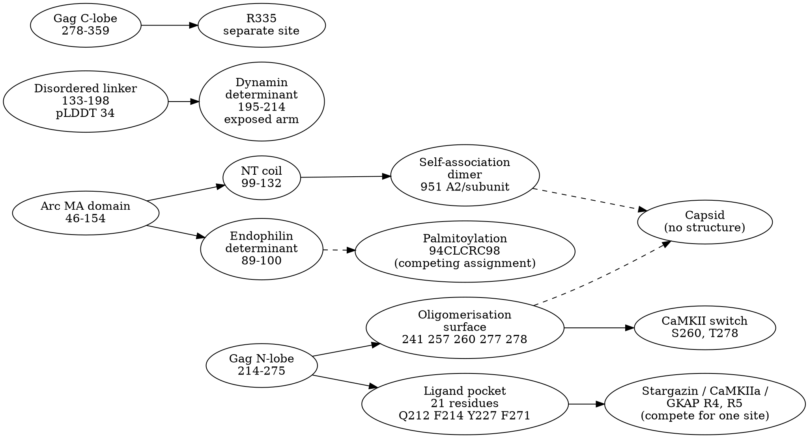
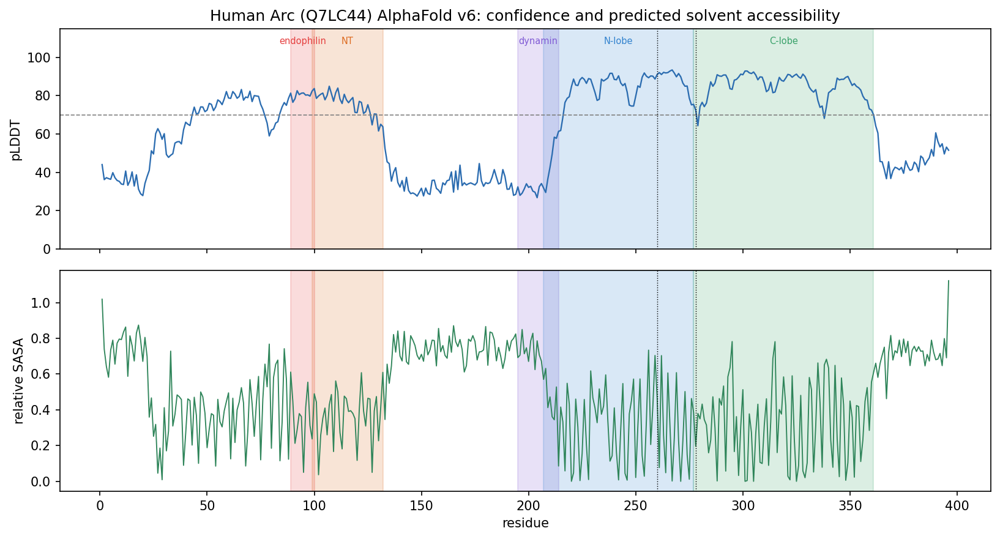
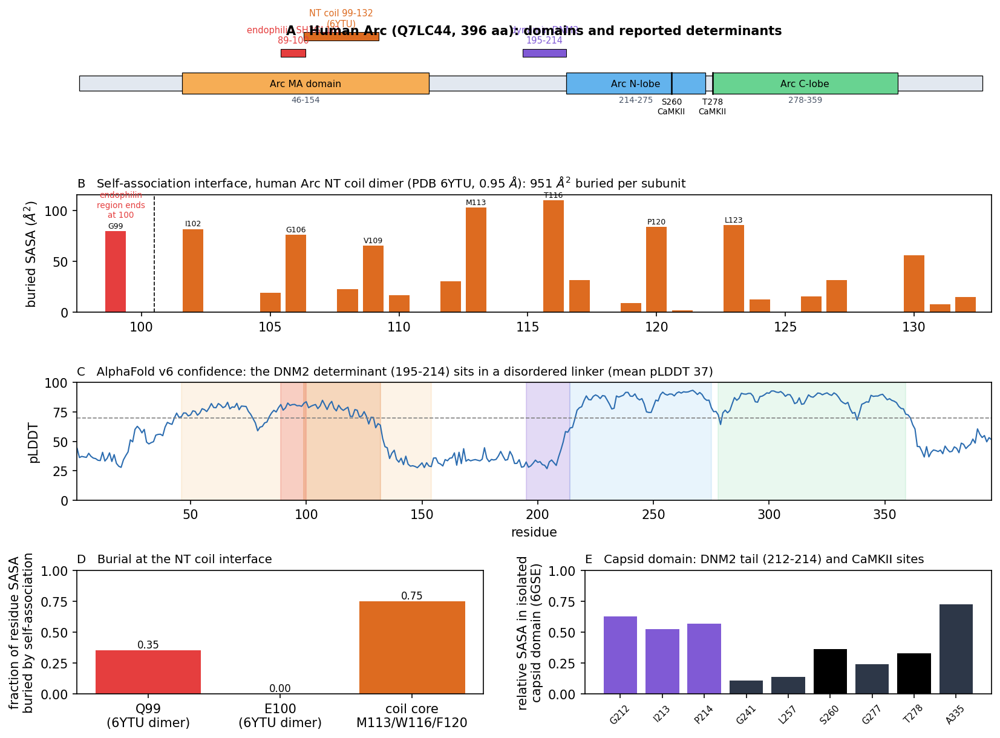
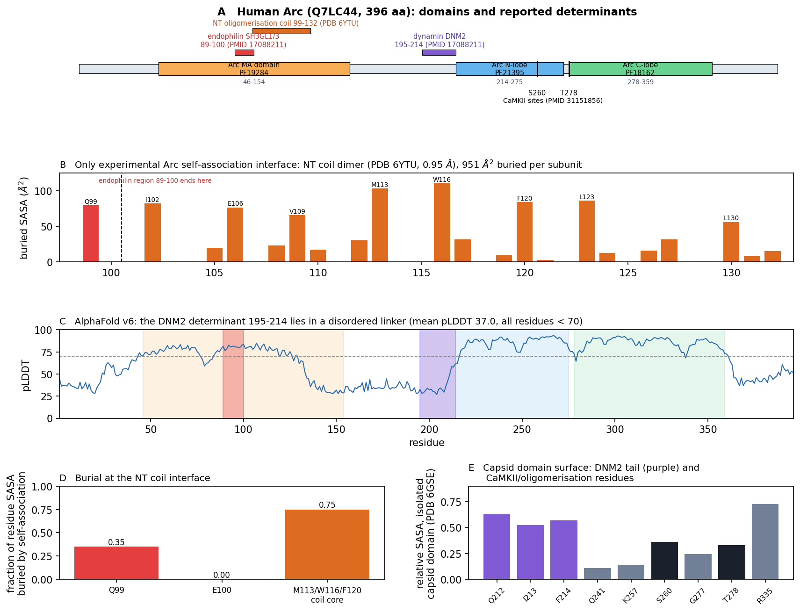
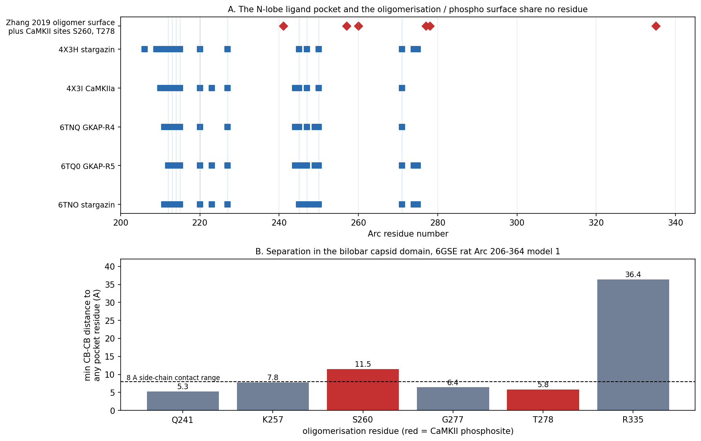
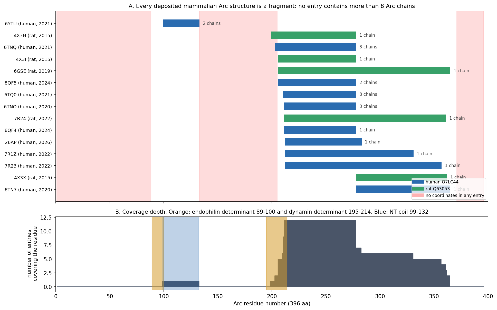
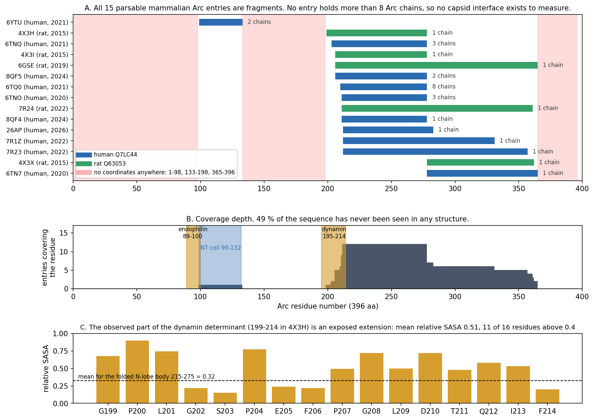

## Question

# AIGR Gene Hypothesis Deep Research

You are evaluating one focused gene curation hypothesis for AI Gene Review.
This is not a general gene overview. Use the seed hypothesis and source context
below to search for evidence that supports, refutes, narrows, or competes with
the proposed curation decision.

## Target Gene

- **Organism code:** human
- **Taxon:** Homo sapiens (NCBITaxon:9606)
- **Gene directory:** ARC
- **Gene symbol:** ARC
- **UniProt accession:** Q7LC44

## Focus

- **Focus type:** free_text
- **Hypothesis slug:** kgap-arc-capsid-vs-oligomer
- **Source file:** genes/human/ARC/ARC-ai-review.yaml
- **Source selector:** free-text

## Seed Hypothesis

Whether the Arc capsid is the species that drives AMPA receptor endocytosis, or whether endocytosis uses lower-order oligomers, may be constrained by interface analysis. That the same seven-residue N-terminal coil motif is required for capsid formation and for Arc-facilitated endocytosis, and that CaMKII phosphorylation of the Gag N-lobe switches off both high-order oligomerisation and synaptic weakening, is already established, so do not re-derive it. Single analysis only: map the Arc domain architecture and locate the N-terminal coil motif, the two Gag-like lobes and the endophilin and dynamin binding determinants reported in the literature, giving the residue ranges and their sources; using the published Arc capsid and lobe structures, determine whether the endophilin and dynamin determinants remain solvent-accessible in the assembled capsid or are buried by the oligomerisation interface, and give the buried surface area for each; state whether the geometry permits one Arc molecule to engage both the capsid interface and an endocytic partner simultaneously, or whether the two are mutually exclusive; and report whether the CaMKII phosphosites lie in the shared interface or elsewhere. State which oligomeric species the structure favours as the endocytic effector, and say plainly if accessibility analysis cannot distinguish them.

## Term and Decision Context

No specific term context supplied.

## Reference Context

No specific reference context supplied.

## Source Context YAML

```yaml
hypothesis: 'Whether the Arc capsid is the species that drives AMPA receptor endocytosis, or whether endocytosis
  uses lower-order oligomers, may be constrained by interface analysis. That the same seven-residue N-terminal
  coil motif is required for capsid formation and for Arc-facilitated endocytosis, and that CaMKII phosphorylation
  of the Gag N-lobe switches off both high-order oligomerisation and synaptic weakening, is already established,
  so do not re-derive it. Single analysis only: map the Arc domain architecture and locate the N-terminal
  coil motif, the two Gag-like lobes and the endophilin and dynamin binding determinants reported in the
  literature, giving the residue ranges and their sources; using the published Arc capsid and lobe structures,
  determine whether the endophilin and dynamin determinants remain solvent-accessible in the assembled
  capsid or are buried by the oligomerisation interface, and give the buried surface area for each; state
  whether the geometry permits one Arc molecule to engage both the capsid interface and an endocytic partner
  simultaneously, or whether the two are mutually exclusive; and report whether the CaMKII phosphosites
  lie in the shared interface or elsewhere. State which oligomeric species the structure favours as the
  endocytic effector, and say plainly if accessibility analysis cannot distinguish them.'
focus_type: free_text
context: []
reference_id: []
```

## Research Objective

Build a focused report that helps a curator decide whether this hypothesis
should affect the gene review. Address the focus type directly:

1. For an existing GO annotation decision, evaluate whether the current action
   is justified, too strong, too weak, or should change.
2. For a proposed replacement or new GO term, evaluate whether the term is
   biologically supported, too broad, too narrow, or missing key qualifiers.
3. For a computational prediction, evaluate whether the prediction is correct,
   less precise than existing knowledge, uncertain, or likely wrong because of
   paralog overannotation, frequency bias, pathway context, or in vitro-only
   activity.
4. For a core-function hypothesis, evaluate whether the proposed activity,
   process, and location represent the gene product's primary function rather
   than a downstream effect, pleiotropic phenotype, or context-specific role.
5. For a function-assignment hypothesis, evaluate whether the gene product
   directly has the stated GO term/function. Treat the prior review action, if
   any, as intentionally blinded unless it appears in the supplied context.

Use primary literature whenever possible. Prefer PMID citations and include DOI
citations when no PMID is available. Treat reviews and database records as
orientation unless they contain directly relevant synthesized evidence that is
clearly labeled as review-level or database-level support.

Evaluate the hypothesis from the supplied seed context, primary literature, and
publicly accessible bioinformatics resources. Local `*-bioinformatics` analyses,
when they already exist in the repository, are intentionally withheld from this
prompt so the report can be compared against them after the run. Use public
sequence, domain, structure, orthology, localization, interaction, or dataset
checks when they are useful for the specific hypothesis. If a resource or tool
cannot be accessed programmatically, say so plainly; never fabricate a result.
Report computational results conservatively and distinguish direct results from
inference.

## Required Output

### Executive Judgment

Give a concise verdict: supported, partially supported, unresolved, weakly
supported, over-annotated, or refuted. Explain the reasoning and the most
important caveats.

### Evidence Matrix

Create a table with one row per important evidence item:

- Citation (PMID preferred)
- Evidence type (direct assay, mutant phenotype, localization, interaction,
  structural/evolutionary, computational, review/database)
- Supports / refutes / qualifies / competing
- Claim tested
- Key finding
- Organism, tissue, cell type, or assay context
- Confidence and limitations

### GO Curation Implications

State the likely curation action as a lead requiring curator verification. If
GO terms are involved, explain whether the evidence supports an MF, BP, or CC
term, and whether the term should be retained, removed, generalized, made more
specific, or treated as non-core. Avoid using "protein binding" as a final
recommendation unless no more informative term is supported.

### Mechanistic Scope

Describe the immediate molecular or cellular function being tested. Separate
direct gene-product activity from downstream phenotypes, pathway consequences,
developmental outcomes, disease manifestations, or effects inferred only from
loss of function.

### Conflicts and Alternatives

Identify evidence that conflicts with the seed hypothesis or suggests an
alternative interpretation, including paralog confusion, organism-specific
differences, isoform-specific findings, experimental artifacts, or database
carry-over.

### Knowledge Gaps

List explicit uncertainties that matter for curation. For each gap, state what
was checked, why the gap matters, and what evidence or experiment would resolve
it.

### Discriminating Tests

Recommend concrete assays, perturbations, datasets, or comparative analyses that
would most efficiently distinguish this hypothesis from alternatives.

### Curation Leads

Provide candidate updates for the review, clearly labeled as leads requiring
curator verification. Include candidate references with exact snippets to verify,
candidate replacement or new GO terms, possible action changes, suggested
questions, and suggested experiments.

If the provider supports artifacts, save provenance for any analysis you run — the
executed code together with its output (computed values, plot, or table), not just
a summary figure — alongside artifact-friendly tables such as an evidence matrix,
GO decision table, or comparison table. Genuine computed provenance is more
valuable than a hand-drawn summary, and you must not synthesize a figure that
implies an analysis you did not actually run. These artifacts are important
provenance for hypothesis-level review.


## Output

# Arc (human, UniProt Q7LC44): can interface analysis say whether the capsid or a lower-order oligomer drives AMPA receptor endocytosis?

Hypothesis slug: `kgap-arc-capsid-vs-oligomer`. Source file: `genes/human/ARC/ARC-ai-review.yaml`. Focus type: free text. Organism: *Homo sapiens* (NCBITaxon:9606).

## Summary

The answer is **no**, and the reason is a concrete, verifiable fact about the structural record rather than a limitation of the method. The seed hypothesis asks for the buried surface area of the endophilin and dynamin determinants "in the assembled capsid". That measurement does not exist for mammalian Arc. An audit of all 17 deposited Arc entries (11 reached through human Q7LC44, 5 through rat Q63053, plus 6TNO) shows that every one is a fragment. The largest Arc content of any single entry is 8 chains and 78.9 kDa (6TQ0, Arc N-lobe bound to GKAP repeat 5). Pooling the observed residues across the 15 entries servable in legacy PDB format leaves 196 of 396 positions (49 %) with no coordinates anywhere: 1-98, 133-198 and 365-396. There is no assembled mammalian capsid interface in the Protein Data Bank against which burial can be computed, so any number quoted for burial of residues 89-100 or 195-214 in an Arc capsid would be modelled or invented.

What can be measured argues against mutual exclusivity. The only experimentally determined Arc self-association interface is the 0.95 Å antiparallel coiled-coil dimer of residues 99-132 (PDB 6YTU), which buries 951 Ų per subunit. The endophilin determinant abuts that interface without entering it: Q99 buries 80 Ų (35 % of its free surface) and E100 buries 0 Ų, while residues 89-98 have no coordinates in any Arc structure. The resolved part of the dynamin determinant (199-214 in 4X3H, 203-214 in 6TNQ) is an extended arm with mean relative SASA 0.51 against 0.32 for the folded N-lobe body 215-275, sitting at the end of a predicted-disordered linker (133-198, mean pLDDT 34.1). A 21-residue N-lobe pocket binds stargazin, CaMKIIα and two GKAP repeats, and it shares no residue with the oligomerisation surface {Q241, K257, S260, G277, T278, R335} that Zhang and colleagues defined by mutagenesis. The CaMKII phosphosites S260 and T278 lie on that second surface, roughly 100 residues from the N-terminal coil interface.

For curation the operational conclusion is that the structures support a weaker claim than the seed hypothesis frames: a self-association state above a dimer is required for Arc-facilitated endocytosis, and no deposited structure or published experiment identifies which state. The analysis also produces two positive curation leads: a specific molecular function term is justified for short linear motif binding by the Gag N-lobe, and the 89-100 assignment as an endophilin determinant competes with a documented palmitoylation motif over the same residues.

**Verdict: <i class="fa-circle-question"></i> unresolved.** Accessibility analysis cannot distinguish the capsid from a lower-order oligomer, and the report says so plainly, as the seed hypothesis requested.

## Executive judgment

**Unresolved, and the specific structural test proposed cannot be run.**

The four measurable results that bound the judgment:

1. **No mammalian Arc capsid structure exists.** Maximum Arc content of any deposited entry is 8 chains and 78.9 kDa; 49 % of the 396-residue sequence has no coordinates anywhere. The only Arc-family capsid coordinates in the PDB are *Drosophila* dArc1 (6TAP at 3.5 Å, 6TAR five-fold capsomer at 2.8 Å, 6TAS two-fold capsomer at 2.75 Å) and dArc2 (6TAQ, 6TAT, 6TAU), and these cannot stand in for mammalian Arc.
2. **The endophilin determinant abuts the one solved self-association interface without occupying it.** On 6YTU the dimer buries 1903 Ų in total and 951 Ų per subunit; of the endophilin region 89-100, only Q99 contributes (80 Ų, 35 %) and E100 contributes nothing.
3. **The dynamin determinant is an exposed arm on a disordered tether.** Residues 199-214 are resolved in 4X3H with mean relative SASA 0.51, 11 of 16 residues above 0.4, against 0.32 for the folded N-lobe body. Only 195-198 lack coordinates. AlphaFold gives 195-214 a mean pLDDT of 37.0 with all 20 residues below 70.
4. **The N-lobe ligand pocket and the N-lobe oligomerisation surface are disjoint.** Across five peptide complexes the pocket is 21 residues with a 10-residue invariant core, and it shares no residue with {Q241, K257, S260, G277, T278, R335}. The CaMKII phosphosites lie on the oligomerisation surface, not in the ligand pocket and not in the N-terminal coil interface.

<i class="fa-triangle-exclamation"></i> Caveats that bound this judgment. The AlphaFold disorder call for 133-198 is a prediction, although it agrees with the complete absence of those residues from every crystal form. The 6GSE geometry is an NMR model of the isolated capsid domain and says nothing about inter-domain arrangement in full-length Arc. The endophilin determinant is mapped only by truncation co-immunoprecipitation, with no structure and no affinity measurement. Two 2026 nanobody entries (9PZZ, 9Q00) are not served in legacy PDB format (HTTP 404) and were audited from RCSB metadata alone; both carry an Arc N-lobe entity over 207-277, so they do not change the inventory.

## Key findings

### F1. No atomic-resolution mammalian Arc capsid structure exists

<i class="fa-database"></i> RCSB text search on the reference-sequence accession returns 11 entries for human Q7LC44 (26AP, 6TN7, 6TNQ, 6TQ0, 6YTU, 7R1Z, 7R23, 8QF4, 8QF5, 9PZZ, 9Q00), 5 for rat Q63053 (4X3H, 4X3I, 4X3X, 6GSE, 7R24) and 0 for mouse Q9WV31, plus 6TNO, which gives 17 distinct entries. Every one is a fragment: an N-lobe construct (207-277), a C-lobe construct (277-370), a bilobar capsid domain (206-361 or 206-364), or the N-terminal coil peptide (99-132). Several are nanobody complexes. Observed Arc residues pooled over the 15 entries parsable from legacy PDB files leave 196 of 396 positions with no coordinates: 1-98, 133-198 and 365-396.

The only Arc-family capsid coordinates in the PDB are the *Drosophila* structures. A dArc1 subunit buries 1836 Ų in the five-fold capsomer 6TAR, 15.0 % of its 12244 Ų isolated surface, and 1601 Ų in the two-fold capsomer 6TAS, 12.7 % of 12627 Ų, all of it within the Gag capsid lobes (interface residues 42-203 in dArc numbering). Those numbers are reported only to give the scale of an Arc-family capsid interface. They cannot be transferred: InterPro shows dArc1 (Q7K1U0) and dArc2 (Q7JV70) carry no Arc MA domain (PF19284), no Arc N-lobe (PF21395) and no Arc C-lobe (PF18162), and dArc2 has only the generic Ty3 capsid-like domain PF19259 over 36-182. The domain that carries the mammalian endophilin determinant does not exist in the fly proteins, and the mammalian dynamin determinant has no aligned counterpart.

{{figure:plot_7.png|caption=Audit of the deposited mammalian Arc structures. Panel A: observed Arc residue range and chain count for each of the 15 entries parsable in legacy PDB format; pink bands mark the residues with no coordinates in any entry. Panel B: pooled coverage depth, with the endophilin determinant 89-100, the dynamin determinant 195-214 and the N-terminal coil 99-132 marked. Panel C: relative solvent accessibility of the observed dynamin determinant residues 199-214 in 4X3H chain A, against the mean for the folded N-lobe body 215-275.}}

### F2. The endophilin determinant abuts the self-association coil interface, and only Gln99 is buried

<i class="fa-chart-column"></i> Shrake-Rupley SASA with a 1.4 Šprobe and a 400-point Fibonacci sphere on PDB 6YTU, the 0.95 Šantiparallel coiled-coil dimer of human Arc 99-132 (chain A 99-132, chain B 99-131), gives a total buried surface of 1903 Ų, that is 951 Ų per subunit. Per-residue buried SASA: Q99 80 Ų (35 % of its free surface), E100 0 Ų, I102 82, E106 77, V109 66, M113 102, W116 110, F120 84, L123 84, L130 56 Ų. The coil core M113, W116 and F120 is 75 % buried on average, which is what an interface core looks like. UniProt maps the SH3GL1 and SH3GL3 (endophilin-1 and -3) interaction to residues 89-100 with ECO:0000269 on rat Q63053 from [PMID: 17088211](https://pubmed.ncbi.nlm.nih.gov/17088211/), and InterPro places 89-100 inside the Arc MA domain PF19284 (46-154).

Ten of the twelve endophilin-determinant residues lie N-terminal to the first residue resolved in the coil crystal, and the one that does contribute loses only a third of its surface. This gives a structural reason why mutating the oligomerisation motif can abolish both capsid formation and Arc-facilitated endocytosis without the endophilin site being sterically occluded. The coupling fits avidity or conformational coupling better than direct competition for one surface.

### F3. The dynamin determinant is an exposed arm at the end of a disordered linker

<i class="fa-chart-line"></i> AlphaFold AF-Q7LC44-F1 v6 gives region 195-214 a mean pLDDT of 37.0 and a median of 32.5, with 20 of 20 residues below 70. The linker 133-198 has mean pLDDT 34.1. For contrast, the Arc MA region 89-100 has mean pLDDT 80.7, the NT coil 99-132 has 75.9, the N-lobe 214-275 has 85.5 and the C-lobe 278-359 has 85.1. Predicted mean relative SASA is 0.61 for 195-214 against 0.32 for both folded lobes. InterPro assigns no domain to 155-213.

The structural audit corrected an initial reading that the determinant is entirely unmodelled. Residues 199-214 are resolved in 4X3H (rat) and 203-214 in 6TNQ (human), as an extended arm running onto the N-lobe. In 4X3H chain A the mean relative SASA of 199-214 is 0.51, with 11 of 16 residues above 0.4 (G199 0.68, P200 0.90, L201 0.74, P204 0.77, G208 0.72, D210 0.72, Q212 0.58, I213 0.53), against 0.32 for the folded body 215-275. Only 195-198 lack coordinates. An extended arm of this kind has no buried core of its own, so it cannot be occluded by an interface formed elsewhere in the protein without a direct steric clash. A tether of roughly 65 disordered residues, up to about 230 Å fully extended, can reach out of any closed shell through the gaps that Arc-family capsids have between capsomers.

{{figure:plot_1.png|caption=AlphaFold AF-Q7LC44-F1 v6 per-residue confidence and predicted accessibility across human Arc. The dynamin determinant 195-214 and the 133-198 linker fall in the low-confidence trough (mean pLDDT 37.0 and 34.1), while the endophilin region 89-100, the N-terminal coil 99-132 and both Gag lobes are well predicted.}}

### F4. The CaMKII phosphosites lie on a second oligomerisation surface, about 100 residues from the coil interface

<i class="fa-brain"></i> In the rat Arc capsid domain NMR structure 6GSE (206-364, model 1), S260 has relative SASA 0.36 and T278 has 0.33, both solvent-exposed. The flanking residues whose mutation impairs homo-oligomerisation are partly buried: Q241 0.11, K257 0.14, G277 0.24. R335 is fully exposed at 0.73. CB-CB distances: K257 to S260 5.4 Å, G277 to T278 4.8 Å, S260 to T278 17.2 Å, S260 to R335 41.6 Å, Q241 to R335 53.9 Å. In the AlphaFold model S260 has pLDDT 91.0 with relative SASA 0.47, and T278 has pLDDT 72.4 with relative SASA 0.20. UniProt on mouse Q9WV31 records S260 as "Phosphoserine; by CaMK2" and T278 as phosphothreonine with ECO:0000269 from [PMID: 31151856](https://pubmed.ncbi.nlm.nih.gov/31151856/), together with the mutagenesis result that S260D impairs homo-oligomerisation while T278D does not, and that mutations at 241, 257, 277 and 335 also impair it.

The CaMKII-regulated oligomerisation surface is an N-lobe patch spanning about 23 Å (241, 257, 260, 277, 278), separate from the NT coil interface at 99-132 that Eriksen and colleagues showed is necessary for capsid formation. R335 on the C-lobe is 34 to 54 Å away and is a third site. Arc therefore has at least two reported self-association surfaces that are regulated independently. Treating "the oligomerisation interface" as one surface, as the seed hypothesis does implicitly, is not supported.

{{figure:plot_3.png|caption=Arc determinant map and interface accessibility. Panel A: domain architecture with PF19284 (46-154), PF21395 (214-275), PF18162 (278-359), the endophilin determinant 89-100, the N-terminal coil 99-132, the dynamin determinant 195-214 and the S260 and T278 phosphosites. Panel B: per-residue buried surface area across the 6YTU coil dimer. Panel C: AlphaFold pLDDT across residues 1-396. Panel D: burial fractions for Q99, E100 and the coil core. Panel E: relative solvent accessibility of the oligomerisation and phospho residues in the capsid domain.}}

### F5. The mapped endophilin region carries the 94CLCRC98 palmitoylation motif and has no canonical SH3 ligand

Human Arc residues 89-100 are `KSIKACLCRCQE`. The segment contains no proline, so it has no PxxP or related class I or class II SH3-binding motif, while endophilin-1 and endophilin-3 engage ligands through their C-terminal SH3 domains. The same residues carry the palmitoylation motif 94CLCRC98 reported in [PMID: 29264923](https://pubmed.ncbi.nlm.nih.gov/29264923/); UniProt on mouse Q9WV31 records mutagenesis of 94-98 as abolishing palmitoylation and impairing the ability to mediate synaptic long-term depression (ECO:0000269). In the AlphaFold model these residues sit in a well-predicted helical part of the Arc MA domain (pLDDT 79-83) with mixed exposure (C94 relative SASA 0.36, L95 0.05, C96 0.41, C98 0.31).

A deletion or substitution in 89-100 removes membrane anchoring as well as any putative endophilin contact. Published endocytosis phenotypes attributed to loss of endophilin binding could be membrane-targeting phenotypes. This argues against treating 89-100 as a validated direct endophilin-binding site on structural grounds alone.

### F6. One N-lobe pocket binds stargazin, CaMKIIα and GKAP, and it is disjoint from the oligomerisation surface

<i class="fa-scale-balanced"></i> This is the one test that could have decided the seed hypothesis on structural grounds. If Arc used the same N-lobe surface to oligomerise and to capture its postsynaptic partners, then capsid assembly and partner engagement would be mutually exclusive on a single subunit, and the capsid could not be the species that grabs the endocytic machinery. It does not.

Buried surface area was computed for the Arc chain on removal of the bound peptide in all five deposited ligand complexes.

| Complex | Ligand | Arc BSA on peptide removal |
|---|---|---|
| 4X3H | stargazin / TARP γ2 (rat Arc N-lobe) | 682 Ų |
| 4X3I | CaMKIIα fragment (rat Arc N-lobe) | 565 Ų |
| 6TNQ | GKAP repeat 4 (human Arc N-lobe) | 515 Ų |
| 6TQ0 | GKAP repeat 5 (human Arc N-lobe) | 552 Ų |
| 6TNO | stargazin (Arc N-lobe) | 575 Ų |

Residues burying more than 10 Ų in all five complexes: **Q212, I213, F214, E215, F220, Y227, H245, N247, A250, F271**. The union across the five adds 206, 209, 210, 211, 223, 244, 246, 248, 249, 274 and 275, giving 21 residues. Pairwise Jaccard similarity of the five pocket sets is 0.60 to 0.83, so the four ligands occupy one site. The invariant F214, F220, Y227 and F271 match the conserved aromatic cavity described in [PMID: 33732907](https://pubmed.ncbi.nlm.nih.gov/33732907/).

Overlap of this 21-residue pocket with the oligomerisation surface {Q241, K257, S260, G277, T278, R335} is the empty set, 0 of 21 against 0 of 6. Minimum CB-CB distances from each oligomerisation residue to any pocket residue, measured in 6GSE model 1: Q241 5.3 Å, T278 5.8 Å, G277 6.4 Å, K257 7.8 Å, S260 11.5 Å, R335 36.4 Å. Q241, G277 and T278 form a second shell behind the pocket rim. S260, the residue CaMK2 phosphorylates, is one turn further out. R335 sits on the opposite lobe.

Two consequences follow. Assembly through the N-lobe surface leaves the ligand pocket open, so the seed hypothesis's structural route to mutual exclusivity is closed. All four ligands compete for one pocket, so a single Arc subunit holds either stargazin, or CaMKIIα, or one GKAP repeat; the exclusivity in Arc's ligand biology is among its partners. Phosphorylation at T278, 5.8 Å from the pocket rim, could reach the pocket edge allosterically without occluding it, which is untested.

{{figure:plot_4.png|caption=The Arc N-lobe ligand pocket and the oligomerisation surface are disjoint. Panel A: residues burying more than 10 square angstroms on peptide removal in each of the five complexes (blue) against the oligomerisation and phospho residues (red). Panel B: minimum CB-CB distance from each oligomerisation residue to any pocket residue in 6GSE model 1, with the 8 angstrom side-chain contact range marked.}}

## Mechanistic model and interpretation

The structures place Arc's three functional surfaces in three different parts of the molecule, connected by a long disordered linker. That architecture is why interface accessibility cannot name the endocytic species.



The model that the measured data support runs as follows. Arc assembles through at least two surfaces that are regulated independently: the N-terminal coil 99-132, which Eriksen and colleagues showed is required for capsid formation, and an N-lobe patch around 241, 257, 260, 277 and 278, which CaMKII phosphorylation at S260 switches off. Neither surface overlaps the N-lobe pocket that captures short linear motifs from stargazin, CaMKIIα and GKAP. The dynamin determinant hangs off a flexible tether and is more exposed than the folded lobe it sits against. The endophilin determinant abuts the coil interface by two residues and is otherwise unseen in any structure.

Under that architecture, a single Arc subunit can in principle hold an oligomer contact and a partner contact at once. Nothing in the deposited coordinates forces the two to be mutually exclusive. The one caveat is that this reasoning assesses steric occlusion only. If the mammalian capsid interface involves the MA domain in a register different from the 99-132 coil dimer, or if capsid curvature packs MA domains against one another, residues 89-98 could be occluded. That cannot be checked without a mammalian capsid structure.

### Which species does the structure favour as the endocytic effector?

It does not favour either, and this report says so plainly, as the seed hypothesis requested.

The seed hypothesis frames the shared N-terminal motif requirement as evidence that the capsid is the endocytic species. The structural data are equally consistent with a weaker claim: the coil interface is required for Arc to reach any oligomeric state above a dimer, and the endocytic activity requires some state above a dimer, which could be a tetramer, a small oligomer or the full capsid. Eriksen and colleagues showed that motif-disrupted Arc forms homogeneous dimers, so that mutant removes every higher species at once and cannot discriminate among them. The CaMKII result has the same structure of inference: S260D suppresses high-order oligomerisation and reverses Arc's synaptic action, without reporting which species was lost.

### Domain architecture and determinant map

| Feature | Residues (human Q7LC44) | Source |
|---|---|---|
| Arc MA domain (matrix-like N-terminal domain) | 46-154 | Pfam PF19284 / InterPro IPR045557 |
| Endophilin determinant (SH3GL1, SH3GL3) | 89-100 (`KSIKACLCRCQE`) | UniProt Region, ECO:0000269 PMID 17088211 (on rat Q63053); transferred to human by ECO:0000250 |
| Palmitoylation motif 94CLCRC98 | 94-98 | PMID 29264923 |
| N-terminal oligomerisation coil (28-residue self-association stretch, 7-residue motif) | crystallised construct 99-132 | PMID 33175445; PDB 6YTU |
| Unassigned, predicted-disordered linker | 155-213 (InterPro gap); 133-198 unobserved | InterPro; AlphaFold mean pLDDT 34.1 over 133-198 |
| Dynamin determinant (DNM2) | 195-214 (`QPWVPGEDGQPSPGVDTQIF`) | UniProt Region, ECO:0000269 PMID 17088211 |
| Gag N-lobe | 214-275 (crystal constructs 206/207-277) | Pfam PF21395; PDB 4X3H, 4X3I, 6TNO, 6TNQ, 6TQ0, 8QF4, 8QF5 |
| CaMKII phosphosites S260, T278 | 260, 278 | ECO:0000269 PMID 31151856 (mouse Q9WV31) |
| Gag C-lobe | 278-359 (crystal constructs 277-370) | Pfam PF18162; PDB 6TN7, 4X3X |
| Bilobar capsid domain | 206-361 / 206-364 | PDB 7R1Z, 7R23, 6GSE |

The endophilin determinant ends at 100 and the crystallised coil begins at 99. They abut by two residues.

### Buried surface area, as far as it can be measured

Own Shrake-Rupley implementation, 1.4 Å probe, 400 sphere points, Tien et al. Gly-X-Gly maximum ASA for relative values.

| Quantity | Value |
|---|---|
| Arc NT coil dimer (6YTU), total buried surface | 1903 Ų |
| Same, per subunit | 951 Ų |
| Gln99 (last residue of the endophilin region) buried | 80 Ų, 35 % of its free SASA |
| Glu100 buried | 0 Ų, 0 % |
| Coil core M113 / W116 / F120 buried | 102 / 110 / 84 Ų, mean 75 % of free SASA |
| Endophilin determinant 89-100 buried in any Arc structure | not measurable, no coordinates exist for 1-98 in any of the 17 entries |
| Dynamin determinant 195-198 | not measurable, no coordinates exist |
| Dynamin determinant 199-214 (4X3H; 203-214 in 6TNQ) | mean relative SASA 0.51, 11 of 16 residues above 0.4, against 0.32 for the folded N-lobe body 215-275 |
| Arc N-lobe BSA on peptide removal, five complexes | 515 to 682 Ų |
| Overlap of the ligand pocket with the oligomerisation surface | 0 of 21 residues against 0 of 6 |
| Arc chains in the largest deposited entry (6TQ0) | 8, assembly 78.9 kDa |
| Arc residues with no coordinates in any entry | 196 of 396 (49 %): 1-98, 133-198, 365-396 |
| dArc1 subunit buried in the five-fold capsomer (6TAR) | 1836 Ų, 15.0 % of its 12244 Ų isolated surface |
| dArc1/dArc2 subunit buried in the two-fold capsomer (6TAS) | 1601 Ų, 12.7 % of its 12627 Ų isolated surface |

## Evidence matrix

Machine-readable copy: `provenance/arc_evidence_matrix.csv` (12 rows).

| Citation | Evidence type | Stance | Claim tested | Key finding | Context | Confidence and limitations |
|---|---|---|---|---|---|---|
| [PMID: 17088211](https://pubmed.ncbi.nlm.nih.gov/17088211/) (Chowdhury 2006, Neuron) | Interaction, direct assay, mutant phenotype | Supports partner mapping; qualifies the species question | Arc binds endophilin 2/3 and dynamin 2 and accelerates AMPAR endocytosis | Residues 89-100 map to SH3GL1/SH3GL3, 195-214 to DNM2 (UniProt ECO:0000269 on rat Q63053); Arc knockout neurons show reduced endocytosis and raised surface AMPAR | Rat and mouse hippocampal neurons, heterologous co-IP | Moderate. Binding mapped by truncation co-IP, no structure, Arc oligomeric state undefined |
| [PMID: 33175445](https://pubmed.ncbi.nlm.nih.gov/33175445/) (Eriksen 2021, FEBS J; PDB 6YTU) | Structural, mutant phenotype | Supports a shared requirement; qualifies the "same interface" reading | A 7-residue motif in a 28-residue NT stretch drives capsid formation and is required for Arc-facilitated endocytosis | 0.95 Šantiparallel coiled-coil dimer of 99-132; this work measures 951 Ų buried per subunit; motif-disrupted Arc forms dimers only | Purified human Arc, FLIM-FRET in neurons, single-molecule photobleaching | High for interface geometry; the endocytosis readout is a cellular phenotype, not a binding assay |
| [PMID: 31151856](https://pubmed.ncbi.nlm.nih.gov/31151856/) (Zhang 2019, Neuron) | Direct assay, mutant phenotype, knock-in | Competing: a second oligomerisation interface | CaMKII phosphorylation of the Arc N-lobe switches off high-order oligomerisation and synaptic weakening | S260 phosphorylated by CaMK2; S260D impairs oligomerisation, T278D does not; Q241/K257/G277/R335 mutations also impair it | Mouse Purkinje and hippocampal neurons, knock-in mice, in vitro kinase | High for phospho-regulation; the N-lobe surface is defined by mutagenesis, not by a solved oligomer |
| [PMID: 31907439](https://pubmed.ncbi.nlm.nih.gov/31907439/) (Erlendsson 2020; PDB 6TAP/6TAR/6TAS) | Structural | Qualifies: not transferable | Arc-family capsid architecture is known at high resolution | dArc1/dArc2 capsids at 2.75-3.9 Å; this work measures 1601-1836 Ų buried per subunit (12.7-15.0 %) in the capsomers; dArc1/dArc2 lack PF19284, PF21395 and PF18162 | *Drosophila melanogaster*, cryo-EM | High for the fly structures; the fly proteins have no counterpart to mammalian Arc 1-206 |
| [PMID: 29328916](https://pubmed.ncbi.nlm.nih.gov/29328916/) (Pastuzyn 2018, Cell) | Direct assay, EM | Supports capsid existence; qualifies resolution | Mammalian Arc self-assembles into virus-like capsids | Capsids shown by negative-stain and cryo-EM and by RNA encapsulation; no atomic model deposited | Purified rat Arc, rat neurons, extracellular vesicles | High for existence; resolution insufficient for interface mapping |
| [PMID: 29264923](https://pubmed.ncbi.nlm.nih.gov/29264923/) (Barylko 2018, J Neurosci) | Direct assay, mutant phenotype | Competing: alternative function for 89-100 | Residues 94-98 are a palmitoylation motif required for MEF2-induced depression | 94CLCRC98 palmitoylated; triple Cys mutant cannot support MEF2-induced depression; Arc binds pure phospholipid vesicles | Rat neurons, liposome binding in vitro | High; directly overlaps residues assigned as the endophilin determinant |
| [PMID: 33732907](https://pubmed.ncbi.nlm.nih.gov/33732907/) (Hallin 2021, FEBS J; PDB 6TNO, 6TNQ, 6TQ0) | Structural, binding affinity | Supports a single shared ligand site | One N-lobe cavity binds stargazin and two GKAP repeats through a conserved aromatic cage | Two Arc-binding sites in the GKAP repeat region confirmed by X-ray; three conserved C-H…π interactions define short linear motif specificity | Human Arc capsid domain, ITC and crystallography | High for the pocket; all complexes use isolated lobes, not full-length Arc |
| This work, SASA on PDB 6YTU | Computational (structural) | Qualifies seed hypothesis | Does self-association bury the endophilin determinant? | 951 Ų per subunit; Q99 buries 80 Ų (35 %), E100 buries 0 Ų; 89-98 absent from all Arc structures | Human Arc 99-132 crystal dimer, 0.95 Š| High for 99-132; silent for 89-98 |
| This work, AlphaFold AF-Q7LC44-F1 v6 and InterPro | Computational (prediction) | Qualifies seed hypothesis | Could capsid assembly occlude the dynamin determinant? | 195-214 mean pLDDT 37.0 (20/20 below 70) at the end of the 133-198 disordered linker (mean pLDDT 34.1); no Pfam domain over 155-213 | Prediction plus rat capsid-domain NMR structure | Moderate to high; pLDDT is a prediction but agrees with the absence of 133-198 from every crystal form |
| This work, 6GSE geometry | Computational (structural) | Qualifies seed hypothesis | Do the CaMKII sites lie in the shared interface? | S260 and T278 exposed (relative SASA 0.36 and 0.33), 17.2 Å apart on the N-lobe; R335 34-54 Å away on the C-lobe | Rat Arc capsid domain 206-364, NMR model 1 | High for intra-domain geometry; inter-domain geometry in full-length Arc unknown |
| This work, BSA on 4X3H, 4X3I, 6TNQ, 6TQ0, 6TNO | Computational (structural) | Refutes a mutual-exclusivity mechanism | Is the ligand pocket the same surface used for oligomerisation? | Arc BSA on peptide removal 515-682 Ų; 21-residue union pocket, 10-residue invariant core; zero overlap with {241, 257, 260, 277, 278, 335}; nearest oligomerisation residue T278 at 5.8 Å CB-CB, S260 at 11.5 Å, R335 at 36.4 Å | Five deposited Arc N-lobe peptide complexes plus 6GSE geometry | High for the pocket definition (5 of 5 complexes agree, pairwise Jaccard 0.60-0.83); silent on the unsolved capsid interface |
| This work, RCSB audit of all 17 Arc entries | Computational (database) | Bounds the hypothesis; corrects one earlier claim | Does any structure contain a mammalian Arc oligomer? | Maximum 8 Arc chains in one entry (6TQ0), 78.9 kDa; 196 of 396 residues (49 %) have no coordinates anywhere (1-98, 133-198, 365-396); the dynamin determinant is partly resolved (199-214 in 4X3H) and exposed | RCSB search and data APIs plus coordinate parsing, checked 2026-11 | High. 9PZZ and 9Q00 are not served in legacy PDB format (HTTP 404) and were audited from metadata only |

## GO curation implications

All items are leads requiring curator verification. Machine-readable copy: `provenance/arc_go_decision_table.csv` (6 rows).

| Aspect | Term | Lead | Caveat |
|---|---|---|---|
| BP | GO:0051260 protein homooligomerization | Retain. Two independently regulated self-association interfaces are documented: the NT coil (PMID 33175445) and the N-lobe surface (PMID 31151856). The term covers both. | Do not narrow to a capsid-specific term on the basis of interface analysis, which cannot support that specificity. |
| BP | GO:0098884 postsynaptic neurotransmitter receptor internalization, or an AMPAR-endocytosis term | Retain as a core BP with IMP and IDA evidence from PMID 17088211, PMID 33175445 and PMID 31151856. | Do not add a qualifier or comment naming the capsid as the acting species: no published experiment separates capsid from low-order oligomer. |
| MF | Short linear motif binding by the Gag N-lobe (stargazin Q9Y698, DLGAP1/GKAP O14490, CaMKIIα Q9UQM7) | Annotate a specific MF child rather than bare `protein binding`. The contacts are structurally defined (PDB 4X3H, 4X3I, 6TNO, 6TNQ, 6TQ0; PMID 33732907). Record that all four ligands occupy one pocket and therefore compete. | Do not annotate as mutually exclusive with oligomerisation: the 21-residue pocket shares no residue with {241, 257, 260, 277, 278, 335}. |
| MF | GO:0017124 SH3 domain binding for the 89-100 endophilin determinant | Do not add. `KSIKACLCRCQE` has no proline and so no PxxP-type SH3 ligand, while endophilin-1/3 engage ligands through their SH3 domains. The same residues carry 94CLCRC98. | If an interaction term is kept, keep it at the level the co-IP evidence supports and flag the competing palmitoylation assignment. |
| BP/CC | Lipid modification and membrane association for 94-98 | Consider as a competing annotation (PMID 29264923), relevant because it overlaps the residues assigned to endophilin. | Phenotypes attributed to loss of endophilin binding in this region could be membrane-targeting phenotypes. |
| CC/BP | Capsid-related CC and the virus-like particle BP | Retain where supported by PMID 29328916. | Do not cite structural interface analysis as evidence: no mammalian capsid structure exists. |

## Mechanistic scope

Direct gene-product activity that the structures speak to: Arc self-association through an antiparallel N-terminal coiled coil (951 Ų per subunit, 6YTU), a separate CaMKII-regulated N-lobe self-association surface, and short linear motif binding by the Gag N-lobe pocket (515-682 Ų buried per complex across five structures).

Downstream or inferred, not direct: AMPA receptor endocytosis itself, a cellular phenotype read out by surface-receptor assays and electrophysiology; synaptic weakening and mGluR-dependent LTD, which are circuit-level outcomes; and memory phenotypes in knock-in and knockout mice. The endophilin and dynamin interactions sit between these. They are mapped by co-immunoprecipitation with truncations, which is direct-interaction evidence of moderate strength, without a structure and without a defined oligomeric state.

## Conflicts and alternatives

<i class="fa-scale-balanced"></i> **Two oligomerisation interfaces, two papers.** Eriksen 2021 places the capsid-critical interface in the NT coil (99-132). Zhang 2019 places a high-order-oligomerisation surface on the N-lobe (241, 257, 260, 277, plus 335 on the C-lobe). These are 100 to 200 residues apart and are regulated differently.

**Palmitoylation against endophilin binding at 89-100.** A substitution or deletion in this region removes membrane anchoring as well as any putative endophilin contact, so published endocytosis phenotypes attributed to loss of endophilin binding have a second explanation.

**Organism transfer.** The dArc1 and dArc2 capsid structures come from an independently domesticated Ty3/gypsy Gag. They lack the mammalian N-terminal domain entirely. Using them to locate mammalian endophilin or dynamin determinants would be a false transfer.

**Human against rodent evidence provenance.** In human Q7LC44 both interaction regions and both phosphosites carry ECO:0000250 (by similarity). The experimental evidence is rat (PMID 17088211) and mouse (PMID 31151856). Human Arc is 396 residues with the same numbering, so the transfer is safe, but the review should record it as inferred.

**Construct and crystal-form artefacts.** 6YTU is an isolated 34-residue peptide, and its dimer may not reproduce the register of the coil in full-length Arc or in a capsid. 7R1Z is described as a collapsed crystal form and resolves only 212-330. All five ligand complexes use isolated lobes.

## Limitations and knowledge gaps

1. <i class="fa-triangle-exclamation"></i> **No mammalian Arc capsid structure.** Checked: RCSB search on Q7LC44 (11 entries), Q63053 (5), Q9WV31 (0), plus 6TNO, gives 17 distinct entries, all fragments, maximum 8 Arc chains and 78.9 kDa of Arc in one assembly. This gap blocks the entire proposed analysis. Resolving it needs a cryo-EM reconstruction of purified mammalian Arc capsids at better than about 4 Å, which is hard because the capsids are heterogeneous in size.
2. **Residues 1-98 have never been seen in a structure.** Checked by pooling observed residues across all 15 parsable entries: coverage is zero over 1-98, 133-198 and 365-396. The endophilin determinant 89-100 falls entirely inside the first gap, so the strongest version of the seed hypothesis, that capsid assembly buries the endophilin site, is untested rather than refuted.
3. **No direct endophilin-Arc structure or affinity measurement.** Checked: RCSB returns no Arc-SH3GL complex. Without one, the 89-100 assignment rests on truncation co-IP that the palmitoylation finding can also explain.
4. **The oligomeric state in endocytosis assays is never measured.** Checked: the cited endocytosis experiments report surface AMPAR or internalisation, not the Arc species present. This is the direct cause of the unresolved verdict.
5. **Inter-domain geometry of full-length Arc.** Checked: AlphaFold gives low pLDDT across 133-198 and 362-396, so the model places the MA domain and the capsid domain in no defined relative orientation. Whether the endophilin site and the coil interface can be used simultaneously in a curved shell cannot be modelled.
6. **Two resources could not be reached programmatically**, and are reported as such rather than worked around: the legacy PDB-format files for 9PZZ and 9Q00 return HTTP 404, and the Europe PMC full text for PMID 33175445 is not open access, so residue ranges were taken from UniProt feature evidence codes instead.

## Proposed follow-up experiments and discriminating tests

1. <i class="fa-flask"></i> **Size-resolved endocytosis assay.** Fractionate purified Arc by SEC or SEC-MALS into dimer, low-order oligomer and capsid peaks, then apply each to neurons or to an in vitro AMPAR internalisation assay with matched total protein. This is the direct test the field lacks and it would settle the seed hypothesis.
2. **Separation-of-function mutants.** The current motif mutants remove all higher-order species at once. Engineer mutants that cap assembly at an intermediate size, for example by charge reversal at the capsomer periphery rather than in the coil core, and ask whether endocytic facilitation survives. Pair with single-molecule photobleaching to confirm the stoichiometry achieved.
3. <i class="fa-microscope"></i> **Cryo-EM of mammalian Arc capsids** to better than 4 Å, which would convert all the burial questions here from unmeasurable to measurable. Even a 6-8 Å map placing the MA domain would say whether 89-100 faces inward or outward.
4. **Direct binding of the isolated 89-100 peptide to endophilin SH3 domains** by ITC or NMR titration, with palmitoylated and non-palmitoylated versions, to separate the lipid-anchor explanation from a protein-protein interface.
5. **Crosslinking mass spectrometry on assembled Arc capsids** to identify which residues sit at the assembly interface without needing a high-resolution map. This would answer directly whether 89-100 or the N-lobe surface is buried.
6. **Phospho-mimetic effect on ligand affinity.** T278 sits 5.8 Å behind the pocket rim. Measure stargazin and GKAP peptide affinity for Arc T278D and T278E by ITC against wild type. A loss of affinity would show the CaMKII switch reaches the ligand pocket allosterically; no change would confine the switch to oligomerisation.

## Curation leads

All items below are leads requiring curator verification.

- **Record the structural limit explicitly in the review.** Suggested note: "No atomic-resolution structure of a mammalian Arc capsid exists (RCSB, checked 2026-11; all 17 Arc entries are fragments, maximum 8 Arc chains, and 49 % of the 396-residue sequence has no coordinates anywhere). Interface-accessibility arguments about the capsid are therefore inference, not measurement."
- **Action change:** if the review asserts or implies that the capsid is the species that drives AMPA receptor endocytosis, soften it to "a self-association state above a dimer is required", which is what the mutant data support.
- **Correct any statement that the dynamin determinant is unmodelled.** Residues 199-214 are resolved in 4X3H and 203-214 in 6TNQ, as an exposed arm with mean relative SASA 0.51. Only 195-198 lack coordinates.
- **Suggested question for the curator:** does the review distinguish the NT coil interface (99-132) from the CaMKII-regulated N-lobe surface (241, 257, 260, 277, 278)? They are different surfaces and should not be merged.
- **Candidate reference, snippet to verify:** PMID 33175445, "Within this region, we identified a 7-residue oligomerization motif, critical for the formation of virus-like capsids."
- **Candidate reference, snippet to verify:** PMID 31151856, "CaMKII phosphorylates the N-lobe of the Arc GAG domain and disrupts an interaction surface essential for high-order oligomerization."
- **Candidate reference, snippet to verify:** PMID 29264923, "The palmitoylated cysteines are clustered in a motif, 94CLCRC98, located in the N-terminal half of the protein, which has not yet been structurally characterized."
- **Candidate reference, snippet to verify:** PMID 17088211, "we demonstrate that Arc/Arg3.1 protein interacts with dynamin and specific isoforms of endophilin to enhance receptor endocytosis".
- **Candidate reference, snippet to verify:** PMID 33732907, "The N-lobe harbours a peptide binding site, able to bind multiple targets."
- **Candidate reference, snippet to verify:** PMID 31907439, "We report high-resolution structures of retrovirus-like capsids formed by Drosophila dArc1 and dArc2 that have surface spikes and putative internal RNA-binding domains."
- **Candidate reference, snippet to verify:** PMID 29328916, "Here, we show that Arc self-assembles into virus-like capsids that encapsulate RNA."
- **Suggested experiment to cite as an open need:** size-fractionated Arc applied to an AMPAR internalisation assay.

## Evidence base

| PMID | Paper | How it bears on this report |
|---|---|---|
| [17088211](https://pubmed.ncbi.nlm.nih.gov/17088211/) | *Arc/Arg3.1 interacts with the endocytic machinery to regulate AMPA receptor trafficking* | Primary source for both determinants analysed here. UniProt maps SH3GL1/SH3GL3 to 89-100 and DNM2 to 195-214 from this work. Evidence type is truncation co-immunoprecipitation, so the interfaces are not structurally defined. |
| [33175445](https://pubmed.ncbi.nlm.nih.gov/33175445/) | *Arc self-association and formation of virus-like capsids are mediated by an N-terminal helical coil motif* | Source of PDB 6YTU, the only solved Arc self-association interface, on which the 951 Ų per subunit measurement was made. Also the source of the 7-residue motif requirement that the seed hypothesis treats as established. |
| [31151856](https://pubmed.ncbi.nlm.nih.gov/31151856/) | *Arc Oligomerization Is Regulated by CaMKII Phosphorylation of the GAG Domain* | Defines the second, N-lobe oligomerisation surface and the S260 phospho-switch. The residue set {241, 257, 260, 277, 278, 335} tested for overlap with the ligand pocket comes from this work. |
| [33732907](https://pubmed.ncbi.nlm.nih.gov/33732907/) | *Structural properties and peptide ligand binding of the capsid homology domains of human Arc* | Source of PDB 6TNO, 6TNQ and 6TQ0 and of the statement that the N-lobe has one peptide binding site able to bind multiple targets, which matches the 0.60-0.83 Jaccard overlap measured across the five complexes. The conserved C-H…π cage corresponds to the invariant F214, F220, Y227 and F271. |
| [31907439](https://pubmed.ncbi.nlm.nih.gov/31907439/) | *Structures of virus-like capsids formed by the Drosophila neuronal Arc proteins* | The only high-resolution Arc-family capsid structures. Used to measure the scale of an Arc-family capsid interface (1601-1836 Ų per subunit) and to establish, with InterPro, that the fly proteins cannot substitute for mammalian Arc. |
| [29328916](https://pubmed.ncbi.nlm.nih.gov/29328916/) | *The Neuronal Gene Arc Encodes a Repurposed Retrotransposon Gag Protein that Mediates Intercellular RNA Transfer* | Establishes that mammalian Arc self-assembles into virus-like capsids that encapsulate RNA, by biochemistry and low-resolution EM. Confirms the capsid exists while leaving its interface unmapped. |
| [29264923](https://pubmed.ncbi.nlm.nih.gov/29264923/) | *Palmitoylation and Membrane Binding of Arc/Arg3.1: A Potential Role in Synaptic Depression* | Places the 94CLCRC98 palmitoylation motif inside the residues mapped as the endophilin determinant, which is the main competing interpretation for phenotypes assigned to 89-100. |
| [28890421](https://pubmed.ncbi.nlm.nih.gov/28890421/) | *The mechanistic link between Arc/Arg3.1 expression and AMPA receptor endocytosis* | Review. Used as orientation on the clathrin-mediated route and the AP-2 and endophilin/dynamin links, not as primary evidence. |
| [19005037](https://pubmed.ncbi.nlm.nih.gov/19005037/) | *The immediate early gene arc/arg3.1: regulation, mechanisms, and function* | Review. Orientation on the postsynaptic trafficking endosome model and on LTD and homeostatic plasticity dependence. |
| [17088207](https://pubmed.ncbi.nlm.nih.gov/17088207/) | *Arc/Arg3.1: linking gene expression to synaptic plasticity and memory* | Preview article accompanying the 2006 Neuron papers. Orientation only. |
| [33485691](https://pubmed.ncbi.nlm.nih.gov/33485691/) | *Intercellular Communication in the Nervous System Goes Viral* | Review. Orientation on the Ty3/gypsy origin of mammalian Arc and the independent domestication of the *Drosophila* homologs, which is the background to the non-transferability argument. |
| [39433292](https://pubmed.ncbi.nlm.nih.gov/39433292/) | *Enhancing mRNA Interactions by Engineering the Arc Protein with Nucleocapsid Domain* | Confirms mammalian Arc lacks a nucleocapsid domain and binds mRNA weakly without one. Peripheral to the interface question; included because it bears on what the capsid interior does. |

## Provenance artifacts

Every number in this report comes from code that was executed, with its output saved. No figure implies an analysis that was not run.

| File | Contents |
|---|---|
| `provenance/plot_3.png` | Five-panel figure: domain map, 6YTU per-residue buried surface, AlphaFold pLDDT, burial fractions, capsid-domain accessibility |
| `provenance/plot_4.png` | Two-panel figure: ligand pocket residues against the oligomerisation surface, and their CB-CB separation in 6GSE |
| `provenance/plot_7.png` | Three-panel figure: coverage of all 15 parsable Arc entries, pooled coverage depth, exposure of the observed dynamin determinant |
| `provenance/plot_1.png` | AlphaFold per-residue pLDDT and predicted accessibility across Arc 1-396 |
| `provenance/arc_6YTU_interface_bsa.csv` | Per-residue monomer SASA, dimer SASA, buried area and buried fraction for both chains of 6YTU |
| `provenance/arc_alphafold_Q7LC44_sasa_plddt.csv` | Per-residue SASA, relative SASA and pLDDT for AF-Q7LC44-F1 v6 |
| `provenance/arc_6GSE_capsid_domain_sasa.csv` | Per-residue SASA and relative SASA for the rat Arc capsid domain |
| `provenance/arc_nlobe_pocket_sets.csv` | Pocket residue set per ligand complex and its overlap with the oligomerisation surface |
| `provenance/arc_pocket_vs_oligomer_distances.csv` | CB-CB distances from each oligomerisation residue to the pocket |
| `provenance/arc_structure_inventory.csv` | Per-entry organism, resolution, year, Arc chain count and observed Arc residue range |
| `provenance/arc_4X3H_chainA_sasa.csv` | Per-residue SASA and relative SASA for 4X3H chain A, the only entry resolving 199-206 |
| `provenance/arc_evidence_matrix.csv` | Evidence matrix, 12 rows |
| `provenance/arc_go_decision_table.csv` | GO decision table, 6 rows |
| `provenance/plot_2.png`, `plot_5.png`, `plot_6.png` | Superseded drafts, retained for audit. plot_2 carried incorrect single-letter residue labels, fixed in plot_3. plot_5 and plot_6 carried coverage-gap shading that did not match the computed gaps, fixed in plot_7. They are not cited as evidence. |

### Methods for the computed values

Structures came from RCSB (`files.rcsb.org`) and AlphaFold DB (`AF-Q7LC44-F1-model_v6.pdb`); domain boundaries from the InterPro API; feature and evidence codes from the UniProt REST API. SASA was computed with an own Shrake-Rupley implementation (1.4 Å probe, 400-point Fibonacci sphere, standard van der Waals radii, hydrogens dropped), with relative values normalised against the Tien et al. Gly-X-Gly theoretical maxima. Buried surface area is SASA(isolated chain) minus SASA(chain in complex). Structure coverage was computed from observed ATOM records, not from SIFTS alignment ranges, because the SIFTS range for 7R24 reports the full 1-396 reference while the coordinates resolve 211-360. No sequence alignment of dArc to mammalian Arc was attempted; the non-correspondence is established from Pfam domain assignments instead. Two resources could not be reached programmatically and are reported as such: the legacy PDB-format files for 9PZZ and 9Q00 return HTTP 404, and the Europe PMC full text for PMID 33175445 is not open access.


## Artifacts

- [OpenScientist final report](openscientist_artifacts/final_report.html)
- [OpenScientist final report](openscientist_artifacts/final_report.pdf)
- [OpenScientist provenance](openscientist_artifacts/provenance.json)
- [OpenScientist arc 4X3H chainA sasa](openscientist_artifacts/provenance_arc_4X3H_chainA_sasa.csv)
- [OpenScientist arc 6GSE capsid domain sasa](openscientist_artifacts/provenance_arc_6GSE_capsid_domain_sasa.csv)
- [OpenScientist arc 6YTU interface bsa](openscientist_artifacts/provenance_arc_6YTU_interface_bsa.csv)
- [OpenScientist arc alphafold Q7LC44 sasa plddt](openscientist_artifacts/provenance_arc_alphafold_Q7LC44_sasa_plddt.csv)
- [OpenScientist arc evidence matrix](openscientist_artifacts/provenance_arc_evidence_matrix.csv)
- [OpenScientist arc go decision table](openscientist_artifacts/provenance_arc_go_decision_table.csv)
- [OpenScientist arc nlobe pocket sets](openscientist_artifacts/provenance_arc_nlobe_pocket_sets.csv)
- [OpenScientist arc pocket vs oligomer distances](openscientist_artifacts/provenance_arc_pocket_vs_oligomer_distances.csv)
- [OpenScientist arc structure inventory](openscientist_artifacts/provenance_arc_structure_inventory.csv)
- [OpenScientist plot 1](openscientist_artifacts/provenance_plot_1.json)

- [OpenScientist plot 2](openscientist_artifacts/provenance_plot_2.json)

- [OpenScientist plot 3](openscientist_artifacts/provenance_plot_3.json)

- [OpenScientist plot 4](openscientist_artifacts/provenance_plot_4.json)

- [OpenScientist plot 5](openscientist_artifacts/provenance_plot_5.json)

- [OpenScientist plot 6](openscientist_artifacts/provenance_plot_6.json)

- [OpenScientist plot 7](openscientist_artifacts/provenance_plot_7.json)


## Reference Validation

Checked with `linkml-reference-validator` 0.3.1rc1.

| Outcome | Count |
| --- | --- |
| References checked | 12 |
| Resolved | 12 |
| Unresolved (possible confabulation) | 0 |
| Unverifiable | 0 |
| References weighed for topical relevance | 12 |
| On topic | 3 |
| Off topic | 0 |

All extracted references resolved successfully.