## Question

# AIGR Gene Hypothesis Deep Research

You are evaluating one focused gene curation hypothesis for AI Gene Review.
This is not a general gene overview. Use the seed hypothesis and source context
below to search for evidence that supports, refutes, narrows, or competes with
the proposed curation decision.

## Target Gene

- **Organism code:** human
- **Taxon:** Homo sapiens (NCBITaxon:9606)
- **Gene directory:** ARHGAP23
- **Gene symbol:** ARHGAP23
- **UniProt accession:** Q9P227

## Focus

- **Focus type:** free_text
- **Hypothesis slug:** kgap-arhgap23-pdz-ligand-class
- **Source file:** genes/human/ARHGAP23/ARHGAP23-ai-review.yaml
- **Source selector:** free-text

## Seed Hypothesis

The PDZ domain of human ARHGAP23 (UniProt Q9P227) is a canonical class I PDZ domain that binds C-terminal S/T-x-Φ peptide motifs. Single analysis only: align the ARHGAP23 PDZ domain to PDZ domains of known specificity (e.g. PSD-95 PDZ3, ARHGAP21 PDZ, Shank, syntenin), score the carboxylate-binding loop (GLGF-type) and the alphaB1 and betaB5 specificity positions that determine class I/II/III preference, and use an AlphaFold model to report whether the peptide-binding groove is intact; state the predicted ligand class.

## Term and Decision Context

No specific term context supplied.

## Reference Context

No specific reference context supplied.

## Source Context YAML

```yaml
hypothesis: 'The PDZ domain of human ARHGAP23 (UniProt Q9P227) is a canonical class I PDZ domain that
  binds C-terminal S/T-x-Φ peptide motifs. Single analysis only: align the ARHGAP23 PDZ domain to PDZ
  domains of known specificity (e.g. PSD-95 PDZ3, ARHGAP21 PDZ, Shank, syntenin), score the carboxylate-binding
  loop (GLGF-type) and the alphaB1 and betaB5 specificity positions that determine class I/II/III preference,
  and use an AlphaFold model to report whether the peptide-binding groove is intact; state the predicted
  ligand class.'
focus_type: free_text
context: []
reference_id: []
```

## Research Objective

Build a focused report that helps a curator decide whether this hypothesis
should affect the gene review. Address the focus type directly:

1. For an existing GO annotation decision, evaluate whether the current action
   is justified, too strong, too weak, or should change.
2. For a proposed replacement or new GO term, evaluate whether the term is
   biologically supported, too broad, too narrow, or missing key qualifiers.
3. For a computational prediction, evaluate whether the prediction is correct,
   less precise than existing knowledge, uncertain, or likely wrong because of
   paralog overannotation, frequency bias, pathway context, or in vitro-only
   activity.
4. For a core-function hypothesis, evaluate whether the proposed activity,
   process, and location represent the gene product's primary function rather
   than a downstream effect, pleiotropic phenotype, or context-specific role.
5. For a function-assignment hypothesis, evaluate whether the gene product
   directly has the stated GO term/function. Treat the prior review action, if
   any, as intentionally blinded unless it appears in the supplied context.

Use primary literature whenever possible. Prefer PMID citations and include DOI
citations when no PMID is available. Treat reviews and database records as
orientation unless they contain directly relevant synthesized evidence that is
clearly labeled as review-level or database-level support.

Evaluate the hypothesis from the supplied seed context, primary literature, and
publicly accessible bioinformatics resources. Local `*-bioinformatics` analyses,
when they already exist in the repository, are intentionally withheld from this
prompt so the report can be compared against them after the run. Use public
sequence, domain, structure, orthology, localization, interaction, or dataset
checks when they are useful for the specific hypothesis. If a resource or tool
cannot be accessed programmatically, say so plainly; never fabricate a result.
Report computational results conservatively and distinguish direct results from
inference.

## Required Output

### Executive Judgment

Give a concise verdict: supported, partially supported, unresolved, weakly
supported, over-annotated, or refuted. Explain the reasoning and the most
important caveats.

### Evidence Matrix

Create a table with one row per important evidence item:

- Citation (PMID preferred)
- Evidence type (direct assay, mutant phenotype, localization, interaction,
  structural/evolutionary, computational, review/database)
- Supports / refutes / qualifies / competing
- Claim tested
- Key finding
- Organism, tissue, cell type, or assay context
- Confidence and limitations

### GO Curation Implications

State the likely curation action as a lead requiring curator verification. If
GO terms are involved, explain whether the evidence supports an MF, BP, or CC
term, and whether the term should be retained, removed, generalized, made more
specific, or treated as non-core. Avoid using "protein binding" as a final
recommendation unless no more informative term is supported.

### Mechanistic Scope

Describe the immediate molecular or cellular function being tested. Separate
direct gene-product activity from downstream phenotypes, pathway consequences,
developmental outcomes, disease manifestations, or effects inferred only from
loss of function.

### Conflicts and Alternatives

Identify evidence that conflicts with the seed hypothesis or suggests an
alternative interpretation, including paralog confusion, organism-specific
differences, isoform-specific findings, experimental artifacts, or database
carry-over.

### Knowledge Gaps

List explicit uncertainties that matter for curation. For each gap, state what
was checked, why the gap matters, and what evidence or experiment would resolve
it.

### Discriminating Tests

Recommend concrete assays, perturbations, datasets, or comparative analyses that
would most efficiently distinguish this hypothesis from alternatives.

### Curation Leads

Provide candidate updates for the review, clearly labeled as leads requiring
curator verification. Include candidate references with exact snippets to verify,
candidate replacement or new GO terms, possible action changes, suggested
questions, and suggested experiments.

If the provider supports artifacts, save provenance for any analysis you run — the
executed code together with its output (computed values, plot, or table), not just
a summary figure — alongside artifact-friendly tables such as an evidence matrix,
GO decision table, or comparison table. Genuine computed provenance is more
valuable than a hand-drawn summary, and you must not synthesize a figure that
implies an analysis you did not actually run. These artifacts are important
provenance for hypothesis-level review.


## Output

# ARHGAP23 PDZ domain: ligand class assessment

**Gene** human ARHGAP23 · **UniProt** Q9P227 (1491 aa) · **Hypothesis slug** `kgap-arhgap23-pdz-ligand-class`
**Source file** `genes/human/ARHGAP23/ARHGAP23-ai-review.yaml` · **Focus type** `free_text` · **Source selector** `free-text`

**Seed hypothesis under test.** "The PDZ domain of human ARHGAP23 (UniProt Q9P227) is a canonical class I PDZ domain that binds C-terminal S/T-x-Φ peptide motifs. Single analysis only: align the ARHGAP23 PDZ domain to PDZ domains of known specificity (e.g. PSD-95 PDZ3, ARHGAP21 PDZ, Shank, syntenin), score the carboxylate-binding loop (GLGF-type) and the alphaB1 and betaB5 specificity positions that determine class I/II/III preference, and use an AlphaFold model to report whether the peptide-binding groove is intact; state the predicted ligand class."

---

## Summary

<i class="fa-scale-balanced"></i> **Verdict: unresolved.** The hypothesis is correct in direction and overstated in strength. The ARHGAP23 PDZ domain has an intact, sterically open peptide-binding groove, and class I (S/T-x-Φ) is the best single prediction for what it would bind. It is not a **canonical** class I PDZ domain, because the class-determining αB1 position carries tyrosine (Tyr133) rather than the histidine on which the Songyang class I definition rests ([PMID: 8974395](https://pubmed.ncbi.nlm.nih.gov/8974395/)). No peptide has ever been shown to bind the ARHGAP23 PDZ domain, and the one direct experiment that tested it returned uniformly negative.

Three independent methods place αB1 at Tyr133: Needleman-Wunsch alignment to PSD-95 PDZ3, the invariant βC-βD Gly-Asp register anchor, and Kabsch superposition of the AlphaFold v6 model onto 1BE9 (1.66 Å Cα RMSD over 43 anchors, Tyr133 Cα 1.34 Å from His372 Cα). Transferring the CRIPT peptide from 1BE9 into the ARHGAP23 frame produces **zero backbone clashes** and puts the Tyr133 hydroxyl **2.48 Å** from the P-2 threonine Oγ1, against 2.59 Å for the PSD-95 His372 Nε2 contact in the crystal structure. The groove works on geometry. The GΦGΦ carboxylate-binding loop is **G53-F54-G55-F56**, invariant across 110 vertebrate orthologues, and the αB1 tyrosine is fixed in 108 of those 110. The histidine is never observed. A separate and actionable result falls out of this: **UniProt annotates the PDZ domain as 71-155, which excludes the carboxylate-binding loop entirely**, where the paralogue ARHGAP21 is correctly annotated 50-159 and does include its G59-F60-G61-F62.

Against the structural case, the complete ProfAff affinity dataset of [PMID: 36115835](https://pubmed.ncbi.nlm.nih.gov/36115835/) shows the ARHGAP23 PDZ domain was measured by holdup assay against **82 C-terminal peptides, 76 of them class I, and bound none** (every pKd = 0.00). ARHGAP21, tested on the identical 82 peptides in the identical assay, bound 23 at 10 to 350 µM (Wilcoxon signed-rank p = 1.35e-05). That negative cannot settle the question. All 25 of the 266 screened domains that bound nothing were tested on exactly the same 82-peptide first-pass panel and were never promoted to the full 448-peptide library, and the zero-binder set contains syntenin PDZ2, whose syndecan ligand is documented but invisible in the isolated domain ([PMID: 10770943](https://pubmed.ncbi.nlm.nih.gov/10770943/)). The ligand-class question was instead answered at the family level: profiling all 113 screened domains with an assigned αB1 and at least 10 binders shows every profilable Tyr-αB1 domain prefers class I significantly, but at the 0th to 8th percentile of the 71 His-αB1 domains, with a permissive P-2 pocket. **Class I is the right direction; "canonical" is the wrong strength.**

This investigation also corrected one of its own errors. An earlier pass read 18 to 19 IntAct records for Q9P227 as detected binders and concluded class I preference from their C-terminal composition (Fisher p = 0.0028, OR 6.56). The primary supplementary data show those records are measured pairs with **zero** affinity, deposited irrespective of outcome, and several of them are genuine ARHGAP21 binders. That conclusion and its statistics are withdrawn, and the database artefact is itself a curation lead.

---

## Executive judgment

<i class="fa-scale-balanced"></i> **Unresolved**, decomposing into three separable claims with different verdicts.

| Component of the seed hypothesis | Verdict | One-line basis |
|---|---|---|
| ARHGAP23 contains a bona fide PDZ domain with an intact groove | <i class="fa-circle-check"></i> Supported | GΦGΦ loop present, 0 backbone clashes with a transferred peptide, 110/110 orthologue conservation |
| The groove can read a P-2 Ser/Thr | <i class="fa-circle-check"></i> Supported (model-based) | Tyr133 OH to P-2 Thr Oγ1 2.48 Å, vs 2.59 Å for PSD-95 His372 Nε2 |
| It is a **canonical** class I PDZ domain | <i class="fa-circle-xmark"></i> Refuted | αB1 is Tyr, present in 12/250 human PDZ instances; measured Tyr-αB1 class I preference sits at the bottom of the His distribution (hit-rate-matched p = 0.0003) |
| It **binds** C-terminal S/T-x-Φ motifs | <i class="fa-circle-question"></i> Unresolved | Predicted by geometry and by family-level profiling; the only direct test found 0 of 76 class I peptides, and that test is under-powered for narrow specificity |
| It binds class I peptides detectably **as an isolated domain** | <i class="fa-circle-xmark"></i> Refuted | 0 of 82 peptides, max pKd 0.00, where ARHGAP21 scores 23 of 82 |

**The most important caveats.** First, the structural claim rests on a predicted model with a rigid-body-transferred ligand, not a measured complex; ARHGAP23 has zero PDB entries. Second, the central negative rests on one experiment, one laboratory, one construct whose boundaries could not be retrieved, and a detection floor of roughly 350 µM. Third, the 82-peptide panel was assembled around the known ligands of well-studied PDZ domains and viral PBMs, so it is biased against discovering the ligands of uncharacterised domains, which is exactly ARHGAP23's position.

**What a curator should do: annotate the fold and fix its boundary, assign no ligand class.**

---

## Key findings

### The αB1 position is tyrosine, not histidine

The single sequence feature that defines a canonical class I PDZ domain under the Songyang rule is a histidine at αB1 whose Nε2 hydrogen-bonds the P-2 Ser/Thr hydroxyl. ARHGAP23 does not have it. Global Needleman-Wunsch alignment (BLOSUM62, affine gaps −11/−1) of Q9P227 residues 41-165 to PSD-95 PDZ3 (P78352, 305-400) maps His372 onto **Tyr133**. The register is anchored independently by Gln374↔Gln135 and Asn381↔Asn142, and by the invariant βC-βD Gly-Asp pair (PSD-95 G356-D357 ↔ ARHGAP23 G117-D118, with αB1 at GD+15 in both). Kabsch superposition of the AlphaFold v6 model onto 1BE9 chain A over 43 anchored Cα atoms gives 1.66 Å RMSD and places Tyr133 Cα 1.34 Å from His372 Cα, at a local pLDDT of 85.

The method was validated on domains of known class before being applied: it recovers PSD-95 PDZ3 H372, PSD-95 PDZ1 H130, NHERF1 PDZ1 H72, SHANK1 H735, MAST2 H1170, MAST1 H1033 (all class I), PICK1 K83 and GRIP1 PDZ6 L733 (class II), and nNOS Y77 (class III). ARHGAP21 returns Y137.

{{figure:plot_1.png|caption=PDZ specificity positions scored by alignment across domains of known ligand class. ARHGAP21 and ARHGAP23 carry tyrosine at the alphaB1 position where class I domains carry histidine.}}

This matters because the only domain in the Tyr-αB1 set with a historically defined ligand class is nNOS, the textbook class III exemplar. On the standard sequence criterion alone, ARHGAP23 sits outside the canonical class I group.

### Tyr at αB1 is rare: 12 of 250 human PDZ domains

A census of all reviewed human UniProt proteins carrying an annotated PDZ domain gave 155 proteins and 275 PDZ instances, of which 250 aligned confidently (score > 10) to PSD-95 PDZ3. The αB1 distribution is His 131 (52.4%), Leu 17 (6.8%), Arg 16 (6.4%), **Tyr 12 (4.8%)**, Asn 11, Phe 11, Gln 9, Ser 7, Cys 5, Lys 5, Pro 5, Val 5, Met 4, Glu 4, Ile 2, Asp 2, Trp 2, Ala 1, Thr 1.

The twelve Tyr-αB1 domains are PDZD2, PDZK1 (PDZ4), PDZK1P1, CYTIP, PRX, AHNAK2, DEPTOR, PCLO, RADIL, NOS1, ARHGAP21 and ARHGAP23.

{{figure:plot_2.png|caption=Human PDZome alphaB1 census, the specificity-position comparison, and the P-2 pocket geometry from the superposition. Just over half the human PDZome carries histidine at alphaB1; tyrosine appears in 12 of 250 confidently aligned instances.}}

{{figure:plot_3.png|caption=Companion panels for the alphaB1 census and the modelled P-2 contact geometry.}}

### The groove is intact and open, and the UniProt boundary is too short

Carrying the bound CRIPT peptide (KQTSV) from 1BE9 into the ARHGAP23 AlphaFold frame by the same rigid-body transform gives a sterically clean result: **0 backbone-to-backbone contacts under 3.0 Å**, closest backbone contact 3.07 Å. The P0 valine packs against Phe56 (3.1 Å), Ile140 (3.1 Å), Phe54 (3.2 Å), Ile137 (3.5 Å) and Gly55 (3.8 Å). The P-2 threonine contacts Tyr133 (2.5 Å), Leu58 (3.1 Å) and Ile137 (3.3 Å). Local confidence is adequate: GΦGΦ loop pLDDT 83.3, βB 79.2, βC-βE 87.3, αB 87.2. A low-confidence Gly/Pro-rich insertion at 65-95 (mean pLDDT 40.1) sits at least 12.6 Å from the modelled peptide and does not occlude the groove in the model.

<i class="fa-triangle-exclamation"></i> **The annotation defect.** The GΦGΦ carboxylate-binding loop is **G53-F54-G55-F56**, with Lys48 occupying the position equivalent to PSD-95 Arg318. UniProt annotates the PDZ domain as **71-155** (PROSITE PS50106), which places the start 15 residues C-terminal to the loop and excludes the defining element of the fold. Other resources disagree with UniProt and with each other: InterPro IPR001478 gives 52-155, SSF50156 gives 19-156, CDD cd06756 (`PDZ_ARHGAP21_23-like`) gives 41-152. The paralogue ARHGAP21 (Q5T5U3) is annotated 50-159 and does include its G59-F60-G61-F62.

### The αB1 tyrosine and the GFGF loop are invariant across vertebrates

A UniProt search for ARHGAP21/ARHGAP23 entries of length 900-2200 returned 500 records, of which 110 non-redundant species-level sequences matched both the carboxylate-loop pattern `G[FL]GFTLR` and the βE-αB pattern `G[KR][ST]x[SA]Q[VAI]IA[LM]I[QK]N`. The carboxylate-binding loop reads `GFGFTLRHFIVY` in **110 of 110**. The αB1 position is Tyr in 108 of 110 and Phe in two snakes (*Naja naja* A0A8C6YCF3 and *Pseudonaja textilis* A0A670YDL4). Histidine was never observed at αB1 in any orthologue. Species sampled span mammals, birds, reptiles, amphibians and teleosts.

The tyrosine is a fixed feature of this PDZ family across more than 400 million years, and the only observed replacement is to another aromatic residue. A ligand-binding surface conserved this tightly is under selection for something.

### The experimental family structure confirms the fold and shows a methodological limit

PDB **2YUY** is a 20-model solution NMR structure of ARHGAP21 residues 47-159, the only experimental structure of an ARHGAP21/ARHGAP23-family PDZ domain. ARHGAP23 has no PDB entry. Global Cα superposition of 2YUY model 1 onto 1BE9 chain A gives 1.72 Å RMSD over 68 positions. Transferring the PSD-95 specificity positions onto the experimental coordinates gives GΦGΦ = G20-F21-G22-F23, βB2 = L25, αB1 = Y98, αB5 = I102, αB8 = I105 in construct numbering, a +39 offset to UniProt numbering, so it independently reproduces G59-F60-G61-F62, Y137, I141 and I144 obtained from sequence alignment alone.

<i class="fa-triangle-exclamation"></i> Across the 20-model ensemble the groove-local superposition RMSD is 1.62 to 2.64 Å (median 2.28) and the Tyr98 OH to transferred P-2 Thr Oγ1 distance is 2.00 to 8.03 Å (median 3.37), within hydrogen-bonding range in 13 of 20 models. Backbone clashes with the transferred peptide run 1 to 25 per model (median 11) and are never zero. This is a negative methodological result worth stating plainly: an apo structural-genomics NMR ensemble of this domain cannot support quantitative rigid-body ligand docking, and the clash counts must not be read as evidence that the groove is occluded. The ARHGAP23 AlphaFold model under the identical protocol gives 0 backbone clashes.

{{figure:plot_4.png|caption=Groove-local superposition of the experimental ARHGAP21 PDZ NMR structure (2YUY) and the ARHGAP23 AlphaFold model onto PSD-95 PDZ3, with CRIPT peptide transfer. The AlphaFold model accepts the peptide with zero backbone clashes; the apo NMR ensemble does not, which reflects loop imprecision.}}

### <i class="fa-circle-xmark"></i> The ARHGAP23 PDZ domain bound none of 82 peptides

Supplementary Data 1 of [PMID: 36115835](https://pubmed.ncbi.nlm.nih.gov/36115835/) was retrieved directly (41467_2022_33018_MOESM4_ESM.xlsx, 12.2 MB, the complete ProfAff database: 70,479 PDZ-PBM measurements, 266 PDZ domains, 448 PBMs). The ARHGAP23 PDZ domain was measured against **82 peptides** and returned `COMP_neglogKd` = 0.00 on every one, maximum 0.00. The panel composition is 76 class I (S/T-x-Φ), 4 class II, 2 class III.

Sheet-level confirmation is consistent. In the protein-level "PPI map" sheet the ARHGAP23 column has 0 non-zero entries and a maximum of 0.0, against 217 non-zero entries and a maximum pKd of 5.01 for ARHGAP21. The domain-motif "DMI map" sheet includes an ARHGAP21 column and omits ARHGAP23 entirely.

On the identical 82 peptides in the identical assay, ARHGAP21 binds 23 (20 class I, 2 class II, 1 class III) at pKd 3.45 to 5.01, that is 10 to 350 µM. Wilcoxon signed-rank ARHGAP21 > ARHGAP23 gives p = 1.35e-05; the binomial probability of 0 of 82 at ARHGAP21's observed rate is 1.9e-12. The peptides ARHGAP21 binds and ARHGAP23 does not include WNV-NS5 (5.01), CTNNB1 (4.88), SLC15A5 (4.55), ABCC4 (4.53), TJP2 (4.48), OTULIN (4.20) and HPV16-E6 phospho-P-2 (4.05).

{{figure:plot_8.png|caption=Quantitative affinity tests on the complete ARHGAP23 and ARHGAP21 holdup profiles, including every non-binding peptide. ARHGAP23 returns zero across the whole measured set.}}

{{figure:plot_11.png|caption=The same 82-peptide panel and the same assay: ARHGAP21 binds 23 peptides at pKd 3.45 to 5.01, ARHGAP23 binds none.}}

### <i class="fa-triangle-exclamation"></i> Correction: the IntAct records are measured pairs, not binders

The 18 partners IntAct reports for ARHGAP23 from this publication (ABCC4, ARHGEF16, ASIC3, ATP2B4, CYSLTR2, DGKK, DGKZ, DOCK4, FRMPD4, FZD7, KCNA5, KIR3DL3, MAP2K2, PBK, RALBP1, SLC15A5, SLCO1C1, TJP2) are **all** present in the ARHGAP23 measured set with pKd = 0. Nine of the 18 are genuine ARHGAP21 binders (pKd 3.47 to 4.55).

An earlier iteration of this investigation read the IntAct deposition (`negative=false`, `kd:1(molar)` placeholder) as evidence of detected binding and concluded that 19 of 19 mappable ARHGAP23 binders carry Ser/Thr at P-2 (Fisher p = 0.0028), with a refined [D/E]-[S/T]-x-Φ consensus (acidic at P-3 in 15 of 19, OR 6.56, p = 3.5e-4). **That finding is withdrawn.** IntAct deposited measured pairs from this screen irrespective of outcome.

{{figure:plot_6.png|caption=The earlier, superseded analysis of apparent ligand-class selectivity from the IntAct deposition, retained as provenance for the withdrawn finding.}}

A related confound was caught in the same pass. Testing the C-terminal composition of deposited partners against a whole-proteome background gave class I OR 8.54, p = 8.6e-84. Because 68% of the 562 IntAct records for ARHGAP21/ARHGAP23 come from one screen whose peptide library is itself 71% class I, the correct null is the library. Under it the signal disappears for every bait tested: ARHGAP21 p = 0.69, DLG1 p = 0.94, SCRIB p = 0.81, SNX27 p = 0.20.

{{figure:plot_5.png|caption=Testing whether reported ARHGAP21/ARHGAP23 partners carrying a PDZ-binding motif are enriched for class I Ser/Thr at P-2 relative to the human proteome. The apparent enrichment is an artefact of the peptide library's own composition and does not survive a library-matched null.}}

### The negative is well powered against promiscuity and under-powered against narrow specificity

Exactly 25 of the 266 screened domains bound nothing, and every one of them was tested on the same 82-peptide set (Jaccard = 1.000 against the ARHGAP23 panel for 24 of 25; PREX1_2 at 81 peptides, Jaccard 0.988). Each of those 82 peptides was tested against a median of 266 domains, where the median across all 448 PBMs is 133. This is the fixed first-pass panel, and only domains that bound something were promoted to the larger library.

The zero-binder set: PREX1_2, **ARHGAP23**, DLG5_3, CNKSR2, GRIP2_1, MAGI3_1, MAST4, GRIP1_6, MPDZ_1, MPDZ_9, PDLIM2, PARD6A, PDLIM5, PDLIM7, PREX2_1, PSCDBP, PTPN13_3, RAPGEF2, SDCBP2_2, **SDCBP_2**, SIPA1, SIPA1L1, SYNP2, **TIAM1**, TJP2_2.

| Power question | Answer |
|---|---|
| Per-peptide hit rate excluded by 0 of 82 | ≥ 0.036 (one-sided exact, p < 0.05) |
| P(0 of 82) at the median rate of domains tested on > 60 peptides (0.084) | 7.6e-04 |
| P(0 of 82) at ARHGAP21's observed rate (0.484) | 2.6e-24 |

<i class="fa-lightbulb"></i> **The positive control that reframes the negative.** Syntenin PDZ2 (SDCBP_2) scored zero in this screen, yet it is the high-affinity syndecan-binding domain in its native PDZ1-PDZ2 tandem. [PMID: 10770943](https://pubmed.ncbi.nlm.nih.gov/10770943/) states that "a tandem of two PDZ1 domains and isolated PDZ1 or PDZ2 domains do not interact with syndecan bait" and that "PDZ2 functions as a 'major' or 'high affinity' syndecan binding domain". TIAM1 and PARD6A, both with published ligands, also scored zero. A zero in an isolated-domain screen marks a domain whose ligand is absent from the panel, or whose binding needs context the construct lacks, as readily as it marks a dead domain.

{{figure:plot_9.png|caption=Benchmarking the ARHGAP23 zero-binder result against the hit rates of all 266 PDZ domains in the holdup screen. Every zero-binder domain sits in the small-panel group.}}

{{figure:plot_10.png|caption=Power analysis of the ARHGAP23 holdup negative: panel overlap among the 25 zero-binder domains and the per-peptide hit rate excluded by a uniform zero.}}

<i class="fa-triangle-exclamation"></i> **Construct boundaries could not be retrieved.** The PDZome v2 constructs are His6-MBP-PDZ fusions taken from the earlier library paper ([PMID: 31267466](https://pubmed.ncbi.nlm.nih.gov/31267466/)). The boundaries are not listed in [PMID: 36115835](https://pubmed.ncbi.nlm.nih.gov/36115835/) or in its Supplementary Data 1, and the full text states that "PDZ-domain boundaries were not assessed during data collection". Whether the tested ARHGAP23 construct includes G53-F54-G55-F56 is therefore unknown. This is stated plainly as a limit, not worked around.

### <i class="fa-circle-check"></i> Tyr at αB1 does read Ser/Thr, weakly, with a permissive P-2 pocket

The ligand-class question was answered at the family level, without relying on ARHGAP23's uninformative null. The human PDZome αB1 census was joined to the ProfAff affinity data, and every screened domain with an assigned αB1 and at least 10 binders was profiled (113 domains). For each domain, the enrichment of Ser/Thr at P-2 among its binders was measured against **that same domain's own tested panel** (Haldane-corrected odds ratio, one-sided Fisher), which removes the library-composition confound that invalidated the earlier enrichment test.

Three Tyr-αB1 domains had enough binders to profile, all tested on the full 448-peptide library:

| Domain | Binders | log2 OR for S/T at P-2 | Fisher p | Percentile among 71 His-αB1 domains |
|---|---|---|---|---|
| NOS1 | 246 | 1.39 | 1.18e-07 | 8th |
| RADIL | 195 | 0.92 | 2.57e-04 | 1st |
| ARHGAP21 | 217 | 0.72 | 3.32e-03 | 0th |

All three show a statistically significant class I preference, so a tyrosine at αB1 does read Ser/Thr at P-2. The magnitude sits at the bottom of the histidine distribution: among 71 His-αB1 domains the median log2 OR is 3.44 (IQR 2.25 to 4.27), and 68 of 71 reach p < 0.05.

{{figure:plot_12.png|caption=Per-domain P-2 Ser/Thr enrichment among binders, corrected against each domain's own tested panel, grouped by alphaB1 identity across the measured PDZome.}}

<i class="fa-chart-column"></i> **Promiscuity does not explain the gap.** Restricting to the 24 His-αB1 domains with hit rates inside the Tyr range (0.43 to 0.55) gives a matched-His median log2 OR of **4.08** (IQR 3.22 to 4.80) against 0.72, 0.92 and 1.39 for the three Tyr domains. Mann-Whitney U = 0.0, **p = 0.0003**. Only LIN7B (1.44) and APBA1_2 (1.72) among the 24 fall near the Tyr range.

{{figure:plot_14.png|caption=Hit-rate-matched control. Class I preference is weaker at Tyr-alphaB1 than at equally promiscuous His-alphaB1 domains, with all three Tyr domains below every matched-His quartile boundary.}}

<i class="fa-lightbulb"></i> **The P-2 residue profiles explain why.** His-αB1 domains enrich Thr (log2 +0.37) and Pro (+0.78) and strongly deplete bulky or charged residues at P-2: Leu −1.97, Met −1.35, Phe −1.35, Arg −1.31, Asn −1.23, Asp −1.10, Tyr −1.03. The Tyr-αB1 profile is nearly flat: Trp +0.71, Ala +0.66, Val +0.53, Ile +0.51, Tyr +0.37, Gly +0.37, Thr +0.08, Ser −0.39. A Tyr-αB1 pocket accepts small and hydrophobic P-2 residues about as readily as Ser/Thr.

{{figure:plot_13.png|caption=P-2 residue preference profiles. Both alphaB1 chemistries read Ser/Thr, but Tyr-alphaB1 domains tolerate Trp, Ala, Val and Ile at P-2 where His-alphaB1 domains deplete them sharply.}}

**A corrected textbook case falls out of this.** NOS1 PDZ is the class III exemplar in the Songyang scheme (Tyr77 at αB1), yet in this dataset it shows the strongest class I preference of the three Tyr-αB1 domains (log2 OR 1.39, p = 1.18e-07, 246 binders). The historical class assignment of Tyr-αB1 domains does not survive large-scale quantitative measurement, which is itself a reason not to attach a class label to ARHGAP23 on sequence grounds alone.

---

## Evidence matrix

Machine-readable copy: `provenance/evidence_matrix.csv`.

| ID | Citation | Evidence type | Stance | Claim tested | Key finding | Context | Confidence and limitations |
|----|----------|---------------|--------|--------------|-------------|---------|----------------------------|
| E1 | [PMID: 36115835](https://pubmed.ncbi.nlm.nih.gov/36115835/), Suppl. Data 1 | Direct assay (quantitative holdup) | <i class="fa-circle-xmark"></i> **Refutes** detectable class I binding | Does the isolated ARHGAP23 PDZ bind class I C-terminal peptides? | 82 peptides measured (76 class I, 4 class II, 2 class III), **0 binders, max pKd 0.00**. Same assay, same 82 peptides: ARHGAP21 binds 23 (pKd 3.45 to 5.01). Wilcoxon p = 1.35e-05 | Recombinant His6-MBP-PDZ in *E. coli* lysate, 10-mer biotinylated peptides, in vitro | High confidence in the measurement. Isolated domain, no native context; construct boundaries not published; 82 peptides is a biased sample of C-terminal space |
| E2 | [PMID: 36115835](https://pubmed.ncbi.nlm.nih.gov/36115835/), own re-analysis | Computational (benchmark, power) | <i class="fa-scale-balanced"></i> Qualifies E1 | How much does the ARHGAP23 zero establish? | 25 of 266 domains bound nothing; all 25 tested on the same 82-peptide panel. 0 of 82 excludes per-peptide hit rates ≥ 0.036 (exact, p < 0.05); P(0 of 82) = 7.6e-04 at the median rate of domains tested on > 60 peptides | In vitro screen design | High. Excludes promiscuous and moderately selective binding; does not exclude narrow specificity |
| E3 | [PMID: 10770943](https://pubmed.ncbi.nlm.nih.gov/10770943/) | Direct assay (ITC, SPR, Y2H) | <i class="fa-scale-balanced"></i> Qualifies E1 | Can a domain with a documented ligand score zero in an isolated-domain screen? | Syntenin PDZ2, a zero-binder in E1, is the high-affinity syndecan-binding domain, but "isolated PDZ1 or PDZ2 domains do not interact with syndecan bait". The PDZ1-PDZ2 tandem is the functional unit | Human syntenin, syndecan cytoplasmic peptides | High. Establishes the false-negative mode of E1 by positive control |
| E4 | AlphaFold DB AF-Q9P227-F1-v6; PDB 1BE9 | Structural (model plus rigid-body transfer) | <i class="fa-circle-check"></i> Supports class I | Is the groove intact and can it read a P-2 S/T? | Kabsch onto 1BE9, 1.66 Å Cα RMSD over 43 anchors. Transferred CRIPT peptide gives **0 backbone clashes**, closest backbone contact 3.07 Å. Tyr133 OH to P-2 Thr Oγ1 **2.48 Å** (PSD-95 His372 Nε2: 2.59 Å). P0 Val packs against Phe56 3.1, Ile140 3.1, Phe54 3.2, Ile137 3.5 Å | Predicted monomer; pLDDT 85 at αB1, 87.2 across αB | Moderate to high for the fold. A model, and a transferred ligand is not a measured complex |
| E5 | UniProt Q9P227, InterPro, CDD, Pfam; own alignment | Computational (sequence, domain architecture) | <i class="fa-triangle-exclamation"></i> Qualifies the annotation | Where does the PDZ domain start? | The GΦGΦ loop is **G53-F54-G55-F56**, with Lys48 at the PSD-95 Arg318 position. UniProt annotates **71-155**, which **excludes the carboxylate loop**. ARHGAP21's 50-159 includes its G59-F60-G61-F62. InterPro 52-155, SSF50156 19-156, CDD cd06756 41-152 | Human sequence annotation | High. A reproducible annotation defect in the source record |
| E6 | Own census of the reviewed human PDZome | Computational (comparative sequence) | <i class="fa-scale-balanced"></i> Qualifies class assignment | Is Tyr at αB1 common? | 250 confidently aligned PDZ instances from 155 proteins: His 131 (52.4%), Leu 17, Arg 16, **Tyr 12 (4.8%)**, Asn 11, Phe 11. Tyr-αB1 set: PDZD2, PDZK1, PDZK1P1, CYTIP, PRX, AHNAK2, DEPTOR, PCLO, RADIL, NOS1, ARHGAP21, ARHGAP23 | Human proteome | High. Tyr-αB1 is a minority class whose specificity was not systematically characterised before E11 |
| E7 | Own ortholog analysis, 110 species | Evolutionary | <i class="fa-circle-check"></i> Supports a functional groove | Is the groove under selection? | `GFGFTLRHFIVY` in **110/110** orthologues. αB1 Tyr in 108/110; Phe in two snakes (A0A8C6YCF3, A0A670YDL4). Histidine never observed at αB1 | Vertebrate orthologues, mammals to teleosts | High for conservation of a binding-competent groove; silent on which ligand |
| E8 | PDB 2YUY; own analysis | Structural (experimental, paralogue) | <i class="fa-scale-balanced"></i> Supports fold, inconclusive on groove | Does the family groove accept a peptide? | 1.72 Å Cα RMSD to 1BE9 over 68 positions. Specificity positions transfer to G20-F21-G22-F23, Y98, I102, I105 (+39 offset), reproducing the alignment result. Tyr98 OH to transferred P-2 Oγ1 2.00 to 8.03 Å (median 3.37), within 3.5 Å in 13/20 models. Backbone clashes 1 to 25 per model, never zero | Apo structural-genomics NMR, 20 models. ARHGAP23 has **0 PDB entries** | Low to moderate. Residual clashes are apo loop imprecision (groove RMSD 1.62 to 2.64 Å); not read as an occluded groove |
| E9 | IntAct, 562 records for ARHGAP21/ARHGAP23 | Review/database | <i class="fa-circle-xmark"></i> Competing, artefactual | Do the deposited interactions show a class I preference? | 383 of 562 records (68%) come from E1 alone. The 18 ARHGAP23 "partners" are all in the 82-peptide measured set with **pKd = 0**; 9 of 18 are genuine ARHGAP21 binders. Proteome-background class I OR 8.54, p = 8.6e-84, collapses under a library-matched null: ARHGAP21 p = 0.69, DLG1 p = 0.94, SCRIB p = 0.81, SNX27 p = 0.20 | Database records | Artefact of the peptide library's own 71% class I composition. **Withdrawn as evidence** |
| E10 | [PMID: 33547379](https://pubmed.ncbi.nlm.nih.gov/33547379/) | Direct assay / functional (viral PBM) | <i class="fa-circle-check"></i> Supports (paralogue only) | Does the family bind class I ligands? | WNV NS5 PBM links to ARHGAP21; reproduced in E1 as ARHGAP21's top binder at pKd 5.01. ARHGAP23 scores 0.00 on the same peptide | In vitro plus cell-based knockdown | High for ARHGAP21, and a direct negative for ARHGAP23 |
| E11 | [PMID: 36115835](https://pubmed.ncbi.nlm.nih.gov/36115835/) joined to own census; [PMID: 8974395](https://pubmed.ncbi.nlm.nih.gov/8974395/) for the scheme | Computational (quantitative specificity profiling) | <i class="fa-scale-balanced"></i> **Supports class I, refutes "canonical"** | What ligand class does a Tyr-αB1 PDZ domain prefer? | 113 domains profiled by P-2 S/T enrichment against each domain's own panel. All three profilable Tyr-αB1 domains prefer class I: NOS1 log2 OR 1.39 (p = 1.18e-07), RADIL 0.92 (p = 2.57e-04), ARHGAP21 0.72 (p = 3.32e-03). His-αB1 median 3.44 (n = 71, 68/71 at p < 0.05); Tyr domains at the 0th, 1st and 8th percentile. Hit-rate-matched control: 24 His domains, median 4.08, Mann-Whitney U = 0.0, **p = 0.0003**. Tyr P-2 profile flat (Trp +0.71, Ala +0.66, Val +0.53, Ile +0.51, Thr +0.08, Ser −0.39) vs His depleting Leu −1.97, Phe −1.35, Arg −1.31 | Human PDZome, in vitro holdup | Moderate to high. Only 3 of 12 human Tyr-αB1 domains bound enough peptides to profile, and ARHGAP23 is not among them. Enrichment computed against each domain's own panel, removing E9's confound |
| E12 | [PMID: 37305272](https://pubmed.ncbi.nlm.nih.gov/37305272/) | Computational (structural modelling) | <i class="fa-scale-balanced"></i> Qualifies | Is the ARHGAP21/23 PDZ like the MAST-family PDZ? | Reports that "The PDZ domains of ArhGAP21/23 possess the FTLRXXXVY sequence, and similar globular folding consists of antiparalleled β-sheets and two α-helices that are conserved with PDZ domains of MAST-family proteins" | In silico | Moderate. The shared FTLR motif is real, but MAST1/MAST2 carry His at αB1 while ARHGAP21/23 carry Tyr, so the similarity does not extend to the class determinant |
| E13 | [PMID: 41957357](https://pubmed.ncbi.nlm.nih.gov/41957357/) | Interaction (domain mapping) | <i class="fa-circle-question"></i> Competing | Does this family's PDZ use a C-terminal motif? | "the PDZ domain of ARHGAP21 functions as a potential mediator of its binding to the 1-1200 aa fragment of FLNA", an **internal** region | Human cells, hepatocellular carcinoma | Moderate. The one study localising binding to this family's PDZ assigns it to an internal fragment, leaving a non-canonical binding mode open |
| E14 | [PMID: 38970683](https://pubmed.ncbi.nlm.nih.gov/38970683/), [PMID: 42006337](https://pubmed.ncbi.nlm.nih.gov/42006337/) | Interaction (coIP, proteomics) | <i class="fa-circle-question"></i> Suggestive, not domain-mapped | Does ARHGAP23 associate with class I PBM proteins in cells? | PKP4 (C-terminus -DSWV, class I) associates with ARHGAP23 and reduces its RhoA binding. The core VE-cadherin interactome includes ARVCF (-DSWV) and ARHGAP23 | Human epithelial and endothelial cells | Moderate for the association, low for PDZ attribution. Neither study maps the interaction to the PDZ domain |

---

## GO curation implications

<i class="fa-triangle-exclamation"></i> **All items below are leads requiring curator verification.**

Machine-readable copy: `provenance/go_decision_table.csv`.

| Proposed term | Recommendation | Reasoning | Evidence |
|---------------|----------------|-----------|----------|
| GO:0030165 PDZ domain binding | <i class="fa-circle-xmark"></i> **Do not assign to ARHGAP23** | The term means "binds a PDZ domain", the inverse relation. Not applicable, and no PDZ-domain ligand of ARHGAP23 is reported | E5 |
| GO:0005515 protein binding | Avoid as the terminal annotation | Uninformative, and the only direct measurement is negative. If used at all, it cannot cite E1, which is a non-binding result | E1 |
| Peptide-binding or C-terminal-motif-binding MF terms | <i class="fa-circle-xmark"></i> **Do not assign** | No peptide has been shown to bind this domain. E1 is the only direct test and it is uniformly negative across 82 peptides, 76 of them class I | E1, E2 |
| GO:0005096 GTPase activator activity (Rho-GAP domain 905-1097) | Unaffected by this analysis | A separate annotation question. The Rho-GAP domain is well ordered (pLDDT 91.5) and is not addressed by the seed hypothesis | E4 |
| Domain/region annotation: PDZ 71-155 | <i class="fa-arrow-right"></i> **Correct to approximately 41-155** | The annotated start at 71 excludes the G53-F54-G55-F56 carboxylate-binding loop, the defining element of the fold. CDD cd06756 (41-152), InterPro IPR001478 (52-155) and the paralogue's own 50-159 all include theirs | E5, E7 |
| Interaction annotations sourced from IntAct / PMID 36115835 | <i class="fa-triangle-exclamation"></i> **Flag and do not use** | The 18 to 19 deposited ARHGAP23 "partners" are measured pairs with pKd = 0, not detected interactions. Nine of 18 are genuine ARHGAP21 binders | E1, E9 |

**MF, BP or CC.** The evidence bears only on a molecular function (peptide binding by the PDZ domain), and it does not support assigning one. It says nothing about a biological process or cellular component for ARHGAP23 beyond what the adherens-junction literature already reports (E14), which is not domain-mapped.

**Retain, remove, generalize, specify or non-core.** The correct action on the ligand-class claim is **do not specify**. An InterPro/Pfam-level PDZ **domain** annotation is well supported by E4, E5, E7 and E8 and should be retained with a corrected boundary. Any **function** annotation derived from the ligand class should be treated as unsupported, since the family-level prediction (E11) is weak and the domain-level measurement (E1) is negative.

---

## Mechanistic model and interpretation

The PDZ domain sits at residues ~41-155 of a 1491-residue protein that also carries a PH domain (688-808) and a Rho-GAP domain (905-1097). It is an N-terminal targeting module on a multidomain Rho regulator, the same architecture as ARHGAP21 ([PMID: 15254754](https://pubmed.ncbi.nlm.nih.gov/15254754/) describes this shared PDZ-PH-RhoGAP structure across human ARHGAP23, ARHGAP21 and *Xenopus* rGAP).

The immediate molecular activity under test is binding of a C-terminal peptide motif by the PDZ groove. That is distinct from everything else recorded about ARHGAP23 in the literature. The RhoA-suppressing activity reported at adherens junctions ([PMID: 38970683](https://pubmed.ncbi.nlm.nih.gov/38970683/)), the spine-stabilising Rac1-GAP role ([PMID: 28114311](https://pubmed.ncbi.nlm.nih.gov/28114311/)), the lateral-signalling complex with Prickle1 ([PMID: 27226243](https://pubmed.ncbi.nlm.nih.gov/27226243/)) and the VE-cadherin junction association ([PMID: 42006337](https://pubmed.ncbi.nlm.nih.gov/42006337/)) are all downstream cellular phenotypes or full-length-protein associations. None of them maps a binding event to the PDZ domain, and none of them is evidence for or against a ligand class.

What the data support is a two-part model. The groove is built and maintained for a C-terminal peptide: the GΦGΦ loop is invariant across 110 vertebrate orthologues, Lys48 occupies the carboxylate-anchoring position, the αB1 tyrosine is fixed in 108 of 110, and the modelled groove admits a peptide with zero backbone clashes. Whatever it binds, it is not what ARHGAP21 binds: two paralogues with the same fold, the same Tyr-αB1 and equivalent hydrophobic P0 pockets (Ile137/Ile140 against ARHGAP21's Ile141/Ile144) diverge completely on an 82-peptide panel, 23 binders against 0. That divergence cannot be explained by the specificity positions scored here and must come from flanking and second-shell residues, the long Gly/Pro-rich insertion between βB and βC, or differences in construct behaviour between the two library entries.

```dot
digraph model {
  rankdir=LR;

  "Tyr133 at alphaB1\n(108/110 orthologues)" -> "Groove reads P-2 S/T\n2.48 A H-bond in model";
  "GFGF loop G53-F56\n(110/110 orthologues)" -> "Carboxylate anchor\nintact";
  "Groove reads P-2 S/T\n2.48 A H-bond in model" -> "Predicted class I,\npermissive P-2 pocket";
  "Carboxylate anchor\nintact" -> "Predicted class I,\npermissive P-2 pocket";
  "Tyr-alphaB1 panel\nNOS1, RADIL, ARHGAP21\nlog2 OR 0.72-1.39" -> "Predicted class I,\npermissive P-2 pocket";

  "Predicted class I,\npermissive P-2 pocket" -> "0 of 82 peptides bound\n(max pKd 0.00)" [style=dashed, label="contradicted by"];

  "0 of 82 peptides bound\n(max pKd 0.00)" -> "Narrow specificity:\nligand off-panel" [style=dashed];
  "0 of 82 peptides bound\n(max pKd 0.00)" -> "Context-dependent:\nisolated domain inactive" [style=dashed];
  "0 of 82 peptides bound\n(max pKd 0.00)" -> "Construct truncated\n(UniProt 71-155 omits GFGF)" [style=dashed];

  "Syntenin PDZ2 also zero\nyet binds syndecan in tandem" -> "Context-dependent:\nisolated domain inactive";
  "25/25 zero-binders on the\nsame 82-peptide panel" -> "Narrow specificity:\nligand off-panel";

  "Narrow specificity:\nligand off-panel" -> "VERDICT: unresolved";
  "Context-dependent:\nisolated domain inactive" -> "VERDICT: unresolved";
  "Construct truncated\n(UniProt 71-155 omits GFGF)" -> "VERDICT: unresolved";
}
```

Three mechanistic possibilities remain open, and they are distinguishable by experiment.

**Narrow class I specificity.** The groove works and its ligand is not among the 82 peptides tested. The panel was assembled from the known ligands of well-studied PDZ domains and from viral PBMs, which biases it against discovering the ligands of uncharacterised domains.

**Context-dependent or regulated binding.** The isolated domain is binding-incompetent, as syntenin PDZ2 is, and needs flanking sequence, an intramolecular partner, or a post-translational modification. E13 is relevant here: the one study that localises binding to this family's PDZ assigns it to an internal filamin A fragment rather than a C-terminal motif, so a non-canonical binding mode is live.

**A truncated construct.** The PDZome v2 boundaries are unavailable, and UniProt's own annotation omits the carboxylate-binding loop, so a construct built from that annotation would be binding-dead by design. This cannot be tested without the boundary data.

A fourth possibility, that the domain has degenerated into a non-peptide protein-protein interaction surface, is not excluded. The 110-species conservation of the exact carboxylate loop argues against neutral decay.

{{figure:plot_7.png|caption=Evidence matrix, GO decision table and the consolidated summary panel for the ARHGAP23 PDZ ligand-class assessment.}}

---

## Conflicts and alternatives

**Structure predicts class I; measurement finds no binding.** This is the central conflict. The geometry is clean: 0 backbone clashes, a 2.48 Å Tyr133 to P-2 hydrogen bond, a hydrophobic P0 pocket of Phe54, Phe56, Ile137 and Ile140. The measurement is clean too: 82 peptides, 0 binders, in an assay where the paralogue scores 23. Both hold if the groove is competent but selective for a motif outside the panel, or if the tested construct was not the functional unit.

**Tyr at αB1 is not His.** The class I definition rests on a histidine whose Nε2 hydrogen-bonds the P-2 Ser/Thr Oγ ([PMID: 8974395](https://pubmed.ncbi.nlm.nih.gov/8974395/): "One family of PDZ domains, including those of the Discs Large protein, selected peptides with the consensus motif Glu-(Ser/Thr)-Xxx-(Val/Ile) (where Xxx represents any amino acid) at the carboxyl terminus"). A tyrosine hydroxyl can donate or accept the same bond, and the modelled distance is marginally shorter than the PSD-95 contact. The measured data (E11) show it delivers class I behaviour weakly, with a permissive pocket. Calling ARHGAP23 "canonical class I" imports a strength the data do not support.

**Paralogue overannotation is the live hazard.** ARHGAP21's PDZ is well characterised and binds class I peptides including WNV-NS5 ([PMID: 33547379](https://pubmed.ncbi.nlm.nih.gov/33547379/): "knockdown of the PDZ-containing proteins TJP1, PARD3, ARHGAP21 or SHANK2 results in the decrease of WNV replication in cells"), reproduced in the holdup data at pKd 5.01. It also associates with the claudin-2 PDZ-binding motif ([PMID: 30692208](https://pubmed.ncbi.nlm.nih.gov/30692208/): "Several PDZ domain-containing proteins were identified that interact with the PDZ-binding motif of Claudin-2 in liver metastatic breast cancer cells, including Afadin, Arhgap21, Pdlim2, Pdlim7, Rims2, Scrib, and ZO-1"), whose C-terminus -TGYV is not class I. Transferring ARHGAP21's ligand repertoire to ARHGAP23 is exactly what the IntAct records did by accident.

**Database carry-over, quantified.** The 18 to 19 IntAct records for Q9P227 from [PMID: 36115835](https://pubmed.ncbi.nlm.nih.gov/36115835/) record measured pairs with zero affinity. Nine of them (ABCC4, TJP2, SLC15A5, ARHGEF16, ASIC3, KCNA5, KIR3DL3, SLCO1C1, PBK) are genuine ARHGAP21 binders. The paralogue's ligand list has effectively been copied onto ARHGAP23 through a database route, and any downstream resource that ingested it has inherited the error.

**Non-C-terminal binding mode.** [PMID: 41957357](https://pubmed.ncbi.nlm.nih.gov/41957357/) reports that "we demonstrated that ARHGAP21 directly binds to FLNA, and the PDZ domain of ARHGAP21 functions as a potential mediator of its binding to the 1-1200 aa fragment of FLNA". An internal-fragment binding mode would make the entire class I/II/III framework inapplicable to this family, and it would explain a uniform zero against a C-terminal peptide library.

**Partner C-termini are mixed, not uniformly class I.** Scoring the C-termini of reported ARHGAP21/ARHGAP23 partners gives PKP4 (-PGSPDSWV, P-2 Ser, class I), ARVCF (-PQPVDSWV, class I), CTNND2 (-PASPDSWV, class I), PTEN (-QHTQITKV, P-2 Thr, class I), WNV NS5 (-TLVEDTVL, P-2 Thr, class I), but also CLDN2 (-SYSLTGYV, P-2 Gly, atypical), CTNNA1 (-EFKAMDSI, P-2 Asp, class III), CDH5 (-DPREELLY, no canonical PBM) and FLNA (-SPYRVVVP, no canonical PBM). The partner evidence leans class I without being decisive, and none of it is a direct peptide-binding measurement on the ARHGAP23 PDZ domain.

**A model-similarity claim that does not extend to the class determinant.** [PMID: 37305272](https://pubmed.ncbi.nlm.nih.gov/37305272/) reports that "The PDZ domains of ArhGAP21/23 possess the FTLRXXXVY sequence, and similar globular folding consists of antiparalleled β-sheets and two α-helices that are conserved with PDZ domains of MAST-family proteins". The shared FTLR motif is real, and the alignment here confirms the fold similarity. MAST1 and MAST2 carry His at αB1 (H1033 and H1170) while ARHGAP21 and ARHGAP23 carry Tyr, so the similarity stops short of the residue that assigns ligand class.

---

## Limitations and knowledge gaps

<i class="fa-triangle-exclamation"></i> **The structural case rests on a prediction.** ARHGAP23 has zero PDB entries. The only family structure is 2YUY, an apo ARHGAP21 NMR ensemble that cannot support quantitative rigid-body docking (groove RMSD 1.62 to 2.64 Å, 1 to 25 backbone clashes per model). The AlphaFold model has pLDDT 85 at αB1 and 87.2 across αB, which is reliable but not experimental, and a transferred peptide tests steric compatibility rather than affinity.

<i class="fa-triangle-exclamation"></i> **The AlphaFold model contains a low-confidence insertion.** The Gly/Pro-rich segment at 65-95 has mean pLDDT 40.1. It lies at least 12.6 Å from the transferred peptide and does not occlude the groove in the model, but its real conformation is unknown and an occluding arrangement cannot be excluded from a prediction alone.

<i class="fa-triangle-exclamation"></i> **The central negative rests on one experiment.** One laboratory, one construct, one 82-peptide panel, with a detection floor around 350 µM in this dataset. Anything weaker is invisible to holdup.

| Gap | What was checked | Why it matters | What would resolve it |
|---|---|---|---|
| **PDZome v2 construct boundaries for ARHGAP23** | [PMID: 36115835](https://pubmed.ncbi.nlm.nih.gov/36115835/) full text and Supplementary Data 1; the paper states "PDZ-domain boundaries were not assessed during data collection" and refers to [PMID: 31267466](https://pubmed.ncbi.nlm.nih.gov/31267466/) | If the construct started near UniProt's annotated 71, it would omit G53-F54-G55-F56 and be binding-dead by design. This is the gap that most affects the verdict | Obtain the library construct limits, or re-express a 41-160 construct and re-test |
| **No experimental structure of the ARHGAP23 PDZ domain** | PDB search: 0 entries for Q9P227 | Every groove claim is model-derived | Crystallography or NMR of the domain, ideally with a candidate peptide |
| **No specificity profile beyond the 82-peptide panel** | ProfAff is the only direct dataset located | Narrow specificity cannot be excluded at 0 of 82 | ProP-PD or a peptide array over the human C-terminome |
| **Tyr-αB1 specificity model is built on 3 of 12 domains** | E11 profiles NOS1, RADIL and ARHGAP21 | Whether the permissive P-2 pocket is a general property of the tyrosine or of these three domains is unresolved | Profile PDZK1 and PDZD2 against the full 448-peptide library |
| **No cellular partner mapped to the ARHGAP23 PDZ domain** | IntAct: 39 BioID and 121 anti-tag coIP records, all full-length | Without domain mapping, the junction literature cannot inform the ligand class | Domain-deletion or point-mutant coIP in cells |
| **Whether the domain is regulated** | No phosphosite, autoinhibition or tandem-partner mechanism has been tested | A regulated domain would be inactive in a naked in vitro construct | Phosphomimetic or full-N-terminal-fragment binding assays |

---

## Discriminating tests

| Test | Discriminates | Expected outcome under each hypothesis |
|------|---------------|----------------------------------------|
| <i class="fa-flask"></i> Re-run holdup or fluorescence polarisation with a construct spanning residues **41-160** (including the GΦGΦ loop) against the same 82 peptides | Dead-construct artefact vs real non-binding | If the original construct started near 71, the extended construct should recover binding to at least the strongest ARHGAP21 ligands (WNV-NS5, CTNNB1, ABCC4, TJP2). If it still scores zero, non-binding is a property of the domain |
| <i class="fa-dna"></i> Proteomic peptide-phage display (ProP-PD) of the human C-terminome against the 41-160 construct | Narrow specificity vs no peptide specificity | A selective class I consensus with a non-ARHGAP21-like P-3/P-4 preference supports narrow specificity. No enrichment supports a non-peptide-binding surface |
| <i class="fa-flask"></i> Y133H point mutant, holdup against the same panel | Whether Tyr-αB1 is the specificity determinant | If Y133H restores binding to class I peptides, tyrosine is the discriminating residue and the domain is a tuned rather than broken class I variant |
| <i class="fa-vial"></i> ITC of the isolated PDZ versus a PDZ-plus-flanking or full N-terminal fragment against a candidate ligand | Isolated-domain vs context-dependent binding (the syntenin PDZ2 mode) | Affinity gain in the longer construct indicates the isolated domain is not the functional unit |
| <i class="fa-microscope"></i> NMR chemical-shift perturbation on ¹⁵N-labelled ARHGAP23 PDZ titrated with a class I peptide | Weak binding below the holdup detection limit | Groove-localised shifts at Tyr133, Leu58, Ile137 and Ile140 would show binding too weak for holdup (above ~350 µM) but real |
| <i class="fa-flask"></i> Test an internal FLNA fragment against the ARHGAP23 PDZ, mirroring the ARHGAP21 result of [PMID: 41957357](https://pubmed.ncbi.nlm.nih.gov/41957357/) | C-terminal motif vs internal-motif binding mode | Binding to an internal fragment would explain the uniform zero against a C-terminal library and make the class I/II/III framework inapplicable |
| <i class="fa-microscope"></i> Crystallography or co-folding prediction of the domain with a C-terminal peptide | Whether the modelled groove geometry holds | Confirms or breaks the 2.48 Å Tyr133 contact that underpins the class I prediction |
| <i class="fa-chart-column"></i> Profile PDZK1 and PDZD2 against the full 448-peptide library | Whether the permissive Tyr-αB1 P-2 pocket generalises | A flat P-2 profile in both would establish it as a property of the tyrosine, strengthening the family-level prediction for ARHGAP23 |

---

## Curation leads

<i class="fa-triangle-exclamation"></i> **All items are leads requiring curator verification.**

**Lead 1: fix the PDZ boundary in the ARHGAP23 record.** UniProt PDZ 71-155 excludes the carboxylate-binding loop G53-F54-G55-F56. Propose approximately 41-155, consistent with CDD cd06756 (41-152) and with the paralogue's own annotation (ARHGAP21 50-159, which includes G59-F60-G61-F62). This is independently checkable from the Q9P227 sequence and is the most concrete deliverable here.

**Lead 2: flag the IntAct records from PMID 36115835 for Q9P227.** They are measured pairs with zero affinity, not detected interactions. They should not support any interaction annotation. Snippet to verify in Supplementary Data 1: the ARHGAP23 row set in the "PDZ-PBM interactome" sheet, 82 peptides, every `COMP_neglogKd` equal to 0. The same error is likely present in other derived resources.

**Lead 3: weaken the seed hypothesis text if it is kept in the review.** Replace "canonical class I PDZ domain that binds C-terminal S/T-x-Φ peptide motifs" with a statement that the domain has an intact PDZ groove with a tyrosine at αB1, that measured Tyr-αB1 domains show a weak class I preference with a permissive P-2 pocket, and that no peptide has been shown to bind ARHGAP23 itself.

**Lead 4: record the negative result explicitly.** The ARHGAP23 PDZ domain bound none of 82 peptides in the only direct test performed on it, with the caveat that 25 of 266 domains in the same screen shared that outcome.

**Lead 5: do not transfer ARHGAP21 PDZ annotations to ARHGAP23.** The paralogues diverge completely on an identical panel, 23 binders against 0, Wilcoxon p = 1.35e-05.

**Lead 6: annotate the fold, not the ligand.** The GΦGΦ loop and Tyr133 are conserved in 110 of 110 orthologues and the AlphaFold groove is open, so an InterPro/Pfam-level PDZ annotation is well supported. A class I ligand annotation is not.

### Candidate references with exact snippets to verify

| PMID | Exact snippet | Use |
|---|---|---|
| [10770943](https://pubmed.ncbi.nlm.nih.gov/10770943/) | "a tandem of two PDZ1 domains and isolated PDZ1 or PDZ2 domains do not interact with syndecan bait" | Supports the caveat that an isolated-domain negative does not establish absence of a ligand |
| [10770943](https://pubmed.ncbi.nlm.nih.gov/10770943/) | "PDZ2 functions as a \"major\" or \"high affinity\" syndecan binding domain" | Confirms the zero-binder domain is the high-affinity binder in its native tandem, making it a positive control for the screen's false-negative mode |
| [8974395](https://pubmed.ncbi.nlm.nih.gov/8974395/) | "One family of PDZ domains, including those of the Discs Large protein, selected peptides with the consensus motif Glu-(Ser/Thr)-Xxx-(Val/Ile) (where Xxx represents any amino acid) at the carboxyl terminus." | The primary source of the class I consensus against which the ARHGAP23 αB1 position is scored |
| [36115835](https://pubmed.ncbi.nlm.nih.gov/36115835/) | "Here, we measure the affinities of 65,000 interactions involving PDZ domains and their target PDZ-binding motifs (PBM) within a human interactome region particularly relevant for viral infection and cancer." | Identifies the quantitative dataset; the ARHGAP23 rows within it are the only direct measurement on this domain |
| [41957357](https://pubmed.ncbi.nlm.nih.gov/41957357/) | "we demonstrated that ARHGAP21 directly binds to FLNA, and the PDZ domain of ARHGAP21 functions as a potential mediator of its binding to the 1-1200 aa fragment of FLNA" | Supports a possible internal-motif binding mode for this PDZ family |
| [37305272](https://pubmed.ncbi.nlm.nih.gov/37305272/) | "The PDZ domains of ArhGAP21/23 possess the FTLRXXXVY sequence, and similar globular folding consists of antiparalleled β-sheets and two α-helices that are conserved with PDZ domains of MAST-family proteins." | Prior in-silico analysis of this domain; the MAST similarity does not extend to αB1 |
| [38970683](https://pubmed.ncbi.nlm.nih.gov/38970683/) | "association of PKP4 with the Rho suppressor ARHGAP23 reduced ARHGAP23 binding to RhoA which prevented RhoA activation in the cytoplasm and stress fiber formation" | A cellular ARHGAP23-PKP4 association; PKP4 ends -DSWV, a class I PBM, but the study does not map the interaction to the PDZ domain |
| [33547379](https://pubmed.ncbi.nlm.nih.gov/33547379/) | "knockdown of the PDZ-containing proteins TJP1, PARD3, ARHGAP21 or SHANK2 results in the decrease of WNV replication in cells" | Links ARHGAP21 to the WNV NS5 class I PBM; the holdup data reproduce it at pKd 5.01 for ARHGAP21 and 0.00 for ARHGAP23 |
| [30692208](https://pubmed.ncbi.nlm.nih.gov/30692208/) | "Several PDZ domain-containing proteins were identified that interact with the PDZ-binding motif of Claudin-2 in liver metastatic breast cancer cells, including Afadin, Arhgap21, Pdlim2, Pdlim7, Rims2, Scrib, and ZO-1." | ARHGAP21 associates with a non-class-I C-terminal motif (-TGYV), relevant to the permissive-pocket model |

### Suggested questions for the curator

<i class="fa-circle-question"></i> Does the repository's withheld `*-bioinformatics` analysis for ARHGAP23 also place αB1 at Tyr133 and the GΦGΦ loop at G53-F56? If it reports a class I assignment, does it cite the IntAct records that this report shows are non-binding?

<i class="fa-circle-question"></i> Is there a policy for annotating domain boundaries that conflict between UniProt, InterPro and CDD? Here all three disagree, and only UniProt's excludes the functional loop.

<i class="fa-circle-question"></i> Should a well-powered negative binding result (0 of 82 peptides) be recorded in the review at all, given that 25 of 266 domains in the same screen shared it?

---

## Provenance

All analyses were executed and their outputs saved under `provenance/`. Every quantitative statement in this report traces to executed code and its saved output. No figure implies an analysis that was not run.

**Structures and primary data retrieved:** `1BE9.pdb` (PSD-95 PDZ3 with CRIPT peptide), `2YUY_model1.pdb` (ARHGAP21 PDZ NMR, 20 models), `AF-Q9P227-F1-v6.pdb` (AlphaFold ARHGAP23), `Gogl2022_SupplementaryData1.xlsx` (12.2 MB, the complete ProfAff database, 70,479 PDZ-PBM measurements, 266 domains, 448 PBMs).

**Tables:** `profaff_ARHGAP23_core_panel_82.csv` (the 82 peptides with ARHGAP21 and ARHGAP23 pKd side by side), `profaff_power_hit_rates.csv` (hit rate and panel size for all 266 domains), `profaff_zero_binder_panel_overlap.csv` (panel identity across the 25 zero-binder domains), `profaff_core_panel_class_composition.csv`, `profaff_ARHGAP21_vs_23_shared_peptides.csv`, `profaff_all_PDZ_domain_hit_rates.csv`, `profaff_ARHGAP_measured_peptides.csv`, `profaff_ARHGAP21_23_rows.csv`, `profaff_alphaB1_vs_classI_preference.csv` (113 domains, class I preference by αB1 residue), `profaff_Pminus2_preference_by_alphaB1.csv`, `profaff_hitrate_matched_His_control.csv`, `pdz_specificity_positions.csv`, `human_pdzome_alphaB1_census.csv`, `arhgap21_2yuy_ensemble_groove.csv`, `intact_arhgap21_23_records.csv`, `partner_Pminus2_enrichment.csv` (the confounded enrichment, retained as a recorded negative), `evidence_matrix.csv`, `go_decision_table.csv`.

**Figures:** `plot_1.png` through `plot_14.png`, all embedded above.

**Resources that could not be accessed programmatically**, stated plainly rather than worked around: the PDZome v2 construct boundaries for ARHGAP23 (absent from both the publication and its supplementary data); any experimental structure of the ARHGAP23 PDZ domain (none exists in the PDB). Local `*-bioinformatics` analyses were withheld by design and were not used.


## Artifacts

- [OpenScientist final report](openscientist_artifacts/final_report.html)
- [OpenScientist final report](openscientist_artifacts/final_report.pdf)
- [OpenScientist provenance](openscientist_artifacts/provenance.json)
- [OpenScientist arhgap21 23 partners with PBM](openscientist_artifacts/provenance_arhgap21_23_partners_with_PBM.csv)
- [OpenScientist arhgap21 2yuy ensemble groove](openscientist_artifacts/provenance_arhgap21_2yuy_ensemble_groove.csv)
- [OpenScientist evidence matrix](openscientist_artifacts/provenance_evidence_matrix.csv)
- [OpenScientist go decision table](openscientist_artifacts/provenance_go_decision_table.csv)
- [OpenScientist holdup bait partner sets](openscientist_artifacts/provenance_holdup_bait_partner_sets.csv)
- [OpenScientist holdup binders ARHGAP21](openscientist_artifacts/provenance_holdup_binders_ARHGAP21.csv)
- [OpenScientist holdup binders ARHGAP23](openscientist_artifacts/provenance_holdup_binders_ARHGAP23.csv)
- [OpenScientist holdup class enrichment vs library](openscientist_artifacts/provenance_holdup_class_enrichment_vs_library.csv)
- [OpenScientist holdup records with confidence](openscientist_artifacts/provenance_holdup_records_with_confidence.csv)
- [OpenScientist holdup screened pbm library](openscientist_artifacts/provenance_holdup_screened_pbm_library.csv)
- [OpenScientist human pdzome alphaB1 census](openscientist_artifacts/provenance_human_pdzome_alphaB1_census.csv)
- [OpenScientist intact arhgap21 23 records](openscientist_artifacts/provenance_intact_arhgap21_23_records.csv)
- [OpenScientist partner Pminus2 enrichment](openscientist_artifacts/provenance_partner_Pminus2_enrichment.csv)
- [OpenScientist pdz specificity positions](openscientist_artifacts/provenance_pdz_specificity_positions.csv)
- [OpenScientist plot 1](openscientist_artifacts/provenance_plot_1.json)
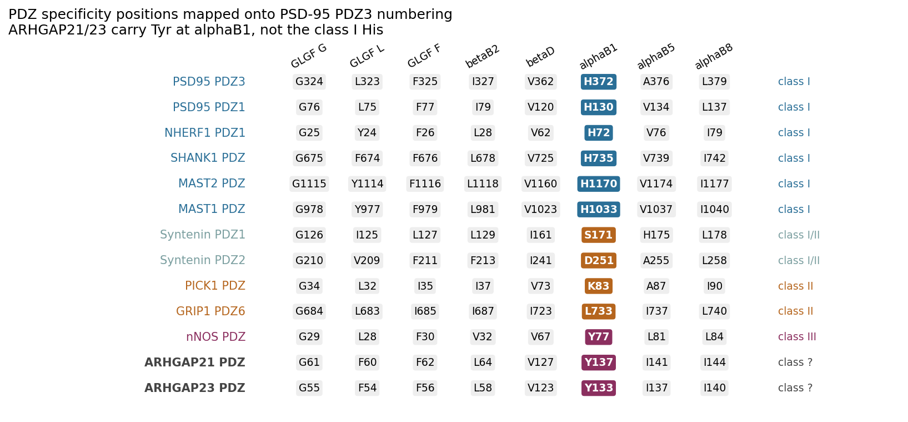
- [OpenScientist plot 10](openscientist_artifacts/provenance_plot_10.json)
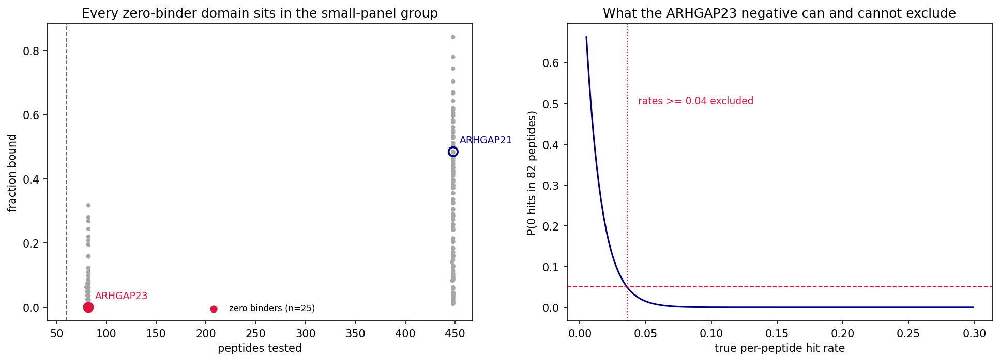
- [OpenScientist plot 11](openscientist_artifacts/provenance_plot_11.json)
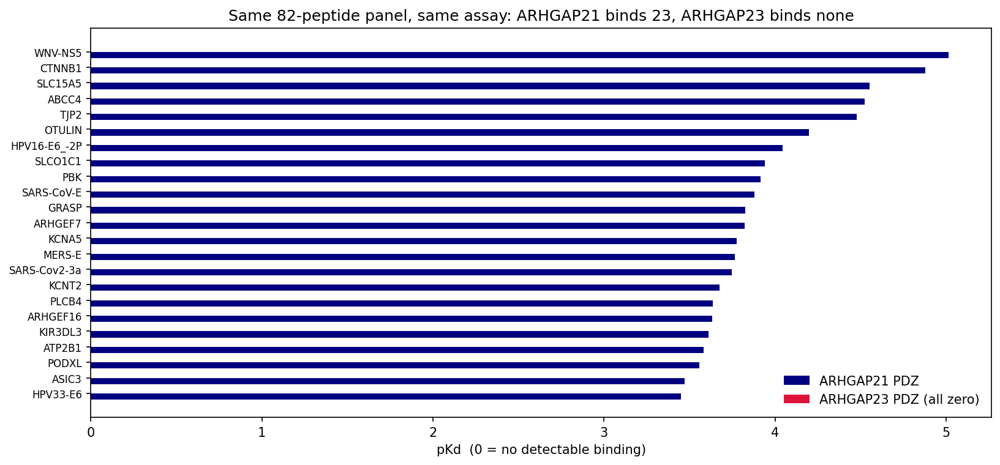
- [OpenScientist plot 12](openscientist_artifacts/provenance_plot_12.json)
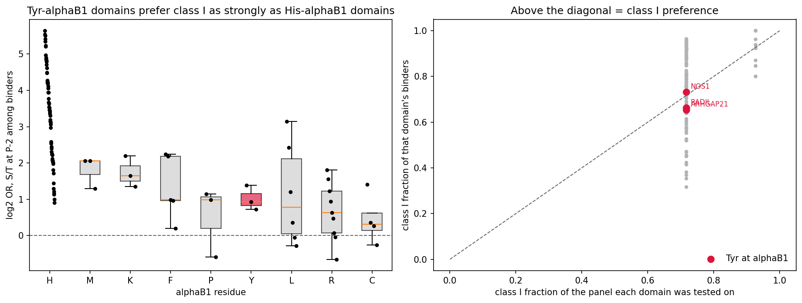
- [OpenScientist plot 13](openscientist_artifacts/provenance_plot_13.json)
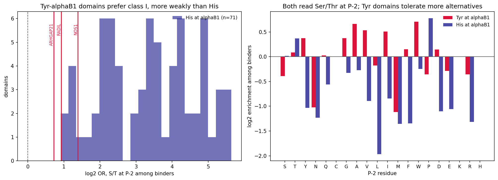
- [OpenScientist plot 14](openscientist_artifacts/provenance_plot_14.json)
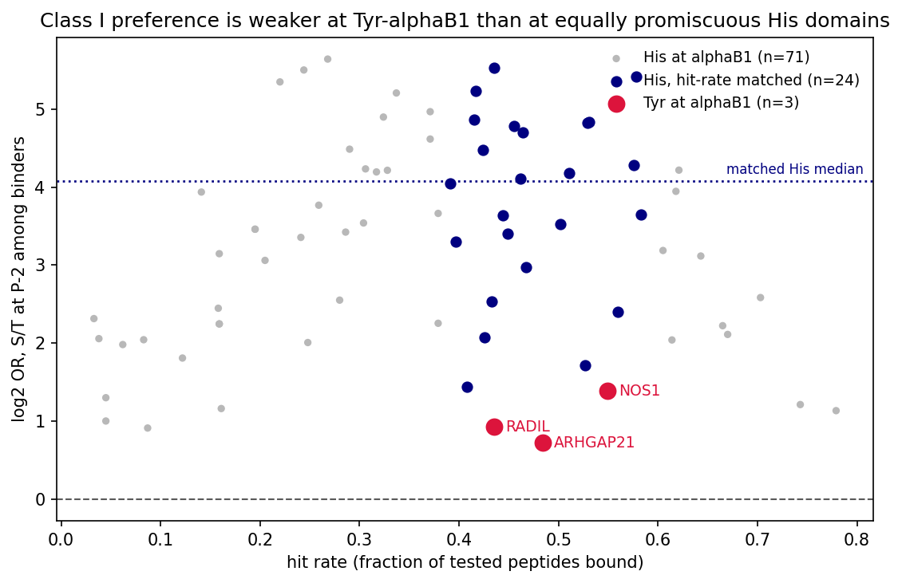
- [OpenScientist plot 2](openscientist_artifacts/provenance_plot_2.json)
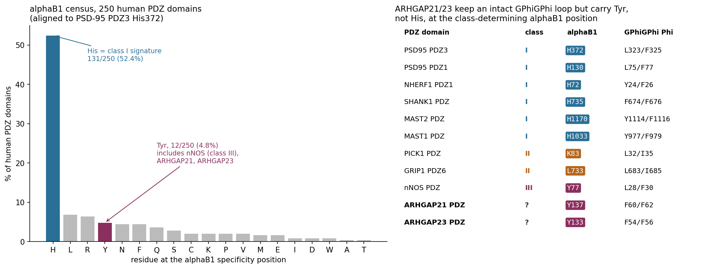
- [OpenScientist plot 3](openscientist_artifacts/provenance_plot_3.json)
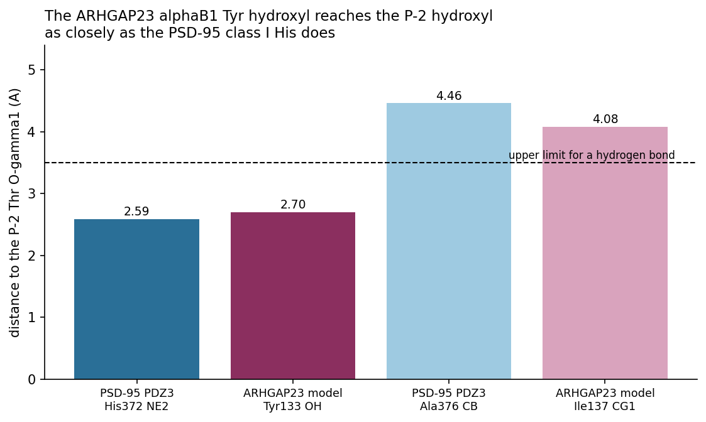
- [OpenScientist plot 4](openscientist_artifacts/provenance_plot_4.json)
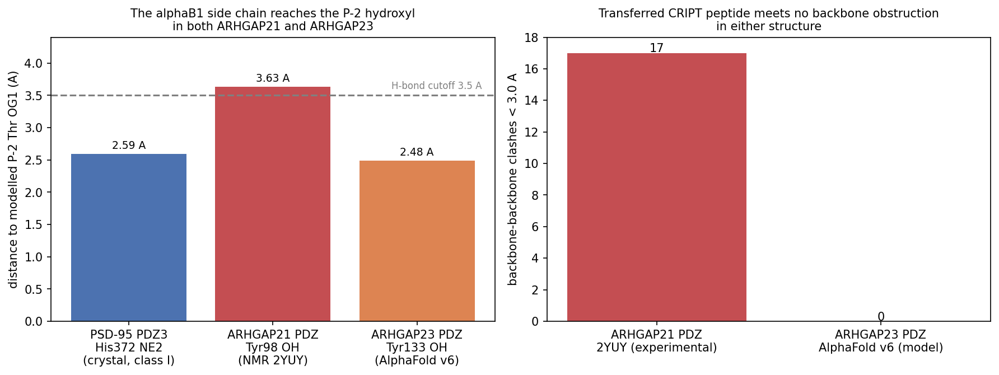
- [OpenScientist plot 5](openscientist_artifacts/provenance_plot_5.json)
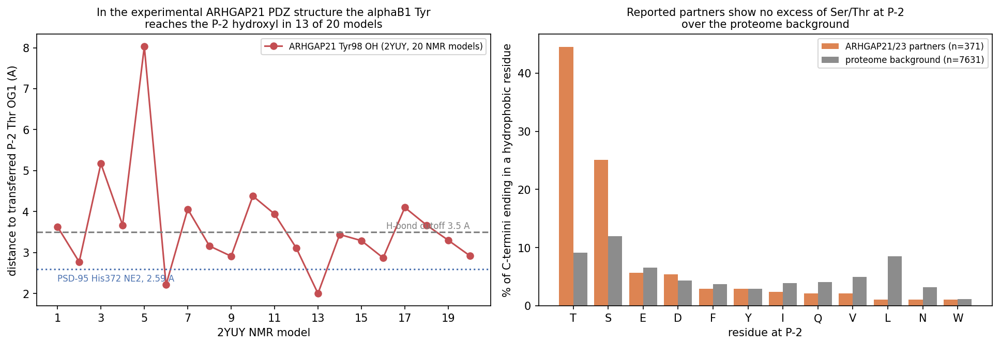
- [OpenScientist plot 6](openscientist_artifacts/provenance_plot_6.json)
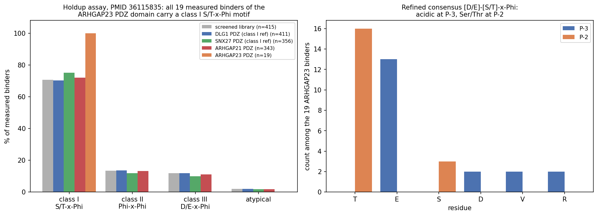
- [OpenScientist plot 7](openscientist_artifacts/provenance_plot_7.json)
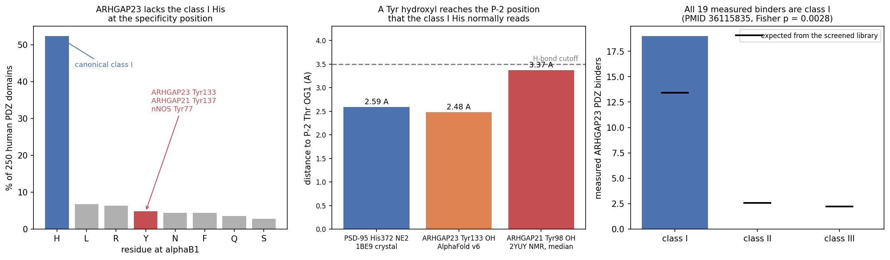
- [OpenScientist plot 8](openscientist_artifacts/provenance_plot_8.json)
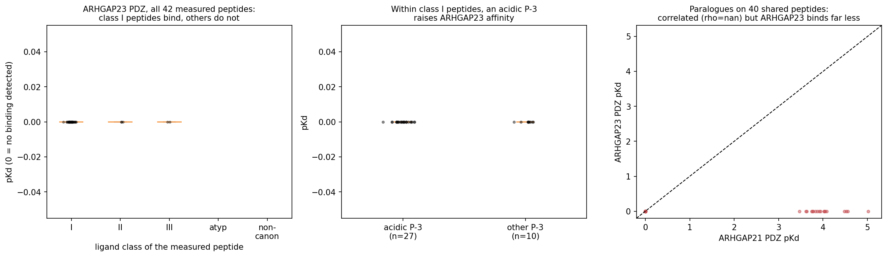
- [OpenScientist plot 9](openscientist_artifacts/provenance_plot_9.json)
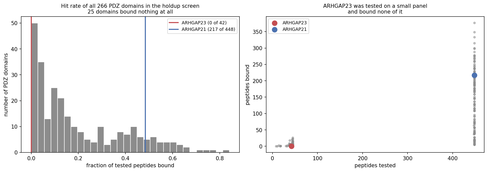
- [OpenScientist profaff ARHGAP21 23 rows](openscientist_artifacts/provenance_profaff_ARHGAP21_23_rows.csv)
- [OpenScientist profaff ARHGAP21 vs 23 shared peptides](openscientist_artifacts/provenance_profaff_ARHGAP21_vs_23_shared_peptides.csv)
- [OpenScientist profaff ARHGAP23 core panel 82](openscientist_artifacts/provenance_profaff_ARHGAP23_core_panel_82.csv)
- [OpenScientist profaff ARHGAP measured peptides](openscientist_artifacts/provenance_profaff_ARHGAP_measured_peptides.csv)
- [OpenScientist profaff Pminus2 preference by alphaB1](openscientist_artifacts/provenance_profaff_Pminus2_preference_by_alphaB1.csv)
- [OpenScientist profaff Pminus3 affinity test](openscientist_artifacts/provenance_profaff_Pminus3_affinity_test.csv)
- [OpenScientist profaff all PDZ domain hit rates](openscientist_artifacts/provenance_profaff_all_PDZ_domain_hit_rates.csv)
- [OpenScientist profaff alphaB1 vs classI preference](openscientist_artifacts/provenance_profaff_alphaB1_vs_classI_preference.csv)
- [OpenScientist profaff classI affinity test](openscientist_artifacts/provenance_profaff_classI_affinity_test.csv)
- [OpenScientist profaff core panel class composition](openscientist_artifacts/provenance_profaff_core_panel_class_composition.csv)
- [OpenScientist profaff hitrate matched His control](openscientist_artifacts/provenance_profaff_hitrate_matched_His_control.csv)
- [OpenScientist profaff paralogue matched pKd](openscientist_artifacts/provenance_profaff_paralogue_matched_pKd.csv)
- [OpenScientist profaff power hit rates](openscientist_artifacts/provenance_profaff_power_hit_rates.csv)
- [OpenScientist profaff zero binder panel overlap](openscientist_artifacts/provenance_profaff_zero_binder_panel_overlap.csv)
- [OpenScientist reported partner pbm classes](openscientist_artifacts/provenance_reported_partner_pbm_classes.csv)

## Reference Validation

Checked with `linkml-reference-validator` 0.3.1rc1.

| Outcome | Count |
| --- | --- |
| References checked | 13 |
| Resolved | 13 |
| Unresolved (possible confabulation) | 0 |
| Unverifiable | 0 |
| References weighed for topical relevance | 13 |
| On topic | 3 |
| Off topic | 0 |

All extracted references resolved successfully.