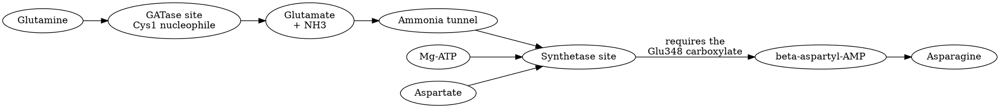
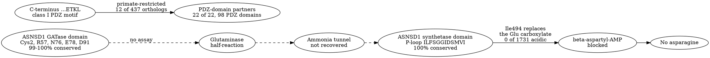
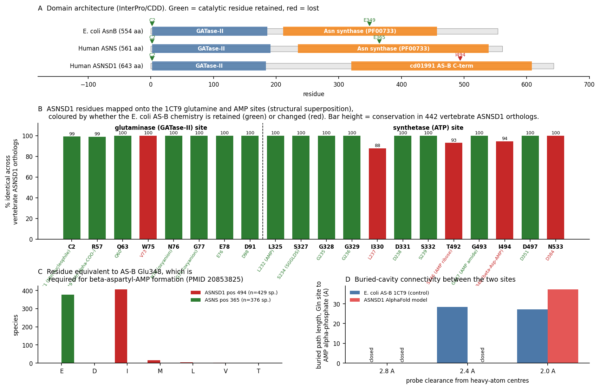
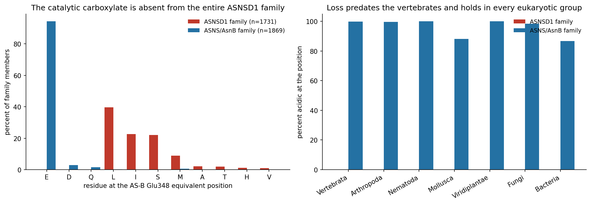
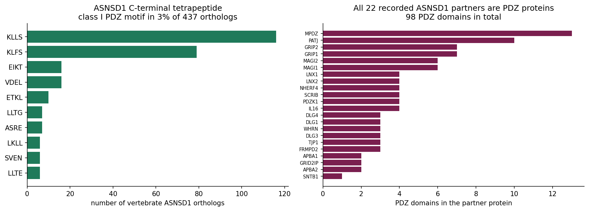
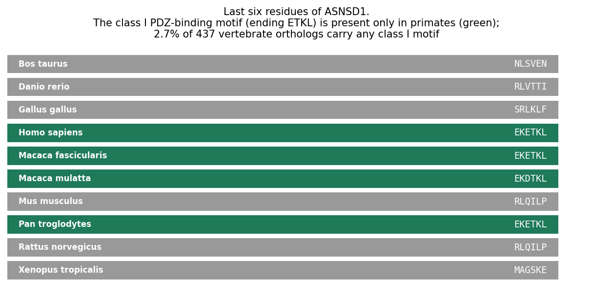

## Question

# AIGR Gene Hypothesis Deep Research

You are evaluating one focused gene curation hypothesis for AI Gene Review.
This is not a general gene overview. Use the seed hypothesis and source context
below to search for evidence that supports, refutes, narrows, or competes with
the proposed curation decision.

## Target Gene

- **Organism code:** human
- **Taxon:** Homo sapiens (NCBITaxon:9606)
- **Gene directory:** ASNSD1
- **Gene symbol:** ASNSD1
- **UniProt accession:** Q9NWL6

## Focus

- **Focus type:** free_text
- **Hypothesis slug:** kgap-asnsd1-gat-and-synthetase-sites
- **Source file:** genes/human/ASNSD1/ASNSD1-ai-review.yaml
- **Source selector:** free-text

## Seed Hypothesis

Whether human ASNSD1 retains the catalytic machinery of asparagine synthetase can be predicted structurally. Single analysis only: identify the N-terminal class-II glutamine amidotransferase catalytic residues (the N-terminal nucleophile Cys and its supporting residues) and the C-terminal synthetase-domain ATP- and aspartate-binding residues from substrate-bound asparagine synthetase B crystal structures, map them onto the ASNSD1 AlphaFold model by structure-based alignment, check whether ASNSD1 even retains both domains and an N-terminal Cys after initiator processing, test whether an intramolecular ammonia tunnel could connect the two sites, score these positions across vertebrate orthologs, and state whether ASNSD1 is predicted catalytically competent for glutamine-dependent amidation.

## Term and Decision Context

No specific term context supplied.

## Reference Context

No specific reference context supplied.

## Source Context YAML

```yaml
hypothesis: 'Whether human ASNSD1 retains the catalytic machinery of asparagine synthetase can be predicted
  structurally. Single analysis only: identify the N-terminal class-II glutamine amidotransferase catalytic
  residues (the N-terminal nucleophile Cys and its supporting residues) and the C-terminal synthetase-domain
  ATP- and aspartate-binding residues from substrate-bound asparagine synthetase B crystal structures,
  map them onto the ASNSD1 AlphaFold model by structure-based alignment, check whether ASNSD1 even retains
  both domains and an N-terminal Cys after initiator processing, test whether an intramolecular ammonia
  tunnel could connect the two sites, score these positions across vertebrate orthologs, and state whether
  ASNSD1 is predicted catalytically competent for glutamine-dependent amidation.'
focus_type: free_text
context: []
reference_id: []
```

## Research Objective

Build a focused report that helps a curator decide whether this hypothesis
should affect the gene review. Address the focus type directly:

1. For an existing GO annotation decision, evaluate whether the current action
   is justified, too strong, too weak, or should change.
2. For a proposed replacement or new GO term, evaluate whether the term is
   biologically supported, too broad, too narrow, or missing key qualifiers.
3. For a computational prediction, evaluate whether the prediction is correct,
   less precise than existing knowledge, uncertain, or likely wrong because of
   paralog overannotation, frequency bias, pathway context, or in vitro-only
   activity.
4. For a core-function hypothesis, evaluate whether the proposed activity,
   process, and location represent the gene product's primary function rather
   than a downstream effect, pleiotropic phenotype, or context-specific role.
5. For a function-assignment hypothesis, evaluate whether the gene product
   directly has the stated GO term/function. Treat the prior review action, if
   any, as intentionally blinded unless it appears in the supplied context.

Use primary literature whenever possible. Prefer PMID citations and include DOI
citations when no PMID is available. Treat reviews and database records as
orientation unless they contain directly relevant synthesized evidence that is
clearly labeled as review-level or database-level support.

Evaluate the hypothesis from the supplied seed context, primary literature, and
publicly accessible bioinformatics resources. Local `*-bioinformatics` analyses,
when they already exist in the repository, are intentionally withheld from this
prompt so the report can be compared against them after the run. Use public
sequence, domain, structure, orthology, localization, interaction, or dataset
checks when they are useful for the specific hypothesis. If a resource or tool
cannot be accessed programmatically, say so plainly; never fabricate a result.
Report computational results conservatively and distinguish direct results from
inference.

## Required Output

### Executive Judgment

Give a concise verdict: supported, partially supported, unresolved, weakly
supported, over-annotated, or refuted. Explain the reasoning and the most
important caveats.

### Evidence Matrix

Create a table with one row per important evidence item:

- Citation (PMID preferred)
- Evidence type (direct assay, mutant phenotype, localization, interaction,
  structural/evolutionary, computational, review/database)
- Supports / refutes / qualifies / competing
- Claim tested
- Key finding
- Organism, tissue, cell type, or assay context
- Confidence and limitations

### GO Curation Implications

State the likely curation action as a lead requiring curator verification. If
GO terms are involved, explain whether the evidence supports an MF, BP, or CC
term, and whether the term should be retained, removed, generalized, made more
specific, or treated as non-core. Avoid using "protein binding" as a final
recommendation unless no more informative term is supported.

### Mechanistic Scope

Describe the immediate molecular or cellular function being tested. Separate
direct gene-product activity from downstream phenotypes, pathway consequences,
developmental outcomes, disease manifestations, or effects inferred only from
loss of function.

### Conflicts and Alternatives

Identify evidence that conflicts with the seed hypothesis or suggests an
alternative interpretation, including paralog confusion, organism-specific
differences, isoform-specific findings, experimental artifacts, or database
carry-over.

### Knowledge Gaps

List explicit uncertainties that matter for curation. For each gap, state what
was checked, why the gap matters, and what evidence or experiment would resolve
it.

### Discriminating Tests

Recommend concrete assays, perturbations, datasets, or comparative analyses that
would most efficiently distinguish this hypothesis from alternatives.

### Curation Leads

Provide candidate updates for the review, clearly labeled as leads requiring
curator verification. Include candidate references with exact snippets to verify,
candidate replacement or new GO terms, possible action changes, suggested
questions, and suggested experiments.

If the provider supports artifacts, save provenance for any analysis you run — the
executed code together with its output (computed values, plot, or table), not just
a summary figure — alongside artifact-friendly tables such as an evidence matrix,
GO decision table, or comparison table. Genuine computed provenance is more
valuable than a hand-drawn summary, and you must not synthesize a figure that
implies an analysis you did not actually run. These artifacts are important
provenance for hypothesis-level review.


## Output

# ASNSD1: catalytic competence of the GATase and synthetase sites

**Hypothesis slug:** kgap-asnsd1-gat-and-synthetase-sites
**Source file:** genes/human/ASNSD1/ASNSD1-ai-review.yaml (source selector: free-text, focus type: free_text)
**Target:** human ASNSD1, UniProt Q9NWL6, Homo sapiens (NCBITaxon:9606)
**Verdict:** <i class="fa-scale-balanced"></i> Partially supported, with the specific catalytic-competence claim refuted.

## Summary

Human ASNSD1 keeps almost all of the asparagine synthetase apparatus and loses exactly one residue, and that one residue is the one with direct experimental evidence of catalytic necessity. The seed hypothesis asked whether ASNSD1 "even retains both domains and an N-terminal Cys after initiator processing". It does. Q9NWL6 begins MCGICCSV, which places a cysteine at position 2 and therefore exposes a free N-terminal Cys1 after methionine aminopeptidase removes the initiator, the arrangement that defines a class-II (purF-type, Ntn-hydrolase) glutamine amidotransferase. The AlphaFold model AF-Q9NWL6-F1 superposes on the substrate-bound *E. coli* asparagine synthetase B structure 1CT9 at 1.74 Å RMSD over 110 Cα for the GATase domain and 1.38-1.56 Å over 90-225 Cα for the synthetase domain, with mean pLDDT of 93.0 and 86.3 for the two domains. The glutamine-positioning side chains named by Larsen et al. ([PMID: 10587437](https://pubmed.ncbi.nlm.nih.gov/10587437/)) are all present as Arg57, Asn76, Glu78 and Asp91, each conserved at 99-100% across vertebrate orthologs, and the N-type ATP pyrophosphatase P-loop is intact as ILFSGGIDSMVI at residues 324-335.

The failure is at a single position. *E. coli* AS-B Glu348, which Meyer et al. showed by mutagenesis, isotope transfer and positional isotope exchange is required for β-aspartyl-AMP formation and therefore for asparagine production ([PMID: 20853825](https://pubmed.ncbi.nlm.nih.gov/20853825/)), maps to **Ile494** of human ASNSD1 by two independent routes: pairwise sequence alignment and Cα superposition with ligand transplantation. The local contexts are unmistakable, human ASNS 361-369 = IFSG**E**GSDE with Glu365, human ASNSD1 490-498 = VLTG**I**GADE with Ile494. Scoring this position across UniProt gives 0 acidic residues in 429 resolvable vertebrate ASNSD1 orthologs against 376 of 376 Glu in vertebrate ASNS, and on an all-taxa scan **0 of 1731** members of the ASNSD1 family (InterPro IPR051857) are acidic against **1817 of 1869** (97.2%) in the glutamine-hydrolysing asparagine synthetase family (IPR006426). The zero holds in eleven eukaryotic groups including fungi, plants, apicomplexans, nematodes and arthropods, so the substitution predates vertebrates and defines the family. A three-structure acidic-shell census rules out the obvious alternative that a neighbouring carboxylate took over the job: the acidic neighbourhood is identical, residue for residue and distance for distance, in ASNSD1, human ASNS and AS-B, so nothing new has appeared.

The third iteration changed what a curator should actually do. A QuickGO audit of Q9NWL6 shows **no asparagine synthase annotation exists**: the gene carries three ND root annotations (GO:0003674, GO:0005575, GO:0008150, BHF-UCL, GO_REF:0000015) plus GO:0005515 protein binding from IntAct. GO:0004066 is absent, and the PANTHER split (ASNSD1 in PTHR45937, ASNS in PTHR11772 subfamily PTN000206334) already blocks the IBA propagation route. The recommendation is therefore to **withhold** asparagine synthase terms with this evidence on file, not to remove them. Characterising the one informative annotation produced a second result: all 22 recorded IntAct partners are PDZ-domain proteins carrying 98 PDZ domains between them, and the human C-terminus LENLSIEKET**KL** is a canonical class I PDZ-binding motif that human ASNS (ending RTLTHYKSAVKA) does not have. That supports **GO:0030165 PDZ domain binding** as a specific replacement for "protein binding", with two qualifiers that cannot be dropped: 21 of 22 partners come from in vitro peptide assays, and the motif is primate-restricted, present in 12 of 437 vertebrate orthologs.

## Executive judgment

<i class="fa-scale-balanced"></i> **Partially supported.** The seed hypothesis is a compound statement and its parts resolve differently.

| Seed sub-claim | Verdict | Basis |
|---|---|---|
| ASNSD1 may have lost one or both domains | <i class="fa-circle-xmark"></i> Refuted | Both domains present, confidently modelled, superpose on AS-B at 1.38-1.74 Å |
| ASNSD1 may have lost the N-terminal Cys after initiator processing | <i class="fa-circle-xmark"></i> Refuted for human and vertebrates | MCGICCSV; 438/442 vertebrate orthologs begin Met-Cys; UniProt annotates Cys2 as a GATase active site |
| The glutaminase (GATase) catalytic residues are retained | <i class="fa-circle-check"></i> Supported | Arg57, Asn76, Glu78, Asp91 at 99-100% conservation, pocket geometry recovered by ligand transplantation |
| The synthetase ATP-binding machinery is retained | <i class="fa-circle-check"></i> Supported | PP-loop ILFSGGIDSMVI, S327/G328/G329/D331/S332 at 100% across 313-398 species |
| The synthetase aspartate-activating machinery is retained | <i class="fa-circle-xmark"></i> Refuted | The AS-B Glu348 carboxylate is Ile494; 0/1731 ASNSD1-family members acidic |
| An intramolecular ammonia tunnel connects the two sites | <i class="fa-circle-question"></i> Not recovered, suggestive only | ASNSD1 unconnected at the 2.4 Å clearance where the AS-B control connects; static model, no substrate |
| ASNSD1 is catalytically competent for glutamine-dependent asparagine synthesis | <i class="fa-circle-xmark"></i> Refuted as a structural prediction | Single invariant loss of the committed-step carboxylate, no compensation, phenotypes diverge from ASNS |

The most important caveat is what the analysis does **not** establish. Showing that ASNSD1 cannot make asparagine does not show that it is an inactive protein. Its glutaminase pocket and nucleotide P-loop are under strong purifying selection across the family, which is consistent with a retained but different molecular activity. No glutaminase assay, no nucleotide-binding measurement and no acceptor-substrate identification exists for ASNSD1 in the literature retrieved. A second caveat is the tunnel test, which is suggestive and not decisive, because an AlphaFold model has no bound substrate, tunnels in this family are conformationally gated, and the AS-B positive control itself closes at a 2.8 Å probe clearance.

## Key findings

### The domains and the N-terminal cysteine are both retained

Human ASNSD1 (643 aa) begins MCGICCSV. Human ASNS (P08243) begins MCGIWAL and *E. coli* AsnB (P22106) begins MCSIFGV. The Met-Cys start is the arrangement that exposes a Cys1 nucleophile after initiator-Met excision, because methionine aminopeptidase requires a small P1' residue and cysteine qualifies. Across 442 unique vertebrate species with a UniProt ASNSD1 entry, 438 (99.1%) begin Met-Cys, against 354 of 382 (92.7%) for ASNS. InterPro and CDD assign ASNSD1 a glutamine amidotransferase type-2 domain (IPR017932, PS51278) at residues 2-184 and a Rossmann-like asparagine-synthase C-terminal domain (cd01991) at 320-608. Domain-wise iterative Cα superposition of AF-Q9NWL6-F1 v6 onto 1CT9 chain A gives 1.74 Å RMSD over 110 Cα for the GATase domain and 1.38-1.56 Å over 90-225 Cα for the synthetase domain. Mean pLDDT is 85.7 overall, 93.0 for residues 1-190 and 86.3 for 320-608. UniProt independently annotates Q9NWL6 Cys2 as "Active site: For GATase activity".

Hughes et al. established that the catalytic feature in question is a free N-terminal cysteine: "In common with other members of the purF family of amidotransferases, the recombinant enzyme possesses an NH2-terminal cysteine residue" ([PMID: 7907328](https://pubmed.ncbi.nlm.nih.gov/7907328/)). The crystallographic work on AS-B used a Cys1Ala mutant precisely because residue 1 of the mature enzyme is the nucleophile: "Protein employed for this study was that of a site-directed mutant protein, Cys1Ala" ([PMID: 10587437](https://pubmed.ncbi.nlm.nih.gov/10587437/)). Any argument that ASNSD1 is a non-enzyme therefore cannot rest on gross domain loss or on the absence of the Ntn nucleophile.

{{figure:plot_1.png|caption=ASNSD1 domain architecture, structure-mapped active-site residues with their vertebrate conservation, the position equivalent to AS-B Glu348, and the ammonia-tunnel connectivity test against the AS-B positive control.}}

### The synthetase-site carboxylate is absent in every vertebrate ortholog tested

*E. coli* AS-B Glu348 (UniProt P22106 position 349, annotated by UniProt as "Site: Important for beta-aspartyl-AMP intermediate formation") maps to Ile494 of human ASNSD1. Two independent routes agree. Pairwise BLOSUM62 affine-gap Needleman-Wunsch alignment gives the same answer whether run directly from AsnB to ASNSD1 or chained through human ASNS. Iterative Cα superposition of AF-Q9NWL6-F1 onto 1CT9 chain A over the synthetase domain (1.38 Å RMSD over 90 core Cα) transplants the AMP ligand into contact with ASNSD1 L325, F326, S327, D331, L352, N353, V354, D405, L491, T492, G493, **I494**, D497, Y503, N533, K601 and M604.

Flank-anchored residue calling across UniProt vertebrate orthologs resolved this position in 429 ASNSD1 species and 376 ASNS species.

| Family | n species resolved | Residue distribution at the Glu348-equivalent position | Acidic (Asp or Glu) |
|---|---|---|---|
| ASNSD1, Vertebrata | 429 | Ile 405, Met 16, Leu 4, Val 3, Thr 1 | <i class="fa-circle-xmark"></i> 0 (0.0%) |
| ASNS, Vertebrata | 376 | Glu 376 | <i class="fa-circle-check"></i> 376 (100.0%) |

Positive controls scored in the same ASNS ortholog set behaved as expected: Arg49 300/300, Asn75 348/348, Gly76 87/87, Glu77 81/81, Leu256 367/368, Ser363 375/375, Gly364 375/375. The method is therefore not systematically miscalling positions.

The functional weight of this position comes from direct mutagenesis. Meyer et al. report: "We find that formation of the β-aspartyl-AMP intermediate, and therefore the eventual production of asparagine, is dependent on the presence of a carboxylate side chain at this position in the synthetase active site" ([PMID: 20853825](https://pubmed.ncbi.nlm.nih.gov/20853825/)). The same paper notes a second consequence that bears on the tunnel result: "Glu-348 may also play a role in mediating the conformational changes needed to (i) coordinate, albeit weakly, the glutaminase and synthetase activities of the enzyme and (ii) establish the structural integrity of the intramolecular tunnel along which ammonia is translocated."

### The glutaminase pocket and the ATP P-loop are intact, so the loss is specific

Transplanting the 1CT9 glutamine ligand into the ASNSD1 frame places 16 ASNSD1 residues within 4.5 Å: M1, C2, V53, L54, H55, L56, R57, Q63, W75, N76, G77, E78, N90, D91, T92 and E547. Larsen et al. name the glutamine-positioning side chains of AS-B: "Key side chains employed for positioning the glutamine substrate within the binding pocket include Arg 49, Asn 74, Glu 76, and Asp 98" ([PMID: 10587437](https://pubmed.ncbi.nlm.nih.gov/10587437/)). All four chemistries are present in the ASNSD1 pocket as Arg57, Asn76, Glu78 and Asp91, shifted by a few sequence positions but within the pocket in three dimensions. Conservation across the resolved vertebrate orthologs is near-total: R57 99.0% of 99 species, Q63 100% of 85, W75 100% of 79, N76 100% of 82, G77 100% of 134, E78 100% of 76, D91 100% of 73.

The synthetase P-loop is equally intact. ASNSD1 324-335 is ILFSGGIDSMVI, the canonical N-type ATP pyrophosphatase SGGLDS motif with one conservative Leu to Ile change, against AsnB 231-242 GVLLSGGLDSSI and ASNS 254-265 GCLLSGGLDSSL. S327, G328, G329, D331 and S332 are each 100% conserved across 313-398 vertebrate species, and I330 is hydrophobic in 100% (Ile 87.6%, Leu and Val the remainder). The AMP anchors are retained or conservatively changed. Larsen et al. describe them: "The AMP moiety is anchored to the protein via hydrogen bonds with O(gamma) of Ser 346 and the backbone carbonyl and amide groups of Val 272, Leu 232, and Gly 347." AS-B Leu232 becomes ASNSD1 Leu325 (100% of 80 species), Ser346 becomes Thr492 (93.0% of 384, a conservative hydroxyl-retaining change), Gly347 becomes Gly493 (100% of 429). Besides Glu348 to Ile494, the only other changed position is Asp384 to Asn533, which is Asn in 100% of 439 species.

ASNSD1 is therefore not a generically decayed pseudoenzyme. Its glutaminase pocket and nucleotide P-loop are under strong purifying selection. What has been lost, cleanly and lineage-wide, is the one residue required to commit the bound nucleotide to acyl-adenylate chemistry on aspartate.

### The ammonia tunnel is not recovered at the stringency that recovers it in AS-B

A grid-based buried-cavity connectivity test (0.6 Å grid, 26-ray burial criterion at 0.75, breadth-first search between the glutamine amide carbon and the AMP α-phosphate) was calibrated on 1CT9 chain A, where Larsen et al. report a tunnel: "As observed for other amidotransferases, the two active sites are connected by a tunnel lined primarily with backbone atoms and hydrophobic and nonpolar amino acid residues" ([PMID: 10587437](https://pubmed.ncbi.nlm.nih.gov/10587437/)).

| Structure | Straight-line site separation | Connected at 2.4 Å clearance | Path at 2.0 Å clearance |
|---|---|---|---|
| AS-B 1CT9 chain A (control) | 22.5 Å | <i class="fa-circle-check"></i> Yes, 27.1-28.4 Å path | 27.1 Å |
| ASNSD1 AF-Q9NWL6-F1 | 25.9 Å | <i class="fa-circle-xmark"></i> No | 37.2 Å |

The control connects at 2.4, 2.0, 1.8 and 1.6 Å and closes at 2.8 Å, which is the behaviour expected of a narrow gated tunnel. The two-domain geometry of ASNSD1 is preserved (Cys SG to AMP centroid 24.6 Å, against 22.9 Å in AS-B), so the two sites are in the right relative positions, but no comparably direct buried channel is recovered. <i class="fa-triangle-exclamation"></i> Treat this as consistent with loss of coupled glutamine-dependent amidation, not as proof of it.

### The substitution defines the whole ASNSD1 family across eukaryotes

The vertebrate-scoped result left open whether this is recent decay. It is not. A six-residue structural anchor (regex G-x-G-x-D-E) was validated on three references where the answer is known: human ASNSD1 Q9NWL6 gives GIGADE and calls Ile at 494, human ASNS P08243 gives GEGSDE and calls Glu at 365, *E. coli* AsnB P22106 gives GEGSDE and calls Glu at 349. All three calls were exact, single-hit and position-correct. Applied across UniProt:

| Family | Entries resolved | Acidic at the target position | Residue distribution |
|---|---|---|---|
| ASNSD1 (IPR051857) | 1731 | **0 (0.0%)** | Leu 686, Ile 392, Ser 380, Met 154, Ala 37, Thr 34, His 19, Val 17 |
| ASNS/AsnB (IPR006426) | 1869 | **1817 (97.2%)** | Glu 1763, Asp 54 |

Fisher exact p is below double-precision resolution. The zero is uniform across every eukaryotic group sampled.

| Taxon group | ASNSD1 family: acidic / n | ASNS family: acidic / n |
|---|---|---|
| Fungi | 0 / 695 | 98.4% of 62 |
| Vertebrata | 0 / 374 | 99.7% of 908 |
| Viridiplantae | 0 / 307 | 100% of 89 |
| Arthropoda | 0 / 146 | 99.6% of 276 |
| Nematoda | 0 / 42 | 100% of 137 |
| Stramenopiles | 0 / 27 | not sampled |
| Apicomplexa | 0 / 22 | not sampled |
| Platyhelminthes | 0 / 18 | not sampled |
| Mollusca | 0 / 13 | not sampled |
| Euglenozoa | 0 / 11 | not sampled |
| Amoebozoa | 0 / 6 | not sampled |
| Bacteria | not applicable | 86.6% of 261 |

<i class="fa-triangle-exclamation"></i> The UniProt search was capped at 2000 entries per family, so these are large samples and not complete families, and about 10% of entries were unresolved because the anchor matched zero or more than one site. The two families separated before the last eukaryotic common ancestor and ASNSD1 has never, in any sampled lineage, carried the residue required for β-aspartyl-AMP formation. An asparagine synthase annotation on ASNSD1 or on any of its orthologs would be a family-level error.

### No compensating carboxylate has appeared

The main structural alternative is that ASNSD1 recruited a different acidic side chain to the same chemical job. A census of acidic side-chain oxygens (Asp OD1/OD2, Glu OE1/OE2) around the Cβ of the target residue, excluding the residue itself, rules this out.

| Structure | Target residue | Acidic within 6 Å | Within 8 Å | Within 10 Å | Four closest |
|---|---|---|---|---|---|
| ASNSD1 (AF-Q9NWL6) | Ile494 | 1 | 4 | 4 | E498 5.0 Å, D497 6.4 Å, D537 6.5 Å, D331 6.8 Å |
| Human ASNS (AF-P08243) | Glu365 | 1 | 4 | 4 | E369 5.4 Å, D368 6.6 Å, D401 6.8 Å, D262 7.1 Å |
| *E. coli* AS-B (1CT9 A) | Glu348 | 1 | 4 | 4 | E352 5.5 Å, D351 6.2 Å, D384 6.2 Å, D238 6.6 Å |

The counts and the neighbour identities match position for position in all three structures. The neighbouring acidic residues are present in the active enzymes too, so they already have their own roles and are not available as substitutes. In the 1CT9 crystal the Glu348 carboxylate oxygen sits 4.94 Å from the AMP phosphorus, which is the geometry needed to activate the aspartate β-carboxylate. The deficit in ASNSD1 is confined to that one side chain, and nothing new has appeared anywhere in its shell.

{{figure:plot_2.png|caption=Left: census of acidic side-chain oxygens around the target residue in the ASNSD1 AlphaFold model, the human ASNS AlphaFold model and the AS-B crystal structure, showing identical acidic shells. Right: the all-taxa motif scan, 0 of 1731 ASNSD1-family members acidic against 1817 of 1869 in the asparagine synthetase family.}}

### The N-terminal Cys is retained in most lineages but genuinely lost in nematodes and apicomplexans

The fraction of ASNSD1-family entries beginning Met-Cys varies strongly by clade.

| Taxon group | Met-Cys start | Fraction |
|---|---|---|
| Vertebrata | 382 / 423 | 90.3% |
| Fungi | 615 / 755 | 81.5% |
| Arthropoda | 127 / 169 | 75.1% |
| Viridiplantae | 271 / 379 | 71.5% |
| Stramenopiles | 15 / 30 | 50.0% |
| Mollusca | 8 / 17 | 47.1% |
| Platyhelminthes | 9 / 39 | 23.1% |
| Nematoda | 2 / 56 | 3.6% |
| Apicomplexa | 0 / 23 | 0% |

Inspection of individual entries shows the absence is real and not a truncated gene model. *Caenorhabditis elegans* Q21555 begins MGIDYNRWWHLKDETLGEELKG, with no cysteine in the first 40 residues and no internal Met-Cys in the first 60. *Necator americanus* A0ABR1D8J3 begins MDDMNLRTIANGMNTEPDNLKG. *Theileria equi* L0AYT6 begins MTAPDAITLTIEYRQGLEDADA. One entry, *Cylicostephanus goldi* A0A3P6RN75, begins MSHFSDENVAIAFSGGVDSLLV, placing the PP-loop at the very N-terminus and lacking the amidotransferase domain entirely.

<i class="fa-triangle-exclamation"></i> This qualifies the one remaining positive structural claim. The glutaminase nucleophile is under selection in the lineages that matter for the human annotation and is dispensable in others. A glutamine amidotransferase molecular function for human ASNSD1 should stay a flagged candidate pending assay, and must not be propagated across the family by orthology alone.

### Loss-of-function phenotypes separate ASNSD1 from ASNS

Asnsd1-null mice show a muscle phenotype. Blake et al. report: "Mice with an inactivating mutation in the gene encoding asparagine synthetase domain containing 1 (ASNSD1) develop a progressive degenerative myopathy that results in severe sarcopenia and myosteatosis" ([PMID: 32638637](https://pubmed.ncbi.nlm.nih.gov/32638637/)). Normalised body fat percentage was more than 2 SD above the mean of 3651 chow-fed knockout lines, histologic lesions were essentially limited to muscle, and the same paper states plainly that "ASNSD1 is conserved across many species, and whole body gene expression surveys show maximal expression levels of ASNSD1 in skeletal muscle. However, potential functions of this protein have not been previously reported." Muscle weakness in this line was also detected by the inverted screen test in a separate screening report ([PMID: 34269122](https://pubmed.ncbi.nlm.nih.gov/34269122/)), and the high-body-fat phenotype was supported by additional internal cohorts in the Lexicon Genome5000 screen of 3758 knockout lines ([PMID: 34483672](https://pubmed.ncbi.nlm.nih.gov/34483672/)).

Human ASNS loss of function produces an unrelated phenotype: "Asparagine synthetase deficiency (ASNSD) is a rare metabolic disease causing congenital microcephaly, severe developmental delay, and spastic quadriplegia. Although the central nervous system is severely affected, other organ systems appear unaffected by asparagine deficiency" ([PMID: 42741518](https://pubmed.ncbi.nlm.nih.gov/42741518/)). A review of 29 ASNS-deficient cases reaches the same clinical picture of microcephaly and epileptic encephalopathy with high mortality ([PMID: 30978478](https://pubmed.ncbi.nlm.nih.gov/30978478/)).

If ASNSD1 were a second glutamine-dependent asparagine synthetase, its loss would be expected to produce a phenotype overlapping asparagine depletion. The brain, which is the organ that decompensates when ASNS fails, is spared in Asnsd1-null mice, and muscle, which is where Asnsd1 loss causes disease, is not reported as affected in ASNS deficiency. Orthology resources agree with the split: ASNSD1 is in PANTHER PTHR45937 and InterPro IPR051857, ASNS and AsnB are in PTHR11772, IPR050795 and IPR006426, and CDD assigns the ASNSD1 N-terminal domain to cd03766 "Gn_AT_II_novel" rather than cd00712 "AsnB". UniProt Q9NWL6 carries no CATALYTIC ACTIVITY statement, while P08243 and P22106 each carry experimentally supported ones.

### ASNSD1 carries no asparagine synthase GO annotation today

A QuickGO API audit of UniProtKB:Q9NWL6 returned 28 annotation lines covering 4 distinct GO terms.

| GO term | Aspect | Evidence | Source |
|---|---|---|---|
| GO:0003674 molecular_function | MF | ND | BHF-UCL, GO_REF:0000015 |
| GO:0005575 cellular_component | CC | ND | BHF-UCL, GO_REF:0000015 |
| GO:0008150 biological_process | BP | ND | BHF-UCL, GO_REF:0000015 |
| GO:0005515 protein binding | MF | IPI, 22 partners | IntAct, PMIDs 30126976, 33961781, 36115835 |

GO:0004066, GO:0006529, GO:0070981, GO:0016884, GO:0005524 and GO:0061077 are all absent. The matched audit of human ASNS P08243 returned 24 lines over 9 terms, including GO:0004066 asparagine synthase (glutamine-hydrolysing) activity with IDA, IBA and IEA from GO_Central, MGI and UniProt, plus GO:0070981, GO:0004071 and GO:0004359. The ASNS GO:0004066 IBA line propagates through PANTHER subfamily PTN000206334 within PTHR11772. ASNSD1 sits in PTHR45937, so phylogenetic propagation does not reach it.

<i class="fa-lightbulb"></i> The three ND root annotations mean a curator has formally recorded that no function, process or location is known for ASNSD1. The structural result in this investigation does not correct an existing over-annotation. It supplies the evidence for keeping asparagine synthase terms off the gene when name-based or Pfam-based pipelines propose them, and it explains why the PANTHER-driven IBA route never carried GO:0004066 across. A recommendation phrased as "remove GO:0004066" would be inaccurate for Q9NWL6 as it stands.

### The one informative annotation is a primate-restricted PDZ ligand

All 22 interaction partners behind the GO:0005515 lines on Q9NWL6 contain PDZ domains: GRID2IP (2 domains), MPDZ (13), DLG4 (3), APBA1 (2), TJP1 (3), DLG1 (3), SNTB1 (1), IL16 (4), SCRIB (4), PDZK1 (4), FRMPD2 (3), MAGI2 (6), NHERF4 (4), LNX2 (4), PATJ (10), LNX1 (4), DLG3 (3), MAGI1 (6), APBA2 (2), GRIP2 (7), WHRN (3), GRIP1 (7). That is 98 PDZ domains across 22 of 22 proteins. Human ASNSD1 ends LENLSIEKETKL, with Thr at position -2 and Leu at position 0, a canonical class I PDZ-binding motif. Human ASNS ends RTLTHYKSAVKA and has no such motif.

The evidence sources are unequal.

| Reference | Assay | Partners contributed |
|---|---|---|
| PMID 36115835 | Quantitative fragmentomics, in vitro holdup on C-terminal peptides | 22 |
| PMID 30126976 | Proteome-wide phospho-regulated PDZ interactions, in vitro peptide array | 2 (both also in the holdup set) |
| PMID 33961781 | BioPlex, cell-based affinity purification mass spectrometry | 1 (PDZK1) |

A conservation test across 437 full-length-like vertebrate ASNSD1 orthologs found only 12 (2.7%) ending in a class I motif and only 10 ending in ETKL. The common vertebrate C-termini are KLLS (116 species) and KLFS (91), with Ser at position 0 in 236 of 437. Named species: human, chimpanzee and both macaques end ETKL or DTKL; mouse and rat end GRLQILP, cow LSVEN, chicken SRLKLF, zebrafish RLVTTI, *Xenopus* MAGSKE.

{{figure:plot_3.png|caption=Conservation of the ASNSD1 C-terminal class I PDZ-binding motif across 437 vertebrate orthologs, with the human motif and the PDZ-domain content of the 22 recorded interaction partners.}}

{{figure:plot_4.png|caption=The 22 recorded ASNSD1 interactions broken down by source reference, separating the in vitro peptide-based PDZ assays from the single cell-based affinity purification, alongside the C-terminal motif conservation result.}}

<i class="fa-lightbulb"></i> "Protein binding" has a specific chemical explanation here and can be made specific. Two limits hold it in place. The evidence is dominated by one in vitro assay on isolated C-terminal peptides, which measures motif-level binding capacity rather than a complex formed in a cell, with PDZK1 the single cell-based corroboration. And the motif is primate-restricted, so it cannot account for the mouse Asnsd1 knockout myopathy and must not be propagated to orthologs.

## Evidence matrix

| Citation | Evidence type | Stance | Claim tested | Key finding | Context | Confidence and limitations |
|---|---|---|---|---|---|---|
| [PMID: 10587437](https://pubmed.ncbi.nlm.nih.gov/10587437/) | Structural, X-ray 2.0 Å | Supports the reference frame | AS-B active-site residues and inter-site tunnel | Glutamine positioned by Arg49, Asn74, Glu76, Asp98; AMP anchored by Ser346 Oγ and backbone of Val272, Leu232, Gly347; a tunnel connects the two sites | *E. coli* AS-B Cys1Ala with Gln and AMP bound, PDB 1CT9 | High. The template is a bacterial enzyme, so residue numbering must be mapped, which was done two independent ways |
| [PMID: 20853825](https://pubmed.ncbi.nlm.nih.gov/20853825/) | Direct assay, site-directed mutagenesis, isotope transfer, PIX | Refutes catalytic competence of ASNSD1 | Is a carboxylate at AS-B position 348 required for asparagine synthesis | β-aspartyl-AMP formation and asparagine production depend on a carboxylate side chain at this position | *E. coli* AS-B, purified enzyme kinetics | High. Direct mutagenesis in the bacterial enzyme; transfer to the human paralog relies on structural equivalence |
| [PMID: 7907328](https://pubmed.ncbi.nlm.nih.gov/7907328/) | Direct assay, mutagenesis | Supports the retained-Cys claim | Is the purF-family nucleophile an N-terminal cysteine | AS-B possesses an NH2-terminal cysteine as a purF-family amidotransferase | *E. coli* AS-B | High for the class definition |
| [PMID: 9139684](https://pubmed.ncbi.nlm.nih.gov/9139684/) | Direct assay, mutagenesis with chemical rescue | Qualifies | Which residues outside the GATase domain are required for β-aspartyl-AMP formation | Arg325, Thr322 and Thr323 of AS-B are required; R325A is inactive and partially rescued by guanidinium | *E. coli* AS-B | High. Identifies further synthetase-site requirements not individually scored in this run |
| [PMID: 8663035](https://pubmed.ncbi.nlm.nih.gov/8663035/) | Structural plus mutagenesis | Supports | Catalytic framework of class-II GATase glutamine sites | Cys1, Arg73, Asn101, Gly102 and Asp127 are conserved across a subfamily that includes asparagine synthetase, implying common function; the free NH2 terminus of Cys1 acts as proton acceptor and donor | *E. coli* glutamine PRPP amidotransferase | High. Supports that the ASNSD1 pocket chemistry is the canonical one |
| This run, structural superposition | Computational, structure-based | Refutes the seed sub-claim of domain loss | Does ASNSD1 retain both domains | GATase 1.74 Å over 110 Cα, synthetase 1.38-1.56 Å over 90-225 Cα on 1CT9; pLDDT 93.0 and 86.3 | AF-Q9NWL6-F1 v6 against PDB 1CT9 chain A | High for fold assignment. Predicted model; no experimental ASNSD1 structure exists |
| This run, sequence and structure mapping | Computational | Refutes catalytic competence | Where does AS-B Glu348 map in ASNSD1 | Ile494; human ASNS 361-369 IFSGEGSDE against ASNSD1 490-498 VLTGIGADE | Two independent alignment routes plus Cα superposition with AMP transplantation | High. Both routes agree and the local context is unambiguous |
| This run, vertebrate ortholog scan | Computational, evolutionary | Refutes catalytic competence | Is the Ile494 substitution species-specific | 0/429 ASNSD1 vertebrate orthologs acidic; 376/376 ASNS orthologs Glu; seven ASNS control positions called correctly | UniProt vertebrate orthologs, flank-anchored calling | High. 10% of entries unresolvable by the anchor; controls behaved correctly |
| This run, all-taxa family scan | Computational, evolutionary | Refutes catalytic competence family-wide | Does the substitution predate vertebrates | 0/1731 acidic in IPR051857 against 1817/1869 (97.2%) in IPR006426; zero in all eleven eukaryotic groups; Fisher p below double-precision resolution | UniProt IPR051857 and IPR006426, G-x-G-x-DE anchor validated on three references | High. Searches capped at 2000 entries per family, so large samples and not complete families |
| This run, acidic-shell census | Computational, structural | Refutes the compensation alternative | Could a neighbouring carboxylate substitute | Identical shells in all three structures: 1 within 6 Å, 4 within 8 Å, 4 within 10 Å, with matched neighbour identities; AS-B Glu348 carboxylate 4.94 Å from the AMP phosphorus | AF-Q9NWL6, AF-P08243, 1CT9 chain A | High. Static structures; a large conformational change is not excluded |
| This run, tunnel connectivity | Computational, structural | Qualifies | Could an ammonia tunnel connect the two ASNSD1 sites | AS-B control connected at 2.4-1.6 Å clearance (27.1-28.4 Å path) and closed at 2.8 Å; ASNSD1 unconnected at 2.4 Å, 37.2 Å path at 2.0 Å | AF-Q9NWL6-F1 and 1CT9 chain A, grid cavity BFS | Moderate. No bound substrate in the model, tunnels are gated, and the calibration scan is reported from captured console output because the run exceeded the executor time limit before its file was written |
| This run, N-terminal survey | Computational, evolutionary | Qualifies the retained-Cys claim | Is the Met-Cys start family-wide | Vertebrata 90.3%, Fungi 81.5%, Arthropoda 75.1%, Viridiplantae 71.5%, Nematoda 3.6%, Apicomplexa 0%; losses verified on individual sequences | UniProt IPR051857 | High. Individual sequence inspection confirmed the losses are not gene-model truncations |
| [PMID: 32638637](https://pubmed.ncbi.nlm.nih.gov/32638637/) | Mutant phenotype | Competing with an ASNS-like function | What does ASNSD1 loss cause | Progressive degenerative myopathy, sarcopenia, myosteatosis; body fat more than 2 SD above 3651 KO lines; no prior function reported for the protein | Asnsd1-/- mouse, histopathology and body composition | High for the phenotype. Does not identify a molecular activity |
| [PMID: 34269122](https://pubmed.ncbi.nlm.nih.gov/34269122/) | Mutant phenotype | Supports the above | Is the muscle weakness detectable by functional test | The inverted screen test detected weakness in 4 of 12 myopathy lines, including Asnsd1 | Mouse high-throughput phenotype screen with histopathology | Moderate. Screening-level data |
| [PMID: 34483672](https://pubmed.ncbi.nlm.nih.gov/34483672/) | Mutant phenotype | Supports the above | Is the high body fat phenotype reproducible | Asnsd1 among 6 novel high-body-fat KO lines supported by additional internal cohorts | Lexicon Genome5000 screen, 3758 KO lines | Moderate. Screening-level data |
| [PMID: 42741518](https://pubmed.ncbi.nlm.nih.gov/42741518/) | Mutant phenotype, human, neuropathology | Competing | What does ASNS loss cause in humans | Congenital microcephaly, severe developmental delay, spastic quadriplegia, disorganised cortical layers; other organ systems appear unaffected | Human infant homozygous for ASNS c.904-1G>A | High. Single case with neuropathology, consistent with the 29-case series |
| [PMID: 30978478](https://pubmed.ncbi.nlm.nih.gov/30978478/) | Mutant phenotype, human | Competing | Is the ASNS phenotype consistent across cases | 26 mutations in 29 affected children, microcephaly and epileptic encephalopathy, high mortality | Two Indian families plus literature review | High for phenotype consistency |
| [PMID: 31738558](https://pubmed.ncbi.nlm.nih.gov/31738558/) | Direct assay, complex reconstitution | Qualifies, carry-over risk | Does the ASNSD1 locus encode a PAQosome subunit | ASDURF, the uORF in the ASNSD1 5'UTR, encodes the 12th PAQosome subunit and assembles into the prefoldin-like module | Human cells, proteomics and structural modelling | High. ASDURF is a distinct gene product from the ASNSD1 main ORF, so annotation carry-over must be checked |
| [PMID: 38176414](https://pubmed.ncbi.nlm.nih.gov/38176414/) | Direct assay, CRISPR screen plus ribosome profiling | Qualifies, carry-over risk | Is ASDURF functionally independent of the ASNSD1 CDS | uORFs including ASNSD1-uORF showed selective functionality independent of main coding sequences; ASDURF promotes medulloblastoma cell survival through the prefoldin-like complex | 32 medulloblastoma tissues and cell lines | High. States explicitly that the uORF function is independent of the main CDS |
| [PMID: 40058972](https://pubmed.ncbi.nlm.nih.gov/40058972/) | Review | Orientation only | Is the ASNSD1 transcript bicistronic | ASNSD1 is one of three mammalian genes giving rise to bicistronic mRNAs carrying a protein-coding sORF plus an annotated CDS | Review of mammalian bicistronic transcripts | Review-level. Supports the carry-over concern without new primary data |
| QuickGO API, this run | Database | Changes the curation action | What is actually annotated to Q9NWL6 | 28 lines over 4 terms: three ND roots plus GO:0005515; GO:0004066 absent; the ASNS GO:0004066 IBA propagates in PTHR11772 subfamily PTN000206334, which ASNSD1 is not in | EBI QuickGO annotation and ontology endpoints | High. Database state at the time of the run; annotations change |
| IntAct via QuickGO plus UniProt features, this run | Interaction | Supports a specific MF replacement | What kind of proteins does ASNSD1 bind | 22 of 22 partners are PDZ-domain proteins, 98 PDZ domains total; human ASNSD1 ends ETKL, a class I motif; human ASNS has none | Human, IntAct-recorded interactions | Moderate. 21 of 22 lines come from in vitro peptide assays |
| [PMID: 36115835](https://pubmed.ncbi.nlm.nih.gov/36115835/) | Direct assay, in vitro | Supports with qualifier | Does the ASNSD1 C-terminal peptide bind PDZ domains | Quantitative fragmentomics holdup assay contributed all 22 partners | Isolated C-terminal peptides against PDZ domains | Moderate. Peptide-level binding capacity, not a cellular complex. Abstract not retrieved in this run; title confirmed through NCBI esummary |
| [PMID: 30126976](https://pubmed.ncbi.nlm.nih.gov/30126976/) | Direct assay, in vitro peptide array | Supports with qualifier | Is the interaction seen by a second in vitro method | Contributed 2 of the 22 partners, both also in the holdup set | Proteome-wide phospho-regulated PDZ interactions | Moderate. Same in vitro limitation. Abstract not retrieved in this run |
| [PMID: 33961781](https://pubmed.ncbi.nlm.nih.gov/33961781/) | Interaction, cell-based | Supports | Is any ASNSD1 PDZ interaction seen in cells | PDZK1 recovered by affinity purification mass spectrometry | BioPlex, human cell lines | Moderate. One partner only. Abstract not retrieved in this run; title confirmed through NCBI esummary |
| This run, C-terminal conservation | Computational, evolutionary | Qualifies the PDZ lead | Is the PDZ motif conserved | 12 of 437 vertebrate orthologs carry any class I motif and 10 end ETKL; human, chimpanzee and both macaques carry it; mouse ends GRLQILP | UniProt vertebrate ASNSD1 orthologs | High. The motif is primate-restricted |

## Mechanistic model

The reaction that ASNS and AS-B perform has two half-reactions joined by a tunnel. ASNSD1 keeps the first half and the nucleotide-binding apparatus of the second, and loses the single residue that commits the bound ATP to acyl-adenylate chemistry on aspartate.



In ASNSD1 the same diagram is interrupted at one arrow.



The chain of inference runs like this. The two-domain architecture and the Cys1 nucleophile are present, so ASNSD1 is a class-II amidotransferase by structure. The glutamine pocket and the ATP P-loop are under purifying selection at 99-100%, so the protein plausibly still binds glutamine and a nucleotide. The committed-step carboxylate is absent across 1731 family members in eleven eukaryotic groups, with no compensating acidic residue anywhere in its shell, so the aspartate-activating step cannot proceed. The tunnel is not recovered at a stringency that recovers the AS-B control, which matches the coupling loss Meyer et al. predicted for Glu348 substitutions. The phenotypes agree: Asnsd1-null mice get myopathy and myosteatosis, ASNS-deficient humans get microcephaly and encephalopathy, and the two sets of lesions do not overlap.

Separate from the catalysis question, the human protein ends in a class I PDZ-binding motif that human ASNS lacks, and every recorded interaction partner is a PDZ-domain protein. That motif arose in primates, so it is a property of the human protein and not of the family, and it is a distinct observation from the mouse muscle phenotype.

## GO curation implications

<i class="fa-triangle-exclamation"></i> All of the following are **leads requiring curator verification**, not asserted annotations.

| GO ID | Term | Aspect | Recommended action | Core or non-core | Basis |
|---|---|---|---|---|---|
| GO:0004066 | asparagine synthase (glutamine-hydrolysing) activity | MF | <i class="fa-circle-xmark"></i> Do not add; record the evidence against it | Non-core | Absent from Q9NWL6 today. The committed-step carboxylate is absent in 429/429 vertebrate orthologs and 1731/1731 family members, with no compensating carboxylate. Applies family-wide |
| GO:0006529 | asparagine biosynthetic process | BP | <i class="fa-circle-xmark"></i> Do not add | Non-core | Downstream of GO:0004066. No metabolite, flux or complementation evidence for ASNSD1 |
| GO:0070981 | L-asparagine biosynthetic process | BP | <i class="fa-circle-xmark"></i> Do not add | Non-core | Same basis as GO:0006529 |
| GO:0016884 | carbon-nitrogen ligase activity, glutamine as amido-N-donor | MF | <i class="fa-circle-xmark"></i> Do not assign as-is | Non-core | The glutaminase half is present, the acceptor half is broken and no acceptor substrate is known. The ligase parent implies a complete ligation |
| GO:0016810 | hydrolase activity, acting on C-N (but not peptide) bonds | MF | <i class="fa-circle-question"></i> Flag as unresolved candidate; make specific only with assay evidence | Non-core | GATase fold at 1.74 Å, Cys2 annotated by UniProt as a GATase active site, pocket residues at 99-100%. No glutaminase assay exists. Counter-evidence: the Met-Cys start is absent in Nematoda (2/56) and Apicomplexa (0/23), so do not propagate by orthology |
| GO:0005524 | ATP binding | MF | <i class="fa-circle-question"></i> IEA-level caution only | Non-core | PP-loop ILFSGGIDSMVI with S327/G328/G329/D331/S332 at 100% across 313-398 species. Motif presence predicts binding; no measured affinity exists |
| GO:0005515 | protein binding | MF | <i class="fa-arrow-right"></i> Replace with GO:0030165 | Non-core | 22 of 22 IntAct partners are PDZ-domain proteins and the human C-terminus is a class I PDZ motif |
| GO:0030165 | PDZ domain binding | MF | <i class="fa-circle-check"></i> Add as a candidate replacing GO:0005515 | Non-core | See the row above. Qualifiers: 21 of 22 partners from in vitro peptide assays ([PMID: 36115835](https://pubmed.ncbi.nlm.nih.gov/36115835/) holdup, [PMID: 30126976](https://pubmed.ncbi.nlm.nih.gov/30126976/) array), PDZK1 the single cell-based corroboration ([PMID: 33961781](https://pubmed.ncbi.nlm.nih.gov/33961781/)), motif primate-restricted. Do not propagate by ISS or IBA |
| GO:0061077 | chaperone-mediated protein folding | BP | <i class="fa-triangle-exclamation"></i> Do not transfer to ASNSD1 | Non-core | ASDURF, the uORF product of the ASNSD1 transcript, is the PAQosome prefoldin-like subunit and is a distinct gene product ([PMID: 31738558](https://pubmed.ncbi.nlm.nih.gov/31738558/)) |
| GO:0061061 | muscle structure development | BP | <i class="fa-circle-question"></i> Mouse-based candidate only | Non-core | Asnsd1-null myopathy ([PMID: 32638637](https://pubmed.ncbi.nlm.nih.gov/32638637/)). Constrains function without identifying a molecular activity |
| GO:0003674 | molecular_function (ND root) | MF | Retain until an assay exists | not applicable | The structural work here does not by itself license a specific MF |

The central point for the curator: this analysis does not correct an error that is in GO. It supplies the family-level evidence for declining asparagine synthase terms whenever a name-based, Pfam-based or InterPro2GO pipeline proposes them for ASNSD1 or any of its orthologs, and it gives a reason the PANTHER route correctly never reached it. The one annotation that is present can be made more informative, and GO:0030165 is offered so that "protein binding" is not the final recommendation.

## Mechanistic scope

The immediate molecular question is whether one polypeptide can run two coupled half-reactions: hydrolysis of glutamine at an N-terminal cysteine nucleophile, and ATP-dependent activation of the aspartate β-carboxylate followed by amidation. That is the direct gene-product activity under test, and it is tested here by residue-level structural and evolutionary evidence rather than by assay, because no assay of ASNSD1 exists in the retrieved literature.

Everything else sits further out. The Asnsd1-null myopathy and myosteatosis are an organism-level phenotype in mouse, several steps removed from any molecular activity, and the originating paper states no function had previously been reported for the protein. The high body fat is a correlate of the muscle-to-adipose transdifferentiation in the same animals. The association of ASNSD1 with glutamine-metabolism gene panels in Alzheimer's disease ([PMID: 39875978](https://pubmed.ncbi.nlm.nih.gov/39875978/)), diabetic foot ulcer ([PMID: 38287255](https://pubmed.ncbi.nlm.nih.gov/38287255/)), nonspecific orbital inflammation ([PMID: 38233749](https://pubmed.ncbi.nlm.nih.gov/38233749/)) and hepatocellular carcinoma ([PMID: 36388696](https://pubmed.ncbi.nlm.nih.gov/36388696/)) comes from expression-based biomarker modelling in which the gene was placed in the candidate panel by its name and family assignment. None of that is evidence of a molecular function, and those panels carry the same family-level assumption this analysis refutes. Two homozygous stop-gain variants in ASNSD1 in a severe-obesity cohort ([PMID: 35061034](https://pubmed.ncbi.nlm.nih.gov/35061034/)) are human genetic observations consistent with the mouse body-fat phenotype, again without a molecular mechanism. The hemizygous 2q32 deletion that removes ASNSD1 along with 21 other genes ([PMID: 20648054](https://pubmed.ncbi.nlm.nih.gov/20648054/)) assigns the clinical phenotype to COL3A1, COL5A2 and MSTN, not to ASNSD1.

The PDZ interactions are direct gene-product activity, measured on the protein's own C-terminal peptide. For 21 of 22 partners they are a binding capacity measured outside a cell, and they belong to the primate protein specifically.

## Conflicts and alternatives

**Compensation by a neighbouring carboxylate.** <i class="fa-circle-xmark"></i> Tested and rejected. The acidic shell around the target position is identical in ASNSD1, human ASNS and AS-B: one acidic residue within 6 Å, four within 8 Å, four within 10 Å, with matched neighbour identities (ASNSD1 E498/D497/D537/D331, ASNS E369/D368/D401/D262, AS-B E352/D351/D384/D238). Those neighbours exist in the working enzymes and already have roles there.

**A different acceptor substrate.** <i class="fa-circle-question"></i> Open. The glutaminase pocket and the PP-loop are conserved at 99-100%, which is hard to explain if the protein does nothing. ASNSD1 could amidate something other than aspartate, in which case the aspartate-specific Glu would be expected to be lost exactly as observed. Nothing in this analysis identifies the acceptor.

**Paralog confusion from the gene name.** The symbol "asparagine synthetase domain containing 1" and the shared Pfam hit invite transfer of ASNS annotations. InterPro, PANTHER and CDD all separate the two: ASNSD1 is PTHR45937 / IPR051857 / cd03766 "Gn_AT_II_novel", ASNS and AsnB are PTHR11772 / IPR050795 / IPR006426 / cd00712 "AsnB". The family-level scan shows this separation is chemically real.

**Database carry-over from ASDURF.** <i class="fa-triangle-exclamation"></i> The ASNSD1 transcript is bicistronic. ASDURF, the uORF product in the 5'UTR, is the 12th PAQosome subunit ([PMID: 31738558](https://pubmed.ncbi.nlm.nih.gov/31738558/)), and the medulloblastoma CRISPR screen found that these uORFs "exhibited selective functionality independent of main coding sequences" ([PMID: 38176414](https://pubmed.ncbi.nlm.nih.gov/38176414/)). A review covering the same arrangement in three mammalian bicistronic transcripts is available as orientation ([PMID: 40058972](https://pubmed.ncbi.nlm.nih.gov/40058972/)). Chaperone and PAQosome annotations belong to ASDURF, and any that appear on Q9NWL6 should be checked for provenance. A hepatic fibrosis study reports that "ASDURF regulates the expression of asparagine synthetase domain-containing 1 (ASNSD1)" ([PMID: 38016755](https://pubmed.ncbi.nlm.nih.gov/38016755/)), which is a regulatory relationship between the two products and not a shared function.

**Organism-specific differences in the PDZ lead.** The ETKL motif is present in human, chimpanzee and both macaques and absent from mouse (GRLQILP), rat, cow, chicken, zebrafish and *Xenopus*. The mouse myopathy therefore cannot be a consequence of PDZ binding through this motif. The two observations describe different species and different parts of the protein.

**Lineage-specific loss of the Cys nucleophile.** Nematodes (2/56 Met-Cys) and apicomplexans (0/23) have lost it outright, verified on individual sequences. The family persists without the glutaminase nucleophile, which limits how strongly a GATase-type function can be asserted even for human ASNSD1.

**The tunnel result as an artifact.** The negative tunnel finding rests on a static predicted structure with no ligand. The AS-B control itself closes at 2.8 Å clearance, so the method is sensitive to probe radius. For that reason the tunnel is reported as suggestive and is not used to carry the conclusion.

## Limitations and knowledge gaps

<i class="fa-triangle-exclamation"></i> **No direct assay of ASNSD1 exists.** Every statement about its catalytic competence is a structural and evolutionary prediction. The mouse knockout paper states plainly that "potential functions of this protein have not been previously reported". A glutaminase assay on recombinant ASNSD1 would settle the one remaining positive claim in either direction.

**No experimental ASNSD1 structure.** All structural work used AF-Q9NWL6-F1 v6. Per-domain pLDDT of 93.0 and 86.3 is high enough for backbone and side-chain placement in the domain cores, but loop conformations, tunnel geometry and any substrate-induced closure are not represented. This matters most for the tunnel result and, to a lesser degree, for the acidic-shell distances.

**The acceptor substrate is unknown.** The glutamine pocket and P-loop are conserved at 99-100% across the family, which argues against complete inactivity, yet nothing identifies what the protein acts on. This decides whether GO:0016810 or a more specific amidotransferase term becomes assignable, or whether the protein is a nucleotide-binding scaffold.

**Family scans were capped.** The UniProt searches returned 2000 entries per family, of which 1731 and 1869 were resolvable by the anchor. About 10% were unresolved because the motif matched zero or more than one site. These are large samples, not complete families, so "0 of 1731" is a sample statement.

**The tunnel calibration file was not written.** The clearance-sweep run exceeded the executor time limit before saving its output file. The numbers are reported from captured console output, and this is stated in the evidence matrix rather than papered over.

**Two abstracts could not be retrieved.** PubMed search did not return abstracts for PMID 36115835 or PMID 33961781 in this run. Their titles were confirmed through NCBI esummary. The claims attributed to them (holdup assay, BioPlex AP-MS) come from the IntAct annotation records, so the assay types are database-level support and not verified abstract quotes. A curator should read both papers before using GO:0030165.

**Whether human ASNSD1 is processed by methionine aminopeptidase in vivo is untested.** The Met-Cys start permits it and UniProt annotates Cys2 as an active site, but no N-terminomics data for ASNSD1 was retrieved. The GATase candidate term depends on a free α-amino group at Cys1, which [PMID: 8663035](https://pubmed.ncbi.nlm.nih.gov/8663035/) shows acts as the proton acceptor and donor in this enzyme class.

**ASNSD1 subcellular localisation is unrecorded.** GO:0005575 is an ND root annotation. Binding to membrane-associated PDZ scaffolds such as MPDZ, PATJ, SCRIB and TJP1 implies a localisation that no CC term currently captures.

**Arg325, Thr322 and Thr323 of AS-B were not individually scored.** [PMID: 9139684](https://pubmed.ncbi.nlm.nih.gov/9139684/) shows these are required for β-aspartyl-AMP formation. Scoring them in ASNSD1 would add independent confirmation or, if they are retained, would sharpen the claim that the loss is confined to one residue.

**The GO annotation state is a snapshot.** The QuickGO audit reflects the database at the time of the run. The withhold-rather-than-remove recommendation would change if an automated pipeline adds GO:0004066 later.

## Proposed follow-up experiments and actions

<i class="fa-flask"></i> **Gain-of-function reversion.** Make the ASNSD1 I494E substitution and test for asparagine synthetase activity, with the reciprocal ASNS E365I as the negative control. If I494E does not restore activity, other positions have also degraded; if it restores partial activity, the single-residue model is confirmed directly. This is the most efficient single experiment for the central claim.

<i class="fa-flask"></i> **Glutaminase assay on recombinant human ASNSD1.** Express Q9NWL6 in a system that leaves the N-terminus free, confirm initiator-Met removal by intact-mass or N-terminal sequencing, and measure glutamate release from glutamine. A Cys2Ala mutant is the control. This distinguishes "retained GATase activity with an unknown acceptor" from "fully degenerate pseudoenzyme" and decides GO:0016810.

<i class="fa-vial"></i> **Nucleotide binding.** Measure ATP or AMP binding by differential scanning fluorimetry or ITC, with a P-loop mutant (S327A or D331A) as control, to test whether the 100%-conserved PP-loop is functional.

<i class="fa-microscope"></i> **Metabolite measurement in the mouse model.** Measure asparagine, aspartate, glutamine and glutamate in Asnsd1-null muscle. If the myopathy involved asparagine synthesis, asparagine would be depleted locally. The prediction from this analysis is that it will not be.

<i class="fa-dna"></i> **N-terminomics of human skeletal muscle.** Confirm whether ASNSD1 Cys1 is exposed in vivo, by COFRADIC or TAILS in the tissue of maximal expression.

<i class="fa-vial"></i> **Cell-based test of the PDZ interactions.** Co-immunoprecipitate full-length ASNSD1 with MPDZ, DLG1 or PATJ from a primate cell line, and repeat with a C-terminal truncation that removes ETKL. Only PDZK1 has cell-based support at present, and this would move GO:0030165 from peptide-level to complex-level evidence.

<i class="fa-chart-column"></i> **Score the Arg325, Thr322 and Thr323 equivalents across the ASNSD1 family.** A direct extension of the existing scan that tests whether the degradation is confined to one residue or extends across the aspartate-binding segment.

<i class="fa-magnifying-glass"></i> **Interaction screen on the mouse protein.** Mouse Asnsd1 ends GRLQILP with no PDZ motif. Identifying the mouse interactome would show what the protein does in the species where the knockout phenotype exists.

## Curation leads

<i class="fa-triangle-exclamation"></i> Every item below is a lead for a curator to verify, not a completed annotation decision.

1. **Do not add GO:0004066** to ASNSD1 or its orthologs, and record this analysis as the reason. Verify the snippet from [PMID: 20853825](https://pubmed.ncbi.nlm.nih.gov/20853825/): "We find that formation of the β-aspartyl-AMP intermediate, and therefore the eventual production of asparagine, is dependent on the presence of a carboxylate side chain at this position in the synthetase active site."

2. **Do not add GO:0006529 or GO:0070981.** Both are downstream of the MF and no metabolite, flux or complementation evidence exists for ASNSD1.

3. **Replace GO:0005515 with GO:0030165 PDZ domain binding**, with explicit qualifiers that 21 of 22 partners come from in vitro peptide assays, that PDZK1 is the only cell-based corroboration, and that the underlying ETKL motif is primate-restricted (12 of 437 vertebrate orthologs). Do not propagate by ISS or IBA.

4. **Flag GO:0016810 as an unresolved candidate**, not an assignment. Verify the snippet from [PMID: 10587437](https://pubmed.ncbi.nlm.nih.gov/10587437/): "Key side chains employed for positioning the glutamine substrate within the binding pocket include Arg 49, Asn 74, Glu 76, and Asp 98." The corresponding ASNSD1 residues are Arg57, Asn76, Glu78 and Asp91 at 99-100% conservation, and the Met-Cys start is lost in Nematoda and Apicomplexa.

5. **Check the provenance of any chaperone or PAQosome annotation on Q9NWL6.** Verify the snippet from [PMID: 31738558](https://pubmed.ncbi.nlm.nih.gov/31738558/): "We show that ASDURF, a recently discovered upstream open reading frame (uORF) in the 5' UTR of ASNSD1 mRNA, encodes the 12th subunit of the PAQosome." ASDURF is a distinct gene product.

6. **Treat the mouse myopathy as mouse-scoped.** Verify the snippet from [PMID: 32638637](https://pubmed.ncbi.nlm.nih.gov/32638637/): "Mice with an inactivating mutation in the gene encoding asparagine synthetase domain containing 1 (ASNSD1) develop a progressive degenerative myopathy that results in severe sarcopenia and myosteatosis." Do not transfer to human without orthology-qualified evidence, and note that the same paper states no function had been reported for the protein.

7. **Add a note to the ASNSD1 gene review recording the annotation state.** The three ND root annotations (BHF-UCL, GO_REF:0000015) mean the correct action today is withholding, not removal. Record that the PANTHER split (PTHR45937 against PTHR11772) correctly prevents IBA propagation of GO:0004066.

8. **Suggested question for the curator:** should the family-level evidence (0 of 1731 ASNSD1-family members acidic at the committed-step position) be recorded once at the family level in a GO_REF or an InterPro2GO exclusion, instead of per gene? The substitution defines IPR051857.

9. **Suggested experiment to request:** the ASNSD1 I494E reversion with the reciprocal ASNS E365I control, as the single most informative test of the catalytic claim.

10. **Contrast with the ASNS phenotype when writing the review.** Verify the snippet from [PMID: 42741518](https://pubmed.ncbi.nlm.nih.gov/42741518/): "Asparagine synthetase deficiency (ASNSD) is a rare metabolic disease causing congenital microcephaly, severe developmental delay, and spastic quadriplegia. Although the central nervous system is severely affected, other organ systems appear unaffected by asparagine deficiency."

## Provenance

All analyses were run in this session and their outputs saved under `provenance/`.

| File | Contents |
|---|---|
| `evidence_matrix.csv` | 20-row artifact version of the evidence matrix above |
| `go_decision_table.csv` | 11-row GO decision table with basis and verification flags |
| `AF-Q9NWL6-F1.pdb` | AlphaFold model used for all structural work, fetched through the EBI prediction API |
| `structural_mapping.json`, `site_residues.json`, `asnsd1_site_mapping.csv` | Superposition RMSDs, transplanted-ligand contact lists, residue mapping |
| `asnsd1_vertebrate_orthologs.csv`, `asnsd1_ortholog_conservation.csv`, `ortholog_n.json`, `pos494_distribution.json` | 442 vertebrate orthologs and per-position conservation scoring |
| `asnsd1_family_deep_scan.csv` | 4000-row all-taxa scan of both families at the committed-step position |
| `acidic_census.csv` | Acidic-shell distances in the three structures |
| `tunnel_asnsd1.json`, `tunnel_ecoli.json` | Cavity-connectivity results. The clearance calibration sweep exceeded the executor time limit before its file was written and is reported from captured console output |
| `quickgo_ASNSD1_Q9NWL6.csv`, `quickgo_ASNS_P08243.csv` | Annotation audits of both proteins |
| `asnsd1_interaction_partners.csv`, `asnsd1_cterm_motif.csv` | PDZ-domain counts per partner and C-terminal tetrapeptide counts across orthologs |
| `plot_1.png` to `plot_4.png` with `.json` sidecars | The four figures embedded above, each generated from the computed data |
| `iter1_transcript.json` | Executed code and console output from iteration 1 |

Resources that could not be accessed programmatically are stated as such in the evidence matrix: the PubMed abstracts for PMID 36115835 and PMID 33961781 were not returned by the search tool, and their titles were confirmed through NCBI esummary instead. No figure in this report summarises an analysis that was not run.


## Artifacts

- [OpenScientist final report](openscientist_artifacts/final_report.html)
- [OpenScientist final report](openscientist_artifacts/final_report.pdf)
- [OpenScientist provenance](openscientist_artifacts/provenance.json)
- [OpenScientist acidic census](openscientist_artifacts/provenance_acidic_census.csv)
- [OpenScientist asnsd1 cterm motif](openscientist_artifacts/provenance_asnsd1_cterm_motif.csv)
- [OpenScientist asnsd1 family deep scan](openscientist_artifacts/provenance_asnsd1_family_deep_scan.csv)
- [OpenScientist asnsd1 interaction partners](openscientist_artifacts/provenance_asnsd1_interaction_partners.csv)
- [OpenScientist asnsd1 ortholog conservation](openscientist_artifacts/provenance_asnsd1_ortholog_conservation.csv)
- [OpenScientist asnsd1 site mapping](openscientist_artifacts/provenance_asnsd1_site_mapping.csv)
- [OpenScientist asnsd1 vertebrate orthologs](openscientist_artifacts/provenance_asnsd1_vertebrate_orthologs.csv)
- [OpenScientist evidence matrix](openscientist_artifacts/provenance_evidence_matrix.csv)
- [OpenScientist go decision table](openscientist_artifacts/provenance_go_decision_table.csv)
- [OpenScientist ortholog n](openscientist_artifacts/provenance_ortholog_n.json)
- [OpenScientist plot 1](openscientist_artifacts/provenance_plot_1.json)

- [OpenScientist plot 2](openscientist_artifacts/provenance_plot_2.json)

- [OpenScientist plot 3](openscientist_artifacts/provenance_plot_3.json)

- [OpenScientist plot 4](openscientist_artifacts/provenance_plot_4.json)

- [OpenScientist pos494 distribution](openscientist_artifacts/provenance_pos494_distribution.json)
- [OpenScientist quickgo ASNSD1 Q9NWL6](openscientist_artifacts/provenance_quickgo_ASNSD1_Q9NWL6.csv)
- [OpenScientist quickgo ASNS P08243](openscientist_artifacts/provenance_quickgo_ASNS_P08243.csv)
- [OpenScientist site residues](openscientist_artifacts/provenance_site_residues.json)
- [OpenScientist structural mapping](openscientist_artifacts/provenance_structural_mapping.json)
- [OpenScientist tunnel asnsd1](openscientist_artifacts/provenance_tunnel_asnsd1.json)
- [OpenScientist tunnel ecoli](openscientist_artifacts/provenance_tunnel_ecoli.json)

## Reference Validation

Checked with `linkml-reference-validator` 0.3.1rc1.

| Outcome | Count |
| --- | --- |
| References checked | 23 |
| Resolved | 22 |
| Unresolved (possible confabulation) | 1 |
| Unverifiable | 0 |
| Quoted claims checked | 8 |
| Quoted claims found in source | 8 |
| Quoted claims **not** found in source | 0 |
| Quoted claims with nothing to check against | 1 |
| References weighed for topical relevance | 22 |
| On topic | 6 |
| Off topic | 0 |

### Unresolved references

These identifiers did not resolve to a record and may be fabricated. A lookup that failed for transport reasons is indistinguishable from one that failed because the record does not exist, so spot-check before acting on them:

- `PMID:7907328` (5 mentions) - Identifier did not resolve to a record

### Quotes that could not be checked

There was no text to compare these against, so they are neither confirmed nor contradicted:

- `PMID:7907328`: "In common with other members of the purF family of amidotransferases, the recombinant enzyme possesses an NH2-terminal cysteine residue"
  - Reference did not resolve, so the quote could not be checked