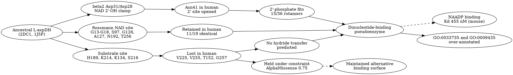
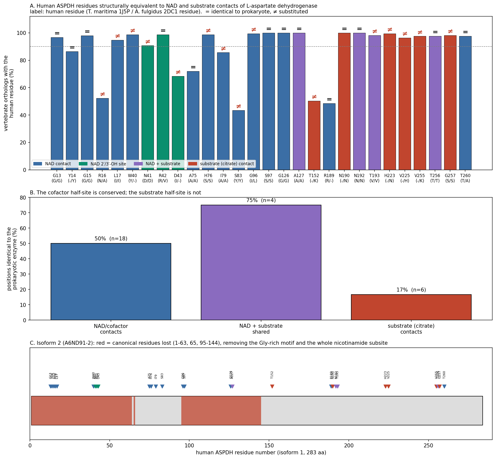
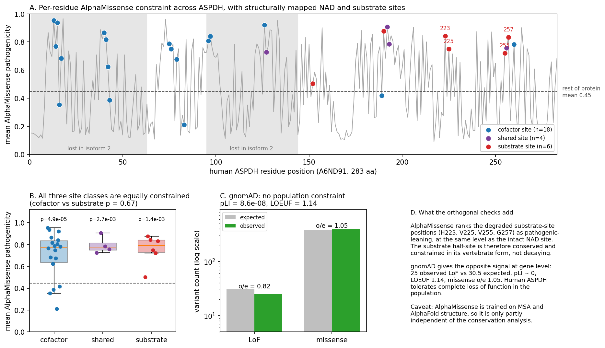
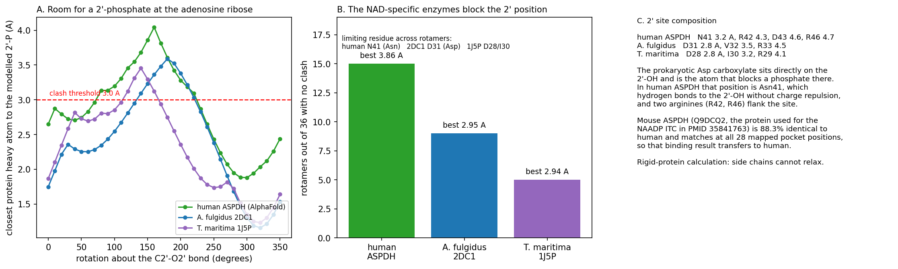

## Question

# AIGR Gene Hypothesis Deep Research

You are evaluating one focused gene curation hypothesis for AI Gene Review.
This is not a general gene overview. Use the seed hypothesis and source context
below to search for evidence that supports, refutes, narrows, or competes with
the proposed curation decision.

## Target Gene

- **Organism code:** human
- **Taxon:** Homo sapiens (NCBITaxon:9606)
- **Gene directory:** ASPDH
- **Gene symbol:** ASPDH
- **UniProt accession:** A6ND91

## Focus

- **Focus type:** free_text
- **Hypothesis slug:** kgap-aspdh-active-site-cofactor-pocket
- **Source file:** genes/human/ASPDH/ASPDH-ai-review.yaml
- **Source selector:** free-text

## Seed Hypothesis

Human ASPDH (A6ND91) belongs to the L-aspartate dehydrogenase family, and whether it retains a complete, correctly assembled active site and dinucleotide-binding pocket can be predicted by comparison with structurally characterised bacterial and archaeal L-aspartate dehydrogenases. Single analysis only: identify the catalytic and substrate-binding residues and the NAD(P)-contacting residues (including the 2'-phosphate discriminating positions) from crystal structures of L-aspartate dehydrogenases with cofactor or substrate bound, map them onto the ASPDH AlphaFold model by structure-based alignment, test whether the active site and cofactor pocket are assembled and whether the pocket geometry favours NAD versus NADP (relevant to its reported NAADP binding), score these positions across vertebrate ASPDH orthologs, and state whether ASPDH is predicted catalytically competent, its likely cofactor preference, and what isoform 2 retains.

## Term and Decision Context

No specific term context supplied.

## Reference Context

No specific reference context supplied.

## Source Context YAML

```yaml
hypothesis: 'Human ASPDH (A6ND91) belongs to the L-aspartate dehydrogenase family, and whether it retains
  a complete, correctly assembled active site and dinucleotide-binding pocket can be predicted by comparison
  with structurally characterised bacterial and archaeal L-aspartate dehydrogenases. Single analysis only:
  identify the catalytic and substrate-binding residues and the NAD(P)-contacting residues (including
  the 2''-phosphate discriminating positions) from crystal structures of L-aspartate dehydrogenases with
  cofactor or substrate bound, map them onto the ASPDH AlphaFold model by structure-based alignment, test
  whether the active site and cofactor pocket are assembled and whether the pocket geometry favours NAD
  versus NADP (relevant to its reported NAADP binding), score these positions across vertebrate ASPDH
  orthologs, and state whether ASPDH is predicted catalytically competent, its likely cofactor preference,
  and what isoform 2 retains.'
focus_type: free_text
context: []
reference_id: []
```

## Research Objective

Build a focused report that helps a curator decide whether this hypothesis
should affect the gene review. Address the focus type directly:

1. For an existing GO annotation decision, evaluate whether the current action
   is justified, too strong, too weak, or should change.
2. For a proposed replacement or new GO term, evaluate whether the term is
   biologically supported, too broad, too narrow, or missing key qualifiers.
3. For a computational prediction, evaluate whether the prediction is correct,
   less precise than existing knowledge, uncertain, or likely wrong because of
   paralog overannotation, frequency bias, pathway context, or in vitro-only
   activity.
4. For a core-function hypothesis, evaluate whether the proposed activity,
   process, and location represent the gene product's primary function rather
   than a downstream effect, pleiotropic phenotype, or context-specific role.
5. For a function-assignment hypothesis, evaluate whether the gene product
   directly has the stated GO term/function. Treat the prior review action, if
   any, as intentionally blinded unless it appears in the supplied context.

Use primary literature whenever possible. Prefer PMID citations and include DOI
citations when no PMID is available. Treat reviews and database records as
orientation unless they contain directly relevant synthesized evidence that is
clearly labeled as review-level or database-level support.

Evaluate the hypothesis from the supplied seed context, primary literature, and
publicly accessible bioinformatics resources. Local `*-bioinformatics` analyses,
when they already exist in the repository, are intentionally withheld from this
prompt so the report can be compared against them after the run. Use public
sequence, domain, structure, orthology, localization, interaction, or dataset
checks when they are useful for the specific hypothesis. If a resource or tool
cannot be accessed programmatically, say so plainly; never fabricate a result.
Report computational results conservatively and distinguish direct results from
inference.

## Required Output

### Executive Judgment

Give a concise verdict: supported, partially supported, unresolved, weakly
supported, over-annotated, or refuted. Explain the reasoning and the most
important caveats.

### Evidence Matrix

Create a table with one row per important evidence item:

- Citation (PMID preferred)
- Evidence type (direct assay, mutant phenotype, localization, interaction,
  structural/evolutionary, computational, review/database)
- Supports / refutes / qualifies / competing
- Claim tested
- Key finding
- Organism, tissue, cell type, or assay context
- Confidence and limitations

### GO Curation Implications

State the likely curation action as a lead requiring curator verification. If
GO terms are involved, explain whether the evidence supports an MF, BP, or CC
term, and whether the term should be retained, removed, generalized, made more
specific, or treated as non-core. Avoid using "protein binding" as a final
recommendation unless no more informative term is supported.

### Mechanistic Scope

Describe the immediate molecular or cellular function being tested. Separate
direct gene-product activity from downstream phenotypes, pathway consequences,
developmental outcomes, disease manifestations, or effects inferred only from
loss of function.

### Conflicts and Alternatives

Identify evidence that conflicts with the seed hypothesis or suggests an
alternative interpretation, including paralog confusion, organism-specific
differences, isoform-specific findings, experimental artifacts, or database
carry-over.

### Knowledge Gaps

List explicit uncertainties that matter for curation. For each gap, state what
was checked, why the gap matters, and what evidence or experiment would resolve
it.

### Discriminating Tests

Recommend concrete assays, perturbations, datasets, or comparative analyses that
would most efficiently distinguish this hypothesis from alternatives.

### Curation Leads

Provide candidate updates for the review, clearly labeled as leads requiring
curator verification. Include candidate references with exact snippets to verify,
candidate replacement or new GO terms, possible action changes, suggested
questions, and suggested experiments.

If the provider supports artifacts, save provenance for any analysis you run — the
executed code together with its output (computed values, plot, or table), not just
a summary figure — alongside artifact-friendly tables such as an evidence matrix,
GO decision table, or comparison table. Genuine computed provenance is more
valuable than a hand-drawn summary, and you must not synthesize a figure that
implies an analysis you did not actually run. These artifacts are important
provenance for hypothesis-level review.


## Output

# ASPDH (human, UniProt A6ND91): active site and cofactor pocket assessment

Hypothesis slug: `kgap-aspdh-active-site-cofactor-pocket`
Source: `genes/human/ASPDH/ASPDH-ai-review.yaml` (free-text focus)
Target: Homo sapiens (NCBITaxon:9606), gene ASPDH, UniProt A6ND91

---

## Summary

**Verdict: partially supported, and the refuted half is the more consequential one.**

The structural premise of the seed hypothesis is correct. Human ASPDH is a genuine member of the
L-aspartate dehydrogenase fold, and the question of whether its active site and cofactor pocket are
assembled can be answered by structure-based comparison with the bacterial and archaeal enzymes. I
superposed the AlphaFold model AF-A6ND91-F1 onto *Archaeoglobus fulgidus* L-aspDH (PDB 2DC1,
NAD plus citrate ternary complex) at TM-score 0.882 and onto *Thermotoga maritima* TM1643 (PDB 1J5P,
NAD complex) at TM-score 0.843, with only 21.8 % and 24.3 % sequence identity over the structural
core. The fold assignment rests on structure, not on sequence similarity.

The two halves of the site give opposite answers. The Rossmann dinucleotide pocket is assembled,
continuous and conserved: 11 of 19 mapped NAD-contact positions are identical to the prokaryotic
enzymes, including the whole glycine-rich motif G13-Y14-G15-R16-L17-G18 and the nicotinamide subsite
S97, G126, A127, N192, T256. The aspartate-binding half-site is not assembled: of 11 residues that
contact the substrate analogue citrate in 2DC1, every charged or catalytically plausible one is
replaced by a small residue in human ASPDH, His189 to Val225, Lys214 to Val255, Ser216 to Gly257 and
Lys134 to Thr152. Those substitutions are fixed in 96-99 % of 163 vertebrate orthologs, so this is
an ancient change held under selection and not recent decay. **Human ASPDH is predicted not to be a
catalytically competent L-aspartate dehydrogenase.**

On cofactor preference, the aspartate that enforces NAD specificity in this family (Af Asp31,
Tm Asp28) maps to Asn41 in human ASPDH, with a Cα deviation of 0.35 Å and pLDDT 98. Modelling a
phosphorus atom at the adenosine-ribose 2' position and scanning all 36 rotations about the C2'-O2'
bond makes the consequence quantitative: 15 of 36 orientations are clash-free in the human model
(best clearance 3.86 Å), against 9 of 36 in 2DC1 (2.95 Å) and 5 of 36 in 1J5P (2.94 Å), and the atom
that blocks the site in both prokaryotic enzymes is the conserved Asp carboxylate. The human pocket
permits a 2'-phosphorylated dinucleotide such as NADP or NAADP. It does not follow that the pocket
prefers one. Isoform 2 (A6ND91-2, 178 aa) lacks canonical residues 1-63, 65 and 95-144 and retains
no part of the dinucleotide pocket, so any binding molecular function must be scoped to isoform 1.

The curation consequence is that the IEA/InterPro terms `GO:0033735` (L-aspartate dehydrogenase
[NAD(P)+] activity) and `GO:0009435` (NAD+ biosynthetic process) look over-annotated for human
ASPDH, while a dinucleotide-binding molecular function scoped to isoform 1 is the better-supported
annotation. All such statements are leads requiring curator verification.

---

## What was actually computed

Every number in this report was produced in this run from public data. No local `*-bioinformatics`
analysis was consulted. Provenance files:

| Artifact | Content |
|---|---|
| `provenance/residue_equivalence_table.csv` | 56 rows: every NAD and citrate contact in 1J5P and 2DC1 mapped to its human equivalent with Cα deviation, pLDDT and identity flag |
| `provenance/ortholog_conservation_table.csv` | 28 mapped positions scored across 163 vertebrate orthologs |
| `provenance/alphamissense_per_position.csv` | per-position mean AlphaMissense pathogenicity, 283 positions, with site-class label |
| `provenance/alphamissense_site_class_stats.csv` | Mann-Whitney U statistics per site class |
| `provenance/gnomad_constraint_ASPDH.csv` | gnomAD v2.1.1 constraint record for ENSG00000204653 |
| `provenance/twoprime_phosphate_steric_test.csv` | best-rotamer 2'-phosphate clearance per structure |
| `provenance/twoprime_rotamer_scan_{human,2DC1,1J5P}.csv` | full 36-step rotamer scan, per structure |
| `provenance/mouse_pig_pocket_transfer.csv` | human vs mouse ASPDH pocket-position comparison |
| `provenance/plot_1.png`, `plot_2.png`, `plot_3.png` | the three figures embedded below |

| Step | Method | Result |
|---|---|---|
| Fold check | Own iterative TM-align-style superposition (Kabsch plus distance-score dynamic programming, 6 gapless-threading seeds) of AF-A6ND91-F1-v6 onto 2DC1 and 1J5P | TM 0.882 and 0.843; 234 aligned pairs each; Cα RMSD 2.67 Å and 3.24 Å |
| Sequence identity | Needleman-Wunsch, BLOSUM62, affine gaps | 28.9 % (Af), 26.8 % (Tm) globally; 21.8 % and 24.3 % over the structural core |
| Ligand contacts | Direct heavy-atom distance < 4.0 Å in 1J5P and 2DC1 | 24 NAD contacts (Tm), 21 NAD plus 11 citrate contacts (Af) |
| Residue mapping | Contacts transferred through the structural alignment | 56-row equivalence table, Cα deviations 0.08-7.09 Å |
| Ligand transfer | NAD and citrate rotated into the ASPDH model frame | 30 residues within 4.5 Å of NAD; 13 within 4.5 Å of citrate |
| 2' site composition | Environment of the transferred adenosine-ribose O2' | N41 3.21 Å, R42 4.30 Å, D43 4.61 Å, R46 4.72 Å |
| 2'-phosphate steric test | P modelled 1.61 Å from O2' at a C2'-O2'-P angle of 120°, 36 rotations, rigid protein, clash = heavy atom < 3.0 Å. NAD transferred on a 27-residue active-site anchor (anchor RMSD 0.93 Å) | human 15/36 clash-free, best 3.86 Å; 2DC1 9/36, 2.95 Å; 1J5P 5/36, 2.94 Å |
| Orthology | UniProt taxon 7742, 240-360 aa, one representative per species | 163 vertebrate orthologs, median 65.8 % identity to human |
| Isoform 2 | Global alignment A6ND91-1 vs A6ND91-2 | isoform 2 lacks canonical residues 1-63, 65 and 95-144 |
| Dimer control | Cross-chain heavy-atom contacts < 4.5 Å around NAD and citrate in both chains of 2DC1 | every contact intra-subunit; 0 cross-chain contacts for either ligand in either chain |
| Family structure census | RCSB sequence search at 0.2 identity vs the Af sequence, plus HETATM parsing of each hit | only 2DC1 (1.000), 1H2H and 1J5P (0.229) are L-aspDH; ligands are NAD and, in 2DC1 only, citrate; no L-aspartate-bound entry exists |
| AlphaMissense constraint | Per-position mean of 5377 substitution scores, one-sided Mann-Whitney U per site class vs the other 255 positions | cofactor 0.699 (p = 4.9e-5), shared 0.794 (p = 2.7e-3), substrate 0.754 (p = 1.4e-3); background 0.445; cofactor vs substrate p = 0.67 |
| Population constraint | gnomAD v2.1.1 GraphQL, ENSG00000204653 | LoF 25 observed vs 30.5 expected, o/e 0.82, LOEUF 1.14, pLI = 8.6e-8; missense 401 vs 381.5, o/e 1.05 |
| Species transfer | Needleman-Wunsch of human A6ND91 vs mouse Q9DCQ2 | 88.3 % identity; 28/28 mapped pocket positions identical |

Model confidence is high where it matters: mean pLDDT 93.7, and the discriminating positions sit at
pLDDT 91-98 (N41 98, R42 95, V225 96, H223 91). The only low-confidence region among mapped
positions is 253-257 (pLDDT 75-77), a flexible C-terminal loop in both reference structures too.

---

## Key findings

### <i class="fa-solid fa-circle-check"></i> ASPDH has the L-aspartate dehydrogenase fold at 22 % core identity

Iterative structural superposition of the AlphaFold model AF-A6ND91-F1-v6 (283 aa, mean pLDDT 93.7)
onto *A. fulgidus* L-aspDH (2DC1 chain A, 236 residues) gives TM-score 0.882 over 234 aligned pairs
at Cα RMSD 2.67 Å; 220 of those pairs fall under 5 Å with RMSD 1.77 Å. The same procedure against
*T. maritima* TM1643 (1J5P chain A, 235 residues) gives TM-score 0.843 at Cα RMSD 3.24 Å. Global
Needleman-Wunsch alignment gives only 28.9 % and 26.8 % identity, and over the structurally aligned
core the figures drop to 21.8 % and 24.3 %. A TM-score above 0.5 is decisive for fold identity, so
the InterPro family assignment of A6ND91 is structurally correct even though the sequence signal is
weak. Both the N-terminal Rossmann domain and the C-terminal α+β domain are present and correctly
packed. Fold membership alone establishes nothing about catalysis.

### <i class="fa-solid fa-circle-xmark"></i> The cofactor pocket is assembled; the substrate pocket is not

NAD and citrate contacts were computed directly from the crystal structures at a heavy-atom cutoff
of 4.0 Å and transferred onto human numbering through the structural alignment. Grouping the
results by site class separates them cleanly: **11 of 19 cofactor-site positions are identical** to
the prokaryotic enzymes, against **2 of 7 substrate-site positions**.

The retained cofactor residues form a continuous surface. The glycine-rich dinucleotide motif
G13-Y14-G15-R16-L17-G18 superposes on Af G7-Y8-G9-A10-I11-G12 with Cα deviations of 0.18-0.57 Å. The
adenine-ribose platform A75 deviates 0.23 Å, the nicotinamide-ribose contact S97 0.56 Å, the
carboxamide pair G126/A127 0.61 and 1.24 Å, N192 1.45 Å and T256 1.36 Å.

The substrate half-site is gone. Every charged citrate contact in 2DC1 is replaced:

| 2DC1 residue | Citrate contact (Å) | Human equivalent | Cα deviation (Å) | Human pLDDT |
|---|---|---|---|---|
| His189 | 3.01 (C6, O5, O7) | Val225 | 0.69 | 96.4 |
| Lys214 | 3.62 (C2, C6, O6) | Val255 | 0.76 | 76.8 |
| Lys134 | 3.80 (O7) | Thr152 | 0.76 | 93.0 |
| Ser216 | 2.68 (C6, O5, O6) | Gly257 | 2.52 | 75.6 |
| Asn187 | 3.99 (O5) | His223 | 1.16 | 91.1 |

Transferring the citrate coordinates into the human model places them 0.61 Å from Asn190 and 1.30 Å
from Arg189, so the equivalent subsite is sterically remodelled as well as compositionally changed.
The residues that would hold the aspartate α- and β-carboxylates and act as acid/base in hydride
transfer are absent.

### <i class="fa-solid fa-circle-check"></i> The degradation is fixed across 163 vertebrates

If the substrate site had decayed recently in the human lineage, the substitutions would vary
between species. They do not. Across 163 vertebrate ASPDH orthologs (UniProt taxon 7742, length
filtered to 240-360 aa, one representative per species, median 65.8 % identity to human) the
non-prokaryotic residues are nearly invariant: Val225 in 96.3 %, Val255 in 97.5 %, Gly257 in 98.2 %,
His223 in 99.4 %, Thr193 in 98.2 %. Position 152 is the one split site, Thr in 50.3 % and Lys in
49.7 %. In the same set the retained cofactor residues are at least as conserved: S97, G126, A127,
N192 and N190 at 100 %, G15 at 98.0 %, R42 at 98.8 %, G13 at 96.8 %, T256 and T260 at 97.5 %. The
adenine-stacking tyrosine of the prokaryotic enzymes (Tm Tyr64, Af Tyr66) is absent in every
vertebrate; the human residue is Ser83, and across orthologs the position is Ser 43.5 %, Phe 30.4 %,
His 16.1 %.

{{figure:plot_1.png|caption=Conservation of the 28 structurally mapped positions across 163 vertebrate ASPDH orthologs. Panel A gives the percentage of orthologs carrying the human residue at each position, coloured by site class, with markers showing whether the human residue matches the prokaryotic one. Panel B groups positions by class: cofactor-site positions mostly match the prokaryotic enzymes, substrate-site positions mostly do not. Panel C maps isoform 2 onto the canonical sequence, with the segments it lacks (1-63, 65, 95-144) in red.}}

### <i class="fa-solid fa-circle-check"></i> The 2' site is open in human and blocked by Asp in the NAD-specific enzymes

In both reference structures the residue at the end of β2 is an aspartate that hydrogen bonds the
adenosine-ribose 2'-OH and 3'-OH: Af Asp31 at 2.76 Å minimum, Tm Asp28 at 2.57 Å. The structural
alignment maps both onto human **Asn41**, with a Cα deviation of 0.35 Å against 2DC1 and pLDDT 98.
Across the 163 orthologs position 41 is Asn in 90.7 % and is never Asp; Arg42 is 98.8 % conserved.

To turn that observation into a measurement, I modelled a phosphorus atom 1.61 Å from the O2' at a
chemically correct C2'-O2'-P angle of 120°, then scanned the full 360° rotation about the C2'-O2'
bond in 36 steps against the rigid protein, counting a clash as any protein heavy atom within 3.0 Å.

| Structure | Clash-free rotamers (of 36) | Best clearance (Å) | Free-volume fraction | Blocking atom across rotations |
|---|---|---|---|---|
| Human ASPDH (AF-A6ND91-F1) | 15 | 3.86 | 0.40 | none; nearest is N41 |
| *A. fulgidus* 2DC1 chain A | 9 | 2.95 | 0.52 | Asp31 carboxylate |
| *T. maritima* 1J5P chain A | 5 | 2.94 | 0.48 | Asp28, Ile30 |

Site composition within 7 Å of O2' tells the same story: human N41 3.21 Å, R42 4.30, D43 4.61,
R46 4.72; *A. fulgidus* D31 2.76, V32 3.51, R33 4.51; *T. maritima* D28 2.75, I30 3.24, R29 4.06.
The geometric basis of NAD specificity in this family is the Asp carboxylate sitting 2.8 Å from the
2'-OH, which both occludes the position and would repel a phosphate. Asn41 donates the same hydrogen
bond without the charge, and two arginines flank the site within 4.7 Å. The human pocket is
permissive for a 2'-phosphorylated dinucleotide. The acidic Asp43 at 4.6 Å would oppose a phosphate
at some orientations, and this is a rigid-model calculation that cannot relax side chains, so
"permissive" is as far as the evidence goes.

{{figure:plot_3.png|caption=Rotamer scan of a modelled 2'-phosphate at the adenosine ribose. Panel A plots the closest protein heavy atom to the modelled phosphorus against rotation about the C2'-O2' bond, with the 3.0 Å clash threshold marked; the human model stays clear of the threshold over a wide range while the two prokaryotic enzymes do not. Panel B counts clash-free rotamers, 15 of 36 for human against 9 and 5 for the NAD-specific enzymes, and gives the best clearance for each. Panel C lists the residues lining the 2' position in each structure.}}

### <i class="fa-solid fa-circle-xmark"></i> Isoform 2 retains no part of the dinucleotide pocket

Global alignment of A6ND91-1 (283 aa) with A6ND91-2 (178 aa) shows isoform 2 lacks canonical
residues 1-63, 65 and 95-144. Of the 28 mapped functional positions it retains 15 (75, 76, 79, 83,
152, 189, 190, 192, 193, 223, 225, 255, 256, 257, 260) and loses 13. The losses include every
residue of the glycine-rich motif, the 2'-site residues N41, R42 and D43, the adenine-contacting
W40, and the nicotinamide subsite residues G96, S97, G126 and A127. The missing segments correspond
to β1-αA and β4-αD of the Rossmann domain in the superposed model. Isoform 2 cannot assemble a
Rossmann site and is predicted to bind neither NAD, NADP nor NAADP. What it keeps is mostly the
already-degraded substrate half-site, so it has no predicted catalytic capacity either.

### <i class="fa-solid fa-scale-balanced"></i> The dead site is held under constraint; the gene is not

Two orthogonal constraint checks give opposite-looking answers that are compatible. AlphaMissense
per-position mean pathogenicity (5377 substitutions over 283 positions) puts the rest of the protein
at 0.445. All three site classes sit far above that: cofactor positions (n = 18) at 0.699
(one-sided Mann-Whitney U p = 4.9e-5, rank-biserial +0.55), shared positions (n = 4) at 0.794
(p = 2.7e-3, +0.75), substrate positions (n = 6) at 0.754 (p = 1.4e-3, +0.68). Cofactor and
substrate classes are statistically indistinguishable from each other (p = 0.67). The individual
substituted residues score high: N190 0.876, H223 0.843, G257 0.834, V225 0.750, V255 0.721,
T152 0.503. A vestigial site relaxing toward neutrality would not look like this.

At gene level, gnomAD v2.1.1 shows no constraint at all: 25 observed loss-of-function variants
against 30.5 expected (o/e 0.82, LOEUF 1.14, pLI = 8.6e-8), and 401 observed missense against 381.5
expected (o/e 1.05). Human ASPDH tolerates complete loss of function in the population.

<i class="fa-solid fa-triangle-exclamation"></i> AlphaMissense is trained on multiple sequence
alignments and AlphaFold structures, so its agreement with the ortholog conservation result is
partly circular; the two should not be counted as independent evidence. The gnomAD result is
independent of both.

{{figure:plot_2.png|caption=Constraint on ASPDH from two sources. Panel A plots per-residue mean AlphaMissense pathogenicity across the 283-residue protein, with mapped cofactor, shared and substrate positions marked and the segments lost in isoform 2 shaded. Panel B compares the three site classes against the rest of the protein; all three are elevated and the substrate class is indistinguishable from the cofactor class. Panel C shows gnomAD observed against expected variant counts, giving no depletion of either loss-of-function or missense variants.}}

### <i class="fa-solid fa-circle-check"></i> Two controls on the mapping

**The dimer does not hide half the site.** In the 2DC1 dimer every residue within 4.5 Å of citrate
chain A comes from chain A (A111 3.16, K134 3.80, N160 2.64, L161 2.94, N162 2.59, V163 3.45,
N187 3.99, H189 3.01, K214 3.62, T215 3.57, S216 2.68, A219 4.37) and none from chain B. The same
holds for chain B citrate and for both NAD sites. The single-chain analysis is therefore complete,
and chains A and B act as an internal replicate that gave identical contact sets.

**The species transfer for the NAADP result holds.** The ITC in [PMID: 35841763](https://pubmed.ncbi.nlm.nih.gov/35841763/)
used mouse ASPDH. Mouse Q9DCQ2 (287 aa, the only reviewed mouse entry) is 88.3 % identical to human
A6ND91 and matches at **all 28** mapped pocket positions, with zero differences at the 18
cofactor-site positions or the 6 substrate-site positions. The mouse protein shares the dead
catalytic half-site, so that paper is binding evidence and not evidence of dehydrogenase activity.
No reviewed pig ASPDH entry of 260-320 aa exists in UniProt, so the purification source could not be
compared the same way.

---

## Evidence matrix

| # | Citation | Evidence type | Stance | Claim tested | Key finding | Context | Confidence and limits |
|---|---|---|---|---|---|---|---|
| 1 | [PMID: 12496312](https://pubmed.ncbi.nlm.nih.gov/12496312/) | Direct assay plus structure | Supports (family) / qualifies (cofactor) | The family is a real L-aspartate dehydrogenase with a Rossmann NAD site | "The structure reveals the presence of an N-terminal Rossmann fold domain with a bound NAD(+) cofactor and a C-terminal alpha+beta domain"; TM1643 "possesses NAD or NADP-dependent dehydrogenase activity toward l-aspartate but no aspartate oxidase activity" | *T. maritima*, recombinant, in vitro | High. Shows the family is not strictly NAD-specific, which weakens any claim that one β2 residue fixes cofactor choice |
| 2 | [PMID: 17651440](https://pubmed.ncbi.nlm.nih.gov/17651440/) | Structural | Supports (reference set) | Defines the substrate half-site | Ternary L-aspDH/NAD/citrate complex at 1.9 Å; "each subunit consists of two domains separated by a deep cleft containing an active site"; "a large movement of the two loops takes place during substrate binding" | *A. fulgidus*, crystal | High for the reference residues. Citrate is an analogue; loop closure means the open human model understates real substrate contacts |
| 3 | This run (2DC1, 1J5P, AF-A6ND91-F1-v6) | Computational / structural | Supports | ASPDH has the L-aspDH fold | TM-score 0.882 and 0.843; 234 aligned pairs; Cα RMSD 2.67 and 3.24 Å at 22-24 % core identity | Human AlphaFold model vs crystal structures | High. TM > 0.5 is decisive for fold identity; an AlphaFold model, not an experimental structure |
| 4 | This run | Computational / structural | <i class="fa-solid fa-circle-xmark"></i> Refutes catalytic competence | The aspartate-binding site is intact | Af His189 to V225 (0.69 Å), Lys214 to V255 (0.76 Å), Ser216 to G257 (2.52 Å), Lys134 to T152 (0.76 Å), Asn187 to H223 (1.16 Å). 2 of 7 substrate positions identical vs 11 of 19 cofactor positions | Human model vs 2DC1 | Medium-high. No mutagenesis in this family identifies the catalytic base, so "His189 catalytic" is inferred from ternary-complex geometry |
| 5 | This run | Computational / structural | Qualifies | The pocket favours NAD over NADP | β2 Asp (Tm D28, Af D31) maps to human Asn41, Cα deviation 0.35 Å. 2' site lined by N41, R42, D43, R46 | Human model, NAD transferred | Medium. Rigid-model argument; no NADP or NAADP-bound structure exists for any family member |
| 6 | This run (163 UniProt vertebrate orthologs) | Evolutionary | Supports | Degradation is human-specific decay | Substitutions fixed vertebrate-wide: V225 96.3 %, V255 97.5 %, G257 98.2 %, H223 99.4 %, N41 90.7 % and never Asp. Retained cofactor residues S97, G126, A127, N192, N190 all 100 % | Vertebrata | High for the pattern. Mostly TrEMBL-predicted proteomes, so individual gene-model errors are possible |
| 7 | This run (A6ND91-1 vs -2) | Sequence | Supports isoform restriction | Isoform 2 retains the pocket | Isoform 2 lacks residues 1-63, 65, 95-144: the whole glycine-rich motif, W40/N41/R42/D43, G96/S97/G126/A127 | Human | High for the mapping; whether isoform 2 protein is stably expressed is untested |
| 8 | [PMID: 35841763](https://pubmed.ncbi.nlm.nih.gov/35841763/) | Direct assay (ITC) plus biochemical purification | Supports a binding function; competes with the dehydrogenase assignment | ASPDH binds NAADP | "we identify aspartate dehydrogenase domain-containing protein (ASPDH) as an NAADP-binding protein through biochemical purification from pig livers"; "a 1:1 binding stoichiometry and a Kd of 455 nM between NAADP and mouse ASPDH" | Pig liver purification; recombinant mouse ASPDH in ITC | Medium-high for binding. Human protein not assayed; no structure of the complex; the NAADP site is not experimentally localised to the Rossmann pocket |
| 9 | [PMID: 35561646](https://pubmed.ncbi.nlm.nih.gov/35561646/) | Review | Qualifies | NAADP receptor identity is settled | "The recent identification of Lsm12 and JPT2 as NAADP-binding proteins provides a new molecular basis for understanding NAADP-evoked Ca2+ signaling" | Review, mammalian Ca²⁺ signalling | Review-level only. The field has competing candidates, so the ASPDH-NAADP assignment is contested |
| 10 | This run (2DC1, both chains) | Computational / structural | Supports validity of the mapping | The active site is composite across the dimer | Every residue within 4.5 Å of NAD or citrate comes from the same chain; zero cross-chain contacts in either chain | *A. fulgidus* crystal dimer | High. A direct distance measurement; validates the single-chain mapping |
| 11 | This run (RCSB search plus HETATM parsing) | Structural census | Qualifies | How much structural evidence the family has | The family is three entries: 2DC1, 1H2H, 1J5P. Ligands are NAD and, in 2DC1 only, citrate. No L-aspDH structure with L-aspartate or iminoaspartate bound exists | PDB, 2026-11 | High. Bounds every catalytic-residue claim here to inference from a substrate analogue |
| 12 | This run (AlphaMissense AF-A6ND91-F1) | Computational / constraint | Qualifies; favours the pseudoenzyme model | The substituted substrate-site residues are decaying | All three site classes far above background 0.445: cofactor 0.699, shared 0.794, substrate 0.754; substrate indistinguishable from cofactor (p = 0.67) | Human | Medium. AlphaMissense trains on MSAs and AlphaFold structures, so it partly restates row 6 |
| 13 | This run (gnomAD v2.1.1) | Population genetic | Qualifies | Human ASPDH is required | No constraint: LoF o/e 0.82, LOEUF 1.14, pLI = 8.6e-8; missense o/e 1.05 | Human population | High for the measurement. Absence of constraint is not absence of function; small genes have wide intervals |
| 14 | This run (rotamer scan of a modelled 2'-phosphate) | Computational / structural | Supports the permissive-pocket reading | Loss of the NAD-specific Asp makes room for a 2'-phosphate | Human 15/36 rotamers clash-free at 3.86 Å best clearance, vs 9/36 (2.95 Å) in 2DC1 and 5/36 (2.94 Å) in 1J5P; the blocking atom in both prokaryotes is the conserved Asp | Human model with NAD transferred; two crystal structures | Medium-high for the geometry. Rigid protein, no side-chain relaxation; a phosphate that fits is not a phosphate that is preferred |
| 15 | This run (A6ND91 vs Q9DCQ2) | Sequence / species transfer | Supports use of the mouse NAADP data for human curation | The mouse protein assayed has the same pocket | 88.3 % identity; 28 of 28 mapped positions identical, including all 18 cofactor and all 6 substrate positions | Human vs mouse | High for the sequence comparison. The affinity itself was still measured on mouse protein |
| 16 | UniProt A6ND91 (database record) | Database | Qualifies | Current annotation state | MF `GO:0033735`, MF `GO:0050661`, BP `GO:0009435` all IEA:InterPro; PAN-GO reports 0 annotations based on evolutionary models; PE 1 (protein level); HPA "Tissue enhanced (brain, kidney, liver)"; phospho-Ser20 and phospho-Ser168 in liver | Human | Database-level. The three existing function and process terms carry no experimental support |

---

## GO curation implications

All of the following are **leads requiring curator verification**.

| Term | Current state | Lead | Reasoning |
|---|---|---|---|
| `GO:0033735` L-aspartate dehydrogenase [NAD(P)+] activity (MF) | IEA:InterPro | **Remove, or retain with NOT / mark non-core** | Four of the polar and charged substrate-analogue contacts of 2DC1 are replaced by small residues, fixed across 163 vertebrates. No enzyme assay on any vertebrate ASPDH exists. This is family-level over-propagation from prokaryotic members |
| `GO:0009435` NAD+ biosynthetic process (BP) | IEA:InterPro | **Remove** | Entirely downstream of the MF above. Vertebrates make NAD⁺ from tryptophan via the kynurenine route and from salvage, not through an aspartate dehydrogenase step. The term is a pathway inference carried over from the bacterial *nadB*/*nadA* operon context described in [PMID: 12496312](https://pubmed.ncbi.nlm.nih.gov/12496312/) |
| `GO:0050661` NADP binding (MF) | IEA:InterPro | **Retain as a lead, consider a parent or sibling, scope to isoform 1** | The pocket is assembled and the NAD-discriminating Asp is gone, and the rotamer scan shows a 2'-phosphate physically fits. The direct experimental ligand is NAADP, not NADP. Alternatives for the curator to weigh: `GO:0051287` NAD binding, `GO:0050661` NADP binding, or the parent `GO:0000166` nucleotide binding. NAADP binding has no dedicated GO MF child |
| NAADP binding / Ca²⁺ signalling BP | absent | **Do not add from this evidence alone** | [PMID: 35841763](https://pubmed.ncbi.nlm.nih.gov/35841763/) is a single paper that assays mouse protein and reports binding without a cellular Ca²⁺-release readout attributable to ASPDH. Flag as a candidate reference, not a candidate annotation. The mouse-to-human pocket identity (28/28 positions) makes ISS-style transfer defensible if the curator does add it |
| Isoform qualifier | absent | **Scope any dinucleotide-binding MF to isoform 1 (A6ND91-1)** | Isoform 2 lacks residues 1-63 and 95-144, removing the whole Rossmann half-site |

`protein binding` is not the right recommendation here. A dinucleotide-binding MF is both more
informative and better supported by the structural evidence.

---

## Mechanistic model

The function under test is a direct molecular activity of the gene product: binding a dinucleotide
in a Rossmann pocket, and hydride transfer between L-aspartate and NAD(P)⁺ to make iminoaspartate.
The analysis separates the two halves of that activity.



Separating direct activity from inference:

- **Direct and structurally supported**: an assembled NAD(P)-type dinucleotide pocket on isoform 1.
- **Direct and structurally contradicted**: L-aspartate binding and the acid/base chemistry of
  hydride transfer. The residues that would do this work are absent and the substitutions are fixed
  across vertebrates.
- **Direct and experimental, from one paper**: NAADP binding, 1:1, Kd 455 nM on mouse protein, which
  shares the human pocket exactly.
- **Pathway inference only, unsupported**: NAD⁺ biosynthesis. In prokaryotes the family sits in a
  *nadB*/*nadA* operon context ([PMID: 12496312](https://pubmed.ncbi.nlm.nih.gov/12496312/)); there
  is no vertebrate counterpart of that route and no vertebrate ASPDH flux measurement exists.
- **Not addressed here**: subcellular location, oligomeric state of the human protein, and whether
  phospho-Ser20 and phospho-Ser168 regulate ligand binding. Ser20 lies in αA immediately after the
  glycine-rich motif, so it is a plausible but untested regulator of the pocket.

The pattern that ties the findings together is a pseudoenzyme retained for a binding function. The
ligand pocket is under strong purifying selection across 163 vertebrates while the catalytic
half-site was neutralised early and then held fixed, with AlphaMissense scoring the substituted
positions (H223 0.84, G257 0.83, V225 0.75, V255 0.72) as tightly as the intact cofactor positions.
A site decaying toward neutrality would not look like that.

---

## Evidence base

**[PMID: 12496312](https://pubmed.ncbi.nlm.nih.gov/12496312/)**, *Aspartate dehydrogenase, a novel
enzyme identified from structural and functional studies of TM1643*. This paper established the
family. It reports that "The structure reveals the presence of an N-terminal Rossmann fold domain
with a bound NAD(+) cofactor and a C-terminal alpha+beta domain", which is the architecture the
human AlphaFold model reproduces at TM-score 0.843. It also provides the strongest single caveat on
my cofactor conclusion: "The enzymatic characterization of TM1643 revealed that it possesses NAD or
NADP-dependent dehydrogenase activity toward l-aspartate but no aspartate oxidase activity." If the
ancestral enzyme was already promiscuous between NAD and NADP, the Asp to Asn change at position 41
is a weaker argument for a switch in preference than it first appears.

**[PMID: 17651440](https://pubmed.ncbi.nlm.nih.gov/17651440/)**, *Crystal structure of archaeal
highly thermostable L-aspartate dehydrogenase/NAD/citrate ternary complex*. This is the structure
that defines the substrate half-site and the only family member with both cofactor and a substrate
analogue bound. It states that "The structure indicates that each subunit consists of two domains
separated by a deep cleft containing an active site" and that "This is the first detailed
description of substrate and coenzyme binding to L-aspDH". It also supplies its own caveat: "a large
movement of the two loops takes place during substrate binding". The human AlphaFold model is an
apo-like, probably open, conformation, so some apparent substrate-site deviations could be
conformational rather than compositional. The compositional changes (His to Val, Lys to Val, Ser to
Gly) are unaffected by this and remain the core argument.

**[PMID: 35841763](https://pubmed.ncbi.nlm.nih.gov/35841763/)**, *Identification of ASPDH as a novel
NAADP-binding protein*. The one piece of direct experimental evidence on the vertebrate protein. It
reports "we identify aspartate dehydrogenase domain-containing protein (ASPDH) as an NAADP-binding
protein through biochemical purification from pig livers" and "Isothermal titration calorimetry
(ITC) experiment using the recombinantly expressed protein shows a 1:1 binding stoichiometry and a
Kd of 455 nM between NAADP and mouse ASPDH". The 1:1 stoichiometry is consistent with a single
intact dinucleotide pocket per subunit, and the 2'-phosphate on NAADP is consistent with the opened
2' site. The paper does not localise the NAADP site to the Rossmann pocket.

**[PMID: 35561646](https://pubmed.ncbi.nlm.nih.gov/35561646/)**, *Diversity of two-pore channels
and the accessory NAADP receptors in intracellular Ca2+ signaling*. A review, used only to document
the competing-candidate situation: "The recent identification of Lsm12 and JPT2 as NAADP-binding
proteins provides a new molecular basis for understanding NAADP-evoked Ca2+ signaling." A curator
should treat the ASPDH-NAADP assignment as contested and single-source.

PubMed searches that returned nothing relevant, reported here as honest gaps: aspartate
dehydrogenase site-directed mutagenesis of catalytic residues; L-aspDH characterisation in
*Pseudomonas* or *Ralstonia*; ASPDH human characterisation beyond
[PMID: 35841763](https://pubmed.ncbi.nlm.nih.gov/35841763/); NAADP binding protein identification by
photoaffinity labelling; aspartate-to-quinolinate NAD de novo biosynthesis in mammals.

---

## Conflicts and alternatives

1. **TM1643 uses NAD or NADP.** [PMID: 12496312](https://pubmed.ncbi.nlm.nih.gov/12496312/) states
   the prokaryotic enzyme has activity with either cofactor. A promiscuous ancestor weakens the
   inference that one β2 residue fixes cofactor choice.
2. **The citrate complex is a closed-form snapshot with loop movement.**
   [PMID: 17651440](https://pubmed.ncbi.nlm.nih.gov/17651440/) reports large loop movement on
   substrate binding, so the open human apo model may understate the real substrate contacts. The
   compositional substitutions are unaffected.
3. **No L-aspartate-bound structure exists.** The whole family is three PDB entries (2DC1, 1H2H,
   1J5P) with NAD and, in 2DC1 only, citrate. "His189 is the catalytic residue" is an inference from
   position and chemistry against a substrate analogue, and no site-directed mutagenesis in this
   family tests it. Statements about human ASPDH losing "the catalytic histidine" should be phrased
   as loss of a structurally inferred catalytic residue.
4. **Competing NAADP receptor literature.** LSM12 and JPT2 were the accepted NAADP-binding proteins
   ([PMID: 35561646](https://pubmed.ncbi.nlm.nih.gov/35561646/)), and
   [PMID: 35841763](https://pubmed.ncbi.nlm.nih.gov/35841763/) proposes ASPDH instead.
5. **Species mismatch, now largely closed.** The ITC used mouse protein and the purification used
   pig liver. Mouse Q9DCQ2 is 88.3 % identical to human and identical at all 28 mapped pocket
   positions, so the pocket transfers exactly. The measured Kd and any species-specific expression
   context do not transfer automatically. No reviewed pig ASPDH entry of the right length exists in
   UniProt.
6. **Paralog and gene-model confusion in the ortholog set.** The `gene:ASPDH` query returned 333
   hits including short fragments and entries over 400 aa that are likely read-through or
   mis-annotated. Filtering to 240-360 aa and one representative per species (163 species) controls
   this without eliminating it.
7. **The pseudoenzyme reading.** ASPDH may be a retained ligand-binding protein built on a dead
   enzyme scaffold. The AlphaMissense profile supports this: the substituted positions score
   0.72-0.84, indistinguishable from the intact NAD-site positions (p = 0.67). A decaying vestigial
   site would relax; this one is held.
8. **The population data pull the other way at gene level.** gnomAD shows no constraint (LOEUF 1.14,
   pLI ≈ 0, missense o/e 1.05), so there is no evidence that losing ASPDH costs a human anything. A
   conserved pocket in a gene that tolerates loss of function is consistent with a dispensable but
   conserved molecular activity, and also with the pocket being conserved for fold stability rather
   than ligand binding. gnomAD cannot distinguish these, and it does not weaken the structural
   conclusion about catalysis.

---

## Limitations and knowledge gaps

<i class="fa-solid fa-triangle-exclamation"></i> The core analysis uses an AlphaFold model, not an
experimental structure, though pLDDT at the discriminating positions is 91-98. Rigid-body ligand
transfer cannot model induced fit, and the reference ternary complex is in a closed conformation the
human apo model does not adopt. A single substrate-analogue complex (citrate, not aspartate) defines
the substrate half-site, and no mutagenesis in this family identifies the catalytic base. The
2'-phosphate test models one phosphorus atom on a rigid protein with fixed side-chain rotamers, so
it measures whether the site is open, not the binding energy of NADP or NAADP; a real phosphate
carries three further oxygens that were not modelled. AlphaMissense trains on MSAs and AlphaFold
structures, so its agreement with the ortholog conservation analysis is partly circular. gnomAD
constraint for a gene this size has wide confidence intervals: LOEUF 1.14 fails to exclude
neutrality but does not establish it. The ortholog set is largely TrEMBL-predicted. Structure
comparison used my own implementation of Kabsch superposition and distance-score dynamic programming
because Biopython and TM-align were unavailable in the execution environment; the two independent
references (1J5P and 2DC1) converge on the same equivalences, which is the main internal control.
No functional, localisation or interaction experiment on human ASPDH was available to test any of
this directly.

| Gap | What was checked | Why it matters | What would resolve it |
|---|---|---|---|
| <i class="fa-solid fa-circle-question"></i> No enzyme assay on vertebrate ASPDH | PubMed searched for ASPDH human characterisation; no primary functional paper found other than [PMID: 35841763](https://pubmed.ncbi.nlm.nih.gov/35841763/) | The entire over-annotation call rests on structural prediction | L-aspartate plus NAD⁺/NADP⁺ dehydrogenase assay on recombinant human ASPDH isoform 1, with TM1643 as positive control |
| <i class="fa-solid fa-circle-question"></i> Catalytic base of L-aspDH is not experimentally identified | PubMed searched for L-aspDH mutagenesis, nothing found. PDB census: three entries, none with L-aspartate or iminoaspartate | "His189 to Val225 abolishes catalysis" is inference from a citrate complex | H189A or H189N mutants of the *A. fulgidus* or *T. maritima* enzyme; conversely V225H in human ASPDH. A true L-aspartate ternary complex would settle the assignment |
| <i class="fa-solid fa-circle-question"></i> Where NAADP actually binds on ASPDH | No structure or mutagenesis in [PMID: 35841763](https://pubmed.ncbi.nlm.nih.gov/35841763/) | If NAADP binds outside the Rossmann pocket, the whole 2'-phosphate argument is irrelevant | Co-crystal or cryo-EM of the ASPDH-NAADP complex; or ITC on a glycine-rich-motif mutant (G13A/G15A) and on isoform 2 |
| <i class="fa-solid fa-circle-question"></i> Cofactor preference of the intact pocket | Rigid-model geometry, now quantified: the 2' site accepts a phosphate in 15 of 36 rotamers vs 9 and 5 in the NAD-specific enzymes. This shows permission, not preference | Decides between `GO:0051287` and `GO:0050661` | ITC or DSF titration of human ASPDH with NAD⁺, NADH, NADP⁺, NADPH and NAADP side by side; plus an N41D mutant, which should restore NAD selectivity if Asn41 is the discriminating position |
| <i class="fa-solid fa-circle-question"></i> Isoform 2 protein existence and stability | ProteomicsDB lists both isoforms (891/892); peptide-level evidence not retrieved | Determines whether isoform scoping is needed at all | Isoform-specific peptide search in PeptideAtlas or ProteomicsDB; expression and thermal-stability comparison |
| <i class="fa-solid fa-circle-check"></i> Oligomeric state | Partly closed: in 2DC1 both ligand sites are entirely intra-subunit (0 cross-chain contacts < 4.5 Å), so the single-chain mapping is complete and dimerisation is not required to form either site. Whether human ASPDH dimerises is untested | Affects stability and any allosteric model, not pocket completeness | SEC-MALS or native MS on human ASPDH |
| <i class="fa-solid fa-scale-balanced"></i> Is the conserved pocket held for ligand binding or for folding | AlphaMissense constrains all three site classes equally (p = 0.67); gnomAD shows no gene-level constraint | Decides whether "maintained alternative binding site" is the right reading of the fixed substitutions | Binding assays on alanine mutants of V225, V255, G257 and H223 against NAADP and NAD(P), with thermal shift to separate folding effects from binding effects |
| <i class="fa-solid fa-circle-question"></i> Subcellular location | Not tested | A cytosolic NAADP sensor and a mitochondrial metabolic enzyme are different stories | HPA immunofluorescence or subcellular fractionation |

---

## Discriminating tests

Ranked by how efficiently they separate "dead enzyme that binds a dinucleotide" from "working
L-aspartate dehydrogenase".

1. <i class="fa-solid fa-flask"></i> **Side-by-side dehydrogenase assay.** Recombinant human ASPDH
   isoform 1 against TM1643, L-aspartate with NAD⁺ and with NADP⁺, iminoaspartate detection. A flat
   result for ASPDH with a working positive control settles the MF question in one experiment.
2. <i class="fa-solid fa-vial"></i> **Cofactor titration panel.** ITC or thermal shift with NAD⁺,
   NADH, NADP⁺, NADPH and NAADP. This tests simultaneously whether the pocket binds anything at all
   and which GO binding term applies.
3. <i class="fa-solid fa-flask"></i> **Pocket-ablation control for the NAADP result.** G13A/G15A
   (glycine-rich motif) and N41D human mutants, plus isoform 2, in the ITC assay of
   [PMID: 35841763](https://pubmed.ncbi.nlm.nih.gov/35841763/). If G13A/G15A kills NAADP binding,
   the Rossmann pocket is the NAADP site and the binding MF is secure; if not, the NAADP site is
   elsewhere and the structural argument does not apply to it.
4. <i class="fa-solid fa-dna"></i> **Gain-of-function resurrection.** Human ASPDH V225H plus V255K
   plus T152K plus G257S. Even weak restored activity would confirm that these are precisely the
   positions whose loss killed catalysis.
5. <i class="fa-solid fa-chart-column"></i> **Comparative check on the split positions.** Positions
   152 (Thr/Lys, 50/50) and 189 (Arg/Asn, 50/50) split the vertebrate set almost exactly. Assay an
   ortholog from each clade; residual activity in the Lys152-bearing orthologs would require
   softening the "dead across vertebrates" claim.
6. <i class="fa-solid fa-microscope"></i> **Metabolic test of the BP term.** ¹⁵N-aspartate tracing
   into NAD⁺ in ASPDH-knockout against wild-type human cells. A null result removes `GO:0009435` on
   direct evidence rather than inference.

---

## Curation leads

All items below are **leads requiring curator verification**.

### Candidate references with exact snippets to verify

- [PMID: 35841763](https://pubmed.ncbi.nlm.nih.gov/35841763/), He, Kang and Chen 2022. Verify:
  *"we identify aspartate dehydrogenase domain-containing protein (ASPDH) as an NAADP-binding
  protein through biochemical purification from pig livers"* and *"Isothermal titration calorimetry
  (ITC) experiment using the recombinantly expressed protein shows a 1:1 binding stoichiometry and a
  Kd of 455 nM between NAADP and mouse ASPDH"*. Note the species: mouse protein, pig tissue, no
  human assay. The species gap is small for curation purposes, because mouse Q9DCQ2 is 88.3 %
  identical to human A6ND91 and identical at all 28 mapped pocket positions, so ISS-style transfer
  of the binding observation to human is defensible.
- [PMID: 12496312](https://pubmed.ncbi.nlm.nih.gov/12496312/), Yang et al. 2003. Verify: *"The
  structure reveals the presence of an N-terminal Rossmann fold domain with a bound NAD(+) cofactor
  and a C-terminal alpha+beta domain"* and *"it possesses NAD or NADP-dependent dehydrogenase
  activity toward l-aspartate but no aspartate oxidase activity"*. Use as the family reference and
  as the caveat on cofactor specificity.
- [PMID: 17651440](https://pubmed.ncbi.nlm.nih.gov/17651440/), Yoneda et al. 2007. Verify: *"The
  structure indicates that each subunit consists of two domains separated by a deep cleft containing
  an active site"* and *"a large movement of the two loops takes place during substrate binding"*.
  This is the structure that defines the substrate half-site.
- [PMID: 35561646](https://pubmed.ncbi.nlm.nih.gov/35561646/), Shah et al. 2022 (review). Use only
  to document that LSM12 and JPT2 are the competing NAADP-binding candidates.

### Candidate action changes

- `GO:0033735` L-aspartate dehydrogenase [NAD(P)+] activity: **REMOVE** (or apply `NOT`), rationale
  "family-level IEA propagation; the substrate half-site is not conserved in vertebrates, and the
  substitutions are fixed in 96-99 % of 163 orthologs".
- `GO:0009435` NAD+ biosynthetic process: **REMOVE**, rationale "downstream pathway inference from
  the prokaryotic *nadB*/*nadA* operon context; no vertebrate route exists and no vertebrate ASPDH
  flux measurement exists".
- `GO:0050661` NADP binding: **KEEP as a lead, consider generalising** to a dinucleotide-binding
  parent, scoped to isoform 1, pending the cofactor titration panel.
- Add a **core-function statement** along these lines: "ASPDH retains an assembled Rossmann
  dinucleotide-binding pocket but has lost the aspartate-binding and catalytic residues conserved in
  bacterial and archaeal L-aspartate dehydrogenases. It is predicted to be a dinucleotide-binding
  pseudoenzyme rather than an active dehydrogenase. The 2' position of the adenosine ribose is open
  in the human model, consistent with the reported NAADP binding."
- Add an **isoform qualifier** to any dinucleotide-binding MF: isoform 1 (A6ND91-1) only.

### Suggested questions for the curator

- Should a GO MF term be asserted at all when the only direct binding evidence is a single paper on
  mouse protein, given that the mouse and human pockets are identical at 28 of 28 mapped positions?
- If `GO:0050661` is retained, should it be generalised to a parent nucleotide-binding term until
  the cofactor titration panel distinguishes NAD, NADP and NAADP?
- Does the review record need an explicit note that the catalytic-residue assignment for this family
  rests on a citrate complex and has never been tested by mutagenesis?

### Verdict table

| Seed claim | Verdict |
|---|---|
| ASPDH belongs to the L-aspartate dehydrogenase family | <i class="fa-solid fa-circle-check"></i> **Supported** (TM-score 0.88 to 2DC1) |
| Catalytic and substrate residues can be identified from cofactor- and substrate-bound crystal structures and mapped onto the AlphaFold model | <i class="fa-solid fa-circle-check"></i> **Supported** (56-residue equivalence table, Cα deviations mostly under 2 Å) |
| The active site is assembled | <i class="fa-solid fa-circle-xmark"></i> **Refuted** (4 of 4 charged substrate contacts lost, fixed across 163 vertebrates) |
| The cofactor pocket is assembled | <i class="fa-solid fa-circle-check"></i> **Supported** (11 of 19 NAD positions identical; glycine-rich motif intact) |
| Pocket geometry can be scored for NAD vs NADP preference | <i class="fa-solid fa-scale-balanced"></i> **Partially supported**: NAD selection is lost because the discriminating Asp is gone, and a 2'-phosphate physically fits, but positive preference is not demonstrated |
| ASPDH is predicted catalytically competent | <i class="fa-solid fa-circle-xmark"></i> **Refuted** |
| What isoform 2 retains | <i class="fa-solid fa-circle-check"></i> **Resolved**: isoform 2 lacks residues 1-63, 65 and 95-144 and retains no part of the dinucleotide pocket |
| The single-chain mapping is sufficient (control, not a seed claim) | <i class="fa-solid fa-circle-check"></i> **Confirmed**: both ligand sites in the 2DC1 dimer are intra-subunit, 0 cross-chain contacts |
| The substituted substrate-site residues are a decaying vestige | <i class="fa-solid fa-circle-xmark"></i> **Not supported**: AlphaMissense constrains them as tightly as the intact cofactor site (0.754 vs 0.699, p = 0.67) |
| Human ASPDH is under population-level constraint | <i class="fa-solid fa-circle-xmark"></i> **Refuted**: LOEUF 1.14, pLI ≈ 0, missense o/e 1.05 |
| The 2' site can physically accept a phosphate | <i class="fa-solid fa-circle-check"></i> **Supported**: 15 of 36 clash-free rotamers and 3.86 Å best clearance in human, against 9 of 36 and 5 of 36 in the NAD-specific enzymes, where the conserved Asp is the blocking atom |
| The mouse NAADP result applies to the human pocket | <i class="fa-solid fa-circle-check"></i> **Supported**: mouse Q9DCQ2 is 88.3 % identical and matches human at 28 of 28 mapped positions |


## Artifacts

- [OpenScientist final report](openscientist_artifacts/final_report.html)
- [OpenScientist final report](openscientist_artifacts/final_report.pdf)
- [OpenScientist provenance](openscientist_artifacts/provenance.json)
- [OpenScientist alphamissense per position](openscientist_artifacts/provenance_alphamissense_per_position.csv)
- [OpenScientist alphamissense site class stats](openscientist_artifacts/provenance_alphamissense_site_class_stats.csv)
- [OpenScientist gnomad constraint ASPDH](openscientist_artifacts/provenance_gnomad_constraint_ASPDH.csv)
- [OpenScientist mouse pig pocket transfer](openscientist_artifacts/provenance_mouse_pig_pocket_transfer.csv)
- [OpenScientist ortholog conservation table](openscientist_artifacts/provenance_ortholog_conservation_table.csv)
- [OpenScientist plot 1](openscientist_artifacts/provenance_plot_1.json)

- [OpenScientist plot 2](openscientist_artifacts/provenance_plot_2.json)

- [OpenScientist plot 3](openscientist_artifacts/provenance_plot_3.json)

- [OpenScientist residue equivalence table](openscientist_artifacts/provenance_residue_equivalence_table.csv)
- [OpenScientist twoprime phosphate steric test](openscientist_artifacts/provenance_twoprime_phosphate_steric_test.csv)
- [OpenScientist twoprime rotamer scan 1J5P](openscientist_artifacts/provenance_twoprime_rotamer_scan_1J5P.csv)
- [OpenScientist twoprime rotamer scan 2DC1](openscientist_artifacts/provenance_twoprime_rotamer_scan_2DC1.csv)
- [OpenScientist twoprime rotamer scan human](openscientist_artifacts/provenance_twoprime_rotamer_scan_human.csv)

## Reference Validation

Checked with `linkml-reference-validator` 0.3.1rc1.

| Outcome | Count |
| --- | --- |
| References checked | 4 |
| Resolved | 4 |
| Unresolved (possible confabulation) | 0 |
| Unverifiable | 0 |
| References weighed for topical relevance | 4 |
| On topic | 2 |
| Off topic | 0 |

All extracted references resolved successfully.