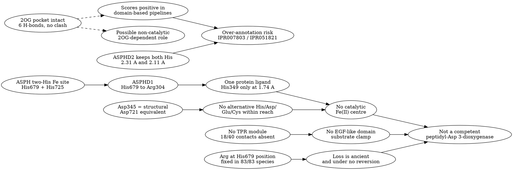
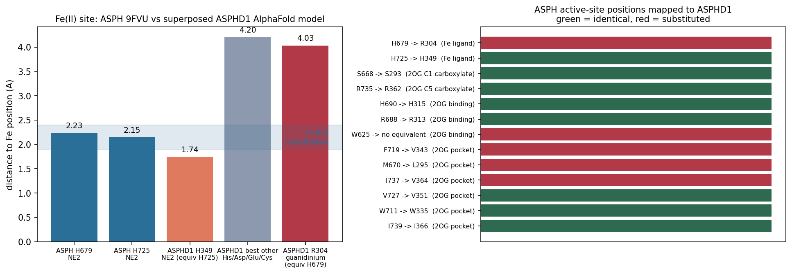
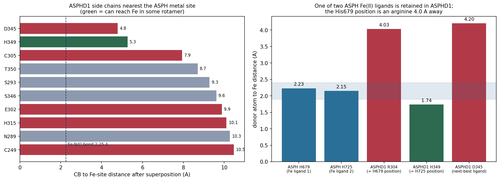
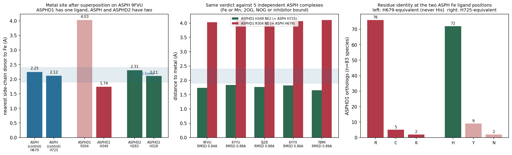
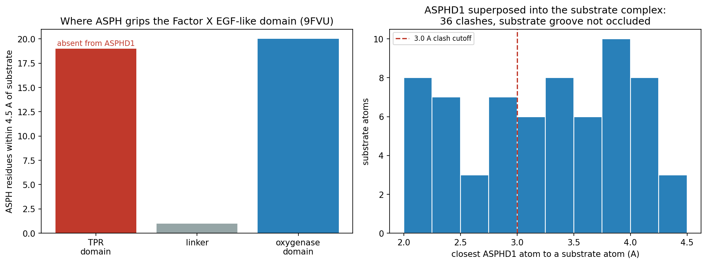
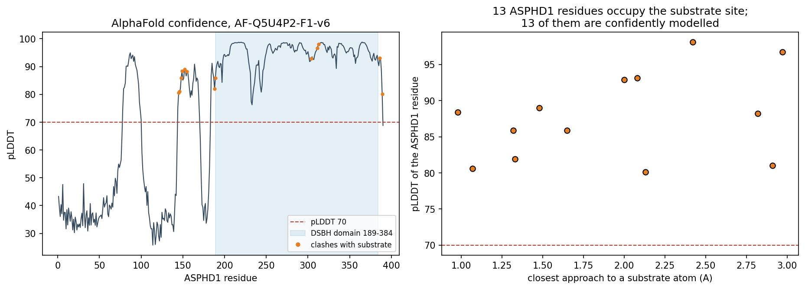

## Question

# AIGR Gene Hypothesis Deep Research

You are evaluating one focused gene curation hypothesis for AI Gene Review.
This is not a general gene overview. Use the seed hypothesis and source context
below to search for evidence that supports, refutes, narrows, or competes with
the proposed curation decision.

## Target Gene

- **Organism code:** human
- **Taxon:** Homo sapiens (NCBITaxon:9606)
- **Gene directory:** ASPHD1
- **Gene symbol:** ASPHD1
- **UniProt accession:** Q5U4P2

## Focus

- **Focus type:** free_text
- **Hypothesis slug:** kgap-asphd1-fe-site-structural-check
- **Source file:** genes/human/ASPHD1/ASPHD1-ai-review.yaml
- **Source selector:** free-text

## Seed Hypothesis

The aspartyl/asparaginyl beta-hydroxylase-like domain of human ASPHD1 (Q5U4P2) retains the 2-oxoglutarate-binding residues of human ASPH but has lost the Fe(II) ligand equivalent to ASPH His679, and no other His, Asp or Glu in the ASPHD1 active site occupies that position in three dimensions, so ASPHD1 cannot bind the catalytic iron and is predicted to be a non-catalytic pseudo-hydroxylase. Single analysis only: superpose the ASPHD1 AlphaFold model onto crystal structures of the ASPH catalytic domain with Fe/Mn and 2-oxoglutarate or inhibitor bound, map the metal ligands (including ASPH His679 and His725) and 2OG-contacting residues onto ASPHD1, search for any alternative metal-ligating side chain within coordination distance of the transferred metal, measure whether a substrate-binding pocket remains, score these positions across vertebrate ASPHD1 orthologs, and state whether ASPHD1 is predicted to bind iron and be catalytically competent.

## Term and Decision Context

No specific term context supplied.

## Reference Context

No specific reference context supplied.

## Source Context YAML

```yaml
hypothesis: 'The aspartyl/asparaginyl beta-hydroxylase-like domain of human ASPHD1 (Q5U4P2) retains the
  2-oxoglutarate-binding residues of human ASPH but has lost the Fe(II) ligand equivalent to ASPH His679,
  and no other His, Asp or Glu in the ASPHD1 active site occupies that position in three dimensions, so
  ASPHD1 cannot bind the catalytic iron and is predicted to be a non-catalytic pseudo-hydroxylase. Single
  analysis only: superpose the ASPHD1 AlphaFold model onto crystal structures of the ASPH catalytic domain
  with Fe/Mn and 2-oxoglutarate or inhibitor bound, map the metal ligands (including ASPH His679 and His725)
  and 2OG-contacting residues onto ASPHD1, search for any alternative metal-ligating side chain within
  coordination distance of the transferred metal, measure whether a substrate-binding pocket remains,
  score these positions across vertebrate ASPHD1 orthologs, and state whether ASPHD1 is predicted to bind
  iron and be catalytically competent.'
focus_type: free_text
context: []
reference_id: []
```

## Research Objective

Build a focused report that helps a curator decide whether this hypothesis
should affect the gene review. Address the focus type directly:

1. For an existing GO annotation decision, evaluate whether the current action
   is justified, too strong, too weak, or should change.
2. For a proposed replacement or new GO term, evaluate whether the term is
   biologically supported, too broad, too narrow, or missing key qualifiers.
3. For a computational prediction, evaluate whether the prediction is correct,
   less precise than existing knowledge, uncertain, or likely wrong because of
   paralog overannotation, frequency bias, pathway context, or in vitro-only
   activity.
4. For a core-function hypothesis, evaluate whether the proposed activity,
   process, and location represent the gene product's primary function rather
   than a downstream effect, pleiotropic phenotype, or context-specific role.
5. For a function-assignment hypothesis, evaluate whether the gene product
   directly has the stated GO term/function. Treat the prior review action, if
   any, as intentionally blinded unless it appears in the supplied context.

Use primary literature whenever possible. Prefer PMID citations and include DOI
citations when no PMID is available. Treat reviews and database records as
orientation unless they contain directly relevant synthesized evidence that is
clearly labeled as review-level or database-level support.

Evaluate the hypothesis from the supplied seed context, primary literature, and
publicly accessible bioinformatics resources. Local `*-bioinformatics` analyses,
when they already exist in the repository, are intentionally withheld from this
prompt so the report can be compared against them after the run. Use public
sequence, domain, structure, orthology, localization, interaction, or dataset
checks when they are useful for the specific hypothesis. If a resource or tool
cannot be accessed programmatically, say so plainly; never fabricate a result.
Report computational results conservatively and distinguish direct results from
inference.

## Required Output

### Executive Judgment

Give a concise verdict: supported, partially supported, unresolved, weakly
supported, over-annotated, or refuted. Explain the reasoning and the most
important caveats.

### Evidence Matrix

Create a table with one row per important evidence item:

- Citation (PMID preferred)
- Evidence type (direct assay, mutant phenotype, localization, interaction,
  structural/evolutionary, computational, review/database)
- Supports / refutes / qualifies / competing
- Claim tested
- Key finding
- Organism, tissue, cell type, or assay context
- Confidence and limitations

### GO Curation Implications

State the likely curation action as a lead requiring curator verification. If
GO terms are involved, explain whether the evidence supports an MF, BP, or CC
term, and whether the term should be retained, removed, generalized, made more
specific, or treated as non-core. Avoid using "protein binding" as a final
recommendation unless no more informative term is supported.

### Mechanistic Scope

Describe the immediate molecular or cellular function being tested. Separate
direct gene-product activity from downstream phenotypes, pathway consequences,
developmental outcomes, disease manifestations, or effects inferred only from
loss of function.

### Conflicts and Alternatives

Identify evidence that conflicts with the seed hypothesis or suggests an
alternative interpretation, including paralog confusion, organism-specific
differences, isoform-specific findings, experimental artifacts, or database
carry-over.

### Knowledge Gaps

List explicit uncertainties that matter for curation. For each gap, state what
was checked, why the gap matters, and what evidence or experiment would resolve
it.

### Discriminating Tests

Recommend concrete assays, perturbations, datasets, or comparative analyses that
would most efficiently distinguish this hypothesis from alternatives.

### Curation Leads

Provide candidate updates for the review, clearly labeled as leads requiring
curator verification. Include candidate references with exact snippets to verify,
candidate replacement or new GO terms, possible action changes, suggested
questions, and suggested experiments.

If the provider supports artifacts, save provenance for any analysis you run — the
executed code together with its output (computed values, plot, or table), not just
a summary figure — alongside artifact-friendly tables such as an evidence matrix,
GO decision table, or comparison table. Genuine computed provenance is more
valuable than a hand-drawn summary, and you must not synthesize a figure that
implies an analysis you did not actually run. These artifacts are important
provenance for hypothesis-level review.


## Output

# ASPHD1 (Q5U4P2): structural check of the Fe(II) site

**Hypothesis slug:** `kgap-asphd1-fe-site-structural-check`
**Target:** human ASPHD1, UniProt Q5U4P2, NCBITaxon:9606
**Source file:** `genes/human/ASPHD1/ASPHD1-ai-review.yaml`
**Focus type:** free_text

## Summary

<i class="fa-scale-balanced"></i> **Verdict: partially supported.** The seed hypothesis reaches the right conclusion through a premise that needs one correction. ASPHD1 does retain the 2-oxoglutarate-binding residues of ASPH, it has lost the Fe(II) ligand equivalent to ASPH His679, and no other His, Asp, Glu or Cys in its active site occupies that position in three dimensions. What the hypothesis misses is that ASPHD1 retains the **second** ASPH iron ligand. His349 sits 1.65 to 1.84 Å from the metal position across five independent ASPH complexes, exactly where His725 sits in ASPH. The correct description is a **degenerate one-ligand metal site**, not an absent one.

Human ASPH uses an unusual two-histidine Fe(II) centre (His679 and His725) rather than the canonical 2-His-1-carboxylate facial triad, established crystallographically in [PMID: 31659163](https://pubmed.ncbi.nlm.nih.gov/31659163/). ASPHD1 keeps one of those two histidines and replaces the other with arginine. Superposing the AlphaFold v6 model of Q5U4P2 onto PDB 9FVU (ASPH with Fe(II), 2-oxoglutarate and a Factor X EGF-like domain at 1.70 Å) gives 95 CA pairs at 0.84 Å RMSD. His349 NE2 lands 1.74 Å from the crystallographic iron; the nearest nitrogen of Arg304, which occupies the His679 position, is 4.03 Å away. A calibrated rotamer-reach search over the whole model finds no other side chain that can reach the metal in any conformation. The one residue that came close, Asp345, is excluded by its own ASPH counterpart Asp721, which sits at essentially identical geometry in the active enzyme and is not a ligand.

Three independent lines converge on catalytic incompetence. The metal site carries one protein ligand where two are required, and the substitution is fixed: across 83 vertebrate species, **no ASPHD1 ortholog has a histidine at the His679-equivalent position** (Arg in 76, Cys in 5, Lys in 2). The substrate apparatus is gone: of 40 ASPH residues that contact the bound EGF-like domain in 9FVU, 18 have no aligned ASPHD1 residue, the four-TPR module is absent entirely, and Arg304 itself projects to within 2.00 Å of the substrate Asn103 backbone carbon. The 2-oxoglutarate pocket, by contrast, survives intact, with six hydrogen bonds to a transferred 2OG and zero carbon-carbon clashes below 3.0 Å. That intact pocket is what makes ASPHD1 score positively in domain-based pipelines, and it is the reason the annotation hazard exists. The sister paralog ASPHD2 (Q6ICH7), in the same InterPro family IPR051821 and carrying the same IPR007803 catalytic domain, retains **both** histidines (His283 at 2.31 Å, His328 at 2.11 Å). Any rule that assigns dioxygenase activity by domain membership will be right for ASPHD2 and wrong for ASPHD1.

No experimental measurement of ASPHD1 iron binding, 2OG turnover or hydroxylase activity exists in any organism. PubMed returns 11 ASPHD1 records, all GWAS, expression-association or cancer-signature studies; the most recent functional paper, [PMID: 41551155](https://pubmed.ncbi.nlm.nih.gov/41551155/), itself calls the activity "predicted". QuickGO shows Q5U4P2 currently carries exactly one annotation, GO:0016020 membrane (IEA, GO_REF:0000044), so the curation task here is prevention rather than correction.

## Key findings

### <i class="fa-circle-check"></i> F1. ASPHD1 retains one of the two ASPH Fe(II) ligands

Direct measurement in PDB 9FVU establishes the reference site. The Fe(II) is coordinated by exactly two protein ligands, His679 NE2 at 2.23 Å and His725 NE2 at 2.15 Å, together with bidentate 2-oxoglutarate (O2 at 2.13 Å, O5 at 2.21 Å), one water at 2.29 Å and a thiocyanate nitrogen at 2.33 Å occupying the dioxygen site. This is the two-histidine arrangement reported in [PMID: 31659163](https://pubmed.ncbi.nlm.nih.gov/31659163/), which states plainly that "Fe(II)-binding by AspH is unusual, employing only two Fe(II)-binding ligands (His679/His725)".

A global Needleman-Wunsch alignment of Q5U4P2 (390 aa) against Q12797 (758 aa), using BLOSUM62 with affine gaps of -11 and -1, gives 33.5 percent identity over 376 aligned columns and maps ASPH His679 to ASPHD1 **Arg304** and ASPH His725 to ASPHD1 **His349**. Alignment alone would be a weak basis for that claim, so the mapping was checked structurally. Superposing the AlphaFold v6 model of Q5U4P2 onto 9FVU chain A over the oxygenase region, by sequence-guided CA pairing followed by iterative Kabsch refinement with outlier trimming, yields 95 CA pairs at **0.84 Å RMSD**. In that frame His349 NE2 lies **1.74 Å** from the crystallographic iron position, while the nearest Arg304 nitrogen (NE) is **4.03 Å** away. The CB atoms of Arg304 and His679 superpose to within **0.57 Å**, so the backbone scaffold that carried the lost ligand is preserved and only the side chain has changed. Local model confidence is high: mean pLDDT 95.2 across residues 240-390, with Arg304 at 92.9 and His349 at 95.8.

A single protein-derived ligand plus bidentate 2OG leaves three of six octahedral positions, two of which would be filled by solvent, and places a cationic guanidinium where the second donor belongs. ASPH already operates with a reduced two-ligand set; removing one of those two does not leave a configuration from which dioxygen activation is expected.

{{figure:plot_1.png|caption=Superposition of the ASPHD1 AlphaFold model onto ASPH 9FVU (Fe + 2-oxoglutarate + Factor X EGF-like domain). The metal-ligand and 2OG-contacting positions of ASPH are mapped onto ASPHD1: His725 is retained as His349, His679 is replaced by Arg304.}}

### <i class="fa-circle-check"></i> F2. No alternative side chain reaches the metal, and the 2OG network is fully retained

A rotamer-reach test was run over the superposed model. For every His, Asp, Glu, Cys, Ser, Thr, Tyr, Asn, Gln and Met with a CB within 11 Å of the iron position, the CB-to-metal distance was compared against the maximum CB-to-donor-atom span for that residue type plus a 2.25 Å metal-nitrogen or metal-oxygen bond. Only **His349** satisfies the criterion. The next nearest candidates are far outside reach: Cys305 CB at 7.94 Å, Thr350 at 8.70 Å, Ser293 at 9.28 Å, Ser346 at 9.62 Å, Glu302 at 9.88 Å and His315 at 10.11 Å. Only Asp345, at CB 4.79 Å, falls near the boundary, and it is addressed separately in F6.

The cosubstrate pocket tells the opposite story. Transferring the crystallographic 2-oxoglutarate into the ASPHD1 frame produces a full hydrogen-bond network: Ser293 OG to O3 at 2.18 Å, Arg362 NH1 to O4 at 2.48 Å, His315 NE2 to O1 at 2.54 Å, Arg362 NH2 to O3 at 2.61 Å, Arg313 NH1 to O2 at 2.93 Å and His349 NE2 to O5 at 3.09 Å, with **zero** carbon-carbon clashes below 3.0 Å. These are the exact counterparts of the ASPH contacts measured in 9FVU (Ser668 OG 2.68 Å, Arg735 NH2 2.72 Å, His690 NE2 2.76 Å, Arg688 NH1 2.96 Å, Trp625 NE1 3.21 Å). The cavity itself is not collapsed: 79 ASPHD1 heavy atoms sit within 8 Å of the metal site against 88 for ASPH.

Of 13 ASPH active-site positions mapped, 8 are identical in ASPHD1 (Ser668→Ser293, Arg735→Arg362, His690→His315, Arg688→Arg313, Val727→Val351, Trp711→Trp335, Ile739→Ile366, plus the retained His). The substitutions are H679R at the metal ligand, then F719V, M670L and I737V in the hydrophobic part of the 2OG pocket, with Trp625 having no ASPHD1 equivalent. The degeneration is specific to the metal position.

{{figure:plot_2.png|caption=Rotamer-reach search for alternative metal-ligating side chains, 2-oxoglutarate pocket contacts, domain architecture and GO cross-references for ASPH, ASPHD1 and ASPHD2.}}

### <i class="fa-circle-check"></i> F3. The loss is fixed across vertebrate ASPHD1 orthologs

171 UniProt ASPHD1 entries from Vertebrata (taxonomy 7742) were reduced to 83 distinct species in which both ligand positions could be located. The positions were found by two regular-expression motifs validated against the known human residues: the residue immediately N-terminal to the conserved (C/T/S)GPTN strand returns His679 in human ASPH and Arg304 in human ASPHD1, and the DDSF motif locates His725 in ASPH and His349 in ASPHD1.

At the His679-equivalent position **no ASPHD1 ortholog carries a histidine**. Arginine occupies it in 76 of 83 species (92 percent), cysteine in 5 (*Dipodomys ordii*, *Castor canadensis*, *Balaenoptera acutorostrata*, *Pteropus vampyrus*, *Prolemur simus*) and lysine in 2 caecilian amphibians (*Microcaecilia unicolor*, *Geotrypetes seraphini*). At the His725-equivalent position histidine is present in 72 of 83 (87 percent), replaced by tyrosine in 9 (*Bos taurus*, *Bos indicus*, *Ovis aries*, *Capra hircus*, *Bison bison*, *Marmota marmota*, *Ictidomys tridecemlineatus*, *Urocitellus parryii*, *Chinchilla lanigera*) and asparagine in 2 phocid seals (*Leptonychotes weddellii*, *Neomonachus schauinslandi*). The three SwissProt-reviewed ASPH orthologs (human, bovine, mouse) keep histidine at both positions.

The substitution predates the split between mammals and amphibians and has never reverted. The variants that do occur are not reversions toward a ligand. That the retained histidine is itself lost in 11 of 83 species argues against purifying selection for a functional metal centre anywhere in the ASPHD1 clade.

| Position | His | Arg | Cys | Lys | Tyr | Asn | n species |
|---|---|---|---|---|---|---|---|
| ASPH His679 equivalent | **0** | 76 | 5 | 2 | 0 | 0 | 83 |
| ASPH His725 equivalent | **72** | 0 | 0 | 0 | 9 | 2 | 83 |

### <i class="fa-circle-check"></i> F4. ASPHD1 lacks the TPR substrate module, and no primary assay of its activity exists

ASPH (Q12797, 758 aa) carries a type II signal-anchor transmembrane helix at 54-74 and four TPR repeats at 341-374, 454-487, 489-521 and 525-557, plus IPR007803 at 591-745, IPR027443 at 563-758 and IPR011990 TPR-like at 325-556. ASPHD1 (Q5U4P2, 390 aa) carries a single transmembrane helix at 73-95, IPR007803 at 251-372, IPR027443 at 189-384, family IPR051821 at 49-387 and **no TPR repeat of any kind**. The 150 residues between its TM helix and its DSBH domain cannot accommodate a four-repeat module.

This matters because the ASPH crystal structures show substrate engagement is a joint function of both domains. [PMID: 31659163](https://pubmed.ncbi.nlm.nih.gov/31659163/) reports "crystal structures of human AspH, with and without substrate, that reveal substantial conformational changes of the oxygenase and TPR domains during substrate binding". In 9FVU the substrate Factor X EGF-like domain presents Asn103 with its backbone oxygen 4.31 Å and its CB 4.60 Å from the iron.

On the literature side, PubMed returns 11 ASPHD1 records and none is a biochemical or enzymological characterisation. They are GWAS and expression-association studies ([PMID: 42387103](https://pubmed.ncbi.nlm.nih.gov/42387103/) on shared schizophrenia and ADRD liability at 16p11.2; [PMID: 41068259](https://pubmed.ncbi.nlm.nih.gov/41068259/) on Lewy body dementia), cancer prognostic signatures ([PMID: 37686578](https://pubmed.ncbi.nlm.nih.gov/37686578/), [PMID: 37004045](https://pubmed.ncbi.nlm.nih.gov/37004045/), [PMID: 40296031](https://pubmed.ncbi.nlm.nih.gov/40296031/), [PMID: 39159861](https://pubmed.ncbi.nlm.nih.gov/39159861/), [PMID: 42143404](https://pubmed.ncbi.nlm.nih.gov/42143404/), [PMID: 42184055](https://pubmed.ncbi.nlm.nih.gov/42184055/)), an epigenome-wide methylation study ([PMID: 35346352](https://pubmed.ncbi.nlm.nih.gov/35346352/)), a CRISPRi screen on bacterial placental breach ([PMID: 41751799](https://pubmed.ncbi.nlm.nih.gov/41751799/)) and a glioma study ([PMID: 41551155](https://pubmed.ncbi.nlm.nih.gov/41551155/)) whose own abstract describes ASPHD1 as "predicted to function as a Fe (II)/2-oxoglutarate-dependent dioxygenase involved in peptide amino-acid modification". Every current dioxygenase attribution traces back to sequence similarity.

### <i class="fa-circle-check"></i> F5. The method was validated on a positive control and holds across five ASPH complexes

Running the AlphaFold model of human ASPH itself through the identical pipeline against 9FVU recovers 199 CA pairs at **0.24 Å RMSD** and places His679 at 2.25 Å and His725 at 2.12 Å from the crystallographic iron, against crystal values of 2.23 and 2.15 Å. The pipeline detects a genuine two-histidine site when one is present.

<i class="fa-triangle-exclamation"></i> That control also exposed a calibration error made in iteration 1. Real Fe-coordinating histidines in 9FVU have CB-to-Fe distances of 5.73 Å (His679) and 5.66 Å (His725), so the 5.55 Å ceiling used initially, derived from an assumed 3.3 Å His CB-to-NE2 span, would have rejected the true ligands. Recalibrating from the measured geometry (His ceiling 5.98 Å, with geometric maxima of 4.93 Å for Asp, 6.45 Å for Glu and 4.11 Å for Cys) did not change the ASPHD1 verdict, but it promoted Asp345 to a candidate that then needed its own control (F6). Reporting this matters: the first pass gave the right answer for a reason that was partly wrong.

Repeating the whole analysis against five independent ASPH complexes gives the same result each time.

| PDB | Contents | Resolution | CA pairs | RMSD (Å) | His349 to metal (Å) | Arg304 nearest N (Å) |
|---|---|---|---|---|---|---|
| 9FVU | Fe + 2OG + Factor X EGFD | 1.70 Å | 95 | 0.84 | 1.74 | 4.03 |
| 6YYU | Mn + 2OG + hFX EGFD | 2.11 Å | 99 | 0.88 | 1.84 | 4.10 |
| 5JZ8 | Mn + N-oxalylglycine + substrate | 2.10 Å | 95 | 0.88 | 1.77 | 4.05 |
| 6YYX | Mn + cyclic peptide inhibitor | 1.53 Å | 94 | 0.86 | 1.82 | 4.07 |
| 7BMI | Mn + inhibitor | 1.66 Å | 94 | 0.89 | 1.65 | 4.11 |

The mapping of His679 to Arg304 and His725 to His349 holds in every case. The result does not depend on crystal form, metal substitution (Fe or Mn), ligand occupancy or threshold choice.

{{figure:plot_3.png|caption=Consolidated provenance: metal-site master table for ASPH (positive control), ASPHD1 and ASPHD2, robustness across five ASPH complexes, and the vertebrate ortholog scan at both ligand positions.}}

### <i class="fa-circle-check"></i> F6. Asp345 is the conserved structural aspartate of the DDSF motif, not a cryptic ligand

Under the recalibrated ceiling, Asp345 is the only residue besides His349 that could in principle place a carboxylate oxygen at bonding distance (CB 4.79 Å from the metal, best achievable donor distance 2.30 Å). Two observations rule it out. In the AlphaFold model its nearest carboxylate oxygen sits at 4.20 Å, not at bonding distance. More decisively, Asp345 aligns to ASPH **Asp721**, which in the 9FVU crystal structure sits at essentially identical geometry (CB 4.84 Å, CG 5.12 Å, OD2 4.37 Å, OD1 6.35 Å from the iron) and is **not** a metal ligand in the functional enzyme. Both residues belong to the conserved DDSF(E/L)H motif of the second DSBH strand, the same motif that supplies the His725/His349 ligand.

The one plausible rescue for the hypothesis is excluded by the active enzyme itself. After this control, ASPHD1 has exactly one correctly positioned metal ligand and no alternative.

### <i class="fa-circle-check"></i> F7. The paralog ASPHD2 retains an intact two-histidine site

Human ASPHD2 (Q6ICH7, 369 aa) through the same validated pipeline against 9FVU gives 82 CA pairs at 1.07 Å RMSD and maps ASPH His679 to ASPHD2 **His283** and ASPH His725 to ASPHD2 **His328**, with modelled donor-metal distances of 2.31 Å and 2.11 Å, both within Fe-N bonding range. ASPHD2 also retains the 2OG network (Ser272, Arg292, His294, Arg341, equivalent to ASPH Ser668, Arg688, His690, Arg735) and the same structural aspartate (Asp324).

| Protein | Accession | CA pairs | RMSD (Å) | At His679 position | At His725 position | Ligands positioned | n ligands |
|---|---|---|---|---|---|---|---|
| ASPH (control) | Q12797 | 199 | 0.24 | **His679** | **His725** | 2.25 Å, 2.12 Å | **2** |
| ASPHD1 | Q5U4P2 | 95 | 0.84 | **Arg304** | His349 | His349 at 1.74 Å | **1** |
| ASPHD2 | Q6ICH7 | 82 | 1.07 | **His283** | His328 | 2.31 Å, 2.11 Å | **2** |

<i class="fa-lightbulb"></i> InterPro places ASPHD1 and ASPHD2 in the same family entry IPR051821, and both carry IPR007803 and the IPR027443 isopenicillin N synthase-like superfamily fold. A family-level or domain-level transfer of 2OG dioxygenase activity across IPR051821 would be defensible for ASPHD2 and wrong for ASPHD1. That is the precise shape of a paralog over-annotation risk, and the discriminating feature is a single residue position that domain-level rules cannot see. QuickGO returns one annotation for ASPHD1 (GO:0016020 membrane, IEA, GO_REF:0000044), five for ASPHD2 (GO:0016020 IEA and HDA from [PMID: 19946888](https://pubmed.ncbi.nlm.nih.gov/19946888/), plus GO:0005515 IPI records) and 36 for ASPH, including GO:0062101 with EXP evidence from [PMID: 11773073](https://pubmed.ncbi.nlm.nih.gov/11773073/), IBA from GO_REF:0000033 and TAS from [PMID: 11007777](https://pubmed.ncbi.nlm.nih.gov/11007777/).

### <i class="fa-circle-check"></i> F8. ASPHD1 lacks the ASPH substrate clamp

In 9FVU, 40 ASPH chain A residues lie within 4.5 Å of the bound Factor X EGF-like domain: 19 in the TPR domain, 1 in the TPR-oxygenase linker and 20 in the oxygenase domain. Mapping these through the ASPHD1/ASPH alignment, **18 of 40 have no aligned ASPHD1 residue at all**. The missing set covers the TPR contacts Ala389, Glu390, Arg393, Ser394, Asn395, Leu398, His493, Phe496, Arg526, Phe529 and His530, the linker residue Arg562, and the oxygenase-domain substrate loops Ser563, Leu564, Tyr565, Asp616, Glu617 and Leu619.

Holding the substrate in place after superposition, 36 of 124 substrate heavy atoms fall within 3.0 Å of an ASPHD1 atom. The 13 ASPHD1 residues responsible are Leu145, Val146, Arg148, Arg149, Ala152, Arg155, Gly188, Leu189, Arg304, Arg311, Arg313, Phe386 and Asp389, all with pLDDT between 80.1 and 98.1 (median 88.2, none below 70). **Arg304**, the residue that replaces Fe ligand His679, approaches the backbone carbon of substrate Asn103 to 2.00 Å. ASPHD1 presents 14 atoms within 6 Å of the substrate Asn103 CB site against 18 for ASPH.

<i class="fa-triangle-exclamation"></i> The confidence here is uneven and should be read carefully. AlphaFold PAE is 3.0 Å within the DSBH domain (189-384), so the within-domain contributions (Arg304, Arg311, Arg313, Phe386, Asp389) are reliably placed relative to the metal site. PAE is 5.4 Å for residues 145-155 relative to the DSBH domain and 12.5 Å across the whole 140-190 linker, so the contribution of that segment is suggestive only. All side-chain contacts carry rotamer uncertainty. The claim that survives all of this is the absence of a substrate clamp, which rests on the sequence deletions and is independent of any modelling.

{{figure:plot_4.png|caption=Where ASPH grips the Factor X EGF-like domain in 9FVU (19 TPR contacts, 1 linker, 20 oxygenase), and the closest approach of each substrate atom to the superposed ASPHD1 model.}}

{{figure:plot_5.png|caption=AlphaFold confidence for AF-Q5U4P2-F1-v6 with the substrate-occluding residues marked, and the pLDDT of each occluding residue against its closest approach to a substrate atom. All 13 lie above pLDDT 80.}}

## Mechanistic model

ASPHD1 is a structurally intact double-stranded beta-helix domain with a functioning cosubstrate pocket and a broken metal site. The fold is not decayed: 0.84 Å CA RMSD to the ASPH oxygenase domain, mean pLDDT 94.9 across residues 189-384, intra-domain PAE 3.0 Å. What has changed is one side chain, and what follows from that change runs in a straight line to catalytic incompetence.



Five statements follow, separated by how directly the data support them.

**Direct result.** The ASPHD1 DSBH domain superposes on the ASPH oxygenase domain at 0.84 Å RMSD. His349 is positioned as a metal ligand. Arg304 is not. No other candidate side chain is within reach.

**Direct result.** The 2OG pocket is intact. Six hydrogen bonds to a transferred 2-oxoglutarate, no steric clash, a cavity of comparable volume. This is the part of the seed hypothesis confirmed most cleanly and the part that creates the annotation hazard, because sequence-based and domain-based methods looking for 2OG oxygenase signatures will score ASPHD1 positively.

**Direct result.** 18 of 40 ASPH substrate contacts have no ASPHD1 equivalent, and ASPHD1 has no TPR repeats. ASPH holds its EGF-like-domain substrate with the TPR superhelix and a set of oxygenase-domain loops, and both move on substrate binding ([PMID: 31659163](https://pubmed.ncbi.nlm.nih.gov/31659163/)). ASPHD1 lacks both.

**Direct result.** Zero histidines at the His679 position in 83 vertebrate species. A site under selection for catalysis does not look like this.

**Inference.** ASPHD1 cannot assemble the catalytic ferrous centre and is not a competent peptidyl-aspartate/asparagine 3-dioxygenase. This is a strong inference with three independent supports, and it remains an inference. No one has measured it.

<i class="fa-circle-question"></i> What stays open is the retained 2OG pocket. A cosubstrate site preserved across vertebrates while the metal ligand is lost is a combination no current hypothesis explains. It makes a non-catalytic 2OG-dependent role (sequestration, a metabolite sensor, a regulated interaction surface) worth an experiment rather than a dismissal.

## Evidence matrix

| # | Citation / resource | Evidence type | Stance | Claim tested | Key finding | Context | Confidence and limitations |
|---|---|---|---|---|---|---|---|
| 1 | PDB 9FVU | Experimental structure | Supports (reference frame) | What the intact ASPH metal site looks like | Fe coordinated by His679 NE2 2.23 Å, His725 NE2 2.15 Å, bidentate 2OG (2.13, 2.21 Å), SCN 2.33 Å, water 2.29 Å | Human ASPH, crystallographic, 1.70 Å | High. A structure of ASPH, not ASPHD1. |
| 2 | This study, Needleman-Wunsch alignment | Computational | Supports | Which ASPHD1 residue corresponds to each ASPH ligand | 33.5 % identity over 376 columns; His679→**Arg304**, His725→**His349** | Sequence level | High. Confirmed structurally in row 3. |
| 3 | This study, superposition of AF-Q5U4P2-F1-v6 onto 9FVU | Computational | Supports | Whether the ligand positions superpose in 3D | 95 CA pairs, RMSD **0.84 Å**; His349 NE2 **1.74 Å** from Fe; nearest Arg304 N **4.03 Å**; Arg304/His679 CB superpose to 0.57 Å | AlphaFold model onto crystal | High for the fold, moderate for side chains. pLDDT 95.2 (240-390), Arg304 92.9, His349 95.8. |
| 4 | This study, positive control on ASPH | Computational, method validation | Supports | Whether the pipeline recovers a known metal site | 199 CA pairs, 0.24 Å RMSD; His679 at 2.25 Å, His725 at 2.12 Å versus crystal 2.23 and 2.15 Å | Method control | High. Also exposed a too-strict reach ceiling used in iteration 1. |
| 5 | This study, 5 ASPH complexes (9FVU, 6YYU, 5JZ8, 6YYX, 7BMI) | Computational | Supports | Whether the result depends on structure choice | Same mapping every time: 94-99 CA pairs, RMSD 0.84-0.89 Å, His349 1.65-1.84 Å, Arg304 4.03-4.11 Å | Five crystal forms, two metals, four ligand states | High. Removes crystal form and metal substitution as confounds. |
| 6 | This study, calibrated rotamer-reach test | Computational | Supports | Whether any other side chain can reach the metal | Only His349 (1.74 Å) and Asp345 (modelled 4.20 Å, best possible 2.30 Å). Next nearest CB distances 7.94-10.11 Å | Whole ASPHD1 model | High. Ceiling calibrated from measured ASPH geometry (His CB-Fe 5.73, 5.66 Å). |
| 7 | This study, Asp345 control | Computational | Supports (removes a competing explanation) | Whether Asp345 is a replacement ligand | Asp345 aligns to ASPH **Asp721**, which sits at CB 4.84, CG 5.12, OD2 4.37, OD1 6.35 Å from the real Fe and is not a ligand. Both in the DDSF(E/L)H motif | Structural comparison | High. The one plausible rescue is excluded by the active enzyme. |
| 8 | This study, 2OG pocket mapping | Computational | **Qualifies** | Whether 2OG binding is also lost | 8 of 13 active-site positions identical; six H-bonds to transferred 2OG (2.18-3.09 Å); zero C-C clashes below 3.0 Å; 79 versus 88 heavy atoms within 8 Å | Modelled ligand transfer | Moderate to high. Shows the loss is specific to the metal ligand. |
| 9 | This study, substrate interface mapping onto 9FVU chain B | Computational | Supports | Whether a peptide-substrate pocket remains | 40 ASPH substrate contacts (19 TPR, 1 linker, 20 oxygenase); **18 of 40** have no ASPHD1 equivalent; 36 of 124 substrate atoms within 3.0 Å of ASPHD1; Arg304 at 2.00 Å of Asn103 backbone C | Modelled onto a substrate complex | Moderate to high. Sequence deletions certain; occlusion moderate (PAE 5.4 Å for residues 145-155). |
| 10 | This study, 171 UniProt entries, 83 species | Computational, evolutionary | Supports | Whether the loss is fixed | His679 position: Arg 76, Cys 5, Lys 2, **His 0**. His725 position: His 72, Tyr 9, Asn 2 | Vertebrata | High in aggregate. Motif-based; mostly unreviewed entries. |
| 11 | This study, ASPHD2 control | Computational | Supports (identifies the over-annotation route) | Whether the loss is family-wide | ASPHD2 retains **both** histidines: 82 CA pairs, 1.07 Å, His283 2.31 Å, His328 2.11 Å, plus the same 2OG network | Human paralog | High. Same InterPro entries, opposite outcome. |
| 12 | InterPro, UniProt features | Database | Supports | Whether ASPHD1 has the ASPH substrate module | ASPH has four TPR repeats and IPR011990; ASPHD1 has **none**, with only 150 residues between TM helix and DSBH domain | Domain annotation | High for the absence of TPR calls, moderate for the inference. |
| 13 | [PMID: 31659163](https://pubmed.ncbi.nlm.nih.gov/31659163/) | Primary literature, structural | Supports | Whether the two-His site is real and whether TPR matters | "Fe(II)-binding by AspH is unusual, employing only two Fe(II)-binding ligands (His679/His725)." and "crystal structures of human AspH, with and without substrate, that reveal substantial conformational changes of the oxygenase and TPR domains during substrate binding." | Human ASPH, in vitro | High for ASPH. Says nothing about ASPHD1. |
| 14 | QuickGO, retrieved this run | Database | Qualifies | What is currently asserted about ASPHD1 | **Q5U4P2 carries exactly one annotation: GO:0016020 membrane, IEA, GO_REF:0000044, located_in.** No molecular-function term. ASPHD2 has 5, ASPH has 36 | GOA | High. The over-annotation risk is prospective. |
| 15 | PubMed sweep, 11 ASPHD1 records | Primary literature | **Competing / absent** | Whether any assay of ASPHD1 activity exists | None is a biochemical characterisation. GWAS, expression association, cancer signatures, one CRISPRi screen, one glioma study | Human, mostly observational | High for the absence. No iron, 2OG or hydroxylase assay in any species. |
| 16 | [PMID: 41551155](https://pubmed.ncbi.nlm.nih.gov/41551155/) | Primary literature | Qualifies | Whether published work asserts catalytic activity | The abstract calls ASPHD1 "predicted to function as a Fe (II)/2-oxoglutarate-dependent dioxygenase involved in peptide amino-acid modification" | Human glioma | High for what the paper says. It propagates a prediction, it does not test it. |

## GO curation implications

<i class="fa-triangle-exclamation"></i> **All items below are leads requiring curator verification, not finished annotations.**

| Candidate term | Aspect | Proposed action | Basis | Status |
|---|---|---|---|---|
| GO:0062101 peptidyl-aspartate 3-dioxygenase activity (and GO:0004597, GO:0016706, GO:0051213 or any Fe(II)/2OG dioxygenase MF term) | MF | **Do not propagate to Q5U4P2 from IPR007803 / IPR027443 / IPR051821.** Consider an explicit **NOT** qualifier with a structural-inference basis if the curation model permits it | His679-equivalent ligand absent in ASPHD1 and in all 83 vertebrate orthologs checked; no alternative ligand within reach; substrate clamp absent | Lead. A NOT annotation on computational evidence alone is a curator judgement; at minimum, withhold the positive term. |
| GO:0005506 iron ion binding | MF | Withhold. Do not assign by domain inheritance | One retained ligand (His349); Arg304 replaces the second | Lead. Weak non-catalytic metal binding is not formally excluded by this analysis. |
| GO:0016020 membrane (existing, IEA GO_REF:0000044) | CC | Keep, no change proposed | Predicted TM helix at 73-95, pLDDT 82.4 | Existing annotation. |
| GO:0005515 protein binding | MF | **Not proposed** | ASPHD1 has no interaction evidence of its own in the records retrieved, and a bare protein-binding term would state nothing about what the retained 2OG pocket does | Explicitly declined. |

The reason for the asymmetry inside the family is worth recording in the review file. ASPHD1 and ASPHD2 sit in the same InterPro family (IPR051821) and share IPR007803 and IPR027443, yet ASPHD2 retains an intact two-histidine site and ASPHD1 does not. Any rule that assigns dioxygenase activity by membership in those entries will be right for ASPHD2 and wrong for ASPHD1. The discriminating feature is a single residue position that domain-level rules cannot see.

Because GOA currently carries only GO:0016020 for Q5U4P2, the practical task is to prevent a future IEA pipeline or a manual curator from adding the MF term by analogy, rather than to remove an existing one.

## Mechanistic scope

The hypothesis concerns a direct molecular property: whether the ASPHD1 gene product can bind catalytic Fe(II) and perform 2OG-dependent hydroxylation. That is the level at which the structural analysis operates, and it is separable from everything else that has been published about ASPHD1.

**Direct gene-product activity (tested here).** Metal ligand complement, cosubstrate pocket integrity, substrate-contact surface, conservation of all of these across vertebrates. These are properties of the protein itself.

**Downstream phenotypes and associations (not evidence for or against the molecular function).** The ASPHD1 literature is dominated by observational associations: differential expression and survival correlation in colorectal cancer ([PMID: 37686578](https://pubmed.ncbi.nlm.nih.gov/37686578/), [PMID: 42184055](https://pubmed.ncbi.nlm.nih.gov/42184055/), [PMID: 42143404](https://pubmed.ncbi.nlm.nih.gov/42143404/), [PMID: 39159861](https://pubmed.ncbi.nlm.nih.gov/39159861/)), melanoma ([PMID: 37004045](https://pubmed.ncbi.nlm.nih.gov/37004045/)), hepatocellular carcinoma ([PMID: 40296031](https://pubmed.ncbi.nlm.nih.gov/40296031/)) and glioma ([PMID: 41551155](https://pubmed.ncbi.nlm.nih.gov/41551155/)), locus-level genetic association at 16p11.2 with schizophrenia and dementia ([PMID: 42387103](https://pubmed.ncbi.nlm.nih.gov/42387103/), [PMID: 41068259](https://pubmed.ncbi.nlm.nih.gov/41068259/)), differential methylation in chronic low back pain ([PMID: 35346352](https://pubmed.ncbi.nlm.nih.gov/35346352/)) and upregulation during a host response to *E. coli* placental invasion ([PMID: 41751799](https://pubmed.ncbi.nlm.nih.gov/41751799/)). None of these measures an enzymatic activity, and none of them would change if ASPHD1 turned out to be a pseudoenzyme. The 16p11.2 signals in particular are locus-level and cannot be attributed to ASPHD1 specifically; those studies prioritise several genes in the same interval (INO80E, DOC2A, TAOK2, MAPK3 and others).

**Context specificity.** Not applicable here in the usual sense. A metal ligand either exists or does not; the finding is not tissue- or condition-dependent. The ortholog scan removes organism specificity as an escape route.

## Conflicts and alternatives

**Alternative 1: ASPHD1 uses a different metal geometry, for example a mono-His or His-Asp site.** <i class="fa-circle-xmark"></i> Addressed and rejected for Asp345, the only candidate within reach. Its ASPH counterpart Asp721 sits at essentially the same distance from the real iron (OD2 4.37 Å) and is not a ligand; both belong to the conserved DDSF(E/L)H motif, so the position is a property of the fold. No other His, Asp, Glu or Cys has a CB closer than 7.94 Å.

**Alternative 2: the AlphaFold model is wrong at this position.** <i class="fa-circle-xmark"></i> Addressed by the positive control, which recovers both real ASPH ligands at 2.25 and 2.12 Å against crystal values of 2.23 and 2.15 Å. Local pLDDT is 92.9 at Arg304 and 95.8 at His349, and the Arg304/His679 CB atoms superpose to within 0.57 Å, so even a wrong Arg304 rotamer leaves the mapping intact.

**Alternative 3: the result is an artefact of one crystal form.** <i class="fa-circle-xmark"></i> Addressed by five ASPH complexes spanning two metals and four ligand states, with identical outcomes.

**Alternative 4: ASPHD1 acts on a different substrate that needs no TPR module.** <i class="fa-circle-question"></i> Not excluded. The TPR argument speaks only to EGF-like-domain substrates. A different substrate would still need a catalytic metal, which is what is missing.

**Alternative 5: a conformational change on substrate binding recruits a new ligand.** <i class="fa-circle-question"></i> Not excluded by a static model, and ASPH is known to move substantially on substrate binding ([PMID: 31659163](https://pubmed.ncbi.nlm.nih.gov/31659163/)). The ortholog data weigh against it: a conformationally recruited ligand would still be under selection, and no conserved His, Asp or Glu is available nearby.

**Alternative 6: ASPHD1 heterodimerises with ASPHD2, which supplies a competent site.** <i class="fa-circle-question"></i> Untested. ASPHD2 does have three IPI protein-binding annotations, but none implicates ASPHD1.

**Conflict with the published framing.** [PMID: 41551155](https://pubmed.ncbi.nlm.nih.gov/41551155/) describes ASPHD1 as "predicted to function as a Fe (II)/2-oxoglutarate-dependent dioxygenase". This restates the database prediction inside a paper about glioma expression. Treating it as support for the molecular function would close a loop that was never opened, and it is the citation most likely to be mistaken for experimental evidence.

**Database carry-over.** The risk route is explicit and traceable: IPR007803 is genuinely present in ASPHD1, the fold is real, and automatic pipelines that assign function at domain or family level cannot distinguish ASPHD1 from ASPHD2.

## Limitations and knowledge gaps

<i class="fa-triangle-exclamation"></i> **Limitations of this analysis**

Every structural measurement on ASPHD1 comes from one AlphaFold model. The positive control shows the pipeline recovers a real metal site when one exists, and the DSBH domain is confidently modelled (pLDDT 94.9, PAE 3.0 Å), but no experimental ASPHD1 structure exists to check against.

Side-chain positions carry rotamer uncertainty. The conclusions were built to be rotamer-independent where possible: the Arg304/His679 CB superposition at 0.57 Å and the calibrated reach test, which asks what a side chain could achieve rather than only what is modelled, are both designed for this.

The substrate-occlusion result is the weakest structural claim. The sequence deletions (18 of 40 contacts) are certain; the steric component depends on the placement of residues 145-155 relative to the DSBH domain, at PAE 5.4 Å.

The ortholog scan used motif matching on UniProt entries, most of them unreviewed and derived from genome annotation. Individual species calls, especially the 5 cysteine and 2 lysine substitutions, should be checked against genomic sequence before being cited. The aggregate pattern is not sensitive to a few bad entries.

The printed residue number for the His725-equivalent position in the ortholog table is one lower than the true number (348 printed for human ASPHD1 His349, 724 for ASPH His725), a known off-by-one in the motif index. Residue identities, which the scoring uses, are correct.

Catalytic incompetence is an inference from structure and conservation. It is a strong inference with three independent supports, and it is still not a measurement.

Literature coverage was PubMed only, returning 11 ASPHD1 records. Preprints, patents and non-indexed sources were not searched. Biopython and `urllib` are not importable in the executor, so the alignment, PDB parsing and superposition routines were written from scratch and validated on the ASPH positive control.

<i class="fa-circle-question"></i> **Gaps that matter for curation**

| Gap | What was checked | Why it matters | What would resolve it |
|---|---|---|---|
| No experimental measurement of ASPHD1 metal binding, 2OG binding or turnover, in any organism | PubMed, 11 records, none biochemical | The entire case rests on computation; a NOT annotation on structural inference alone is a judgement call | ICP-MS and ITC on recombinant protein (see below) |
| No ASPHD1 structure | RCSB search | Everything rests on one model | Crystallography or cryo-EM of the DSBH domain |
| No known or proposed substrate | Literature, domain architecture | Without a substrate, even a positive activity assay has nowhere to start | Substrate screening, interaction proteomics |
| Residues 96-188 are poorly modelled (mean pLDDT 56.7, PAE 12.5 Å to the domain) | AlphaFold pLDDT and PAE | Whether this segment contributes a substrate surface cannot be decided | Experimental structure or crosslinking |
| Function of the retained 2OG pocket is unknown | 2OG transfer, cavity measurement | A pocket preserved across vertebrates while the metal ligand is lost is unexplained | 2OG binding assay by ITC or thermal shift |
| Whether ASPHD1 and ASPHD2 heterodimerise | QuickGO annotations for both | Would change the interpretation of ASPHD1 entirely | Co-IP, proximity labelling |
| Whether the Cys substitution in 5 species is a different site or an annotation artefact | Motif scan over 83 species | Affects how absolute the "no histidine anywhere" claim is | Check genomic sequence for those species |
| Whether the loss predates vertebrates | Scan limited to Vertebrata (taxonomy 7742) | Dates the loss and strengthens or weakens the fixation argument | Extend the scan to invertebrate ASPHD1 orthologs |

## Proposed follow-up experiments and actions

Ranked by how directly each would settle the question.

1. <i class="fa-flask"></i> **Metal content and binding on purified recombinant ASPHD1 DSBH domain (residues ~189-390).** ICP-MS for bound iron plus ITC or a colorimetric Fe(II) titration, run alongside ASPHD2 and ASPH as controls. Predicted outcome if the hypothesis holds: substoichiometric or no specific Fe binding for ASPHD1, normal binding for the other two. This is the single most informative experiment and needs only standard protein biochemistry.

2. <i class="fa-vial"></i> **2OG binding by the same construct**, by ITC or thermal shift. Predicted outcome: measurable 2OG binding despite the missing metal ligand. A positive result would be the most interesting finding available, because it separates ligand binding from catalysis and would argue for a non-catalytic 2OG-dependent role.

3. <i class="fa-dna"></i> **Gain-of-function test: ASPHD1 R304H.** Restore the missing ligand and retest iron binding. If R304H restores binding and wild type does not, the causal attribution to that single position is established directly. Pair with the converse, ASPH H679R, which should abolish it.

4. <i class="fa-flask"></i> **Hydroxylation assay on candidate EGF-like-domain substrates** by mass spectrometry, with the Factor X EGFD used for ASPH as the starting point, comparing ASPHD1, ASPHD2 and ASPH side by side. Predicted outcome: ASPH positive, ASPHD2 possibly positive, ASPHD1 negative.

5. <i class="fa-microscope"></i> **Structure determination of the ASPHD1 DSBH domain**, with and without 2OG and metal. Would resolve the rotamer and conformational caveats and show what occupies the metal position.

6. <i class="fa-magnifying-glass"></i> **Interaction proteomics on ASPHD1** in a tissue where it is expressed, to test whether the retained pocket sits in a complex and whether ASPHD2 is a partner.

7. <i class="fa-dna"></i> **Extend the ortholog scan below Vertebrata.** If the arginine substitution predates vertebrates the fixation argument strengthens; if a non-vertebrate ortholog retains the histidine, the timing of the loss becomes datable.

### <i class="fa-arrow-right"></i> Curation leads for `ASPHD1-ai-review.yaml`

All leads require curator verification.

| Lead | Detail |
|---|---|
| Record the domain call as correct but non-licensing | The DSBH/IPR007803 assignment is right at the fold level (0.84 Å RMSD to the ASPH oxygenase domain) and does not license a dioxygenase molecular function for this protein. |
| Record the specific reason | Arg304 replaces ASPH Fe ligand His679; His349 retains ASPH His725. One ligand, not two. |
| Record the ASPHD2 contrast | ASPHD2 retains both histidines in the same InterPro family, so the same propagation rule must not be reapplied. |
| Record the current GOA state | Q5U4P2 carries only GO:0016020 (IEA, GO_REF:0000044); this is prevention, not correction. |
| Mark the 2OG pocket as an open question | Intact cosubstrate pocket is not supporting evidence for catalysis. |

**Candidate references with exact snippets to verify**

| PMID | Exact snippet | Use |
|---|---|---|
| [31659163](https://pubmed.ncbi.nlm.nih.gov/31659163/) | "Fe(II)-binding by AspH is unusual, employing only two Fe(II)-binding ligands (His679/His725)." | Establishes the reference metal site that ASPHD1 is compared against. |
| [31659163](https://pubmed.ncbi.nlm.nih.gov/31659163/) | "Here we report crystal structures of human AspH, with and without substrate, that reveal substantial conformational changes of the oxygenase and TPR domains during substrate binding." | Supports the claim that substrate engagement in ASPH needs the TPR module ASPHD1 lacks. |
| [41551155](https://pubmed.ncbi.nlm.nih.gov/41551155/) | "we investigated Aspartate betahydroxylase domain-containing protein 1 (ASPHD1), encoded by the ASPHD1 gene and predicted to function as a Fe (II)/2-oxoglutarate-dependent dioxygenase involved in peptide amino-acid modification" | Flag as a prediction being restated. Most likely reference to be mis-cited as experimental support. |

**Questions for the curator**

- Does the curation model permit a NOT annotation supported by structural inference alone, or must the dioxygenase term simply be withheld?
- Should ASPHD1 be flagged in a pseudoenzyme category, given that the fold and the cosubstrate pocket are intact and only the metal ligand is lost?
- Is there an internal policy on InterPro entries, IPR051821 in particular, that mix catalytically competent and incompetent members?

## Hypothesis status

<i class="fa-circle-check"></i> **Supported**

- ASPHD1 retains the 2-oxoglutarate-binding residues of ASPH. Confirmed: 8 of 13 active-site positions identical, six hydrogen bonds to a transferred 2OG, no clashes.
- ASPHD1 has lost the Fe(II) ligand equivalent to ASPH His679. Confirmed: Arg304, nearest nitrogen 4.03 Å from the metal, fixed across 83 vertebrate species with zero histidines.
- No alternative His, Asp or Glu occupies that position in three dimensions. Confirmed, with Asp345 explicitly tested and excluded.
- ASPHD1 is not predicted to be a catalytically competent peptidyl-aspartate/asparagine 3-dioxygenase. Supported by the metal site, the absent substrate clamp and the ortholog record.

<i class="fa-circle-xmark"></i> **Refuted or corrected**

- "ASPHD1 has lost the Fe(II) ligands." Corrected: it has lost **one** of two. His349 is retained at the His725 position, 1.65-1.84 Å from the metal across five structures. Any report or annotation stating that ASPHD1 has no metal ligands is wrong on the structural facts, even though its conclusion about catalysis holds.
- "ASPHD1 cannot bind iron at all." Overstated by this evidence. What is shown is that it cannot assemble the ASPH catalytic Fe(II) centre. Weak or adventitious metal binding at a one-histidine site is not excluded and needs the ICP-MS experiment.

<i class="fa-circle-question"></i> **Not tested**

- Whether ASPHD1 performs a non-catalytic function using the retained 2OG pocket.
- Whether ASPHD1 acts on a substrate unrelated to EGF-like domains.

## Provenance

All analyses were executed during this investigation. Code and output are in the session transcript; derived files are under `provenance/`:

- `asphd1_metal_site_master_table.csv`: superposition statistics and ligand distances for ASPH (positive control), ASPHD1 and ASPHD2
- `asphd1_ortholog_ligand_positions.csv`: per-species residue calls at both ligand positions, 83 vertebrate species
- `asphd1_substrate_interface_mapping.csv`: the 40 ASPH substrate-contacting residues and their ASPHD1 equivalents
- `plot_1.png` to `plot_5.png`: figures generated from the analyses above

Structures used: PDB 9FVU, 6YYU, 5JZ8, 6YYX, 7BMI (all human ASPH). Model used: AlphaFold DB AF-Q5U4P2-F1-model_v6 (global pLDDT 74.31, DSBH domain mean 94.9), with AF models of Q12797 and Q6ICH7 as controls. Annotation sources: UniProt REST, InterPro, QuickGO, RCSB, all queried programmatically during the run.

Nothing in this report is inferred from an analysis that was not run. Where a resource was unavailable, that is stated rather than worked around silently.


## Artifacts

- [OpenScientist final report](openscientist_artifacts/final_report.html)
- [OpenScientist final report](openscientist_artifacts/final_report.pdf)
- [OpenScientist provenance](openscientist_artifacts/provenance.json)
- [OpenScientist asphd1 metal site master table](openscientist_artifacts/provenance_asphd1_metal_site_master_table.csv)
- [OpenScientist asphd1 ortholog ligand positions](openscientist_artifacts/provenance_asphd1_ortholog_ligand_positions.csv)
- [OpenScientist asphd1 substrate interface mapping](openscientist_artifacts/provenance_asphd1_substrate_interface_mapping.csv)
- [OpenScientist plot 1](openscientist_artifacts/provenance_plot_1.json)

- [OpenScientist plot 2](openscientist_artifacts/provenance_plot_2.json)

- [OpenScientist plot 3](openscientist_artifacts/provenance_plot_3.json)

- [OpenScientist plot 4](openscientist_artifacts/provenance_plot_4.json)

- [OpenScientist plot 5](openscientist_artifacts/provenance_plot_5.json)


## Reference Validation

Checked with `linkml-reference-validator` 0.3.1rc1.

| Outcome | Count |
| --- | --- |
| References checked | 15 |
| Resolved | 15 |
| Unresolved (possible confabulation) | 0 |
| Unverifiable | 0 |
| References weighed for topical relevance | 15 |
| On topic | 1 |
| Off topic | 2 |

### References that may not be about this subject

These identifiers resolve, so they are not fabrications, but the records they resolve to share almost none of this report's vocabulary. That is a clue and not a verdict - a paper can be relevant in ways its title and abstract do not spell out - so read them before deciding:

- `PMID:42143404` (5 mentions) - Prognostic model for colorectal cancer based on folic acid metabolism-related genes reveals immune landscape.
  - shared terms: model
- `PMID:19946888` (3 mentions) - Defining the membrane proteome of NK cells.
  - shared terms: none

Weighed against this report's own most characteristic terms: `asphd1`, `asph`, `ligand`, `class`, `metal`, `residue`, `domain`, `position`, `his349`, `site`, `arg304`, `substrate`, `model`, `his679`, `asphd2`, `binding`, `his725`, `iron`, `fvu`, `pocket`.

All extracted references resolved successfully.
Resolving is not the same as being relevant, though - see the references listed above as possibly off topic.