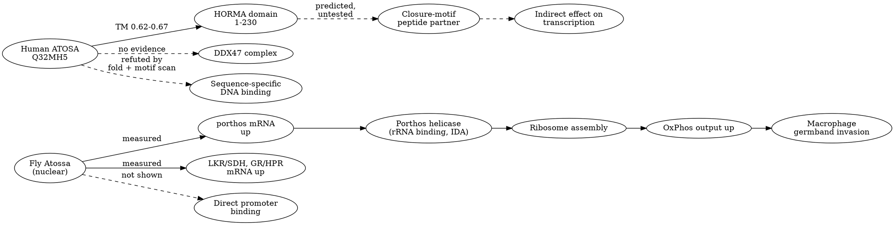
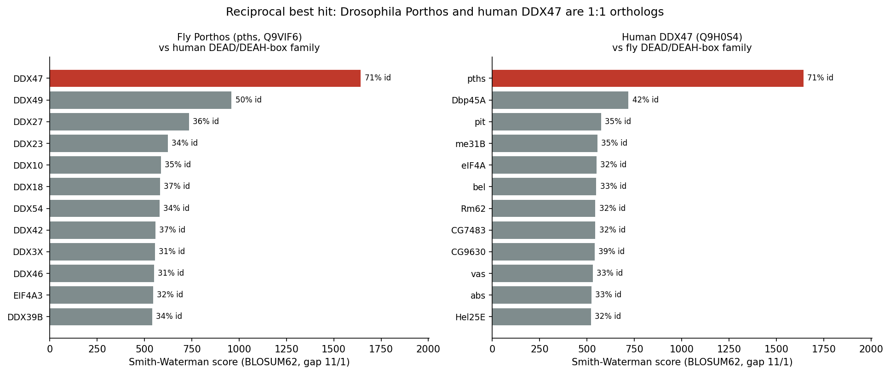
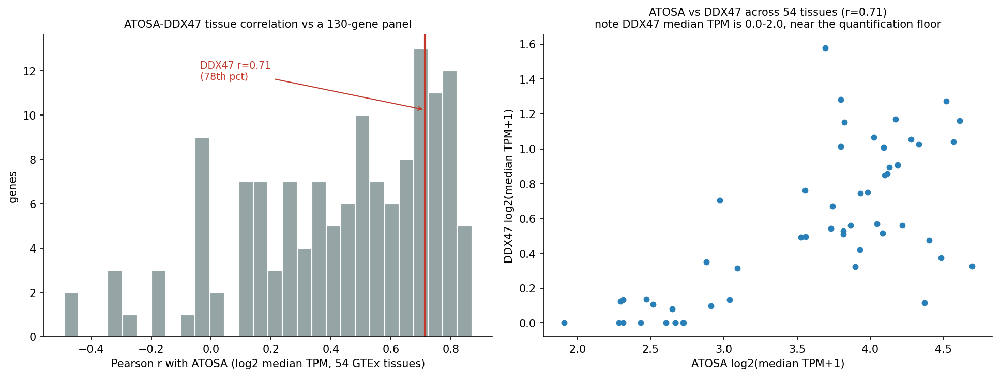
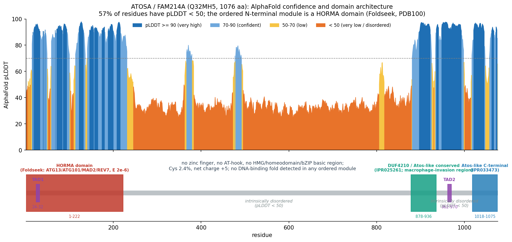
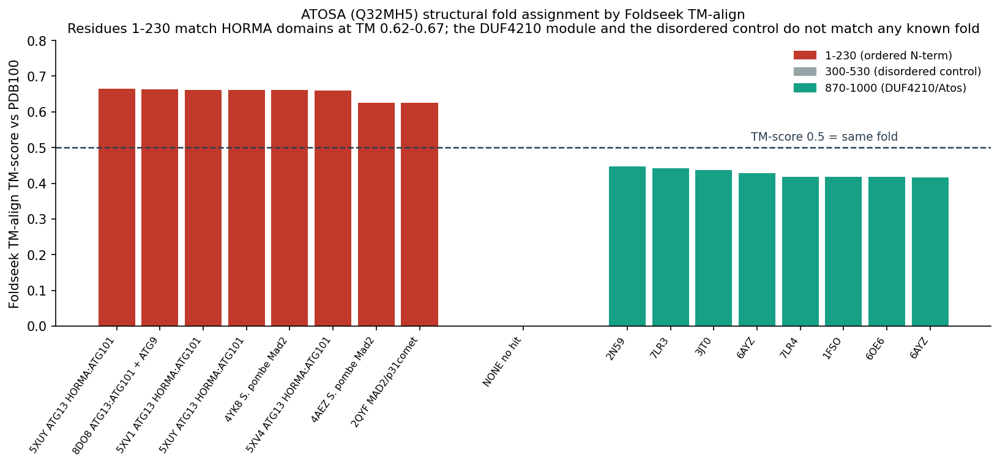
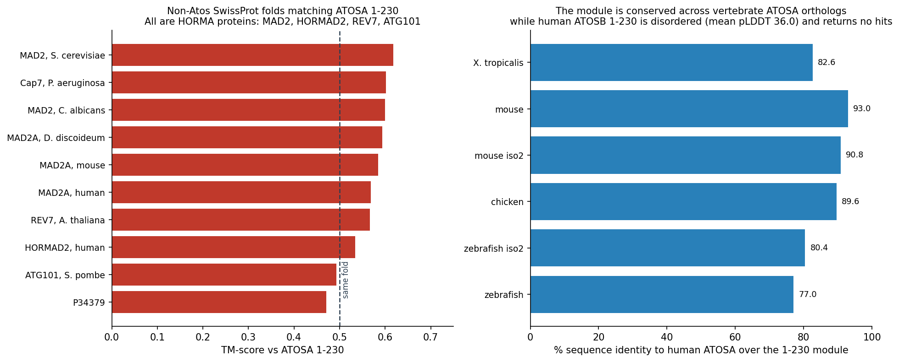

## Question

# AIGR Gene Hypothesis Deep Research

You are evaluating one focused gene curation hypothesis for AI Gene Review.
This is not a general gene overview. Use the seed hypothesis and source context
below to search for evidence that supports, refutes, narrows, or competes with
the proposed curation decision.

## Target Gene

- **Organism code:** human
- **Taxon:** Homo sapiens (NCBITaxon:9606)
- **Gene directory:** ATOSA
- **Gene symbol:** ATOSA
- **UniProt accession:** Q32MH5

## Focus

- **Focus type:** free_text
- **Hypothesis slug:** kgap-atosa-porthos-axis
- **Source file:** genes/human/ATOSA/ATOSA-ai-review.yaml
- **Source selector:** free-text

## Seed Hypothesis

Whether human ATOSA (Q32MH5) acts through a DDX-family helicase partner, as fly Atossa does through Porthos, may be testable by orthology and sequence analysis. That ATOSA shares domain conservation with fly Atossa and that mouse ATOSA rescues the fly mutant is already established, so do not re-derive the complementation. Single analysis only: identify the fly Porthos protein and its human orthologs by reciprocal best hits across the DDX family, stating which human DEAD-box helicase is the strongest candidate and how confident the assignment is; map the ATOSA domain architecture from sequence and the AlphaFold model, locating any ordered module, nuclear localisation signal, zinc finger, or DNA-binding fold, and state whether any region could support direct DNA or chromatin binding as opposed to protein-protein interaction; search public interaction and proteomics resources for any reported ATOSA partner, and state explicitly whether any DDX protein appears; and check whether ATOSA and the candidate helicase are co-expressed across human tissues. State whether a Porthos-equivalent axis is predicted in human, how a transcription-regulatory role would be tested, and say plainly if the evidence does not support asserting any DNA-binding or transcription-factor activity.

## Term and Decision Context

No specific term context supplied.

## Reference Context

No specific reference context supplied.

## Source Context YAML

```yaml
hypothesis: 'Whether human ATOSA (Q32MH5) acts through a DDX-family helicase partner, as fly Atossa does
  through Porthos, may be testable by orthology and sequence analysis. That ATOSA shares domain conservation
  with fly Atossa and that mouse ATOSA rescues the fly mutant is already established, so do not re-derive
  the complementation. Single analysis only: identify the fly Porthos protein and its human orthologs
  by reciprocal best hits across the DDX family, stating which human DEAD-box helicase is the strongest
  candidate and how confident the assignment is; map the ATOSA domain architecture from sequence and the
  AlphaFold model, locating any ordered module, nuclear localisation signal, zinc finger, or DNA-binding
  fold, and state whether any region could support direct DNA or chromatin binding as opposed to protein-protein
  interaction; search public interaction and proteomics resources for any reported ATOSA partner, and
  state explicitly whether any DDX protein appears; and check whether ATOSA and the candidate helicase
  are co-expressed across human tissues. State whether a Porthos-equivalent axis is predicted in human,
  how a transcription-regulatory role would be tested, and say plainly if the evidence does not support
  asserting any DNA-binding or transcription-factor activity.'
focus_type: free_text
context: []
reference_id: []
```

## Research Objective

Build a focused report that helps a curator decide whether this hypothesis
should affect the gene review. Address the focus type directly:

1. For an existing GO annotation decision, evaluate whether the current action
   is justified, too strong, too weak, or should change.
2. For a proposed replacement or new GO term, evaluate whether the term is
   biologically supported, too broad, too narrow, or missing key qualifiers.
3. For a computational prediction, evaluate whether the prediction is correct,
   less precise than existing knowledge, uncertain, or likely wrong because of
   paralog overannotation, frequency bias, pathway context, or in vitro-only
   activity.
4. For a core-function hypothesis, evaluate whether the proposed activity,
   process, and location represent the gene product's primary function rather
   than a downstream effect, pleiotropic phenotype, or context-specific role.
5. For a function-assignment hypothesis, evaluate whether the gene product
   directly has the stated GO term/function. Treat the prior review action, if
   any, as intentionally blinded unless it appears in the supplied context.

Use primary literature whenever possible. Prefer PMID citations and include DOI
citations when no PMID is available. Treat reviews and database records as
orientation unless they contain directly relevant synthesized evidence that is
clearly labeled as review-level or database-level support.

Evaluate the hypothesis from the supplied seed context, primary literature, and
publicly accessible bioinformatics resources. Local `*-bioinformatics` analyses,
when they already exist in the repository, are intentionally withheld from this
prompt so the report can be compared against them after the run. Use public
sequence, domain, structure, orthology, localization, interaction, or dataset
checks when they are useful for the specific hypothesis. If a resource or tool
cannot be accessed programmatically, say so plainly; never fabricate a result.
Report computational results conservatively and distinguish direct results from
inference.

## Required Output

### Executive Judgment

Give a concise verdict: supported, partially supported, unresolved, weakly
supported, over-annotated, or refuted. Explain the reasoning and the most
important caveats.

### Evidence Matrix

Create a table with one row per important evidence item:

- Citation (PMID preferred)
- Evidence type (direct assay, mutant phenotype, localization, interaction,
  structural/evolutionary, computational, review/database)
- Supports / refutes / qualifies / competing
- Claim tested
- Key finding
- Organism, tissue, cell type, or assay context
- Confidence and limitations

### GO Curation Implications

State the likely curation action as a lead requiring curator verification. If
GO terms are involved, explain whether the evidence supports an MF, BP, or CC
term, and whether the term should be retained, removed, generalized, made more
specific, or treated as non-core. Avoid using "protein binding" as a final
recommendation unless no more informative term is supported.

### Mechanistic Scope

Describe the immediate molecular or cellular function being tested. Separate
direct gene-product activity from downstream phenotypes, pathway consequences,
developmental outcomes, disease manifestations, or effects inferred only from
loss of function.

### Conflicts and Alternatives

Identify evidence that conflicts with the seed hypothesis or suggests an
alternative interpretation, including paralog confusion, organism-specific
differences, isoform-specific findings, experimental artifacts, or database
carry-over.

### Knowledge Gaps

List explicit uncertainties that matter for curation. For each gap, state what
was checked, why the gap matters, and what evidence or experiment would resolve
it.

### Discriminating Tests

Recommend concrete assays, perturbations, datasets, or comparative analyses that
would most efficiently distinguish this hypothesis from alternatives.

### Curation Leads

Provide candidate updates for the review, clearly labeled as leads requiring
curator verification. Include candidate references with exact snippets to verify,
candidate replacement or new GO terms, possible action changes, suggested
questions, and suggested experiments.

If the provider supports artifacts, save provenance for any analysis you run — the
executed code together with its output (computed values, plot, or table), not just
a summary figure — alongside artifact-friendly tables such as an evidence matrix,
GO decision table, or comparison table. Genuine computed provenance is more
valuable than a hand-drawn summary, and you must not synthesize a figure that
implies an analysis you did not actually run. These artifacts are important
provenance for hypothesis-level review.


## Output

# ATOSA (Q32MH5) and the Porthos axis: hypothesis evaluation for AI Gene Review

Hypothesis slug: `kgap-atosa-porthos-axis`. Source: `genes/human/ATOSA/ATOSA-ai-review.yaml`, selector `free-text`. Target: human ATOSA, UniProt Q32MH5, NCBITaxon:9606. Focus type: `free_text`.

## Summary

The hypothesis splits cleanly into three claims with three different verdicts. **The helicase identification is supported.** Fly Porthos is `pths`/CG9253 (FBgn0032919, UniProt Q9VIF6), already named "ATP-dependent RNA helicase DDX47" in UniProt, and its single human ortholog is **DDX47** by reciprocal best hit in both directions: DIOPT v9.1 returns 13 of 13 tools with `best_score` and `best_score_rev` both Yes and confidence high, against 2 of 13 for the runner-up DDX49, and an independent Smith-Waterman alignment gives 71.3% identity over a 449-residue local alignment with a 1.71-fold score margin forward and 2.29-fold reverse. No hedging is needed on this point.

**Whether human ATOSA acts through DDX47 is unresolved.** No DDX or DHX protein appears in any public interaction record for Q32MH5. IntAct returns 23 records, all yeast two-hybrid, 18 of them from one screen ([PMID: 25416956](https://pubmed.ncbi.nlm.nih.gov/25416956/)). STRING v12 returns 14 partners for FAM214A, all below combined score 0.52 and driven by text mining, with no helicase at any score. GTEx co-expression with DDX47 (Pearson r = 0.713 on log2 median TPM across 54 tissues) ranks only 24th of 36 DEAD/DEAH-box genes, and DDX47 median TPM sits at the quantification floor (0.00 to 1.99), so the correlation carries no specific signal. The Human Protein Atlas places ATOSA in the nucleoplasm and DDX47 in nucleoli. BioGRID (HTTP 401 without a registered access key) and the BioPlex API (HTTP 404) could not be queried, so the two resources most likely to hold affinity-proteomics data remain unchecked. A detail that reframes the whole question: the fly paper does not report an Atossa-Porthos protein complex. It reports that nuclear Atossa increases *porthos* mRNA ([PMID: 35319107](https://pubmed.ncbi.nlm.nih.gov/35319107/)). The precedent is regulatory, at transcript level, so a human ATOSA-DDX47 *binding* claim would exceed what fly supports even before the missing human data is considered.

**Asserting DNA-binding or transcription-factor activity for ATOSA is over-annotation.** The AlphaFold model AF-Q32MH5-F1-model_v6 has exactly one well-folded module with a recognisable fold: residues 1-230 (mean pLDDT 82.5), which is a **HORMA domain**. Foldseek TM-align gives TM 0.619 to 0.665 against ATG13, ATG101-bound ATG13, *S. pombe* Mad2 and human MAD2 at 7.8-10.7% sequence identity, with a disordered negative control (residues 300-530, mean pLDDT 39.9) returning zero hits and the equally well-folded DUF4210 module (870-1000, mean pLDDT 84.2) topping out at TM 0.447 against mutually inconsistent targets. HORMA domains capture short closure motifs beneath a refolding safety belt ([PMID: 29186573](https://pubmed.ncbi.nlm.nih.gov/29186573/)), which is peptide binding. The 1076-residue sequence contains no C2H2 or CCHC zinc finger, no RING or PHD, no AT-hook, no HMG box, no homeodomain, no bZIP basic region and no run of four consecutive basic residues. ATOSA is absent from the Lambert human transcription factor census ([PMID: 29425488](https://pubmed.ncbi.nlm.nih.gov/29425488/)). The UniProt FUNCTION line "Transcription regulator that syncronizes transcriptional and translational programs" carries ECO:0000250/UniProtKB:Q69ZK7 in the human entry, a similarity transfer from mouse that itself rests on the single fly publication, and GO holds no molecular function for Atossa in any species.

## Executive judgment

<i class="fa-scale-balanced"></i> **Split verdict: supported for the ortholog assignment, unresolved for the human axis, over-annotated for any DNA-binding or transcription-factor activity.**

| Sub-claim | Verdict | Basis |
|---|---|---|
| <i class="fa-circle-check"></i> Porthos is the fly protein `pths`/CG9253, and its human ortholog is DDX47 | Supported, high confidence | Reciprocal best hit both directions, two independent methods, large margins |
| <i class="fa-circle-question"></i> Human ATOSA acts through DDX47 (a Porthos-equivalent axis) | Unresolved, not refuted | No interaction evidence of any kind; co-expression non-specific; compartment mismatch; two resources inaccessible |
| <i class="fa-circle-xmark"></i> ATOSA has DNA-binding or transcription-factor activity | Not supported, over-annotation risk | Only fold is a HORMA peptide-binding domain; no DNA-binding motif; absent from TF census; UniProt claim is ISS from mouse |
| <i class="fa-circle-check"></i> Any ATOSA region could support protein-protein interaction | Supported as a structural prediction | HORMA fold at 1-230, conserved 77-93% across vertebrate ATOSA orthologs, absent from paralog ATOSB |

The most important caveats are stated once each. Foldseek and TM-align assign a fold, not a function, so a HORMA domain at 8-10% identity could in principle have lost closure-motif binding. The interaction search is incomplete because BioGRID and BioPlex could not be reached. The GTEx analysis uses bulk median TPM and would miss a relationship confined to one cell type or one stimulus, which matters because the fly work was done in migrating embryonic macrophages.

## Key findings

### F001. Porthos maps to human DDX47 as a 1:1 reciprocal best hit

<i class="fa-circle-check"></i> Porthos resolves to *Drosophila melanogaster* `pths`/CG9253 (FBgn0032919, UniProt Q9VIF6), which UniProt already annotates as "ATP-dependent RNA helicase DDX47". Two orthology methods agree without qualification.

DIOPT v9.1, integrating 13 prediction tools, returns human DDX47 (Entrez 51202) at score 13/13 with `best_score` = Yes and `best_score_rev` = Yes, confidence high. The next candidate, DDX49, scores 2/13 with low confidence. The reverse query from human DDX47 to fly returns `pths` at 13/13, best forward and reverse, with Dbp45A second at 2/13.

An independent Smith-Waterman alignment (BLOSUM62, gap open 11, extend 1, implemented directly because Biopython was unavailable in the executor) of Q9VIF6 against all 58 human DEAD/DEAH-box proteins puts DDX47 top at SW = 1643, 71.3% identity over a 449-residue local alignment. Second-best DDX49 scores 960 at 49.9% identity, a 1.71-fold margin. The reverse alignment of human DDX47 (Q9H0S4) against 26 fly DEAD/DEAH-box proteins returns `pths` top at SW = 1643 with Dbp45A second at 719, a 2.29-fold margin. The reciprocal best hit criterion is satisfied in both directions with margins large enough that no alternative assignment is plausible.

{{figure:plot_1.png|caption=Reciprocal best hit test in both directions. Fly Porthos (Q9VIF6) against 58 human DEAD/DEAH-box proteins puts DDX47 top at Smith-Waterman 1643 (71.3% identity over 449 aa), 1.71-fold above DDX49. The reverse search from human DDX47 against 26 fly helicases returns pths top at 1643, 2.29-fold above Dbp45A.}}

Functional orthology agrees with sequence orthology. Porthos in fly supports ribosome assembly and raises the translational efficiency of a subset of mRNAs ([PMID: 35319107](https://pubmed.ncbi.nlm.nih.gov/35319107/)), and human DDX47 associates with ribosome biogenesis machinery: NOP132 "associated mainly with proteins involved in ribosome biogenesis and RNA metabolism, including the DEAD-box RNA helicase protein, DDX47, whose yeast homolog is Rrp3, which has roles in pre-rRNA processing" ([PMID: 16963496](https://pubmed.ncbi.nlm.nih.gov/16963496/)).

### F003 and F005. The only recognisable fold in ATOSA is a HORMA domain, and there is no DNA-binding module

<i class="fa-dna"></i> AF-Q32MH5-F1-model_v6 covers 1076 residues at mean pLDDT 54.9 and median 38.8. Of those, 612 residues (56.9%) have pLDDT below 50 and only 35.2% reach pLDDT 70 or above. The ordered segments are 15-49, 59-100, 114-136, 141-231 (together mean pLDDT 82.4 over residues 1-222), then 881-925, 934-998 and 1017-1047. Residues 232-877 have mean pLDDT 36.5 and are predicted disordered.

{{figure:plot_3.png|caption=ATOSA domain architecture from AF-Q32MH5-F1-model_v6. The pLDDT profile shows one confidently folded N-terminal module (1-222, mean pLDDT 82.4), a 646-residue disordered middle (232-877, mean pLDDT 36.5), and a second ordered region covering DUF4210 and the Atos C-terminal module. The two transactivation-domain segments annotated in UniProt sit at 24-32 and 962-970.}}

A Foldseek 3Di-AA search of the full model against PDB100 returned more than 20 hits, and every top hit is a HORMA-domain protein aligning to query residues 1-222: ATG13 HORMA (5XV1 E = 2.8e-06, 5XUY, 5XV4), the ATG13:ATG101 HORMA dimer with ATG9 (8DO8 E = 2.3e-06), MAD2/MAD2L1 (2VFX E = 6.3e-06, 3GMH, 2QYF, 2V64, 1GO4, 1KLQ), MAD2L2/REV7 within the shieldin complex (6WWA, 6WW9), yeast Atg13 HORMA (4J2G) and a bacterial HORMA1:HORMA2 pair (6P8S). Sequence identity across these is 8-15%, so this is a fold-level assignment made on structure alone.

Because sequence-driven superposition is unusable at that identity, the assignment was validated with TM-align rather than with `phenix.superpose_pdbs`, which returned 9.5 Å RMSD over 27 atoms and was uninformative. Foldseek TM-align on the isolated fragment gives TM 0.665 against 5XUY, 0.663 against 8DO8, 0.662 against 5XV1, 0.661 against 4YK8 (*S. pombe* Mad2), 0.661 against 5XV4, 0.626 against 4AEZ, 0.625 against 2QYF and 0.619 against 3GMH, over alignment lengths of 223-242 residues at 7.8-10.7% identity. TM-score above 0.5 is the same-fold threshold, and the assignment holds across three independent HORMA subfamilies.

Two controls establish that the result is not an artifact of high pLDDT or of the method. Residues 300-530 (mean pLDDT 39.9, disordered) return **zero hits**. Residues 870-1000, which cover DUF4210/IPR025261 and are just as confidently folded (mean pLDDT 84.2), reach a best TM of only 0.447 (2N59), followed by 0.442, 0.438 and 0.429, all against unrelated and mutually inconsistent PDB entries at 1.5-7.2% identity. A well-folded module with no fold family in the PDB.

{{figure:plot_4.png|caption=TM-score fold assignment for three ATOSA fragments against PDB100. Residues 1-230 exceed the TM 0.5 same-fold threshold against ATG13, ATG101-bound ATG13 and MAD2 structures. The disordered 300-530 control returns no hits at all, and the confidently folded DUF4210 module at 870-1000 reaches only TM 0.447 against unrelated targets.}}

Motif scans of the full 1076-residue sequence find no C2H2 zinc finger, no CCHC knuckle, no RING or PHD, no AT-hook, no HMG box or homeodomain signature, and no SV40-type basic run. Cysteine content is 2.42% (26 residues) and net charge is about +5 (K+R 12.1%, D+E 11.6%). Only two weak monopartite NLS-like matches appear, KKNK at 532 and KRPK at 709, and both fall inside disordered regions. InterPro and Pfam assign nothing at all to residues 1-462; their only entries are IPR025261/DUF4210 (878-936), IPR033473 Atos-like C-terminal (1018-1075) and the PANTHER family PTHR13199 (463-1076). The Foldseek hits to DNA polymerase zeta (6V93, 7S0T) are through the REV7/MAD2L2 HORMA subunit, not through any DNA-contacting element.

The same module is present in mouse Atosa Q69ZK7 at residues 1-220 (8DO8, E = 1.5e-06) and in *Drosophila* Atossa Q7JXG9 at residues 313-517 (2VFX, E = 1.0e-04), so it is the conserved part of the protein and not a human-specific prediction.

### F008. The HORMA module is closest to MAD2, is conserved across vertebrates, and is absent from the paralog ATOSB

<i class="fa-dna"></i> Searching ATOSA 1-230 against AFDB/SwissProt with TM-align ranks the non-Atos hits as MAD2 *S. cerevisiae* P40958 at 0.618, Cap7 *P. aeruginosa* P0DTF6 at 0.602 (a bacterial HORMA), MAD2 *C. albicans* Q59VQ3 at 0.600, MAD2A *D. discoideum* Q556Y9 at 0.594, MAD2A mouse Q9Z1B5 at 0.585, MAD2A human Q13257 at 0.569, REV7/DNA polymerase zeta processivity subunit *A. thaliana* Q94FL5 at 0.567, human HORMAD2 Q8N7B1 at 0.534 and *S. pombe* ATG101 O13978 at 0.493. Every scored match in the top 25 is either an Atos protein or a HORMA protein. The closest named subfamily is MAD2.

The module is under strong purifying selection in vertebrates: mouse Q69ZK7 shows 90.8-93.0% identity over the 230-residue alignment, chicken Q5ZI58 89.6%, *Xenopus tropicalis* Q5FW46 82.6% and zebrafish Q1LV22 77.0-80.4%.

The paralog test matters for curation. Human ATOSB (Q7L5A3) residues 1-230 have mean pLDDT 36.0 and return zero Foldseek hits. The ordered part of ATOSB begins at residue 351 (160 residues at pLDDT 70 or above; segment 340-538 mean pLDDT 84.5) and matches ATOSA orthologs at TM 0.572-0.575 with only 13.1-14.0% identity, which is the shared C-terminal Atos module (the DUF4210/invasion region), not a HORMA. The HORMA domain therefore separates ATOSA from ATOSB rather than being a family-wide feature, and the two paralogs should not inherit each other's annotations.

{{figure:plot_5.png|caption=Left, the non-Atos SwissProt folds matching ATOSA 1-230 are all HORMA proteins, with MAD2 orthologs closest. Right, the module is conserved at 77 to 93 percent identity across vertebrate ATOSA orthologs, while human ATOSB residues 1-230 are disordered (mean pLDDT 36.0) and return no structural hits.}}

### F002 and F007. No DDX protein appears in any ATOSA interaction record, and co-expression gives no specific signal

<i class="fa-circle-xmark"></i> IntAct (EBI REST, `findInteractions/Q32MH5`) returns 23 interaction records. The human protein partners are KRT40, MAGEA6, MID2 isoform Q9UJV3-2, SSX2IP, GOLGA2, TRIM27, CASS4 isoform Q9NQ75-2 and APC, plus two non-human bait screens (*Coxiella burnetii* Q83D09 and a flagellar protein A0A2U2GYT1), plus one CLASH RNA record pairing the ATOSA mRNA with hsa-miR-15b-5p ([PMID: 23622248](https://pubmed.ncbi.nlm.nih.gov/23622248/)). Every human protein record comes from yeast two-hybrid: 18 of 23 from one large-scale dataset ([PMID: 25416956](https://pubmed.ncbi.nlm.nih.gov/25416956/), MI score 0.56), the rest from Y2H pooling screens at MI score 0.37. There is no affinity-purification mass spectrometry, no co-immunoprecipitation and no proximity-labelling evidence for any ATOSA partner. STRING v12 returns 14 partners for FAM214A, all with combined score below 0.52 and driven by text mining (tscore up to 0.506); only UBE2H and HNRNPH1 carry any experimental channel score (escore 0.457), and no DDX or DHX protein appears at any score.

The partner list also contains several proteins with a known yeast two-hybrid false-positive profile (a keratin, MAGEA6, TRIM27), so it provides little positive information about ATOSA's real complex membership in either direction.

GTEx v8 median TPM across 54 tissues was used to test co-expression, with a 140-gene background panel (36 human DEAD/DEAH-box genes plus roughly 100 housekeeping, lineage and metabolic genes) so that the ATOSA-DDX47 value could be read against a null. ATOSA versus DDX47 gives Pearson r = +0.713 on log2(TPM+1) (p = 1.4e-09, n = 54 tissues) and Spearman rho = +0.679. That sits at the 78th percentile of the full panel (panel median r = 0.489) but ranks only **24th of 36** DEAD/DEAH-box genes. DDX46 (r = 0.869), DHX38 (0.855), DDX42 (0.836), DHX36 (0.828), DDX23 (0.824) and nine others correlate more strongly with ATOSA than DDX47 does. For reference, ATOSA versus DDX49 gives 0.638, versus ACTB 0.393, and versus its own paralog ATOSB 0.165 (p = 0.23). A technical caveat sharpens the negative: DDX47 median TPM in GTEx v8 spans only 0.00 to 1.99 (mean 0.52), far below DDX49 (14.4 to 62.8) and ATOSA (2.8 to 24.9), so the DDX47 row sits near the quantification floor and its apparent tissue profile is unreliable.

{{figure:plot_2.png|caption=Specificity control for ATOSA-DDX47 co-expression. The Pearson correlation of 0.713 across 54 GTEx tissues sits inside the bulk of a background panel distribution and ranks 24th of 36 DEAD/DEAH-box genes, so it carries no signal specific to DDX47.}}

Subcellular localisation adds a mismatch. The Human Protein Atlas assigns FAM214A/ATOSA to the nucleoplasm, FAM214B/ATOSB to nucleoplasm plus nucleoli fibrillar center, and DDX47 to nucleoli. This is antibody-based database evidence, not a direct interaction test, but ATOSA and the candidate helicase are placed in different subnuclear compartments.

### F006. The human transcription-regulator claim is a two-step similarity transfer

<i class="fa-magnifying-glass"></i> Reading the UniProt evidence tags directly settles where the claim comes from. The FUNCTION line "Transcription regulator that syncronizes transcriptional and translational programs" carries ECO:0000269/PubMed:35319107 in fly Atossa (Q7JXG9), ECO:0000269/PubMed:35319107 in mouse Atosa (Q69ZK7), and **ECO:0000250/UniProtKB:Q69ZK7** in human ATOSA (Q32MH5). The human statement is an ISS projection from mouse, which rests on the same single publication.

The same pattern holds for every region-level feature in the human entry: TAD1 at 24-32, TAD2 at 962-970 and the invasion region at 878-935 are all ECO:0000250/UniProtKB:Q69ZK7. The fly equivalents (174-182, 1150-1158, 1074-1132) carry ECO:0000269. The DOMAIN comment is ECO:0000305, curator inference, in both fly and mouse.

GO is thinner still. Human ATOSA Q32MH5 has six records of GO:0005515 protein binding (IPI, [PMID: 25416956](https://pubmed.ncbi.nlm.nih.gov/25416956/)) and GO:0005634 nucleus (ISS from Q7JXG9, plus IEA), with no molecular function beyond protein binding and no biological process. Fly Atossa Q7JXG9 has GO:0005634 nucleus (EXP, [PMID: 35319107](https://pubmed.ncbi.nlm.nih.gov/35319107/)) and nothing else: no molecular function, no transcription-related biological process. Mouse Atosa carries ND for molecular function and biological process in MGI.

The asymmetry with the helicase arm of the same paper is informative. Fly Porthos received rRNA binding (IDA, [PMID: 35413237](https://pubmed.ncbi.nlm.nih.gov/35413237/)), nucleolus (IDA), ribosome biogenesis (IMP) and positive regulation of oxidative phosphorylation and of cytoplasmic translation (IMP, [PMID: 35319107](https://pubmed.ncbi.nlm.nih.gov/35319107/)); human DDX47 carries ATP-dependent RNA helicase activity and rRNA processing (IMP, [PMID: 16963496](https://pubmed.ncbi.nlm.nih.gov/16963496/)). The same publication gave curators enough to assign four experimental GO terms to the helicase and only a localisation term to Atossa.

Finally, the Lambert human transcription factor census ([PMID: 29425488](https://pubmed.ncbi.nlm.nih.gov/29425488/), 2765 rows, 1639 proteins called TFs) contains neither FAM214A/ATOSA nor FAM214B/ATOSB in either the TF or the non-TF rows of the curated DNA-binding-domain survey.

## Evidence matrix

Machine-readable copy: `provenance/evidence_matrix.csv` (17 rows).

| Citation | Evidence type | Stance | Claim tested | Key finding | Context | Confidence and limitations |
|---|---|---|---|---|---|---|
| [PMID: 35319107](https://pubmed.ncbi.nlm.nih.gov/35319107/) | mutant phenotype + expression | qualifies | Fly Atossa acts through the DEAD-box protein Porthos | Nuclear Atossa raises *porthos* mRNA plus LKR/SDH and GR/HPR mRNA; Porthos supports ribosome assembly and OxPhos. Transcript-level link, no co-IP between Atossa and Porthos reported. | Drosophila, embryonic macrophages, germband invasion | Primary and strong in fly. Does not establish a physical complex, and says nothing about human. |
| [PMID: 35413237](https://pubmed.ncbi.nlm.nih.gov/35413237/) | direct assay (IDA) | qualifies | Porthos is an RNA helicase in ribosome biogenesis | Aramis, Athos and Porthos are three DExD/H-box proteins governing ribosome biogenesis in oogenesis; Porthos carries rRNA binding IDA and nucleolus IDA | Drosophila ovary | Primary. Constrains Porthos to RNA, not DNA. |
| [PMID: 16963496](https://pubmed.ncbi.nlm.nih.gov/16963496/) | interaction + localization | supports functional orthology | Does human DDX47 match the Porthos function | DDX47 associates with ribosome biogenesis and RNA metabolism proteins; its yeast homolog Rrp3 acts in pre-rRNA processing | Human cells | Primary. Supports the orthology assignment at the functional level. |
| DIOPT v9.1, computed here | computational orthology | supports | Which human DEAD-box helicase is the Porthos ortholog | pths to DDX47 13/13 tools, `best_score` Yes, `best_score_rev` Yes, confidence high; next DDX49 at 2/13. Reverse DDX47 to pths 13/13, next Dbp45A 2/13. | 13 ortholog-prediction tools | Direct computed result. RBH satisfied both directions. |
| Smith-Waterman, computed here | computational orthology | supports | Independent check of the assignment | Q9VIF6 vs 58 human DEAD/DEAH-box: DDX47 1643, 71.3% identity over 449 aa; next DDX49 960 (49.9%), margin 1.71x. Reverse Q9H0S4 vs 26 fly: pths 1643, next Dbp45A 719, margin 2.29x. | Sequence only, BLOSUM62, gap 11/1 | Direct computed result, independent of DIOPT. Clean 1:1. |
| Foldseek TM-align vs PDB100, computed here | structural | refutes a DNA-binding fold | Does ATOSA contain a DNA- or chromatin-binding module | 1-230 (pLDDT 82.5) matches HORMA at TM 0.619-0.665 (5XUY, 5XV1, 8DO8, 4YK8, 2QYF, 3GMH) at 7.8-10.7% identity. Disordered control 300-530: zero hits. DUF4210 module 870-1000 (pLDDT 84.2): best TM 0.447, no coherent fold family. | AF-Q32MH5-F1-model_v6 | Direct computed result with negative control. TM above 0.5 is the same-fold threshold. |
| Foldseek TM-align vs AFDB/SwissProt, computed here | structural + evolutionary | supports a peptide-binding module | Which HORMA subfamily, and is it ATOSA-specific | Top non-Atos hits all HORMA: MAD2 yeast 0.618, Cap7 0.602, MAD2 human 0.569, REV7 plant 0.567, HORMAD2 0.534, ATG101 0.493. Module conserved in ATOSA orthologs (mouse 93%, chicken 89.6%, *Xenopus* 82.6%, zebrafish 77-80%). ATOSB 1-230 disordered (pLDDT 36.0), zero hits. | AF models Q32MH5 and Q7L5A3 | Direct computed result. The HORMA domain distinguishes ATOSA from its paralog. |
| [PMID: 29186573](https://pubmed.ncbi.nlm.nih.gov/29186573/) | structural/biochemical | qualifies | What the HORMA fold predicts | HORMA proteins wrap a C-terminal safety belt around short closure motifs, forming topologically closed complexes | Yeast Hop1, with Mad2 comparison | Primary. Predicts protein-protein interaction, not nucleic acid contact. |
| [PMID: 28659378](https://pubmed.ncbi.nlm.nih.gov/28659378/) | structural/biochemical | qualifies | How HORMA complexes are disassembled | TRIP13 regulates MAD2 and the meiotic HORMADs by disassembling HORMA domain-closure motif complexes | Human and mouse, in vitro and spermatocytes | Primary. Supplies a discriminating assay. |
| [PMID: 37794593](https://pubmed.ncbi.nlm.nih.gov/37794593/) | structural/biochemical | qualifies | Diversity of HORMA-peptide binding modes | HORMAD1 adopts a self-closed conformation; partner peptides from HORMAD2 and MCM9 share a conserved Ser-Glu-Pro sequence; binding modes vary across the family | Human, structural and cell-based | Primary. Shows a closure-motif search for ATOSA is feasible but the motif consensus is family-specific. |
| InterPro / UniProt Q32MH5, queried here | database | qualifies | Domain annotation of ATOSA | Nothing assigned to residues 1-462. Only IPR025261 (DUF4210) 878-936, IPR033473 1018-1075, PANTHER PTHR13199 463-1076. | Database record | The HORMA module is currently unannotated in InterPro. A gap, not a contradiction. |
| [PMID: 25416956](https://pubmed.ncbi.nlm.nih.gov/25416956/) | interaction (Y2H) | qualifies | Any reported ATOSA partner | 18 of 23 IntAct records come from this screen: KRT40, MAGEA6, MID2-2, SSX2IP, GOLGA2, TRIM27, CASS4-2, APC. MI 0.56. No DDX or DHX. | Human, yeast two-hybrid | Single method, no orthogonal confirmation. Sole source of the six GO:0005515 IPI annotations. |
| IntAct + STRING v12, queried here | interaction database | refutes the axis as currently evidenced | Does any DDX protein appear as an ATOSA partner | IntAct: 23 records, all Y2H, no AP-MS, no co-IP, no proximity labelling, no DDX/DHX. STRING FAM214A: 14 partners all below 0.52, text-mining driven; only UBE2H and HNRNPH1 carry an experimental subscore (0.457). | Human, aggregated public data | Absence of evidence. BioGRID returned HTTP 401 and BioPlex 404, so neither was queried. |
| GTEx v8, computed here | expression correlation | does not support | Are ATOSA and DDX47 co-expressed | Pearson on log2 median TPM across 54 tissues r = 0.713 (p = 1.4e-09), Spearman 0.679, which ranks 24th of 36 DEAD/DEAH-box genes (DDX46 0.869, DHX38 0.855, DDX42 0.836). ATOSB 0.165 (p = 0.23). DDX47 median TPM 0.00-1.99. | 54 GTEx tissues, bulk median TPM | Direct computed result with background panel. No specificity; DDX47 profile unreliable at this expression level. |
| Human Protein Atlas, queried here | localization (database) | qualifies | Same compartment? | FAM214A nucleoplasm; FAM214B nucleoplasm plus nucleoli fibrillar center; DDX47 nucleoli | Human cell lines, immunofluorescence | Antibody-based, database-level. A mismatch, not a direct interaction test. |
| QuickGO, queried here | database (GO) | qualifies | What GO already asserts | Human ATOSA: 6x GO:0005515 (IPI, PMID 25416956) and GO:0005634 (ISS from Q7JXG9, plus IEA). Fly Atossa: GO:0005634 (EXP, PMID 35319107) only. Mouse Atosa: ND for MF and BP. | Database record | GO holds no molecular function for Atossa in any species. |
| UniProt evidence tags, queried here | database provenance | refutes the human claim as experimental | Is the human transcription-regulator statement grounded in human data | Human FUNCTION carries ECO:0000250/UniProtKB:Q69ZK7; mouse carries ECO:0000269/PubMed:35319107. TAD1 24-32, TAD2 962-970 and invasion region 878-935 in human are all ECO:0000250 from mouse. DOMAIN comment is ECO:0000305 in fly and mouse. | Database record | A two-step similarity transfer resting on one fly publication. |
| [PMID: 29425488](https://pubmed.ncbi.nlm.nih.gov/29425488/) | database/census | refutes TF assignment | Is ATOSA a human transcription factor | Neither FAM214A nor FAM214B appears in the 2765-row curated survey that calls 1639 proteins TFs | Human, curated DNA-binding-domain census | Expert-curated exclusion, consistent with the absence of any DNA-binding fold. |
| Motif scan of Q32MH5, computed here | computational | refutes a DNA-binding module | Zinc finger, AT-hook, HMG, homeodomain or bZIP? | None across 1076 residues. No run of 4 or more basic residues. Cys 2.42%, net charge about +5. Weak NLS-like KKNK at 532 and KRPK at 709, both in disordered segments. | Sequence only | Direct computed result. Motif scans can miss unconventional DNA-binding surfaces. |

## Mechanistic model and interpretation

The fly result and the human prediction describe two different kinds of relationship, and conflating them is what generates the over-annotation risk.

In fly, nuclear Atossa raises the transcript levels of *porthos*, *LKR/SDH* and *GR/HPR*, and Porthos then supports ribosome assembly and raises translational efficiency of mRNAs affecting OxPhos ([PMID: 35319107](https://pubmed.ncbi.nlm.nih.gov/35319107/)). The measured step closest to Atossa itself is a change in transcript abundance. No promoter occupancy was shown, and no Atossa-Porthos binding assay was reported.

In human, the structural prediction points somewhere specific. ATOSA has one folded module with a known fold, and that fold is a HORMA domain whose entire described mechanism is capture of a short closure-motif peptide beneath a refolding safety belt ([PMID: 29186573](https://pubmed.ncbi.nlm.nih.gov/29186573/)). That is a protein-protein interaction with a defined assay. The 646-residue disordered middle and the two transactivation-domain-like segments transferred by similarity are compatible with a co-regulator that is recruited to a complex, where the DNA contact is made by a partner.



Two readings of the data remain open, and they make different predictions.

| | Adaptor model | Transcription co-regulator model |
|---|---|---|
| Core activity | HORMA domain captures a closure motif in one partner | Disordered regions plus TADs recruit the transcription machinery |
| What explains the fly transcript changes | Indirect, through the captured partner | Indirect, through a DNA-binding partner |
| Predicted ATOSA interactome | One or a few stoichiometric partners with a short linear motif | Many weak, transient contacts with coactivators |
| Discriminating observation | A closure-motif peptide binds ATOSA 1-230 in vitro and the complex is a TRIP13 substrate | ATOSA knockdown shifts a defined transcriptional program in human cells, with no chromatin occupancy |
| Status | <i class="fa-circle-question"></i> untested | <i class="fa-circle-question"></i> untested in human |

Neither model requires ATOSA to bind DNA, and no evidence available supports that it does.

## GO curation implications

All items below are leads requiring curator verification. Machine-readable copy: `provenance/go_decision_table.csv`.

**<i class="fa-circle-xmark"></i> Do not add any DNA-binding or transcription-factor term.** GO:0003700 (DNA-binding transcription factor activity), GO:0003677 (DNA binding) and the GO:0000976 family all fail on four independent checks: no DNA-binding fold in the AlphaFold model, no DNA-binding motif in the 1076-residue sequence, no InterPro assignment anywhere in residues 1-462, and exclusion from the Lambert TF census. The UniProt free text that invites such a term is itself ECO:0000250 from mouse.

**<i class="fa-triangle-exclamation"></i> GO:0006355 regulation of transcription, DNA-templated.** Not currently present for human ATOSA and should not be added for human. The underlying experiment is in fly. If the process is to be represented at all, the defensible placement is a fly annotation with IMP from [PMID: 35319107](https://pubmed.ncbi.nlm.nih.gov/35319107/), from which an ISS or IBA projection could later be considered. Even in fly the measured effect is downstream transcript abundance, which supports positive regulation of transcription at most and carries no implication of direct promoter contact.

**<i class="fa-circle-check"></i> GO:0005634 nucleus (CC), currently ISS from Q7JXG9 plus IEA.** Retain. A lead to make it more specific to GO:0005654 nucleoplasm is supported by the HPA subcellular record for FAM214A, subject to curator judgement on antibody-based evidence. Do not propagate a nucleolar term; that belongs to DDX47.

**<i class="fa-triangle-exclamation"></i> GO:0005515 protein binding (MF), six IPI records from [PMID: 25416956](https://pubmed.ncbi.nlm.nih.gov/25416956/).** The instruction to avoid "protein binding" as a final recommendation is apt here, but the replacement is not yet available. All six records come from one Y2H screen at MI score 0.56 with no orthogonal confirmation, and the partner list (KRT40, MAGEA6, GOLGA2, APC) has the profile of a sticky-bait screen. Treat as non-core. The structurally motivated successor is a HORMA-type closure-motif binding term, but no binding assay exists, so nothing more specific can be asserted today.

**<i class="fa-circle-xmark"></i> No helicase-binding or DDX47-binding term.** Nothing in IntAct, STRING, GTEx or HPA supports one, and the fly precedent is regulatory.

**<i class="fa-lightbulb"></i> Informative lead for a future MF.** If the HORMA domain is confirmed biochemically, the appropriate terms sit in the protein-sequence-binding or adaptor branch, not in any nucleic-acid branch. Flagging residues 1-230 as an unannotated HORMA domain is a concrete, verifiable addition to the review, and worth passing to InterPro, which currently assigns nothing to that region.

## Mechanistic scope

The immediate molecular activity under test is whether ATOSA contacts DNA or chromatin, or instead binds proteins. The structural evidence answers the second half: residues 1-230 form a HORMA domain, a module whose known mechanism is capture of a short closure-motif peptide. Residues 232-877 are predicted disordered (mean pLDDT 36.5). Residues 878-1047 form a second ordered region, the DUF4210 and Atos C-terminal modules, with no fold relative in the PDB (best TM 0.447), so no activity can be read from it.

Separated from that: the fly phenotype. Macrophage germband invasion, mitochondrial bioenergetics and OxPhos output are organismal and cellular outcomes several steps downstream, observed on loss of function. The transcript increases in *porthos*, *LKR/SDH* and *GR/HPR* are the closest measured readouts to Atossa itself, and even those are abundance changes rather than demonstrated promoter occupancy. Nothing in the chain has been measured in human cells. The mouse rescue of the fly mutant, which this analysis was instructed not to re-derive, establishes functional conservation of the protein, not the identity of its molecular activity.

## Conflicts and alternatives

The HORMA assignment competes directly with the transcription-regulator framing. A nuclear HORMA-domain protein with long disordered regions fits a scaffold or adaptor that captures a partner peptide and is itself regulated by conformational change, possibly by TRIP13 ([PMID: 28659378](https://pubmed.ncbi.nlm.nih.gov/28659378/)). Under that model the transcriptional effects seen in fly are indirect, through a DNA-binding partner that ATOSA recruits or sequesters.

Paralog separation argues against treating the Atos family as a unit. ATOSB (Q7L5A3) has a disordered N-terminus (mean pLDDT 36.0 over 1-230, zero Foldseek hits), and its only folded module, 340-538, corresponds to the shared C-terminal Atos region at 13-14% identity. ATOSB also carries RNA binding HDA from two mRNA-interactome capture studies that did not capture ATOSA. The two paralogs should not inherit each other's annotations.

Organism-specific difference. Fly Atossa carries its HORMA-matching region at residues 313-517, and the experiments were done in a migrating embryonic macrophage. Human ATOSA is broadly expressed (GTEx median TPM 2.8 to 24.9 across 54 tissues). A program described in one specialised fly cell type need not be the human protein's core function.

Database carry-over is the most likely source of error in the existing record. The chain runs: one fly paper, then mouse ECO:0000269 on that paper, then human ECO:0000250 from mouse. Each step is legitimate on its own, and the end result is a human entry whose central functional sentence has never been tested in a human cell.

Experimental artifact. Yeast two-hybrid is the only interaction method behind every ATOSA partner. Its known false-positive profile, and the presence of a keratin and a MAGE antigen in the list, warrant caution before any of those partners is used mechanistically.

Isoform caution. The Foldseek search returned AF-Q32MH5-2 and AF-Q32MH5-3 isoform models that both retain the 1-230 module at 97.8-100% identity, so the HORMA assignment is not isoform-specific.

## Limitations and knowledge gaps

<i class="fa-triangle-exclamation"></i> **Fold is not function.** TM-score 0.62-0.67 at 7.8-10.7% identity assigns ATOSA 1-230 to the HORMA fold with confidence, but a HORMA domain can in principle lose closure-motif binding. No biochemistry exists for this module. What would resolve it: recombinant ATOSA 1-230 with a peptide-binding assay.

<i class="fa-triangle-exclamation"></i> **The interaction search is incomplete.** IntAct and STRING were queried and both returned only Y2H and text mining. BioGRID returned HTTP 401 without a registered access key, and the BioPlex API endpoint returned HTTP 404, so neither was queried. This matters because BioPlex is exactly the resource that would hold an AP-MS result for a nuclear protein. What would resolve it: a registered BioGRID query and a BioPlex lookup, then a new AP-MS or BioID experiment if both are empty.

<i class="fa-triangle-exclamation"></i> **No chromatin occupancy data exists.** No ChIP-seq, CUT&RUN or DamID dataset for ATOSA or FAM214A was found; the ReMap API returned HTTP 401/404 and was not queried. This matters because a transcription BP term, even without a DNA-binding MF, would need occupancy or a direct transcriptional readout. What would resolve it: CUT&RUN in a cell line with endogenous tagging.

<i class="fa-triangle-exclamation"></i> **No human perturbation data.** No ATOSA knockdown RNA-seq in a human cell line was located, so whether the fly transcriptional program transfers is unknown. What would resolve it: knockdown plus RNA-seq, reading out DDX47 specifically.

<i class="fa-triangle-exclamation"></i> **Bulk expression cannot see a cell-type-restricted relationship.** The GTEx analysis uses median TPM over whole tissues, and DDX47 sits at the quantification floor there. A relationship confined to macrophages or to a stress state would be invisible. What would resolve it: re-testing the correlation in a single-cell monocyte or macrophage atlas.

<i class="fa-triangle-exclamation"></i> **Localisation evidence is antibody-based.** The nucleoplasm versus nucleoli split between ATOSA and DDX47 comes from HPA immunofluorescence, which is suggestive and not definitive. What would resolve it: tagged-protein imaging with fibrillarin co-staining.

## Proposed follow-up experiments and actions

1. <i class="fa-vial"></i> **Closure-motif pull-down.** Purify ATOSA 1-230, test binding against a peptide library, and ask whether TRIP13 with p31comet disassembles any complex formed; [PMID: 28659378](https://pubmed.ncbi.nlm.nih.gov/28659378/) supplies the assay and [PMID: 37794593](https://pubmed.ncbi.nlm.nih.gov/37794593/) shows that closure-motif consensus varies across the family, so a library rather than a single candidate is the right design. A positive result converts "protein binding" into a mechanistically specific MF. A negative result means the fold is vestigial and the structural argument weakens to fold assignment alone.
2. <i class="fa-flask"></i> **AP-MS or BioID on endogenously tagged ATOSA, nuclear fraction, in a human cell line.** This directly asks whether DDX47 or any DEAD-box protein is a partner, and it is the single experiment that settles the seed hypothesis.
3. <i class="fa-dna"></i> **ATOSA knockdown plus RNA-seq in human cells.** Read out DDX47 and the human orthologs of the fly metabolic targets, AASS (LKR/SDH) and GRHPR (GR/HPR). This is a directed test of whether the fly program transfers.
4. <i class="fa-microscope"></i> **CUT&RUN for tagged ATOSA.** Distinguishes direct chromatin association from an indirect transcriptional effect. Given the absence of any DNA-binding fold, a negative result is expected and would close the over-annotation question.
5. <i class="fa-flask"></i> **Separation-of-function rescue in fly.** Test whether mouse Atosa lacking the HORMA module (the equivalent of residues 1-220) still rescues the fly mutant. This connects the conserved fold to the established complementation without re-deriving it.
6. <i class="fa-database"></i> **Single-cell or stimulus-resolved co-expression.** Re-test the ATOSA-DDX47 correlation in a macrophage or monocyte single-cell atlas, which is the cell type the fly work points to and the one bulk GTEx cannot resolve.

## Curation leads

All items require curator verification.

**Lead 1 <i class="fa-arrow-right"></i> Flag residues 1-230 of Q32MH5 as an unannotated HORMA domain.** Supporting computation in `provenance/foldseek_tmalign_atosa.csv` and `provenance/foldseek_afdb_swissprot_atosa_atosb.csv`. Snippet to verify, [PMID: 29186573](https://pubmed.ncbi.nlm.nih.gov/29186573/): "HORMA domain proteins interact with short 'closure motifs' in partner proteins by wrapping their C-terminal 'safety belt' region entirely around these motifs, forming topologically-closed complexes." Suggested question: should this be reported to InterPro, which currently assigns nothing to residues 1-462?

**Lead 2 <i class="fa-arrow-right"></i> Record that the human "Transcription regulator" statement is ECO:0000250 from mouse Q69ZK7.** Verify directly in the Q32MH5 FUNCTION comment and in the evidence tags on TAD1 24-32, TAD2 962-970 and the invasion region 878-935. Action change: review text treating this as a human experimental finding should be downgraded to a cross-species inference.

**Lead 3 <i class="fa-arrow-right"></i> Do not assert DNA binding or transcription factor activity.** Supporting reference [PMID: 29425488](https://pubmed.ncbi.nlm.nih.gov/29425488/), with the verifiable fact that FAM214A is absent from the supplementary TF census table. Supporting computation: the motif scan and the fold assignment above.

**Lead 4 <i class="fa-arrow-right"></i> Treat the six GO:0005515 IPI annotations as non-core.** Verifiable in IntAct: all 18 records from [PMID: 25416956](https://pubmed.ncbi.nlm.nih.gov/25416956/) are yeast two-hybrid at MI score 0.56 with no orthogonal method. Suggested action: retain for provenance, do not build mechanism on them, and do not use KRT40, MAGEA6, GOLGA2 or APC as a functional partner without confirmation.

**Lead 5 <i class="fa-arrow-right"></i> State explicitly in the review that no DDX protein appears in any ATOSA interaction record,** and that BioGRID and BioPlex were not accessible during this analysis. Suggested question: can a curator with BioGRID access confirm the negative?

**Lead 6 <i class="fa-arrow-right"></i> Correct the mechanistic description of the fly precedent.** Snippet to verify, [PMID: 35319107](https://pubmed.ncbi.nlm.nih.gov/35319107/): "First, nuclear Atossa increases mRNA levels of Porthos, a DEAD-box protein, and of two metabolic enzymes, lysine-α-ketoglutarate reductase (LKR/SDH) and NADPH glyoxylate reductase (GR/HPR), thus enhancing mitochondrial bioenergetics." The relationship as published is transcript-level, so any phrasing implying an Atossa-Porthos complex should be revised.

**Lead 7 <i class="fa-arrow-right"></i> Record DDX47 as the human Porthos ortholog with high confidence,** citing the DIOPT and Smith-Waterman results in `provenance/`. Useful for the review even though it does not by itself support a human axis.

## Evidence base

| Paper | PMID | How it bears on the findings |
|---|---|---|
| *Macrophage mitochondrial bioenergetics and tissue invasion are boosted by an Atossa-Porthos axis in Drosophila* | [35319107](https://pubmed.ncbi.nlm.nih.gov/35319107/) | The source of the entire hypothesis. Establishes the fly axis and, read carefully, establishes that it is transcript-level: nuclear Atossa increases *porthos* mRNA. No Atossa-Porthos binding assay is reported. Also the sole experimental basis for the UniProt FUNCTION line in fly, mouse and (by ISS) human. |
| *Atossa: a royal link between OXPHOS metabolism and macrophage migration* | [35466422](https://pubmed.ncbi.nlm.nih.gov/35466422/) | Commentary on the above, describing "a nuclear Atossa-Porthos axis that adjusts transcription and translation of a small subset of OXPHOS genes". Orientation only, review-level. |
| *Aramis, Athos and Porthos in Drosophila oogenesis* | [35413237](https://pubmed.ncbi.nlm.nih.gov/35413237/) | Independent assignment of Porthos to ribosome biogenesis as a DExD/H-box protein; source of the fly Porthos rRNA binding IDA and nucleolus IDA annotations. Constrains Porthos to RNA. |
| *NOP132 is required for proper nucleolus localization of DEAD-box RNA helicase DDX47* | [16963496](https://pubmed.ncbi.nlm.nih.gov/16963496/) | Places human DDX47 with ribosome biogenesis and RNA metabolism proteins, with yeast homolog Rrp3 in pre-rRNA processing. Supports functional as well as sequence orthology to Porthos, and is the source of the DDX47 rRNA processing IMP. |
| *Conformational dynamics of the Hop1 HORMA domain reveal a common mechanism with the spindle checkpoint protein Mad2* | [29186573](https://pubmed.ncbi.nlm.nih.gov/29186573/) | Defines the HORMA domain as a protein-protein interaction module that wraps a safety belt around closure motifs. This is the interpretive basis for saying the ATOSA 1-230 fold predicts peptide binding and not DNA contact. |
| *The AAA+ ATPase TRIP13 remodels HORMA domains through N-terminal engagement and unfolding* | [28659378](https://pubmed.ncbi.nlm.nih.gov/28659378/) | Supplies a discriminating test: a functional ATOSA HORMA complex should be a TRIP13 substrate. |
| *Structural and biochemical insights into the interaction mechanism underlying HORMAD1 and its partner proteins* | [37794593](https://pubmed.ncbi.nlm.nih.gov/37794593/) | Shows that HORMA-peptide binding modes vary across the family and that HORMAD1 partners share a Ser-Glu-Pro motif. Argues for a peptide library rather than a single candidate when testing ATOSA. |
| *Two structurally mobile regions control the conformation and function of metamorphic meiotic HORMAD proteins* | [42156730](https://pubmed.ncbi.nlm.nih.gov/42156730/) | Describes the β5-αC loop as a second mobile region controlling HORMAD conformation, which adds a structural element to check in the ATOSA model before assuming closure-motif competence. |
| *SYCP2 recruits HORMAD2 to chromosome axes* | [42493501](https://pubmed.ncbi.nlm.nih.gov/42493501/) | An example of a closure motif being located in a partner and deleted to test the interaction in vivo, which is the design template for the ATOSA experiment proposed above. |
| *State changes of the HORMA protein ASY1 are mediated by an interplay between its closure motif and PCH2* | [32558910](https://pubmed.ncbi.nlm.nih.gov/32558910/) | Shows closure-motif state controlling nuclear targeting of a HORMA protein, relevant because ATOSA's only confident localisation evidence is nuclear. |
| *The HORMA-domain protein ASY1 recruits the plant-specific cyclin SDS* | [42275601](https://pubmed.ncbi.nlm.nih.gov/42275601/) | A HORMA domain recruiting a functionally unrelated partner through its closure motif, which is the general mechanism the adaptor model proposes for ATOSA. |
| *Aberrant activation of chromosome asynapsis checkpoint triggers oocyte elimination* | [40050306](https://pubmed.ncbi.nlm.nih.gov/40050306/) | Reports HORMAD1 binding BRCA1 "not through the canonical closure motif-binding mode but via an interface on its HORMA domain near the N-terminus", which is a caution that a negative closure-motif screen would not rule out HORMA function. |
| *Phosphoregulation of HORMA domain protein HIM-3* | [33175901](https://pubmed.ncbi.nlm.nih.gov/33175901/) | Closure-motif phosphorylation abolishes partner binding, a regulatory layer to consider if an ATOSA binding assay is negative under one condition. |
| *The Arabidopsis Cdk1/Cdk2 homolog CDKA;1 controls chromosome axis assembly* | [31556459](https://pubmed.ncbi.nlm.nih.gov/31556459/) | Identifies a closure motif in ASY1 and shows phosphorylation regulating HORMA self-polymerisation, relevant to whether ATOSA 1-230 might self-associate. |
| *Identification of miRNA, lncRNA and circRNA associated with gastric cancer metabolism* | [38290402](https://pubmed.ncbi.nlm.nih.gov/38290402/) | The only human dataset found mentioning FAM214A, and it concerns a circRNA derived from the locus in a ceRNA network, not the protein. Does not bear on ATOSA protein function. |
| *The E1E4 protein of HPV16 associates with a putative RNA helicase* | [11024137](https://pubmed.ncbi.nlm.nih.gov/11024137/) | Describes E4-DBP, a DEAD-box protein with homology to Rrp3, providing background on the DDX47/Rrp3 branch of the family. No ATOSA relevance. |

## Provenance

Executed code and its outputs are saved in `provenance/`:

- `atosa_af_full.pdb`, `atosa_horma_1_230.pdb`, `atosb_af_full.pdb`: the AlphaFold models used for all structural work (downloaded inside the analysis container, since host-side requests to alphafold.ebi.ac.uk returned HTTP 403).
- `foldseek_tmalign_atosa.csv`: TM-scores for the three ATOSA fragments against PDB100, including the disordered negative control and the DUF4210 control.
- `foldseek_afdb_swissprot_atosa_atosb.csv`: TM-scores and identities for ATOSA 1-230 and ATOSB 1-230 against AFDB/SwissProt, with the cross-species identity values.
- `evidence_matrix.csv` (17 rows), `go_decision_table.csv` (6 rows): the two tables above in machine-readable form.
- `plot_1.png` to `plot_5.png`: the five figures embedded above, each generated from the computation it depicts.
- Reference PDB chains used during the aborted superposition attempt: `5xv1.pdb`, `1klq.pdb`, `6ww9.pdb`, `atg13_horma_A.pdb`, `mad2_A.pdb`, `rev7_A.pdb`.

Resources that could not be accessed programmatically, stated plainly rather than estimated: BioGRID REST (HTTP 401, requires a registered access key), BioPlex API (HTTP 404), ReMap API (HTTP 401/404), PeptideAtlas (bot-blocked page), FlyBase REST gene endpoint (HTTP 404). `phenix.superpose_pdbs` was attempted for the HORMA comparison and abandoned: it is sequence-alignment driven and returned 9.5 Å RMSD over 27 atoms against ATG13 and 12.6 Å over 21 atoms against MAD2 at 8-15% identity, which is uninformative rather than a refutation, so Foldseek TM-align was used instead. GTEx and STRING do not resolve the symbol ATOSA, so FAM214A was used throughout.


## Artifacts

- [OpenScientist final report](openscientist_artifacts/final_report.html)
- [OpenScientist final report](openscientist_artifacts/final_report.pdf)
- [OpenScientist provenance](openscientist_artifacts/provenance.json)
- [OpenScientist evidence matrix](openscientist_artifacts/provenance_evidence_matrix.csv)
- [OpenScientist foldseek afdb swissprot atosa atosb](openscientist_artifacts/provenance_foldseek_afdb_swissprot_atosa_atosb.csv)
- [OpenScientist foldseek tmalign atosa](openscientist_artifacts/provenance_foldseek_tmalign_atosa.csv)
- [OpenScientist go decision table](openscientist_artifacts/provenance_go_decision_table.csv)
- [OpenScientist plot 1](openscientist_artifacts/provenance_plot_1.json)

- [OpenScientist plot 2](openscientist_artifacts/provenance_plot_2.json)

- [OpenScientist plot 3](openscientist_artifacts/provenance_plot_3.json)

- [OpenScientist plot 4](openscientist_artifacts/provenance_plot_4.json)

- [OpenScientist plot 5](openscientist_artifacts/provenance_plot_5.json)


## Reference Validation

Checked with `linkml-reference-validator` 0.3.1rc1.

| Outcome | Count |
| --- | --- |
| References checked | 19 |
| Resolved | 19 |
| Unresolved (possible confabulation) | 0 |
| Unverifiable | 0 |
| Quoted claims checked | 1 |
| Quoted claims found in source | 1 |
| Quoted claims **not** found in source | 0 |
| References weighed for topical relevance | 19 |
| On topic | 2 |
| Off topic | 1 |

### References that may not be about this subject

These identifiers resolve, so they are not fabrications, but the records they resolve to share almost none of this report's vocabulary. That is a clue and not a verdict - a paper can be relevant in ways its title and abstract do not spell out - so read them before deciding:

- `PMID:35466422` (1 mention) - Atossa: a royal link between OXPHOS metabolism and macrophage migration.
  - shared terms: atossa

Weighed against this report's own most characteristic terms: `atosa`, `human`, `protein`, `horma`, `fly`, `fold`, `ddx47`, `domain`, `residue`, `class`, `mouse`, `region`, `binding`, `portho`, `module`, `identity`, `partner`, `interaction`, `atossa`, `function`.

All extracted references resolved successfully.
Resolving is not the same as being relevant, though - see the references listed above as possibly off topic.