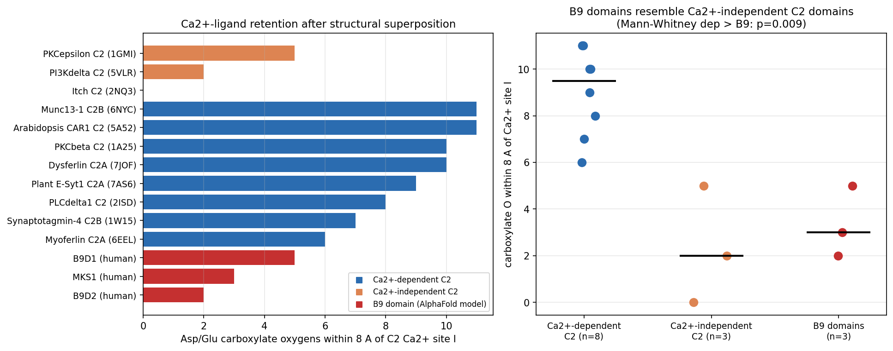
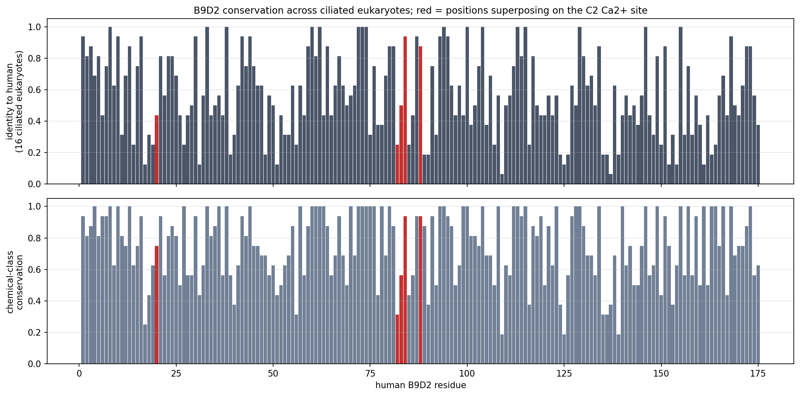
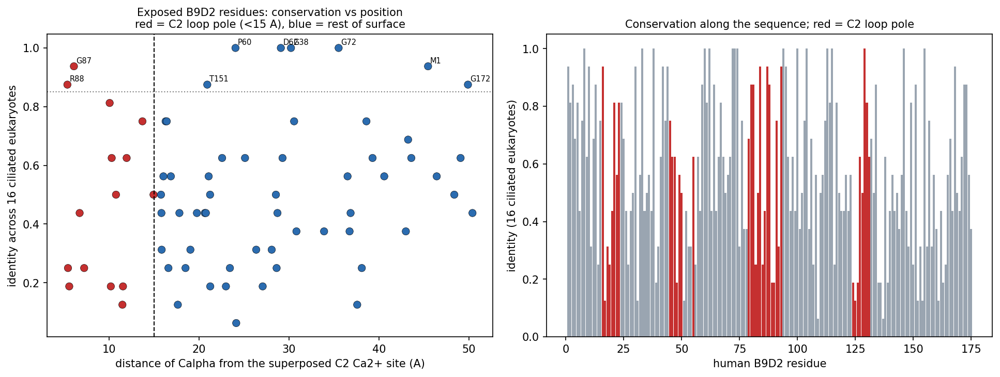
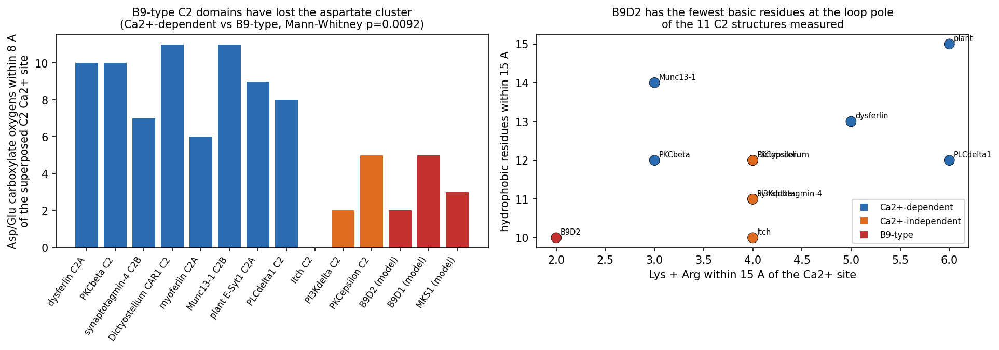

## Question

# AIGR Gene Hypothesis Deep Research

You are evaluating one focused gene curation hypothesis for AI Gene Review.
This is not a general gene overview. Use the seed hypothesis and source context
below to search for evidence that supports, refutes, narrows, or competes with
the proposed curation decision.

## Target Gene

- **Organism code:** human
- **Taxon:** Homo sapiens (NCBITaxon:9606)
- **Gene directory:** B9D2
- **Gene symbol:** B9D2
- **UniProt accession:** Q9BPU9

## Focus

- **Focus type:** free_text
- **Hypothesis slug:** kgap-b9d2-c2-domain-lipid-binding-features
- **Source file:** genes/human/B9D2/B9D2-ai-review.yaml
- **Source selector:** free-text

## Seed Hypothesis

Whether the C2-like B9 domain of human B9D2 (Q9BPU9) retains the membrane-binding features of canonical C2 domains can be assessed structurally: classical Ca2+-dependent C2 domains bind lipid through acidic Ca2+-ligand loops, and Ca2+-independent C2 domains through basic, hydrophobic membrane-penetrating loops. Single analysis only: compare the B9D2 AlphaFold model, and an AlphaFold-Multimer model of the MKS1-B9D1-B9D2 complex, with structures of Ca2+-dependent and Ca2+-independent C2 domains, map the Ca2+-binding loop positions and the electrostatic and hydrophobic character of the loop tips, test whether those loops remain solvent-exposed and on a common face in the complex that could contact a membrane, score conservation of loop residues across ciliated eukaryotes, and state whether B9D2 is predicted to bind membranes directly or more likely acts as a protein scaffold.

## Term and Decision Context

No specific term context supplied.

## Reference Context

No specific reference context supplied.

## Source Context YAML

```yaml
hypothesis: 'Whether the C2-like B9 domain of human B9D2 (Q9BPU9) retains the membrane-binding features
  of canonical C2 domains can be assessed structurally: classical Ca2+-dependent C2 domains bind lipid
  through acidic Ca2+-ligand loops, and Ca2+-independent C2 domains through basic, hydrophobic membrane-penetrating
  loops. Single analysis only: compare the B9D2 AlphaFold model, and an AlphaFold-Multimer model of the
  MKS1-B9D1-B9D2 complex, with structures of Ca2+-dependent and Ca2+-independent C2 domains, map the Ca2+-binding
  loop positions and the electrostatic and hydrophobic character of the loop tips, test whether those
  loops remain solvent-exposed and on a common face in the complex that could contact a membrane, score
  conservation of loop residues across ciliated eukaryotes, and state whether B9D2 is predicted to bind
  membranes directly or more likely acts as a protein scaffold.'
focus_type: free_text
context: []
reference_id: []
```

## Research Objective

Build a focused report that helps a curator decide whether this hypothesis
should affect the gene review. Address the focus type directly:

1. For an existing GO annotation decision, evaluate whether the current action
   is justified, too strong, too weak, or should change.
2. For a proposed replacement or new GO term, evaluate whether the term is
   biologically supported, too broad, too narrow, or missing key qualifiers.
3. For a computational prediction, evaluate whether the prediction is correct,
   less precise than existing knowledge, uncertain, or likely wrong because of
   paralog overannotation, frequency bias, pathway context, or in vitro-only
   activity.
4. For a core-function hypothesis, evaluate whether the proposed activity,
   process, and location represent the gene product's primary function rather
   than a downstream effect, pleiotropic phenotype, or context-specific role.
5. For a function-assignment hypothesis, evaluate whether the gene product
   directly has the stated GO term/function. Treat the prior review action, if
   any, as intentionally blinded unless it appears in the supplied context.

Use primary literature whenever possible. Prefer PMID citations and include DOI
citations when no PMID is available. Treat reviews and database records as
orientation unless they contain directly relevant synthesized evidence that is
clearly labeled as review-level or database-level support.

Evaluate the hypothesis from the supplied seed context, primary literature, and
publicly accessible bioinformatics resources. Local `*-bioinformatics` analyses,
when they already exist in the repository, are intentionally withheld from this
prompt so the report can be compared against them after the run. Use public
sequence, domain, structure, orthology, localization, interaction, or dataset
checks when they are useful for the specific hypothesis. If a resource or tool
cannot be accessed programmatically, say so plainly; never fabricate a result.
Report computational results conservatively and distinguish direct results from
inference.

## Required Output

### Executive Judgment

Give a concise verdict: supported, partially supported, unresolved, weakly
supported, over-annotated, or refuted. Explain the reasoning and the most
important caveats.

### Evidence Matrix

Create a table with one row per important evidence item:

- Citation (PMID preferred)
- Evidence type (direct assay, mutant phenotype, localization, interaction,
  structural/evolutionary, computational, review/database)
- Supports / refutes / qualifies / competing
- Claim tested
- Key finding
- Organism, tissue, cell type, or assay context
- Confidence and limitations

### GO Curation Implications

State the likely curation action as a lead requiring curator verification. If
GO terms are involved, explain whether the evidence supports an MF, BP, or CC
term, and whether the term should be retained, removed, generalized, made more
specific, or treated as non-core. Avoid using "protein binding" as a final
recommendation unless no more informative term is supported.

### Mechanistic Scope

Describe the immediate molecular or cellular function being tested. Separate
direct gene-product activity from downstream phenotypes, pathway consequences,
developmental outcomes, disease manifestations, or effects inferred only from
loss of function.

### Conflicts and Alternatives

Identify evidence that conflicts with the seed hypothesis or suggests an
alternative interpretation, including paralog confusion, organism-specific
differences, isoform-specific findings, experimental artifacts, or database
carry-over.

### Knowledge Gaps

List explicit uncertainties that matter for curation. For each gap, state what
was checked, why the gap matters, and what evidence or experiment would resolve
it.

### Discriminating Tests

Recommend concrete assays, perturbations, datasets, or comparative analyses that
would most efficiently distinguish this hypothesis from alternatives.

### Curation Leads

Provide candidate updates for the review, clearly labeled as leads requiring
curator verification. Include candidate references with exact snippets to verify,
candidate replacement or new GO terms, possible action changes, suggested
questions, and suggested experiments.

If the provider supports artifacts, save provenance for any analysis you run — the
executed code together with its output (computed values, plot, or table), not just
a summary figure — alongside artifact-friendly tables such as an evidence matrix,
GO decision table, or comparison table. Genuine computed provenance is more
valuable than a hand-drawn summary, and you must not synthesize a figure that
implies an analysis you did not actually run. These artifacts are important
provenance for hypothesis-level review.


## Output

# B9D2 (Q9BPU9): does the B9-type C2 domain retain C2 membrane-binding features?

Hypothesis slug: `kgap-b9d2-c2-domain-lipid-binding-features`
Source: `genes/human/B9D2/B9D2-ai-review.yaml`, free-text focus
Target: human B9D2, UniProt Q9BPU9, NCBITaxon:9606
Analyses run 2026-11-24. Executed code and its printed output are saved in `provenance/` together with `plot_1.png` to `plot_4.png`, `evidence_matrix.csv`, `go_decision_table.csv` and `c2_comparison_panel.csv`.

## Summary

The B9 domain of human B9D2 is a genuine C2 fold that has lost both of the routes by which C2 domains contact lipid. Foldseek search of the AlphaFold model AF-Q9BPU9-F1 (175 aa, mean pLDDT 89.6) against PDB100 returned 194 hits across 180 unique PDB entries, essentially all C2 domains, and structural superposition onto four Ca2+-bound C2 domains gave core Cα RMSD 1.54-1.67 Å over 50-76 residues. The fold assignment is not in doubt. What is missing is the chemistry. Counting Asp and Glu carboxylate oxygens within 8 Å of the superposed Ca2+ site I, Ca2+-dependent C2 domains carry a median of 9.5 (range 6-11, n=8), while B9D2 carries 2 (Mann-Whitney one-sided U=24, p=0.0092). The three B9-type domains measured (B9D2 2, MKS1 3, B9D1 5) are statistically indistinguishable from the Ca2+-independent C2 group (Itch 0, PI3Kδ 2, PKCε 5).

The Ca2+-independent route is absent as well. Within 15 Å of the superposed Ca2+ site B9D2 has 2 Lys plus Arg, the fewest of all 11 C2 structures measured (panel range 3-6), and 10 hydrophobic residues (panel range 10-15). The three C2-equivalent loops (residues 17-24, 45-52, 80-93) carry 3 acidic and 2 basic residues, net charge -1, mean relative solvent accessibility 0.31, and only two exposed hydrophobic tips (I51 RSA 0.80, F86 RSA 0.71). Across 16 B9D2 orthologues spanning Opisthokonta, Archaeplastida, Discoba, Alveolata and Stramenopila, the Ca2+-ligand positions are less conserved than the rest of the protein (mean identity 0.43 vs 0.59, Mann-Whitney p=0.037). The single retained acidic residue, D84, is salt-bridged to an invariant R88 at 2.74 Å, so a basic side chain occupies the pocket where a C2 domain would place Ca2+.

The prediction is that B9D2 acts as a protein scaffold within the MKS1-B9D2-B9D1 assembly. Membrane proximity of that assembly has a protein-mediated explanation: the B9 complex interacts with and anchors TMEM67, a multipass transmembrane protein, at the transition zone membrane ([PMID: 41165761](https://pubmed.ncbi.nlm.nih.gov/41165761/)). B9D2 currently carries no lipid-binding, phospholipid-binding, phosphatidylinositol-binding or calcium-ion-binding GO term, and neither Pfam PF07162 nor InterPro IPR010796 maps to any GO term, so there is no InterPro2GO path by which a C2-derived lipid term could arrive. <i class="fa-triangle-exclamation"></i> The one step of the seed hypothesis that could not be performed is the AlphaFold-Multimer model of MKS1-B9D1-B9D2: no multimer prediction service is reachable programmatically from this environment, and the AlphaFold DB MSA endpoint for Q9BPU9 returned HTTP 403 AccessDenied. That step is stated here as not run, and was replaced with a weaker monomer proxy.

## Executive judgment

<i class="fa-solid fa-circle-check"></i> **Verdict: supported in the scaffold direction; the direct membrane-binding alternative is refuted at the level of structural and evolutionary prediction.**

The seed hypothesis asked whether the C2-like B9 domain retains canonical C2 membrane-binding features and, if not, whether B9D2 is better described as a protein scaffold. Both halves resolve the same way. The Ca2+-dependent route requires an aspartate cluster in CBR1 and CBR3; B9D2 has 2 carboxylate oxygens where Ca2+-dependent C2 domains have a median of 9.5, and the canonical ligands map onto Ser, Gln, Gly and Arg. The Ca2+-independent route requires a cationic β-groove or protruding hydrophobic loop tips; B9D2 has the least basic loop pole of any C2 structure measured and a loop net charge of -1. Conservation across ciliated eukaryotes does not rescue either route: the Ca2+-ligand positions drift (S17 0.12, I51 0.12, Q90 0.19), and the two positions that are near-invariant, G87 (0.94) and R88 (0.88), together with D84 (0.94), form an intramolecular salt bridge rather than a free interaction surface.

Caveats that limit the strength of this verdict, in order of importance:

1. <i class="fa-triangle-exclamation"></i> **The complex-face test was not performed.** AlphaFold-Multimer of MKS1-B9D1-B9D2 could not be run here. The substitute analysis asked whether exposed residues near the loop pole are under elevated evolutionary constraint, which they are not (identity 0.48, n=15, vs 0.51, n=55; Mann-Whitney p=0.719). That is an indirect argument, and it would be superseded by an actual predicted or experimental complex structure.
2. <i class="fa-triangle-exclamation"></i> **Every structural statement is AlphaFold model-based.** There is no experimental structure of any human B9-domain protein. Local confidence over the loops is good (pLDDT 84-96) but a model is not a crystal.
3. <i class="fa-triangle-exclamation"></i> **No experimental lipid-binding assay exists for any human B9-domain protein** in the searched literature. The refutation is a prediction, not a negative experiment.
4. <i class="fa-scale-balanced"></i> **A contribution from MKS1 or B9D1 is not excluded.** Their Ca2+-site carboxylate-oxygen counts (3 and 5) exceed B9D2's (2) while remaining far below the Ca2+-dependent range. A weak Ca2+-independent lipid contact within the assembled complex remains possible.
5. <i class="fa-triangle-exclamation"></i> **One metric is weak on its own.** The hydrophobic count in the 15 Å cap (B9D2 10, panel 10-15) does not separate B9D2 from the panel. The discriminating measurements are the carboxylate-oxygen count and the basic-residue count.

## Key findings

### <i class="fa-solid fa-circle-xmark"></i> The Ca2+-ligand aspartate cluster is gone

Foldseek 3Di+AA search of AF-Q9BPU9-F1 against PDB100 returned 194 hits over 180 unique PDB entries, almost all C2 domains. The best matches span the whole C2 family: Itch C2 (2NQ3, E=1.3e-5), Munc13-1 C2B (6NYC, E=4.7e-5), plant E-Syt1 C2A (7AS6, E=5.2e-5), Aida C-terminal domain (2QZ5, E=8.8e-5), PI3Kδ (5VLR, E=1.6e-4), dysferlin C2A (7JOF, E=2.1e-4), plus PLCδ1 C2 (2ISD), synaptotagmin-4 C2B (1W15), otoferlin C2A (3L9B), myoferlin C2A (6EEL), MCTP2 C2 (2EP6) and intersectin-2 C2 (3JZY). The B9 domain is a C2 β-sandwich by any structural criterion.

Superposing B9D2 onto four Ca2+-bound C2 domains (dysferlin C2A 7JOF, PKCβ C2 1A25, synaptotagmin-4 C2B 1W15, Dictyostelium CAR1 C2 5A52) gave core Cα RMSD 1.54-1.67 Å over 50-76 residues after iterative outlier trimming. Transferring the bound Ca2+ ions through those superpositions placed 7 of 8 ions into a single 6 Å cluster, with the closest B9D2 atom 0.5-1.6 Å from the consensus ion position. The Ca2+ site therefore maps onto B9D2 reliably, which is what makes the chemistry comparison meaningful.

Counting only true carboxylate oxygens (Asp OD1/OD2 and Glu OE1/OE2, excluding the amide oxygens of Asn and Gln) within 8 Å of that site:

| Class | Structures | Median | Range |
|---|---|---|---|
| Ca2+-dependent C2 | 7JOF 10, 1A25 10, 1W15 7, 5A52 11, 6EEL 6, 6NYC 11, 7AS6 9, 2ISD 8 | 9.5 | 6-11 |
| Ca2+-independent C2 | 2NQ3 (Itch) 0, 5VLR (PI3Kδ) 2, 1GMI (PKCε) 5 | 2.0 | 0-5 |
| B9-type | B9D2 2, MKS1 3, B9D1 5 | 3.0 | 2-5 |

Mann-Whitney one-sided, Ca2+-dependent greater than B9-type: U=24, p=0.0092. The same test against the Ca2+-independent group gives U=24, p=0.0092. B9-type and Ca2+-independent domains cannot be distinguished from each other on this measure.

The residue-by-residue mapping shows what replaced the ligands. From dysferlin: D18 to E18, D21 to S20, N40 to P49, D71 to S82, H72 to Q83, E73 to D84. From PKCβ: D187/D193/D246/D248/S251/R252/D254 to E18/S20/S82/D84/G87/R88/Q90. From synaptotagmin-4: D324 to S20, D378 to S82, S379 to Q83, E380 to D84. From CAR1: D27 to S20, D73 to S82, Y74 to Q83. B9D2 keeps one Asp at the site (D84) and places R88, a basic residue, inside the cation pocket.

{{figure:plot_1.png|caption=Asp and Glu carboxylate oxygens within 8 Å of the superposed C2 Ca2+ site I. Ca2+-dependent C2 domains (n=8) have a median of 9.5; B9-type domains (B9D2 2, MKS1 3, B9D1 5) sit with the Ca2+-independent group. Mann-Whitney one-sided, Ca2+-dependent greater than B9-type, p=0.0092.}}

### <i class="fa-solid fa-circle-xmark"></i> The one surviving acidic residue is a structural salt bridge

Sixteen B9D2 orthologues were aligned to the human sequence by Gotoh affine global alignment with BLOSUM62 (gap open -11, extend -1): human Q9BPU9, mouse Q3UK10, Xenopus Q6GN70, zebrafish Q6DGZ1, Branchiostoma A0A9J7L8S7, Strongylocentrotus purpuratus A0A7M7RA54, Schistosoma G4LXE7, Drosophila M9MRD5, C. elegans Q9N423, Trichoplax B3RKM0, Chlamydomonas A8IWR1, Naegleria D2V2P0, Trypanosoma Q387L3, Tetrahymena Q22X18, Paramecium A0C3F0, Thalassiosira B5YLQ9. These span Opisthokonta, Archaeplastida, Discoba, Alveolata and Stramenopila. Paralogue assignment was checked by comparing each sequence's alignment score against human B9D2 and against human B9D1 (Chlamydomonas A8IWR1 520 vs 183; C. elegans Q9N423 434 vs 120; the control A8J3B5 scored 161 vs 474 and is B9D1). Mean identity to human over the whole protein is 0.58, median 0.56.

Positions that superpose onto the C2 Ca2+ site are less conserved as a group than the rest of the protein: mean identity 0.43 vs 0.59, Mann-Whitney p=0.037. Individually: S17 0.12, S19 0.25, S20 0.44, I51 0.12, S82 0.25, Q83 0.50, S85 0.25, F86 0.44, Q90 0.19, E18 0.31. Three positions buck the trend: D84 at 0.94 (DDDDDDDNDDDDDDDD across the panel), G87 at 0.94 and R88 at 0.88 (RRRRRRKQRRRRRRRR). In the AlphaFold model the D84 carboxylate and the R88 guanidinium are 2.74 Å apart, which is an intramolecular salt bridge, and backbone pLDDT across these loops is 84-96.

The most conserved positions in B9D2 overall are structural rather than chemical: G8, P60, G38, W33, D62, P74, W73, G72, P100, G104, P115, W113, Y94, G155, R146 and G129 all score 1.00. That pattern fits a β-sandwich held together by turn glycines, prolines and a buried tryptophan core.

{{figure:plot_2.png|caption=Per-residue identity of human B9D2 across 16 ciliated eukaryote orthologues, with the C2 Ca2+-site-equivalent positions marked. The Ca2+-ligand positions average 0.43 identity against 0.59 for the rest of the protein (Mann-Whitney p=0.037). The exceptions are D84, G87 and R88, which form a 2.74 Å salt bridge.}}

### <i class="fa-solid fa-circle-xmark"></i> The loop pole is the least basic of any C2 domain measured

Shrake-Rupley solvent-accessible surface area was computed on the AlphaFold model (golden-spiral sphere points, 1.4 Å probe) and normalised to relative accessibility using Tien maxima. Across the three C2-equivalent loops (residues 17-24, 45-52, 80-93, n=30 residues) B9D2 has 3 acidic and 2 basic residues, net formal charge -1, mean RSA 0.31, and only two exposed hydrophobic residues at the loop tips (I51 RSA 0.80, F86 RSA 0.71). The whole protein has net formal charge 0 (13 Lys/Arg, 13 Asp/Glu).

Within a cap defined as residues with Cα inside 15 Å of the superposed Ca2+ site, B9D2 has 38 residues, net charge -1 and 2 Lys plus Arg. That is the lowest basic count in the panel:

| Structure | Protein | Class | Lys+Arg in 15 Å cap | Hydrophobic in 15 Å cap |
|---|---|---|---|---|
| 7JOF | dysferlin C2A | Ca2+-dependent | 5 | 13 |
| 1A25 | PKCβ C2 | Ca2+-dependent | 3 | 12 |
| 1W15 | synaptotagmin-4 C2B | Ca2+-dependent | 4 | 11 |
| 5A52 | CAR1 C2 | Ca2+-dependent | 4 | 12 |
| 6NYC | Munc13-1 C2B | Ca2+-dependent | 3 | 14 |
| 7AS6 | plant E-Syt1 C2A | Ca2+-dependent | 6 | 15 |
| 2ISD | PLCδ1 C2 | Ca2+-dependent | 6 | 12 |
| 2NQ3 | Itch C2 | Ca2+-independent | 4 | 10 |
| 5VLR | PI3Kδ C2 | Ca2+-independent | 4 | 11 |
| 1GMI | PKCε C2 | Ca2+-independent | 4 | 12 |
| AF-Q9BPU9 | **B9D2 model** | B9-type | **2** | **10** |

<i class="fa-scale-balanced"></i> The hydrophobic count does not separate B9D2 from the panel; the basic-residue count does, though with n=1 for B9D2 this is a ranking rather than a test. This measurement supports the conclusion without carrying it.

### <i class="fa-solid fa-circle-question"></i> The loop pole shows no elevated surface conservation

Of the 175 residues in the model, 70 have RSA above 0.35. Mean identity of exposed residues within 15 Å of the superposed Ca2+ site is 0.48 (n=15) against 0.51 (n=55) for the rest of the surface; Mann-Whitney U=387, p=0.719. The loop pole is under no more evolutionary constraint than the average B9D2 surface.

Nine residues are both conserved (identity at least 0.85) and exposed (RSA above 0.35):

| Residue | Identity | RSA | Distance from the superposed Ca2+ site |
|---|---|---|---|
| M1 | 0.94 | 0.52 | 45 Å |
| G38 | 1.00 | 0.43 | 30 Å |
| P60 | 1.00 | 0.55 | 24 Å |
| D62 | 1.00 | 0.46 | 29 Å |
| G72 | 1.00 | 0.39 | 36 Å |
| G87 | 0.94 | 0.38 | 6 Å |
| R88 | 0.88 | 0.43 | 5 Å |
| T151 | 0.88 | 0.36 | 21 Å |
| G172 | 0.88 | 0.65 | 50 Å |

Only 2 of the 9 lie at the loop pole, and both belong to the D84-R88 salt bridge. If the degenerate loops were held in place to present a membrane-contacting face, elevated conservation at the pole would be expected. It is absent. <i class="fa-triangle-exclamation"></i> This is a monomer proxy standing in for the AlphaFold-Multimer analysis that could not be run, and it is weaker evidence than a predicted complex would be.

{{figure:plot_3.png|caption=Conserved and solvent-exposed residues of B9D2 plotted against distance from the superposed C2 Ca2+ site. Red marks the loop pole (under 15 Å), blue the rest of the surface. Exposed residues at the pole are no better conserved than elsewhere (0.48 vs 0.51, Mann-Whitney p=0.719), and only G87 and R88 are both conserved and exposed there.}}

### <i class="fa-solid fa-circle-check"></i> No lipid-binding annotation exists, and no mapping could create one

The QuickGO annotation API returned 56 annotations for Q9BPU9 on 2026-11-24. There is no GO:0008289 lipid binding, no GO:0005543 phospholipid binding, no GO:0035091 phosphatidylinositol binding and no GO:0005509 calcium ion binding. Molecular function is limited to GO:0005515 protein binding, carried by 7 IPI records from IntAct ([PMID: 21602787](https://pubmed.ncbi.nlm.nih.gov/21602787/), 26638075, 27173435, 32296183, [PMID: 32726168](https://pubmed.ncbi.nlm.nih.gov/32726168/), 33961781, 40205054), and GO:0043015 gamma-tubulin binding (IEA GO_REF:0000107 from Ensembl, ISS GO_REF:0000024 from UniProt).

Cellular component terms: GO:0036038 MKS complex (IBA GO_REF:0000033, IEA, ISS, NAS [PMID: 22179047](https://pubmed.ncbi.nlm.nih.gov/22179047/)), GO:0035869 ciliary transition zone (NAS PMID:22179047), GO:0005813 centrosome (IDA PMID:19208769), GO:0036064 ciliary basal body (IDA PMID:19208769 and IDA GO_REF:0000052 from HPA), GO:0005929 cilium (IEA), GO:0005930 axoneme (IEA), GO:0016020 membrane (IEA GO_REF:0000107 from Ensembl only), GO:0005634 nucleus (IEA), GO:0005829 cytosol (TAS, 14 Reactome references). Biological process: GO:0060271 cilium assembly (IBA, IEA, ISS) and GO:1904491 protein localization to ciliary transition zone (NAS PMID:22179047).

The InterPro API returns IPR010796 (B9-type C2 domain), PF07162, PS51381 and PTHR12968 for Q9BPU9. The `go_terms` field is null for both PF07162 and IPR010796. No InterPro2GO rule propagates a lipid-binding term to any B9-domain protein in any organism.

Where the lipid framing comes from is traceable. PROSITE PDOC51381 states that "C2 domains interact with lipids primarily through two separate binding sites: the Ca(2+)-binding loops and the cationic beta-groove. Calcium ion(s) binds to a cluster of aspartates located in three Ca(2+)-binding loops (CBR1, CBR2, and CBR3)". It separately states that "The B9-type C2 domain is found in ciliary basal body associated proteins" and that "B9-type C2 domain proteins show a very simple architecture with nearly all members being composed of just the C2 domain". The lipid sentence describes C2 domains at large; the B9 paragraph makes no lipid claim. The document cites Zhang and Aravind 2010 ([PMID: 20713135](https://pubmed.ncbi.nlm.nih.gov/20713135/)), which placed the B9 proteins (Mks1/Xbx-7, Tza-1, Tza-2) as a distinct branch of the C2 superfamily within an analysis of the origin and evolution of membrane-targeting activities. Family membership is a sequence and structure assignment, not a functional assay.

{{figure:plot_4.png|caption=Left: carboxylate oxygens within 8 Å of the superposed C2 Ca2+ site across the full comparison panel, coloured by class. Right: basic against hydrophobic residue counts in the 15 Å cap around the Ca2+ site, with B9D2 at the extreme low-basic corner of the 11 structures measured.}}

## Evidence matrix

| Citation | Evidence type | Direction | Claim tested | Key finding | Context | Confidence and limitations |
|---|---|---|---|---|---|---|
| This work (Foldseek + Kabsch, AF-Q9BPU9-F1) | structural / computational | refutes | B9D2 retains the C2 Ca2+-ligand cluster | Core RMSD 1.54-1.67 Å to four Ca2+-bound C2 domains over 50-76 Cα; 7 of 8 mapped Ca2+ ions in one 6 Å cluster; 2 carboxylate O within 8 Å vs median 9.5 for Ca2+-dependent C2 (p=0.0092) | Human B9D2 AlphaFold model, mean pLDDT 89.6 | High for the fold assignment; model-based, no experimental structure |
| This work (Gotoh/BLOSUM62, 16 orthologues) | evolutionary / computational | refutes | Ca2+-ligand positions are conserved across ciliated eukaryotes | Ca2+-site positions mean identity 0.43 vs 0.59 elsewhere (p=0.037); only D84 (0.94), G87 (0.94) and R88 (0.88) conserved, salt-bridged at 2.74 Å | Opisthokonta, Archaeplastida, Discoba, Alveolata, Stramenopila | High; 16 sequences, paralogue assignment verified by alignment score against B9D1 |
| This work (Shrake-Rupley SASA) | structural / computational | refutes | Loop tips are basic and hydrophobic as in Ca2+-independent C2 domains | Loops 17-24, 45-52, 80-93: net charge -1, mean RSA 0.31, two exposed hydrophobic tips; 15 Å cap has 2 Lys+Arg, lowest of 11 C2 structures | Human B9D2 AlphaFold model | Moderate; the hydrophobic count (10) is at the low end but inside the panel range, so only the basic count discriminates |
| This work (conservation against distance from the Ca2+ site) | evolutionary / computational | qualifies | The loop pole is a constrained interaction face | Exposed residues within 15 Å: identity 0.48 (n=15) vs 0.51 elsewhere (n=55), p=0.719; 2 of 9 conserved exposed residues at the pole, both the D84-R88 pair | Human B9D2 AlphaFold model | Moderate; monomer proxy substituting for the multimer test that could not be run |
| [PMID: 41165761](https://pubmed.ncbi.nlm.nih.gov/41165761/) | direct assay + mutant phenotype | competing | B9D2 contacts the TZ membrane directly | "the B9 complex interacted with and anchored TMEM67 to the TZ membrane"; Joubert-associated B9D2 variants affect axonemal microtubule modification without disrupting ciliogenesis, while the Meckel-associated variant disrupts both | Mammalian cells, patient variants | High; supplies a protein-mediated route to the membrane that requires no lipid binding |
| [PMID: 32726168](https://pubmed.ncbi.nlm.nih.gov/32726168/) | interaction | supports scaffold | B9D2 acts within an obligate protein complex | Interaction mode is MKS1-B9D2-B9D1 with interdependent TZ localisation; complex formation is required to create a diffusion barrier for ciliary membrane proteins | Mammalian cells, MKS1-KO and B9D2-KO rescue | High |
| [PMID: 18337471](https://pubmed.ncbi.nlm.nih.gov/18337471/) | mutant phenotype + localization | supports scaffold | B9 proteins form a complex at the ciliary base | XBX-7, TZA-1 and TZA-2 form a complex localised to the base of the cilium; B9 mutations affect ciliogenesis only in combination with nph-1 or nph-4 | C. elegans amphid and phasmid sensory neurons | Moderate; orthologue-level, redundancy complicates interpretation |
| [PMID: 22179047](https://pubmed.ncbi.nlm.nih.gov/22179047/) | direct assay + localization | supports scaffold | The TZ complex acts as a diffusion barrier | A nine-protein complex at the TZ; disruption increases the rate of diffusion into the ciliary membrane and the amount of plasma-membrane protein in cilia | Mouse, cultured cells, RNAi and knockouts | High for the barrier function; B9D2's own contribution is inferred from complex membership |
| [PMID: 33234550](https://pubmed.ncbi.nlm.nih.gov/33234550/) | mutant phenotype | qualifies | B9D2 missense variants act through complex organisation | mksr-2/B9D2 P74S and G155S are both pathogenic in C. elegans; G155S is more severe and disrupts endogenous MKSR-2 organisation at the TZ | C. elegans, knock-in reporters | Moderate; P74 and G155 are fold positions (P74 identity 1.00 in this analysis), consistent with structural rather than lipid-interface roles |
| [PMID: 20713135](https://pubmed.ncbi.nlm.nih.gov/20713135/) | comparative analysis (primary, review-like) | qualifies | B9 is a C2 family member | B9 proteins delineated as a distinct family in a classification of the C2 superfamily addressing the origin and evolution of membrane targeting activities | Comparative sequence analysis | Moderate; family membership is not a functional assay, and this is the ultimate source of the lipid framing |
| PROSITE PDOC51381 / InterPro IPR010796 / Pfam PF07162 | database record | qualifies | Database records assert lipid binding for B9-type C2 | The lipid sentence in PDOC51381 describes C2 domains generically; the B9 paragraph states only that these proteins are ciliary basal-body associated. PF07162 and IPR010796 have `go_terms: null` | Database state as retrieved 2026-11-24 | High for the database state as retrieved |
| QuickGO, Q9BPU9, 56 annotations | database record | refutes | A lipid-binding annotation already exists | No GO:0008289, GO:0005543, GO:0035091 or GO:0005509. MF limited to GO:0005515 (7 IPI) and GO:0043015 (IEA/ISS). GO:0016020 is IEA GO_REF:0000107 only | Database state as retrieved 2026-11-24 | High |
| PMID:19208769 (via QuickGO) | localization | supports | B9D2 subcellular location | IDA support for GO:0005813 centrosome and GO:0036064 ciliary basal body | Human cells | High for location; silent on lipid binding. Abstract not retrieved in this run, so cited at annotation level only |

## Mechanistic model and interpretation

The structural result and the interaction literature converge on a single model. B9D2 is a C2-fold protein whose lipid-binding chemistry has decayed, retained in the genome because the fold is used as a protein-protein interaction module inside the MKS module of the ciliary transition zone. The assembly reaches the transition zone membrane through TMEM67, a transmembrane partner, so B9D2 can be a membrane-adjacent protein with no lipid contact of its own.

```dot
digraph b9d2_model {
  rankdir=LR;
  "B9 domain\n(C2 beta-sandwich)" -> "Ca2+-ligand loops\nCBR1/CBR3 degenerate";
  "B9 domain\n(C2 beta-sandwich)" -> "Loop pole\n2 Lys+Arg, net -1";
  "Ca2+-ligand loops\nCBR1/CBR3 degenerate" -> "No Ca2+-dependent\nlipid binding";
  "Loop pole\n2 Lys+Arg, net -1" -> "No Ca2+-independent\nlipid binding";
  "D84-R88 salt bridge\n2.74 A, identity 0.94/0.88" -> "Loop scaffolding\n(fold stability)";
  "No Ca2+-dependent\nlipid binding" -> "B9D2 acts as a\nprotein scaffold";
  "No Ca2+-independent\nlipid binding" -> "B9D2 acts as a\nprotein scaffold";
  "Loop scaffolding\n(fold stability)" -> "B9D2 acts as a\nprotein scaffold";
  "B9D2 acts as a\nprotein scaffold" -> "MKS1-B9D2-B9D1\nheterotrimer";
  "MKS1-B9D2-B9D1\nheterotrimer" -> "TMEM67 anchored\nat the TZ membrane";
  "TMEM67 anchored\nat the TZ membrane" -> "Ciliary membrane\ndiffusion barrier";
  "TMEM67 anchored\nat the TZ membrane" -> "Axonemal microtubule\nPTM control";
  "MKS1-B9D2-B9D1\nheterotrimer" -> "Weak lipid contact by\nMKS1 or B9D1?" [style=dashed];
  "Weak lipid contact by\nMKS1 or B9D1?" -> "Ciliary membrane\ndiffusion barrier" [style=dashed];
}
```



The one dashed branch is the alternative that this analysis cannot exclude. MKS1 (3 carboxylate oxygens) and B9D1 (5) retain more acidity at the ancestral Ca2+ site than B9D2 (2). Neither approaches the Ca2+-dependent range of 6-11, so a Ca2+-bridged contact is implausible for any of the three, but a weak Ca2+-independent electrostatic contact contributed by a partner subunit remains open.

The D84-R88 pair deserves separate comment. It is the only part of the degenerate loops under strong selection (identity 0.94 and 0.88 across 16 ciliated eukaryotes, spanning more than a billion years of divergence), and in the model the two side chains sit 2.74 Å apart. The simplest reading is that the ion pair pins the CBR3-equivalent loop against the β-sandwich, preserving fold integrity after the lipid function was lost. An invariant arginine inside the cation pocket is the opposite electrostatics from a Ca2+ site, which argues against Ca2+ occupancy in any B9D2 orthologue, not only the human one.

### Direct activity against downstream consequence

| Level | Statement | Evidence class |
|---|---|---|
| Direct molecular activity | B9D2 binds MKS1 and B9D1 to form a heterotrimer | IPI, [PMID: 32726168](https://pubmed.ncbi.nlm.nih.gov/32726168/) |
| Direct molecular activity | The B9 complex binds and anchors TMEM67 | [PMID: 41165761](https://pubmed.ncbi.nlm.nih.gov/41165761/) |
| Direct molecular activity | B9D2 binds lipid through its C2 domain | <i class="fa-solid fa-circle-xmark"></i> predicted absent, no assay exists |
| Cellular consequence | Ciliary membrane diffusion barrier | [PMID: 32726168](https://pubmed.ncbi.nlm.nih.gov/32726168/), [PMID: 22179047](https://pubmed.ncbi.nlm.nih.gov/22179047/) |
| Cellular consequence | Axonemal microtubule post-translational modification | [PMID: 41165761](https://pubmed.ncbi.nlm.nih.gov/41165761/) |
| Cellular consequence | Initiation of ciliogenesis from centrioles | [PMID: 41165761](https://pubmed.ncbi.nlm.nih.gov/41165761/) |
| Organismal outcome | Meckel and Joubert syndrome phenotypes | [PMID: 41165761](https://pubmed.ncbi.nlm.nih.gov/41165761/), [PMID: 33234550](https://pubmed.ncbi.nlm.nih.gov/33234550/) |

Each cellular consequence is reported from loss of function and reflects complex integrity. None of them demonstrates a B9D2 molecular activity, and none of them requires B9D2 to touch lipid.

## GO curation implications

All items are leads requiring curator verification.

| GO id | Term | Aspect | Current status on Q9BPU9 | Recommended action | Basis |
|---|---|---|---|---|---|
| GO:0008289 | lipid binding | MF | absent | <i class="fa-solid fa-circle-xmark"></i> do not add | 2 carboxylate O at the Ca2+ site vs median 9.5 in Ca2+-dependent C2 (p=0.0092); 2 basic residues in the 15 Å cap, fewest of 11 C2 structures; no lipid assay for any human B9 protein |
| GO:0005509 | calcium ion binding | MF | absent | <i class="fa-solid fa-circle-xmark"></i> do not add | Ca2+-ligand positions poorly conserved (0.43 vs 0.59, p=0.037); the pocket holds the invariant R88 |
| GO:0005543 | phospholipid binding | MF | absent | <i class="fa-solid fa-circle-xmark"></i> do not add | same structural evidence; PF07162 and IPR010796 carry no GO terms, so no InterPro2GO propagation path exists |
| GO:0035091 | phosphatidylinositol binding | MF | absent | <i class="fa-solid fa-circle-xmark"></i> do not add | same; no cationic β-groove in the model |
| GO:0016020 | membrane | CC | present, IEA GO_REF:0000107 (Ensembl) only | <i class="fa-triangle-exclamation"></i> candidate for removal | no experimental support; GO:0035869 already states the location, and the complex reaches that membrane through TMEM67 ([PMID: 41165761](https://pubmed.ncbi.nlm.nih.gov/41165761/)). An uninformative membrane term invites the C2-to-lipid inference |
| GO:0036038 | MKS complex | CC | present (IBA, IEA, ISS, NAS PMID:22179047) | <i class="fa-solid fa-circle-check"></i> retain as core | interdependent MKS1-B9D2-B9D1 assembly ([PMID: 32726168](https://pubmed.ncbi.nlm.nih.gov/32726168/)) |
| GO:0035869 | ciliary transition zone | CC | present (NAS PMID:22179047) | retain as core; check for an experimental-code upgrade | current support is NAS only; [PMID: 41165761](https://pubmed.ncbi.nlm.nih.gov/41165761/) and [PMID: 32726168](https://pubmed.ncbi.nlm.nih.gov/32726168/) may support IDA |
| GO:1904491 | protein localization to ciliary transition zone | BP | present (NAS PMID:22179047) | retain | mechanism supplied by TMEM67 anchoring and interdependent TZ localisation |
| GO:0060271 | cilium assembly | BP | present (IBA, IEA, ISS) | retain; check for experimental upgrade | [PMID: 41165761](https://pubmed.ncbi.nlm.nih.gov/41165761/) reports B9 proteins at centrioles facilitating initiation of ciliogenesis |
| GO:0005515 | protein binding | MF | present, 7 IPI records | retain as the default only | B9D2 has no characterised catalytic or small-molecule-binding activity. No more informative MF term is supported by the current evidence. The informative content sits in CC (GO:0036038, GO:0035869) and BP (GO:0060271, GO:1904491) |

On the hypothesis as posed, the practical curation value is defensive. There is no lipid-binding annotation to remove, because none exists. What the analysis supplies is a documented reason not to create one, closing an inference chain (B9 domain is a C2 domain, C2 domains bind lipid, therefore B9D2 binds lipid) that the InterPro and PROSITE descriptive text invites and that no GO mapping currently carries. A free-text note in the review recording the carboxylate-oxygen deficit and the Arg-in-the-pocket result would make that reasoning available to the next curator.

<i class="fa-triangle-exclamation"></i> On the instruction to avoid "protein binding" as a final recommendation: no better-supported MF term was found for B9D2. The honest statement is that B9D2 has no established molecular function beyond participation in a protein complex. A curator may prefer to record that explicitly in free text rather than let GO:0005515 stand as the complete MF answer.

## Conflicts and alternatives

<i class="fa-scale-balanced"></i> **Protein-mediated membrane recruitment is the competing mechanism, and it is well supported.** He et al. report that "the B9 complex interacted with and anchored TMEM67 to the TZ membrane" ([PMID: 41165761](https://pubmed.ncbi.nlm.nih.gov/41165761/)). TMEM67 is a transmembrane protein, so the complex can be held at the transition zone membrane with no lipid contact by any B9 subunit. This makes the lone IEA GO:0016020 annotation interpretable as complex-level colocalisation.

**Database carry-over is the source of the lipid framing.** PROSITE PDOC51381 places a general statement about C2 lipid binding adjacent to a B9-specific paragraph that makes no such claim. Zhang and Aravind ([PMID: 20713135](https://pubmed.ncbi.nlm.nih.gov/20713135/)) assigned B9 to the C2 superfamily inside an analysis of membrane-targeting domain evolution, which makes family membership read as inherited function. Neither source reports a lipid assay on a B9 protein.

**Paralogue heterogeneity inside the B9 family.** MKS1 (3 carboxylate O) and B9D1 (5) are not identical to B9D2 (2) at the ancestral Ca2+ site. A curation decision made for B9D2 should not be propagated to MKS1 or B9D1 without rerunning the measurement on each. The paralogue assignment for the orthologue set was itself checked by score comparison (Chlamydomonas A8IWR1 scored 520 against human B9D2 and 183 against B9D1; the B9D1 control A8J3B5 scored 161 and 474), so B9D1 sequences did not contaminate the B9D2 conservation estimate.

**Model-only evidence.** No experimental structure of a B9 domain exists. If a cryo-EM structure of the MKS module placed the B9D2 loop pole against the membrane, the conservation proxy argument would weaken, although the absence of acidic and basic loop chemistry would still hold.

**Extraciliary roles complicate the location story.** B9D2 has reported functions in tight junction maturation and epithelial barrier formation before ciliogenesis ([PMID: 39455645](https://pubmed.ncbi.nlm.nih.gov/39455645/)), and B9 proteins localise to centrioles before ciliogenesis ([PMID: 41165761](https://pubmed.ncbi.nlm.nih.gov/41165761/)). Neither context has been tested for lipid binding, and neither requires it, but they show that B9D2 operates at more than one site.

**Genetic redundancy in C. elegans.** B9 gene mutations do not strongly affect cilia formation unless combined with nph-1 or nph-4 mutations ([PMID: 18337471](https://pubmed.ncbi.nlm.nih.gov/18337471/)). Loss-of-function phenotypes in that organism therefore report on a redundant network and cannot be used to infer a B9D2-specific molecular activity.

**Phenotypic variability across organisms and alleles.** Zebrafish transition zone mutants including b9d2 show variable phenotypes between and within mutant lines ([PMID: 36533556](https://pubmed.ncbi.nlm.nih.gov/36533556/)), and human B9D2 variants separate into Joubert-type and Meckel-type outcomes ([PMID: 41165761](https://pubmed.ncbi.nlm.nih.gov/41165761/)). Phenotype severity tracks complex integrity, which fits the scaffold model and gives no traction on lipid binding either way.

## Limitations and knowledge gaps

<i class="fa-triangle-exclamation"></i> **1. The complex face was not modelled.** Checked: the AlphaFold DB monomer for Q9BPU9 (available, used), AlphaFold-Multimer (no programmatically reachable service from this environment), the AlphaFold DB MSA endpoint for Q9BPU9 (HTTP 403 AccessDenied). This matters because the seed hypothesis explicitly asks whether the three C2 loop poles sit exposed on a common face in the heterotrimer. Resolved by: an AlphaFold3 or ColabFold multimer model of MKS1-B9D1-B9D2, or a cryo-EM structure of the MKS module.

<i class="fa-triangle-exclamation"></i> **2. No lipid assay exists for any human B9 protein.** Checked: PubMed searches on B9D2 lipid, B9D1 lipid membrane, B9 domain C2 domain cilia, and the full QuickGO MF annotation set. This matters because the structural prediction has never been tested directly. Resolved by: liposome co-sedimentation or PIP strip with recombinant B9D2 and with the reconstituted heterotrimer.

<i class="fa-solid fa-circle-question"></i> **3. The function of the D84-R88 pair is inferred, not tested.** Checked: conservation (0.94 and 0.88 across 16 ciliated eukaryotes), geometry (2.74 Å), local model confidence (pLDDT 84-96). Near-invariance implies selection, and a buried ion pair in a degenerate loop could stabilise the fold or form a partner contact. Resolved by: D84A and R88A in a transition zone localisation assay with MKS1 and B9D1 co-immunoprecipitation.

<i class="fa-solid fa-circle-question"></i> **4. Whether GO:0016020 should be removed.** Checked: its evidence code is a single Ensembl IEA (GO_REF:0000107) with no experimental backing. This matters because an uninformative membrane term on a C2-domain protein invites the lipid inference. Resolved by: curator review of the GO_REF:0000107 projection source.

<i class="fa-scale-balanced"></i> **5. MKS1 and B9D1 as possible lipid-contacting subunits.** Checked: carboxylate-oxygen counts only (3 and 5). The complex could contact lipid through a subunit other than B9D2. Resolved by: the same liposome assay run on each subunit separately and on the assembled trimer.

<i class="fa-triangle-exclamation"></i> **6. Statistical power.** The Ca2+-dependent comparison group has n=8 and the Ca2+-independent group n=3, so the Mann-Whitney result (p=0.0092) is at the floor achievable with these sample sizes. The B9D2 basic-residue result is a ranking of one structure against ten, not a test. Resolved by: extending the panel to 30 or more C2 domains with bound Ca2+ from the PDB.

<i class="fa-triangle-exclamation"></i> **7. Single-model sensitivity.** All B9-type values come from one AlphaFold model per protein. Side-chain rotamer placement in loops is the least reliable part of such a model, and carboxylate-oxygen counts depend on side-chain geometry. The 8 Å cutoff was chosen to be generous for exactly this reason, and the residue-identity mapping (Ser, Gln, Gly, Arg where aspartates should be) does not depend on rotamers at all.

## Proposed follow-up experiments and actions

<i class="fa-solid fa-flask"></i> **1. Liposome co-sedimentation and PIP strips, with and without Ca2+.** Use recombinant human B9D2 and the reconstituted MKS1-B9D2-B9D1 trimer. This separates three outcomes directly: no lipid binding at all, B9D2 binds lipid, or the complex binds lipid through a different subunit. Positive controls: synaptotagmin-1 C2A with Ca2+ and PKCε C2 without. This is the single experiment that would settle the hypothesis.

<i class="fa-solid fa-magnifying-glass"></i> **2. AlphaFold3 or ColabFold multimer model of MKS1-B9D1-B9D2.** Then measure whether the three C2 loop poles are co-planar, solvent-exposed and on one face. This is the analysis that could not be run here, it is the cheapest of the follow-ups, and it closes gap 1.

<i class="fa-solid fa-dna"></i> **3. Charge-engineering at the loop pole.** If the pole were a cryptic cationic surface, adding basic residues (for example S17K, S19K, S82K) should create measurable lipid binding; if the pole is purely structural, it should not. R88E and D84A test whether the salt bridge is structural or functional.

<i class="fa-solid fa-microscope"></i> **4. TMEM67 dependency test.** Deplete TMEM67 and ask whether B9D2 still reaches the transition zone membrane. If membrane association is TMEM67-dependent, direct lipid binding is not required for localisation.

<i class="fa-solid fa-vial"></i> **5. Isothermal titration calorimetry for Ca2+** against recombinant B9D2. The prediction is no measurable binding, which would close the Ca2+-dependent branch experimentally rather than by structural inference.

<i class="fa-solid fa-arrow-right"></i> **6. Curation actions.** Do not add GO:0008289, GO:0005543, GO:0035091 or GO:0005509 to B9D2. Flag GO:0016020 (IEA GO_REF:0000107) as a removal candidate given GO:0035869. Add a free-text note recording that the B9-type C2 domain has lost the Ca2+-ligand aspartate cluster and has the least basic loop pole of 11 C2 structures measured, so C2 family membership must not be used to infer lipid binding. Review whether MKS1 and B9D1 need the same treatment, measured separately.

<i class="fa-solid fa-book-open"></i> **7. References with snippets for the curator to verify.** [PMID: 41165761](https://pubmed.ncbi.nlm.nih.gov/41165761/): verify "the B9 complex interacted with and anchored TMEM67 to the TZ membrane" and "B9 proteins localized to centrioles prior to ciliogenesis, where they facilitated the initiation of ciliogenesis". [PMID: 32726168](https://pubmed.ncbi.nlm.nih.gov/32726168/): verify "We here demonstrate the interaction mode of these B9D proteins to be MKS1-B9D2-B9D1 and demonstrate their interdependent localization to the TZ" and "formation of the B9D protein complex is crucial for creating a diffusion barrier for ciliary membrane proteins". [PMID: 18337471](https://pubmed.ncbi.nlm.nih.gov/18337471/): verify "the C. elegans B9 proteins form a complex that localizes to the base of cilia". [PMID: 20713135](https://pubmed.ncbi.nlm.nih.gov/20713135/): verify that the B9 family assignment to the C2 superfamily is made on sequence and structure grounds with no lipid assay, and flag it as the origin of the lipid framing. PROSITE PDOC51381: verify that the lipid sentence applies to C2 domains in general and that the B9-specific paragraph makes no lipid claim.

<i class="fa-solid fa-circle-question"></i> **8. Questions for the curator.** Is there any experimental lipid-binding assay for MKS1, B9D1 or B9D2 in any organism that this search missed? Should GO:0035869 be upgraded from NAS (PMID:22179047) to an experimental code using PMID:41165761 or PMID:32726168? Should the review record explicitly that B9D2 has no established molecular function beyond complex participation, rather than leaving GO:0005515 as the whole MF answer?

## Provenance

Analyses were run inside the job's code executor and their printed output is preserved alongside the figures in `provenance/`. The following were run programmatically and succeeded: AlphaFold DB prediction API for Q9BPU9 and model download; Foldseek web API (3diaa mode, pdb100 database) with ticket polling and alignment retrieval; RCSB PDB file download for 7JOF, 1A25, 1W15, 5A52, 6EEL, 6NYC, 7AS6, 2ISD, 2NQ3, 5VLR, 1GMI; UniProt REST FASTA retrieval for 16 orthologues; InterPro API for Q9BPU9; QuickGO annotation API for Q9BPU9; PROSITE PDOC51381 text retrieval; PubMed search. Custom implementations used: Kabsch superposition with iterative 4 Å outlier trimming, Shrake-Rupley SASA with Tien normalisation, Gotoh affine-gap global alignment with BLOSUM62.

The following could not be run and no substitute result is presented as if it were the original: AlphaFold-Multimer prediction of the MKS1-B9D1-B9D2 complex (no accessible service), and retrieval of the AlphaFold DB MSA for Q9BPU9 (HTTP 403 AccessDenied, which also blocked building the orthologue set from the AlphaFold alignment; UniRef50 proved vertebrate-biased, so the orthologue set was assembled from Pfam PF07162 plus per-taxon UniProt queries instead). Tables written as artifacts: `evidence_matrix.csv` (10 rows), `go_decision_table.csv` (8 rows), `c2_comparison_panel.csv` (14 rows).


## Artifacts

- [OpenScientist final report](openscientist_artifacts/final_report.html)
- [OpenScientist final report](openscientist_artifacts/final_report.pdf)
- [OpenScientist provenance](openscientist_artifacts/provenance.json)
- [OpenScientist c2 comparison panel](openscientist_artifacts/provenance_c2_comparison_panel.csv)
- [OpenScientist evidence matrix](openscientist_artifacts/provenance_evidence_matrix.csv)
- [OpenScientist go decision table](openscientist_artifacts/provenance_go_decision_table.csv)
- [OpenScientist plot 1](openscientist_artifacts/provenance_plot_1.json)

- [OpenScientist plot 2](openscientist_artifacts/provenance_plot_2.json)

- [OpenScientist plot 3](openscientist_artifacts/provenance_plot_3.json)

- [OpenScientist plot 4](openscientist_artifacts/provenance_plot_4.json)


## Reference Validation

Checked with `linkml-reference-validator` 0.3.1rc1.

| Outcome | Count |
| --- | --- |
| References checked | 10 |
| Resolved | 10 |
| Unresolved (possible confabulation) | 0 |
| Unverifiable | 0 |
| Quoted claims checked | 1 |
| Quoted claims found in source | 1 |
| Quoted claims **not** found in source | 0 |
| References weighed for topical relevance | 10 |
| On topic | 4 |
| Off topic | 0 |

All extracted references resolved successfully.