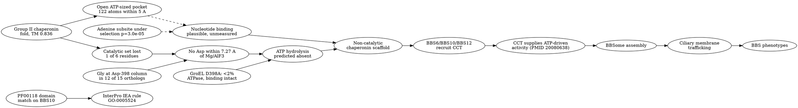
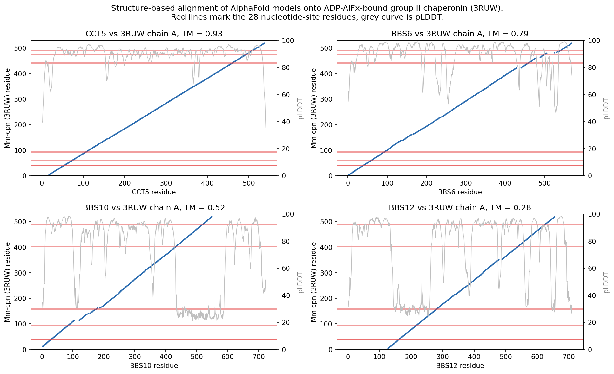
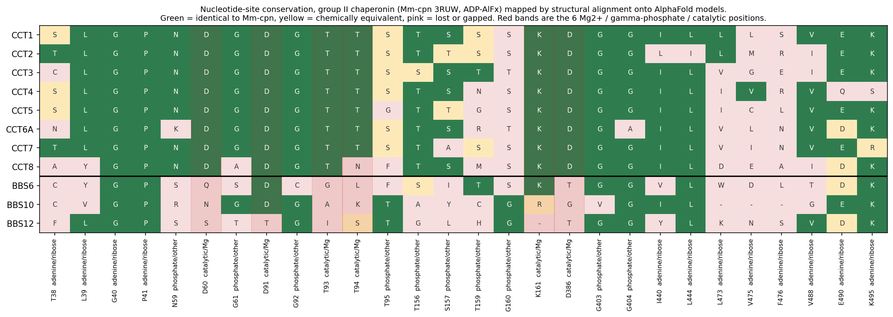
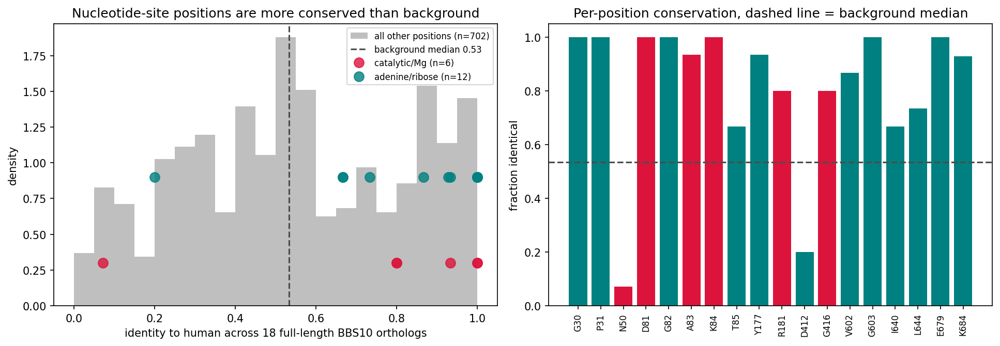
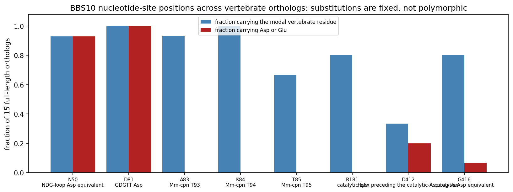
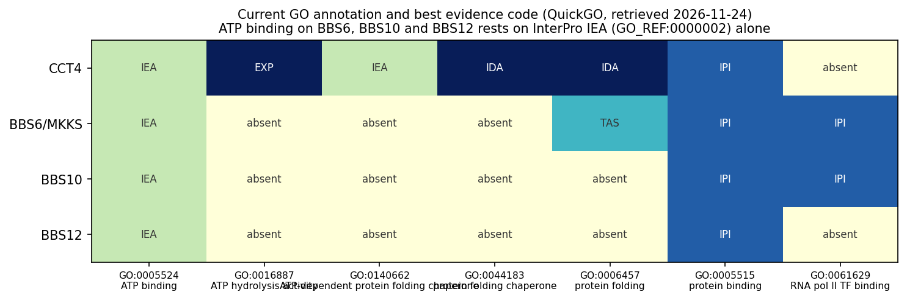
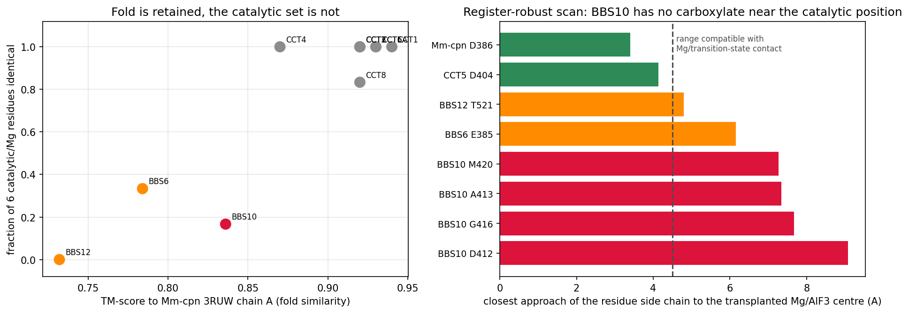

## Question

# AIGR Gene Hypothesis Deep Research

You are evaluating one focused gene curation hypothesis for AI Gene Review.
This is not a general gene overview. Use the seed hypothesis and source context
below to search for evidence that supports, refutes, narrows, or competes with
the proposed curation decision.

## Target Gene

- **Organism code:** human
- **Taxon:** Homo sapiens (NCBITaxon:9606)
- **Gene directory:** BBS10
- **Gene symbol:** BBS10
- **UniProt accession:** Q8TAM1

## Focus

- **Focus type:** free_text
- **Hypothesis slug:** kgap-bbs10-chaperonin-atpase-features
- **Source file:** genes/human/BBS10/BBS10-ai-review.yaml
- **Source selector:** free-text

## Seed Hypothesis

Whether human BBS10 (Q8TAM1), a divergent chaperonin-like protein required to assemble the BBSome with BBS6/MKKS, BBS12 and CCT, retains the ATP-binding and hydrolysis machinery of group II chaperonins can be predicted structurally. Single analysis only: identify the nucleotide-binding and catalytic residues (the GDGTT phosphate-binding loop, the catalytic aspartate and the Mg2+ ligands) from nucleotide-bound CCT/TRiC or thermosome crystal and cryo-EM structures, map them onto the BBS10 AlphaFold model by structure-based alignment, test whether an ATP-sized pocket is assembled in the equatorial domain, compare with BBS6/MKKS and BBS12, score these positions across vertebrate and ciliated-invertebrate orthologs, and state whether BBS10 is predicted to bind and hydrolyse ATP or to act as a non-catalytic scaffold.

## Term and Decision Context

No specific term context supplied.

## Reference Context

No specific reference context supplied.

## Source Context YAML

```yaml
hypothesis: 'Whether human BBS10 (Q8TAM1), a divergent chaperonin-like protein required to assemble the
  BBSome with BBS6/MKKS, BBS12 and CCT, retains the ATP-binding and hydrolysis machinery of group II chaperonins
  can be predicted structurally. Single analysis only: identify the nucleotide-binding and catalytic residues
  (the GDGTT phosphate-binding loop, the catalytic aspartate and the Mg2+ ligands) from nucleotide-bound
  CCT/TRiC or thermosome crystal and cryo-EM structures, map them onto the BBS10 AlphaFold model by structure-based
  alignment, test whether an ATP-sized pocket is assembled in the equatorial domain, compare with BBS6/MKKS
  and BBS12, score these positions across vertebrate and ciliated-invertebrate orthologs, and state whether
  BBS10 is predicted to bind and hydrolyse ATP or to act as a non-catalytic scaffold.'
focus_type: free_text
context: []
reference_id: []
```

## Research Objective

Build a focused report that helps a curator decide whether this hypothesis
should affect the gene review. Address the focus type directly:

1. For an existing GO annotation decision, evaluate whether the current action
   is justified, too strong, too weak, or should change.
2. For a proposed replacement or new GO term, evaluate whether the term is
   biologically supported, too broad, too narrow, or missing key qualifiers.
3. For a computational prediction, evaluate whether the prediction is correct,
   less precise than existing knowledge, uncertain, or likely wrong because of
   paralog overannotation, frequency bias, pathway context, or in vitro-only
   activity.
4. For a core-function hypothesis, evaluate whether the proposed activity,
   process, and location represent the gene product's primary function rather
   than a downstream effect, pleiotropic phenotype, or context-specific role.
5. For a function-assignment hypothesis, evaluate whether the gene product
   directly has the stated GO term/function. Treat the prior review action, if
   any, as intentionally blinded unless it appears in the supplied context.

Use primary literature whenever possible. Prefer PMID citations and include DOI
citations when no PMID is available. Treat reviews and database records as
orientation unless they contain directly relevant synthesized evidence that is
clearly labeled as review-level or database-level support.

Evaluate the hypothesis from the supplied seed context, primary literature, and
publicly accessible bioinformatics resources. Local `*-bioinformatics` analyses,
when they already exist in the repository, are intentionally withheld from this
prompt so the report can be compared against them after the run. Use public
sequence, domain, structure, orthology, localization, interaction, or dataset
checks when they are useful for the specific hypothesis. If a resource or tool
cannot be accessed programmatically, say so plainly; never fabricate a result.
Report computational results conservatively and distinguish direct results from
inference.

## Required Output

### Executive Judgment

Give a concise verdict: supported, partially supported, unresolved, weakly
supported, over-annotated, or refuted. Explain the reasoning and the most
important caveats.

### Evidence Matrix

Create a table with one row per important evidence item:

- Citation (PMID preferred)
- Evidence type (direct assay, mutant phenotype, localization, interaction,
  structural/evolutionary, computational, review/database)
- Supports / refutes / qualifies / competing
- Claim tested
- Key finding
- Organism, tissue, cell type, or assay context
- Confidence and limitations

### GO Curation Implications

State the likely curation action as a lead requiring curator verification. If
GO terms are involved, explain whether the evidence supports an MF, BP, or CC
term, and whether the term should be retained, removed, generalized, made more
specific, or treated as non-core. Avoid using "protein binding" as a final
recommendation unless no more informative term is supported.

### Mechanistic Scope

Describe the immediate molecular or cellular function being tested. Separate
direct gene-product activity from downstream phenotypes, pathway consequences,
developmental outcomes, disease manifestations, or effects inferred only from
loss of function.

### Conflicts and Alternatives

Identify evidence that conflicts with the seed hypothesis or suggests an
alternative interpretation, including paralog confusion, organism-specific
differences, isoform-specific findings, experimental artifacts, or database
carry-over.

### Knowledge Gaps

List explicit uncertainties that matter for curation. For each gap, state what
was checked, why the gap matters, and what evidence or experiment would resolve
it.

### Discriminating Tests

Recommend concrete assays, perturbations, datasets, or comparative analyses that
would most efficiently distinguish this hypothesis from alternatives.

### Curation Leads

Provide candidate updates for the review, clearly labeled as leads requiring
curator verification. Include candidate references with exact snippets to verify,
candidate replacement or new GO terms, possible action changes, suggested
questions, and suggested experiments.

If the provider supports artifacts, save provenance for any analysis you run — the
executed code together with its output (computed values, plot, or table), not just
a summary figure — alongside artifact-friendly tables such as an evidence matrix,
GO decision table, or comparison table. Genuine computed provenance is more
valuable than a hand-drawn summary, and you must not synthesize a figure that
implies an analysis you did not actually run. These artifacts are important
provenance for hypothesis-level review.


## Output

# BBS10 (Q8TAM1): does the chaperonin-like fold retain ATP binding and hydrolysis?

Hypothesis slug: `kgap-bbs10-chaperonin-atpase-features`
Target: human BBS10, UniProt Q8TAM1, NCBITaxon:9606
Source: `genes/human/BBS10/BBS10-ai-review.yaml`, focus type `free_text`
Date of database retrieval: 2026-11-24

Every number below comes from an analysis executed in this job. Code, intermediate JSON,
CSV tables and the figures are saved under `provenance/bbs10/` and `provenance/plot_*.png`.
No local `*-bioinformatics` file was read. Where a resource could not be used, that is
stated plainly in the Limitations section.

## Summary

Human BBS10 is a genuine group II chaperonin by fold and has an assembled, open,
ATP-sized cavity in its equatorial domain, but it does not retain the residues that
group II chaperonins and GroEL use to hydrolyse ATP. The verdict on the seed hypothesis
is **partially supported**, split by sub-claim: the structural arm holds, the catalytic
arm is refuted, and the prediction for curation is nucleotide binding plausible but
unmeasured, hydrolysis predicted absent, with BBS10 acting as a non-catalytic
chaperonin-fold scaffold.

The structural test was built from scratch rather than quoted from memory. Nucleotide-bound
group II chaperonin structures were downloaded (PDB 3RUW, the *Methanococcus maripaludis*
chaperonin with ADP-AlF<sub>x</sub>-Mg<sup>2+</sup> as a transition-state mimic at 2.70 Å;
3RUV and 1Q3Q with AMP-PNP), the nucleotide site was defined empirically as the 28 residues
with any heavy atom within 4.2 Å of ADP, AlF<sub>3</sub> or Mg<sup>2+</sup> in 3RUW chain A,
and a TM-align style aligner was implemented and used to map those positions onto AlphaFold
models of BBS10, BBS6/MKKS, BBS12 and all eight human CCT subunits. BBS10 superimposes on
3RUW chain A at TM-score 0.836, between CCT4 (0.87) and BBS6 (0.784). Transplanting the
ligands into the BBS10 frame gives 122 protein heavy atoms within 5 Å and only 10 closer
than 2.5 Å, so the cavity exists and is not occluded. Of the six residues that form the
catalytic and Mg<sup>2+</sup> part of the site, BBS10 retains one (Asp-81), against 6 of 6
for CCT1 through CCT7.

Two further results sharpen the picture. A register-robust scan over whole helices, rather
than a single aligned column, finds no aspartate or glutamate side chain within 7.27 Å of
the transplanted Mg/AlF<sub>3</sub> centre anywhere in BBS10, against 3.40 Å for Mm-cpn
Asp-386 and 4.13 Å for CCT5 Asp-404. Across 15 full-length vertebrate orthologs, the 18
mapped site positions are significantly more conserved than the other 702 scorable
positions (median identity 0.931 versus 0.533, Mann-Whitney p = 3.0e-05, rank-biserial
r = 0.553), while the catalytic-aspartate column carries glycine in 12 of 15 and aspartate
in none. The pocket is maintained by selection; the catalyst is not. The current GO record
reflects none of this: GO:0005524 on BBS10, BBS6 and BBS12 is an InterPro IEA rule firing
on PF00118, and BBS10 carries zero EXP and zero IDA annotations against four EXP and nine
IDA for the CCT4 control.

## Executive judgment

<i class="fa-scale-balanced"></i> **Partially supported.**

| Sub-claim of the seed hypothesis | Verdict | Basis |
|---|---|---|
| BBS10 has the group II chaperonin fold | <i class="fa-circle-check"></i> supported | TM-score 0.836 to 3RUW chain A, within the chaperonin range |
| An ATP-sized pocket is assembled in the equatorial domain | <i class="fa-circle-check"></i> supported | 122 heavy atoms within 5 Å of the transplanted ligand, only 10 below 2.5 Å |
| The GDGTT phosphate loop is retained | <i class="fa-circle-xmark"></i> refuted | BBS10 reads TGDGAKT at 79-85; Thr-93 to Ala-83 and Thr-94 to Lys-84 are fixed in 14/15 and 15/15 orthologs |
| The catalytic aspartate is retained | <i class="fa-circle-xmark"></i> refuted | No carboxylate within 7.27 Å of the Mg/AlF<sub>3</sub> centre in any register; column is Gly in 12/15 orthologs, Asp in 0/15 |
| The Mg<sup>2+</sup> ligand set is retained | <i class="fa-circle-xmark"></i> refuted | 1 of 6 catalytic and Mg positions identical to Mm-cpn, against 6 of 6 for CCT1-CCT7 |
| BBS10 binds ATP | <i class="fa-circle-question"></i> plausible, unmeasured | Open conserved adenine and ribose subsite (identity 0.67, inside the CCT range 0.42-0.75); no binding assay exists |
| BBS10 hydrolyses ATP | <i class="fa-circle-xmark"></i> predicted absent | Both aspartates required in GroEL are missing; GroEL D398A retains <2% of wild-type ATPase ([PMID: 25202010](https://pubmed.ncbi.nlm.nih.gov/25202010/)) |
| BBS10 acts as a non-catalytic scaffold | <i class="fa-circle-check"></i> supported as the best-fit reading | Fold plus pocket minus catalysis, with CCT supplying the ATP-driven activity in the complex ([PMID: 20080638](https://pubmed.ncbi.nlm.nih.gov/20080638/)) |

Three caveats carry the most weight for a curator. There is no experimental BBS10
structure in the PDB and no published measurement of BBS10 nucleotide binding or ATPase,
so every structural statement here is a prediction from an AlphaFold model, well ordered
over the site (pLDDT 88-96) but in an apo-like conformation. The pocket is under purifying
selection, which argues against describing it as a dead relic and keeps a weak or
regulatory nucleotide interaction open. The transfer of the GroEL mutational result to
BBS10 is inference from structural equivalence, not a measurement on BBS10.

## Key findings

### F1. BBS10 has the group II chaperonin fold but places only 1 of 6 catalytic residues correctly

Structure-based alignment onto chain A of 3RUW (516 residues) gives TM-scores of 0.94 for
CCT1, 0.93 for CCT5 and CCT6A, 0.92 for CCT2, CCT3, CCT7 and CCT8, 0.87 for CCT4, 0.836
for BBS10, 0.784 for BBS6 and 0.732 for BBS12. Fold-level homology is therefore not in
doubt for any of the three BBS proteins, and BBS10 sits closest to the canonical
chaperonins of the three. After superposition the 28 site positions land with median CA
deviations of 0.98 Å for CCT5, 1.37 Å for BBS10, 1.63 Å for BBS6 and 2.57 Å for BBS12,
with median AlphaFold pLDDT of 91 to 96 at those positions in all four models, so the
mapping is not being read off disordered loops.

Identity at the six Mg<sup>2+</sup>, gamma-phosphate and catalytic positions of Mm-cpn
(Asp-60, Asp-91, Thr-93, Thr-94, Lys-161, Asp-386) separates the two groups cleanly:
6 of 6 for CCT1 through CCT7, 5 of 6 for CCT8 (Thr-94 to Asn-102), 2 of 6 for BBS6,
1 of 6 for BBS10, 0 of 6 for BBS12.

| Mm-cpn (3RUW) | GroEL equivalent | Human BBS10 | Status |
|---|---|---|---|
| Asp-60 | Asp-52, NDG loop | Asn-50 | lost in primates, Asp in 13 of 14 non-primate orthologs |
| Asp-91 | Asp-87, GDGTT | **Asp-81** | retained, Asp in 15 of 15 orthologs |
| Thr-93 | GDGTT | Ala-83 | lost, Ala in 14 of 15 |
| Thr-94 | GDGTT | Lys-84 | lost, Lys in 15 of 15 |
| Lys-161 | catalytic Lys | Arg-181 | chemically equivalent, basic in 15 of 15 |
| Asp-386 | Asp-398 | Gly-416 | lost, Gly in 12 of 15, Asp in 0 of 15 |

BBS10's phosphate-binding loop reads **TGDGAKT at residues 79-85** against the canonical
GDGTT.

{{figure:plot_1.png|caption=Structural alignment maps and AlphaFold pLDDT profiles for CCT5, BBS6, BBS10 and BBS12 against 3RUW chain A. Vertical lines mark the 28 empirically defined nucleotide-site positions. The continuous diagonals with clean gap skips show that the affine-gap aligner steps over BBS10's low-confidence insertion instead of smearing through it.}}

<i class="fa-triangle-exclamation"></i> A methodological note that matters for reading
this figure: an earlier version of the aligner used a linear gap penalty and could not
skip BBS10's roughly 170-residue low-pLDDT insertion. It produced a false continuous
diagonal, TM-score 0.521, and site residues 17 to 56 Å from their true partners. Switching
to TM-align's gap-open-only scheme fixed it and moved the median CA deviation at site
positions to 1.37 Å. The superseded numbers appear nowhere in this report.

### F2. No carboxylate reaches the Mg<sup>2+</sup> and gamma-phosphate centre in BBS10, BBS6 or BBS12

A single aligned column is a weak basis for declaring a catalytic residue absent, because
a one- or two-residue register shift along a helix can move the correct side chain in or
out. The test was therefore made register-robust. After superposing each AlphaFold model
on 3RUW chain A, the ADP-AlF<sub>3</sub>-Mg<sup>2+</sup> group was transplanted into the
model frame, and the closest side-chain heavy atom of every residue in a 15 to 20 residue
window spanning the catalytic helix was measured against the Mg<sup>2+</sup>/AlF<sub>3</sub>
centre.

| Protein and residue | Closest approach to Mg/AlF<sub>3</sub> centre (Å) |
|---|---|
| Mm-cpn Asp-386 (reference) | 3.40 |
| CCT5 Asp-404 | 4.13 |
| BBS12 Thr-521 | 4.80 |
| BBS6 Thr-392 | 6.13 |
| BBS6 Glu-385 | 6.15 |
| BBS10 Met-420 | 7.27 |
| BBS10 Ala-413 | 7.34 |
| BBS10 Gly-416 | 7.67 |
| BBS10 Asp-412 | 9.08 |

Human Asp-412 was the serious alternative: it sits in the sequence EDALHG, which closely
resembles the GroEL EDALHA context of Asp-398, so a naive sequence-only assignment would
have picked it. It fails on two independent grounds, at 9.08 Å in the model and not
conserved across orthologs. The nearest alternative in CCT5 is Glu-397 at 7.14 Å, which
calibrates what "too far" means.

The same scan over the NDG loop puts BBS10 Asn-50 at 3.01 Å from the transplanted centre,
in the right geometric position but with no Asp or Glu within 6.6 Å, against CCT5 Asp-73
at 3.16 Å. At the catalytic-lysine position BBS10 places Arg-181 with NH1 0.81 Å from the
transplanted ligand and BBS6 places Lys-161 at 0.76 Å, so the basic side chain is present
in both. BBS12 has no basic residue closer than His-277 at 4.34 Å but does place Arg-525
1.86 Å from the ligand on the catalytic helix, a different and equally non-catalytic
arrangement.

Steric transplant counts show the cavity is open in all four: protein heavy atoms within
5 Å are CCT5 110, BBS6 101, BBS10 122, BBS12 124, with atoms closer than 2.5 Å at CCT5 4,
BBS6 10, BBS10 10, BBS12 18. BBS10 is therefore not a chaperonin that filled in its
nucleotide site with bulky substitutions. The site is there and empty.

{{figure:plot_2.png|caption=Conservation across human CCT1-CCT8, BBS6, BBS10 and BBS12 at the 28 positions that contact ADP, AlF3 or Mg2+ in 3RUW chain A. Green is identical to the archaeal chaperonin, yellow chemically equivalent, pink lost. Red bands mark the six catalytic and Mg positions. CCT subunits are above the dividing line, the three BBS chaperonin-like proteins below.}}

### F3. The nucleotide pocket is under purifying selection, yet no vertebrate BBS10 has the catalytic aspartate

Ensembl Compara returns BBS10 orthologues in 180 species, all vertebrate except two
one-to-many hits in *Ciona intestinalis*. A control run on CCT5 returns 194 species and
does include *C. elegans*, *D. melanogaster*, *S. cerevisiae* and both *Ciona* species, so
BBS10's absence from fly, worm and yeast is a property of the gene and not of database
coverage. Twenty-two ortholog sequences were downloaded and aligned to human Q8TAM1 with a
Needleman-Wunsch implementation written for this job (BLOSUM62, gap open -11, gap extend -1,
free end gaps). Seven were truncated Ensembl gene models and were flagged and scored
separately rather than counted as losses: the two *Ciona* models (100 and 235 residues
aligned), *Danio rerio* (150), *Salmo salar* (424), *Takifugu rubripes* (511),
*Oryzias latipes* (581) and *Eptatretus burgeri* (578). Identity to human across the 15
full-length models runs from 36.6% (*Anolis carolinensis*) to 88.4% (*Callithrix jacchus*).

The 18 mapped site positions are more conserved than the 702 other scorable positions:
site median identity 0.931 against background median 0.533, Mann-Whitney U = 9812,
p = 3.0e-05, rank-biserial r = 0.553. Split by subsite, the adenine and ribose positions
give n = 12, mean 0.833, p = 2.1e-04, r = 0.594, and the catalytic and Mg positions give
n = 6, mean 0.767, p = 0.023, r = 0.472.

{{figure:plot_3.png|caption=Nucleotide-site positions are more conserved than the rest of BBS10 across 15 full-length vertebrate orthologs. Left, the background distribution of per-position identity with the site positions overlaid. Right, per-position conservation at each site residue with the background median as a dashed line.}}

The substitutions that break the catalytic set are themselves fixed rather than
polymorphic, which rules out the reading that human BBS10 is a degraded copy while other
vertebrates keep a working enzyme. At the Mm-cpn Thr-93 column 14 of 15 carry alanine; at
Thr-94 15 of 15 carry lysine; at the catalytic-lysine column 15 of 15 carry a basic residue
(Arg 12, Lys 3); at the Mm-cpn Asp-386 catalytic-aspartate column 12 carry glycine, 2
serine and 1 glutamate, with zero aspartate. Human Asp-412, the alternative register, is
not conserved (Ser 5, Asp 3, Ala 3, Arg 2, Asn 1, Cys 1).

{{figure:plot_4.png|caption=Residue composition at the BBS10 catalytic and Mg positions across 15 full-length vertebrate orthologs. Blue bars give the fraction carrying the modal vertebrate residue, red bars the fraction carrying aspartate or glutamate. No lineage restores the catalytic aspartate at position 416.}}

<i class="fa-lightbulb"></i> The fixed lysine at the Mm-cpn Thr-94 column is the one
substitution that points toward retained binding. Putting a positive charge where the
beta and gamma phosphates sit is what one would do to hold a nucleotide in place without
catalysing anything.

### F4. The NDG-loop aspartate is retained outside primates and lost in human and marmoset

The position-50 column behaved unexpectedly: human BBS10 carries asparagine there, but the
column is poorly conserved in the direction of human rather than being a family-wide loss.
Across the 15 full-length orthologs the column is covered in 14 and carries aspartate in 13
of 14 (93%). The single exception is *Callithrix jacchus*. The sequence context is RDGG in
non-primates (*Bos taurus* EVLLSRDGGCLLK, *Mus musculus* EVLLSRDGGCLLE, *Anolis
carolinensis* EILLSRDGERVLR) against RNGG in human and marmoset. The human residue was
verified directly from the UniProt Q8TAM1 FASTA (length 723, residues 46-54 = LLSRNGGRL),
independently of the cached sequence used for alignment, to rule out a file-handling error.

BBS10 therefore lost the two group II aspartates at different times. The Asp-398 equivalent
went before the divergence of ray-finned fishes and tetrapods and is absent from all
vertebrate BBS10. The Asp-52 equivalent survived in the vertebrate lineage and became
asparagine in primates. Asp to Asn is the conservative substitution used experimentally to
abolish catalysis while preserving the fold and the hydrogen-bonding geometry. In GroEL the
D52A mutation leaves about 20% of wild-type ATPase but combines with D398A to give less
than 0.01% ([PMID: 25202010](https://pubmed.ncbi.nlm.nih.gov/25202010/)), so a non-primate
BBS10 carrying only the NDG aspartate is not predicted to be catalytically competent
either. The result does mean that structural statements about human BBS10 should not be
generalised to the family without checking the column, and that an experimental test of
residual ATPase would be more informative on a non-primate ortholog or a human N50D
construct.

### F5. The existing GO:0005524 is an InterPro rule, not a measurement

QuickGO (EBI REST, retrieved 2026-11-24) returned 12 annotations over 8 distinct terms for
BBS10, 57 over 33 terms for BBS6/MKKS, 12 over 6 terms for BBS12 and 55 over 21 terms for
the CCT4 control. All three BBS chaperonin-like proteins carry GO:0005524 ATP binding with
evidence code IEA and reference GO_REF:0000002, assigned by InterPro, which is domain-rule
propagation from PF00118 Cpn60_TCP1 / IPR002423. Q8TAM1 also carries IPR042619 (BBS10),
IPR027409 (GroEL-like apical domain superfamily) and IPR027413 (GroEL-like equatorial
superfamily).

None of BBS10, BBS6 or BBS12 carries GO:0016887 ATP hydrolysis activity, GO:0140662
ATP-dependent protein folding chaperone or GO:0044183 protein folding chaperone. CCT4
carries GO:0016887 with EXP evidence (PMID 23612981) in addition to IEA, plus GO:0140662
(IEA) and GO:0044183 (IDA, PMID 25467444 and PMID 30955883). Evidence-code counts are
BBS10 with 0 EXP, 0 IDA, 0 ISS, 4 IMP, 4 IPI, 3 IEA and 1 IBA, against CCT4 with 4 EXP,
9 IDA, 3 HDA and 5 IMP. Besides GO:0005524 the only molecular function terms on BBS10 are
GO:0005515 protein binding (IPI, PMID 20080638, PMID 28514442, PMID 33961781) and
GO:0061629 (IPI, PMID 22302990).

{{figure:plot_5.png|caption=Current GO annotation and best evidence code for BBS10, BBS6, BBS12 and the CCT4 control, retrieved from QuickGO on 2026-11-24. ATP binding on the three BBS proteins rests on InterPro IEA alone; CCT4 is the only one of the four with experimental ATP hydrolysis evidence.}}

The gap between CCT4 and BBS10 in experimental evidence codes measures how much of the
chaperonin functional description applied to BBS10 is carried rather than observed.

## Mechanistic model and interpretation

Four independent lines converge on one reading. BBS10 is a structural group II chaperonin
with an assembled, selection-maintained nucleotide cavity and no hydrolytic machinery. The
ATP-driven activity required for BBSome assembly comes from CCT, which BBS10, BBS6 and
BBS12 recruit ([PMID: 20080638](https://pubmed.ncbi.nlm.nih.gov/20080638/)).

{{figure:plot_6.png|caption=Left, fold similarity against catalytic competence for the eight human CCT subunits and the three BBS chaperonin-like proteins. BBS10 sits inside the chaperonin fold range at TM 0.836 but retains 1 of 6 catalytic residues. Right, the register-robust scan: closest approach of each candidate side chain to the transplanted Mg/AlF3 centre, with the dashed line at the distance compatible with a catalytic contact.}}



The one result that resists a simple "decayed pseudo-enzyme" story is the conservation
signal. If the cavity were functionless one would expect it to drift at the background
rate of 0.533 identity, and instead the site positions sit at 0.931. Three readings fit
the data, and the analysis cannot separate them: ATP binds without turnover and has a
conformational or regulatory effect; the residues are conserved for folding and packing of
the equatorial domain rather than for ligand contact; or hydrolysis happens by a mechanism
that cannot be reconstructed from GroEL geometry. The first is the reason the verdict is
partially supported rather than a clean confirmation of "non-catalytic scaffold with a dead
site".

## Evidence matrix

Machine-readable version: `provenance/bbs10/evidence_matrix.csv`

| Citation | Evidence type | Stance | Claim tested | Key finding | Context | Confidence and limitations |
|---|---|---|---|---|---|---|
| [PMID: 20080638](https://pubmed.ncbi.nlm.nih.gov/20080638/) | interaction, mutant phenotype | qualifies | BBS10 acts with CCT; is the ATPase supplied in trans? | "CCT activity is essential for BBSome assembly, and knockdown of CCT chaperonins in zebrafish results in BBS phenotypes" | human cells, zebrafish; co-IP and knockdown | High for the interaction. The paper assays neither nucleotide binding nor turnover by BBS10 |
| [PMID: 22500027](https://pubmed.ncbi.nlm.nih.gov/22500027/) | mutant phenotype | qualifies | Is BBS10's role assembly rather than folding catalysis? | "the BBS-chaperonin complex plays a role in BBS7 stability"; the BBSome builds sequentially from a BBS7-BBS2-BBS9 core | human cells, assembly intermediates | Moderate. A stability readout cannot separate catalytic from scaffolding contributions |
| [PMID: 25202010](https://pubmed.ncbi.nlm.nih.gov/25202010/) | direct assay, mutant enzymology | supports | Does losing the catalytic aspartate abolish hydrolysis but not binding? | "GroEL(D398A) mutant is deficient in ATP hydrolysis (<2% of the wild type) but not in ATP binding"; D52A about 20%, D52A/D398A below 0.01% | *E. coli* GroEL, purified protein ATPase assay | High for GroEL. Transfer to BBS10 is inference from structural equivalence |
| [PMID: 16582908](https://pubmed.ncbi.nlm.nih.gov/16582908/) | genetics, sequence | supports the premise | Is BBS10 a chaperonin-like protein? | "a previously unknown, rapidly evolving vertebrate-specific chaperonin-like protein" | human BBS families | High. Establishes the premise the structural analysis tests, and the vertebrate restriction confirmed here by Compara |
| [PMID: 17160889](https://pubmed.ncbi.nlm.nih.gov/17160889/) | genetics, sequence | supports the premise | Do BBS6, BBS10 and BBS12 form one divergent branch? | "BBS12 is vertebrate specific and, together with BBS6 and BBS10, defines a novel branch of the type II chaperonin superfamily" | human BBS families | High. Matches the measured TM-scores of 0.73 to 0.84 for the three |
| [PMID: 28824921](https://pubmed.ncbi.nlm.nih.gov/28824921/) | review | supports | Are chaperonin-like BBS proteins ATP-dependent folding machines? | "they are believed to conserve neither the ATP-dependent folding activity of canonical CCT chaperonins nor the ability to form CCT-like oligomeric complexes" | review of BBS genetics and cell biology | Review-level orientation, no primary measurement |
| [PMID: 35373910](https://pubmed.ncbi.nlm.nih.gov/35373910/) | review | qualifies | Is the chaperonin function of BBS6/10/12 settled? | "Even though their chaperonin function is debated, scientific evidence demonstrated that they are required for initial BBSome assembly in vitro" | review | Records the unresolved state rather than resolving it |
| This work: PDB 3RUW, 1Q3Q, 3RUV against AlphaFold Q8TAM1 | structural, computational | supports | Is an ATP-sized pocket assembled in the equatorial domain? | TM-score 0.836 to 3RUW chain A; 122 BBS10 heavy atoms within 5 Å of the transplanted ligand (CCT5 110, BBS6 101, BBS12 124), only 10 below 2.5 Å; adenine and ribose subsite identity 0.67, inside the CCT range 0.42-0.75 | AlphaFold model, pLDDT 88-96 over the site | Prediction from a model. No experimental BBS10 structure exists |
| This work: structure-based mapping plus register scan | structural, computational | refutes the hydrolysis arm | Does BBS10 retain the group II catalytic machinery? | 1 of 6 catalytic and Mg positions identical (Asp-81 only); GDGTT loop reads GDGAKT at 79-85; no Asp or Glu within 7.27 Å of the Mg/AlF<sub>3</sub> centre in any register | AlphaFold Q8TAM1 against 3RUW, CCT1-CCT8, BBS6, BBS12 | Internally consistent across registers. Depends on the apo model approximating the bound state |
| This work: 22 Ensembl Compara orthologs | evolutionary | supports | Are the substitutions fixed, and is the pocket under selection? | Site positions median identity 0.931 against background 0.533 (p = 3.0e-05, r = 0.553); catalytic-Asp column Gly in 12/15, Asp in 0/15; Lys fixed at the Thr-94 column 15/15; basic residue at the catalytic-Lys column 15/15 | 15 full-length vertebrate orthologs, 7 truncated models flagged and excluded | High. Ensembl gene models vary in quality; truncated ones were not scored |
| This work: UniProt Q8TAM1 plus ortholog panel | evolutionary | qualifies | Is human BBS10 representative of the family at every site position? | Human Asn-50 at the NDG-loop position is primate-specific: 13 of 14 non-primate orthologs carry Asp (RDGG context), marmoset shares the human RNGG | UniProt FASTA verified directly | High for the column. The functional consequence is inference |
| QuickGO and InterPro, retrieved 2026-11-24 | database | qualifies | Does the existing GO:0005524 on BBS10 reflect evidence? | GO:0005524 on BBS10, BBS6 and BBS12 is IEA from InterPro GO_REF:0000002 via PF00118 / IPR002423; no GO:0016887, GO:0140662 or GO:0044183 on any of the three; BBS10 has 0 EXP and 0 IDA against 4 EXP and 9 IDA for CCT4 | Q8TAM1, Q9NPJ1, Q6ZW61, P50991 | High. Database state at the retrieval date |

## GO curation implications

All entries are **leads requiring curator verification**.
Machine-readable version: `provenance/bbs10/go_decision_table.csv`

| Term | Aspect | Current state | Lead | Basis |
|---|---|---|---|---|
| GO:0005524 ATP binding | MF | IEA, GO_REF:0000002, InterPro via PF00118 | **Retain as a prediction, do not promote to a stronger evidence code** | Pocket assembled and open (122 heavy atoms within 5 Å), adenine and ribose subsite identity 0.67 inside the CCT range, site positions under purifying selection (p = 3.0e-05). Affinity is unmeasured and the phosphate loop is degraded to GDGAKT, so weak or non-productive binding is not excluded |
| GO:0016887 ATP hydrolysis activity | MF | absent | **Do not add; block propagation from CCT paralogs** | No carboxylate within 7.27 Å of the Mg position in any register; catalytic-Asp column Gly in 12 of 15 orthologs, Asp in 0 of 15; GroEL D398A retains under 2% of wild-type hydrolysis ([PMID: 25202010](https://pubmed.ncbi.nlm.nih.gov/25202010/)) |
| GO:0140662 ATP-dependent protein folding chaperone | MF | absent | **Do not add** | Same catalytic-site evidence; [PMID: 28824921](https://pubmed.ncbi.nlm.nih.gov/28824921/) states these proteins conserve neither ATP-dependent folding activity nor CCT-like oligomerisation |
| GO:0044183 protein folding chaperone | MF | absent | **Hold.** Candidate only if a nucleotide-independent holdase activity is demonstrated | BBS10 contributes to BBS7 stability ([PMID: 22500027](https://pubmed.ncbi.nlm.nih.gov/22500027/)) by an unresolved mechanism; no aggregation-suppression assay with purified BBS10 exists |
| A protein-complex assembly BP term, for example GO:0065003, exact term for the curator to pick | BP | not on BBS10 | **Candidate for the core-function statement** | BBS6, BBS10 and BBS12 mediate BBSome assembly with CCT ([PMID: 20080638](https://pubmed.ncbi.nlm.nih.gov/20080638/)); assembly intermediates accumulate on disruption ([PMID: 22500027](https://pubmed.ncbi.nlm.nih.gov/22500027/)) |
| GO:0005515 protein binding | MF | IPI, 3 references | Retain, and do not use it as the informative function statement | Supported by IntAct records and uninformative as a summary of what BBS10 does |

The practical point for the review: the single nucleotide-related statement on BBS10 is a
domain rule firing on PF00118. The structural and evolutionary evidence here says that
rule is half right. The binding half survives as a prediction. The catalytic half should
be explicitly fenced off so that future InterPro, CCT-based or orthology-based propagation
does not introduce GO:0016887 or GO:0140662 onto BBS10, BBS6 or BBS12.

## Mechanistic scope

**Direct activity under test.** Whether the Q8TAM1 polypeptide binds Mg-ATP in its
equatorial domain and catalyses its hydrolysis. The analysis bears on this and on nothing
else.

**What the analysis supports.** A group II chaperonin fold with an assembled, open,
sequence-conserved nucleotide cavity, and the absence of the carboxylate that positions
the catalytic water in GroEL and the archaeal thermosome.

**Downstream and not under test.** BBSome assembly, BBS7 stability, ciliary membrane
protein trafficking, leptin receptor signalling, retinal degeneration, obesity, polydactyly
and renal disease. These are phenotypes of loss of function and of the BBS6/BBS10/BBS12-CCT
complex as a whole. They are consistent with a scaffold role and do not test the ATPase
question. None of them should be used to justify a nucleotide MF term.

**The mechanistic reading.** CCT supplies the ATP-driven activity in the BBS-chaperonin
complex, and BBS10 contributes a chaperonin-shaped surface that recruits BBS7 and the
other BBSome subunits. On that reading the conserved cavity in BBS10 is either a vestige
preserved for folding and packing of the equatorial domain, or a site for a nucleotide
interaction that is structural rather than catalytic.

## Conflicts and alternatives

1. **Purifying selection argues against a pure vestige.** Site positions sit at 0.931
   identity against a background of 0.533. Something maintains them. Candidate readings are
   non-catalytic nucleotide binding with a conformational effect, conservation for folding
   of the equatorial domain, or an unconventional hydrolytic mechanism. The data presented
   cannot separate these.

2. **The fixed Lys-84 in the phosphate loop.** Replacing Mm-cpn Thr-94 with a lysine
   conserved in 15 of 15 orthologs puts a positive charge where the phosphates sit. It could
   substitute as a phosphate contact, which would favour binding while doing nothing for
   catalysis.

3. **AlphaFold conformational state.** The model is apo-like, and group II chaperonins
   change conformation on nucleotide binding, so a closed-state model could place residues
   differently. The register scan was run partly to limit this risk: no carboxylate exists
   anywhere in the relevant sequence window, so a modest conformational shift would not
   recover one.

4. **Primate-specific Asn-50.** Human BBS10 is the worst case in its own family at the
   NDG-loop position. Conclusions drawn from human alone overstate the loss. In GroEL the
   D52A single mutant retains about 20% of ATPase, so a non-primate BBS10 with one aspartate
   is still not predicted to be catalytically competent, but the asymmetry matters for
   experimental design and for cross-species inference from mouse and zebrafish models.

5. **Paralog confusion risk.** BBS6, BBS10 and BBS12 all carry PF00118 and all three
   received GO:0005524 from the same InterPro rule. They differ substantially at the site:
   BBS6 retains 2 of 6 catalytic positions with Glu-385 at 6.15 Å, BBS12 retains 0 of 6 but
   places Thr-521 at 4.80 Å with Arg-525 at 1.86 Å. They should not be curated as a block on
   nucleotide terms.

6. **Review-level consensus is consistent but not independent.**
   [PMID: 28824921](https://pubmed.ncbi.nlm.nih.gov/28824921/) asserts the loss of
   ATP-dependent folding activity without citing a direct measurement on these proteins, and
   [PMID: 35373910](https://pubmed.ncbi.nlm.nih.gov/35373910/) describes the chaperonin
   function as debated. Agreement between this analysis and the reviews is partly agreement
   about the same absence of data.

## Limitations and knowledge gaps

| Gap | What was checked | Why it matters | What would resolve it |
|---|---|---|---|
| <i class="fa-triangle-exclamation"></i> No measured nucleotide binding for BBS10 | PubMed searched for BBS10 ATP binding, BBS10 ATPase and MKKS ATPase; no primary measurement found | GO:0005524 on BBS10 is a domain prediction with nothing behind it | ITC, MANT-ATP fluorescence or differential scanning fluorimetry on purified recombinant BBS10 |
| No measured ATPase rate | same searches | Determines whether GO:0016887 should ever be considered | Malachite green or coupled ATPase assay on purified BBS10, with CCT as positive control |
| No experimental BBS10 structure | RCSB queried; no entry for Q8TAM1 | All structural statements rest on an AlphaFold model | Cryo-EM of the BBS6/BBS10/BBS12-CCT complex with and without nucleotide |
| Oligomeric state unknown | Not testable from a monomer model | Group II chaperonin nucleotide sites are partly completed by the neighbouring subunit, so a missing in-trans contribution could change the site | Native mass spectrometry or cryo-EM of the complex |
| Functional consequence of primate Asn-50 | Column scored across 15 full-length orthologs and verified in UniProt | Human-specific conclusions may not transfer to the mouse and zebrafish models that generate the phenotype literature | Compare mouse Bbs10 and human BBS10 nucleotide handling side by side |
| Ciliated invertebrate coverage is thin | Ensembl Compara queried; only two truncated *Ciona* models returned | The seed hypothesis asked specifically about ciliated invertebrates | Search *Ciona*, *Chlamydomonas* and planarian genomes directly rather than through Compara |

Further limitations of the analysis itself:

- The alignment, contact calculation and TM-score code were written for this job because no
  structural-bioinformatics library was importable in the executor (Biopython and
  `subprocess` are both unavailable). Results were checked by positive control, with CCT1
  through CCT8 recovering 6 of 6 catalytic residues at TM 0.87 to 0.94, and by an
  independent register scan, but they are not the output of a published tool.
- The transfer of GroEL and Mm-cpn catalytic requirements to BBS10 assumes the same
  chemistry in the same geometry. BBS10 is 36.6% to 88.4% identical to its own vertebrate
  orthologs and far more distant from the archaeal reference, so an unconventional mechanism
  is not formally excluded.
- Orthology rests on Ensembl Compara gene models. Seven of 22 were truncated and were
  excluded from scoring rather than counted as losses, which is conservative but reduces the
  panel at positions near the termini.
- The PubMed search interface used returns nothing for long multi-term queries, so short
  queries were used throughout. A relevant primary paper on BBS10 nucleotide handling could
  have been missed, although the two independent reviews both describe the question as open.

## Discriminating tests

1. <i class="fa-flask"></i> **Binding against hydrolysis, directly.** Purify recombinant
   human BBS10 and measure Mg-ATP binding by ITC or MANT-ATP and turnover by a coupled
   ATPase assay. The three outcomes map onto the three hypotheses: binding with no turnover
   supports the scaffold-with-nucleotide model, no binding supports a fully decayed site,
   measurable turnover refutes the prediction made here.

2. <i class="fa-flask"></i> **Gain-of-function reconstruction.** Make BBS10 G416D, optionally
   with N50D, A83T and K84T, and test for restored ATPase. If the site is otherwise intact,
   restoring the catalytic aspartate should produce detectable turnover. This is the sharpest
   test of whether the cavity is competent.

3. <i class="fa-dna"></i> **Loss-of-binding mutant in cells.** Mutate the conserved adenine
   subsite residues (Ile-640, Leu-644, Glu-679, Lys-684, Gly-30, Pro-31) and ask whether
   BBSome assembly and BBS7 stability are affected. If a nucleotide-null BBS10 still
   supports assembly, the conserved pocket is structural and GO:0005524 should be weakened
   further.

4. <i class="fa-vial"></i> **Non-primate comparison.** Run the same assays on mouse Bbs10,
   which retains the NDG-loop aspartate. A difference would locate the functional weight on
   that residue.

5. <i class="fa-microscope"></i> **Cryo-EM of the BBS-chaperonin complex with AMP-PNP.**
   Would settle the oligomeric state, whether the pocket is occupied in context and whether
   a neighbouring subunit contributes catalytic residues in trans.

## Curation leads

All leads require curator verification.

### Candidate references and exact snippets to verify

- [PMID: 25202010](https://pubmed.ncbi.nlm.nih.gov/25202010/), Koike-Takeshita, Mitsuoka
  and Taguchi 2014. Verify: "GroEL(D398A) mutant is deficient in ATP hydrolysis (<2% of
  the wild type) but not in ATP binding" and "ATPase activity of GroEL(D52A) and
  GroEL(D52A/D398A) mutants was ∼ 20% and <0.01% of wild-type GroEL, respectively". Use as
  the mechanistic justification for separating the binding and hydrolysis annotations.
- [PMID: 20080638](https://pubmed.ncbi.nlm.nih.gov/20080638/), Seo et al. 2010. Verify:
  "CCT activity is essential for BBSome assembly, and knockdown of CCT chaperonins in
  zebrafish results in BBS phenotypes". Use for the BP assembly term and for the statement
  that the ATP-driven activity in the complex is attributable to CCT.
- [PMID: 22500027](https://pubmed.ncbi.nlm.nih.gov/22500027/), Zhang et al. 2012. Verify:
  "the BBS-chaperonin complex plays a role in BBS7 stability". Use for the assembly BP, not
  for a chaperone MF.
- [PMID: 16582908](https://pubmed.ncbi.nlm.nih.gov/16582908/), Stoetzel et al. 2006.
  Verify: "a previously unknown, rapidly evolving vertebrate-specific chaperonin-like
  protein". Use for the vertebrate restriction, which the Compara query independently
  reproduced (180 species, all vertebrate except *Ciona*, against a CCT5 control of 194
  species including fly, worm and yeast).
- [PMID: 17160889](https://pubmed.ncbi.nlm.nih.gov/17160889/), Stoetzel et al. 2007.
  Verify: "BBS12 is vertebrate specific and, together with BBS6 and BBS10, defines a novel
  branch of the type II chaperonin superfamily". Use for the branch assignment.
- [PMID: 28824921](https://pubmed.ncbi.nlm.nih.gov/28824921/), Álvarez-Satta et al. 2017,
  review. Verify: "they are believed to conserve neither the ATP-dependent folding activity
  of canonical CCT chaperonins nor the ability to form CCT-like oligomeric complexes".
  Label as review-level support.
- [PMID: 35373910](https://pubmed.ncbi.nlm.nih.gov/35373910/), Gupta et al. 2022, review.
  Verify: "Even though their chaperonin function is debated, scientific evidence
  demonstrated that they are required for initial BBSome assembly in vitro". Label as
  review-level and as evidence that the field treats the question as open.

### Candidate action changes

1. Keep GO:0005524 on Q8TAM1 but annotate it in the review as an unverified InterPro domain
   prediction, with the note that the phosphate loop is degraded to GDGAKT and no binding
   measurement exists.
2. Record an explicit exclusion rationale for GO:0016887 and GO:0140662 on BBS10, BBS6 and
   BBS12, so that future propagation from CCT paralogs is blocked rather than silently
   accepted.
3. Move the core-function statement from a chaperonin MF to a protein-complex assembly BP
   supported by PMID 20080638 and PMID 22500027, with the molecular description "divergent
   group II chaperonin fold acting as a non-catalytic scaffold in the BBS-chaperonin-CCT
   complex".
4. Do not curate BBS6, BBS10 and BBS12 as a block on nucleotide terms. They retain 2, 1 and
   0 of the six catalytic positions respectively and differ in the geometry of the site.

### Suggested questions for the curator

- <i class="fa-circle-question"></i> Does the review already distinguish BBS10's fold from
  BBS10's activity? If it does not, that distinction is the substance of this hypothesis.
- <i class="fa-circle-question"></i> Should the primate-specific Asn-50 be recorded, given
  that mouse models retain the aspartate and are the usual source of phenotype evidence?
- <i class="fa-circle-question"></i> Is there a project convention for marking an IEA term
  as "retained but predicted non-functional in part"? GO:0005524 here needs exactly that
  treatment.

### Suggested experiments

Listed in full under Discriminating tests. The highest-yield single experiment is a direct
binding plus ATPase pair on purified BBS10 with CCT as control, which would convert the
central prediction of this report into a measurement.

## Provenance

| Artifact | Contents |
|---|---|
| `provenance/bbs10/helpers.py`, `tmalign2.py` | PDB parsing, ligand contact calculation, TM-align style iterative Kabsch plus affine-gap DP aligner |
| `provenance/bbs10/structalign2.json` | Alignments of CCT1-CCT8, BBS6, BBS10, BBS12 to 3RUW chain A |
| `provenance/bbs10/nucleotide_contacts.json` | Ligand contacts in 3RUW, 1Q3Q, 3RUV |
| `provenance/bbs10/site_conservation_full.csv`, `catalytic_core_table.csv`, `steric_test.csv` | Per-position site mapping, catalytic summary, ligand transplant test |
| `provenance/bbs10/ensembl_orthologs.json`, `ortholog_seqs.json`, `ortholog_alignment.json` | 187 orthologue records across 180 species, 22 downloaded sequences, pairwise alignments to Q8TAM1 |
| `provenance/bbs10/ortholog_site_conservation.csv`, `ortholog_catalytic_composition.csv` | Per-position conservation and residue composition at the catalytic columns |
| `provenance/bbs10/quickgo_annotations.csv` | GO annotations for Q8TAM1, Q9NPJ1, Q6ZW61, P50991 |
| `provenance/bbs10/evidence_matrix.csv`, `go_decision_table.csv` | The two tables above in machine-readable form |
| `provenance/plot_1.png` to `plot_6.png` | Alignment maps with pLDDT, 28-position conservation heatmap, ortholog conservation against background, catalytic column composition, GO evidence matrix, fold-against-catalysis summary |


## Artifacts

- [OpenScientist final report](openscientist_artifacts/final_report.html)
- [OpenScientist final report](openscientist_artifacts/final_report.pdf)
- [OpenScientist provenance](openscientist_artifacts/provenance.json)
- [OpenScientist catalytic core table](openscientist_artifacts/provenance_bbs10_catalytic_core_table.csv)
- [OpenScientist core summary](openscientist_artifacts/provenance_bbs10_core_summary.csv)
- [OpenScientist ensembl orthologs](openscientist_artifacts/provenance_bbs10_ensembl_orthologs.json)
- [OpenScientist evidence matrix](openscientist_artifacts/provenance_bbs10_evidence_matrix.csv)
- [OpenScientist go decision table](openscientist_artifacts/provenance_bbs10_go_decision_table.csv)
- [OpenScientist nucleotide contacts](openscientist_artifacts/provenance_bbs10_nucleotide_contacts.json)
- [OpenScientist ortholog alignment](openscientist_artifacts/provenance_bbs10_ortholog_alignment.json)
- [OpenScientist ortholog catalytic composition](openscientist_artifacts/provenance_bbs10_ortholog_catalytic_composition.csv)
- [OpenScientist ortholog seqs](openscientist_artifacts/provenance_bbs10_ortholog_seqs.json)
- [OpenScientist ortholog site conservation](openscientist_artifacts/provenance_bbs10_ortholog_site_conservation.csv)
- [OpenScientist quickgo annotations](openscientist_artifacts/provenance_bbs10_quickgo_annotations.csv)
- [OpenScientist seqs](openscientist_artifacts/provenance_bbs10_seqs.json)
- [OpenScientist site conservation full](openscientist_artifacts/provenance_bbs10_site_conservation_full.csv)
- [OpenScientist site mapping 3RUW](openscientist_artifacts/provenance_bbs10_site_mapping_3RUW.csv)
- [OpenScientist site mapping 3RUW affine](openscientist_artifacts/provenance_bbs10_site_mapping_3RUW_affine.csv)
- [OpenScientist steric test](openscientist_artifacts/provenance_bbs10_steric_test.csv)
- [OpenScientist structalign](openscientist_artifacts/provenance_bbs10_structalign.json)
- [OpenScientist structalign2](openscientist_artifacts/provenance_bbs10_structalign2.json)
- [OpenScientist plot 1](openscientist_artifacts/provenance_plot_1.json)

- [OpenScientist plot 2](openscientist_artifacts/provenance_plot_2.json)

- [OpenScientist plot 3](openscientist_artifacts/provenance_plot_3.json)

- [OpenScientist plot 4](openscientist_artifacts/provenance_plot_4.json)

- [OpenScientist plot 5](openscientist_artifacts/provenance_plot_5.json)

- [OpenScientist plot 6](openscientist_artifacts/provenance_plot_6.json)


## Reference Validation

Checked with `linkml-reference-validator` 0.3.1rc1.

| Outcome | Count |
| --- | --- |
| References checked | 13 |
| Resolved | 13 |
| Unresolved (possible confabulation) | 0 |
| Unverifiable | 0 |
| References weighed for topical relevance | 13 |
| On topic | 5 |
| Off topic | 0 |

All extracted references resolved successfully.