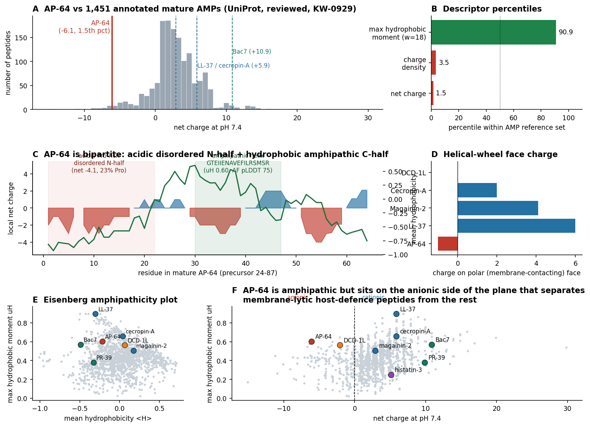
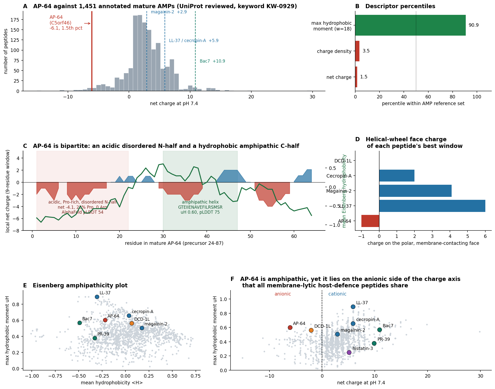
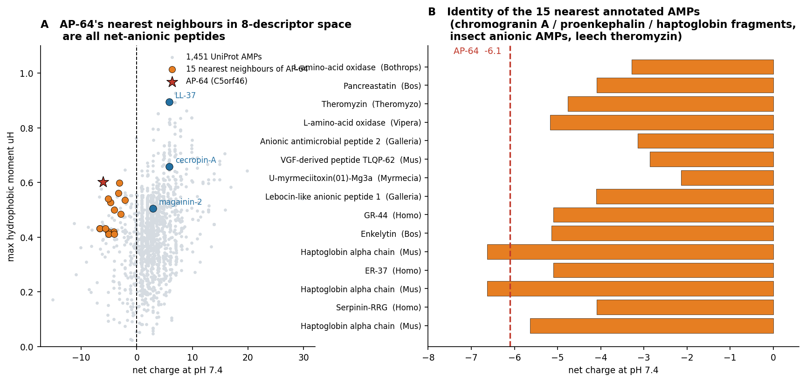
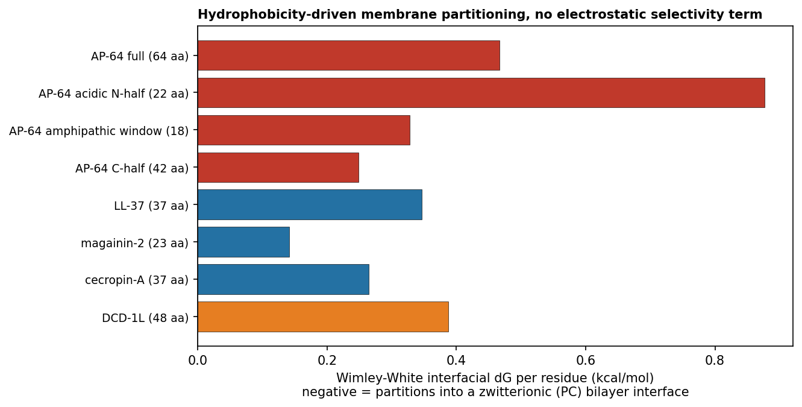
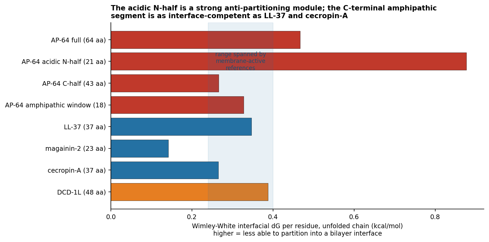

## Question

# AIGR Gene Hypothesis Deep Research

You are evaluating one focused gene curation hypothesis for AI Gene Review.
This is not a general gene overview. Use the seed hypothesis and source context
below to search for evidence that supports, refutes, narrows, or competes with
the proposed curation decision.

## Target Gene

- **Organism code:** human
- **Taxon:** Homo sapiens (NCBITaxon:9606)
- **Gene directory:** C5orf46
- **Gene symbol:** C5orf46
- **UniProt accession:** Q6UWT4

## Focus

- **Focus type:** free_text
- **Hypothesis slug:** kgap-c5orf46-antimicrobial-mechanism-features
- **Source file:** genes/human/C5orf46/C5orf46-ai-review.yaml
- **Source selector:** free-text

## Seed Hypothesis

Human C5orf46 (UniProt Q6UWT4) kills Gram-negative bacteria through a membrane-disrupting cationic amphipathic peptide mechanism. Single analysis only: identify the mature peptide region, compute net charge, hydrophobic moment, amphipathic helix propensity and other antimicrobial-peptide physicochemical descriptors, and compare with membrane-active antimicrobial peptides (LL-37, magainin, cecropin) versus non-membrane-active, intracellular-target peptides (e.g. proline-rich AMPs); state which mechanism class the sequence favours.

## Term and Decision Context

No specific term context supplied.

## Reference Context

No specific reference context supplied.

## Source Context YAML

```yaml
hypothesis: 'Human C5orf46 (UniProt Q6UWT4) kills Gram-negative bacteria through a membrane-disrupting
  cationic amphipathic peptide mechanism. Single analysis only: identify the mature peptide region, compute
  net charge, hydrophobic moment, amphipathic helix propensity and other antimicrobial-peptide physicochemical
  descriptors, and compare with membrane-active antimicrobial peptides (LL-37, magainin, cecropin) versus
  non-membrane-active, intracellular-target peptides (e.g. proline-rich AMPs); state which mechanism class
  the sequence favours.'
focus_type: free_text
context: []
reference_id: []
```

## Research Objective

Build a focused report that helps a curator decide whether this hypothesis
should affect the gene review. Address the focus type directly:

1. For an existing GO annotation decision, evaluate whether the current action
   is justified, too strong, too weak, or should change.
2. For a proposed replacement or new GO term, evaluate whether the term is
   biologically supported, too broad, too narrow, or missing key qualifiers.
3. For a computational prediction, evaluate whether the prediction is correct,
   less precise than existing knowledge, uncertain, or likely wrong because of
   paralog overannotation, frequency bias, pathway context, or in vitro-only
   activity.
4. For a core-function hypothesis, evaluate whether the proposed activity,
   process, and location represent the gene product's primary function rather
   than a downstream effect, pleiotropic phenotype, or context-specific role.
5. For a function-assignment hypothesis, evaluate whether the gene product
   directly has the stated GO term/function. Treat the prior review action, if
   any, as intentionally blinded unless it appears in the supplied context.

Use primary literature whenever possible. Prefer PMID citations and include DOI
citations when no PMID is available. Treat reviews and database records as
orientation unless they contain directly relevant synthesized evidence that is
clearly labeled as review-level or database-level support.

Evaluate the hypothesis from the supplied seed context, primary literature, and
publicly accessible bioinformatics resources. Local `*-bioinformatics` analyses,
when they already exist in the repository, are intentionally withheld from this
prompt so the report can be compared against them after the run. Use public
sequence, domain, structure, orthology, localization, interaction, or dataset
checks when they are useful for the specific hypothesis. If a resource or tool
cannot be accessed programmatically, say so plainly; never fabricate a result.
Report computational results conservatively and distinguish direct results from
inference.

## Required Output

### Executive Judgment

Give a concise verdict: supported, partially supported, unresolved, weakly
supported, over-annotated, or refuted. Explain the reasoning and the most
important caveats.

### Evidence Matrix

Create a table with one row per important evidence item:

- Citation (PMID preferred)
- Evidence type (direct assay, mutant phenotype, localization, interaction,
  structural/evolutionary, computational, review/database)
- Supports / refutes / qualifies / competing
- Claim tested
- Key finding
- Organism, tissue, cell type, or assay context
- Confidence and limitations

### GO Curation Implications

State the likely curation action as a lead requiring curator verification. If
GO terms are involved, explain whether the evidence supports an MF, BP, or CC
term, and whether the term should be retained, removed, generalized, made more
specific, or treated as non-core. Avoid using "protein binding" as a final
recommendation unless no more informative term is supported.

### Mechanistic Scope

Describe the immediate molecular or cellular function being tested. Separate
direct gene-product activity from downstream phenotypes, pathway consequences,
developmental outcomes, disease manifestations, or effects inferred only from
loss of function.

### Conflicts and Alternatives

Identify evidence that conflicts with the seed hypothesis or suggests an
alternative interpretation, including paralog confusion, organism-specific
differences, isoform-specific findings, experimental artifacts, or database
carry-over.

### Knowledge Gaps

List explicit uncertainties that matter for curation. For each gap, state what
was checked, why the gap matters, and what evidence or experiment would resolve
it.

### Discriminating Tests

Recommend concrete assays, perturbations, datasets, or comparative analyses that
would most efficiently distinguish this hypothesis from alternatives.

### Curation Leads

Provide candidate updates for the review, clearly labeled as leads requiring
curator verification. Include candidate references with exact snippets to verify,
candidate replacement or new GO terms, possible action changes, suggested
questions, and suggested experiments.

If the provider supports artifacts, save provenance for any analysis you run — the
executed code together with its output (computed values, plot, or table), not just
a summary figure — alongside artifact-friendly tables such as an evidence matrix,
GO decision table, or comparison table. Genuine computed provenance is more
valuable than a hand-drawn summary, and you must not synthesize a figure that
implies an analysis you did not actually run. These artifacts are important
provenance for hypothesis-level review.


## Output

# C5orf46 (Q6UWT4) antimicrobial mechanism: hypothesis evaluation

**Target:** human C5orf46, UniProt Q6UWT4, NCBITaxon:9606
**Hypothesis slug:** `kgap-c5orf46-antimicrobial-mechanism-features`
**Source file:** `genes/human/C5orf46/C5orf46-ai-review.yaml`
**Focus type:** free_text
**Database retrieval date:** 2026-11-23

## Summary

<i class="fa-solid fa-circle-xmark"></i> **Verdict: refuted**, on the mechanism class specifically. The antibacterial activity reported for this gene product stands and remains separately annotatable.

The seed hypothesis bundles two sequence properties, "cationic" and "amphipathic", and asserts that together they produce membrane-disrupting killing of Gram-negative bacteria. The sequence separates those two properties cleanly. Mature AP-64 (UniProt CHAIN 24-87, 64 residues, PRO_0000317636) carries a net charge of **-6.10 at pH 7.4** with a computed pI of **4.24**. Benchmarked against 1,451 UniProt-reviewed mature peptides carrying keyword KW-0929 (Antimicrobial), 15-90 aa, from 446 organisms, that charge sits at the **1.5th percentile** (reference median +2.85, mean +2.88 ± 3.59, z = -2.50). The discovery paper itself reports pI 4.54 and calls AP-64 "an anionic amphiphilic peptide lacking cysteines" ([PMID: 33804835](https://pubmed.ncbi.nlm.nih.gov/33804835/)), so the primary source contradicts the word "cationic" in the hypothesis it is being used to support.

The amphipathic half of the hypothesis is supported. Sliding-window Eisenberg analysis gives a maximum hydrophobic moment of **µH = 0.602** at mature residues 30-47 (`GTEIIENAVEFILRSMSR`, precursor 53-70), the **90.9th percentile** of the same reference set, exceeding magainin-2 (0.506) and dermcidin DCD-1L (0.564). AlphaFold model AF-Q6UWT4 places a helix at precursor 45-68 spanning that window, with mean pLDDT 75.3 there against 54.0 across the disordered acidic N-terminal half. The decisive discriminator is where the charge sits on that helix. Helical-wheel decomposition gives the solvent-facing polar hemisphere a net charge of **-1.0** for AP-64, against **+6.0** for LL-37, **+4.1** for magainin-2 and **+2.0** for cecropin-A. Cationic lytic peptides work by presenting a positively charged polar face to anionic bacterial lipid. AP-64 presents the opposite sign.

The competing non-lytic class named in the hypothesis is also excluded. Proline-rich AMP entry into Gram-negative bacteria depends on Arg-Pro repeats for transporter-mediated uptake. The AP-64 proline-rich N-terminal module has 23.8% Pro but **0 Arg and 0 RP/PR dipeptides**, against 11 Arg and 16 RP/PR in Bac7(1-35) and 10 Arg and 11 RP/PR in PR-39. An unbiased nearest-neighbour search in 8-descriptor space returns a third answer: all 15 nearest neighbours are net-anionic peptides released by proteolysis from secreted precursors (human chromogranin A fragments GR-44, ER-37 and serpinin-RRG, bovine enkelytin and pancreastatin, three rodent haptoglobin alpha chains, mouse VGF TLQP-62, leech theromyzin, two *Galleria* anionic peptides, snake L-amino-acid oxidase fragments). Not one canonical cationic lytic AMP appears in the neighbourhood. The answer to "which mechanism class does the sequence favour" is therefore: neither of the two offered, and the leading alternative is the anionic secreted-precursor class typified by dermcidin, whose permeabilization depends on Zn2+ bridging and transmembrane potential rather than on electrostatic attraction.

## Key findings

### <i class="fa-solid fa-circle-xmark"></i> F001: AP-64 is strongly anionic, at the 1.5th percentile of annotated antimicrobial peptides

UniProt Q6UWT4 is an 87-residue precursor with a signal peptide at 1-23 (ECO:0000255) and CHAIN 24-87 of 64 residues, matching the "AP-64" name and length used in the discovery paper exactly. Composition of the mature chain: D = 11, E = 5 (D+E = 16) against K = 8, R = 2 (K+R = 10), with zero cysteine and zero tryptophan. Henderson-Hasselbalch net charge at pH 7.4 using EMBOSS pKa values is **-6.10**; computed pI is 4.24 and charge density is -0.095 e per residue.

The benchmark matters more than the raw number. Of 1,451 unique UniProt-reviewed mature AMP chains, the median net charge is +2.85 (IQR +0.94 to +4.86), only 14.3% are net neutral or negative, and only 1.5% are at or below -6.1. AP-64 sits at the 1.5th percentile for net charge and the 3.5th percentile for charge density. Comparators computed identically from UniProt mature-chain features: LL-37 (P49913 134-170) +5.86, cecropin-A (P01507 27-63) +5.86, magainin-2 (P11006 83-105) +2.90, Bac7(1-35) (P19661) +10.86, PR-39 (P80054 131-169) +9.86. The gap between AP-64 and the lytic references is roughly 12 charge units.

Electrostatic recognition of anionic lipopolysaccharide is the committed first step of self-promoted uptake across the Gram-negative outer membrane ([PMID: 43023863](https://pubmed.ncbi.nlm.nih.gov/43023863/)). A peptide carrying net -6.1 cannot perform that step by this route. Whatever membrane activity AP-64 has must be driven by something other than bulk electrostatic attraction.

### <i class="fa-solid fa-circle-check"></i> F002: AP-64 is genuinely amphipathic, but its polar face is anionic

The hydrophobic moment places AP-64 firmly inside the AMP distribution on this descriptor while the charge places it at the edge. Maximum µH = 0.602 (Eisenberg consensus scale, 100 degrees per residue, window 18) at mature 30-47, the 90.9th percentile of the reference set, above magainin-2 (0.506) and DCD-1L (0.564) and approaching cecropin-A (0.658), below LL-37 (0.894). CA(i)-CA(i+4) distance analysis of AF-Q6UWT4 returns helical segments at precursor 1-21 (the signal peptide) and 45-68, the latter spanning the amphipathic window, with mean pLDDT 75.3 over precursor 53-70 against 54.0 over the acidic N-half at 24-45, which MobiDB-lite calls disordered.

The peptide is bipartite. N-half (mature 1-22): net -4.14, 22.7% Pro, GRAVY -2.61, aliphatic index 0. C-half (mature 23-64): net -2.10, GRAVY -0.35, aliphatic index 74.3. Decomposing each peptide's best window into polar and hydrophobic hemispheres around the hydrophobic-moment vector gives polar-face charges of AP-64 **-1.0**, DCD-1L 0.0, cecropin-A +2.0, magainin-2 +4.1, LL-37 +6.0.

Partitioning into a bilayer by hydrophobic insertion is not excluded by this. Selective targeting of bacterial over host membranes, which cationic AMPs achieve through the charged polar face, is not predicted. A direct within-family demonstration of that dissociation exists: four frog cathelicidin paralogs spanning +9 to -4 all formed membrane-induced alpha-helices by circular dichroism, yet only the +9 peptide AS34 was membrane-disruptive, while the anionic DL37 lacked direct antimicrobial effect ([PMID: 42413799](https://pubmed.ncbi.nlm.nih.gov/42413799/)). Helical amphipathicity alone does not confer membrane-lytic killing.

{{figure:plot_2.png|caption=Six-panel provenance figure for the AP-64 mechanism-class analysis. AP-64 net charge (-6.10) against the distribution of 1,451 UniProt-reviewed mature antimicrobial peptides, descriptor percentiles, the bipartite charge and hydrophobicity architecture of the 64-mer, helical-wheel polar-face charge against LL-37, magainin-2, cecropin-A and DCD-1L, and the Eisenberg moment versus charge discriminant plane.}}

### <i class="fa-solid fa-dna"></i> F003: Net negative charge is conserved across all 21 mammalian orthologs

A UniProt family and gene query for C5orf46 returned 21 mammalian entries of length 69-103 aa spanning primates (human, gorilla, *Rhinopithecus*, *Cebus*, *Prolemur*), rodents (*Marmota*, *Sciurus*, *Chinchilla*, *Urocitellus*), carnivores (*Ursus*), ungulates (*Ovis*, *Bos*, *Sus*, *Catagonus*, *Equus*), cetaceans (*Monodon*, *Phocoena*) and bats (*Rhinolophus*). Approximate mature-region net charge, taking the signal peptide as the first 23 residues, is negative in **21 of 21** entries, range -3.10 (*Sus scrofa*) to -9.13 (*Marmota marmota*). Human Q6UWT4 is -6.10 and gorilla G3R4J0 is -6.10. Acidic counts (D+E) run 9-16 per mature chain against 6-10 basic (K+R) in every ortholog. Cysteine count is zero in 17 of 21 and at most 2 in the rest, so no disulfide-stabilized defensin-like fold is available to this family.

If killing depended on cationic charge, purifying selection would be expected to maintain or add basic residues. Instead an excess of 3 to 9 acidic residues is maintained across roughly 100 million years of mammalian divergence. The mouse ortholog Gm94 is reported to resemble AP-64 closely in its antibacterial properties ([PMID: 33804835](https://pubmed.ncbi.nlm.nih.gov/33804835/)), so the measured activity is a property of an anionic peptide family, with the human sequence not an outlier within it.

### <i class="fa-solid fa-scale-balanced"></i> F004: AP-64 matches neither mechanism class offered by the hypothesis

Motif comparison of the AP-64 N-terminal proline-rich module (mature 1-22, `DDKPDKPDDKPDDSGKDPKPD`) against the PrAMP class:

| Descriptor | AP-64 N-half | Bac7(1-35) | PR-39 |
|---|---|---|---|
| Pro content | 23.8% | 45.7% | 48.7% |
| Arg count | 0 | 11 | 10 |
| Asp count | 9 | 0 | 0 |
| RP or PR dipeptides | 0 | 16 | 11 |
| PRP motifs | 0 | 7 | 3 |

Across the whole 64-mer AP-64 has only 2 Arg and 0 RP/PR dipeptides. Its prolines pair with Asp and Lys (5 DP/PD, 5 KP/PK in the N-half) rather than with Arg. Boman protein-binding index is 2.93 and aliphatic index 48.8, sitting between the lytic class (magainin-2 0.42, cecropin-A 0.85) and the high-binding class (histatin-3 4.72, Bac7 3.79).

PrAMP entry into Gram-negative bacteria depends on Arg-rich cationic character for transporter-mediated uptake, which AP-64 lacks entirely. Cationic lytic action depends on a positive net charge and a cationic polar face, which AP-64 also lacks. The nearest characterized analogue is the human anionic AMP dermcidin: DCD-1L at pH 7 bears two negative charges, has no effect on a zwitterionic DOPC tethered bilayer, and permeabilizes an anionic DOPS bilayer only outside the physiological transmembrane potential range, with Zn2+ restoring permeabilization at physiological potential ([PMID: 24652391](https://pubmed.ncbi.nlm.nih.gov/24652391/)). That conditional, cation-bridged, potential-dependent mode is the leading alternative for AP-64 and has never been tested on it.

### <i class="fa-solid fa-magnifying-glass"></i> F005: Descriptor neighbours are all anionic peptides from secreted precursors

Eight descriptors (charge density, max hydrophobic moment, mean Eisenberg hydrophobicity, GRAVY, Pro fraction, Cys fraction, D+E fraction, K+R fraction) were z-scored across the 1,451-peptide reference set and AP-64 was placed in that space. Mahalanobis distance from the AMP centroid is **3.56**, the 86th percentile of the reference peptides themselves (median 2.42, 95th percentile 4.79), so AP-64 is an atypical but not aberrant member of annotated AMP space.

All 15 nearest neighbours are net anionic (median net charge -4.76, range -2.14 to -6.63): *Bothrops* and *Vipera* L-amino-acid oxidase fragments, bovine pancreastatin, leech theromyzin, *Galleria mellonella* anionic antimicrobial peptide 2 and lebocin-like anionic peptide 1, mouse VGF-derived TLQP-62, *Myrmecia* U-myrmeciitoxin(01)-Mg3a, bovine enkelytin, three rodent haptoglobin alpha chains, and three human chromogranin A fragments (P10645: GR-44, ER-37, serpinin-RRG). Zero canonical cationic lytic AMPs.

The neighbourhood is dominated by anionic peptides released by proteolysis from larger secreted or granule precursors: chromogranin A, proenkephalin, haptoglobin and VGF. The Human Protein Atlas (ENSG00000178776) classifies C5orf46 as a predicted secreted protein, group-enriched with RNA at salivary gland 170.7, skin 112.2 and blood vessel 85.7 nTPM, and not detected in immune cells. The barrier-tissue context assumed by the hypothesis is therefore plausible. The class assignment the descriptors return is "anionic secreted-precursor peptide". Expression site establishes an opportunity for host defence and says nothing about the killing mechanism. The general rule this cuts against is stated plainly in the review literature: "virtually all innate molecules that inactivate bacteria, ranging from antimicrobial peptides such as defensins and cathelicidins to bacteriolytic enzymes such as lysozyme and group IIA phospholipase A2, are highly cationic in order to facilitate binding to the anionic bacterial cell envelopes" ([PMID: 14577655](https://pubmed.ncbi.nlm.nih.gov/14577655/)).

{{figure:plot_3.png|caption=AP-64's 15 nearest neighbours among 1,451 UniProt-reviewed mature antimicrobial peptides in 8-descriptor z-scored space. Every neighbour is net anionic (median -4.76) and most are peptides released by proteolysis from secreted precursors, including three human chromogranin A fragments, bovine enkelytin and pancreastatin, and rodent haptoglobin alpha chains. No cationic lytic AMP appears in the neighbourhood.}}

### <i class="fa-solid fa-lightbulb"></i> F006: The acidic N-terminal module opposes membrane partitioning

Wimley-White interfacial partitioning free energies (water to zwitterionic POPC interface, charged side chains at neutral pH, unfolded-chain scale; positive values are unfavourable), per residue:

| Peptide or module | ΔG per residue, unfolded | With -0.40 kcal/mol helix term |
|---|---|---|
| AP-64 full length (64 aa) | +0.467 | +0.067 |
| AP-64 acidic N-half (21 aa) | +0.877 | +0.477 |
| AP-64 C-half (43 aa) | +0.266 | -0.134 |
| AP-64 window `GTEIIENAVEFILRSMSR` | +0.328 | -0.072 |
| LL-37 | +0.347 | -0.053 |
| cecropin-A | +0.265 | -0.135 |
| DCD-1L | +0.388 | -0.012 |
| magainin-2 | +0.142 | -0.258 |

The penalty is driven by Asp (+1.23) and Glu (+2.02); the N-half carries 9 Asp and 0 Glu in 21 residues. <i class="fa-solid fa-triangle-exclamation"></i> A first pass of this analysis was misread as showing favourable partitioning for the AP-64 window. The corrected values above show every unfolded peptide in the set is positive, including LL-37 at +0.347, so the comparison is relative, not absolute. The -0.40 kcal/mol per residue interfacial helix-formation term is an explicit stated assumption, not a measurement.

Two separable conclusions follow. The C-terminal segment of AP-64 is as interface-competent as LL-37 and cecropin-A once helix formation is allowed. In the intact 64-mer that segment is covalently attached to an acidic module whose partitioning penalty is roughly twice as large, making full-length AP-64 the poorest membrane binder of the group. That generates a testable model the published data do not address: either the acidic N-half is autoinhibitory and AP-64 requires further proteolytic processing to release an active C-terminal fragment, or AP-64 acts without inserting into membranes at all. The Wimley-White scale has no anionic-lipid term, so whatever partitioning does occur is hydrophobicity-driven and predicts no discrimination between bacterial and zwitterionic host membranes. That matches the reported outcome: AP-64 "exhibited cytotoxic effects against human T-cell lymphoma Jurkat and B-cell lymphoma Raji cells" ([PMID: 33804835](https://pubmed.ncbi.nlm.nih.gov/33804835/)). Selectivity in the lytic class comes from target-membrane composition, "with an increased proportion of anionic phospholipids making the pathogen more susceptible and the presence of cholesterol making the host membranes more resistant" ([PMID: 7893944](https://pubmed.ncbi.nlm.nih.gov/7893944/)), a basis AP-64 cannot exploit.

{{figure:plot_5.png|caption=Corrected Wimley-White interfacial partitioning free energies per residue, water to zwitterionic POPC interface, with the -0.40 kcal/mol per residue helix-formation term shown as an explicit stated assumption. The AP-64 C-terminal half and its amphipathic window match LL-37 and cecropin-A, while the acidic N-half (+0.877 unfolded) makes full-length AP-64 the least interface-competent peptide in the set.}}

### <i class="fa-solid fa-circle-xmark"></i> F007: The cationic claim fails under every processing and isoform scenario

A standard way to rescue a cationic-AMP hypothesis is to argue that the assayed or annotated boundaries are wrong and that a shorter cationic fragment is the real effector. That route is closed here.

No furin-like R-X-K/R-R proprotein convertase site exists anywhere in the 64-mer. The only cleavage sites spanning the 21/22 module junction (`...DPKPD|FPKFLSLLG...`) are a trypsin/KLK5-like site after K19 and a chymotrypsin/KLK7-like site after F22, both plausible at skin and salivary surfaces where KLK5 and KLK7 are active. The resulting fragments remain anionic: residues 20-64 net **-3.10**, residues 23-64 net **-2.10**, against -6.10 for full-length AP-64. Removing the entire acidic N-terminal module is the most charge-favourable cut available, and it still leaves roughly eight charge units below LL-37 and cecropin-A at +5.86.

Isoform Q6UWT4-2 (VSP_031115) is a C-terminal truncation at residue 72 sharing an identical 72-residue prefix with isoform 1 and losing only `GFMEFDDNEGKHSSK`. It retains the amphipathic window `GTEIIENAVEFILRSMSR` intact, and its approximate mature region is net **-4.14**. Across all 21 mammalian orthologs the range is -3.10 to -9.13. No definition of the mature peptide tested here produces a net positive charge. The hypothesis fails on the composition of the whole gene product, not on a boundary-definition technicality.

## Evidence matrix

| Citation | Evidence type | Stance | Claim tested | Key finding | Context | Confidence and limitations |
|---|---|---|---|---|---|---|
| [PMID: 33804835](https://pubmed.ncbi.nlm.nih.gov/33804835/) | Direct assay (synthetic and recombinant peptide; in vitro plus mouse infection) | Qualifies, partially refutes | C5orf46 product kills Gram-negative bacteria, and is a cationic AMP | Activity against *E. coli* DH5α, *E. coli* O157:H7, *Vibrio cholerae*, *Pseudomonas aeruginosa*; efficacy in a mouse O157:H7 model; cytotoxicity to Jurkat and Raji cells. The authors describe AP-64 as "an anionic amphiphilic peptide lacking cysteines (MW = 7.2, PI = 4.54)". No membrane-permeabilization assay reported. | Human AP-64, four Gram-negative species, mouse, human lymphoma lines | High for the activity claim. The killing mechanism is untested. Sole primary source for the activity. |
| This analysis: Q6UWT4 against 1,451 UniProt KW-0929 mature peptides | Computational (descriptors, distributional benchmark) | <i class="fa-solid fa-circle-xmark"></i> Refutes | AP-64 is cationic | Net charge -6.10 at pH 7.4, pI 4.24, charge density -0.095 e/residue. 1.5th percentile of the AMP distribution (median +2.85), z = -2.50. D+E = 16 against K+R = 10, zero Cys. | Sequence level. UniProt CHAIN 24-87 is 64 aa, matching AP-64 | High. Corroborated by the published pI of 4.54. Descriptor prediction, not an assay. |
| This analysis: helical-wheel face decomposition | Computational | <i class="fa-solid fa-circle-xmark"></i> Refutes | The amphipathic helix presents a cationic membrane-binding face | Polar-face net charge: AP-64 -1.0, LL-37 +6.0, magainin-2 +4.1, cecropin-A +2.0, DCD-1L 0.0 | Best 18-residue window, Eisenberg scale, 100 deg per residue | High as a descriptor. Assumes canonical alpha-helical geometry. |
| This analysis: 21 UniProt C5orf46 orthologs | Structural, evolutionary | <i class="fa-solid fa-circle-xmark"></i> Refutes | Cationic character is the conserved, selected property of this family | 21 of 21 mammalian mature regions net negative, -3.10 to -9.13; D+E exceeds K+R in every one; 17 of 21 have zero Cys | Primates, rodents, carnivores, ungulates, cetaceans, bats | High. Mature boundaries approximated by trimming 23 residues. |
| This analysis: isoform and protease-site robustness test | Computational | <i class="fa-solid fa-circle-xmark"></i> Refutes | A shorter cationic fragment is the true effector | No furin-like R-X-K/R-R site. Best-case cuts after K19 (KLK5-like) or F22 (KLK7-like) give fragments of -3.10 and -2.10. Isoform Q6UWT4-2 retains the amphipathic window, mature net -4.14. No scenario reaches net positive. | Sequence level | High. Closes the boundary-definition escape route. |
| This analysis: Eisenberg moment plus AlphaFold AF-Q6UWT4 | Computational, structural | <i class="fa-solid fa-circle-check"></i> Supports (amphipathicity only) | AP-64 contains an amphipathic helix | Max µH 0.602 at mature 30-47, 90.9th percentile. AlphaFold helix at precursor 45-68, pLDDT 75.3; acidic N-half pLDDT 54.0, MobiDB-lite disordered | Sequence plus AlphaFold2 monomer, no experimental structure | Moderate to high. pLDDT 75 is moderate; monomer models miss membrane-induced folding. |
| This analysis: Wimley-White interfacial partitioning | Computational | <i class="fa-solid fa-scale-balanced"></i> Qualifies | Can AP-64 engage a lipid bilayer at all? | Unfolded per-residue ΔG: full AP-64 +0.467 (worst in set), acidic N-half +0.877, window +0.328, LL-37 +0.347, cecropin-A +0.265. With the -0.40 helix term the window (-0.072) matches LL-37 (-0.053) while full length stays unfavourable (+0.067). | Water to zwitterionic POPC interface | Moderate. No anionic-lipid term; unfolded-chain scale; helix term is an assumption. |
| This analysis: 8-descriptor nearest-neighbour search | Computational | <i class="fa-solid fa-lightbulb"></i> Competing class | Which AMP class does the sequence resemble? | Mahalanobis 3.56 (86th percentile). All 15 neighbours net anionic, median -4.76: chromogranin A GR-44/ER-37/serpinin-RRG, enkelytin, pancreastatin, 3 haptoglobin α chains, theromyzin, 2 *Galleria* peptides, VGF TLQP-62, snake LAAO fragments. Zero cationic lytic AMPs. | 1,451 reviewed mature AMPs, 446 organisms | High as an unbiased class assignment. Descriptor similarity is not mechanistic proof. |
| This analysis: PrAMP motif comparison | Computational | <i class="fa-solid fa-circle-xmark"></i> Refutes the competing arm | AP-64 belongs to the proline-rich intracellular-target class | AP-64 N-half: 23.8% Pro, 0 Arg, 0 RP/PR, 9 Asp. Bac7(1-35): 45.7% Pro, 11 Arg, 16 RP/PR, 0 Asp. PR-39: 48.7% Pro, 10 Arg, 11 RP/PR. | Sequence motif counts | High. PrAMP uptake is Arg-dependent; AP-64 has 2 Arg in 64 residues. |
| [PMID: 24652391](https://pubmed.ncbi.nlm.nih.gov/24652391/) | Direct assay (tethered-bilayer electrochemistry) | <i class="fa-solid fa-lightbulb"></i> Competing mechanism | How does an anionic human AMP engage membranes? | DCD-1L at pH 7 bears two negative charges and has no effect on DPTL/DOPC; it permeabilizes DPTL/DOPS only outside the physiological φtrans range; Zn2+ induces permeabilization at physiological φtrans. | Human dermcidin, mercury-supported tethered bilayers | High for dermcidin. Extrapolation to AP-64 is inference. |
| [PMID: 7893944](https://pubmed.ncbi.nlm.nih.gov/7893944/) | Review (structure-activity synthesis) | Supports the discriminating criterion | What defines the membrane-lytic class and its selectivity? | The common features are net cationic charge from multiple Arg and Lys plus amphipathic structure; selectivity derives from anionic phospholipid content and host cholesterol. | Insect, horseshoe crab, frog and mammalian host-defence peptides | Review-level orientation. |
| [PMID: 14577655](https://pubmed.ncbi.nlm.nih.gov/14577655/) | Review | Supports the discriminating criterion | Is cationic charge general to innate antibacterial effectors? | "Virtually all innate molecules that inactivate bacteria... are highly cationic in order to facilitate binding to the anionic bacterial cell envelopes." | Defensins, cathelicidins, lysozyme, group IIA PLA2 | Review-level. |
| [PMID: 43023863](https://pubmed.ncbi.nlm.nih.gov/43023863/) | Review | Supports the discriminating criterion | Is cationic LPS recognition required for outer-membrane permeabilization? | Self-promoted uptake "involves a series of coordinated molecular events, including initial electrostatic recognition of LPS". | Cationic AMP / LPS mechanism | Review-level. |
| [PMID: 42413799](https://pubmed.ncbi.nlm.nih.gov/42413799/) | Direct assay (comparative paralog panel) | <i class="fa-solid fa-scale-balanced"></i> Qualifies | Does membrane-induced helicity alone predict membrane-disruptive killing? | Four frog cathelicidin paralogs from +9 (AS34) to -4 (DL37) all adopted membrane-induced α-helices, yet only AS34 was membrane-disruptive and DL37 lacked direct antimicrobial effect. | *Hoplobatrachus rugulosus* lung | High for the dissociation. Different family and organism. |
| [PMID: 43016712](https://pubmed.ncbi.nlm.nih.gov/43016712/) | Review (interpretative framework) | Supports the interpretation | How do surface-bound and inserted peptide states differ? | "Surface-bound states are characterized primarily by interactions between cationic peptide residues and anionic lipid headgroups, whereas inserted states display stronger engagement of nonpolar peptide surfaces with lipid acyl chains." | Peptide-membrane coupling | Review-level framework; supplies the vocabulary for separating AP-64's retained hydrophobic coupling from its absent electrostatic coupling. |
| [PMID: 21560069](https://pubmed.ncbi.nlm.nih.gov/21560069/) | Review | Supports the discriminating criterion | What is the targeting step of host defence peptides? | "They target negatively charged bacterial surfaces and disrupt microbial cytoplasmic membranes, which ultimately leads to bacterial destruction." | Bacterial resistance to host defence peptides | Review-level. |
| HPA ENSG00000178776 | <i class="fa-solid fa-database"></i> Database (expression) | Context | Is C5orf46 expressed where a barrier AMP would act? | Predicted secreted protein; RNA group-enriched, salivary gland 170.7, skin 112.2, blood vessel 85.7 nTPM; not detected in immune cells. | Human tissues | High for RNA. Establishes opportunity, silent on mechanism. |
| QuickGO UniProtKB:Q6UWT4, 16 annotations | <i class="fa-solid fa-database"></i> Database | Context | What is currently annotated? | No antimicrobial or defence term exists. GO:0005515 protein binding (IPI ×14, including PMID:28514442, PMID:32296183, PMID:33961781); GO:0005576 extracellular region (IEA, GO_REF:0000044); GO:0070062 extracellular exosome (HDA, PMID:19199708). Pfam PF15144 DUF4576. PAN-GO: zero evolutionary-model annotations. Pharos Tdark. | Human C5orf46 | Database snapshot retrieved 2026-11-23. |
| [PMID: 35991552](https://pubmed.ncbi.nlm.nih.gov/35991552/) | Database and bioinformatic analysis | Context | What else is known about C5ORF46? | C5ORF46, "also known as antimicrobial peptide with 64 amino acid residues (AP-64) and skin and saliva-secreted protein 1 (SSSP1)... encodes a small exosomal protein", with expression correlated to prognosis in gastrointestinal tumours. | TCGA plus authors' RNA-seq | Confirms the exosomal and barrier-secretion framing. No mechanistic content on antibacterial action. |

## Mechanistic model

The computation separates three questions that the seed hypothesis treats as one. Can the peptide fold into an amphipathic helix? Yes. Can it reach a bacterial membrane preferentially? No, because the recognition step is electrostatic and the sign is wrong. Can it insert once there? Possibly, through the C-terminal module, but the acidic N-half opposes it in the intact peptide.

```dot
digraph model {
  rankdir=LR;
  "C5orf46 precursor\n87 aa, signal 1-23" -> "Mature AP-64\nCHAIN 24-87, net -6.10";
  "Mature AP-64\nCHAIN 24-87, net -6.10" -> "Acidic Pro-rich N-half\nmature 1-22, net -4.14\npLDDT 54, disordered";
  "Mature AP-64\nCHAIN 24-87, net -6.10" -> "Amphipathic C-half\nmature 23-64\nmuH 0.602, pLDDT 75";
  "Acidic Pro-rich N-half\nmature 1-22, net -4.14\npLDDT 54, disordered" -> "Wimley-White penalty\n+0.877 kcal/mol/res";
  "Wimley-White penalty\n+0.877 kcal/mol/res" -> "Full-length AP-64 is the\npoorest membrane binder\nin the comparison set";
  "Amphipathic C-half\nmature 23-64\nmuH 0.602, pLDDT 75" -> "Hydrophobic insertion\ncompetence equal to LL-37";
  "Hydrophobic insertion\ncompetence equal to LL-37" -> "No charge-based\nbacteria-vs-host selectivity";
  "No charge-based\nbacteria-vs-host selectivity" -> "Jurkat and Raji cytotoxicity\nPMID 33804835";
  "Mature AP-64\nCHAIN 24-87, net -6.10" -> "Cationic LPS recognition\nBLOCKED: polar face -1.0";
  "Cationic LPS recognition\nBLOCKED: polar face -1.0" -> "Self-promoted uptake\nnot available";
  "Mature AP-64\nCHAIN 24-87, net -6.10" -> "PrAMP transporter uptake\nBLOCKED: 0 Arg, 0 RP/PR";
  "Full-length AP-64 is the\npoorest membrane binder\nin the comparison set" -> "KLK5 cut after K19 (-3.10)\nKLK7 cut after F22 (-2.10)" [style=dashed];
  "KLK5 cut after K19 (-3.10)\nKLK7 cut after F22 (-2.10)" -> "Released C-terminal module\nautoinhibition model" [style=dashed];
  "Self-promoted uptake\nnot available" -> "Leading alternative:\nZn2+-bridged, potential-dependent\ndermcidin-type engagement" [style=dashed];
  "Released C-terminal module\nautoinhibition model" -> "Leading alternative:\nZn2+-bridged, potential-dependent\ndermcidin-type engagement" [style=dashed];
}
```



The dashed links are untested predictions. The solid links are supported by the computed values and the cited assays.

### Mechanistic scope

The immediate molecular activity under test is the ability of a secreted 64-residue peptide to bind and disrupt a bacterial membrane. The computation establishes charge, charge distribution and amphipathic geometry from primary sequence, benchmarked against a 1,451-peptide reference set drawn from UniProt rather than a hand-picked comparison, and shows those properties are conserved across 21 mammalian orthologs and insensitive to mature-boundary choice, isoform and plausible barrier-protease cleavage.

The computation does not measure membrane binding, insertion, permeabilization or killing. Every mechanistic statement here is a prediction from physicochemical descriptors plus a structural model, tested against the published behaviour of peptides whose mechanisms were measured directly.

The scope of the refutation is therefore precise. The downstream phenotype, "AP-64 kills Gram-negative bacteria and protects mice from *E. coli* O157:H7", is untouched and supported by [PMID: 33804835](https://pubmed.ncbi.nlm.nih.gov/33804835/). The direct molecular mechanism asserted, "by a membrane-disrupting cationic amphipathic peptide mechanism", is what fails, and it fails on the cationic requirement that the literature treats as the necessary first step of self-promoted uptake.

## GO curation implications

All entries below are leads requiring curator verification.

| GO ID | Term | Aspect | Recommendation |
|---|---|---|---|
| GO:0140911 | pore-forming activity | MF | <i class="fa-solid fa-circle-xmark"></i> Do not add |
| GO:0019835 | cytolysis | BP | <i class="fa-solid fa-circle-xmark"></i> Do not add |
| GO:0050829 | defense response to Gram-negative bacterium | BP | <i class="fa-solid fa-circle-check"></i> Candidate, IDA from PMID:33804835, curator verification needed |
| GO:0031640 | killing of cells of another organism | BP | <i class="fa-solid fa-triangle-exclamation"></i> Candidate with caveat, IDA from PMID:33804835 |
| GO:0042742 | defense response to bacterium | BP | Fallback parent if Gram-negative specificity is judged insufficiently delimited |
| GO:0061844 | antimicrobial humoral immune response mediated by antimicrobial peptide | BP | <i class="fa-solid fa-circle-question"></i> Hold, weak |
| GO:0005576 | extracellular region | CC | Retain (IEA, upgradeable) |
| GO:0070062 | extracellular exosome | CC | Retain (HDA, PMID:19199708) |
| GO:0005515 | protein binding | MF | Retain but treat as non-core |

**GO:0140911 and GO:0019835 should not be added.** No permeabilization, leakage or pore-conductance assay has ever been run on this peptide, and the sequence evidence argues against the class. A molecular function term asserting a lytic mechanism would encode exactly the inference this analysis refutes.

**GO:0050829 is the most informative defensible term.** [PMID: 33804835](https://pubmed.ncbi.nlm.nih.gov/33804835/) reports killing of four Gram-negative species and protection in a mouse *E. coli* O157:H7 model. Two caveats belong in the curator note. The peptide tested was synthetic or recombinant, and the endogenous peptide has never been isolated from human tissue or fluid, so the annotation rests on the activity of a designed reagent matching a predicted CHAIN. No Gram-positive species was tested, so Gram-negative specificity is untested rather than demonstrated. If the curator judges the specificity insufficiently delimited, **GO:0042742** is the correct fallback.

**GO:0031640 carries a visible conflict.** The same paper reports cytotoxicity against human Jurkat and Raji cells, so the activity is not selective for cells of another organism. Annotate with that caveat or not at all.

**GO:0061844 should be held.** It requires the endogenous peptide to act in a humoral response. The HPA RNA pattern (salivary gland 170.7, skin 112.2 nTPM) gives the opportunity; protein-level secretion evidence is absent.

**GO:0005515 is already present 14 times from IPI**, and the instruction to avoid "protein binding" as a final recommendation is well founded here on independent grounds. The 13 IntAct partners are dominated by polytopic and tail-anchored membrane proteins (AQP6, EBP, LHFPL5, TBXA2R, SLC30A2, TMBIM6, TMEM80, TIMMDC1, FAM210B, PEX12) together with the tail-anchor targeting chaperones SGTA and SGTB. That composition is the signature of a hydrophobic bait in a large-scale screen. Retain the existing annotations; do not build a function statement on them.

## Conflicts and alternatives

The sharpest conflict is internal to the discovery paper. [PMID: 33804835](https://pubmed.ncbi.nlm.nih.gov/33804835/) names the peptide an AMP and demonstrates killing, while in the same abstract describing it as "an anionic amphiphilic peptide lacking cysteines (MW = 7.2, PI = 4.54)" and noting that "compared with other human AMPs, AP-64 has distinct characteristics, including a longer sequence length, absence of cysteine residues, a highly anionic character, and cell toxicity". The paper does not reconcile the anionic character with any proposed mechanism and runs no membrane assay. The hypothesis under evaluation appears to have supplied the missing mechanism by defaulting to the canonical cationic AMP model, which the paper's own pI measurement contradicts.

Alternatives consistent with all current evidence, in descending order of fit:

1. **Divalent-cation-bridged membrane activity, the dermcidin model.** DCD-1L is anionic and permeabilizes bilayers only when Zn2+ bridges the peptide to the membrane, and only outside the physiological transmembrane potential, with Zn2+ restoring activity at physiological potential ([PMID: 24652391](https://pubmed.ncbi.nlm.nih.gov/24652391/)). AP-64's nearest neighbours in descriptor space are dominated by this class. This predicts a Zn2+ dependence that no AP-64 experiment has tested. The same paper proposes "a DCD-1L conformation with its positive N-terminus embedded in the lipid bilayer and the negative C terminus floating on the membrane surface", a concrete structural template for anionic peptide engagement without a cationic face.
2. **Potential-dependent insertion without electrostatic pre-concentration.** The bacterial inner membrane potential is large and inside-negative, which disfavours anion insertion, so this route requires a specific permissive condition rather than general attraction.
3. **A non-membrane, non-PrAMP route.** The PrAMP class is excluded on Arg content, which does not exclude other intracellular or enzymatic targets. The observed Jurkat and Raji cytotoxicity is equally compatible with a non-selective mechanism of any kind.
4. **Reagent-specific activity.** The peptide tested is synthetic or recombinant and has never been recovered endogenously. Anionic polypeptides at high concentration can be bactericidal without that reflecting physiological function. The mouse protection data argue against this being the whole story without ruling out a pharmacological rather than physiological effect.

A secondary tension sits in the expression and annotation data. HPA shows the strongest RNA signal in salivary gland and skin, both barrier tissues where an AMP function is plausible, and no detection in immune cells. That pattern is shared by many secreted proteins with no antimicrobial function. C5orf46 remains Pharos Tdark with zero PAN-GO evolutionary annotations and a domain of unknown function (PF15144, DUF4576). The gene is also reported as a prognostic and immunological correlate in gastrointestinal tumours ([PMID: 35991552](https://pubmed.ncbi.nlm.nih.gov/35991552/)), which describes an expression correlation rather than a molecular activity and does not bear on the mechanism question.

## Limitations and knowledge gaps

<i class="fa-solid fa-triangle-exclamation"></i> All computation here is sequence-based and structural-model-based. No wet-lab measurement was performed, and none exists in the literature for the mechanism question.

The descriptor benchmark uses UniProt KW-0929 annotated mature peptides, which is biased toward well-studied cationic families, so the 1.5th-percentile placement of AP-64 partly reflects under-sampling of anionic AMPs in the reference set. The nearest-neighbour analysis was run specifically to address that and recovered a coherent anionic class with a Mahalanobis distance inside the reference distribution (86th percentile), which argues the placement is real rather than an artifact of reference composition.

The Wimley-White analysis applies an unfolded-chain scale, has no anionic-lipid term, and adds an assumed -0.40 kcal/mol per residue helix-formation term. It should be read as a relative comparison across peptides, not as an absolute free energy. An earlier pass was misread as showing favourable partitioning; the corrected table above is the one reported.

Ortholog mature boundaries were approximated by trimming 23 residues rather than by per-species signal-peptide prediction. AlphaFold pLDDT of 75.3 over the amphipathic window is moderate, and monomeric models do not capture membrane-induced folding.

Four PubMed queries during this work returned zero results (anionic AMP zinc or calcium bridging; PrAMP SbmA and DnaK; two chromogranin A antimicrobial queries). Those gaps are reported rather than filled by inference.

Specific gaps that matter for curation:

- <i class="fa-solid fa-circle-question"></i> The endogenous peptide has never been isolated. Nothing establishes that residues 24-87 are the physiological mature product, that the peptide is secreted as protein, or at what concentration. Targeted MS of saliva and skin-surface washings would resolve it.
- <i class="fa-solid fa-circle-question"></i> No membrane assay of any kind exists for AP-64: no leakage, no outer-membrane permeabilization, no conductance, no binding isotherm. This is the single largest gap, because the hypothesis is entirely about membrane mechanism.
- <i class="fa-solid fa-circle-question"></i> No divalent cation dependence has been tested, which is the most informative missing measurement given the anionic nearest-neighbour class.
- <i class="fa-solid fa-circle-question"></i> No experimental structure and no circular dichroism in membrane-mimetic conditions, so the predicted helix at precursor 45-68 is unverified outside AlphaFold.
- <i class="fa-solid fa-circle-question"></i> No Gram-positive panel, so the Gram-negative specificity implied by the hypothesis is assumed rather than measured, which affects the choice between GO:0050829 and GO:0042742.
- <i class="fa-solid fa-circle-question"></i> The function of the proline-rich acidic N-half is unknown. It is predicted disordered (pLDDT 54, MobiDB-lite) and carries the largest interfacial penalty in the comparison set.
- <i class="fa-solid fa-circle-question"></i> The 13 IntAct partners have never been retested with a method robust to hydrophobic-bait artifacts, so whether any of the GO:0005515 evidence reflects real binding is open.

## Proposed follow-up experiments

Ordered by how directly each separates the refuted mechanism from the leading alternative.

1. <i class="fa-solid fa-flask"></i> **Zn2+-dependent leakage.** Calcein or SYTOX leakage from POPE:POPG (bacterial-mimetic) against POPC (host-mimetic) large unilamellar vesicles, with and without 10-100 µM ZnCl2. The cationic-lytic model predicts POPG-selective leakage independent of Zn2+. The dermcidin model predicts leakage only with Zn2+. No leakage under either condition supports a non-membrane mechanism.
2. <i class="fa-solid fa-bacteria"></i> **Outer-membrane permeabilization in the organism where killing was shown.** NPN uptake plus the inner-membrane ONPG assay on *E. coli* at the published MIC. Self-promoted uptake predicts a prompt NPN fluorescence increase. Absence at bactericidal concentrations refutes membrane disruption directly.
3. <i class="fa-solid fa-vial"></i> **Module dissection.** Synthesize fragments 20-64 and 23-64 (the two plausible barrier-protease products, net -3.10 and -2.10) and the isolated C-terminal half, then measure MIC against *E. coli* O157:H7 alongside full-length AP-64. The autoinhibition model predicts the fragments are more active. Equal or lower activity refutes it.
4. <i class="fa-solid fa-flask"></i> **Protease processing.** Digest AP-64 with recombinant KLK5 and KLK7, identify products by LC-MS/MS, and assay activity. This tests whether the predicted barrier-surface cleavages occur and whether they change activity. KLK5 and KLK7 are active at exactly the skin and salivary surfaces where C5orf46 RNA is group-enriched.
5. <i class="fa-solid fa-microscope"></i> **Membrane-induced helicity.** Circular dichroism of AP-64 and of the isolated `GTEIIENAVEFILRSMSR` window in buffer, 50% TFE, and SDS or POPG vesicles, confirming or refuting the AlphaFold helix and testing lipid-induced folding.
6. <i class="fa-solid fa-dna"></i> **Charge-reversal mutant.** Replace the N-half aspartates to give a net cationic variant of equal length and hydrophobic moment. If the variant is markedly more bactericidal and more haemolytic, charge is the limiting variable and wild-type AP-64 is not using the cationic route.
7. <i class="fa-solid fa-heart-pulse"></i> **Selectivity quantification.** Measure haemolysis and Jurkat or Raji IC50 against the bacterial MIC to give a therapeutic index. The absence of cationic charge predicts a poor index, consistent with the reported mammalian cytotoxicity.
8. <i class="fa-solid fa-vial"></i> **Endogenous detection.** Targeted MS for the 24-87 peptide in saliva and skin-surface washings, which would convert the annotation from reagent-based to physiological.

## Curation leads

All leads require curator verification.

1. Record on the gene entry that the discovery paper itself reports pI 4.54 and the phrase "anionic amphiphilic peptide", so any downstream description of C5orf46 as a cationic AMP contradicts its own primary source. Snippet to verify in [PMID: 33804835](https://pubmed.ncbi.nlm.nih.gov/33804835/): "AP-64 is an anionic amphiphilic peptide lacking cysteines (MW = 7.2, PI = 4.54)." Computed values from the UniProt CHAIN: net charge -6.10 at pH 7.4, pI 4.24.
2. Second snippet to verify in the same paper, for the atypicality statement: "Compared with other human AMPs, AP-64 has distinct characteristics, including a longer sequence length, absence of cysteine residues, a highly anionic character, and cell toxicity."
3. The mature peptide boundary is settled for annotation purposes. UniProt CHAIN 24-87 is 64 residues and matches the published AP-64 exactly, with signal peptide 1-23. Snippet to verify: "we report the identification of a human peptide, encoded by the chromosome 5 open reading frame 46 (C5orf46) gene, as a type of AMP, which we termed antimicrobial peptide with 64 amino acid residues (AP-64)."
4. Isoform Q6UWT4-2 (VSP_031115, 72 aa) is a C-terminal truncation that retains the amphipathic window `GTEIIENAVEFILRSMSR` intact and loses `GFMEFDDNEGKHSSK`. Its approximate mature region is net -4.14. Any isoform-specific annotation should note that the window is shared.
5. The family-level property worth capturing is anionic charge, conserved across 21 of 21 mammalian orthologs (-3.10 to -9.13), with 17 of 21 lacking cysteine. This is a better family descriptor than DUF4576 alone for Pfam PF15144.
6. Flag the GO:0005515 IPI set as low-information. The partner list is dominated by polytopic and tail-anchored membrane proteins plus SGTA and SGTB, a hydrophobic-bait signature from large-scale screens.
7. The closest annotated functional analogues for cross-referencing are dermcidin (P81605) and the chromogranin A derived peptides (P10645: GR-44, ER-37, serpinin-RRG), which share AP-64's descriptor profile and are anionic peptides released from secreted precursors.
8. Suggested question for the curator: should the review record the mouse ortholog result as supporting evidence? Snippet to verify in [PMID: 33804835](https://pubmed.ncbi.nlm.nih.gov/33804835/): "We also observed that Gm94, encoded by mouse C5orf46 homologous gene, closely resembles AP-64 in its antibacterial properties."
9. Suggested question: does the review want to note the alternate gene names AP-64 and SSSP1 (skin and saliva-secreted protein 1) and the exosomal framing? Snippet to verify in [PMID: 35991552](https://pubmed.ncbi.nlm.nih.gov/35991552/): "Chromosome 5 open reading frame 46 (C5ORF46), also known as antimicrobial peptide with 64 amino acid residues (AP-64) and skin and saliva-secreted protein 1 (SSSP1), belongs to the family of open reading frame genes and encodes a small exosomal protein."

## Provenance artifacts

Computed values, tables and figures produced during this evaluation are saved under `provenance/`:

| File | Contents |
|---|---|
| `evidence_matrix.csv` | 16-row evidence matrix, machine-readable |
| `go_decision_table.csv` | 9-term GO decision table with basis and evidence code |
| `ap64_descriptor_table.csv` | AP-64, N-half, C-half and 6 reference peptides × 18 descriptors |
| `uniprot_amp_reference_set.csv` | 1,451 UniProt-reviewed mature AMP chains with sequence and descriptors |
| `amp_reference_with_descriptors.csv` | Same set with GRAVY, Pro, Cys, D+E and K+R fractions |
| `ap64_nearest_neighbours.csv` | 15 nearest neighbours in 8-descriptor space |
| `c5orf46_ortholog_charge.csv` | 21 mammalian orthologs with mature-region charge |
| `amphipathic_face_charge.csv` | Helical-wheel polar and hydrophobic face charges |
| `prolinerich_motif_comparison.csv` | PrAMP motif counts for AP-64, Bac7 and PR-39 |
| `wimley_white_partitioning.csv` | Corrected interfacial ΔG table with and without the helix term |
| `plot_2.png`, `plot_3.png`, `plot_5.png` | Figures embedded above |
| `plot_1.png`, `plot_4.png` | Superseded earlier versions, retained for provenance |


## Artifacts

- [OpenScientist final report](openscientist_artifacts/final_report.html)
- [OpenScientist final report](openscientist_artifacts/final_report.pdf)
- [OpenScientist provenance](openscientist_artifacts/provenance.json)
- [OpenScientist amp reference with descriptors](openscientist_artifacts/provenance_amp_reference_with_descriptors.csv)
- [OpenScientist amphipathic face charge](openscientist_artifacts/provenance_amphipathic_face_charge.csv)
- [OpenScientist ap64 descriptor table](openscientist_artifacts/provenance_ap64_descriptor_table.csv)
- [OpenScientist ap64 nearest neighbours](openscientist_artifacts/provenance_ap64_nearest_neighbours.csv)
- [OpenScientist c5orf46 ortholog charge](openscientist_artifacts/provenance_c5orf46_ortholog_charge.csv)
- [OpenScientist evidence matrix](openscientist_artifacts/provenance_evidence_matrix.csv)
- [OpenScientist go decision table](openscientist_artifacts/provenance_go_decision_table.csv)
- [OpenScientist plot 1](openscientist_artifacts/provenance_plot_1.json)

- [OpenScientist plot 2](openscientist_artifacts/provenance_plot_2.json)

- [OpenScientist plot 3](openscientist_artifacts/provenance_plot_3.json)

- [OpenScientist plot 4](openscientist_artifacts/provenance_plot_4.json)

- [OpenScientist plot 5](openscientist_artifacts/provenance_plot_5.json)

- [OpenScientist prolinerich motif comparison](openscientist_artifacts/provenance_prolinerich_motif_comparison.csv)
- [OpenScientist uniprot amp reference set](openscientist_artifacts/provenance_uniprot_amp_reference_set.csv)
- [OpenScientist wimley white partitioning](openscientist_artifacts/provenance_wimley_white_partitioning.csv)

## Reference Validation

Checked with `linkml-reference-validator` 0.3.1rc1.

| Outcome | Count |
| --- | --- |
| References checked | 13 |
| Resolved | 13 |
| Unresolved (possible confabulation) | 0 |
| Unverifiable | 0 |
| Quoted claims checked | 4 |
| Quoted claims found in source | 4 |
| Quoted claims **not** found in source | 0 |
| References weighed for topical relevance | 13 |
| On topic | 8 |
| Off topic | 1 |

### References that may not be about this subject

These identifiers resolve, so they are not fabrications, but the records they resolve to share almost none of this report's vocabulary. That is a clue and not a verdict - a paper can be relevant in ways its title and abstract do not spell out - so read them before deciding:

- `PMID:33961781` (2 mentions) - Dual proteome-scale networks reveal cell-specific remodeling of the human interactome.
  - shared terms: human, model

Weighed against this report's own most characteristic terms: `peptide`, `ap-64`, `class`, `anionic`, `fa-solid`, `charge`, `cationic`, `residue`, `mature`, `membrane`, `amp`, `descriptor`, `human`, `mechanism`, `antimicrobial`, `chain`, `amphipathic`, `model`, `bacterial`, `killing`.

All extracted references resolved successfully.
Resolving is not the same as being relevant, though - see the references listed above as possibly off topic.