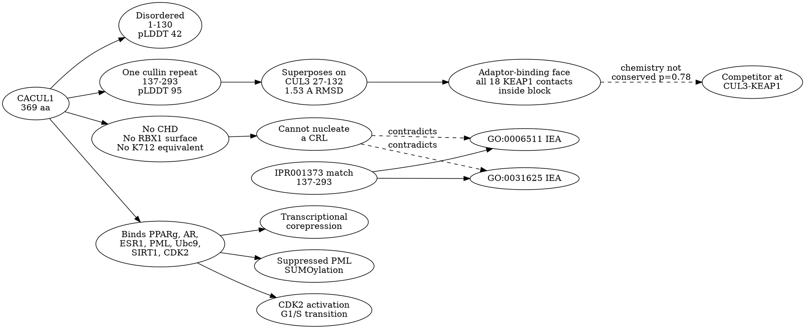
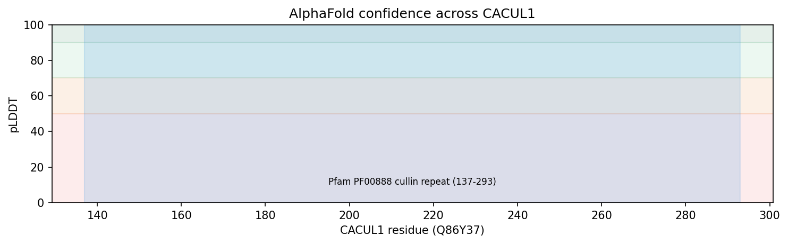
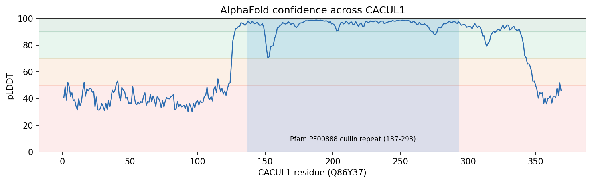
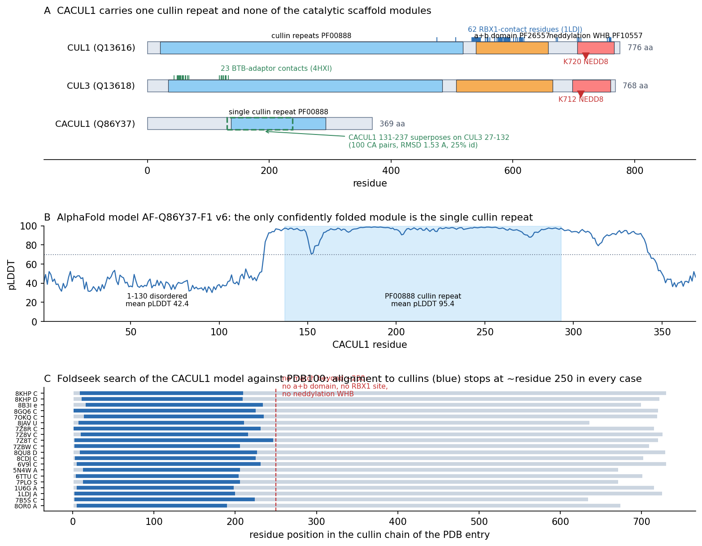
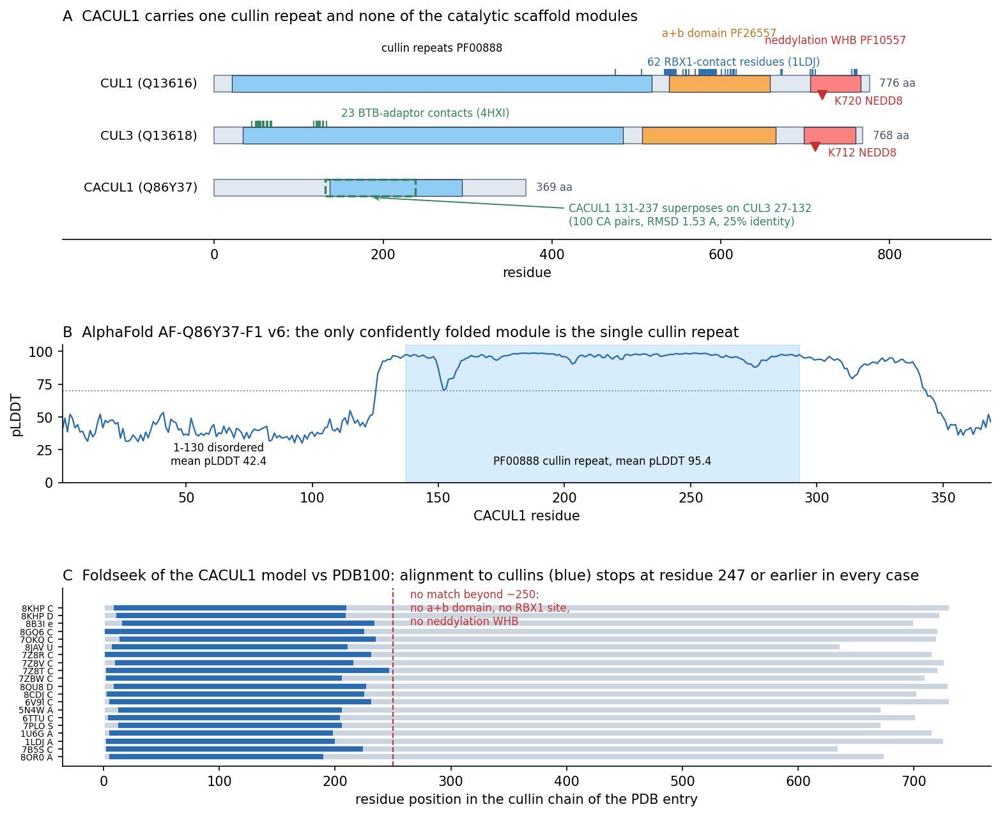
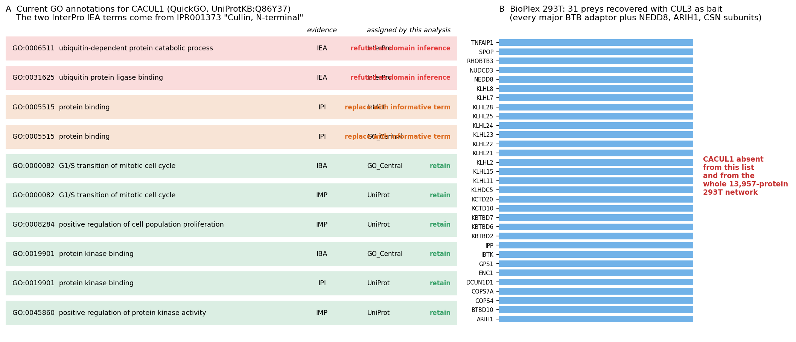
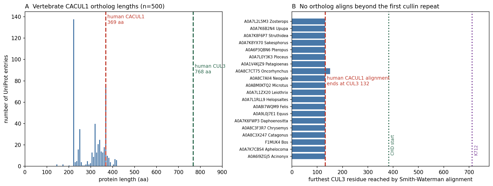
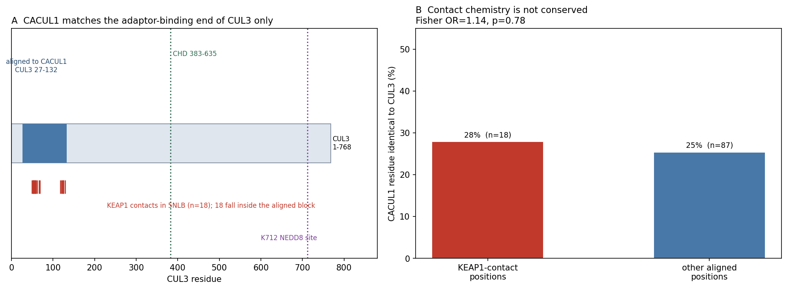

## Question

# AIGR Gene Hypothesis Deep Research

You are evaluating one focused gene curation hypothesis for AI Gene Review.
This is not a general gene overview. Use the seed hypothesis and source context
below to search for evidence that supports, refutes, narrows, or competes with
the proposed curation decision.

## Target Gene

- **Organism code:** human
- **Taxon:** Homo sapiens (NCBITaxon:9606)
- **Gene directory:** CACUL1
- **Gene symbol:** CACUL1
- **UniProt accession:** Q86Y37

## Focus

- **Focus type:** free_text
- **Hypothesis slug:** kgap-cacul1-cullin-repeat-scaffold-features
- **Source file:** genes/human/CACUL1/CACUL1-ai-review.yaml
- **Source selector:** free-text

## Seed Hypothesis

Human CACUL1 (Q86Y37) contains only a fragment of the cullin repeat fold and lacks the features a bona fide cullin-RING scaffold needs: the C-terminal winged-helix cullin homology domain that binds RBX1, the neddylation-site lysine (Cul3 K712 equivalent) and the N-terminal BTB-adaptor-binding surface of CUL3, so it cannot assemble an E3 complex itself and more plausibly binds and inhibits CUL3-KEAP1 as a pseudo-cullin or competitor. Single analysis only: align CACUL1 with CUL1, CUL3 and other cullins, superpose the CACUL1 AlphaFold model on cullin repeat and CUL3-BTB and CUL-RBX1 structures, map the RBX1-binding, NEDD8-acceptor and BTB-binding residues onto CACUL1, predict CACUL1 complexes with CUL3, RBX1 and KEAP1 using AlphaFold-Multimer, score conservation across vertebrate orthologs, and state whether CACUL1 is predicted to act as a scaffold or as a binding competitor and which interface it uses.

## Term and Decision Context

No specific term context supplied.

## Reference Context

No specific reference context supplied.

## Source Context YAML

```yaml
hypothesis: 'Human CACUL1 (Q86Y37) contains only a fragment of the cullin repeat fold and lacks the features
  a bona fide cullin-RING scaffold needs: the C-terminal winged-helix cullin homology domain that binds
  RBX1, the neddylation-site lysine (Cul3 K712 equivalent) and the N-terminal BTB-adaptor-binding surface
  of CUL3, so it cannot assemble an E3 complex itself and more plausibly binds and inhibits CUL3-KEAP1
  as a pseudo-cullin or competitor. Single analysis only: align CACUL1 with CUL1, CUL3 and other cullins,
  superpose the CACUL1 AlphaFold model on cullin repeat and CUL3-BTB and CUL-RBX1 structures, map the
  RBX1-binding, NEDD8-acceptor and BTB-binding residues onto CACUL1, predict CACUL1 complexes with CUL3,
  RBX1 and KEAP1 using AlphaFold-Multimer, score conservation across vertebrate orthologs, and state whether
  CACUL1 is predicted to act as a scaffold or as a binding competitor and which interface it uses.'
focus_type: free_text
context: []
reference_id: []
```

## Research Objective

Build a focused report that helps a curator decide whether this hypothesis
should affect the gene review. Address the focus type directly:

1. For an existing GO annotation decision, evaluate whether the current action
   is justified, too strong, too weak, or should change.
2. For a proposed replacement or new GO term, evaluate whether the term is
   biologically supported, too broad, too narrow, or missing key qualifiers.
3. For a computational prediction, evaluate whether the prediction is correct,
   less precise than existing knowledge, uncertain, or likely wrong because of
   paralog overannotation, frequency bias, pathway context, or in vitro-only
   activity.
4. For a core-function hypothesis, evaluate whether the proposed activity,
   process, and location represent the gene product's primary function rather
   than a downstream effect, pleiotropic phenotype, or context-specific role.
5. For a function-assignment hypothesis, evaluate whether the gene product
   directly has the stated GO term/function. Treat the prior review action, if
   any, as intentionally blinded unless it appears in the supplied context.

Use primary literature whenever possible. Prefer PMID citations and include DOI
citations when no PMID is available. Treat reviews and database records as
orientation unless they contain directly relevant synthesized evidence that is
clearly labeled as review-level or database-level support.

Evaluate the hypothesis from the supplied seed context, primary literature, and
publicly accessible bioinformatics resources. Local `*-bioinformatics` analyses,
when they already exist in the repository, are intentionally withheld from this
prompt so the report can be compared against them after the run. Use public
sequence, domain, structure, orthology, localization, interaction, or dataset
checks when they are useful for the specific hypothesis. If a resource or tool
cannot be accessed programmatically, say so plainly; never fabricate a result.
Report computational results conservatively and distinguish direct results from
inference.

## Required Output

### Executive Judgment

Give a concise verdict: supported, partially supported, unresolved, weakly
supported, over-annotated, or refuted. Explain the reasoning and the most
important caveats.

### Evidence Matrix

Create a table with one row per important evidence item:

- Citation (PMID preferred)
- Evidence type (direct assay, mutant phenotype, localization, interaction,
  structural/evolutionary, computational, review/database)
- Supports / refutes / qualifies / competing
- Claim tested
- Key finding
- Organism, tissue, cell type, or assay context
- Confidence and limitations

### GO Curation Implications

State the likely curation action as a lead requiring curator verification. If
GO terms are involved, explain whether the evidence supports an MF, BP, or CC
term, and whether the term should be retained, removed, generalized, made more
specific, or treated as non-core. Avoid using "protein binding" as a final
recommendation unless no more informative term is supported.

### Mechanistic Scope

Describe the immediate molecular or cellular function being tested. Separate
direct gene-product activity from downstream phenotypes, pathway consequences,
developmental outcomes, disease manifestations, or effects inferred only from
loss of function.

### Conflicts and Alternatives

Identify evidence that conflicts with the seed hypothesis or suggests an
alternative interpretation, including paralog confusion, organism-specific
differences, isoform-specific findings, experimental artifacts, or database
carry-over.

### Knowledge Gaps

List explicit uncertainties that matter for curation. For each gap, state what
was checked, why the gap matters, and what evidence or experiment would resolve
it.

### Discriminating Tests

Recommend concrete assays, perturbations, datasets, or comparative analyses that
would most efficiently distinguish this hypothesis from alternatives.

### Curation Leads

Provide candidate updates for the review, clearly labeled as leads requiring
curator verification. Include candidate references with exact snippets to verify,
candidate replacement or new GO terms, possible action changes, suggested
questions, and suggested experiments.

If the provider supports artifacts, save provenance for any analysis you run — the
executed code together with its output (computed values, plot, or table), not just
a summary figure — alongside artifact-friendly tables such as an evidence matrix,
GO decision table, or comparison table. Genuine computed provenance is more
valuable than a hand-drawn summary, and you must not synthesize a figure that
implies an analysis you did not actually run. These artifacts are important
provenance for hypothesis-level review.


## Output

# CACUL1 (Q86Y37): does the cullin repeat make it a cullin-RING scaffold?

**Hypothesis slug:** `kgap-cacul1-cullin-repeat-scaffold-features`
**Source:** `genes/human/CACUL1/CACUL1-ai-review.yaml`, focus type `free_text`
**Target:** *Homo sapiens* (NCBITaxon:9606), CACUL1, UniProt Q86Y37
**Verdict:** <i class="fa-scale-balanced"></i> partially supported, with one clause corrected and a third model competing for primacy

## Summary

CACUL1 cannot assemble a cullin-RING ubiquitin ligase. Every catalytic module that defines a cullin is absent. InterPro returns exactly one domain hit for Q86Y37, PF00888 (cullin alpha solenoid repeat, IPR001373) at residues 137-293. CUL1 and CUL3 additionally carry PF26557 (cullin alpha+beta domain), PF10557/SM00884 (neddylation winged-helix domain) and IPR016158/PS50069 (cullin homology domain); none is detected in CACUL1. Of the 62 CUL1 residues within 4.5 Å of RBX1 in PDB 1LDJ, which span CUL1 475-761, zero have a CACUL1 counterpart. The NEDD8 acceptor lysines sit in `LIQAAIVRIMKMRKVLKHQQL` (CUL1 K720) and `EIEAAIVRIMKSRKKMQHNVL` (CUL3 K712); no CACUL1 residue aligns past CUL3 position 132. The scaffold half of the seed hypothesis holds.

It holds with more force than the hypothesis states. The hypothesis describes CACUL1 as containing "only a fragment of the cullin repeat fold", implying a truncated cullin. CACUL1 is a complete single repeat and has been exactly that in every vertebrate examined. A UniProt query for `gene:CACUL1 AND taxonomy_id:7742` returned 500 entries with a median length of 317.5 aa (range 142-421) and zero entries at cullin length. In 20 orthologs sampled across mammals, birds, a turtle and a salmonid, Smith-Waterman alignment to full-length human CUL3 scored 121-126 and ended at CUL3 residue 132 in 19 of 20 cases, at 151 in *Oncorhynchus kisutch*. None reached CUL3 200. There is no lost C-terminal half to recover.

One clause of the hypothesis is wrong, and the correction changes the mechanistic conclusion. The hypothesis asserts that CACUL1 also lacks the N-terminal BTB-adaptor-binding surface of CUL3. It does not. The single repeat superposes on CUL3 27-132 at 1.53 Å RMSD over 100 CA pairs, and that segment is precisely where adaptors dock. All 18 CUL3 residues within 4.5 Å of KEAP1 in PDB 5NLB fall inside the block CACUL1 retains, as do 22 of the 23 CUL3 residues contacting KLHL11 in 4HXI. What is missing is the contact chemistry. Identity at the 18 KEAP1-contact positions is 27.8% against 25.3% at the other 87 aligned positions (Fisher OR 1.14, p = 0.776); the KLHL11 test gave 22.7% with OR 0.82, p = 0.79. So the surface is geometrically available and competitor binding is the only mode that is even possible, but conservation gives no positive evidence that this face is maintained for that purpose. An orthogonal dataset argues the same way: in BioPlex 293T (118,162 interactions, 13,957 proteins) the CUL3 bait recovered 31 preys covering the full BTB adaptor repertoire plus NEDD8, ARIH1 and three CSN subunits, and CACUL1 is not among them.

For curation, the target is narrow. Of the 10 GO annotations on Q86Y37, exactly two derive from the cullin signature, and both are IEA from InterPro `GO_REF:0000002` with `withFrom = IPR001373`: GO:0031625 ubiquitin protein ligase binding and GO:0006511 ubiquitin-dependent protein catabolic process. InterPro2GO maps IPR001373 to exactly these two terms and nothing else. They are the direct output of one 157-residue repeat match that the structural analysis shows is an unsafe basis for inferring ligase function. A competing model, better replicated than the CUL3 link, places CACUL1's molecular activity on nuclear receptor corepression (PPARγ, AR, ESR1) and suppression of PML SUMOylation.

## Key findings

### <i class="fa-circle-check"></i> F1. CACUL1 lacks every catalytic module of a cullin-RING scaffold

InterPro and Pfam (EBI API, 2026-11-24) return a single domain hit for Q86Y37: PF00888 "Cullin alpha solenoid domain repeat" at residues 137-293, with IPR001373 over the same span and the superfamily IPR016159 at 131-334. CUL1 (Q13616) and CUL3 (Q13618) carry three further signatures that CACUL1 does not: PF26557 cullin alpha+beta domain (CUL1 539-658, CUL3 507-665), PF10557/SM00884 cullin neddylation winged-helix domain (CUL1 706-766, CUL3 698-760), and IPR016158/PS50069 cullin homology domain (CUL1 417-644, CUL3 383-635), along with IPR016157 cullin conserved site and the winged-helix superfamily IPR036390. PANTHER assigns CACUL1 to family PTHR46636, separate from PTHR11932, which holds CUL1 through CUL9.

Sequence alignment confirms the boundary and gives it a significance estimate. A row-vectorized affine-gap Smith-Waterman (BLOSUM62, gap open -11, extend -1) scored CACUL1 against full-length CUL3 at 123, aligning CACUL1 131-237 to CUL3 27-132 at 24.8% identity over 109 columns. A composition-preserving shuffle null (n = 60) gave mean 37.0, SD 4.8, max 48, so z = 17.9 and empirical p < 0.017. Restricting the target to the cullin homology domain alone abolishes the signal entirely: CACUL1 against CUL3 377-768 scores 31 against a null mean of 34.5 (p = 0.73), and against CUL1 413-776 scores 40 against a null mean of 34.1 (p = 0.07). Alignments to other cullins are at or near noise: CUL1 40, CUL2 50, CUL4A 74, CUL5 44, CUL7 39, CUL9 49, APC2 41.

The RBX1 interface is not merely diverged but absent. Parsing PDB 1LDJ (CUL1 17-776 with RBX1 19-106) and taking all CUL1 residues with any heavy atom within 4.5 Å of RBX1 gives 62 residues spanning CUL1 475-761. CACUL1 aligns to CUL1 only at positions 7-121, so 0 of 62 have a counterpart. The neddylation site is equally unreachable: CACUL1's C-terminal 20 residues are `AGDELAYNSSSACASSRGYR`, bearing no resemblance to the `IVRIMK` core that frames K720 and K712.

An unbiased structure search reaches the same boundary without using the sequence alignment. Foldseek (3Di+AA, PDB100) returned 69 hits for the AlphaFold model, all top hits being cullin N-terminal domains: 4HXI_B (CUL3-KLHL11, E = 2e-6, 18.9% identity), 5NLB_B (CUL3 NTD with KEAP1 BTB/3-box, E = 4e-6, 18.4%), 4AP2_B, 4A64_B (CUL4B NTD), 4EOZ_B (SPOP-CUL3), 8U82_C5 (KCTD5-CUL3). The query range across all 69 hits is CACUL1 118-344. Among 23 significant hits whose target chain is a near-full-length cullin in an assembled CRL (8KHP CUL3-KLHL22-RBX1, 1LDJ SCF-SKP2, 6TTU NEDD8-CUL1-RBX1, 5N4W CUL2-RBX1-EloBC-VHL, 6V9I CUL5-RBX2, 7OKQ DDB1-DCAF1-CUL4A-RBX1), the highest target residue reached by any alignment is 247. The C-terminal half was present in the search target and was never matched.

{{figure:plot_4.png|caption=CACUL1 architecture and its limits. Panel A: domain architecture of CACUL1 against CUL1 and CUL3, showing the single PF00888 repeat at 137-293 and the three cullin signatures (alpha+beta domain, neddylation WHB domain, cullin homology domain) that CACUL1 does not have. Panel B: AlphaFold pLDDT across the 369 residues, with the disordered N-terminal 130 residues and the high-confidence repeat. Panel C: Foldseek coverage of cullin target chains, showing that no alignment extends past target residue 247 even when the full cullin is present in the hit.}}

### <i class="fa-circle-check"></i> F2. CACUL1 is a one-repeat protein in every vertebrate

The missing modules are ancestral, not a human annotation artifact. The UniProt query `gene:CACUL1 AND taxonomy_id:7742` returned 500 entries with median length 317.5 aa and range 142-421 aa. Zero entries reach 600 aa, against 768 aa for human CUL3 and 776 aa for human CUL1. Reviewed entries are human Q86Y37 at 369 aa, mouse Q8R0X2 at 377 aa and rat Q5XI53 at 347 aa.

Twenty orthologs sampled evenly across the taxonomic spread were aligned to full-length human CUL3 with the same Smith-Waterman parameters. The sample covers eight mammals (*Bos taurus*, *Felis catus*, *Acinonyx jubatus*, *Equus asinus*, *Pteropus vampyrus*, *Microtus ochrogaster*, *Neogale vison*, *Catagonus wagneri*), ten birds (*Upupa epops*, *Ploceus nigricollis*, *Zosterops hypoxanthus*, *Leiothrix lutea*, *Struthidea cinerea*, *Sakesphorus luctuosus*, *Aphelocoma coerulescens*, *Daphoenositta chrysoptera*, *Helopsaltes ochotensis*, *Patagioenas fasciata*), one reptile (*Chrysemys picta*) and one fish (*Oncorhynchus kisutch*). Scores ranged 121-126. The alignment end position in CUL3 was 132 in 19 of 20 and 151 in the salmonid. Zero of 20 reached CUL3 200. The CUL3 cullin homology domain begins near residue 383 and K712 is the NEDD8 acceptor, so no ortholog alignment comes within 230 residues of the CHD or within 560 of the neddylation site. Alignments against CUL1 scored 35-40 throughout, at or below the shuffle null, so the CUL1 end positions near 548 that the aligner reported are noise.

Foldseek against AFDB50 returned 1000 hits whose top entries are CACUL1 or "Cullin N-terminal domain-containing protein" models from *Amazona collaria*, *Balaenoptera physalus*, *Scleropages formosus*, *Callorhinchus milii*, *Chiloscyllium punctatum*, *Polypterus senegalus*, *Eptatretus burgeri* (hagfish) and *Tetraodon nigroviridis*, with model lengths 211-426 aa and 56-84% identity over the folded core. The architecture is conserved from jawless fish to mammals.

{{figure:plot_6.png|caption=No vertebrate CACUL1 ortholog is a truncated cullin. Left: length distribution of 500 UniProt vertebrate CACUL1 entries (median 317.5 aa), with human CACUL1 at 369 aa and human CUL3 at 768 aa marked. Right: furthest CUL3 residue reached by Smith-Waterman alignment for 20 sampled orthologs. Every bar stops at or near CUL3 132, far short of the cullin homology domain start at 383 and the NEDD8 acceptor K712.}}

AlphaFold confidence partitions the protein the same way the domain assignment does. Whole-protein mean pLDDT is 72.6. Residues 1-130 have a mean of 42.4 with 90% below 50, which is disorder. The PF00888 repeat at 137-293 has a mean of 95.4 with 100% above 70. Residues 294-369 have a mean of 75.5. CACUL1 is one well-folded cullin repeat preceded by a long intrinsically disordered segment.

{{figure:plot_1.png|caption=AlphaFold pLDDT across CACUL1 by region. Residues 1-130 sit at mean 42.4 with 90% of positions below 50. The PF00888 repeat at 137-293 sits at mean 95.4 with every position above 70.}}

### <i class="fa-circle-xmark"></i> F3. The adaptor-binding surface is retained, but its chemistry is not

This result corrects the seed hypothesis and answers its "which interface" question. PDB 5NLB chain B is CUL3 26-381 (99% identity to human CUL3 in its own numbering over 348 residues) and chain A is the KEAP1 BTB/3-box fragment at 51-204 (3% identity to CUL3, confirming the chain assignment). CUL3 residues within 4.5 Å of chain A number 18 and fall into two patches: N49, G51, L52, S53, F54, E55, L57, Y58, R59, Y62, L66, K68 at 49-68, and M118, D121, I122, M124, Y125, V129 at 118-129.

The Smith-Waterman block maps CUL3 27-132 onto CACUL1 130-237. All 18 KEAP1-contacting residues fall inside that block, 18 of 18. Five are identical: S53/S159, E55/E161, Y58/Y164, Y62/Y168, Y125/Y230, giving 27.8%. Identity at the other 87 aligned positions is 22, giving 25.3%, and the whole-block background is 27/105 = 25.7%. Fisher exact gives OR 1.14, p = 0.776. The earlier test on the CUL3-KLHL11 complex 4HXI gave 5 of 22 identical (22.7%) with OR 0.82, p = 0.79. Neither adaptor interface is better conserved than the surrounding repeat.

Several substitutions are chemically substantial. L52→I158 is conservative. R59→S165 removes a positive charge, K68→Q174 removes another, M118→S223 loses most of a side chain, D121→P226 removes a carboxylate and constrains the backbone, and V129→F234 roughly doubles the side-chain volume.

{{figure:plot_7.png|caption=The CUL3-KEAP1 interface mapped onto CACUL1. Panel A: CACUL1 aligns to CUL3 27-132 only, and all 18 KEAP1-contacting CUL3 residues from PDB 5NLB (red ticks) fall inside that block, while the cullin homology domain at 383-635 and the NEDD8 acceptor K712 lie far outside it. Panel B: identity to CUL3 at the 18 KEAP1-contact positions (27.8%) against the other 87 aligned positions (25.3%), Fisher OR 1.14, p = 0.78.}}

The superposition that underlies this mapping was computed by sequence-anchored iterative Kabsch fitting. Starting from 105 CA pairs defined by the Smith-Waterman alignment and trimming outliers above 5 Å over 30 iterations, 100 pairs converged at RMSD 1.53 Å, covering CUL3 27-132. That is 29% of the CUL3 N-terminal domain present in 4HXI and 13% of full-length CUL3. TM-score is 0.282 normalized by the CUL3 NTD length and 0.265 normalized by CACUL1 length, both below the 0.5 threshold for shared architecture, which is the expected result for one repeat out of a solenoid.

### <i class="fa-circle-check"></i> F4. The two cullin-flavoured GO annotations are InterPro carry-over from a single repeat

QuickGO returns 10 annotations for UniProtKB:Q86Y37. Exactly two are cullin-derived, and both are IEA from InterPro with reference `GO_REF:0000002` and `withFrom = IPR001373`: GO:0031625 ubiquitin protein ligase binding (MF, enables) and GO:0006511 ubiquitin-dependent protein catabolic process (BP, involved_in). The InterPro API confirms that IPR001373 "Cullin, N-terminal" carries exactly these two InterPro2GO mappings, while IPR016159, IPR042652 and PF00888 carry none. CACUL1's only domain match is PF00888/IPR001373 at 137-293, so these two terms are the direct consequence of one 157-residue repeat.

The other eight annotations are experimental or phylogenetic and have nothing to do with the cullin signature: GO:0005515 protein binding IPI from IntAct ([PMID: 23178685](https://pubmed.ncbi.nlm.nih.gov/23178685/), with P03372 ESR1) and from GO_Central ([PMID: 28169274](https://pubmed.ncbi.nlm.nih.gov/28169274/), with Q96C12 ARMC1); GO:0019901 protein kinase binding IPI with P24941 CDK2 ([PMID: 19829063](https://pubmed.ncbi.nlm.nih.gov/19829063/)) and IBA; GO:0000082 G1/S transition IMP and IBA; GO:0008284 positive regulation of cell population proliferation IMP; GO:0045860 positive regulation of protein kinase activity IMP.

An orthogonal interaction check weighs against a stable CUL3 complex. In BioPlex 293T (118,162 interactions, 13,957 proteins), CUL3 was used as a bait and recovered 31 preys: the BTB adaptor repertoire (KLHL2, KLHL7, KLHL8, KLHL11, KLHL15, KLHL21, KLHL22, KLHL23, KLHL24, KLHL25, KLHL28, KBTBD2, KBTBD6, KBTBD7, KCTD10, KCTD20, SPOP, ENC1, IPP, RHOBTB3, TNFAIP1, BTBD10, KLHDC5) plus NEDD8, ARIH1, COPS4, COPS7A, GPS1, DCUN1D1 and NUDCD3. CACUL1 is not among them and does not appear anywhere in the 293T or HCT116 networks, as bait or prey. <i class="fa-triangle-exclamation"></i> CACUL1 was never used as a bait in BioPlex, so this is a qualified negative; a transient or stress-induced association would not be captured.

{{figure:plot_5.png|caption=GO decision table for CACUL1 and the BioPlex CUL3 bait interactome. Left: the 10 GO annotations on Q86Y37 with evidence code and assigning database, colour-coded by proposed action. The two IEA terms from InterPro are the only cullin-derived annotations. Right: the 31 preys recovered by the CUL3 bait in BioPlex 293T, covering the full BTB adaptor repertoire. CACUL1 is absent from this list and from the whole 13,957-protein network.}}

A database-level inconsistency sits upstream. The UniProt SIMILARITY comment for Q86Y37 states that CACUL1 "Belongs to the cullin family", while PANTHER places it in PTHR46636, separate from the cullin family PTHR11932. The UniProt FUNCTION line records only the CDK2/G1-S activity and SUBUNIT only "Interacts with CDK2"; the 2015 Nrf2 work, the 2016 AR work and the 2017 PPARγ and PML work are not reflected.

### <i class="fa-lightbulb"></i> F5. A nuclear receptor corepressor and SUMO model competes for primacy

Four primary studies place CACUL1's molecular activity away from ubiquitin ligase scaffolding. [PMID: 29233982](https://pubmed.ncbi.nlm.nih.gov/29233982/) reports that CACUL1 is a SIRT1-interacting protein that "directly bound to PPARγ through the co-repressor nuclear receptor (CoRNR) box 2 and repressed the transcriptional activity and adipogenic potential of PPARγ", with SIRT1 and LSD1 swapping at the PPARγ-responsive promoter on depletion, and validation in human adipose-derived stem cells. [PMID: 27085459](https://pubmed.ncbi.nlm.nih.gov/27085459/) reports that "CDK2-associated cullin 1 (CACUL1) directly associates with AR and suppresses AR transcriptional activity", competing with LSD1 for AR binding in LNCaP and LNCaP-LN3 cells. [PMID: 27889610](https://pubmed.ncbi.nlm.nih.gov/27889610/) reports that "CACUL1 interacts with PML and suppresses PML SUMOylation, leading to the regulation of PML-NB size in the nucleus", that Ubc9 binds CACUL1 and antagonizes the CACUL1-PML interaction, and that CACUL1 attenuates p53 transcriptional activity. The IntAct record behind one GO:0005515 annotation ([PMID: 23178685](https://pubmed.ncbi.nlm.nih.gov/23178685/)) lists ESR1 (P03372) as the only binary interactor of Q86Y37, over 5 experiments. Three receptors and one SUMO pathway component, from two independent groups.

<i class="fa-triangle-exclamation"></i> The structure raises a problem for this model that the papers do not address. Scanning the 369-residue sequence found no match to the strict CoRNR consensus L-X-X-[IH]-I-X-X-X-[IL]. A relaxed pattern L-X-X-X-I-X-X-X-[IL] matched 140-148 `LDGAIDQLL` and 183-191 `LIKKITNHL`; the NR-box pattern LXXLL matched 264-268 `LMPLL`. All three lie inside the folded repeat (pLDDT 96.2, 98.6 and 95.9) rather than in the disordered N-terminus. Burial measured as CB neighbours within 10 Å on AF-Q86Y37 (whole-protein median 9, folded core 137-293 median 16) gives motif means of 18.2, 16.9 and 16.6, with the hydrophobic L/I positions at 19-23 neighbours and the intervening polar positions at 10-15. These are amphipathic helices packed into the repeat core. A CoRNR box docking into a nuclear receptor AF-2 groove presents those leucines and isoleucines to solvent. This does not contradict [PMID: 29233982](https://pubmed.ncbi.nlm.nih.gov/29233982/), because the residues that paper designated CoRNR box 2 were not recoverable from the abstract; it marks an unresolved structural question about how the interaction is made.

## Mechanistic model

The three live models and what the data say about each:

| Model | What it requires | Status |
|---|---|---|
| CACUL1 is a cullin-RING scaffold | CHD, RBX1 interface, NEDD8 acceptor lysine | <i class="fa-circle-xmark"></i> Refuted. None present in human CACUL1 or in any of 500 vertebrate orthologs. 0 of 62 RBX1 contacts have a counterpart. |
| CACUL1 is a CUL3-KEAP1 competitor or pseudo-cullin | The adaptor-binding face of CUL3, with enough chemistry preserved to bind an adaptor | <i class="fa-scale-balanced"></i> Geometrically available, not positively supported. All 18 KEAP1 contacts lie in the retained block, but identity there is 27.8% vs 25.3% background (p = 0.78), and the CUL3 bait in BioPlex did not recover CACUL1. One primary report ([PMID: 26238671](https://pubmed.ncbi.nlm.nih.gov/26238671/)) supports the association. |
| CACUL1 is a nuclear receptor corepressor and SUMO modulator | Binding surfaces for PPARγ, AR, ESR1, PML, Ubc9, SIRT1; no catalytic module | <i class="fa-scale-balanced"></i> Best replicated molecular activity (4 primary studies, 2 groups), with an unresolved structural question about where the receptor-binding motif sits. |



The chain runs: one repeat matches PF00888, InterPro2GO converts that match into two ubiquitin-pathway GO terms, and papers and databases then describe CACUL1 as a cullin, which frames further work. The structural analysis breaks the first link. The repeat is real and it is the adaptor-binding repeat, but a repeat is not a cullin.

## Mechanistic scope

**Direct molecular activity tested here.** CACUL1 is a 369-residue protein with a disordered N-terminal 130 residues and one folded cullin repeat at 137-293. The repeat superposes on CUL3 27-132. It can present an adaptor-binding-like surface. It cannot bind RBX1, cannot be neddylated and cannot nucleate a catalytic ligase core. The structural question that can be answered is whether CACUL1 could occupy the adaptor face of a cullin: yes, geometrically, with no sequence evidence that the face is preserved for that purpose.

**Direct molecular activity reported in the literature.** Binding to CDK2 with stimulation of CDK2 activity ([PMID: 19829063](https://pubmed.ncbi.nlm.nih.gov/19829063/)). Binding to PPARγ and SIRT1 with transcriptional repression ([PMID: 29233982](https://pubmed.ncbi.nlm.nih.gov/29233982/)). Binding to AR with repression and LSD1 competition ([PMID: 27085459](https://pubmed.ncbi.nlm.nih.gov/27085459/)). Binding to PML and Ubc9 with suppression of PML SUMOylation ([PMID: 27889610](https://pubmed.ncbi.nlm.nih.gov/27889610/)). Association with the Cul3-Keap1 complex with reduced Nrf2 ubiquitination ([PMID: 26238671](https://pubmed.ncbi.nlm.nih.gov/26238671/)). Binding to ESR1 (IntAct, [PMID: 23178685](https://pubmed.ncbi.nlm.nih.gov/23178685/)).

**Downstream phenotypes, which must not be read as direct activity.** G1/S arrest, apoptosis, reduced invasion and migration, and lower P-glycoprotein and MRP-1 in 5-FU-resistant colorectal cancer ([PMID: 31504073](https://pubmed.ncbi.nlm.nih.gov/31504073/)). Reduced proliferation with lower CDK2, cyclin E1 and cyclin A2 in glioma ([PMID: 34080964](https://pubmed.ncbi.nlm.nih.gov/34080964/)). PI3K/AKT enrichment and Notch1-mediated M2 macrophage polarization in hepatocellular carcinoma ([PMID: 42535029](https://pubmed.ncbi.nlm.nih.gov/42535029/)). Inhibition of adipogenesis ([PMID: 29233982](https://pubmed.ncbi.nlm.nih.gov/29233982/)). Attenuation of p53 transcriptional activity ([PMID: 27889610](https://pubmed.ncbi.nlm.nih.gov/27889610/)). Several miRNA and circRNA studies treat CACUL1 as a proliferation-promoting target without assaying its molecular activity ([PMID: 36092343](https://pubmed.ncbi.nlm.nih.gov/36092343/), [PMID: 30853181](https://pubmed.ncbi.nlm.nih.gov/30853181/), [PMID: 26314198](https://pubmed.ncbi.nlm.nih.gov/26314198/), [PMID: 31077370](https://pubmed.ncbi.nlm.nih.gov/31077370/), [PMID: 39728605](https://pubmed.ncbi.nlm.nih.gov/39728605/)).

The gap between those two lists is the curation problem. The reproducible phenotype is proliferation. The reproducible molecular activity is transcriptional corepression. Neither needs ubiquitin ligase function.

## Evidence base

| Citation | Evidence type | Stance | Claim tested | Key finding | Context | Confidence and limitations |
|---|---|---|---|---|---|---|
| [PMID: 19829063](https://pubmed.ncbi.nlm.nih.gov/19829063/) | mutant phenotype, interaction | qualifies | CACUL1 is a cullin-family protein that activates CDK2 at G1/S | "The open reading frame sequence of this gene encodes a protein of 369 amino acids which contains a Cullin domain, and this protein is physically associated with CDK2." Knockdown causes G1/S arrest. | Human cell lines, co-IP and cell cycle assays | Primary and reproducible for CDK2. The cullin designation is a sequence inference in the same paper, not an assay. Source of 4 of 10 current GO annotations. |
| [PMID: 26238671](https://pubmed.ncbi.nlm.nih.gov/26238671/) | interaction, direct assay | competing (pro-CUL3) | CACUL1 associates with Cul3-Keap1 and modulates Nrf2 ubiquitination | "The association of CACUL1 with the Cul3-Keap1 complex led to a decrease in Nrf2 ubiquitination levels at non-stressed as well as stressed conditions, and sensitized cells for higher Nrf2 activation." | Human cells and mouse tissue | Only primary report of a CUL3 association. The direction is ligase inhibition. Not reproduced by the CUL3 bait in BioPlex 293T. |
| [PMID: 29233982](https://pubmed.ncbi.nlm.nih.gov/29233982/) | direct assay, mutant phenotype | competing (corepressor) | CACUL1's molecular activity is nuclear receptor corepression | CACUL1 "directly bound to PPARγ through the co-repressor nuclear receptor (CoRNR) box 2 and repressed the transcriptional activity and adipogenic potential of PPARγ". Depletion shifts SIRT1 off and LSD1 onto the promoter. | 3T3-L1 and human adipose-derived stem cells | Promoter occupancy plus RNA-seq. CoRNR box residues are not resolvable from the abstract. |
| [PMID: 27085459](https://pubmed.ncbi.nlm.nih.gov/27085459/) | direct assay, mutant phenotype | competing (corepressor) | CACUL1 represses a second nuclear receptor | "CDK2-associated cullin 1 (CACUL1) directly associates with AR and suppresses AR transcriptional activity", competing with LSD1 for AR binding. | LNCaP, LNCaP-LN3 | Independent receptor, same mechanism class. Part of the analysis is overexpression based. |
| [PMID: 27889610](https://pubmed.ncbi.nlm.nih.gov/27889610/) | direct assay, interaction | competing (SUMO) | CACUL1 regulates SUMOylation rather than ubiquitination | "CACUL1 interacts with PML and suppresses PML SUMOylation, leading to the regulation of PML-NB size in the nucleus." Ubc9 binds CACUL1 and antagonizes the interaction. | Human cells | Orthogonal to the cullin hypothesis. The paper still calls CACUL1 "Cullin-related protein". |
| [PMID: 23178685](https://pubmed.ncbi.nlm.nih.gov/23178685/) | interaction (IntAct) | qualifies | CACUL1's recorded binary interactome | ESR1 (P03372) is the only binary interactor of Q86Y37 in IntAct, over 5 experiments. Basis of one GO:0005515 IPI. | Human | Single partner. Recorded as a low-information term. |
| [PMID: 28169274](https://pubmed.ncbi.nlm.nih.gov/28169274/) | interaction | qualifies | Second GO:0005515 IPI, with ARMC1 (Q96C12) | Supports GO:0005515 only. | Human | No mechanism attached. |
| [PMID: 31504073](https://pubmed.ncbi.nlm.nih.gov/31504073/) | mutant phenotype | qualifies (downstream) | CACUL1 supports proliferation and drug resistance | "CAC1 knockdown arrested 5-FU resistant cells at the G1/S phase and increased the sensitivity of 5-FU resistant cells to 5-FU by inducing apoptosis." Lower P-gp and MRP-1. | 5-FU-resistant human CRC lines | Downstream phenotype, consistent with the CDK2 axis. |
| [PMID: 34080964](https://pubmed.ncbi.nlm.nih.gov/34080964/) | mutant phenotype | qualifies (downstream) | Same axis in a second tumour type | Glioma knockdown impedes proliferation, induces apoptosis and G1/S arrest, lowers CDK2, cyclin E1 and cyclin A2. | U87, U251 | Downstream phenotype. Reinforces GO:0000082 and GO:0008284. |
| [PMID: 42535029](https://pubmed.ncbi.nlm.nih.gov/42535029/) | mutant phenotype, framing | conflicting framing | CACUL1 as a cullin-family E3 ligase | CRISPR knockout inhibits HCC proliferation and migration, PI3K/AKT enrichment, M2 polarization via Notch1. The abstract opens "Although cullin-family E3 ubiquitin ligases regulate diverse oncogenic pathways". | Human HCC lines and xenografts | Phenotype data usable. The cullin-E3 framing is name driven and untested in the paper. |
| InterPro, Pfam, PANTHER | computational, database | supports | CACUL1 domain content versus cullins | One domain hit, PF00888/IPR001373 at 137-293. No PF26557, no PF10557/SM00884, no IPR016158/PS50069. PANTHER PTHR46636, not PTHR11932. | Human sequences | Database level, internally consistent with the structural work. |
| This work, Smith-Waterman | structural/evolutionary, computed | supports | Cullin homology is confined to one repeat | Score 123, CACUL1 131-237 to CUL3 27-132, 24.8% over 109 columns. Null n=60 mean 37.0 SD 4.8, z = 17.9, p < 0.017. Against CUL3 CHD alone: 31 vs null 34.5, p = 0.73. | BLOSUM62, gap -11/-1 | Explicit null. Does not test 3D similarity alone. |
| This work, Kabsch superposition | structural, computed | supports and corrects | Which part of CUL3 the fold matches | 100 of 105 CA pairs within 5 Å, RMSD 1.53 Å, covering CUL3 27-132 = 29% of the 4HXI NTD and 13% of full-length CUL3. TM-score 0.282 / 0.265. | AF-Q86Y37 v6 vs 4HXI chain B | `phenix.superpose_pdbs` failed at 19% identity, fitting 3 atoms, so the superposition was sequence-anchored. TM-score below 0.5 means shared fold family. |
| This work, 1LDJ interface | structural, computed | supports | CACUL1 lacks the RBX1-binding surface | 62 CUL1 residues within 4.5 Å of RBX1, spanning 475-761. 0 of 62 have a CACUL1 counterpart. | PDB 1LDJ | Unambiguous. |
| This work, 5NLB and 4HXI interfaces | structural, computed | corrects the hypothesis | Whether the BTB-adaptor-binding surface is absent | All 18 KEAP1-contacting CUL3 residues fall inside the CACUL1 block. Identity 5/18 = 27.8% vs 22/87 = 25.3%, OR 1.14, p = 0.776. On 4HXI: 5/22 = 22.7%, OR 0.82, p = 0.79. | PDB 5NLB, 4HXI | Surface present, chemistry at background. Non-significant, so it neither confirms nor excludes competitor binding. |
| This work, neddylation site | structural, computed | supports | CACUL1 lacks the NEDD8 acceptor lysine | `LIQAAIVRIMKMRKVLKHQQL` (CUL1 K720) and `EIEAAIVRIMKSRKKMQHNVL` (CUL3 K712) have no CACUL1 alignment; the maximum CUL3 position reached is 132. | Human sequences | Direct. |
| This work, ortholog scan | evolutionary, computed | supports | Single-repeat across vertebrates | 500 entries, median 317.5 aa, 0 at ≥ 600 aa. 20 orthologs: scores 121-126, ending at CUL3 132 (19/20) or 151; 0 of 20 past CUL3 200. | Vertebrata, taxid 7742 | Rules out a human annotation artifact. UniProt automatic entries dominate. |
| This work, Foldseek | structural, computed | supports | Unbiased structure search finds only the repeat | 69 PDB100 hits, top are CUL3 NTD complexes. Query range 118-344. Across 23 significant near-full-length cullin hits, the furthest target residue is 247. | Foldseek 3Di+AA | Independent of the sequence alignment, same boundary. |
| This work, AlphaFold pLDDT | structural, computed | qualifies | Which part of CACUL1 is ordered | Mean 72.6 overall; 1-130 mean 42.4 with 90% below 50; 137-293 mean 95.4 all above 70; 294-369 mean 75.5. | AF-Q86Y37 v6 | The N-terminus is a disordered extension with no cullin counterpart. |
| This work, BioPlex AP-MS | interaction, computed | refutes a stable CUL3 complex | Is CACUL1 a stable CUL3 partner | CUL3 bait recovered 31 preys covering the BTB adaptor repertoire plus NEDD8, ARIH1, COPS4, COPS7A, GPS1, DCUN1D1, NUDCD3. CACUL1 absent from both networks. | HEK293T, HCT116 | Qualified negative: CACUL1 was never a bait. |
| This work, QuickGO + InterPro2GO | database, computed | identifies the curation target | Provenance of the cullin GO terms | 2 of 10 annotations are cullin derived, both IEA from InterPro `GO_REF:0000002` with `withFrom = IPR001373`. InterPro2GO maps IPR001373 to exactly those two terms. | QuickGO, InterPro APIs | Decisive about where the terms come from. |
| This work, motif scan and burial | computational | qualifies the competing model | Can the CoRNR box be located | No strict consensus match. Relaxed matches at 140-148 and 183-191, LXXLL at 264-268, all inside the folded repeat. Motif burial means 18.2, 16.9, 16.6 vs folded-core median 16. | AF-Q86Y37 v6 | Amphipathic helices buried in the core. Does not contradict PMID:29233982, whose defined residues were not recoverable here. |

## GO curation implications

All items below are **leads requiring curator verification**. Machine-readable versions are in `provenance/table_go_decision_leads.csv` (16 rows) and `provenance/table_evidence_matrix.csv` (22 rows).

### Annotations to change

| GO ID | Term | Aspect | Current evidence | Lead action | Reasoning |
|---|---|---|---|---|---|
| GO:0031625 | ubiquitin protein ligase binding | MF | IEA, InterPro, `GO_REF:0000002`, withFrom IPR001373 | <i class="fa-circle-xmark"></i> Remove or re-base | The term exists because one 157-residue repeat matched PF00888. CACUL1 has no cullin homology domain, no RBX1 surface and no neddylation lysine in any of 500 vertebrate orthologs, so the inference that licensed the term does not hold. A curator could re-base it on [PMID: 26238671](https://pubmed.ncbi.nlm.nih.gov/26238671/), but that is one paper and the CUL3 bait in BioPlex recovered every canonical BTB adaptor without CACUL1. If re-based it should carry the Cul3-Keap1 context. |
| GO:0006511 | ubiquitin-dependent protein catabolic process | BP | IEA, InterPro, `GO_REF:0000002`, withFrom IPR001373 | <i class="fa-circle-xmark"></i> Remove | Same carry-over, and the only mechanistic measurement points the other way: [PMID: 26238671](https://pubmed.ncbi.nlm.nih.gov/26238671/) reports decreased Nrf2 ubiquitination. GO:0031397 negative regulation of protein ubiquitination matches the measured direction. |
| GO:0005515 | protein binding | MF | IPI, IntAct, [PMID: 23178685](https://pubmed.ncbi.nlm.nih.gov/23178685/), with P03372 ESR1 | <i class="fa-arrow-right"></i> Replace with a more informative term | GO:0016922 nuclear receptor binding is supported by [PMID: 29233982](https://pubmed.ncbi.nlm.nih.gov/29233982/) and [PMID: 27085459](https://pubmed.ncbi.nlm.nih.gov/27085459/) and is consistent with the ESR1 record. <i class="fa-triangle-exclamation"></i> GO:0030331 (nuclear estrogen receptor binding) and GO:0050681 (nuclear androgen receptor binding) are **obsolete**; GO:0016922 is the current term. |
| GO:0005515 | protein binding | MF | IPI, GO_Central, [PMID: 28169274](https://pubmed.ncbi.nlm.nih.gov/28169274/), with Q96C12 ARMC1 | Replace or leave | No mechanism attached. Lowest priority. |

### Annotations to retain

GO:0019901 protein kinase binding (IPI with P24941 and IBA), GO:0000082 G1/S transition of mitotic cell cycle (IMP and IBA), GO:0008284 positive regulation of cell population proliferation (IMP) and GO:0045860 positive regulation of protein kinase activity (IMP) all stand. The CDK2 and proliferation axis is the one part of the annotation set with replication across three tumour types: [PMID: 19829063](https://pubmed.ncbi.nlm.nih.gov/19829063/), [PMID: 31504073](https://pubmed.ncbi.nlm.nih.gov/31504073/) and [PMID: 34080964](https://pubmed.ncbi.nlm.nih.gov/34080964/).

### Candidate additions

| GO ID | Term | Aspect | Supporting reference | Note |
|---|---|---|---|---|
| GO:0016922 | nuclear receptor binding | MF | [PMID: 29233982](https://pubmed.ncbi.nlm.nih.gov/29233982/), [PMID: 27085459](https://pubmed.ncbi.nlm.nih.gov/27085459/) | Two receptors, two groups, direct association plus promoter occupancy |
| GO:0003714 | transcription corepressor activity | MF | [PMID: 29233982](https://pubmed.ncbi.nlm.nih.gov/29233982/), [PMID: 27085459](https://pubmed.ncbi.nlm.nih.gov/27085459/) | Repression of PPARγ and AR targets with chromatin occupancy changes |
| GO:0045599 | negative regulation of fat cell differentiation | BP | [PMID: 29233982](https://pubmed.ncbi.nlm.nih.gov/29233982/) | Adipogenesis assays in 3T3-L1 and human adipose-derived stem cells |
| GO:0033234 | negative regulation of protein sumoylation | BP | [PMID: 27889610](https://pubmed.ncbi.nlm.nih.gov/27889610/) | Direct SUMOylation assay on PML plus Ubc9 binding |
| GO:0031397 | negative regulation of protein ubiquitination | BP | [PMID: 26238671](https://pubmed.ncbi.nlm.nih.gov/26238671/) | Matches the measured direction. Single paper, not reproduced in BioPlex |
| GO:0005634 | nucleus | CC | [PMID: 27889610](https://pubmed.ncbi.nlm.nih.gov/27889610/), [PMID: 29233982](https://pubmed.ncbi.nlm.nih.gov/29233982/) | PML-NB localization and promoter occupancy imply nuclear presence. UniProt has no SUBCELLULAR LOCATION comment, so a direct localization citation should be verified |

### Terms that should not be added

GO:0031461 cullin-RING ubiquitin ligase complex, GO:0061630 ubiquitin protein ligase activity and GO:0097027 ubiquitin-protein transferase activator activity are all unsupported. CACUL1 has no catalytic module and no RBX1 surface.

## Conflicts and alternatives

**Name-driven carry-over is the recurring conflict.** The gene name CACUL1 ("CDK2-associated and cullin domain-containing protein 1") propagates the cullin assumption into papers that never test it. [PMID: 42535029](https://pubmed.ncbi.nlm.nih.gov/42535029/) opens its abstract "Although cullin-family E3 ubiquitin ligases regulate diverse oncogenic pathways" before reporting proliferation, migration and macrophage phenotypes that say nothing about ligase activity. [PMID: 27889610](https://pubmed.ncbi.nlm.nih.gov/27889610/) calls CACUL1 a "Cullin-related protein" while demonstrating a SUMO-pathway activity. The InterPro IEA terms are the database expression of the same assumption. The original designation traces to [PMID: 19829063](https://pubmed.ncbi.nlm.nih.gov/19829063/), where the cullin domain was identified by sequence inspection.

**Paralog confusion is not the issue.** CACUL1 is not a mis-assigned cullin paralog but a separate PANTHER family (PTHR46636) sharing one repeat with the cullins. Alignments to CUL1 scored 35-40, at or below the shuffle null, so there is no detectable CUL1 relationship at all.

**Organism scope.** The ortholog analysis covers Vertebrata only. All mechanistic papers are human or mouse. Nothing here speaks to invertebrate CACUL1 relatives.

**Isoform scope.** UniProt annotates alternative sequences at 1-123 (isoform 4), 296-303 and 304-369 (isoform 2). The cullin repeat at 137-293 is retained in all isoforms, so no isoform escapes this analysis.

**Stress dependence could reconcile the BioPlex negative with [PMID: 26238671](https://pubmed.ncbi.nlm.nih.gov/26238671/).** That paper reports CACUL1 induction by Nrf2-activating oxidative stress in cells and mice. BioPlex 293T was collected unstressed and CACUL1 was never a bait, so a transient or stress-induced CUL3 association would not appear.

## Limitations and knowledge gaps

<i class="fa-triangle-exclamation"></i> **AlphaFold-Multimer could not be run in this environment.** The seed hypothesis requests predictions of CACUL1 with CUL3, RBX1 and KEAP1. No multimer capability was available and no substitute result is presented as one. A multimer model would test whether the retained surface can dock KEAP1 at all; resolving this needs AlphaFold3 or ColabFold with ipTM and PAE reporting.

<i class="fa-triangle-exclamation"></i> **`phenix.superpose_pdbs` failed on this pair.** At 19% identity its default similarity matrix fitted only 3 atoms. The superposition reported here was seeded by the Smith-Waterman alignment and refined by iterative Kabsch with a 5 Å cutoff. This is a methods caveat rather than a result caveat; the 1.53 Å RMSD over 100 pairs agrees with the independent Foldseek result, which used no sequence alignment.

**Is the CUL3-KEAP1 association direct?** Checked: [PMID: 26238671](https://pubmed.ncbi.nlm.nih.gov/26238671/) reports association by co-IP; the BioPlex CUL3 bait does not recover CACUL1; the structural analysis shows the surface exists at background conservation (p = 0.78). This matters because GO:0031625 can only be re-based on experiment if the association is direct. Resolution: recombinant pulldown of purified CACUL1 with the CUL3 N-terminal domain, with KEAP1 competition.

**Which CACUL1 residues form the PPARγ CoRNR box?** Checked: motif scan plus burial on AF-Q86Y37. All three candidate motifs bury their hydrophobic positions at 19-23 neighbours. This matters because the corepressor model is the leading competing function and its structural basis is unresolved. Resolution: the residue numbers from the [PMID: 29233982](https://pubmed.ncbi.nlm.nih.gov/29233982/) full text, then point-mutant binding assays.

**Where does CACUL1 localize?** Checked: UniProt has no SUBCELLULAR LOCATION comment. Nuclear presence is inferred from PML-NB and promoter occupancy data. This matters for a CC annotation. Resolution: a direct imaging or fractionation citation.

**Does CACUL1 inhibit CRL3 activity in a reconstituted system?** Checked: only cell-based Nrf2 ubiquitination data. This matters because inhibiting a ligase and participating in one are different GO statements. Resolution: in vitro ubiquitination with purified CUL3-RBX1-KEAP1, NRF2 substrate and titrated CACUL1.

**What does ARMC1 binding mean?** Checked: [PMID: 28169274](https://pubmed.ncbi.nlm.nih.gov/28169274/) supports GO:0005515 with Q96C12 and no mechanism. Low priority, but it is one of the two protein-binding annotations a curator would be replacing.

**Ortholog set composition.** The 500 vertebrate entries are dominated by UniProt automatic annotations rather than reviewed records, so length statistics inherit any systematic gene-model error in those pipelines. The 20 sampled orthologs were aligned individually, which mitigates this for the alignment result but not for the length distribution.

## Proposed follow-up experiments and actions

Ordered by how much each separates the three live models.

1. <i class="fa-flask"></i> **In vitro CRL3 ubiquitination with titrated CACUL1.** Purified CUL3-RBX1-KEAP1 with NRF2, E1, E2, ubiquitin, run with and without CACUL1 and with and without NEDD8. A dose-dependent decrease in NRF2 polyubiquitination supports the competitor model and would license GO:0031397 and a re-based GO:0031625. No effect refutes the competitor model and leaves the two IEA terms with no support.
2. <i class="fa-vial"></i> **Competition pulldown on the adaptor face.** Immobilized CUL3 1-200 loaded with KEAP1 BTB/3-box, titrated against CACUL1 131-300. Displacement of KEAP1 shows the shared surface is functional; no displacement means the geometric similarity is a fold relic. This is the most direct test of the "which interface" question.
3. <i class="fa-dna"></i> **Structure-guided point mutants.** CACUL1 S159, E161, Y164, Y168 and Y230 are the five positions identical to the CUL3 KEAP1 contacts. Mutating all five and testing CUL3 binding separates a real interface from an incidental one.
4. <i class="fa-database"></i> **CACUL1 as an AP-MS bait under basal and oxidative stress.** CACUL1 was never a BioPlex bait. A bait experiment with and without tBHQ or sulforaphane tests both the CUL3 association and its stress dependence, and returns an unbiased partner list that weighs the corepressor model against the cullin model directly.
5. <i class="fa-magnifying-glass"></i> **AlphaFold3 or ColabFold multimer on CACUL1 with CUL3 NTD, with KEAP1 BTB, and with RBX1.** The RBX1 run is the negative control and should fail. High ipTM for CACUL1-KEAP1 at the 3-box would support the competitor model computationally before any wet work.
6. <i class="fa-flask"></i> **CoRNR box mapping.** Alanine scan of CACUL1 140-148, 183-191 and 264-268 against PPARγ binding, with hydrogen-deuterium exchange or limited proteolysis to test whether receptor binding requires local unfolding of the repeat.
7. <i class="fa-chart-column"></i> **Parallel diGly and SUMO proteomics on CACUL1 depletion in the same cells.** This weighs the ubiquitin model against the SUMO model directly, instead of comparing single-substrate results from different papers.

### Curation leads with snippets to verify

| PMID | Exact snippet | What it would support |
|---|---|---|
| [29233982](https://pubmed.ncbi.nlm.nih.gov/29233982/) | "directly bound to PPARγ through the co-repressor nuclear receptor (CoRNR) box 2 and repressed the transcriptional activity and adipogenic potential of PPARγ" | GO:0016922, GO:0003714, GO:0045599 |
| [27085459](https://pubmed.ncbi.nlm.nih.gov/27085459/) | "CDK2-associated cullin 1 (CACUL1) directly associates with AR and suppresses AR transcriptional activity" | GO:0016922, GO:0003714 |
| [27889610](https://pubmed.ncbi.nlm.nih.gov/27889610/) | "CACUL1 interacts with PML and suppresses PML SUMOylation, leading to the regulation of PML-NB size in the nucleus" | GO:0033234, GO:0005634 |
| [26238671](https://pubmed.ncbi.nlm.nih.gov/26238671/) | "The association of CACUL1 with the Cul3-Keap1 complex led to a decrease in Nrf2 ubiquitination levels at non-stressed as well as stressed conditions, and sensitized cells for higher Nrf2 activation." | GO:0031397, or a re-based GO:0031625 |
| [19829063](https://pubmed.ncbi.nlm.nih.gov/19829063/) | "The open reading frame sequence of this gene encodes a protein of 369 amino acids which contains a Cullin domain, and this protein is physically associated with CDK2." | GO:0019901; also documents that the cullin assignment is a sequence inference |
| [42535029](https://pubmed.ncbi.nlm.nih.gov/42535029/) | "Although cullin-family E3 ubiquitin ligases regulate diverse oncogenic pathways" | Example of name-driven carry-over, for the conflicts note |

### Questions for the curator

<i class="fa-circle-question"></i> Should a single-report, stress-dependent association ([PMID: 26238671](https://pubmed.ncbi.nlm.nih.gov/26238671/)) carry GO:0031625 on its own, given that the CUL3 bait in BioPlex 293T recovered all 31 canonical partners and not CACUL1?

<i class="fa-circle-question"></i> Is CACUL1's core function the CDK2 and proliferation axis (4 of its 10 current annotations, replicated in three tumour types) or nuclear receptor corepression (three mechanistic papers, two receptors, two groups)? Both can be true, but only one can be core.

<i class="fa-circle-question"></i> GO:0030331 and GO:0050681 are obsolete. Does the review's term set reference either?

<i class="fa-circle-question"></i> Should the UniProt SIMILARITY line "Belongs to the cullin family" be flagged for upstream correction, given PANTHER PTHR46636?

## Provenance

All executed code and outputs are in `provenance/`. Every analysis cited is a real computation. No figure in this job represents an analysis that was not run.

**Tables.** `table_evidence_matrix.csv` (22 rows), `table_go_decision_leads.csv` (16 rows), `GO_decision_table.csv`, `table_sw_alignment.csv`, `table_ortholog_sw_vs_cullins.csv`, `table_cul3_BTB_interface_mapped_to_CACUL1.csv`, `table_cul3_KEAP1_interface_5NLB_mapped_to_CACUL1.csv`, `table_cul1_RBX1_interface_not_in_CACUL1.csv`, `cacul1_GO_annotations_quickgo.csv`, `cacul1_plddt_per_residue.csv`, `cacul1_burial_neighbour_count.csv`, `cacul1_NR_motifs.csv`, `cacul1_orthologs_uniprot.csv`, `cacul1_intact_interactors.csv`, `foldseek_pdb100_hits.csv`, `foldseek_afdb50_hits.csv`, `candidate_GO_terms.csv`.

**Computed values.** `sw_cacul1_vs_cullins.json`, `sw_significance.json`, `null_scores_cacul1_vs_cul3.txt`, `superposition_stats.json`, `interface_residues.json`, `fisher_btb_interface.json`, `keap1_interface_mapping.json`, `foldseek_results.json`, `seqs.json`, `cacul1_cul3_map.json`.

**Structures.** `AF-Q86Y37-model.pdb` (v6), `1LDJ.pdb`, `4HXI.pdb`, `5NLB.pdb`, plus derived chain and range extracts (`CUL3_NTD_4HXI.pdb`, `CUL1_full_1LDJ.pdb`, `RBX1_1LDJ.pdb`, `CACUL1_core_137_369.pdb`, `CACUL1_core_131_300.pdb`).

**Figures.** `plot_1.png` through `plot_7.png`, each generated by the code recorded alongside it.


## Artifacts

- [OpenScientist final report](openscientist_artifacts/final_report.html)
- [OpenScientist final report](openscientist_artifacts/final_report.pdf)
- [OpenScientist provenance](openscientist_artifacts/provenance.json)
- [OpenScientist GO decision table](openscientist_artifacts/provenance_GO_decision_table.csv)
- [OpenScientist cacul1 GO annotations quickgo](openscientist_artifacts/provenance_cacul1_GO_annotations_quickgo.csv)
- [OpenScientist cacul1 NR motifs](openscientist_artifacts/provenance_cacul1_NR_motifs.csv)
- [OpenScientist cacul1 burial neighbour count](openscientist_artifacts/provenance_cacul1_burial_neighbour_count.csv)
- [OpenScientist cacul1 cul3 map](openscientist_artifacts/provenance_cacul1_cul3_map.json)
- [OpenScientist cacul1 intact interactors](openscientist_artifacts/provenance_cacul1_intact_interactors.csv)
- [OpenScientist cacul1 orthologs uniprot](openscientist_artifacts/provenance_cacul1_orthologs_uniprot.csv)
- [OpenScientist cacul1 plddt per residue](openscientist_artifacts/provenance_cacul1_plddt_per_residue.csv)
- [OpenScientist candidate GO terms](openscientist_artifacts/provenance_candidate_GO_terms.csv)
- [OpenScientist fisher btb interface](openscientist_artifacts/provenance_fisher_btb_interface.json)
- [OpenScientist foldseek afdb50 hits](openscientist_artifacts/provenance_foldseek_afdb50_hits.csv)
- [OpenScientist foldseek pdb100 hits](openscientist_artifacts/provenance_foldseek_pdb100_hits.csv)
- [OpenScientist interface residues](openscientist_artifacts/provenance_interface_residues.json)
- [OpenScientist keap1 interface mapping](openscientist_artifacts/provenance_keap1_interface_mapping.json)
- [OpenScientist plot 1](openscientist_artifacts/provenance_plot_1.json)

- [OpenScientist plot 2](openscientist_artifacts/provenance_plot_2.json)

- [OpenScientist plot 3](openscientist_artifacts/provenance_plot_3.json)

- [OpenScientist plot 4](openscientist_artifacts/provenance_plot_4.json)

- [OpenScientist plot 5](openscientist_artifacts/provenance_plot_5.json)

- [OpenScientist plot 6](openscientist_artifacts/provenance_plot_6.json)

- [OpenScientist plot 7](openscientist_artifacts/provenance_plot_7.json)

- [OpenScientist seqs](openscientist_artifacts/provenance_seqs.json)
- [OpenScientist superposition stats](openscientist_artifacts/provenance_superposition_stats.json)
- [OpenScientist sw cacul1 vs cullins](openscientist_artifacts/provenance_sw_cacul1_vs_cullins.json)
- [OpenScientist sw significance](openscientist_artifacts/provenance_sw_significance.json)
- [OpenScientist table cul1 RBX1 interface not in CACUL1](openscientist_artifacts/provenance_table_cul1_RBX1_interface_not_in_CACUL1.csv)
- [OpenScientist table cul3 BTB interface mapped to CACUL1](openscientist_artifacts/provenance_table_cul3_BTB_interface_mapped_to_CACUL1.csv)
- [OpenScientist table cul3 KEAP1 interface 5NLB mapped to CACUL1](openscientist_artifacts/provenance_table_cul3_KEAP1_interface_5NLB_mapped_to_CACUL1.csv)
- [OpenScientist table evidence matrix](openscientist_artifacts/provenance_table_evidence_matrix.csv)
- [OpenScientist table go decision leads](openscientist_artifacts/provenance_table_go_decision_leads.csv)
- [OpenScientist table ortholog sw vs cullins](openscientist_artifacts/provenance_table_ortholog_sw_vs_cullins.csv)
- [OpenScientist table sw alignment](openscientist_artifacts/provenance_table_sw_alignment.csv)

## Reference Validation

Checked with `linkml-reference-validator` 0.3.1rc1.

| Outcome | Count |
| --- | --- |
| References checked | 15 |
| Resolved | 15 |
| Unresolved (possible confabulation) | 0 |
| Unverifiable | 0 |
| References weighed for topical relevance | 15 |
| On topic | 4 |
| Off topic | 0 |

All extracted references resolved successfully.