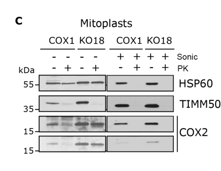

## Question

# Gene Research for Functional Annotation

## ⚠️ CRITICAL: Gene/Protein Identification Context

**BEFORE YOU BEGIN RESEARCH:** You MUST verify you are researching the CORRECT gene/protein. Gene symbols can be ambiguous, especially for less well-characterized genes from non-model organisms.

### Target Gene/Protein Identity (from UniProt):
- **UniProt Accession:** Q8N8Q8
- **Protein Description:** RecName: Full=Cytochrome c oxidase assembly protein COX18, mitochondrial {ECO:0000303|PubMed:28330871}; Short=COX18Hs; AltName: Full=Cytochrome c oxidase assembly protein 18 {ECO:0000303|PubMed:28330871}; Flags: Precursor;
- **Gene Information:** Name=COX18 {ECO:0000303|PubMed:16212937, ECO:0000312|HGNC:HGNC:26801}; Synonyms=OXA1L2;
- **Organism (full):** Homo sapiens (Human).
- **Protein Family:** Belongs to the OXA1/ALB3/YidC family. .
- **Key Domains:** YidC/ALB3/OXA1/COX18. (IPR001708); YidC/Oxa/ALB_C. (IPR028055); 60KD_IMP (PF02096)

### MANDATORY VERIFICATION STEPS:

1. **Check if the gene symbol "COX18" matches the protein description above**
2. **Verify the organism is correct:** Homo sapiens (Human).
3. **Check if protein family/domains align with what you find in literature**
4. **If you find literature for a DIFFERENT gene with the same or similar symbol, STOP**

### If Gene Symbol is Ambiguous or You Cannot Find Relevant Literature:

**DO NOT PROCEED WITH RESEARCH ON A DIFFERENT GENE.** Instead:
- State clearly: "The gene symbol 'COX18' is ambiguous or literature is limited for this specific protein"
- Explain what you found (e.g., "Found extensive literature on a different gene with the same symbol in a different organism")
- Describe the protein based ONLY on the UniProt information provided above
- Suggest that the protein function can be inferred from domain/family information

### Research Target:

Please provide a comprehensive research report on the gene **COX18** (gene ID: COX18, UniProt: Q8N8Q8) in human.

The research report should be a detailed narrative explaining the function, biological processes, and localization of the gene product. Citations should be given for all claims.

You should prioritize authoritative reviews and primary scientific literature when conducting research. You can supplement
this with annotations you find in gene/protein databases, but these can be outdated or inaccurate.

We are specifically interested in the primary function of the gene - for enzymes, what reaction is catalyzed, and what is the substrate specificity? For transporters, what is the substrate? For structural proteins or adapters, what is the broader structural role? For signaling molecules, what is the role in the pathway.

We are interested in where in or outside the cell the gene product carries out its function.

We are also interested in the signaling or biochemical pathways in which the gene functions. We are less interested in broad pleiotropic effects, except where these elucidate the precise role.

Include evidence where possible. We are interested in both experimental evidence as well as inference from structure, evolution, or bioinformatic analysis. Precise studies should be prioritized over high-throughput, where available.

## Output

Question: You are an expert researcher providing comprehensive, well-cited information.

Provide detailed information focusing on:
1. Key concepts and definitions with current understanding
2. Recent developments and latest research (prioritize 2023-2024 sources)
3. Current applications and real-world implementations
4. Expert opinions and analysis from authoritative sources
5. Relevant statistics and data from recent studies

Format as a comprehensive research report with proper citations. Include URLs and publication dates where available.
Always prioritize recent, authoritative sources and provide specific citations for all major claims.

# Gene Research for Functional Annotation

## ⚠️ CRITICAL: Gene/Protein Identification Context

**BEFORE YOU BEGIN RESEARCH:** You MUST verify you are researching the CORRECT gene/protein. Gene symbols can be ambiguous, especially for less well-characterized genes from non-model organisms.

### Target Gene/Protein Identity (from UniProt):
- **UniProt Accession:** Q8N8Q8
- **Protein Description:** RecName: Full=Cytochrome c oxidase assembly protein COX18, mitochondrial {ECO:0000303|PubMed:28330871}; Short=COX18Hs; AltName: Full=Cytochrome c oxidase assembly protein 18 {ECO:0000303|PubMed:28330871}; Flags: Precursor;
- **Gene Information:** Name=COX18 {ECO:0000303|PubMed:16212937, ECO:0000312|HGNC:HGNC:26801}; Synonyms=OXA1L2;
- **Organism (full):** Homo sapiens (Human).
- **Protein Family:** Belongs to the OXA1/ALB3/YidC family. .
- **Key Domains:** YidC/ALB3/OXA1/COX18. (IPR001708); YidC/Oxa/ALB_C. (IPR028055); 60KD_IMP (PF02096)

### MANDATORY VERIFICATION STEPS:

1. **Check if the gene symbol "COX18" matches the protein description above**
2. **Verify the organism is correct:** Homo sapiens (Human).
3. **Check if protein family/domains align with what you find in literature**
4. **If you find literature for a DIFFERENT gene with the same or similar symbol, STOP**

### If Gene Symbol is Ambiguous or You Cannot Find Relevant Literature:

**DO NOT PROCEED WITH RESEARCH ON A DIFFERENT GENE.** Instead:
- State clearly: "The gene symbol 'COX18' is ambiguous or literature is limited for this specific protein"
- Explain what you found (e.g., "Found extensive literature on a different gene with the same symbol in a different organism")
- Describe the protein based ONLY on the UniProt information provided above
- Suggest that the protein function can be inferred from domain/family information

### Research Target:

Please provide a comprehensive research report on the gene **COX18** (gene ID: COX18, UniProt: Q8N8Q8) in human.

The research report should be a detailed narrative explaining the function, biological processes, and localization of the gene product. Citations should be given for all claims.

You should prioritize authoritative reviews and primary scientific literature when conducting research. You can supplement
this with annotations you find in gene/protein databases, but these can be outdated or inaccurate.

We are specifically interested in the primary function of the gene - for enzymes, what reaction is catalyzed, and what is the substrate specificity? For transporters, what is the substrate? For structural proteins or adapters, what is the broader structural role? For signaling molecules, what is the role in the pathway.

We are interested in where in or outside the cell the gene product carries out its function.

We are also interested in the signaling or biochemical pathways in which the gene functions. We are less interested in broad pleiotropic effects, except where these elucidate the precise role.

Include evidence where possible. We are interested in both experimental evidence as well as inference from structure, evolution, or bioinformatic analysis. Precise studies should be prioritized over high-throughput, where available.

# Human COX18 (UniProt Q8N8Q8): functional annotation research report

## Identity and principal function

The specified target is **human COX18**, also called **OXA1L2** in the supplied UniProt record—not the distinct human insertase **OXA1L**, and not yeast Cox18p. Human COX18 belongs to the evolutionarily conserved Oxa1/YidC/Alb3 family of membrane-protein insertases, consistent with the YidC/Oxa/Alb domains listed for Q8N8Q8. Its experimentally established principal function is to facilitate insertion of the *second* membrane-spanning segment of mitochondrially encoded cytochrome-*c* oxidase subunit II (**MT-CO2**, or COX2) and translocation of COX2’s large C-terminal domain across the mitochondrial inner membrane. COX18 is thus a **protein-insertion/assembly factor**, not the oxygen-reducing enzyme itself or a copper transporter with an established small-molecule substrate. The identified protein substrate is nascent COX2; whether human COX18 inserts additional substrates has not been established by the cited work. [Bourens and Barrientos, *Journal of Biological Chemistry*, published March 22, 2017; journal issue May 2017](https://doi.org/10.1074/jbc.M117.778514). (bourens2017humanmitochondrialcytochrome pages 1-2, bourens2017humanmitochondrialcytochrome pages 4-5, bourens2017humanmitochondrialcytochrome pages 5-6)

## Where it acts and how

COX18 acts **in the mitochondrial inner membrane**, where it enables the COX2 C-terminal domain to emerge into the **intermembrane space**. That domain carries the apo-CuA copper-binding site, which must subsequently mature before COX2 can function in complex IV. In human cells, COX18-FLAG colocalized with mitochondria, and endogenous and tagged COX18 resisted alkaline-carbonate extraction, supporting its identity as an integral membrane protein. More decisively, COX2 in mitoplasts lacking COX18 was protected from added proteinase K, whereas COX2 with its C-terminal domain exposed to the intermembrane space was protease-sensitive; sonication made the protected protein digestible. This distinguishes defective membrane translocation from simple protease resistance. See the original study’s cropped **Figure 5C** for the topology experiment and **Figure 7** for the authors’ assembly model. (bourens2017humanmitochondrialcytochrome pages 3-4, bourens2017humanmitochondrialcytochrome pages 4-5, bourens2017humanmitochondrialcytochrome media ef9b12b8, bourens2017humanmitochondrialcytochrome media d21cf958)

The supported order of events is: COX20 binds and stabilizes newly synthesized COX2; COX18 transiently associates with the COX2 maturation machinery to promote C-tail translocation; then the SCO1/SCO2/COA6-associated machinery participates in formation of the COX2 CuA center. Immunoprecipitation detected weak but reproducible COX18–COX2 association. Without COX18, COX20 retained some COX2 binding but lost detectable coprecipitation of SCO1, SCO2 and COA6. **The precise timing of COX18 release and copper transfer is a model inferred from interactions, not a direct demonstration that COX18 transfers copper.** The mechanism inserting the *first*, N-proximal COX2 transmembrane segment in human mitochondria also remains less securely resolved than COX18’s C-tail role. (bourens2017humanmitochondrialcytochrome pages 3-4, bourens2017humanmitochondrialcytochrome pages 4-5, bourens2017humanmitochondrialcytochrome pages 5-6, nyvltova2023coordinationofmetal pages 4-6)

## Biological pathway and strength of experimental evidence

COX18 functions in the **COX2 assembly module of mitochondrial respiratory complex IV**, within oxidative phosphorylation. Mature complex IV oxidizes cytochrome *c*, reduces molecular oxygen to water and contributes to the proton gradient used for ATP synthesis; **COX18 enables biogenesis of that enzyme rather than catalyzing its redox reaction**. A 2024 review places COX18 alongside COX20, COX16 and CuA-maturation factors in the COX2 module, while distinguishing the broader insertase OXA1L. [Guaragnella and colleagues, *International Journal of Molecular Sciences*, March 2024](https://doi.org/10.3390/ijms25073814). (bourens2017humanmitochondrialcytochrome pages 1-2, guaragnella2024morethanjust pages 4-5, guaragnella2024morethanjust pages 9-11)

The strongest causal experiments are in edited human HEK293T cells. Three predicted complete COX18-knockout clones lacked detectable assembled complex IV; introduction of COX18-FLAG restored its abundance. COX1/COX4-containing early assembly intermediates persisted, but COX2 was strongly depleted. A 30-minute mitochondrial translation pulse showed that COX2 was initially synthesized; its degradation became evident by approximately **one hour** of chase. Thus, the primary demonstrated defect is **COX2 topogenesis and post-translational stability**, not loss of COX2 synthesis. Complex-IV-containing supercomplexes were consequently absent in the complete knockout, while complex-III-containing assemblies persisted; this is a downstream consequence of defective complex-IV assembly, not evidence that COX18 is a mature supercomplex scaffold. [Bourens and Barrientos, 2017](https://doi.org/10.1074/jbc.M117.778514). (bourens2017humanmitochondrialcytochrome pages 2-3, bourens2017humanmitochondrialcytochrome pages 3-4)

The principal human observations and their interpretive limits are summarized below.

| Finding | Experimental basis | Interpretive boundary | Source DOI/year |
|---|---|---|---|
| Human COX18 is an integral mitochondrial membrane protein essential for complex IV biogenesis. | TALEN-generated **COX18**-knockout HEK293T clones lacked detectable complex IV, while other OXPHOS complexes were not detectably altered. COX18-FLAG localized to mitochondria, resisted alkaline-carbonate extraction, and restored complex IV abundance. (bourens2017humanmitochondrialcytochrome pages 2-3, bourens2017humanmitochondrialcytochrome pages 3-4) | Establishes mitochondrial membrane localization and an essential, relatively selective role in complex IV assembly or stability; COX18 is not a structural subunit or catalytic enzyme of mature complex IV. | [Bourens and Barrientos, JBC; published March 22, 2017](https://doi.org/10.1074/jbc.M117.778514) |
| COX18 translocates the C-terminal portion of MT-CO2 across the inner mitochondrial membrane. | In mitoplasts, MT-CO2 was proteinase-K sensitive when exposed to the intermembrane space but remained protected in COX18-knockout cells; sonication restored protease accessibility. The affected C-terminal region represents approximately half of MT-CO2 and contains the apo-CuA site. (bourens2017humanmitochondrialcytochrome pages 4-5, bourens2017humanmitochondrialcytochrome media ef9b12b8) | Direct evidence supports a **C-tail insertase/translocase** function. It does not establish COX18 as the insertase for the N-proximal transmembrane segment of MT-CO2. | [Bourens and Barrientos, JBC; 2017](https://doi.org/10.1074/jbc.M117.778514) |
| COX18 acts transiently between MT-CO2 stabilization and CuA-site maturation. | MT-CO2 was synthesized normally during a 30-minute pulse in knockout cells but became unstable during the chase. COX18-FLAG weakly but reproducibly co-immunoprecipitated MT-CO2 and associated with COX20 and a small SCO1 fraction. Without COX18, COX20 still bound some MT-CO2 but no longer co-precipitated SCO1, SCO2, or COA6. (bourens2017humanmitochondrialcytochrome pages 3-4, bourens2017humanmitochondrialcytochrome pages 4-5) | The interactions and post-translational instability are direct findings. The proposed sequence—COX20 binding, COX18-mediated translocation, COX18 release, and SCO1/SCO2/COA6-dependent metallation—is a mechanistic model rather than direct observation of copper transfer. | [Bourens and Barrientos, JBC; May 2017](https://doi.org/10.1074/jbc.M117.778514) |
| COX18 is distinct from the broader mitochondrial insertase OXA1L. | COX18 belongs to the Oxa1/YidC/Alb3 family, but the human study found no evidence that OXA1L substitutes for the MT-CO2 C-tail function of COX18. OXA1L knockdown had previously affected complexes I and V without reducing complexes III or IV. (bourens2017humanmitochondrialcytochrome pages 1-2, bourens2017humanmitochondrialcytochrome pages 5-6) | Family homology does not imply functional interchangeability. **COX18/OXA1L2 (Q8N8Q8) must not be conflated with OXA1L**; cross-species complementation is also limited by substrate-recognition specificity. | [Bourens and Barrientos, JBC; May 2017](https://doi.org/10.1074/jbc.M117.778514) |
| Homozygous **COX18 c.667G>C, p.Asp223His** causes an isolated complex IV assembly disorder. | Patient myoblasts had complex IV activity at **36% of control**; MT-CO2, MT-CO3, and COX4 steady-state levels were **36%, 46%, and 54%**, respectively. Fully assembled complex IV and in-gel activity were markedly reduced. COX18 knockdown reduced activity by about 60%, whereas wild-type COX18 complementation rescued the patient-cell biochemical defect. (ronchi2023abiallelicvariant pages 3-5) | Direct evidence comes from one affected individual with neonatal encephalo-cardio-myopathy and axonal sensory neuropathy. It strongly supports pathogenicity but cannot establish broad genotype-phenotype correlations. | [Ronchi et al., European Journal of Human Genetics; published July 2023](https://doi.org/10.1038/s41431-023-01433-6) |
| Homozygous **COX18 c.598G>A** disrupts splicing and produces residual COX18Δ112-240 function. | Patient cDNA contained three abnormal splice products; a surviving transcript encoded COX18Δ112-240. Muscle complex IV activity was **18.38 nmol/min/mg**, versus a **34-180** reference range, while other respiratory-chain activities were normal. Fibroblast mitochondrial complex IV activity was **7.5-fold lower** than controls and rose **threefold** after full-length COX18 complementation, without reaching normal. (mavillard2024asplicealteringhomozygous pages 5-7, mavillard2024asplicealteringhomozygous pages 7-8) | This second single-patient report was associated with severe sensory-motor neuropathy and oculofacial apraxia. Expression of a residual truncated protein makes it a hypomorphic model rather than a complete loss-of-function state. | [Mavillard et al., BBA Molecular Basis of Disease; available July 1, 2024](https://doi.org/10.1016/j.bbadis.2024.167330) |
| COX18Δ112-240 permits gross complex IV and supercomplex formation but yields poorly functional enzyme. | Patient fibroblasts showed markedly reduced MT-CO2 but control-like COX1 and COX4 levels. BN-PAGE revealed no substantial change in gross complex IV or respiratory-supercomplex band patterns, and the truncated protein was detected in the complex IV band despite the severe activity deficit. (mavillard2024asplicealteringhomozygous pages 7-8) | Assembly detected by BN-PAGE does not demonstrate normal molecular composition, topology, CuA loading, or catalytic competence; retained gross assembly therefore does not contradict the MT-CO2 maturation role of COX18. | [Mavillard et al., BBA Molecular Basis of Disease; 2024](https://doi.org/10.1016/j.bbadis.2024.167330) |

*Table: Direct human experimental and clinical evidence defining COX18 as an MT-CO2 C-terminal insertase required for complex IV biogenesis. The table separates established findings from mechanistic interpretation and distinguishes COX18 from OXA1L.*

## Developments in 2023–2024: human disease and quantitative findings

**2023: missense variant.** Ronchi and colleagues reported one individual homozygous for **COX18 c.667G>C, p.Asp223His**, with neonatal encephalo-cardiomyopathy and axonal sensory neuropathy. Patient myoblast complex-IV activity was **36% of control**; steady-state COX-II, COX-III and COX-IV were **36%, 46% and 54% of controls**, respectively. Fully assembled complex IV was markedly depleted. Independent COX18 silencing in human cells reduced COX activity by approximately **60%**, while provision of wild-type COX18 rescued the patient-cell biochemical defect. These complementary genetic and biochemical observations support a pathogenic assembly defect, though they come from a single affected person. [Ronchi and colleagues, *European Journal of Human Genetics*, published July 2023](https://doi.org/10.1038/s41431-023-01433-6). (ronchi2023abiallelicvariant pages 2-3, ronchi2023abiallelicvariant pages 3-5)

**2024: splice-altering variant and residual function.** Mavillard and colleagues described a second affected individual, homozygous for **c.598G>A** at the end of exon 3. Although describable at the DNA level as p.Gly200Ser, sequencing of patient cDNA demonstrated abnormal *splicing*: one surviving transcript encodes **COX18Δ112–240**, lacking a substantial predicted membrane-insertion region. The patient had severe childhood-onset sensory-motor neuropathy and oculofacial apraxia, without the cardiomyopathy seen in the earlier case. Muscle complex-IV activity was **18.38 nmol/min/mg protein**, below the laboratory reference range of **34–180**; activities of the other assayed respiratory-chain complexes were normal. Patient-fibroblast mitochondrial complex-IV activity was **7.5-fold lower** than in controls and increased **threefold** after full-length COX18 expression, without full normalization. Unlike a complete knockout, the truncated protein permitted grossly detectable complex-IV and supercomplex bands despite reduced COX2 abundance and severely compromised activity. Consequently, a normal-looking native-gel band alone is insufficient to establish normal complex-IV function. [Mavillard and colleagues, *BBA—Molecular Basis of Disease*, available July 1, 2024](https://doi.org/10.1016/j.bbadis.2024.167330). (mavillard2024asplicealteringhomozygous pages 1-2, mavillard2024asplicealteringhomozygous pages 7-8, mavillard2024asplicealteringhomozygous pages 5-7)

The March 2024 review described **one** reported COX18-associated patient because it preceded publication of the second case in July 2024; the count must not be carried forward as a current fact. Together, these two reports expand the recognized presentation from neonatal multi-organ disease to prolonged survival with predominantly neurological disease, but **two individually reported patients do not establish variant-specific prognosis or population prevalence**. (guaragnella2024morethanjust pages 11-13, mavillard2024asplicealteringhomozygous pages 1-2, ronchi2023abiallelicvariant pages 2-3)

## Practical interpretation and unresolved questions

The clearest real-world application is **interpretation of candidate COX18 variants in suspected inherited mitochondrial complex-IV deficiency**. Concordant evidence includes an isolated complex-IV biochemical defect, reduced COX2 or its maturation, and functional improvement after expression of wild-type COX18. The 2024 example particularly shows why RNA analysis can matter: the c.598G>A change is at a splice boundary, and its experimentally observed effect cannot be adequately characterized as an ordinary Gly200Ser substitution alone. These are research-supported diagnostic strategies, not evidence of an established COX18-directed therapy. (bourens2017humanmitochondrialcytochrome pages 4-5, ronchi2023abiallelicvariant pages 3-5, mavillard2024asplicealteringhomozygous pages 4-5, mavillard2024asplicealteringhomozygous pages 5-7)

Finally, family membership and yeast work strengthen the **insertase** interpretation but do not make related proteins interchangeable. Yeast Cox18p also exports the COX2 C-tail; nevertheless, human and yeast COX18 show limited functional cross-complementation. Human **OXA1L is a separate protein**, and the exact contribution of OXA1L to initial human COX2 insertion remains debated across experimental systems. No well-defined catalytic stoichiometry, transport cycle, complete human substrate repertoire or direct COX18-mediated copper-transfer reaction is established in these sources. [Bourens and Barrientos, 2017](https://doi.org/10.1074/jbc.M117.778514); [Guaragnella and colleagues, 2024](https://doi.org/10.3390/ijms25073814). (bourens2017humanmitochondrialcytochrome pages 4-5, bourens2017humanmitochondrialcytochrome pages 5-6, guaragnella2024morethanjust pages 11-13, guaragnella2024morethanjust pages 9-11)

References

1. (bourens2017humanmitochondrialcytochrome pages 1-2): Myriam Bourens and Antoni Barrientos. Human mitochondrial cytochrome c oxidase assembly factor cox18 acts transiently as a membrane insertase within the subunit 2 maturation module. Journal of Biological Chemistry, 292:7774-7783, May 2017. URL: https://doi.org/10.1074/jbc.m117.778514, doi:10.1074/jbc.m117.778514. This article has 80 citations and is from a domain leading peer-reviewed journal.

2. (bourens2017humanmitochondrialcytochrome pages 4-5): Myriam Bourens and Antoni Barrientos. Human mitochondrial cytochrome c oxidase assembly factor cox18 acts transiently as a membrane insertase within the subunit 2 maturation module. Journal of Biological Chemistry, 292:7774-7783, May 2017. URL: https://doi.org/10.1074/jbc.m117.778514, doi:10.1074/jbc.m117.778514. This article has 80 citations and is from a domain leading peer-reviewed journal.

3. (bourens2017humanmitochondrialcytochrome pages 5-6): Myriam Bourens and Antoni Barrientos. Human mitochondrial cytochrome c oxidase assembly factor cox18 acts transiently as a membrane insertase within the subunit 2 maturation module. Journal of Biological Chemistry, 292:7774-7783, May 2017. URL: https://doi.org/10.1074/jbc.m117.778514, doi:10.1074/jbc.m117.778514. This article has 80 citations and is from a domain leading peer-reviewed journal.

4. (bourens2017humanmitochondrialcytochrome pages 3-4): Myriam Bourens and Antoni Barrientos. Human mitochondrial cytochrome c oxidase assembly factor cox18 acts transiently as a membrane insertase within the subunit 2 maturation module. Journal of Biological Chemistry, 292:7774-7783, May 2017. URL: https://doi.org/10.1074/jbc.m117.778514, doi:10.1074/jbc.m117.778514. This article has 80 citations and is from a domain leading peer-reviewed journal.

5. (bourens2017humanmitochondrialcytochrome media ef9b12b8): Myriam Bourens and Antoni Barrientos. Human mitochondrial cytochrome c oxidase assembly factor cox18 acts transiently as a membrane insertase within the subunit 2 maturation module. Journal of Biological Chemistry, 292:7774-7783, May 2017. URL: https://doi.org/10.1074/jbc.m117.778514, doi:10.1074/jbc.m117.778514. This article has 80 citations and is from a domain leading peer-reviewed journal.

6. (bourens2017humanmitochondrialcytochrome media d21cf958): Myriam Bourens and Antoni Barrientos. Human mitochondrial cytochrome c oxidase assembly factor cox18 acts transiently as a membrane insertase within the subunit 2 maturation module. Journal of Biological Chemistry, 292:7774-7783, May 2017. URL: https://doi.org/10.1074/jbc.m117.778514, doi:10.1074/jbc.m117.778514. This article has 80 citations and is from a domain leading peer-reviewed journal.

7. (nyvltova2023coordinationofmetal pages 4-6): Eva Nývltová, Dietz Johnathan V., Javier Seravalli, Oleh Khalimonchuk, and Antonio Barrientos. Coordination of metal center biogenesis in human cytochrome c oxidase. Text, Jan 2023. URL: https://doi.org/10.25376/hra.21892989, doi:10.25376/hra.21892989. This article has 133 citations and is from a peer-reviewed journal.

8. (guaragnella2024morethanjust pages 4-5): Nicoletta Guaragnella, T. Cervelli, Bel é m Sampaio-Marques, Chenelle A. Caron-Godon, Emma Collington, Jessica L. Wolf, Genna Coletta, and D. M. Glerum. More than just bread and wine: using yeast to understand inherited cytochrome oxidase deficiencies in humans. International Journal of Molecular Sciences, 25:3814, Mar 2024. URL: https://doi.org/10.3390/ijms25073814, doi:10.3390/ijms25073814. This article has 6 citations.

9. (guaragnella2024morethanjust pages 9-11): Nicoletta Guaragnella, T. Cervelli, Bel é m Sampaio-Marques, Chenelle A. Caron-Godon, Emma Collington, Jessica L. Wolf, Genna Coletta, and D. M. Glerum. More than just bread and wine: using yeast to understand inherited cytochrome oxidase deficiencies in humans. International Journal of Molecular Sciences, 25:3814, Mar 2024. URL: https://doi.org/10.3390/ijms25073814, doi:10.3390/ijms25073814. This article has 6 citations.

10. (bourens2017humanmitochondrialcytochrome pages 2-3): Myriam Bourens and Antoni Barrientos. Human mitochondrial cytochrome c oxidase assembly factor cox18 acts transiently as a membrane insertase within the subunit 2 maturation module. Journal of Biological Chemistry, 292:7774-7783, May 2017. URL: https://doi.org/10.1074/jbc.m117.778514, doi:10.1074/jbc.m117.778514. This article has 80 citations and is from a domain leading peer-reviewed journal.

11. (ronchi2023abiallelicvariant pages 3-5): Dario Ronchi, Manuela Garbellini, Francesca Magri, Francesca Menni, Megi Meneri, Maria Francesca Bedeschi, Robertino Dilena, Valeria Cecchetti, Irene Picciolli, Francesca Furlan, Valentina Polimeni, Sabrina Salani, Laura Pezzoli, Francesco Fortunato, Matteo Bellini, Daniela Piga, Michela Ripolone, Simona Zanotti, Laura Napoli, Patrizia Ciscato, Monica Sciacco, Giovanna Mangili, Fabio Mosca, Stefania Corti, Maria Iascone, and Giacomo Pietro Comi. A biallelic variant in cox18 cause isolated complex iv deficiency associated with neonatal encephalo-cardio-myopathy and axonal sensory neuropathy. European Journal of Human Genetics, 31:1414-1420, Jul 2023. URL: https://doi.org/10.1038/s41431-023-01433-6, doi:10.1038/s41431-023-01433-6. This article has 13 citations and is from a domain leading peer-reviewed journal.

12. (mavillard2024asplicealteringhomozygous pages 5-7): Fabiola Mavillard, Alejandra Guerra-Castellano, David Guerrero-Gómez, Eloy Rivas, Gloria Cantero, Emilia Servian-Morilla, Chiara Folland, Gianina Ravenscroft, Miguel A. Martín, Antonio Miranda-Vizuete, Macarena Cabrera-Serrano, Irene Diaz-Moreno, and Carmen Paradas. A splice-altering homozygous variant in cox18 causes severe sensory-motor neuropathy with oculofacial apraxia. Biochimica et Biophysica Acta (BBA) - Molecular Basis of Disease, 1870:167330, Oct 2024. URL: https://doi.org/10.1016/j.bbadis.2024.167330, doi:10.1016/j.bbadis.2024.167330. This article has 5 citations and is from a peer-reviewed journal.

13. (mavillard2024asplicealteringhomozygous pages 7-8): Fabiola Mavillard, Alejandra Guerra-Castellano, David Guerrero-Gómez, Eloy Rivas, Gloria Cantero, Emilia Servian-Morilla, Chiara Folland, Gianina Ravenscroft, Miguel A. Martín, Antonio Miranda-Vizuete, Macarena Cabrera-Serrano, Irene Diaz-Moreno, and Carmen Paradas. A splice-altering homozygous variant in cox18 causes severe sensory-motor neuropathy with oculofacial apraxia. Biochimica et Biophysica Acta (BBA) - Molecular Basis of Disease, 1870:167330, Oct 2024. URL: https://doi.org/10.1016/j.bbadis.2024.167330, doi:10.1016/j.bbadis.2024.167330. This article has 5 citations and is from a peer-reviewed journal.

14. (ronchi2023abiallelicvariant pages 2-3): Dario Ronchi, Manuela Garbellini, Francesca Magri, Francesca Menni, Megi Meneri, Maria Francesca Bedeschi, Robertino Dilena, Valeria Cecchetti, Irene Picciolli, Francesca Furlan, Valentina Polimeni, Sabrina Salani, Laura Pezzoli, Francesco Fortunato, Matteo Bellini, Daniela Piga, Michela Ripolone, Simona Zanotti, Laura Napoli, Patrizia Ciscato, Monica Sciacco, Giovanna Mangili, Fabio Mosca, Stefania Corti, Maria Iascone, and Giacomo Pietro Comi. A biallelic variant in cox18 cause isolated complex iv deficiency associated with neonatal encephalo-cardio-myopathy and axonal sensory neuropathy. European Journal of Human Genetics, 31:1414-1420, Jul 2023. URL: https://doi.org/10.1038/s41431-023-01433-6, doi:10.1038/s41431-023-01433-6. This article has 13 citations and is from a domain leading peer-reviewed journal.

15. (mavillard2024asplicealteringhomozygous pages 1-2): Fabiola Mavillard, Alejandra Guerra-Castellano, David Guerrero-Gómez, Eloy Rivas, Gloria Cantero, Emilia Servian-Morilla, Chiara Folland, Gianina Ravenscroft, Miguel A. Martín, Antonio Miranda-Vizuete, Macarena Cabrera-Serrano, Irene Diaz-Moreno, and Carmen Paradas. A splice-altering homozygous variant in cox18 causes severe sensory-motor neuropathy with oculofacial apraxia. Biochimica et Biophysica Acta (BBA) - Molecular Basis of Disease, 1870:167330, Oct 2024. URL: https://doi.org/10.1016/j.bbadis.2024.167330, doi:10.1016/j.bbadis.2024.167330. This article has 5 citations and is from a peer-reviewed journal.

16. (guaragnella2024morethanjust pages 11-13): Nicoletta Guaragnella, T. Cervelli, Bel é m Sampaio-Marques, Chenelle A. Caron-Godon, Emma Collington, Jessica L. Wolf, Genna Coletta, and D. M. Glerum. More than just bread and wine: using yeast to understand inherited cytochrome oxidase deficiencies in humans. International Journal of Molecular Sciences, 25:3814, Mar 2024. URL: https://doi.org/10.3390/ijms25073814, doi:10.3390/ijms25073814. This article has 6 citations.

17. (mavillard2024asplicealteringhomozygous pages 4-5): Fabiola Mavillard, Alejandra Guerra-Castellano, David Guerrero-Gómez, Eloy Rivas, Gloria Cantero, Emilia Servian-Morilla, Chiara Folland, Gianina Ravenscroft, Miguel A. Martín, Antonio Miranda-Vizuete, Macarena Cabrera-Serrano, Irene Diaz-Moreno, and Carmen Paradas. A splice-altering homozygous variant in cox18 causes severe sensory-motor neuropathy with oculofacial apraxia. Biochimica et Biophysica Acta (BBA) - Molecular Basis of Disease, 1870:167330, Oct 2024. URL: https://doi.org/10.1016/j.bbadis.2024.167330, doi:10.1016/j.bbadis.2024.167330. This article has 5 citations and is from a peer-reviewed journal.

## Artifacts

- [Edison artifact artifact-00](COX18-deep-research-falcon_artifacts/artifact-00.md)

## Citations

1. ronchi2023abiallelicvariant pages 3-5
2. mavillard2024asplicealteringhomozygous pages 7-8
3. bourens2017humanmitochondrialcytochrome pages 1-2
4. bourens2017humanmitochondrialcytochrome pages 4-5
5. bourens2017humanmitochondrialcytochrome pages 5-6
6. bourens2017humanmitochondrialcytochrome pages 3-4
7. nyvltova2023coordinationofmetal pages 4-6
8. guaragnella2024morethanjust pages 4-5
9. guaragnella2024morethanjust pages 9-11
10. bourens2017humanmitochondrialcytochrome pages 2-3
11. mavillard2024asplicealteringhomozygous pages 5-7
12. ronchi2023abiallelicvariant pages 2-3
13. mavillard2024asplicealteringhomozygous pages 1-2
14. guaragnella2024morethanjust pages 11-13
15. mavillard2024asplicealteringhomozygous pages 4-5
16. Bourens and Barrientos, *Journal of Biological Chemistry*, published March 22, 2017; journal issue May 2017
17. Guaragnella and colleagues, *International Journal of Molecular Sciences*, March 2024
18. Bourens and Barrientos, 2017
19. Bourens and Barrientos, JBC; published March 22, 2017
20. Bourens and Barrientos, JBC; 2017
21. Bourens and Barrientos, JBC; May 2017
22. Ronchi et al., European Journal of Human Genetics; published July 2023
23. Mavillard et al., BBA Molecular Basis of Disease; available July 1, 2024
24. Mavillard et al., BBA Molecular Basis of Disease; 2024
25. Ronchi and colleagues, *European Journal of Human Genetics*, published July 2023
26. Mavillard and colleagues, *BBA—Molecular Basis of Disease*, available July 1, 2024
27. Guaragnella and colleagues, 2024
28. https://doi.org/10.1074/jbc.M117.778514
29. https://doi.org/10.3390/ijms25073814
30. https://doi.org/10.1038/s41431-023-01433-6
31. https://doi.org/10.1016/j.bbadis.2024.167330
32. https://doi.org/10.1074/jbc.m117.778514,
33. https://doi.org/10.25376/hra.21892989,
34. https://doi.org/10.3390/ijms25073814,
35. https://doi.org/10.1038/s41431-023-01433-6,
36. https://doi.org/10.1016/j.bbadis.2024.167330,