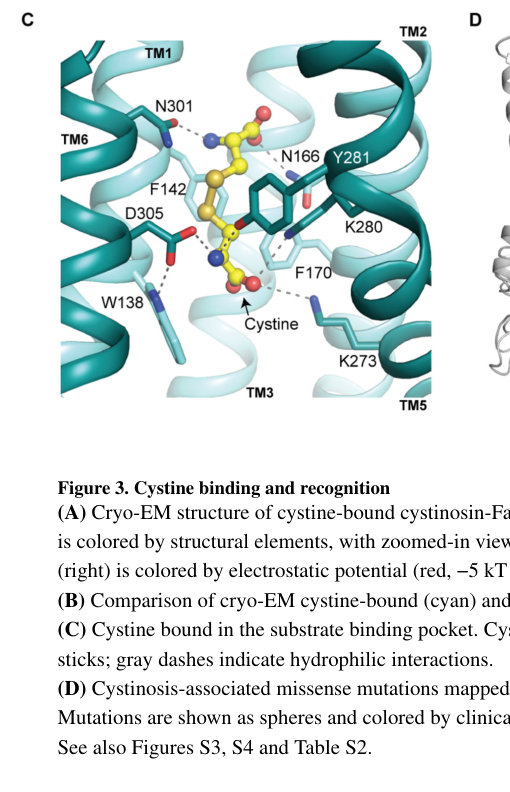

## Question

# Gene Research for Functional Annotation

## ⚠️ CRITICAL: Gene/Protein Identification Context

**BEFORE YOU BEGIN RESEARCH:** You MUST verify you are researching the CORRECT gene/protein. Gene symbols can be ambiguous, especially for less well-characterized genes from non-model organisms.

### Target Gene/Protein Identity (from UniProt):
- **UniProt Accession:** O60931
- **Protein Description:** RecName: Full=Cystinosin {ECO:0000303|PubMed:9537412}; Flags: Precursor;
- **Gene Information:** Name=CTNS {ECO:0000303|PubMed:9537412, ECO:0000312|HGNC:HGNC:2518};
- **Organism (full):** Homo sapiens (Human).
- **Protein Family:** Belongs to the cystinosin family. .
- **Key Domains:** LC_transporter. (IPR005282); PQ-loop_rpt. (IPR006603); PQ-loop (PF04193)

### MANDATORY VERIFICATION STEPS:

1. **Check if the gene symbol "CTNS" matches the protein description above**
2. **Verify the organism is correct:** Homo sapiens (Human).
3. **Check if protein family/domains align with what you find in literature**
4. **If you find literature for a DIFFERENT gene with the same or similar symbol, STOP**

### If Gene Symbol is Ambiguous or You Cannot Find Relevant Literature:

**DO NOT PROCEED WITH RESEARCH ON A DIFFERENT GENE.** Instead:
- State clearly: "The gene symbol 'CTNS' is ambiguous or literature is limited for this specific protein"
- Explain what you found (e.g., "Found extensive literature on a different gene with the same symbol in a different organism")
- Describe the protein based ONLY on the UniProt information provided above
- Suggest that the protein function can be inferred from domain/family information

### Research Target:

Please provide a comprehensive research report on the gene **CTNS** (gene ID: CTNS, UniProt: O60931) in human.

The research report should be a detailed narrative explaining the function, biological processes, and localization of the gene product. Citations should be given for all claims.

You should prioritize authoritative reviews and primary scientific literature when conducting research. You can supplement
this with annotations you find in gene/protein databases, but these can be outdated or inaccurate.

We are specifically interested in the primary function of the gene - for enzymes, what reaction is catalyzed, and what is the substrate specificity? For transporters, what is the substrate? For structural proteins or adapters, what is the broader structural role? For signaling molecules, what is the role in the pathway.

We are interested in where in or outside the cell the gene product carries out its function.

We are also interested in the signaling or biochemical pathways in which the gene functions. We are less interested in broad pleiotropic effects, except where these elucidate the precise role.

Include evidence where possible. We are interested in both experimental evidence as well as inference from structure, evolution, or bioinformatic analysis. Precise studies should be prioritized over high-throughput, where available.

## Output

Question: You are an expert researcher providing comprehensive, well-cited information.

Provide detailed information focusing on:
1. Key concepts and definitions with current understanding
2. Recent developments and latest research (prioritize 2023-2024 sources)
3. Current applications and real-world implementations
4. Expert opinions and analysis from authoritative sources
5. Relevant statistics and data from recent studies

Format as a comprehensive research report with proper citations. Include URLs and publication dates where available.
Always prioritize recent, authoritative sources and provide specific citations for all major claims.

# Gene Research for Functional Annotation

## ⚠️ CRITICAL: Gene/Protein Identification Context

**BEFORE YOU BEGIN RESEARCH:** You MUST verify you are researching the CORRECT gene/protein. Gene symbols can be ambiguous, especially for less well-characterized genes from non-model organisms.

### Target Gene/Protein Identity (from UniProt):
- **UniProt Accession:** O60931
- **Protein Description:** RecName: Full=Cystinosin {ECO:0000303|PubMed:9537412}; Flags: Precursor;
- **Gene Information:** Name=CTNS {ECO:0000303|PubMed:9537412, ECO:0000312|HGNC:HGNC:2518};
- **Organism (full):** Homo sapiens (Human).
- **Protein Family:** Belongs to the cystinosin family. .
- **Key Domains:** LC_transporter. (IPR005282); PQ-loop_rpt. (IPR006603); PQ-loop (PF04193)

### MANDATORY VERIFICATION STEPS:

1. **Check if the gene symbol "CTNS" matches the protein description above**
2. **Verify the organism is correct:** Homo sapiens (Human).
3. **Check if protein family/domains align with what you find in literature**
4. **If you find literature for a DIFFERENT gene with the same or similar symbol, STOP**

### If Gene Symbol is Ambiguous or You Cannot Find Relevant Literature:

**DO NOT PROCEED WITH RESEARCH ON A DIFFERENT GENE.** Instead:
- State clearly: "The gene symbol 'CTNS' is ambiguous or literature is limited for this specific protein"
- Explain what you found (e.g., "Found extensive literature on a different gene with the same symbol in a different organism")
- Describe the protein based ONLY on the UniProt information provided above
- Suggest that the protein function can be inferred from domain/family information

### Research Target:

Please provide a comprehensive research report on the gene **CTNS** (gene ID: CTNS, UniProt: O60931) in human.

The research report should be a detailed narrative explaining the function, biological processes, and localization of the gene product. Citations should be given for all claims.

You should prioritize authoritative reviews and primary scientific literature when conducting research. You can supplement
this with annotations you find in gene/protein databases, but these can be outdated or inaccurate.

We are specifically interested in the primary function of the gene - for enzymes, what reaction is catalyzed, and what is the substrate specificity? For transporters, what is the substrate? For structural proteins or adapters, what is the broader structural role? For signaling molecules, what is the role in the pathway.

We are interested in where in or outside the cell the gene product carries out its function.

We are also interested in the signaling or biochemical pathways in which the gene functions. We are less interested in broad pleiotropic effects, except where these elucidate the precise role.

Include evidence where possible. We are interested in both experimental evidence as well as inference from structure, evolution, or bioinformatic analysis. Precise studies should be prioritized over high-throughput, where available.

# Functional annotation report: human CTNS (UniProt O60931)

## Identity and principal function

**Identity verified.** Human *CTNS* encodes **cystinosin**, not an unrelated similarly named protein. The canonical protein is UniProt **O60931-1**, a 367-amino-acid, seven-transmembrane protein of the **PQ-loop transporter family**. Its established primary function is to export **L-cystine**, the disulfide-linked dimer of cysteine, **from the lysosomal lumen into the cytosol**, coupled to movement of a proton in the same direction. The reported coupling ratio is **one H⁺ per cystine**. This is a transporter, not an enzyme: it does not catalyze the reduction of cystine to cysteine, which occurs after export. The CTNS identity, PQ-loop architecture, and lysosomal function agree with the supplied UniProt annotation. (bellomo2016carboxylterminalsslkgmotif pages 1-2, guo2022structureandmechanism pages 3-5, guo2022structureandmechanism pages 1-3)

Cystinosin functions primarily **in the lysosomal limiting membrane**. Its luminal surface encounters cystine generated during degradation of endocytosed and autophagic material; the acidic lysosomal lumen and relatively neutral cytosol provide the proton electrochemical gradient that drives export. Cytosolic cystine is subsequently reduced to cysteine, making lysosomal recycling a source of cysteine for downstream metabolism. Although this can influence glutathione synthesis, cystinosin should not itself be annotated as a glutathione-synthesis enzyme or a general cysteine transporter. (guo2022structureandmechanism pages 1-3, guo2022structureandmechanism pages 3-5, kalatzis2001cystinosintheprotein pages 4-5)

The central evidence, from direct transport assays to recent cellular studies, is summarized below.

| Function/aspect | Most informative observation | Evidence strength and reference |
|---|---|---|
| **Identity and isoforms** | Human **CTNS UniProt O60931-1** is canonical 367-aa cystinosin, a seven-transmembrane cystine/H⁺ symporter located predominantly in the lysosomal membrane. Alternative exon-12 splicing produces 400-aa **O60931-2/cystinosin-LKG**; its C-terminal SSLKG motif promotes plasma-membrane sorting, whereas canonical GYDQL and YFPQA motifs mediate lysosomal targeting. | **Strong:** human isoform localization, mutagenesis and transport experiments. Bellomo et al., published **5 May 2016**, [DOI: 10.1371/journal.pone.0154805](https://doi.org/10.1371/journal.pone.0154805) (bellomo2016carboxylterminalsslkgmotif pages 1-2) |
| **Primary substrate and proton coupling** | Plasma-membrane-redirected cystinosin transported **L-cystine** with Michaelis–Menten kinetics (**Kₘ 278 ± 49 µM**, three transfections). Acidic pH stimulated uptake, and nigericin-mediated collapse of the proton gradient inhibited it by **more than 85%**. L-cystine, but not D-cystine, competed effectively; direct cystinosin-dependent cysteine translocation was not detected. | **Very strong:** direct radiotracer transport, kinetics, stereoselectivity and ionophore experiments. Kalatzis et al., published **1 November 2001**, [DOI: 10.1093/emboj/20.21.5940](https://doi.org/10.1093/emboj/20.21.5940) (kalatzis2001cystinosintheprotein pages 4-5, kalatzis2001cystinosintheprotein pages 2-4) |
| **Structure and alternating-access mechanism** | Human cystinosin structures captured lumen-open, cytosol-open and cystine-bound states. The binding pocket includes **K273, K280, Y281, D305, N166, N301, W138, F142 and F170**; mutating K273, K280 or D305 abolished transport. DEER analysis identified **D346 as the proposed proton sensor**. The paper cites preceding functional work supporting **1 cystine:1 H⁺ symport**. | **Very strong for structure and residues; moderate for stoichiometry because it derives from preceding work:** crystallography, cryo-EM, mutagenesis and DEER. Guo et al., published **29 September 2022**, [DOI: 10.1016/j.cell.2022.08.020](https://doi.org/10.1016/j.cell.2022.08.020) (guo2022structureandmechanism pages 3-5, guo2022structureandmechanism media befffc70, guo2022structureandmechanism pages 8-9) |
| **Lysosomal nutrient signaling** | In proximal-tubule models, CTNS loss and lysosomal cystine storage promoted Ragulator–Rag-dependent lysosomal recruitment and persistent **mTORC1** activity. Wild-type CTNS, but not transport-defective G339R, restored nutrient responsiveness; cystine dimethyl ester was sufficient to induce starvation-resistant signaling. Low-dose rapamycin rescued lysosomal, differentiation and tubular phenotypes in **preclinical** cell, rat and zebrafish models only. | **Strong preclinical evidence, not clinical evidence:** genetic rescue, metabolite loading, co-immunoprecipitation and cross-species intervention. Berquez et al., **2023**, [DOI: 10.1038/s41467-023-39261-3](https://doi.org/10.1038/s41467-023-39261-3) (luciani2024thectnsmtorc1axis pages 1-2, berquez2023lysosomalcystineexporta pages 12-13, berquez2023lysosomalcystineexport pages 12-13) |
| **Variant-dependent residual activity** | In CTNS-null human proximal-tubule cells, **K280R** and several other mutants reduced cystine to near-WT levels when expressed, whereas lysosome-localized **G339R failed to rescue** cystine accumulation. EF1α and native CTNS promoters produced about **160-fold and 18-fold** endogenous WT transcript, respectively; the findings therefore demonstrate model- and expression-dependent residual activity rather than benignity. | **Moderate-to-strong:** isogenic human-cell addback, lysosomal colocalization and mass spectrometry; clinical interpretation remains limited. Medaer et al., published **6 April 2024**, [DOI: 10.3390/cells13070646](https://doi.org/10.3390/cells13070646) (medaer2024residualcystinetransport pages 7-9, medaer2024residualcystinetransport pages 9-11, medaer2024residualcystinetransport pages 11-14) |
| **Cysteamine therapeutic bypass** | Cysteamine reacts with lysosomal cystine to produce cysteine and a cysteamine–cysteine mixed disulfide. The mixed disulfide is exported by **PQLC2/SLC66A1**, not CTNS; cysteamine therefore bypasses the defective cystinosin pathway rather than restoring cystinosin transport. | **Very strong:** transporter electrophysiology, RNA interference and metabolite measurements in cystinotic fibroblasts. Jézégou et al., published **20 November 2012**, [DOI: 10.1073/pnas.1211198109](https://doi.org/10.1073/pnas.1211198109) (jezegou2012heptahelicalproteinpqlc2 pages 1-2, jamalpoor2021molecularmechanismsand pages 2-2) |

*Table: Evidence hierarchy for the identity, localization, transport mechanism, signaling roles, variant effects and therapeutic bypass of human CTNS/cystinosin (UniProt O60931). Preclinical interventions are explicitly distinguished from approved or clinically validated therapies.*

## Direct evidence for substrate and transport mechanism

**Transport and specificity.** In the foundational study by Kalatzis and colleagues, deleting cystinosin’s C-terminal **GYDQL** lysosomal-sorting motif redirected it to the surface of COS cells. Uptake of extracellular radiolabeled L-cystine then recreated the *direction* of normal transport: the extracellular side of the surface membrane is topologically equivalent to the lysosomal lumen. Acidic external pH **5.6**, compared with pH **7.4**, greatly increased uptake; dissipating the proton gradient with nigericin inhibited uptake by **more than 85%**. Transport was saturable, with **Kₘ = 278 ± 49 µM** across three transfections. Unlabeled **L-cystine**, but not **D-cystine**, competed effectively. L-cysteine inhibited at high concentrations, yet cystinosin-dependent radiolabeled cysteine transport was *not detected* under the study’s assay conditions. Thus, the defensible functional annotation is **selective L-cystine/H⁺ symport**, not broad amino-acid or proven cysteine transport. Kalatzis et al., *EMBO Journal*, **2001**, https://doi.org/10.1093/emboj/20.21.5940. (kalatzis2001cystinosintheprotein pages 2-4, kalatzis2001cystinosintheprotein pages 4-5)

**Structure and coupling.** Structures of **human** cystinosin reported by Guo and colleagues capture lumen-open, cytosol-open, and cystine-bound states. Seven transmembrane helices form two related three-helix bundles joined by TM4. The two characteristic PQ motifs contribute to a cytosolic gate and to the movements required for **alternating access**. In the cystine-bound structure, residues including **K273, K280, D305, N166, and N301** contact the substrate-binding region; mutations at several pocket residues abolish transport. The elongated pocket recognizes features at both ends of the cystine dimer, providing a structural explanation for its selectivity over single amino acids. Figure 3C depicts this binding pocket. Guo et al., *Cell*, **2022**, https://doi.org/10.1016/j.cell.2022.08.020. (guo2022structureandmechanism pages 3-5, guo2022structureandmechanism pages 5-6, guo2022structureandmechanism pages 6-8, guo2022structureandmechanism media befffc70)

In pH-dependent structural and double-electron–electron-resonance experiments, acidification shifted cystinosin toward cytosol-open conformations. **D346** was proposed as a key protonation-dependent conformational switch because neutralizing it removed the observed pH-dependent transition. This identifies a mechanistic contributor; it should not be interpreted as proof that one residue alone accounts for every step of proton binding and translocation. Guo et al., *Cell*, **2022**, https://doi.org/10.1016/j.cell.2022.08.020. (guo2022structureandmechanism pages 8-9)

## Localization and isoforms

Canonical cystinosin contains a C-terminal **GYDQL** lysosomal-targeting motif and a second targeting determinant, **YFPQA**, in an inter-transmembrane region. In human proximal-tubule cells, experimentally expressed cystinosin colocalizes with **LAMP1-positive lysosomes**. An alternatively spliced, approximately **400-amino-acid** isoform, **cystinosin-LKG/O60931-2**, has a different C terminus: its **SSLKG** sequence promotes plasma-membrane sorting. LKG can also occur in intracellular compartments and remains capable of proton-coupled cystine transport. Its presence at the cell surface must not be generalized to the predominant localization of canonical O60931-1. Bellomo et al., *PLOS ONE*, **5 May 2016**, https://doi.org/10.1371/journal.pone.0154805; Medaer et al., *Cells*, **6 April 2024**, https://doi.org/10.3390/cells13070646. (bellomo2016carboxylterminalsslkgmotif pages 1-2, medaer2024residualcystinetransport pages 7-9, david2019molecularbasisof pages 7-8)

## Biological pathways and interpretation of signaling evidence

**Lysosomal recycling and sulfur-amino-acid metabolism** are the most direct pathways to annotate. Loss of CTNS prevents normal cystine efflux, leaving cystine stored in lysosomes and reducing normal coupling between lysosomal proteolysis and cytosolic nutrient availability. A fasting study in *Drosophila* linked exported cystine-derived cysteine to CoA/acetyl-CoA metabolism and TORC1 regulation. That experiment supplies evolutionary and pathway context, but its organism-specific metabolic conclusions should not be presented as directly established for every human tissue. Jouandin et al., *Science*, **2022**, https://doi.org/10.1126/science.abc4203. (guo2022structureandmechanism pages 1-3, guo2022structureandmechanism pages 3-5)

**mTORC1 nutrient signaling is supported, but is more context-dependent than the transport assignment.** Structural and co-immunoprecipitation work found conformation-dependent association of cystinosin with components of the **V-ATPase–Ragulator–Rag** machinery, which positions mTORC1 at lysosomes. The disease-associated **N288K** variant favored a cytosol-open conformation, disrupted association with several complex components, and lost transport activity. These findings implicate cystinosin in the signaling machinery; co-immunoprecipitation does **not**, on its own, prove direct physical binding to mTORC1 or make cystinosin an mTOR kinase. Guo et al., *Cell*, **2022**, https://doi.org/10.1016/j.cell.2022.08.020. (guo2022structureandmechanism pages 9-11)

A particularly informative **2023 primary study** found that, in kidney proximal-tubule models, CTNS loss and **lysosomal cystine accumulation** caused Ragulator–Rag-dependent recruitment and persistent activation of lysosomal mTORC1, including reduced sensitivity to nutrient withdrawal. Reintroducing wild-type CTNS restored nutrient responsiveness; introducing lysosome-accumulating cystine derivatives into wild-type cells reproduced starvation-resistant signaling. The transport-defective **G339R** variant did not reproduce wild-type rescue. mTORC1 inhibition improved lysosomal proteolysis, epithelial differentiation, and tubular phenotypes in **preclinical** systems. Berquez et al., *Nature Communications* **14:3994**, **2023**, https://doi.org/10.1038/s41467-023-39261-3; Luciani and Devuyst, *Autophagy*, **2024**, https://doi.org/10.1080/15548627.2023.2250165. (berquez2023lysosomalcystineexport pages 1-2, berquez2023lysosomalcystineexport pages 12-13, luciani2024thectnsmtorc1axis pages 1-2)

These findings do **not** justify describing mTORC1 as uniformly hyperactive in every CTNS-deficient cell under every condition. Earlier proximal-tubule experiments reported **delayed mTORC1 lysosomal recruitment after refeeding** and abnormal localization during starvation. The measurements interrogate different conditions and aspects of pathway behavior; together, they support **disrupted nutrient-responsive regulation**, with compelling evidence for persistent activation in the 2023 proximal-tubule models. Altered TFEB-associated lysosomal programs and autophagy are important downstream observations, but are less specific descriptions of the protein’s primary molecular function than cystine transport. David et al., *Nephron*, **2019**, https://doi.org/10.1159/000495270; Berquez et al., *Nature Communications*, **2023**, https://doi.org/10.1038/s41467-023-39261-3. (david2019molecularbasisof pages 8-9, berquez2023lysosomalcystineexport pages 1-2, luciani2024thectnsmtorc1axis pages 2-3)

## Recent functional genetics and clinical relevance

In a **2024** human kidney-cell addback study, CTNS-null proximal-tubule cells were supplied with individual CTNS variants and assayed for intracellular cystine by mass spectrometry. Several variants associated with clinically affected patients—including **K280R**—lowered cystine when expressed in this system, whereas lysosome-localized **G339R** did not. Expression level mattered: wild-type CTNS transcripts produced using the EF1α promoter were approximately **160-fold** endogenous levels, versus approximately **18-fold** with a CTNS promoter. Even at lower expression, some mutants retained measurable rescue. **Residual activity in an addback cell line does not establish that a variant is harmless in a patient**, and cystine reduction is a functional readout rather than a direct measurement of purified-protein turnover. Medaer et al., *Cells* **13:646**, **6 April 2024**, https://doi.org/10.3390/cells13070646. (medaer2024residualcystinetransport pages 7-9, medaer2024residualcystinetransport pages 9-11, medaer2024residualcystinetransport pages 11-14)

Biallelic pathogenic *CTNS* variants cause **cystinosis**, a lysosomal storage disease characterized by cystine accumulation. A 2024 review estimates an incidence of **0.5–1 per 100,000 live births**. The kidney proximal tubule is affected early, producing renal Fanconi syndrome; eye and other organs can also be affected. These clinical manifestations establish the consequence of transport failure, rather than evidence that cystinosin is itself a kidney-specific structural protein. Devitt, *Journal of Rare Diseases*, **June 2024**, https://doi.org/10.1007/s44162-024-00041-2; Cherqui and Courtoy, *Nature Reviews Nephrology*, **2017**, https://doi.org/10.1038/nrneph.2016.182. (devitt2024cystinosis—a pages 1-2, cherqui2017therenalfanconi pages 1-3)

**Implemented and investigational interventions clarify the molecular pathway.** Established cystine-depleting treatment uses **cysteamine**: its reaction with lysosomal cystine produces cysteine and a cysteamine–cysteine mixed disulfide; the mixed disulfide leaves via the **distinct transporter PQLC2/SLC66A1**, bypassing defective CTNS. Cysteamine does not restore cystinosin itself and does not reliably reverse established Fanconi syndrome. Jézégou et al., *PNAS*, **2012**, https://doi.org/10.1073/pnas.1211198109; Cherqui and Courtoy, *Nature Reviews Nephrology*, **2017**, https://doi.org/10.1038/nrneph.2016.182. (jezegou2012heptahelicalproteinpqlc2 pages 1-2, jamalpoor2021molecularmechanismsand pages 2-2, cherqui2017therenalfanconi pages 1-3)

A registered **phase 1/2 autologous CD34⁺ stem-cell gene-therapy study**, [NCT03897361](https://clinicaltrials.gov/study/NCT03897361), tests lentiviral introduction of *CTNS*. The registry records **seven participants enrolled**, actual completion on **18 September 2024**, and a results-posting date of **6 August 2026**. Enrollment is **not** an efficacy result; numerical kidney-function, cystine-response, and safety outcomes were not established from the evidence reviewed here. Likewise, mTORC1 inhibition with rapamycin remains a **preclinical therapeutic finding** in this report, not an established cystinosis treatment. ClinicalTrials.gov, record updated **August 2026**; Berquez et al., *Nature Communications*, **2023**, https://doi.org/10.1038/s41467-023-39261-3. (NCT03897361 chunk 1, NCT03897361 chunk 2, berquez2023lysosomalcystineexport pages 12-13)

**Annotation conclusion:** Assign human **CTNS/O60931** the high-confidence molecular function **lysosomal L-cystine:H⁺ symporter**, acting at the **lysosomal membrane to export cystine into cytosol**. Assign lysosomal amino-acid recycling as its direct biological process. Describe Ragulator–Rag/mTORC1 nutrient signaling and autophagy regulation as experimentally supported, **context-dependent associated roles**, rather than substituting them for the firmly demonstrated transport function. (kalatzis2001cystinosintheprotein pages 2-4, guo2022structureandmechanism pages 3-5, berquez2023lysosomalcystineexport pages 1-2, david2019molecularbasisof pages 8-9)

References

1. (bellomo2016carboxylterminalsslkgmotif pages 1-2): Francesco Bellomo, Anna Taranta, Stefania Petrini, Rossella Venditti, Maria Teresa Rocchetti, Laura Rita Rega, Serena Corallini, Loreto Gesualdo, Maria Antonietta De Matteis, and Francesco Emma. Carboxyl-terminal sslkg motif of the human cystinosin-lkg plays an important role in plasma membrane sorting. PLoS ONE, 11:e0154805, May 2016. URL: https://doi.org/10.1371/journal.pone.0154805, doi:10.1371/journal.pone.0154805. This article has 20 citations and is from a peer-reviewed journal.

2. (guo2022structureandmechanism pages 3-5): Xue Guo, Philip Schmiege, Tufa E. Assafa, Rong Wang, Yan Xu, Linda Donnelly, Michael Fine, Xiaodan Ni, Jiansen Jiang, Glenn Millhauser, Liang Feng, and Xiaochun Li. Structure and mechanism of human cystine exporter cystinosin. Cell, 185:3739-3752.e18, Sep 2022. URL: https://doi.org/10.1016/j.cell.2022.08.020, doi:10.1016/j.cell.2022.08.020. This article has 68 citations and is from a highest quality peer-reviewed journal.

3. (guo2022structureandmechanism pages 1-3): Xue Guo, Philip Schmiege, Tufa E. Assafa, Rong Wang, Yan Xu, Linda Donnelly, Michael Fine, Xiaodan Ni, Jiansen Jiang, Glenn Millhauser, Liang Feng, and Xiaochun Li. Structure and mechanism of human cystine exporter cystinosin. Cell, 185:3739-3752.e18, Sep 2022. URL: https://doi.org/10.1016/j.cell.2022.08.020, doi:10.1016/j.cell.2022.08.020. This article has 68 citations and is from a highest quality peer-reviewed journal.

4. (kalatzis2001cystinosintheprotein pages 4-5): V. Kalatzis, S. Cherqui, C. Antignac, and B. Gasnier. Cystinosin, the protein defective in cystinosis, is a h+‐driven lysosomal cystine transporter. The EMBO Journal, 20:5940-5949, Nov 2001. URL: https://doi.org/10.1093/emboj/20.21.5940, doi:10.1093/emboj/20.21.5940. This article has 402 citations.

5. (kalatzis2001cystinosintheprotein pages 2-4): V. Kalatzis, S. Cherqui, C. Antignac, and B. Gasnier. Cystinosin, the protein defective in cystinosis, is a h+‐driven lysosomal cystine transporter. The EMBO Journal, 20:5940-5949, Nov 2001. URL: https://doi.org/10.1093/emboj/20.21.5940, doi:10.1093/emboj/20.21.5940. This article has 402 citations.

6. (guo2022structureandmechanism media befffc70): Xue Guo, Philip Schmiege, Tufa E. Assafa, Rong Wang, Yan Xu, Linda Donnelly, Michael Fine, Xiaodan Ni, Jiansen Jiang, Glenn Millhauser, Liang Feng, and Xiaochun Li. Structure and mechanism of human cystine exporter cystinosin. Cell, 185:3739-3752.e18, Sep 2022. URL: https://doi.org/10.1016/j.cell.2022.08.020, doi:10.1016/j.cell.2022.08.020. This article has 68 citations and is from a highest quality peer-reviewed journal.

7. (guo2022structureandmechanism pages 8-9): Xue Guo, Philip Schmiege, Tufa E. Assafa, Rong Wang, Yan Xu, Linda Donnelly, Michael Fine, Xiaodan Ni, Jiansen Jiang, Glenn Millhauser, Liang Feng, and Xiaochun Li. Structure and mechanism of human cystine exporter cystinosin. Cell, 185:3739-3752.e18, Sep 2022. URL: https://doi.org/10.1016/j.cell.2022.08.020, doi:10.1016/j.cell.2022.08.020. This article has 68 citations and is from a highest quality peer-reviewed journal.

8. (luciani2024thectnsmtorc1axis pages 1-2): Alessandro Luciani and Olivier Devuyst. The ctns-mtorc1 axis couples lysosomal cystine to epithelial cell fate decisions and is a targetable pathway in cystinosis. Autophagy, 20:202-204, Aug 2024. URL: https://doi.org/10.1080/15548627.2023.2250165, doi:10.1080/15548627.2023.2250165. This article has 15 citations and is from a domain leading peer-reviewed journal.

9. (berquez2023lysosomalcystineexporta pages 12-13): Marine Berquez, Zhiyong Chen, Beatrice Paola Festa, Patrick Krohn, Svenja Aline Keller, Silvia Parolo, Mikhail Korzinkin, Anna Gaponova, Endre Laczko, Enrico Domenici, Olivier Devuyst, and Alessandro Luciani. Lysosomal cystine export regulates mtorc1 signaling to guide kidney epithelial cell fate specialization. JournalArticle, Mar 2023. URL: https://doi.org/10.5281/zenodo.7655201, doi:10.5281/zenodo.7655201. This article has 58 citations.

10. (berquez2023lysosomalcystineexport pages 12-13): Marine Berquez, Zhiyong Chen, Beatrice Paola Festa, Patrick Krohn, Svenja Aline Keller, Silvia Parolo, Mikhail Korzinkin, Anna Gaponova, Endre Laczko, Enrico Domenici, Olivier Devuyst, and Alessandro Luciani. Lysosomal cystine export regulates mtorc1 signaling to guide kidney epithelial cell fate specialization. Nature Communications, Feb 2023. URL: https://doi.org/10.1038/s41467-023-39261-3, doi:10.1038/s41467-023-39261-3. This article has 58 citations and is from a highest quality peer-reviewed journal.

11. (medaer2024residualcystinetransport pages 7-9): Louise Medaer, Dries David, Maxime Smits, Elena Levtchenko, Maurilio Sampaolesi, and Rik Gijsbers. Residual cystine transport activity for specific infantile and juvenile ctns mutations in a ptec-based addback model. Cells, 13:646, Apr 2024. URL: https://doi.org/10.3390/cells13070646, doi:10.3390/cells13070646. This article has 5 citations.

12. (medaer2024residualcystinetransport pages 9-11): Louise Medaer, Dries David, Maxime Smits, Elena Levtchenko, Maurilio Sampaolesi, and Rik Gijsbers. Residual cystine transport activity for specific infantile and juvenile ctns mutations in a ptec-based addback model. Cells, 13:646, Apr 2024. URL: https://doi.org/10.3390/cells13070646, doi:10.3390/cells13070646. This article has 5 citations.

13. (medaer2024residualcystinetransport pages 11-14): Louise Medaer, Dries David, Maxime Smits, Elena Levtchenko, Maurilio Sampaolesi, and Rik Gijsbers. Residual cystine transport activity for specific infantile and juvenile ctns mutations in a ptec-based addback model. Cells, 13:646, Apr 2024. URL: https://doi.org/10.3390/cells13070646, doi:10.3390/cells13070646. This article has 5 citations.

14. (jezegou2012heptahelicalproteinpqlc2 pages 1-2): Adrien Jézégou, Elisa Llinares, Christine Anne, Sylvie Kieffer-Jaquinod, Seana O’Regan, Joëlle Aupetit, Allel Chabli, Corinne Sagné, Cécile Debacker, Bernadette Chadefaux-Vekemans, Agnès Journet, Bruno André, and Bruno Gasnier. Heptahelical protein pqlc2 is a lysosomal cationic amino acid exporter underlying the action of cysteamine in cystinosis therapy. Proceedings of the National Academy of Sciences, 109:E3434-E3443, Nov 2012. URL: https://doi.org/10.1073/pnas.1211198109, doi:10.1073/pnas.1211198109. This article has 241 citations and is from a highest quality peer-reviewed journal.

15. (jamalpoor2021molecularmechanismsand pages 2-2): Amer Jamalpoor, Amr Othman, Elena N. Levtchenko, Rosalinde Masereeuw, and Manoe J. Janssen. Molecular mechanisms and treatment options of nephropathic cystinosis. Trends in Molecular Medicine, 27:673-686, Jul 2021. URL: https://doi.org/10.1016/j.molmed.2021.04.004, doi:10.1016/j.molmed.2021.04.004. This article has 53 citations and is from a domain leading peer-reviewed journal.

16. (guo2022structureandmechanism pages 5-6): Xue Guo, Philip Schmiege, Tufa E. Assafa, Rong Wang, Yan Xu, Linda Donnelly, Michael Fine, Xiaodan Ni, Jiansen Jiang, Glenn Millhauser, Liang Feng, and Xiaochun Li. Structure and mechanism of human cystine exporter cystinosin. Cell, 185:3739-3752.e18, Sep 2022. URL: https://doi.org/10.1016/j.cell.2022.08.020, doi:10.1016/j.cell.2022.08.020. This article has 68 citations and is from a highest quality peer-reviewed journal.

17. (guo2022structureandmechanism pages 6-8): Xue Guo, Philip Schmiege, Tufa E. Assafa, Rong Wang, Yan Xu, Linda Donnelly, Michael Fine, Xiaodan Ni, Jiansen Jiang, Glenn Millhauser, Liang Feng, and Xiaochun Li. Structure and mechanism of human cystine exporter cystinosin. Cell, 185:3739-3752.e18, Sep 2022. URL: https://doi.org/10.1016/j.cell.2022.08.020, doi:10.1016/j.cell.2022.08.020. This article has 68 citations and is from a highest quality peer-reviewed journal.

18. (david2019molecularbasisof pages 7-8): Dries David, Sante Princiero Berlingerio, Mohamed A. Elmonem, Fanny Oliveira Arcolino, Neveen Soliman, Bert van den Heuvel, Rik Gijsbers, and Elena Levtchenko. Molecular basis of cystinosis: geographic distribution, functional consequences of mutations in the ctns gene, and potential for repair. Nephron, 141:133-146, Dec 2019. URL: https://doi.org/10.1159/000495270, doi:10.1159/000495270. This article has 94 citations.

19. (guo2022structureandmechanism pages 9-11): Xue Guo, Philip Schmiege, Tufa E. Assafa, Rong Wang, Yan Xu, Linda Donnelly, Michael Fine, Xiaodan Ni, Jiansen Jiang, Glenn Millhauser, Liang Feng, and Xiaochun Li. Structure and mechanism of human cystine exporter cystinosin. Cell, 185:3739-3752.e18, Sep 2022. URL: https://doi.org/10.1016/j.cell.2022.08.020, doi:10.1016/j.cell.2022.08.020. This article has 68 citations and is from a highest quality peer-reviewed journal.

20. (berquez2023lysosomalcystineexport pages 1-2): Marine Berquez, Zhiyong Chen, Beatrice Paola Festa, Patrick Krohn, Svenja Aline Keller, Silvia Parolo, Mikhail Korzinkin, Anna Gaponova, Endre Laczko, Enrico Domenici, Olivier Devuyst, and Alessandro Luciani. Lysosomal cystine export regulates mtorc1 signaling to guide kidney epithelial cell fate specialization. Nature Communications, Feb 2023. URL: https://doi.org/10.1038/s41467-023-39261-3, doi:10.1038/s41467-023-39261-3. This article has 58 citations and is from a highest quality peer-reviewed journal.

21. (david2019molecularbasisof pages 8-9): Dries David, Sante Princiero Berlingerio, Mohamed A. Elmonem, Fanny Oliveira Arcolino, Neveen Soliman, Bert van den Heuvel, Rik Gijsbers, and Elena Levtchenko. Molecular basis of cystinosis: geographic distribution, functional consequences of mutations in the ctns gene, and potential for repair. Nephron, 141:133-146, Dec 2019. URL: https://doi.org/10.1159/000495270, doi:10.1159/000495270. This article has 94 citations.

22. (luciani2024thectnsmtorc1axis pages 2-3): Alessandro Luciani and Olivier Devuyst. The ctns-mtorc1 axis couples lysosomal cystine to epithelial cell fate decisions and is a targetable pathway in cystinosis. Autophagy, 20:202-204, Aug 2024. URL: https://doi.org/10.1080/15548627.2023.2250165, doi:10.1080/15548627.2023.2250165. This article has 15 citations and is from a domain leading peer-reviewed journal.

23. (devitt2024cystinosis—a pages 1-2): Lauren Devitt. Cystinosis — a review of disease pathogenesis, management, and future treatment options. Journal of Rare Diseases, 3:1-12, Jun 2024. URL: https://doi.org/10.1007/s44162-024-00041-2, doi:10.1007/s44162-024-00041-2. This article has 12 citations.

24. (cherqui2017therenalfanconi pages 1-3): Stephanie Cherqui and Pierre J. Courtoy. The renal fanconi syndrome in cystinosis: pathogenic insights and therapeutic perspectives. Nature Reviews Nephrology, 13:115-131, Feb 2017. URL: https://doi.org/10.1038/nrneph.2016.182, doi:10.1038/nrneph.2016.182. This article has 218 citations and is from a domain leading peer-reviewed journal.

25. (NCT03897361 chunk 1): Stephanie Cherqui. Stem Cell Gene Therapy for Cystinosis. University of California, San Diego. 2019. ClinicalTrials.gov Identifier: NCT03897361

26. (NCT03897361 chunk 2): Stephanie Cherqui. Stem Cell Gene Therapy for Cystinosis. University of California, San Diego. 2019. ClinicalTrials.gov Identifier: NCT03897361

## Artifacts

- [Edison artifact artifact-00](CTNS-deep-research-falcon_artifacts/artifact-00.md)

## Citations

1. bellomo2016carboxylterminalsslkgmotif pages 1-2
2. guo2022structureandmechanism pages 8-9
3. guo2022structureandmechanism pages 9-11
4. guo2022structureandmechanism pages 3-5
5. guo2022structureandmechanism pages 1-3
6. kalatzis2001cystinosintheprotein pages 4-5
7. kalatzis2001cystinosintheprotein pages 2-4
8. berquez2023lysosomalcystineexporta pages 12-13
9. berquez2023lysosomalcystineexport pages 12-13
10. medaer2024residualcystinetransport pages 7-9
11. medaer2024residualcystinetransport pages 9-11
12. medaer2024residualcystinetransport pages 11-14
13. jamalpoor2021molecularmechanismsand pages 2-2
14. guo2022structureandmechanism pages 5-6
15. guo2022structureandmechanism pages 6-8
16. david2019molecularbasisof pages 7-8
17. berquez2023lysosomalcystineexport pages 1-2
18. david2019molecularbasisof pages 8-9
19. cherqui2017therenalfanconi pages 1-3
20. DOI: 10.1371/journal.pone.0154805
21. DOI: 10.1093/emboj/20.21.5940
22. DOI: 10.1016/j.cell.2022.08.020
23. DOI: 10.1038/s41467-023-39261-3
24. DOI: 10.3390/cells13070646
25. DOI: 10.1073/pnas.1211198109
26. NCT03897361
27. https://doi.org/10.1371/journal.pone.0154805
28. https://doi.org/10.1093/emboj/20.21.5940
29. https://doi.org/10.1016/j.cell.2022.08.020
30. https://doi.org/10.1038/s41467-023-39261-3
31. https://doi.org/10.3390/cells13070646
32. https://doi.org/10.1073/pnas.1211198109
33. https://doi.org/10.1093/emboj/20.21.5940.
34. https://doi.org/10.1016/j.cell.2022.08.020.
35. https://doi.org/10.1371/journal.pone.0154805;
36. https://doi.org/10.3390/cells13070646.
37. https://doi.org/10.1126/science.abc4203.
38. https://doi.org/10.1038/s41467-023-39261-3;
39. https://doi.org/10.1080/15548627.2023.2250165.
40. https://doi.org/10.1159/000495270;
41. https://doi.org/10.1038/s41467-023-39261-3.
42. https://doi.org/10.1007/s44162-024-00041-2;
43. https://doi.org/10.1038/nrneph.2016.182.
44. https://doi.org/10.1073/pnas.1211198109;
45. https://clinicaltrials.gov/study/NCT03897361
46. https://doi.org/10.1371/journal.pone.0154805,
47. https://doi.org/10.1016/j.cell.2022.08.020,
48. https://doi.org/10.1093/emboj/20.21.5940,
49. https://doi.org/10.1080/15548627.2023.2250165,
50. https://doi.org/10.5281/zenodo.7655201,
51. https://doi.org/10.1038/s41467-023-39261-3,
52. https://doi.org/10.3390/cells13070646,
53. https://doi.org/10.1073/pnas.1211198109,
54. https://doi.org/10.1016/j.molmed.2021.04.004,
55. https://doi.org/10.1159/000495270,
56. https://doi.org/10.1007/s44162-024-00041-2,
57. https://doi.org/10.1038/nrneph.2016.182,