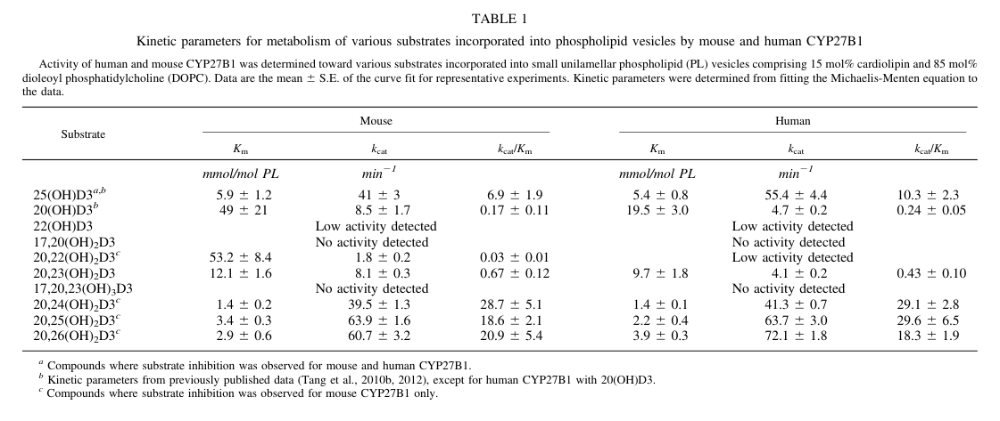

## Question

# Gene Research for Functional Annotation

## ⚠️ CRITICAL: Gene/Protein Identification Context

**BEFORE YOU BEGIN RESEARCH:** You MUST verify you are researching the CORRECT gene/protein. Gene symbols can be ambiguous, especially for less well-characterized genes from non-model organisms.

### Target Gene/Protein Identity (from UniProt):
- **UniProt Accession:** O15528
- **Protein Description:** RecName: Full=25-hydroxyvitamin D-1 alpha hydroxylase, mitochondrial; EC=1.14.15.18 {ECO:0000269|PubMed:10518789}; AltName: Full=25-OHD-1 alpha-hydroxylase; AltName: Full=25-hydroxyvitamin D(3) 1-alpha-hydroxylase; Short=VD3 1A hydroxylase; AltName: Full=Calcidiol 1-monooxygenase; AltName: Full=Cytochrome P450 subfamily XXVIIB polypeptide 1; AltName: Full=Cytochrome P450C1 alpha; AltName: Full=Cytochrome P450VD1-alpha; AltName: Full=Cytochrome p450 27B1; Flags: Precursor;
- **Gene Information:** Name=CYP27B1; Synonyms=CYP1ALPHA, CYP27B;
- **Organism (full):** Homo sapiens (Human).
- **Protein Family:** Belongs to the cytochrome P450 family. .
- **Key Domains:** CYP11_CYP27_families. (IPR050479); Cyt_P450. (IPR001128); Cyt_P450_CS. (IPR017972); Cyt_P450_E_grp-I. (IPR002401); Cyt_P450_sf. (IPR036396)

### MANDATORY VERIFICATION STEPS:

1. **Check if the gene symbol "CYP27B1" matches the protein description above**
2. **Verify the organism is correct:** Homo sapiens (Human).
3. **Check if protein family/domains align with what you find in literature**
4. **If you find literature for a DIFFERENT gene with the same or similar symbol, STOP**

### If Gene Symbol is Ambiguous or You Cannot Find Relevant Literature:

**DO NOT PROCEED WITH RESEARCH ON A DIFFERENT GENE.** Instead:
- State clearly: "The gene symbol 'CYP27B1' is ambiguous or literature is limited for this specific protein"
- Explain what you found (e.g., "Found extensive literature on a different gene with the same symbol in a different organism")
- Describe the protein based ONLY on the UniProt information provided above
- Suggest that the protein function can be inferred from domain/family information

### Research Target:

Please provide a comprehensive research report on the gene **CYP27B1** (gene ID: CYP27B1, UniProt: O15528) in human.

The research report should be a detailed narrative explaining the function, biological processes, and localization of the gene product. Citations should be given for all claims.

You should prioritize authoritative reviews and primary scientific literature when conducting research. You can supplement
this with annotations you find in gene/protein databases, but these can be outdated or inaccurate.

We are specifically interested in the primary function of the gene - for enzymes, what reaction is catalyzed, and what is the substrate specificity? For transporters, what is the substrate? For structural proteins or adapters, what is the broader structural role? For signaling molecules, what is the role in the pathway.

We are interested in where in or outside the cell the gene product carries out its function.

We are also interested in the signaling or biochemical pathways in which the gene functions. We are less interested in broad pleiotropic effects, except where these elucidate the precise role.

Include evidence where possible. We are interested in both experimental evidence as well as inference from structure, evolution, or bioinformatic analysis. Precise studies should be prioritized over high-throughput, where available.

## Output

Question: You are an expert researcher providing comprehensive, well-cited information.

Provide detailed information focusing on:
1. Key concepts and definitions with current understanding
2. Recent developments and latest research (prioritize 2023-2024 sources)
3. Current applications and real-world implementations
4. Expert opinions and analysis from authoritative sources
5. Relevant statistics and data from recent studies

Format as a comprehensive research report with proper citations. Include URLs and publication dates where available.
Always prioritize recent, authoritative sources and provide specific citations for all major claims.

# Gene Research for Functional Annotation

## ⚠️ CRITICAL: Gene/Protein Identification Context

**BEFORE YOU BEGIN RESEARCH:** You MUST verify you are researching the CORRECT gene/protein. Gene symbols can be ambiguous, especially for less well-characterized genes from non-model organisms.

### Target Gene/Protein Identity (from UniProt):
- **UniProt Accession:** O15528
- **Protein Description:** RecName: Full=25-hydroxyvitamin D-1 alpha hydroxylase, mitochondrial; EC=1.14.15.18 {ECO:0000269|PubMed:10518789}; AltName: Full=25-OHD-1 alpha-hydroxylase; AltName: Full=25-hydroxyvitamin D(3) 1-alpha-hydroxylase; Short=VD3 1A hydroxylase; AltName: Full=Calcidiol 1-monooxygenase; AltName: Full=Cytochrome P450 subfamily XXVIIB polypeptide 1; AltName: Full=Cytochrome P450C1 alpha; AltName: Full=Cytochrome P450VD1-alpha; AltName: Full=Cytochrome p450 27B1; Flags: Precursor;
- **Gene Information:** Name=CYP27B1; Synonyms=CYP1ALPHA, CYP27B;
- **Organism (full):** Homo sapiens (Human).
- **Protein Family:** Belongs to the cytochrome P450 family. .
- **Key Domains:** CYP11_CYP27_families. (IPR050479); Cyt_P450. (IPR001128); Cyt_P450_CS. (IPR017972); Cyt_P450_E_grp-I. (IPR002401); Cyt_P450_sf. (IPR036396)

### MANDATORY VERIFICATION STEPS:

1. **Check if the gene symbol "CYP27B1" matches the protein description above**
2. **Verify the organism is correct:** Homo sapiens (Human).
3. **Check if protein family/domains align with what you find in literature**
4. **If you find literature for a DIFFERENT gene with the same or similar symbol, STOP**

### If Gene Symbol is Ambiguous or You Cannot Find Relevant Literature:

**DO NOT PROCEED WITH RESEARCH ON A DIFFERENT GENE.** Instead:
- State clearly: "The gene symbol 'CYP27B1' is ambiguous or literature is limited for this specific protein"
- Explain what you found (e.g., "Found extensive literature on a different gene with the same symbol in a different organism")
- Describe the protein based ONLY on the UniProt information provided above
- Suggest that the protein function can be inferred from domain/family information

### Research Target:

Please provide a comprehensive research report on the gene **CYP27B1** (gene ID: CYP27B1, UniProt: O15528) in human.

The research report should be a detailed narrative explaining the function, biological processes, and localization of the gene product. Citations should be given for all claims.

You should prioritize authoritative reviews and primary scientific literature when conducting research. You can supplement
this with annotations you find in gene/protein databases, but these can be outdated or inaccurate.

We are specifically interested in the primary function of the gene - for enzymes, what reaction is catalyzed, and what is the substrate specificity? For transporters, what is the substrate? For structural proteins or adapters, what is the broader structural role? For signaling molecules, what is the role in the pathway.

We are interested in where in or outside the cell the gene product carries out its function.

We are also interested in the signaling or biochemical pathways in which the gene functions. We are less interested in broad pleiotropic effects, except where these elucidate the precise role.

Include evidence where possible. We are interested in both experimental evidence as well as inference from structure, evolution, or bioinformatic analysis. Precise studies should be prioritized over high-throughput, where available.

# Human CYP27B1: functional annotation and research report

## Identity and principal function

**Identity verified.** The target specified as human **CYP27B1**, UniProt **O15528**, matches the mitochondrial cytochrome P450 known as **25-hydroxyvitamin D 1α-hydroxylase**. Its P450 and CYP27-family domain annotations are consistent with its experimentally established heme-dependent hydroxylase activity. The closely named **CYP27A1** acts principally in an upstream vitamin D 25-hydroxylation pathway, whereas **CYP24A1** hydroxylates vitamin D metabolites in a predominantly catabolic pathway; neither is the target of this report. The accession is supplied by the query; the cited biochemical literature independently establishes the human gene, protein family, location, and reaction rather than explicitly listing that accession. (jones2014cytochromep450mediatedmetabolism pages 2-4, jones2014cytochromep450mediatedmetabolism pages 1-2, tang2013hydroxylationofcyp11a1derived pages 4-5)

**Core reaction:** CYP27B1 hydroxylates carbon 1α of **25-hydroxyvitamin D₃** [25(OH)D₃, calcifediol] to generate **1α,25-dihydroxyvitamin D₃** [1,25(OH)₂D₃, calcitriol]. It also 1α-hydroxylates **25-hydroxyvitamin D₂** to the corresponding active D₂ metabolite; an authoritative biochemical review describes broadly similar efficiency for these two canonical substrates. This is the final enzymatic activation step after vitamin D 25-hydroxylation, not conversion of unmodified vitamin D₃ directly to calcitriol. Calcitriol then binds the vitamin D receptor (VDR) to mediate downstream signaling; CYP27B1 synthesizes the ligand rather than serving as the receptor. (jones2014cytochromep450mediatedmetabolism pages 9-10, jones2014cytochromep450mediatedmetabolism pages 1-2)

## Catalytic mechanism, specificity, and strength of evidence

CYP27B1 is a **mitochondrial, heme-containing monooxygenase**. In the mitochondrial P450 electron-transfer scheme, NADPH supplies electrons through **ferredoxin reductase and ferredoxin**—also called adrenodoxin reductase and adrenodoxin—to the P450 for oxygen-dependent hydroxylation. Recombinant CYP27B1 has been assayed with those partner proteins in phospholipid vesicles that approximate its membrane environment. Conserved P450 heme-binding architecture supports this mechanism; the reviewed structural discussion draws on P450 alignments and homology-based inference, rather than establishing an experimentally solved human CYP27B1–substrate structure. (jones2014cytochromep450mediatedmetabolism pages 2-4, tang2013hydroxylationofcyp11a1derived pages 4-5)

Direct human-enzyme measurements quantify both the canonical reaction and a narrower set of experimentally accepted alternative substrates. The following values are from the **human**, not mouse, column of the original kinetic table; the cropped source table is available as visual evidence. (tang2013hydroxylationofcyp11a1derived pages 4-5, tang2013hydroxylationofcyp11a1derived media 2d1fd2b3)

| Human CYP27B1 substrate | *K*ₘ (mmol/mol phospholipid) | *k*cat (min⁻¹) | *k*cat/*K*ₘ [min⁻¹ per (mmol/mol phospholipid)] |
|---|---:|---:|---:|
| 25(OH)D₃ | 5.4 ± 0.8 | 55.4 ± 4.4 | 10.3 ± 2.3 |
| 20(OH)D₃ | 19.5 ± 3.0 | 4.7 ± 0.2 | 0.24 ± 0.05 |
| 20,24(OH)₂D₃ | 1.4 ± 0.1 | 41.3 ± 0.7 | 29.1 ± 2.8 |
| 20,25(OH)₂D₃ | 2.2 ± 0.4 | 63.7 ± 3.0 | 29.6 ± 6.5 |
| 20,26(OH)₂D₃ | 3.9 ± 0.3 | 72.1 ± 1.8 | 18.3 ± 1.9 |
| **Assay context and interpretation** | **Reconstituted small unilamellar vesicles containing 15 mol% cardiolipin and 85 mol% DOPC** | **Values are mean ± SE from representative Michaelis–Menten curve fits** | **“mmol/mol phospholipid” is a membrane mole ratio, not solution mM; the physiological importance of the noncanonical 20-hydroxylated secosteroids remains uncertain.** (tang2013hydroxylationofcyp11a1derived pages 4-5, tang2013hydroxylationofcyp11a1derived media 2d1fd2b3) |

*Table: Human recombinant CYP27B1 kinetic parameters measured in a membrane-mimetic vesicle system by Tang et al. (2013). The table distinguishes the canonical 25(OH)D₃ substrate from experimentally accepted noncanonical secosteroids.*

The standard 25(OH)D₃ substrate gave *K*ₘ **5.4 ± 0.8 mmol/mol phospholipid** and *k*cat **55.4 ± 4.4 min⁻¹** in that membrane-reconstituted assay. Several 20,24-, 20,25-, and 20,26-dihydroxylated D₃ metabolites were also 1α-hydroxylated, sometimes with greater **in-vitro** *k*cat/*K*ₘ than 25(OH)D₃. Conversely, 20(OH)D₃ was much less efficient, and tested **17α-hydroxylated** secosteroids showed no detectable product. Product characterization included mass spectrometry and NMR for selected metabolites. These observations establish biochemical capacity, **not** that the alternative compounds are quantitatively important physiological CYP27B1 substrates; membrane mole-ratio *K*ₘ values must not be read as aqueous millimolar concentrations. (tang2013hydroxylationofcyp11a1derived pages 4-5, tang2013hydroxylationofcyp11a1derived pages 5-7, tang2013hydroxylationofcyp11a1derived media 2d1fd2b3)

## Where the reaction occurs and what it accomplishes

**Subcellular site:** CYP27B1 functions within mitochondria, associated with the **inner mitochondrial membrane** and its mitochondrial electron-transfer machinery; its N-terminal membrane association follows the established mitochondrial-P450 architecture. It is not a secreted hydroxylase. The enzyme’s product can subsequently act through VDR within or beyond the producing cell. (jones2014cytochromep450mediatedmetabolism pages 2-4)

**Physiological site:** The **renal proximal tubule** is the principal source of circulating calcitriol. This makes renal CYP27B1 a controlled point in the kidney–bone–intestine endocrine circuit: calcitriol increases intestinal calcium and phosphate absorption, while calcium, parathyroid hormone (PTH), and fibroblast growth factor 23 (FGF23) participate in reciprocal feedback. CYP27B1 expression and local 1α-hydroxylase activity have also been reported in macrophages and other nonrenal sites, including skin and placenta. These sites can generate calcitriol for local autocrine or paracrine signaling, although their normal contribution to **circulating** hormone should not be assumed equivalent to that of the kidney. The same CYP27B1 gene is implicated at renal and extrarenal sites; regulation differs by cellular context. (jones2014cytochromep450mediatedmetabolism pages 9-10, murray2024calciumandphosphate pages 1-2)

## Pathway regulation: current mechanistic understanding

Nephrology experts summarize the opposing endocrine controls as follows: **PTH increases renal CYP27B1 and decreases CYP24A1**, favoring calcitriol accumulation; **FGF23 decreases CYP27B1 and increases CYP24A1**, lowering calcitriol. FGF23 signals in the kidney through a receptor complex involving **FGFR1 and α-Klotho**. Calcitriol contributes negative feedback within this mineral-homeostasis network. These are controls on production and removal of the hormone, not changes in CYP27B1’s substrate identity. (murray2024calciumandphosphate pages 1-2, murray2024calciumandphosphate pages 2-3)

A particularly informative **2023 primary study** resolved part of the PTH-to-CYP27B1 signaling route. PTH/PTH1R signaling activated cAMP-dependent PKA, inhibited salt-inducible kinases **SIK2/SIK3**, and promoted **CRTC2** access to kidney-specific *Cyp27b1* regulatory enhancers. Single-cell data located a strong response in proximal-tubule cells; pharmacological SIK inhibition increased CYP27B1 expression and calcitriol production in **human stem-cell-derived kidney organoids** as well as mice. CRTC2-deficient organoids lost the induced response, strengthening the mechanistic inference. FGF23 opposed induction in the organoid experiments. In a mouse CKD–mineral/bone-disorder model, an investigational SIK inhibitor also increased renal *Cyp27b1* and circulating active vitamin D. **SIK inhibition is a preclinical strategy here, not an established CYP27B1-directed human treatment.** (yoon2023aparathyroidhormonesaltinducible pages 1-2, yoon2023aparathyroidhormonesaltinducible pages 9-10, yoon2023aparathyroidhormonesaltinducible pages 13-14, yoon2023aparathyroidhormonesaltinducible pages 4-5)

## Human genetics, clinical implementation, and recent data

The strongest human causal annotation is **vitamin D-dependent rickets type 1A (VDDR1A)**: pathogenic variants on both CYP27B1 alleles impair activation despite adequate precursor availability. The characteristic pattern includes **normal or non-deficient 25(OH)D**, insufficient active 1,25(OH)₂D, hypocalcemia, elevated PTH and alkaline phosphatase, and skeletal undermineralization; phosphate may be reduced in part because secondary hyperparathyroidism increases renal phosphate loss. Thus, serum 25(OH)D alone does not test whether the CYP27B1 activation step works. Clinical treatment supplies **calcitriol and calcium**, bypassing the defective enzyme, with biochemical and skeletal monitoring. (jones2014cytochromep450mediatedmetabolism pages 9-10, tran2025phenotypesandgenotypes pages 2-4, tran2025phenotypesandgenotypes pages 9-11)

A **2025 single-center primary study** examined **19 affected children from 17 Vietnamese families**. All had biallelic CYP27B1 variants; the recurrent frameshift **c.1319_1325dup, p.(Phe443Profs*24)** occurred in **18/19**, including **14 homozygotes** and **four compound heterozygotes**. Mean serum calcium was **1.5 ± 0.3 mmol/L**, and **11/19** had hypophosphatemia. All children received calcitriol and calcium: the authors reported walking after **4.7 ± 1.5 months** of treatment, normalization of calcium, alkaline phosphatase, and PTH after **six months**, and a median rickets severity score of **1 (range 0–3)** after **12 months**. This is treatment-response evidence from a small, genetically concentrated observational cohort, not a randomized comparison or a population-wide estimate of variant frequencies. (tran2025phenotypesandgenotypes pages 1-2, tran2025phenotypesandgenotypes pages 6-8, tran2025phenotypesandgenotypes pages 8-9, tran2025phenotypesandgenotypes pages 9-11)

Excess **extrarenal** calcitriol production illustrates the opposite functional consequence: inflammatory or granulomatous macrophage-associated 1α-hydroxylase activity can contribute to **PTH-independent hypercalcemia**, including in sarcoidosis. A **2024 clinical review** discusses glucocorticoids for acute hypercalcemia and describes azole-mediated hydroxylase inhibition as a *possible* alternative; these approaches have different targets and levels of clinical support, and azoles should not be characterized as selective, approved CYP27B1 therapies on this evidence. In chronic kidney disease, diminished renal calcitriol production and the countervailing FGF23–CYP24A1 axis make the pathway relevant to secondary hyperparathyroidism, but manipulating the newly described SIK mechanism remains experimental. (aberger2024targetingcalcitriolmetabolism pages 1-3, murray2024calciumandphosphate pages 1-2, yoon2023aparathyroidhormonesaltinducible pages 1-2)

As a separate, less definitive application, a **2024 South Indian case–control study** associated CYP27B1 variant **rs118204012 A** with pulmonary-tuberculosis susceptibility: **odds ratio 1.52, 95% CI 1.02–2.26**. Such population-specific association does not demonstrate that this allele changes macrophage enzymatic activity in those participants or that CYP27B1 genotyping guides tuberculosis treatment. It should not be confused with the causal evidence from biallelic loss-of-function rickets. (murugesan2024associationofcyp27b1 pages 1-2)

**Functional annotation conclusion:** Human CYP27B1 is best annotated as the **mitochondrial 25-hydroxyvitamin D 1α-hydroxylase that generates VDR-active calcitriol**, chiefly for systemic mineral homeostasis in the renal proximal tubule and, in selected nonrenal cells, for locally regulated vitamin D signaling. Recombinant-enzyme catalysis, organoid and animal perturbation, and human Mendelian disease converge on that assignment; the physiological importance of its additional in-vitro secosteroid substrates and several proposed nonrenal clinical effects remains less certain. (tang2013hydroxylationofcyp11a1derived pages 4-5, yoon2023aparathyroidhormonesaltinducible pages 1-2, jones2014cytochromep450mediatedmetabolism pages 9-10, tran2025phenotypesandgenotypes pages 9-11)

### Principal publications and links

- Tang EKY *et al.* **May 2013**, *Drug Metabolism and Disposition*: primary human CYP27B1 substrate and kinetic experiments. https://doi.org/10.1124/dmd.113.050955 (tang2013hydroxylationofcyp11a1derived pages 4-5)
- Jones G, Prosser DE, Kaufmann M. **January 2014**, *Journal of Lipid Research*: authoritative biochemical review and enzyme comparisons. https://doi.org/10.1194/jlr.r031534 (jones2014cytochromep450mediatedmetabolism pages 2-4, jones2014cytochromep450mediatedmetabolism pages 9-10)
- Yoon S-H *et al.* **May 1, 2023**, *Journal of Clinical Investigation*: PTH–SIK–CRTC2 mechanism, including human kidney organoids. https://doi.org/10.1172/JCI163627 (yoon2023aparathyroidhormonesaltinducible pages 1-2, yoon2023aparathyroidhormonesaltinducible pages 9-10)
- Murray SL, Wolf M. **Published online December 13, 2023; February 2024 issue**, *American Journal of Kidney Diseases*: expert renal calcium/phosphate curriculum. https://doi.org/10.1053/j.ajkd.2023.04.017 (murray2024calciumandphosphate pages 1-2, murray2024calciumandphosphate pages 2-3)
- Aberger S *et al.* **September 2024**, *International Journal of Molecular Sciences*: review of pathological calcitriol production and toxicity interventions. https://doi.org/10.3390/ijms251810003 (aberger2024targetingcalcitriolmetabolism pages 1-3)
- Murugesan H *et al.* **Available online June 12, 2024; 2024 journal volume**, *Gene*: human tuberculosis genetic association. https://doi.org/10.1016/j.gene.2024.148679 (murugesan2024associationofcyp27b1 pages 1-2)
- Tran TAT *et al.* **April 2025**, *Diagnostics*: 19-child genetically confirmed VDDR1A cohort and treatment outcomes. https://doi.org/10.3390/diagnostics15070918 (tran2025phenotypesandgenotypes pages 1-2, tran2025phenotypesandgenotypes pages 9-11)

References

1. (jones2014cytochromep450mediatedmetabolism pages 2-4): Glenville Jones, David E. Prosser, and Martin Kaufmann. Cytochrome p450-mediated metabolism of vitamin d. Journal of Lipid Research, 55:13-31, Jan 2014. URL: https://doi.org/10.1194/jlr.r031534, doi:10.1194/jlr.r031534. This article has 677 citations and is from a peer-reviewed journal.

2. (jones2014cytochromep450mediatedmetabolism pages 1-2): Glenville Jones, David E. Prosser, and Martin Kaufmann. Cytochrome p450-mediated metabolism of vitamin d. Journal of Lipid Research, 55:13-31, Jan 2014. URL: https://doi.org/10.1194/jlr.r031534, doi:10.1194/jlr.r031534. This article has 677 citations and is from a peer-reviewed journal.

3. (tang2013hydroxylationofcyp11a1derived pages 4-5): Edith K.Y. Tang, Jianjun Chen, Zorica Janjetovic, Elaine W. Tieu, Andrzej T. Slominski, Wei Li, and Robert C. Tuckey. Hydroxylation of cyp11a1-derived products of vitamin d3 metabolism by human and mouse cyp27b1. Drug Metabolism and Disposition, 41:1112-1124, May 2013. URL: https://doi.org/10.1124/dmd.113.050955, doi:10.1124/dmd.113.050955. This article has 52 citations and is from a domain leading peer-reviewed journal.

4. (jones2014cytochromep450mediatedmetabolism pages 9-10): Glenville Jones, David E. Prosser, and Martin Kaufmann. Cytochrome p450-mediated metabolism of vitamin d. Journal of Lipid Research, 55:13-31, Jan 2014. URL: https://doi.org/10.1194/jlr.r031534, doi:10.1194/jlr.r031534. This article has 677 citations and is from a peer-reviewed journal.

5. (tang2013hydroxylationofcyp11a1derived media 2d1fd2b3): Edith K.Y. Tang, Jianjun Chen, Zorica Janjetovic, Elaine W. Tieu, Andrzej T. Slominski, Wei Li, and Robert C. Tuckey. Hydroxylation of cyp11a1-derived products of vitamin d3 metabolism by human and mouse cyp27b1. Drug Metabolism and Disposition, 41:1112-1124, May 2013. URL: https://doi.org/10.1124/dmd.113.050955, doi:10.1124/dmd.113.050955. This article has 52 citations and is from a domain leading peer-reviewed journal.

6. (tang2013hydroxylationofcyp11a1derived pages 5-7): Edith K.Y. Tang, Jianjun Chen, Zorica Janjetovic, Elaine W. Tieu, Andrzej T. Slominski, Wei Li, and Robert C. Tuckey. Hydroxylation of cyp11a1-derived products of vitamin d3 metabolism by human and mouse cyp27b1. Drug Metabolism and Disposition, 41:1112-1124, May 2013. URL: https://doi.org/10.1124/dmd.113.050955, doi:10.1124/dmd.113.050955. This article has 52 citations and is from a domain leading peer-reviewed journal.

7. (murray2024calciumandphosphate pages 1-2): Susan L. Murray and Myles Wolf. Calcium and phosphate disorders: core curriculum 2024. American Journal of Kidney Diseases, 83:241-256, Feb 2024. URL: https://doi.org/10.1053/j.ajkd.2023.04.017, doi:10.1053/j.ajkd.2023.04.017. This article has 88 citations and is from a domain leading peer-reviewed journal.

8. (murray2024calciumandphosphate pages 2-3): Susan L. Murray and Myles Wolf. Calcium and phosphate disorders: core curriculum 2024. American Journal of Kidney Diseases, 83:241-256, Feb 2024. URL: https://doi.org/10.1053/j.ajkd.2023.04.017, doi:10.1053/j.ajkd.2023.04.017. This article has 88 citations and is from a domain leading peer-reviewed journal.

9. (yoon2023aparathyroidhormonesaltinducible pages 1-2): Sung-Hee Yoon, Mark B. Meyer, Carlos Arevalo, Murat Tekguc, Chengcheng Zhang, Jialiang S. Wang, Christian D. Castro Andrade, Katelyn Strauss, Tadatoshi Sato, Nancy A. Benkusky, Seong Min Lee, Rebecca Berdeaux, Marc Foretz, Thomas B. Sundberg, Ramnik J. Xavier, Charles H. Adelmann, Daniel J. Brooks, Anthony Anselmo, Ruslan I. Sadreyev, Ivy A. Rosales, David E. Fisher, Navin Gupta, Ryuji Morizane, Anna Greka, J. Wesley Pike, Michael Mannstadt, and Marc N. Wein. A parathyroid hormone/salt-inducible kinase signaling axis controls renal vitamin d activation and organismal calcium homeostasis. Journal of Clinical Investigation, May 2023. URL: https://doi.org/10.1172/jci163627, doi:10.1172/jci163627. This article has 57 citations and is from a highest quality peer-reviewed journal.

10. (yoon2023aparathyroidhormonesaltinducible pages 9-10): Sung-Hee Yoon, Mark B. Meyer, Carlos Arevalo, Murat Tekguc, Chengcheng Zhang, Jialiang S. Wang, Christian D. Castro Andrade, Katelyn Strauss, Tadatoshi Sato, Nancy A. Benkusky, Seong Min Lee, Rebecca Berdeaux, Marc Foretz, Thomas B. Sundberg, Ramnik J. Xavier, Charles H. Adelmann, Daniel J. Brooks, Anthony Anselmo, Ruslan I. Sadreyev, Ivy A. Rosales, David E. Fisher, Navin Gupta, Ryuji Morizane, Anna Greka, J. Wesley Pike, Michael Mannstadt, and Marc N. Wein. A parathyroid hormone/salt-inducible kinase signaling axis controls renal vitamin d activation and organismal calcium homeostasis. Journal of Clinical Investigation, May 2023. URL: https://doi.org/10.1172/jci163627, doi:10.1172/jci163627. This article has 57 citations and is from a highest quality peer-reviewed journal.

11. (yoon2023aparathyroidhormonesaltinducible pages 13-14): Sung-Hee Yoon, Mark B. Meyer, Carlos Arevalo, Murat Tekguc, Chengcheng Zhang, Jialiang S. Wang, Christian D. Castro Andrade, Katelyn Strauss, Tadatoshi Sato, Nancy A. Benkusky, Seong Min Lee, Rebecca Berdeaux, Marc Foretz, Thomas B. Sundberg, Ramnik J. Xavier, Charles H. Adelmann, Daniel J. Brooks, Anthony Anselmo, Ruslan I. Sadreyev, Ivy A. Rosales, David E. Fisher, Navin Gupta, Ryuji Morizane, Anna Greka, J. Wesley Pike, Michael Mannstadt, and Marc N. Wein. A parathyroid hormone/salt-inducible kinase signaling axis controls renal vitamin d activation and organismal calcium homeostasis. Journal of Clinical Investigation, May 2023. URL: https://doi.org/10.1172/jci163627, doi:10.1172/jci163627. This article has 57 citations and is from a highest quality peer-reviewed journal.

12. (yoon2023aparathyroidhormonesaltinducible pages 4-5): Sung-Hee Yoon, Mark B. Meyer, Carlos Arevalo, Murat Tekguc, Chengcheng Zhang, Jialiang S. Wang, Christian D. Castro Andrade, Katelyn Strauss, Tadatoshi Sato, Nancy A. Benkusky, Seong Min Lee, Rebecca Berdeaux, Marc Foretz, Thomas B. Sundberg, Ramnik J. Xavier, Charles H. Adelmann, Daniel J. Brooks, Anthony Anselmo, Ruslan I. Sadreyev, Ivy A. Rosales, David E. Fisher, Navin Gupta, Ryuji Morizane, Anna Greka, J. Wesley Pike, Michael Mannstadt, and Marc N. Wein. A parathyroid hormone/salt-inducible kinase signaling axis controls renal vitamin d activation and organismal calcium homeostasis. Journal of Clinical Investigation, May 2023. URL: https://doi.org/10.1172/jci163627, doi:10.1172/jci163627. This article has 57 citations and is from a highest quality peer-reviewed journal.

13. (tran2025phenotypesandgenotypes pages 2-4): Thi Anh Thuong Tran, Tran Minh Dien, Ngoc Lan Nguyen, Khanh Ngoc Nguyen, Thi Bich Ngoc Can, Bui Phuong Thao, Nguyen Thi Thuy Hong, Van Khanh Tran, Thinh Huy Tran, Ngo Xuan Khoa, Nguyen Thi Kim Lien, Nguyen Thien Tao, Huy Hoang Nguyen, and Chi Dung Vu. Phenotypes and genotypes of children with vitamin d-dependent rickets type 1a: a single tertiary pediatric center in vietnam. Diagnostics, 15:918, Apr 2025. URL: https://doi.org/10.3390/diagnostics15070918, doi:10.3390/diagnostics15070918. This article has 5 citations.

14. (tran2025phenotypesandgenotypes pages 9-11): Thi Anh Thuong Tran, Tran Minh Dien, Ngoc Lan Nguyen, Khanh Ngoc Nguyen, Thi Bich Ngoc Can, Bui Phuong Thao, Nguyen Thi Thuy Hong, Van Khanh Tran, Thinh Huy Tran, Ngo Xuan Khoa, Nguyen Thi Kim Lien, Nguyen Thien Tao, Huy Hoang Nguyen, and Chi Dung Vu. Phenotypes and genotypes of children with vitamin d-dependent rickets type 1a: a single tertiary pediatric center in vietnam. Diagnostics, 15:918, Apr 2025. URL: https://doi.org/10.3390/diagnostics15070918, doi:10.3390/diagnostics15070918. This article has 5 citations.

15. (tran2025phenotypesandgenotypes pages 1-2): Thi Anh Thuong Tran, Tran Minh Dien, Ngoc Lan Nguyen, Khanh Ngoc Nguyen, Thi Bich Ngoc Can, Bui Phuong Thao, Nguyen Thi Thuy Hong, Van Khanh Tran, Thinh Huy Tran, Ngo Xuan Khoa, Nguyen Thi Kim Lien, Nguyen Thien Tao, Huy Hoang Nguyen, and Chi Dung Vu. Phenotypes and genotypes of children with vitamin d-dependent rickets type 1a: a single tertiary pediatric center in vietnam. Diagnostics, 15:918, Apr 2025. URL: https://doi.org/10.3390/diagnostics15070918, doi:10.3390/diagnostics15070918. This article has 5 citations.

16. (tran2025phenotypesandgenotypes pages 6-8): Thi Anh Thuong Tran, Tran Minh Dien, Ngoc Lan Nguyen, Khanh Ngoc Nguyen, Thi Bich Ngoc Can, Bui Phuong Thao, Nguyen Thi Thuy Hong, Van Khanh Tran, Thinh Huy Tran, Ngo Xuan Khoa, Nguyen Thi Kim Lien, Nguyen Thien Tao, Huy Hoang Nguyen, and Chi Dung Vu. Phenotypes and genotypes of children with vitamin d-dependent rickets type 1a: a single tertiary pediatric center in vietnam. Diagnostics, 15:918, Apr 2025. URL: https://doi.org/10.3390/diagnostics15070918, doi:10.3390/diagnostics15070918. This article has 5 citations.

17. (tran2025phenotypesandgenotypes pages 8-9): Thi Anh Thuong Tran, Tran Minh Dien, Ngoc Lan Nguyen, Khanh Ngoc Nguyen, Thi Bich Ngoc Can, Bui Phuong Thao, Nguyen Thi Thuy Hong, Van Khanh Tran, Thinh Huy Tran, Ngo Xuan Khoa, Nguyen Thi Kim Lien, Nguyen Thien Tao, Huy Hoang Nguyen, and Chi Dung Vu. Phenotypes and genotypes of children with vitamin d-dependent rickets type 1a: a single tertiary pediatric center in vietnam. Diagnostics, 15:918, Apr 2025. URL: https://doi.org/10.3390/diagnostics15070918, doi:10.3390/diagnostics15070918. This article has 5 citations.

18. (aberger2024targetingcalcitriolmetabolism pages 1-3): Simon Aberger, Nikolaus Schreiber, Stefan Pilz, Kathrin Eller, Alexander R. Rosenkranz, and Alexander H. Kirsch. Targeting calcitriol metabolism in acute vitamin d toxicity—a comprehensive review and clinical insight. International Journal of Molecular Sciences, 25:10003, Sep 2024. URL: https://doi.org/10.3390/ijms251810003, doi:10.3390/ijms251810003. This article has 23 citations.

19. (murugesan2024associationofcyp27b1 pages 1-2): Harishankar Murugesan, Pavithra Sampath, Vamsi Kumar A., Srividhya R., Athikesavan Veerasamy, Uma Devi Ranganathan, Selvaraj Paramasivam, and Ramalingam Bethunaickan. Association of cyp27b1 gene polymorphisms with pulmonary tuberculosis and vitamin d levels. Gene, 927:148679, Nov 2024. URL: https://doi.org/10.1016/j.gene.2024.148679, doi:10.1016/j.gene.2024.148679. This article has 9 citations and is from a peer-reviewed journal.

## Artifacts

- [Edison artifact artifact-00](CYP27B1-deep-research-falcon_artifacts/artifact-00.md)

## Citations

1. aberger2024targetingcalcitriolmetabolism pages 1-3
2. murray2024calciumandphosphate pages 1-2
3. murray2024calciumandphosphate pages 2-3
4. yoon2023aparathyroidhormonesaltinducible pages 1-2
5. yoon2023aparathyroidhormonesaltinducible pages 9-10
6. yoon2023aparathyroidhormonesaltinducible pages 13-14
7. yoon2023aparathyroidhormonesaltinducible pages 4-5
8. tran2025phenotypesandgenotypes pages 2-4
9. tran2025phenotypesandgenotypes pages 9-11
10. tran2025phenotypesandgenotypes pages 1-2
11. tran2025phenotypesandgenotypes pages 6-8
12. tran2025phenotypesandgenotypes pages 8-9
13. 25(OH)D₃, calcifediol
14. 1,25(OH)₂D₃, calcitriol
15. min⁻¹ per (mmol/mol phospholipid)
16. https://doi.org/10.1124/dmd.113.050955
17. https://doi.org/10.1194/jlr.r031534
18. https://doi.org/10.1172/JCI163627
19. https://doi.org/10.1053/j.ajkd.2023.04.017
20. https://doi.org/10.3390/ijms251810003
21. https://doi.org/10.1016/j.gene.2024.148679
22. https://doi.org/10.3390/diagnostics15070918
23. https://doi.org/10.1194/jlr.r031534,
24. https://doi.org/10.1124/dmd.113.050955,
25. https://doi.org/10.1053/j.ajkd.2023.04.017,
26. https://doi.org/10.1172/jci163627,
27. https://doi.org/10.3390/diagnostics15070918,
28. https://doi.org/10.3390/ijms251810003,
29. https://doi.org/10.1016/j.gene.2024.148679,