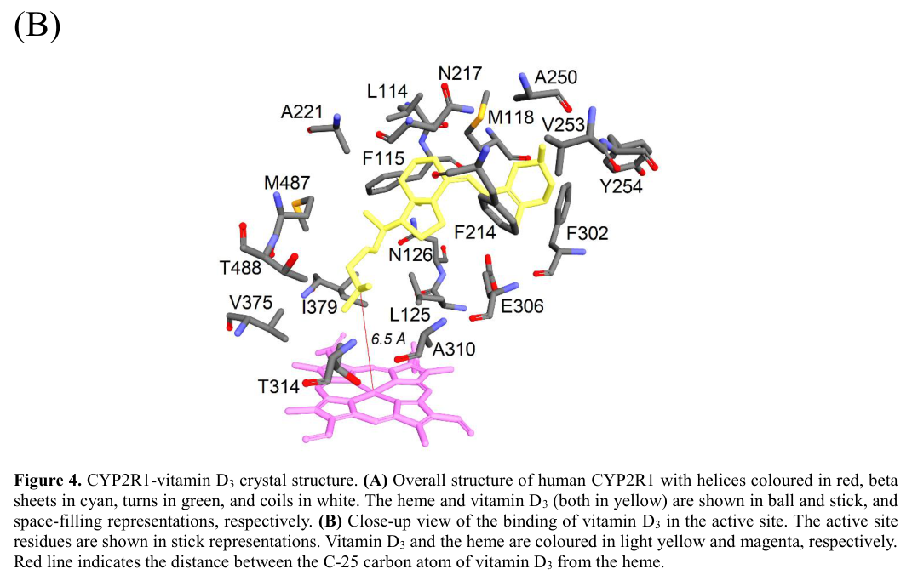

## Question

# Gene Research for Functional Annotation

## ⚠️ CRITICAL: Gene/Protein Identification Context

**BEFORE YOU BEGIN RESEARCH:** You MUST verify you are researching the CORRECT gene/protein. Gene symbols can be ambiguous, especially for less well-characterized genes from non-model organisms.

### Target Gene/Protein Identity (from UniProt):
- **UniProt Accession:** Q6VVX0
- **Protein Description:** RecName: Full=Vitamin D 25-hydroxylase {ECO:0000303|PubMed:12867411}; EC=1.14.14.24 {ECO:0000269|PubMed:12867411, ECO:0000269|PubMed:15465040, ECO:0000269|PubMed:18511070}; AltName: Full=Cytochrome P450 2R1; Flags: Precursor;
- **Gene Information:** Name=CYP2R1;
- **Organism (full):** Homo sapiens (Human).
- **Protein Family:** Belongs to the cytochrome P450 family. .
- **Key Domains:** Cyt_P450. (IPR001128); Cyt_P450_CS. (IPR017972); Cyt_P450_E_grp-I. (IPR002401); Cyt_P450_sf. (IPR036396); Cytochrome_P450_fam2. (IPR050182)

### MANDATORY VERIFICATION STEPS:

1. **Check if the gene symbol "CYP2R1" matches the protein description above**
2. **Verify the organism is correct:** Homo sapiens (Human).
3. **Check if protein family/domains align with what you find in literature**
4. **If you find literature for a DIFFERENT gene with the same or similar symbol, STOP**

### If Gene Symbol is Ambiguous or You Cannot Find Relevant Literature:

**DO NOT PROCEED WITH RESEARCH ON A DIFFERENT GENE.** Instead:
- State clearly: "The gene symbol 'CYP2R1' is ambiguous or literature is limited for this specific protein"
- Explain what you found (e.g., "Found extensive literature on a different gene with the same symbol in a different organism")
- Describe the protein based ONLY on the UniProt information provided above
- Suggest that the protein function can be inferred from domain/family information

### Research Target:

Please provide a comprehensive research report on the gene **CYP2R1** (gene ID: CYP2R1, UniProt: Q6VVX0) in human.

The research report should be a detailed narrative explaining the function, biological processes, and localization of the gene product. Citations should be given for all claims.

You should prioritize authoritative reviews and primary scientific literature when conducting research. You can supplement
this with annotations you find in gene/protein databases, but these can be outdated or inaccurate.

We are specifically interested in the primary function of the gene - for enzymes, what reaction is catalyzed, and what is the substrate specificity? For transporters, what is the substrate? For structural proteins or adapters, what is the broader structural role? For signaling molecules, what is the role in the pathway.

We are interested in where in or outside the cell the gene product carries out its function.

We are also interested in the signaling or biochemical pathways in which the gene functions. We are less interested in broad pleiotropic effects, except where these elucidate the precise role.

Include evidence where possible. We are interested in both experimental evidence as well as inference from structure, evolution, or bioinformatic analysis. Precise studies should be prioritized over high-throughput, where available.

## Output

Question: You are an expert researcher providing comprehensive, well-cited information.

Provide detailed information focusing on:
1. Key concepts and definitions with current understanding
2. Recent developments and latest research (prioritize 2023-2024 sources)
3. Current applications and real-world implementations
4. Expert opinions and analysis from authoritative sources
5. Relevant statistics and data from recent studies

Format as a comprehensive research report with proper citations. Include URLs and publication dates where available.
Always prioritize recent, authoritative sources and provide specific citations for all major claims.

# Gene Research for Functional Annotation

## ⚠️ CRITICAL: Gene/Protein Identification Context

**BEFORE YOU BEGIN RESEARCH:** You MUST verify you are researching the CORRECT gene/protein. Gene symbols can be ambiguous, especially for less well-characterized genes from non-model organisms.

### Target Gene/Protein Identity (from UniProt):
- **UniProt Accession:** Q6VVX0
- **Protein Description:** RecName: Full=Vitamin D 25-hydroxylase {ECO:0000303|PubMed:12867411}; EC=1.14.14.24 {ECO:0000269|PubMed:12867411, ECO:0000269|PubMed:15465040, ECO:0000269|PubMed:18511070}; AltName: Full=Cytochrome P450 2R1; Flags: Precursor;
- **Gene Information:** Name=CYP2R1;
- **Organism (full):** Homo sapiens (Human).
- **Protein Family:** Belongs to the cytochrome P450 family. .
- **Key Domains:** Cyt_P450. (IPR001128); Cyt_P450_CS. (IPR017972); Cyt_P450_E_grp-I. (IPR002401); Cyt_P450_sf. (IPR036396); Cytochrome_P450_fam2. (IPR050182)

### MANDATORY VERIFICATION STEPS:

1. **Check if the gene symbol "CYP2R1" matches the protein description above**
2. **Verify the organism is correct:** Homo sapiens (Human).
3. **Check if protein family/domains align with what you find in literature**
4. **If you find literature for a DIFFERENT gene with the same or similar symbol, STOP**

### If Gene Symbol is Ambiguous or You Cannot Find Relevant Literature:

**DO NOT PROCEED WITH RESEARCH ON A DIFFERENT GENE.** Instead:
- State clearly: "The gene symbol 'CYP2R1' is ambiguous or literature is limited for this specific protein"
- Explain what you found (e.g., "Found extensive literature on a different gene with the same symbol in a different organism")
- Describe the protein based ONLY on the UniProt information provided above
- Suggest that the protein function can be inferred from domain/family information

### Research Target:

Please provide a comprehensive research report on the gene **CYP2R1** (gene ID: CYP2R1, UniProt: Q6VVX0) in human.

The research report should be a detailed narrative explaining the function, biological processes, and localization of the gene product. Citations should be given for all claims.

You should prioritize authoritative reviews and primary scientific literature when conducting research. You can supplement
this with annotations you find in gene/protein databases, but these can be outdated or inaccurate.

We are specifically interested in the primary function of the gene - for enzymes, what reaction is catalyzed, and what is the substrate specificity? For transporters, what is the substrate? For structural proteins or adapters, what is the broader structural role? For signaling molecules, what is the role in the pathway.

We are interested in where in or outside the cell the gene product carries out its function.

We are also interested in the signaling or biochemical pathways in which the gene functions. We are less interested in broad pleiotropic effects, except where these elucidate the precise role.

Include evidence where possible. We are interested in both experimental evidence as well as inference from structure, evolution, or bioinformatic analysis. Precise studies should be prioritized over high-throughput, where available.

# Human CYP2R1 (UniProt Q6VVX0): functional annotation research report

## Identity and principal function

**Identity verified.** The published structural review explicitly identifies **Q6VVX0 as human CYP2R1**. The gene maps to chromosome 11p15.2 and encodes a 501-residue, heme-containing cytochrome P450. Its experimentally determined P450 fold, heme-binding architecture and membrane-associated N terminus agree with the supplied Cyt_P450 family/domain annotations. This report concerns *Homo sapiens* CYP2R1, not a similarly named enzyme from another organism. [Dong et al., February 2021](https://doi.org/10.18433/jpps31305); [Strushkevich et al., 2008](https://doi.org/10.1016/j.jmb.2008.03.065). (dong2021thecyp2r1enzyme pages 1-4, dong2021thecyp2r1enzyme pages 4-5, dong2021thecyp2r1enzyme pages 5-8, strushkevich2008structuralanalysisof pages 2-3)

**Primary reaction.** CYP2R1 is a vitamin D **25-hydroxylase**: it adds a hydroxyl group at carbon 25 of cholecalciferol (**vitamin D₃**) to make 25-hydroxyvitamin D₃ (**25(OH)D₃; calcifediol**) and likewise converts ergocalciferol (**vitamin D₂**) to **25(OH)D₂**. It is the principal *identified* physiological hepatic enzyme for this first hydroxylation step, but not the only enzyme capable of making 25(OH)D. [Jones et al., January 2014](https://doi.org/10.1194/jlr.r031534); [Giustina et al., April 2024](https://doi.org/10.1210/endrev/bnae009). (jones2014cytochromep450mediatedmetabolism pages 4-6, jones2014cytochromep450mediatedmetabolism pages 2-4, zhu2013cyp2r1isa pages 1-2, giustina2024consensusstatementon pages 3-4)

## Catalytic mechanism, specificity and structural evidence

CYP2R1 is an oxygen- and reducing-equivalent-dependent, heme P450 monooxygenase, rather than a vitamin D receptor or transporter. In the endoplasmic-reticulum P450 system, **NADPH–cytochrome P450 reductase (POR)** transfers electrons from NADPH to CYP2R1. Purified human CYP2R1 reconstituted with human POR and phospholipid vesicles produced 25(OH)D₃ from membrane-partitioned vitamin D₃, directly demonstrating activity in a membrane-like environment. [Jones et al., 2014](https://doi.org/10.1194/jlr.r031534); [Cheng et al., March 2018](https://doi.org/10.1016/j.jsbmb.2017.07.011). (jones2014cytochromep450mediatedmetabolism pages 4-6, cheng2018propertiesofpurified pages 4-6, cheng2018propertiesofpurified pages 6-8)

Its **established physiological substrate class is vitamin D secosteroids**, not cholesterol in general. Experiments support conversion of both D₂ and D₃, with similar activity at physiologically relevant substrate concentrations. Purified human enzyme also 25-hydroxylates the *tested* 1α-hydroxylated D₂ and D₃ analogues, but did not measurably metabolize 25(OH)D₃, cholesterol or 7-dehydrocholesterol under the reported assay conditions. Product identification found C25 hydroxylation without detectable competing C24 or C27 products in the structural study. A separate membrane-reconstitution experiment demonstrated conversion of **20-hydroxyvitamin D₃ to 20,25-dihydroxyvitamin D₃**; the in-vivo importance of this additional reaction is less established than the D₂/D₃ reaction. [Strushkevich et al., 2008](https://doi.org/10.1016/j.jmb.2008.03.065); [Cheng et al., 2018](https://doi.org/10.1016/j.jsbmb.2017.07.011); [Jones et al., 2014](https://doi.org/10.1194/jlr.r031534). (jones2014cytochromep450mediatedmetabolism pages 4-6, strushkevich2008structuralanalysisof pages 1-2, cheng2018propertiesofpurified pages 9-11, strushkevich2008structuralanalysisof pages 2-3)

In the 2008 purified-enzyme study, the reported vitamin D₃ **Kₘ was 4.4 µM** and turnover **0.48 min⁻¹ per P450**; these are *in-vitro assay parameters*, not estimates of circulating vitamin D concentration or whole-body flux. Under matched phospholipid-vesicle conditions in a later study, CYP2R1 had approximately **17-fold higher catalytic efficiency** for D₃ 25-hydroxylation than mitochondrial CYP27A1, largely because of a lower apparent Kₘ. Absolute kinetic comparisons between different solvent and membrane preparations require caution because the hydrophobic substrate partitions into membranes. [Strushkevich et al., 2008](https://doi.org/10.1016/j.jmb.2008.03.065); [Cheng et al., 2018](https://doi.org/10.1016/j.jsbmb.2017.07.011). (strushkevich2008structuralanalysisof pages 2-3, cheng2018propertiesofpurified pages 9-11, cheng2018propertiesofpurified pages 6-8)

The human CYP2R1–vitamin D₃ crystal structure places vitamin D₃ in an elongated, largely hydrophobic pocket, with its side chain directed toward the buried heme. The ordered B′ helix helps gate substrate access. Notably, the observed distance between vitamin D₃ carbon 25 and heme iron is approximately **6.5 Å**: the structure supports substrate orientation but should not be mistaken for a fully resolved oxygen-transfer transition state. The cropped active-site illustration shows the heme and substrate arrangement. [Strushkevich et al., 2008](https://doi.org/10.1016/j.jmb.2008.03.065); [Dong et al., 2021, Fig. 4B](https://doi.org/10.18433/jpps31305). (strushkevich2008structuralanalysisof pages 2-3, strushkevich2008structuralanalysisof pages 3-5, dong2021thecyp2r1enzyme media 4f3c4919)

## Where it acts and its place in the pathway

**Site of action:** CYP2R1 is an **intracellular, membrane-associated microsomal enzyme**, principally characterized in **liver cells at the endoplasmic reticulum**; expression is also reported in testis. Its catalytic function is associated with the intracellular membrane/POR system, **not secretion into blood**. This distinction matters because its soluble product, rather than the enzyme, contributes to circulating vitamin D metabolites. The N-terminal membrane-targeting region and experimental recovery of recombinant protein with membranes reinforce the microsomal assignment. [Jones et al., 2014](https://doi.org/10.1194/jlr.r031534); [Strushkevich et al., 2008](https://doi.org/10.1016/j.jmb.2008.03.065); [Cheng et al., 2018](https://doi.org/10.1016/j.jsbmb.2017.07.011). (jones2014cytochromep450mediatedmetabolism pages 2-4, jones2014cytochromep450mediatedmetabolism pages 4-6, cheng2018propertiesofpurified pages 6-8, strushkevich2008structuralanalysisof pages 3-5)

**Pathway:** Skin-derived or dietary D₃, and dietary D₂, undergo hepatic C25 hydroxylation to produce **25(OH)D**, the predominant circulating metabolite routinely used to assess vitamin D status. Subsequently, **CYP27B1**, chiefly in the kidney for circulating hormone production, 1α-hydroxylates 25(OH)D to produce **1,25-dihydroxyvitamin D (calcitriol for the D₃ series)**. Calcitriol signals through the vitamin D receptor (**VDR**) to regulate calcium/phosphate homeostasis and bone mineralization; **CYP24A1** participates in downstream vitamin D metabolite catabolism. Thus, CYP2R1 controls precursor supply to VDR signaling but **does not itself bind DNA, activate VDR, or catalyze the CYP27B1 step**. [Jones et al., 2014](https://doi.org/10.1194/jlr.r031534); [Giustina et al., 2024](https://doi.org/10.1210/endrev/bnae009). (jones2014cytochromep450mediatedmetabolism pages 2-4, dong2021thecyp2r1enzyme pages 5-8, giustina2024consensusstatementon pages 3-4)

## Strength of functional and clinical evidence

Several independent approaches converge on this annotation. **Human genetics:** a homozygous **p.Leu99Pro** substitution abolished measured CYP2R1 D₃ 25-hydroxylase activity and was associated with rickets and serum 25(OH)D of **10–12 nM**, versus a stated reference interval of **25–137 nM**. Subsequent family studies found another functionally impaired allele, **p.Lys242Asn**, and smaller post-dose 25(OH)D responses in heterozygotes than controls, with particularly poor responses in affected homozygotes. Structural analysis indicates that Leu99 contributes to the integrity of a region near the heme-coordinating machinery, although the precise failure mode of the mutant protein is not settled by the patient observation alone. [Cheng et al., May 2004](https://doi.org/10.1073/pnas.0402490101); [Thacher et al., July 2015](https://doi.org/10.1210/jc.2015-1746); [Strushkevich et al., 2008](https://doi.org/10.1016/j.jmb.2008.03.065). (cheng2004geneticevidencethat pages 1-2, strushkevich2008structuralanalysisof pages 2-3, thacher2015cyp2r1mutationsimpairgeneration pages 1-2)

**In-vivo qualification:** deleting *Cyp2r1* in mice lowered circulating 25(OH)D₃ by **more than 50%**, but did not abolish it or appreciably change circulating 1,25(OH)₂D₃. Residual production persisted even in mice additionally lacking *Cyp27a1*. The appropriate conclusion is **major, not exclusive, 25-hydroxylase activity**; neither another enzyme’s precise quantitative contribution in humans nor complete CYP2R1 indispensability has been demonstrated. The [2024 international expert consensus](https://doi.org/10.1210/endrev/bnae009) likewise described CYP2R1 as the major hepatic microsomal 25-hydroxylase and noted **five functionally characterized mutations** at the time of its assessment. [Zhu et al., September 2013](https://doi.org/10.1073/pnas.1315006110); [Giustina et al., 2024](https://doi.org/10.1210/endrev/bnae009). (zhu2013cyp2r1isa pages 1-2, giustina2024consensusstatementon pages 3-4)

The following matrix separates direct observations from their interpretive limits. (cheng2018propertiesofpurified pages 9-11, cheng2004geneticevidencethat pages 1-2, zhu2013cyp2r1isa pages 1-2, strushkevich2008structuralanalysisof pages 2-3, baroncelli2024diagnosistreatmentand pages 11-12, giustina2024consensusstatementon pages 3-4, alharazy2024geneticvariantsin pages 1-2)

| Experimental/clinical approach | Directly established finding | Limitation/interpretation | Source |
|---|---|---|---|
| Purified recombinant human CYP2R1; product identification and enzyme kinetics | Regioselective C25 hydroxylation of vitamin D3; no detectable C24/C27 products. Vitamin D3 **Km = 4.4 µM**. CYP2R1 also hydroxylated 1α-OH-D3 and 1α-OH-D2, but not 25-OH-D3, cholesterol, or 7-dehydrocholesterol. | Truncated, bacterially expressed protein in a reconstituted system; micromolar assay kinetics may not reproduce physiological substrate delivery. | Strushkevich et al., 2008, *J Mol Biol*, [doi:10.1016/j.jmb.2008.03.065](https://doi.org/10.1016/j.jmb.2008.03.065) (strushkevich2008structuralanalysisof pages 2-3, strushkevich2008structuralanalysisof pages 3-5) |
| Purified human CYP2R1 reconstituted with phospholipid vesicles, NADPH and human POR | CYP2R1 showed approximately **17-fold greater catalytic efficiency** for vitamin D3 25-hydroxylation than CYP27A1 under matched vesicle conditions; it also converted 20(OH)D3 to 20,25(OH)2D3. POR was required, whereas cytochrome b5 had no detectable effect. | Cell-free membrane model; establishes catalytic capability and comparative efficiency, not the quantitative in-vivo contribution of 20(OH)D3 metabolism. | Cheng et al., 2018, *J Steroid Biochem Mol Biol*, [doi:10.1016/j.jsbmb.2017.07.011](https://doi.org/10.1016/j.jsbmb.2017.07.011) (cheng2018propertiesofpurified pages 9-11, cheng2018propertiesofpurified pages 1-3, cheng2018propertiesofpurified pages 4-6) |
| Human genetics and functional analysis of homozygous CYP2R1 p.Leu99Pro | The mutation eliminated vitamin D3 25-hydroxylase activity and was associated with serum 25(OH)D of **10–12 nM**, versus a stated reference range of **25–137 nM**, plus rickets-related mineral and skeletal abnormalities. | Evidence came from a rare familial case; phenotype and treatment response may be modified by other hydroxylases, calcium intake and genetic background. | Cheng et al., 2004, *PNAS*, [doi:10.1073/pnas.0402490101](https://doi.org/10.1073/pnas.0402490101) (cheng2004geneticevidencethat pages 1-2) |
| Cyp2r1-knockout mice, including combined Cyp2r1/Cyp27a1 deletion | Loss of Cyp2r1 reduced circulating 25(OH)D3 by **more than 50%**, while 1,25(OH)2D3 remained unchanged; residual production persisted even after combined deletion with Cyp27a1. | Mouse evidence establishes CYP2R1 as major but **not exclusive**; residual activity implies one or more compensating 25-hydroxylases and limits direct quantitative extrapolation to humans. | Zhu et al., 2013, *PNAS*, [doi:10.1073/pnas.1315006110](https://doi.org/10.1073/pnas.1315006110) (zhu2013cyp2r1isa pages 1-2) |
| International expert consensus integrating human genetics, biochemistry and animal studies | CYP2R1 is the major hepatic microsomal 25-hydroxylase; **five functional mutations** had been described. Mouse deletion lowers 25(OH)D by over 50%, while preserved mineral indices and human residual responses indicate enzymatic compensation. | Expert synthesis rather than a new experiment; mutation count reflects evidence available at publication, and metabolic-regulation findings are stronger in rodents than in humans. | Giustina et al., 2024, *Endocr Rev*, [doi:10.1210/endrev/bnae009](https://doi.org/10.1210/endrev/bnae009) (giustina2024consensusstatementon pages 3-4) |
| Pediatric endocrinology position statement for CYP2R1-related vitamin D–dependent rickets type 1B | Recommends **calcifediol plus calcium**, because parent vitamin D has poor or absent effect when hepatic 25-hydroxylation is impaired; calcitriol or alfacalcidol may be alternatives. Homozygous patients show little or no 25(OH)D rise after a vitamin-D bolus. | Guidance is based largely on rare cases and expert synthesis; treatment must be individualized and monitored rather than inferred solely from genotype. | Baroncelli et al., 2024, *Front Endocrinol*, [doi:10.3389/fendo.2024.1383681](https://doi.org/10.3389/fendo.2024.1383681) (baroncelli2024diagnosistreatmentand pages 7-9, baroncelli2024diagnosistreatmentand pages 11-12) |
| Cross-sectional genotyping of **149** Saudi women with type 2 diabetes | CYP2R1 rs10500804 G-allele frequency was **0.37**; genotype showed **no significant association** with 25(OH)D or measured glycaemic parameters. | Modest, sex- and population-specific sample with no non-diabetic comparator; a null result for one common SNP does not exclude effects of rare variants, expression changes or gene–environment interactions. | Alharazy, 2024, *Pak J Med Sci*, [doi:10.12669/pjms.40.8.9318](https://doi.org/10.12669/pjms.40.8.9318) (alharazy2024geneticvariantsin pages 1-2) |

*Table: Compact evidence matrix linking CYP2R1 biochemical function, structural specificity, genetic disease, in-vivo redundancy, clinical management and recent human association data. It distinguishes direct findings from important experimental and interpretive limitations.*

## Recent clinical implementation and research boundaries

**Established clinical use of the pathway.** Serum **25(OH)D** is used to assess vitamin D status, although the 2024 expert consensus emphasizes that optimal cutoffs and assay comparability remain contested. In suspected inherited 25-hydroxylase deficiency, clinicians evaluate the vitamin D metabolites and mineral-bone phenotype and use molecular testing to distinguish **CYP2R1-related vitamin D-dependent rickets type 1B (VDDR1B)** from defects at other steps. The [2024 Italian pediatric-endocrinology position statement](https://doi.org/10.3389/fendo.2024.1383681) recommends **calcifediol with calcium** for VDDR1B because calcifediol bypasses the defective C25-hydroxylation step; calcitriol or alfacalcidol can be alternatives. It reports that a vitamin D bolus produces little or no 25(OH)D rise in homozygous CYP2R1 disease, although responses in heterozygotes can be less severely impaired. These recommendations concern a **rare diagnosed disorder**, not routine genotype-directed supplementation for the general population. (dong2021thecyp2r1enzyme pages 5-8, baroncelli2024diagnosistreatmentand pages 7-9, baroncelli2024diagnosistreatmentand pages 11-12, giustina2024consensusstatementon pages 3-4)

**2024 research and unresolved issues.** The [2024 international consensus](https://doi.org/10.1210/endrev/bnae009) discusses reduced hepatic CYP2R1 expression in mouse models of obesity and diabetes as a possible contributor to reduced 25(OH)D synthesis, while cautioning that the explanation of low 25(OH)D in human obesity remains unsettled. Common-variant results are context-dependent: a [2024 cross-sectional study](https://doi.org/10.12669/pjms.40.8.9318) of **149 Saudi women with type 2 diabetes** found **no significant association** between CYP2R1 **rs10500804** genotype and either 25(OH)D or measured glycaemic parameters. Such a negative result for one variant in one sample does not undermine experimentally verified 25-hydroxylase activity, but disease-association findings alone should not be turned into claims that CYP2R1 directly causes diabetes, obesity or other pleiotropic conditions. (giustina2024consensusstatementon pages 3-4, alharazy2024geneticvariantsin pages 1-2)

**Functional-annotation conclusion:** assign human CYP2R1/Q6VVX0 the primary role **ER-associated, POR-dependent vitamin D₂/D₃ C25 hydroxylation, producing circulating-hormone precursors 25(OH)D₂/D₃**. Record 1α-hydroxylated vitamin D analogues and 20(OH)D₃ as experimentally converted additional substrates, while distinguishing their demonstrated *in-vitro* conversion from the enzyme’s established principal physiological role. Mark tissue-specific quantitative flux, compensation by other hydroxylases, and effects of many common variants as unresolved rather than as new primary functions. (jones2014cytochromep450mediatedmetabolism pages 4-6, cheng2018propertiesofpurified pages 9-11, zhu2013cyp2r1isa pages 1-2, strushkevich2008structuralanalysisof pages 2-3, giustina2024consensusstatementon pages 3-4)

References

1. (dong2021thecyp2r1enzyme pages 1-4): Amelia Nathania Dong, Boon Hooi Tan, Yan Pan, and Chin Eng Ong. The cyp2r1 enzyme: structure, function, enzymatic properties and genetic polymorphism. Journal of pharmacy & pharmaceutical sciences : a publication of the Canadian Society for Pharmaceutical Sciences, Societe canadienne des sciences pharmaceutiques, 24:94-112, Feb 2021. URL: https://doi.org/10.18433/jpps31305, doi:10.18433/jpps31305. This article has 27 citations.

2. (dong2021thecyp2r1enzyme pages 4-5): Amelia Nathania Dong, Boon Hooi Tan, Yan Pan, and Chin Eng Ong. The cyp2r1 enzyme: structure, function, enzymatic properties and genetic polymorphism. Journal of pharmacy & pharmaceutical sciences : a publication of the Canadian Society for Pharmaceutical Sciences, Societe canadienne des sciences pharmaceutiques, 24:94-112, Feb 2021. URL: https://doi.org/10.18433/jpps31305, doi:10.18433/jpps31305. This article has 27 citations.

3. (dong2021thecyp2r1enzyme pages 5-8): Amelia Nathania Dong, Boon Hooi Tan, Yan Pan, and Chin Eng Ong. The cyp2r1 enzyme: structure, function, enzymatic properties and genetic polymorphism. Journal of pharmacy & pharmaceutical sciences : a publication of the Canadian Society for Pharmaceutical Sciences, Societe canadienne des sciences pharmaceutiques, 24:94-112, Feb 2021. URL: https://doi.org/10.18433/jpps31305, doi:10.18433/jpps31305. This article has 27 citations.

4. (strushkevich2008structuralanalysisof pages 2-3): N.V. Strushkevich, J. Min, P. Loppnau, W. Tempel, C.H. Arrowsmith, A.M. Edwards, M. Sundstrom, J. Weigelt, A. Bochkarev, A.N. Plotnikov, S.A. Usanov, G. Jones, and H. Park. Structural analysis of cyp2r1 in complex with vitamin d3. Journal of molecular biology, 380 1:95-106, Jan 2008. URL: https://doi.org/10.1016/j.jmb.2008.03.065, doi:10.1016/j.jmb.2008.03.065. This article has 231 citations and is from a domain leading peer-reviewed journal.

5. (jones2014cytochromep450mediatedmetabolism pages 4-6): Glenville Jones, David E. Prosser, and Martin Kaufmann. Cytochrome p450-mediated metabolism of vitamin d. Journal of Lipid Research, 55:13-31, Jan 2014. URL: https://doi.org/10.1194/jlr.r031534, doi:10.1194/jlr.r031534. This article has 677 citations and is from a peer-reviewed journal.

6. (jones2014cytochromep450mediatedmetabolism pages 2-4): Glenville Jones, David E. Prosser, and Martin Kaufmann. Cytochrome p450-mediated metabolism of vitamin d. Journal of Lipid Research, 55:13-31, Jan 2014. URL: https://doi.org/10.1194/jlr.r031534, doi:10.1194/jlr.r031534. This article has 677 citations and is from a peer-reviewed journal.

7. (zhu2013cyp2r1isa pages 1-2): Jinge G. Zhu, Justin T. Ochalek, Martin Kaufmann, Glenville Jones, and Hector F. DeLuca. Cyp2r1 is a major, but not exclusive, contributor to 25-hydroxyvitamin d production in vivo. Proceedings of the National Academy of Sciences, 110:15650-15655, Sep 2013. URL: https://doi.org/10.1073/pnas.1315006110, doi:10.1073/pnas.1315006110. This article has 438 citations and is from a highest quality peer-reviewed journal.

8. (giustina2024consensusstatementon pages 3-4): Andrea Giustina, John P Bilezikian, Robert A Adler, Giuseppe Banfi, Daniel D Bikle, Neil C Binkley, Jens Bollerslev, Roger Bouillon, Maria Luisa Brandi, Felipe F Casanueva, Luigi di Filippo, Lorenzo M Donini, Peter R Ebeling, Ghada El-Hajj Fuleihan, Angelo Fassio, Stefano Frara, Glenville Jones, Claudio Marcocci, Adrian R Martineau, Salvatore Minisola, Nicola Napoli, Massimo Procopio, René Rizzoli, Anne L Schafer, Christopher T Sempos, Fabio Massimo Ulivieri, and Jyrki K Virtanen. Consensus statement on vitamin d status assessment and supplementation: whys, whens, and hows. Endocrine Reviews, 45:625-654, Apr 2024. URL: https://doi.org/10.1210/endrev/bnae009, doi:10.1210/endrev/bnae009. This article has 503 citations and is from a domain leading peer-reviewed journal.

9. (cheng2018propertiesofpurified pages 4-6): Chloe Y.S. Cheng, Tae-Kang Kim, Saowanee Jeayeng, Andrzej T. Slominski, and Robert C. Tuckey. Properties of purified cyp2r1 in a reconstituted membrane environment and its 25-hydroxylation of 20-hydroxyvitamin d3. The Journal of Steroid Biochemistry and Molecular Biology, 177:59-69, Mar 2018. URL: https://doi.org/10.1016/j.jsbmb.2017.07.011, doi:10.1016/j.jsbmb.2017.07.011. This article has 17 citations.

10. (cheng2018propertiesofpurified pages 6-8): Chloe Y.S. Cheng, Tae-Kang Kim, Saowanee Jeayeng, Andrzej T. Slominski, and Robert C. Tuckey. Properties of purified cyp2r1 in a reconstituted membrane environment and its 25-hydroxylation of 20-hydroxyvitamin d3. The Journal of Steroid Biochemistry and Molecular Biology, 177:59-69, Mar 2018. URL: https://doi.org/10.1016/j.jsbmb.2017.07.011, doi:10.1016/j.jsbmb.2017.07.011. This article has 17 citations.

11. (strushkevich2008structuralanalysisof pages 1-2): N.V. Strushkevich, J. Min, P. Loppnau, W. Tempel, C.H. Arrowsmith, A.M. Edwards, M. Sundstrom, J. Weigelt, A. Bochkarev, A.N. Plotnikov, S.A. Usanov, G. Jones, and H. Park. Structural analysis of cyp2r1 in complex with vitamin d3. Journal of molecular biology, 380 1:95-106, Jan 2008. URL: https://doi.org/10.1016/j.jmb.2008.03.065, doi:10.1016/j.jmb.2008.03.065. This article has 231 citations and is from a domain leading peer-reviewed journal.

12. (cheng2018propertiesofpurified pages 9-11): Chloe Y.S. Cheng, Tae-Kang Kim, Saowanee Jeayeng, Andrzej T. Slominski, and Robert C. Tuckey. Properties of purified cyp2r1 in a reconstituted membrane environment and its 25-hydroxylation of 20-hydroxyvitamin d3. The Journal of Steroid Biochemistry and Molecular Biology, 177:59-69, Mar 2018. URL: https://doi.org/10.1016/j.jsbmb.2017.07.011, doi:10.1016/j.jsbmb.2017.07.011. This article has 17 citations.

13. (strushkevich2008structuralanalysisof pages 3-5): N.V. Strushkevich, J. Min, P. Loppnau, W. Tempel, C.H. Arrowsmith, A.M. Edwards, M. Sundstrom, J. Weigelt, A. Bochkarev, A.N. Plotnikov, S.A. Usanov, G. Jones, and H. Park. Structural analysis of cyp2r1 in complex with vitamin d3. Journal of molecular biology, 380 1:95-106, Jan 2008. URL: https://doi.org/10.1016/j.jmb.2008.03.065, doi:10.1016/j.jmb.2008.03.065. This article has 231 citations and is from a domain leading peer-reviewed journal.

14. (dong2021thecyp2r1enzyme media 4f3c4919): Amelia Nathania Dong, Boon Hooi Tan, Yan Pan, and Chin Eng Ong. The cyp2r1 enzyme: structure, function, enzymatic properties and genetic polymorphism. Journal of pharmacy & pharmaceutical sciences : a publication of the Canadian Society for Pharmaceutical Sciences, Societe canadienne des sciences pharmaceutiques, 24:94-112, Feb 2021. URL: https://doi.org/10.18433/jpps31305, doi:10.18433/jpps31305. This article has 27 citations.

15. (cheng2004geneticevidencethat pages 1-2): Jeffrey B. Cheng, Michael A. Levine, Norman H. Bell, David J. Mangelsdorf, and David W. Russell. Genetic evidence that the human cyp2r1 enzyme is a key vitamin d 25-hydroxylase. Proceedings of the National Academy of Sciences of the United States of America, 101 20:7711-5, May 2004. URL: https://doi.org/10.1073/pnas.0402490101, doi:10.1073/pnas.0402490101. This article has 1031 citations and is from a highest quality peer-reviewed journal.

16. (thacher2015cyp2r1mutationsimpairgeneration pages 1-2): Tom D. Thacher, Philip R. Fischer, Ravinder J. Singh, Jeffrey Roizen, and Michael A. Levine. <i>cyp2r1</i>mutations impair generation of 25-hydroxyvitamin d and cause an atypical form of vitamin d deficiency. The Journal of Clinical Endocrinology &amp; Metabolism, 100:E1005-E1013, Jul 2015. URL: https://doi.org/10.1210/jc.2015-1746, doi:10.1210/jc.2015-1746. This article has 163 citations.

17. (baroncelli2024diagnosistreatmentand pages 11-12): Giampiero I. Baroncelli, Pasquale Comberiati, Tommaso Aversa, Federico Baronio, Alessandra Cassio, Mariangela Chiarito, Mirna Cosci o di Coscio, Luisa De Sanctis, Natascia Di Iorgi, Maria Felicia Faienza, Danilo Fintini, Roberto Franceschi, Mila Kalapurackal, Silvia Longhi, Michela Mariani, Marco Pitea, Andrea Secco, Daniele Tessaris, Francesco Vierucci, Malgorzata Wasniewska, Giovanna Weber, and Stefano Mora. Diagnosis, treatment, and management of rickets: a position statement from the bone and mineral metabolism group of the italian society of pediatric endocrinology and diabetology. Frontiers in Endocrinology, Apr 2024. URL: https://doi.org/10.3389/fendo.2024.1383681, doi:10.3389/fendo.2024.1383681. This article has 40 citations.

18. (alharazy2024geneticvariantsin pages 1-2): Shatha Alharazy. Genetic variants in vitamin-d metabolism genes (rs1155563, rs12785878 and rs10500804) among females with type-2 diabetes mellitus in saudi arabia. Pakistan Journal of Medical Sciences, 40:1753-1758, Jul 2024. URL: https://doi.org/10.12669/pjms.40.8.9318, doi:10.12669/pjms.40.8.9318. This article has 0 citations and is from a peer-reviewed journal.

19. (cheng2018propertiesofpurified pages 1-3): Chloe Y.S. Cheng, Tae-Kang Kim, Saowanee Jeayeng, Andrzej T. Slominski, and Robert C. Tuckey. Properties of purified cyp2r1 in a reconstituted membrane environment and its 25-hydroxylation of 20-hydroxyvitamin d3. The Journal of Steroid Biochemistry and Molecular Biology, 177:59-69, Mar 2018. URL: https://doi.org/10.1016/j.jsbmb.2017.07.011, doi:10.1016/j.jsbmb.2017.07.011. This article has 17 citations.

20. (baroncelli2024diagnosistreatmentand pages 7-9): Giampiero I. Baroncelli, Pasquale Comberiati, Tommaso Aversa, Federico Baronio, Alessandra Cassio, Mariangela Chiarito, Mirna Cosci o di Coscio, Luisa De Sanctis, Natascia Di Iorgi, Maria Felicia Faienza, Danilo Fintini, Roberto Franceschi, Mila Kalapurackal, Silvia Longhi, Michela Mariani, Marco Pitea, Andrea Secco, Daniele Tessaris, Francesco Vierucci, Malgorzata Wasniewska, Giovanna Weber, and Stefano Mora. Diagnosis, treatment, and management of rickets: a position statement from the bone and mineral metabolism group of the italian society of pediatric endocrinology and diabetology. Frontiers in Endocrinology, Apr 2024. URL: https://doi.org/10.3389/fendo.2024.1383681, doi:10.3389/fendo.2024.1383681. This article has 40 citations.

## Artifacts

- [Edison artifact artifact-00](CYP2R1-deep-research-falcon_artifacts/artifact-00.md)

## Citations

1. cheng2004geneticevidencethat pages 1-2
2. giustina2024consensusstatementon pages 3-4
3. alharazy2024geneticvariantsin pages 1-2
4. strushkevich2008structuralanalysisof pages 2-3
5. cheng2018propertiesofpurified pages 4-6
6. cheng2018propertiesofpurified pages 6-8
7. strushkevich2008structuralanalysisof pages 1-2
8. cheng2018propertiesofpurified pages 9-11
9. strushkevich2008structuralanalysisof pages 3-5
10. baroncelli2024diagnosistreatmentand pages 11-12
11. cheng2018propertiesofpurified pages 1-3
12. baroncelli2024diagnosistreatmentand pages 7-9
13. Dong et al., February 2021
14. Strushkevich et al., 2008
15. Jones et al., January 2014
16. Giustina et al., April 2024
17. Jones et al., 2014
18. Cheng et al., March 2018
19. Cheng et al., 2018
20. Dong et al., 2021, Fig. 4B
21. Giustina et al., 2024
22. Cheng et al., May 2004
23. Thacher et al., July 2015
24. 2024 international expert consensus
25. Zhu et al., September 2013
26. doi:10.1016/j.jmb.2008.03.065
27. doi:10.1016/j.jsbmb.2017.07.011
28. doi:10.1073/pnas.0402490101
29. doi:10.1073/pnas.1315006110
30. doi:10.1210/endrev/bnae009
31. doi:10.3389/fendo.2024.1383681
32. doi:10.12669/pjms.40.8.9318
33. 2024 Italian pediatric-endocrinology position statement
34. 2024 international consensus
35. 2024 cross-sectional study
36. https://doi.org/10.18433/jpps31305
37. https://doi.org/10.1016/j.jmb.2008.03.065
38. https://doi.org/10.1194/jlr.r031534
39. https://doi.org/10.1210/endrev/bnae009
40. https://doi.org/10.1016/j.jsbmb.2017.07.011
41. https://doi.org/10.1073/pnas.0402490101
42. https://doi.org/10.1210/jc.2015-1746
43. https://doi.org/10.1073/pnas.1315006110
44. https://doi.org/10.3389/fendo.2024.1383681
45. https://doi.org/10.12669/pjms.40.8.9318
46. https://doi.org/10.18433/jpps31305,
47. https://doi.org/10.1016/j.jmb.2008.03.065,
48. https://doi.org/10.1194/jlr.r031534,
49. https://doi.org/10.1073/pnas.1315006110,
50. https://doi.org/10.1210/endrev/bnae009,
51. https://doi.org/10.1016/j.jsbmb.2017.07.011,
52. https://doi.org/10.1073/pnas.0402490101,
53. https://doi.org/10.1210/jc.2015-1746,
54. https://doi.org/10.3389/fendo.2024.1383681,
55. https://doi.org/10.12669/pjms.40.8.9318,