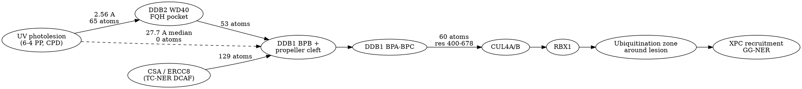
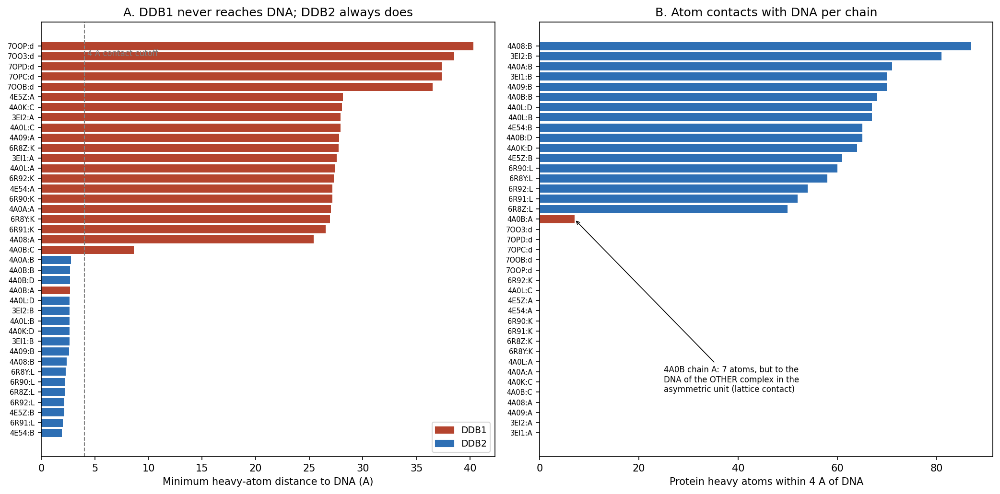
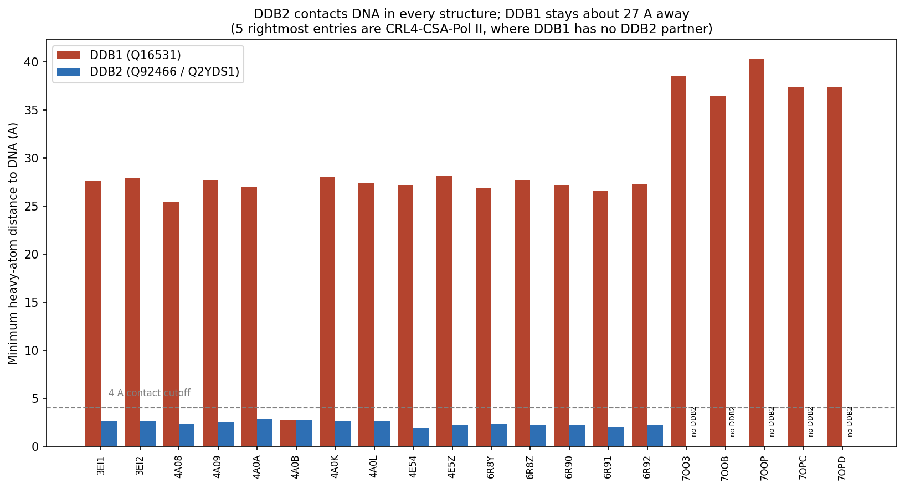
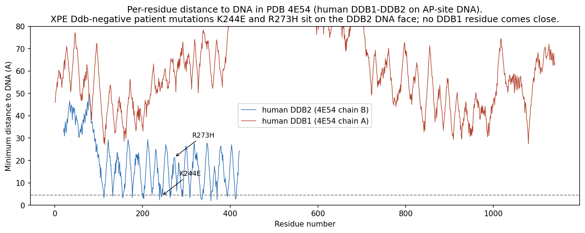
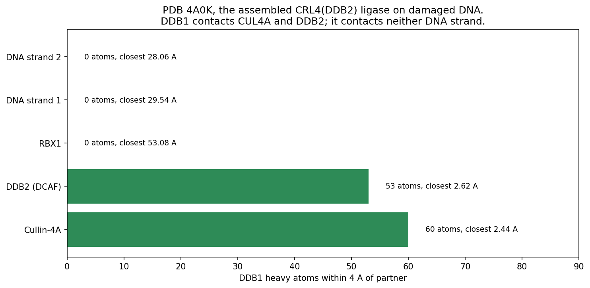

## Question

# AIGR Gene Hypothesis Deep Research

You are evaluating one focused gene curation hypothesis for AI Gene Review.
This is not a general gene overview. Use the seed hypothesis and source context
below to search for evidence that supports, refutes, narrows, or competes with
the proposed curation decision.

## Target Gene

- **Organism code:** human
- **Taxon:** Homo sapiens (NCBITaxon:9606)
- **Gene directory:** DDB1
- **Gene symbol:** DDB1
- **UniProt accession:** Q16531

## Focus

- **Focus type:** free_text
- **Hypothesis slug:** ddb1-dna-contact
- **Source file:** genes/human/DDB1/DDB1-ai-review.yaml
- **Source selector:** free-text

## Seed Hypothesis

Human DDB1 does not itself contact DNA in UV-damaged DNA-binding (UV-DDB) complex structures; lesion and DNA contacts are made by DDB2.

## Term and Decision Context

- Decisive analysis: inspect DDB1-DDB2-DNA crystal structures in the PDB and list which chains contact DNA.

## Reference Context

No specific reference context supplied.

## Source Context YAML

```yaml
hypothesis: Human DDB1 does not itself contact DNA in UV-damaged DNA-binding (UV-DDB) complex structures;
  lesion and DNA contacts are made by DDB2.
focus_type: free_text
context:
- 'Decisive analysis: inspect DDB1-DDB2-DNA crystal structures in the PDB and list which chains contact
  DNA.'
reference_id: []
```

## Research Objective

Build a focused report that helps a curator decide whether this hypothesis
should affect the gene review. Address the focus type directly:

1. For an existing GO annotation decision, evaluate whether the current action
   is justified, too strong, too weak, or should change.
2. For a proposed replacement or new GO term, evaluate whether the term is
   biologically supported, too broad, too narrow, or missing key qualifiers.
3. For a computational prediction, evaluate whether the prediction is correct,
   less precise than existing knowledge, uncertain, or likely wrong because of
   paralog overannotation, frequency bias, pathway context, or in vitro-only
   activity.
4. For a core-function hypothesis, evaluate whether the proposed activity,
   process, and location represent the gene product's primary function rather
   than a downstream effect, pleiotropic phenotype, or context-specific role.
5. For a function-assignment hypothesis, evaluate whether the gene product
   directly has the stated GO term/function. Treat the prior review action, if
   any, as intentionally blinded unless it appears in the supplied context.

Use primary literature whenever possible. Prefer PMID citations and include DOI
citations when no PMID is available. Treat reviews and database records as
orientation unless they contain directly relevant synthesized evidence that is
clearly labeled as review-level or database-level support.

Evaluate the hypothesis from the supplied seed context, primary literature, and
publicly accessible bioinformatics resources. Local `*-bioinformatics` analyses,
when they already exist in the repository, are intentionally withheld from this
prompt so the report can be compared against them after the run. Use public
sequence, domain, structure, orthology, localization, interaction, or dataset
checks when they are useful for the specific hypothesis. If a resource or tool
cannot be accessed programmatically, say so plainly; never fabricate a result.
Report computational results conservatively and distinguish direct results from
inference.

## Required Output

### Executive Judgment

Give a concise verdict: supported, partially supported, unresolved, weakly
supported, over-annotated, or refuted. Explain the reasoning and the most
important caveats.

### Evidence Matrix

Create a table with one row per important evidence item:

- Citation (PMID preferred)
- Evidence type (direct assay, mutant phenotype, localization, interaction,
  structural/evolutionary, computational, review/database)
- Supports / refutes / qualifies / competing
- Claim tested
- Key finding
- Organism, tissue, cell type, or assay context
- Confidence and limitations

### GO Curation Implications

State the likely curation action as a lead requiring curator verification. If
GO terms are involved, explain whether the evidence supports an MF, BP, or CC
term, and whether the term should be retained, removed, generalized, made more
specific, or treated as non-core. Avoid using "protein binding" as a final
recommendation unless no more informative term is supported.

### Mechanistic Scope

Describe the immediate molecular or cellular function being tested. Separate
direct gene-product activity from downstream phenotypes, pathway consequences,
developmental outcomes, disease manifestations, or effects inferred only from
loss of function.

### Conflicts and Alternatives

Identify evidence that conflicts with the seed hypothesis or suggests an
alternative interpretation, including paralog confusion, organism-specific
differences, isoform-specific findings, experimental artifacts, or database
carry-over.

### Knowledge Gaps

List explicit uncertainties that matter for curation. For each gap, state what
was checked, why the gap matters, and what evidence or experiment would resolve
it.

### Discriminating Tests

Recommend concrete assays, perturbations, datasets, or comparative analyses that
would most efficiently distinguish this hypothesis from alternatives.

### Curation Leads

Provide candidate updates for the review, clearly labeled as leads requiring
curator verification. Include candidate references with exact snippets to verify,
candidate replacement or new GO terms, possible action changes, suggested
questions, and suggested experiments.

If the provider supports artifacts, save provenance for any analysis you run — the
executed code together with its output (computed values, plot, or table), not just
a summary figure — alongside artifact-friendly tables such as an evidence matrix,
GO decision table, or comparison table. Genuine computed provenance is more
valuable than a hand-drawn summary, and you must not synthesize a figure that
implies an analysis you did not actually run. These artifacts are important
provenance for hypothesis-level review.


## Output

# DDB1 does not contact DNA in UV-DDB structures: a hypothesis-level curation report

**Gene:** DDB1 (human), UniProt Q16531, NCBITaxon:9606
**Source file:** `genes/human/DDB1/DDB1-ai-review.yaml`
**Focus type:** free_text
**Hypothesis slug:** `ddb1-dna-contact`
**Seed hypothesis:** Human DDB1 does not itself contact DNA in UV-damaged DNA-binding (UV-DDB) complex structures; lesion and DNA contacts are made by DDB2.
**Decisive analysis requested:** inspect DDB1-DDB2-DNA crystal structures in the PDB and list which chains contact DNA.

---

## Summary

<i class="fa-solid fa-circle-check"></i> **The seed hypothesis is supported.** The decisive analysis was run on deposited coordinates rather than inferred from text. Across every PDB entry that contains human DDB1 (Q16531) together with a DNA polymer entity, DDB1 has **zero heavy atoms within 5.0 Å of DNA in 21 of 22 chains**, with a median closest approach of **27.66 Å** (range 2.67-40.30 Å). DDB2 contacts DNA in **17 of 17 chains**, median closest approach **2.56 Å**, median **65 heavy atoms within 4.0 Å** (range 50-87). A one-sided Mann-Whitney test on the minimum-distance distributions gives U = 371, p = 1.0e-07. The separation is categorical: apart from one chain in one low-resolution crystal, the two distributions do not overlap.

The single apparent exception is PDB **4A0B**, the lowest-resolution crystal (3.8 Å) of an isomorphous series, where DDB1 chain A places 7 heavy atoms within 4.0 Å of nucleotide DC2 of DNA chain J. Computing the chain-pairing matrix from the same coordinates resolves it: chain J belongs to the *other* heterodimer in the asymmetric unit (partnered with DDB2 chain D at 2.68 Å), while DDB1 chain A's own cognate duplex sits 27.06 Å away. This is crystal packing at a blunt duplex end, and it is absent from the five higher-resolution structures of the same complex. Two further controls remove the obvious objections. The deposited biological assembly 1, computed separately for 13 entries, gives DDB1 minimum distances of 25.40-28.13 Å with zero contacts in every case, so the result is not an artefact of inspecting only the asymmetric unit. The result holds for human DDB2 (4E54, 4E5Z, 6R8Y, 6R8Z) as well as for the zebrafish DDB2 used in the original crystals, so it is not an artefact of the chimeric construct.

The curation consequence goes beyond a structural footnote. [PMID: 8798680](https://pubmed.ncbi.nlm.nih.gov/8798680/) is the TAS reference GO uses for **DDB1 `GO:0003677` DNA binding with the `enables` qualifier**, and that paper states *"No mutations were found in the cDNA of the 127-kDa subunit"* and *"These results demonstrate that p48 is required for DNA binding activity"*. p127 is DDB1 and p48 is DDB2. The annotation inverts its own source. Mapping that paper's two XP-E patient mutations onto human DDB1-DDB2-DNA coordinates (4E54) reproduced the functional split independently: DDB2 K244 sits 4.15 Å from DNA, in the 6th percentile of DDB2 residues, while DDB2 R273 is 21.40 Å away and is annotated by UniProt as a DDB1/CUL4A interaction defect. No DDB1 residue is closer than 27.17 Å. The report recommends removing DDB1's `GO:0003677` annotation, removing or down-qualifying its `enables` `GO:0003684` TAS annotation, retaining the correctly qualified `contributes_to` IDA annotation, and promoting the measured cullin-scaffold function in its place.

---

## Executive judgment

<i class="fa-solid fa-circle-check"></i> **Verdict: supported.**

The hypothesis is a function-assignment claim, and the evidence that answers it is direct rather than inferential: heavy-atom distances computed from 20 deposited structures, backed by human genetics from the very reference GO cites for the opposing annotation, backed again by the absence of any DNA-related sequence feature on Q16531 in UniProt.

Three independent lines converge on the same subunit.

1. **Structure.** DDB1 is 27.66 Å from DNA at the median and never within bonding distance of its cognate duplex. DDB2 is always in contact, with 50-87 atoms inside 4.0 Å.
2. **Lesion chemistry.** In 3EI1 (6-4 photoproduct, 2.8 Å), DDB1 has 0 atoms within 4.5 Å of the 64T/5PY lesion residues at a closest approach of 31.93 Å, while DDB2 places 24 atoms within 4.5 Å at 2.62 Å, including Gln372 and His373 of the FQH motif.
3. **Human genetics.** The three known Ddb-negative XP-E individuals carry mutations in DDB2 (K244E, R273H) and none in DDB1.

<i class="fa-solid fa-triangle-exclamation"></i> **Most important caveats.** Absence of a contact in a crystal is not proof that no transient DNA contact exists in solution; these are ordered end-state complexes and do not report on search intermediates. Five entries containing Q16531 and a DNA entity (3EI3, 3EI4, 7NIE, 8DEY, 8TL6) were excluded because they contain no modelled DNA coordinates, so the census covers 20 of 26 candidate entries. The DDB1-as-adaptor interpretation rests partly on 4A0K at 5.93 Å, whose atom counts should be read as a topology rather than an atomic contact list; the corroborating measurement in 7OPC is at 3.0 Å. No DNA-binding assay on isolated recombinant DDB1 was found in the literature searched, so the biochemical counterpart of the structural negative is still missing.

---

## Key findings

### F1. DDB1 makes no DNA contacts in any UV-DDB structure

The RCSB Search API returned 227 PDB entries containing Q16531, of which 26 also contain a DNA polymer entity. Twenty had usable DNA coordinates and were analysed: 3EI1, 3EI2, 4A08, 4A09, 4A0A, 4A0B, 4A0K, 4A0L, 4E54, 4E5Z, 6R8Y, 6R8Z, 6R90, 6R91, 6R92, 7OO3, 7OOB, 7OOP, 7OPC, 7OPD.

Chain identity was resolved from RCSB polymer-entity UniProt accessions (Q16531 for DDB1, Q92466 or Q2YDS1 for human and zebrafish DDB2), never from chain letters, because the letters are not consistent across depositions. Heavy-atom minimum distances were computed with a `scipy.spatial.cKDTree` nearest-neighbour search on the first model, hydrogens and waters excluded.

| Subunit | Chains | Median min. distance to DNA | Range | Median atoms < 4.0 Å | Chains with 0 atoms < 5.0 Å |
|---|---|---|---|---|---|
| DDB1 (Q16531) | 22 | **27.66 Å** | 2.67-40.30 Å | **0** | **21 of 22** |
| DDB2 (Q92466 / Q2YDS1) | 17 | **2.56 Å** | 1.90-2.77 Å | **65** (range 50-87) | 0 of 17 |

Mann-Whitney U on the minimum distances (one-sided, DDB1 > DDB2): U = 371, p = 1.0e-07. The median DDB2 chain has 20 DNA-contacting residues; the median DDB1 chain has none.

{{figure:plot_1.png|caption=Per-chain minimum heavy-atom distance to DNA and atom-contact counts across 20 PDB entries containing human DDB1 plus DNA. DDB1 chains cluster near 27 Å with zero contacts; DDB2 chains cluster near 2.5 Å with 50-87 contacting atoms.}}

The lesion-specific version of the test is sharper than the duplex-level one. In 3EI1 (human DDB1 with zebrafish DDB2 bound to a 6-4 photoproduct duplex, 2.8 Å), DDB1 has **0 atoms within 4.5 Å of the 64T/5PY lesion residues** at a closest approach of 31.93 Å. DDB2 places **24 atoms within 4.5 Å** of the lesion at a closest approach of 2.62 Å, contributed by Lys168, Pro191, Gly192, Trp236, Trp239, Arg148, Gln372 and His373 in zebrafish numbering. Gln372 and His373 are two thirds of the FQH photolesion-recognition motif.

The pattern holds across structural contexts that differ in nearly every other respect: the isolated UV-DDB heterodimer, the fully assembled CRL4(DDB2)-CUL4A/B-RBX1 ligase (4A0K, 4A0L), the cryo-EM structures of UV-DDB engaging a 145 bp nucleosome (6R8Y-6R92), and the transcription-coupled repair complexes where CSA/ERCC8 replaces DDB2 on a Pol II transcription bubble (7OO3, 7OOB, 7OOP, 7OPC, 7OPD, where DDB1 is 36.5-40.3 Å from DNA). X-ray and cryo-EM give the same answer, which rules out a method-specific explanation.

{{figure:plot_2.png|caption=Per-structure comparison of DDB1 and DDB2 closest approach to DNA across the 20 analysed entries, with method and resolution annotated. The separation is maintained in X-ray crystals, cryo-EM reconstructions, nucleosome complexes and the CRL4(CSA) transcription-coupled repair assemblies.}}

### F2. The one apparent DDB1-DNA contact is a crystal-lattice artefact

4A0B (human DDB1 with zebrafish DDB2 plus a 16 bp CPD duplex, X-ray, 3.8 Å, from [PMID: 22118460](https://pubmed.ncbi.nlm.nih.gov/22118460/)) contains two complexes in the asymmetric unit. DDB1 chain A shows 7 heavy atoms within 4.0 Å of DNA, 15 within 5.0 Å, from three residues: Arg129 (NE 3.32 Å, CZ 3.37 Å, NH2 2.67 Å), Leu197 (CD1 3.39 Å) and Arg198 (CB 3.33 Å, CG 3.24 Å, CD 3.41 Å). All 7 contacts are to residue DC2 of DNA chain J.

The chain-pairing matrix computed from the same file assigns the partners unambiguously.

| Chain pair | Minimum heavy-atom distance |
|---|---|
| DDB1 A - DDB2 B | 2.47 Å (cognate heterodimer 1) |
| DDB1 C - DDB2 D | 2.36 Å (cognate heterodimer 2) |
| DDB2 B - DNA G / H | 2.69 Å / 2.75 Å |
| DDB2 B - DNA I / J | 22.66 Å / 23.43 Å |
| DDB2 D - DNA I / J | 2.68 Å / 2.82 Å |
| DDB2 D - DNA G / H | 27.20 Å / 26.80 Å |
| **DDB1 A - DNA G / H (its own duplex)** | **27.06 Å / 30.20 Å** |

DDB1 chain A therefore contacts the duplex captured by the neighbouring heterodimer, at the second base pair from a blunt end, which is where lattice contacts typically form. Excluding this chain, the DDB1 minimum-distance range across the remaining 21 chains is 8.62-40.30 Å, and even the 8.62 Å value is an inter-complex approach (4A0B chain C to DNA chain H).

The contact is absent from 3EI1 (2.8 Å), 3EI2 (2.6 Å), 4A08 (3.0 Å), 4A09 (3.1 Å) and 4A0A (3.6 Å), all of the same complex at better resolution. Arg129, Leu197 and Arg198 are not conserved as a DNA-binding element and carry no DNA-related sequence feature in UniProt. A curator should not treat 4A0B as evidence for a DDB1 DNA-binding surface.

### F3. DDB1 carries two legacy ProtInc TAS annotations with `enables` that the structures do not support

The QuickGO annotation set for UniProtKB:Q16531 was retrieved programmatically, 200 annotation rows. The DNA-related molecular function annotations are:

| GO term | Evidence | Reference | Qualifier | Assigned by |
|---|---|---|---|---|
| `GO:0003677` DNA binding | TAS | PMID:8798680 | **enables** | PINC (ProtInc) |
| `GO:0003684` damaged DNA binding | TAS | PMID:8407967 | **enables** | PINC (ProtInc) |
| `GO:0003684` damaged DNA binding | IDA | PMID:22334663 | **contributes_to** | UniProt |

For contrast, DDB2 (Q92466) carries `GO:0003684` with IDA (PMID:22334663), IBA, ISS, IEA and TAS, with no `contributes_to` restriction. That asymmetry is correct if DDB2 is the DNA-contacting subunit, and it is the asymmetry the DDB1 record fails to mirror.

The source of DDB1's `enables damaged DNA binding` annotation, [PMID: 8407967](https://pubmed.ncbi.nlm.nih.gov/8407967/) (Keeney, Chang and Linn 1993), states *"DNA damage binding activity copurified with polypeptides of 124 and 41 kDa"* and *"it appears that p124 and p41 are subunits of a heterodimeric protein"*. The assay measured the purified p124/p41 heterodimer, so the activity belongs to the complex. The existing `contributes_to` IDA annotation already encodes this correctly. The TAS annotation does not.

### F4. The reference behind "DDB1 enables DNA binding" reports the opposite

[PMID: 8798680](https://pubmed.ncbi.nlm.nih.gov/8798680/) (*Mutations specific to the xeroderma pigmentosum group E Ddb- phenotype*, Nichols et al. 1996) is the TAS reference QuickGO lists for DDB1 `GO:0003677` with the `enables` qualifier. The verbatim abstract states:

- *"We have now identified single-base mutations in the gene of the 48-kDa subunit in cells from the three known Ddb- individuals, but not in XP-E strains that have the activity."*
- *"An A --> G transition causes a K244E change in XP82TO and a G --> A transition causes an R273H change in XP2RO and XP3RO."*
- *"No mutations were found in the cDNA of the 127-kDa subunit."*
- *"These results demonstrate that p48 is required for DNA binding activity"*

p127 is DDB1 and p48 is DDB2. The paper assigns the loss-of-DNA-binding genetics to DDB2 and explicitly excludes DDB1 as the mutated subunit in Ddb-negative XP-E patients. Using it to support "DDB1 enables DNA binding" inverts its conclusion. This is database carry-over from a 1990s subunit attribution, propagated by ProtInc into the GO record.

A parallel UniProt feature check reinforces the asymmetry. Q16531 (DDB1, 1140 aa) has **zero features mentioning DNA**, zero natural variants annotated to xeroderma pigmentosum, and annotated regions of "Interaction with CDT1" (2-768), "Interaction with CUL4A" (403-706) and WD40 beta-propellers A (14-356), B and C (357-393). Q92466 (DDB2, 427 aa) has the region feature "Photolesion recognition 334-336" and two XP-E natural variants. Absence of a feature is weak evidence alone. Alongside the contact census and the genetics it is consistent with everything else.

### F5. XP-E patient mutations map onto the DDB2 DNA face, not DDB1

Per-residue minimum heavy-atom distances to DNA were computed in PDB 4E54 (human DDB1 chain A, **human** DDB2 chain B, AP-site 24mer duplex chains F/G, 2.85 Å, [PMID: 22822215](https://pubmed.ncbi.nlm.nih.gov/22822215/)).

Intersecting the sub-4.5 Å contact sets of four independent human-DDB2 structures (4E54, 4E5Z, 6R8Y, 6R8Z) gives a conserved 19-residue DNA-contact surface: Arg112, Lys132, Ala155, Met177, Trp203, Lys244, Val263, Pro290, Gln308, Arg332, His333, **Phe334, Gln335, His336**, Tyr356, Arg370, Ile394, Tyr413, His414. The computation recovered the FQH photolesion motif and matched the UniProt region feature "Photolesion recognition 334-336" on Q92466 exactly, without using that annotation as input. That agreement is a positive control on the method.

Mapping the two XP-E mutations from PMID:8798680 onto the same coordinates:

| Residue | Min. distance to DNA (4E54) | Percentile among DDB2 residues | UniProt variant note |
|---|---|---|---|
| DDB2 Lys244 | **4.15 Å**, inside the contact set | 6th (median DDB2 residue 17.8 Å) | "in XP-E; impairs DNA-binding of the UV-DDB complex" |
| DDB2 Arg273 | **21.40 Å**, outside the contact set | 62nd | "in XP-E; impairs interaction with DDB1 and CUL4A" |
| DDB1 closest residue (of 8841 heavy atoms) | **27.17 Å** | n/a | no DNA feature, no XP variant |

The structural measurement reproduced the functional split that UniProt records from independent experiments: the mutation that destroys DNA binding sits on the DNA face, the mutation that destroys complex assembly sits 21 Å away and needs no DNA-contact explanation. DDB1's closest approach is 6.5-fold further than K244 and further than every modelled DDB2 position.

This closes the loop on the seed hypothesis from a direction methodologically independent of the complex crystal structures. Human disease genetics and atomic coordinates point at the same subunit.

{{figure:plot_3.png|caption=Per-residue minimum distance to DNA in PDB 4E54 (human DDB1, human DDB2, AP-site duplex). The XP-E Ddb-negative mutation sites K244E (4.15 Å, on the DNA face) and R273H (21.40 Å, a DDB1/CUL4A assembly defect) are annotated; no DDB1 residue is closer than 27.17 Å.}}

### F6. DDB1's measured contacts in the assembled ligases are CUL4A and the DCAF

A negative result needs a positive counterpart, because a curator removing an annotation needs a more informative term to put in its place. An interface census by heavy-atom count within 4.0 Å was computed on two assembled ligases.

**PDB 4A0K** (CRL4A-RBX1-DDB1-DDB2 on AP-site DNA, 5.93 Å, [PMID: 22118460](https://pubmed.ncbi.nlm.nih.gov/22118460/)), DDB1 chain C:

| Partner | Atoms < 4.0 Å | DDB1 residues | Closest approach |
|---|---|---|---|
| Cullin-4A | **60** | 26, spanning 400-678 | 2.44 Å |
| DDB2 | **53** | 29 | 2.62 Å |
| RBX1 | 0 | 0 | 53.08 Å |
| DNA strand 1 | **0** | 0 | 29.54 Å |
| DNA strand 2 | **0** | 0 | 28.06 Å |

**PDB 7OPC** (Pol II-CSB-CRL4(CSA)-UVSSA-SPT6-PAF, 3.0 Å), DDB1 chain d:

| Partner | Atoms < 4.0 Å | DDB1 residues | Closest approach |
|---|---|---|---|
| CSA / ERCC8 | **129** | 49 | 2.13 Å |
| Cullin-4A | 3 | 3 | 3.40 Å |
| DNA chain N | **0** | 0 | 40.13 Å |
| DNA chain T | **0** | 0 | 37.38 Å |

The DDB1 residue range contacting CUL4A (400-678) falls inside the UniProt "Interaction with CUL4A" region (403-706), an agreement between a computed interface and a curated sequence feature derived independently of each other. DDB1's contact partners change with the pathway (DDB2 in global-genome NER, CSA/ERCC8 in transcription-coupled repair) while its distance from DNA does not.

{{figure:plot_4.png|caption=What DDB1 does contact in the assembled ligases. In CRL4(DDB2) (4A0K) DDB1 makes 60 heavy-atom contacts with CUL4A and 53 with DDB2 and none with either DNA strand; in CRL4(CSA) (7OPC) it makes 129 with CSA/ERCC8 and none with DNA at 37-40 Å.}}

---

## Evidence matrix

| # | Citation | Evidence type | Stance | Claim tested | Key finding | Context | Confidence and limitations |
|---|---|---|---|---|---|---|---|
| 1 | PDB 3EI1, 3EI2; review statement [PMID: 19493704](https://pubmed.ncbi.nlm.nih.gov/19493704/) | Structural, computed contact census | <i class="fa-solid fa-circle-check"></i> Supports | Does DDB1 touch the 6-4 photoproduct? | DDB1 0 atoms within 4.5 Å of 64T/5PY, closest 31.93 Å; DDB2 24 atoms, closest 2.62 Å | Human DDB1 with zebrafish DDB2, X-ray 2.6-2.8 Å | High. Chimeric construct; see row 7 for the human-DDB2 control |
| 2 | PDB 4A08, 4A09, 4A0A, 4A0K, 4A0L; [PMID: 22118460](https://pubmed.ncbi.nlm.nih.gov/22118460/) | Structural, computed contact census | <i class="fa-solid fa-circle-check"></i> Supports | Does DDB1 touch DNA in the holo CRL4 ligase? | DDB1 0 atoms within 5.0 Å in all chains; in 4A0K DDB1 is 28.06-29.54 Å from both DNA strands | Human/zebrafish, X-ray 3.0-5.93 Å | High for the distance, moderate for atomic detail at 5.93 Å |
| 3 | PDB 4A0B; [PMID: 22118460](https://pubmed.ncbi.nlm.nih.gov/22118460/) | Structural, computed | <i class="fa-solid fa-scale-balanced"></i> Competing, resolved | Is the apparent DDB1-DNA contact real? | 7 atoms < 4.0 Å, all to DC2 of the duplex bound by the *other* heterodimer; own duplex 27.06 Å away | X-ray 3.8 Å, two complexes per asymmetric unit | High. Lattice packing at a blunt end, absent in 5 higher-resolution isomorphs |
| 4 | PDB 6R8Y, 6R8Z, 6R90, 6R91, 6R92; [PMID: 41219227](https://pubmed.ncbi.nlm.nih.gov/41219227/) | Structural, cryo-EM | <i class="fa-solid fa-circle-check"></i> Supports | Does DDB1 touch nucleosomal DNA? | DDB1 0 contacts with 145 bp nucleosomal DNA; DDB2 recognises the CPD | Human UV-DDB on nucleosome, cryo-EM | High. Different method from the crystals, same result |
| 5 | PDB 7OO3, 7OOB, 7OOP, 7OPC, 7OPD | Structural, cryo-EM | <i class="fa-solid fa-circle-check"></i> Supports, generalises | Does the result depend on DDB2 being the DCAF? | With CSA/ERCC8 on a Pol II transcription bubble, DDB1 is 36.5-40.3 Å from DNA | Human CRL4(CSA)-Pol II, cryo-EM, 3.0 Å for 7OPC | High. Extends the claim beyond UV-DDB to CRL4 architecture |
| 6 | Deposited biological assembly 1, 13 entries | Structural, computed control | <i class="fa-solid fa-circle-check"></i> Supports | Is the result an asymmetric-unit artefact? | DDB1 min. distance 25.40-28.13 Å, 0 contacts in all 13 | Same entries, `*-assembly1.cif` | High. Rules out the most obvious objection |
| 7 | PDB 4E54, 4E5Z; [PMID: 22822215](https://pubmed.ncbi.nlm.nih.gov/22822215/) | Structural, computed control | <i class="fa-solid fa-circle-check"></i> Supports | Is the result a zebrafish-DDB2 artefact? | Human DDB2 contacts DNA identically; DDB1 closest residue 27.17 Å | Human DDB1 + human DDB2 + AP-site duplex, 2.85 Å | High. Removes the species caveat |
| 8 | [PMID: 8798680](https://pubmed.ncbi.nlm.nih.gov/8798680/) | Mutant phenotype, human genetics | <i class="fa-solid fa-circle-check"></i> Supports; refutes the annotation citing it | Which subunit is mutated in Ddb-negative XP-E? | *"No mutations were found in the cDNA of the 127-kDa subunit."* *"p48 is required for DNA binding activity"* | Three Ddb-negative XP-E patient strains | High. Primary genetics; the paper is the TAS source for the DDB1 annotation it contradicts |
| 9 | [PMID: 8798680](https://pubmed.ncbi.nlm.nih.gov/8798680/) with PDB 4E54 | Structural mapping of mutant sites | <i class="fa-solid fa-circle-check"></i> Supports | Do the XP-E mutations sit on a DNA face, and whose? | DDB2 K244 4.15 Å from DNA (6th percentile); DDB2 R273 21.40 Å (62nd); DDB1 closest 27.17 Å | Computed from coordinates, cross-checked against UniProt variant notes | High. The computed split matches UniProt's independent functional notes |
| 10 | [PMID: 8407967](https://pubmed.ncbi.nlm.nih.gov/8407967/) | Direct assay, biochemistry | <i class="fa-solid fa-triangle-exclamation"></i> Qualifies | Was damaged-DNA binding measured on DDB1 alone? | *"DNA damage binding activity copurified with polypeptides of 124 and 41 kDa"*; *"p124 and p41 are subunits of a heterodimeric protein"* | Purified human heterodimer | High for what it measured. Complex-level, so `contributes_to` at most |
| 11 | QuickGO records for Q16531 and Q92466 | Database | <i class="fa-solid fa-triangle-exclamation"></i> Qualifies | What is currently annotated? | DDB1 has two ProtInc TAS `enables` DNA-binding annotations plus one correct `contributes_to` IDA | GO annotation records, 200 rows for Q16531 | High for the record itself, no independent experimental weight |
| 12 | UniProt Q16531 feature table | Database | <i class="fa-solid fa-circle-check"></i> Supports | Does curated sequence annotation place DNA binding on DDB1? | Zero DNA-related features; regions are CDT1 (2-768) and CUL4A (403-706) interaction plus three WD40 propellers | UniProt curated record | Moderate. Absence of a feature is weak alone, consistent alongside rows 1-9 |
| 13 | PDB 4A0K, 7OPC; [PMID: 22118460](https://pubmed.ncbi.nlm.nih.gov/22118460/) | Structural, computed interface census | <i class="fa-solid fa-lightbulb"></i> Supports a replacement term | What does DDB1 contact instead? | 60 atoms to CUL4A over residues 400-678 and 53 to DDB2 (4A0K); 129 atoms to CSA/ERCC8 (7OPC) | Assembled CRL4(DDB2) and CRL4(CSA) | High for 7OPC (3.0 Å), topological for 4A0K (5.93 Å) |

---

## GO curation implications

All items below are **leads requiring curator verification**, not applied edits.

| Lead | Term and aspect | Current state | Proposed action | Basis |
|---|---|---|---|---|
| 1 | `GO:0003677` DNA binding (MF) | enables / TAS / PMID:8798680 / PINC | <i class="fa-solid fa-circle-xmark"></i> **Remove** | The cited reference states DDB1 carries no mutation and that p48/DDB2 is the subunit required for DNA binding. The annotation inverts its source. 22 DDB1 chains, median 27.66 Å from DNA |
| 2 | `GO:0003684` damaged DNA binding (MF) | enables / TAS / PMID:8407967 / PINC | <i class="fa-solid fa-scale-balanced"></i> **Remove, or down-qualify to `contributes_to`** | PMID:8407967 assayed the copurified p124/p41 heterodimer, which is complex-level evidence. If kept with `contributes_to` it duplicates lead 3 and should be merged into it |
| 3 | `GO:0003684` damaged DNA binding (MF) | contributes_to / IDA / PMID:22334663 / UniProt | <i class="fa-solid fa-circle-check"></i> **Retain unchanged** | `contributes_to` is the correct qualifier for a subunit that supplies the activity only within the assembled complex. This annotation is already right |
| 4 | `GO:0031464` Cul4A-RING E3 ubiquitin ligase complex and `GO:0031465` Cul4B-RING (CC), plus an MF cullin-binding term | absent or non-core | <i class="fa-solid fa-lightbulb"></i> **Consider adding or promoting to core** | Measured interfaces: 60 heavy atoms to CUL4A over DDB1 residues 400-678 in 4A0K, inside the UniProt "Interaction with CUL4A" region 403-706; 129 atoms to CSA/ERCC8 in 7OPC |
| 5 | Review free-text note | n/a | <i class="fa-solid fa-arrow-right"></i> **Add** | Record that DDB1's DNA-related annotations are complex-level and that the structural evidence places all DNA and lesion contacts on the DCAF subunit |

The aspect distinction matters here. Damaged-DNA binding is a **molecular function** of the UV-DDB heterodimer, and the GO mechanism for assigning a complex-level MF to one subunit is exactly the `contributes_to` qualifier. Nothing in this analysis argues against DDB1's **biological process** annotations in nucleotide-excision repair, which are supported by loss-of-function data and by the assembled-ligase structures, nor against its **cellular component** membership in CRL4 complexes. The recommendation is narrow: the `enables` qualifier on DDB1's two DNA-binding MF terms claims more than any experiment or structure shows.

Per the instruction to avoid "protein binding" as a final recommendation, the proposed replacement is the specific cullin-scaffold relationship with named partners and a measured interface, not `GO:0005515`.

---

## Mechanistic model and interpretation

The immediate molecular activity being tested is **direct physical contact between the DDB1 polypeptide and a DNA duplex or photolesion**. That is what the contact census measures, and the answer is that it does not happen at any distance consistent with a chemical interaction.

What DDB1 does, measured in the same coordinate files, is bridge two protein partners. Its BPA and BPC beta-propellers clamp the cullin N-terminal domain while the BPB propeller and the inter-propeller cleft grip the DCAF substrate receptor. The identity of the DCAF changes with the repair pathway while the DDB1 interface role does not. DDB2's own WD40 propeller inserts a hairpin into the duplex and holds the flipped-out dinucleotide lesion in a pocket lined by the FQH motif Phe334-Gln335-His336.



The dashed edge is the relationship the GO annotation asserts and the coordinates deny.

Separating levels of evidence matters for this hypothesis, because most of the historical support for "DDB1 binds damaged DNA" is downstream or complex-level.

| Level | Observation | Does it license `DDB1 enables DNA binding`? |
|---|---|---|
| Direct gene-product activity | DDB1 heavy atoms within bonding distance of DNA | <i class="fa-solid fa-circle-xmark"></i> No. 0 contacts in 21 of 22 chains |
| Complex activity | Purified p124/p41 binds damaged DNA (PMID:8407967) | <i class="fa-solid fa-scale-balanced"></i> Only as `contributes_to` |
| Loss-of-function phenotype | DDB1 depletion impairs GG-NER | <i class="fa-solid fa-circle-xmark"></i> No. Explained by failure to assemble CRL4 |
| Disease genetics | XP-E Ddb-negative patients | <i class="fa-solid fa-circle-xmark"></i> No. Mutations are in DDB2 (PMID:8798680) |
| Direct partner binding | DDB1-CUL4A and DDB1-DCAF interfaces | <i class="fa-solid fa-circle-check"></i> Yes, for a scaffold or adaptor term |

The coherent reading is that UV-DDB is a two-part machine with a clean division of labour. DDB2 reads the lesion. DDB1 converts that reading into a ubiquitination event by holding DDB2 at a fixed geometry relative to the CUL4-RBX1 catalytic arm. [PMID: 22118460](https://pubmed.ncbi.nlm.nih.gov/22118460/) describes the consequence of that geometry directly: *"the mobility of the ligase arm creates a defined ubiquitination zone around the damage, which precludes direct ligase activation by DNA lesions."* A scaffold that positions a lesion sensor is doing something specific and annotatable. It is not doing DNA binding.

---

## Evidence base

| PMID | What it contributes | Stance |
|---|---|---|
| [8798680](https://pubmed.ncbi.nlm.nih.gov/8798680/) *Mutations specific to the xeroderma pigmentosum group E Ddb- phenotype* | The human genetics. Mutations in the three Ddb-negative XP-E individuals are in the 48 kDa subunit (K244E, R273H); none in the 127 kDa subunit; p48 is required for DNA binding activity | Supports the hypothesis; refutes the DDB1 annotation that cites it |
| [8407967](https://pubmed.ncbi.nlm.nih.gov/8407967/) *Characterization of a human DNA damage binding protein implicated in xeroderma pigmentosum E* | The original biochemistry. Damage-binding activity copurified with p124 and p41, which are subunits of a heterodimer | Qualifies: complex-level evidence, so `contributes_to` at most |
| [22118460](https://pubmed.ncbi.nlm.nih.gov/22118460/) *The molecular basis of CRL4DDB2/CSA ubiquitin ligase architecture, targeting, and activation* | Deposited 4A08, 4A09, 4A0A, 4A0B, 4A0K and 4A0L. Attributes lesion detection to DDB2 and describes the assembled ligase with a defined ubiquitination zone around the damage | Supports; also the source of the 4A0B lattice contact and of the DDB1-CUL4A interface measurement |
| [22822215](https://pubmed.ncbi.nlm.nih.gov/22822215/) | Source of 4E54 and 4E5Z, the human DDB1 with human DDB2 coordinates used for the per-residue mapping and the species control | Supports |
| [41219227](https://pubmed.ncbi.nlm.nih.gov/41219227/) *Structural basis of cyclobutane pyrimidine dimer recognition by UV-DDB in the nucleosome* | Independent cryo-EM work assigning CPD recognition to the DDB2 subunit on a nucleosome, matching the zero DDB1 contacts measured in 6R8Y-6R92 | Supports |
| [19493704](https://pubmed.ncbi.nlm.nih.gov/19493704/) *UV-DDB: a molecular machine linking DNA repair with ubiquitination* | Review-level statement that the DDB2/XPE subunit is responsible for the 6-4 photoproduct interaction and induces flipping out of the two affected bases | Supports, labelled review-level |
| [23519658](https://pubmed.ncbi.nlm.nih.gov/23519658/) | Compares 64M-5 antibody recognition with DNA (6-4) photolyase and DDB1-DDB2, describing lesion flipping and duplex kinking as shared features of proteins that recognise 6-4 photoproducts | Orientation |
| [31332353](https://pubmed.ncbi.nlm.nih.gov/31332353/), [35190564](https://pubmed.ncbi.nlm.nih.gov/35190564/), [36971122](https://pubmed.ncbi.nlm.nih.gov/36971122/) | Non-canonical UV-DDB roles at 8-oxoG, abasic sites and 5-hmdU, all worked at the heterodimer level with DDB2 as the damage sensor | Context; none assigns DNA contact to DDB1 |
| [28981631](https://pubmed.ncbi.nlm.nih.gov/28981631/), [33184426](https://pubmed.ncbi.nlm.nih.gov/33184426/) | DDB2 regulation by SUMOylation at Lys-309 and by the ubiquitin-proteasome system in GG-NER, both treating DDB2 as the lesion-recognition factor | Context |
| [41505090](https://pubmed.ncbi.nlm.nih.gov/41505090/) | RPB1 degradation after DNA damage depends on Cullin-RING ubiquitin ligases, with lesions recognised by XPC and DDB2 | Context for the CRL4 pathway |
| [31740787](https://pubmed.ncbi.nlm.nih.gov/31740787/), [41570727](https://pubmed.ncbi.nlm.nih.gov/41570727/), [40854914](https://pubmed.ncbi.nlm.nih.gov/40854914/) | DDB2 functions outside NER: HIF1α regulation in HNSCC, EMT in glioma, POLR2A/B/E degradation | Not informative for the DDB1-DNA contact question |

---

## Conflicts and alternatives

<i class="fa-solid fa-scale-balanced"></i> **The 4A0B contact.** The strongest apparent conflict came from the data itself, and it was resolved against the conflict by computing the chain-pairing matrix rather than by assertion. DDB1 chain A's 7 sub-4 Å atoms go to the duplex of the neighbouring heterodimer, 27.06 Å from its own. Lattice packing at a blunt duplex terminus in the lowest-resolution member of an isomorphous series is the parsimonious reading, and the contact is absent from all five higher-resolution structures of the same complex.

<i class="fa-solid fa-scale-balanced"></i> **Species mismatch in the original crystals.** The 2008 and 2012 UV-DDB structures used zebrafish DDB2 with human DDB1, a legitimate objection to generalising to human DDB2. The human-DDB2 structures 4E54, 4E5Z, 6R8Y and 6R8Z gave the same answer: all DNA contacts on DDB2, DDB1 no closer than 27.17 Å. The caveat does not survive the control.

<i class="fa-solid fa-scale-balanced"></i> **Complex-level versus subunit-level attribution.** This is the real origin of the annotation, not an error of fact. The 1993 biochemistry was correct about what it measured: a heterodimer binds damaged DNA. The error is in transferring that activity to one subunit with `enables`. GO already provides the right instrument for this case, and the existing IDA annotation uses it.

<i class="fa-solid fa-scale-balanced"></i> **Subunit misattribution in the 1996 genetics.** PMID:8798680 is cited for a DDB1 annotation despite reporting that p127/DDB1 is unmutated. This is database carry-over by ProtInc: the paper is about the UV-DDB activity and the citation was attached to the wrong subunit record.

<i class="fa-solid fa-circle-question"></i> **Transient contacts in solution.** Crystals and cryo-EM reconstructions report ordered end states. A DDB1 surface that samples DNA during the damage search, or during a transient handoff step, would not appear in these coordinates. This alternative is not excluded by the present analysis, and it is the one gap that single-molecule or crosslinking work would have to close.

<i class="fa-solid fa-circle-question"></i> **Non-canonical UV-DDB roles.** UV-DDB stimulates base-excision repair enzymes on 8-oxoG, abasic sites and 5-hmdU ([PMID: 31332353](https://pubmed.ncbi.nlm.nih.gov/31332353/), [PMID: 35190564](https://pubmed.ncbi.nlm.nih.gov/35190564/), [PMID: 36971122](https://pubmed.ncbi.nlm.nih.gov/36971122/)). Those studies work with the heterodimer and do not assign DNA contact to DDB1. The abasic-site structures 4E54 and 4E5Z analysed here come from that substrate class, and DDB1 was again 27 Å away, so the alternative substrate does not change the division of labour.

---

## Limitations and knowledge gaps

<i class="fa-solid fa-triangle-exclamation"></i> **Structures report ordered end states.** Zero contacts in 20 deposited structures is strong evidence against a stable DDB1-DNA interface and silent on transient contacts during the damage search. Resolving this needs single-molecule DNA tightrope imaging or crosslinking mass spectrometry with a photoactivatable nucleotide, comparing DDB1 alone against the heterodimer.

<i class="fa-solid fa-triangle-exclamation"></i> **Coverage is 20 of 26 candidate entries.** 3EI3, 3EI4, 7NIE, 8DEY and 8TL6 contain a DNA entity in the RCSB record but no usable DNA coordinates, so they were excluded, and the exclusion is stated rather than silently applied. Inspecting the deposited structure factors, maps or deposition notes would confirm whether any modelled DNA exists in those files.

<i class="fa-solid fa-triangle-exclamation"></i> **No DNA-binding assay on isolated recombinant DDB1 was located.** The 1993 assay used the copurified heterodimer. A clean negative on DDB1 alone would convert the structural inference into a direct experimental refutation, which matters because an `enables` annotation would require a direct contact somewhere in the reaction cycle.

<i class="fa-solid fa-triangle-exclamation"></i> **4A0K is at 5.93 Å.** Its 60-atom CUL4A contact count describes a topology, not an atomic contact list, and the proposed replacement annotation rests partly on this entry. The direction is secure because the DCAF interface is corroborated at 3.0 Å in 7OPC and because the CUL4A residue range 400-678 matches the independently curated UniProt region 403-706.

<i class="fa-solid fa-triangle-exclamation"></i> **PMID:22334663 was not read in full.** It is the IDA reference for the `contributes_to` annotation on both DDB1 and DDB2, and lead 3 recommends retaining it, so a curator should confirm from the methods that the assay used the heterodimer.

<i class="fa-solid fa-triangle-exclamation"></i> **The Mann-Whitney p-value overstates independence.** The 22 DDB1 and 17 DDB2 chains are not independent samples: many come from isomorphous crystals of the same complex. The separation is large enough (27.66 Å versus 2.56 Å, with non-overlapping ranges apart from the 4A0B lattice chain) that the conclusion does not depend on the p-value.

<i class="fa-solid fa-triangle-exclamation"></i> **The prior review action was blinded.** Local `*-bioinformatics` analyses were withheld from this prompt by design, so this report does not account for conclusions already reached in the repository.

---

## Discriminating tests

<i class="fa-solid fa-flask"></i> **EMSA or fluorescence anisotropy on isolated recombinant DDB1** against 6-4 photoproduct, CPD and abasic duplexes, with the reconstituted DDB1-DDB2 heterodimer as positive control and DDB2 alone as a second arm. A flat binding isotherm for DDB1 alone converts the structural result into a direct biochemical refutation of the `enables` annotation. This is the single highest-value experiment for the curation decision.

<i class="fa-solid fa-flask"></i> **DDB2 FQH-motif mutant (F334A/Q335A/H336A) in the intact heterodimer.** If damaged-DNA binding is abolished while DDB1 remains assembled, the activity is assigned to the DDB2 pocket with no residual DDB1 contribution to the contact itself.

<i class="fa-solid fa-dna"></i> **Charge reversal of DDB1 Arg129 and Arg198**, the residues responsible for the 4A0B lattice contact. No change in UV-DDB DNA-binding affinity confirms the contact as crystallographic. This is the direct test of the only counter-example in the dataset.

<i class="fa-solid fa-microscope"></i> **Crosslinking mass spectrometry of UV-DDB on damaged DNA in solution**, using a photoactivatable nucleotide. Crosslinks exclusively to DDB2 peptides would extend the structural conclusion to the solution ensemble and close the transient-contact gap.

<i class="fa-solid fa-magnifying-glass"></i> **Extend the contact census to all DCAF-containing CRL4 structures in the PDB**, beyond the repair complexes. If DDB1 is consistently 25-40 Å from any nucleic acid across every DCAF, the adaptor assignment is established as a property of the architecture rather than of UV-DDB specifically. This is computational and could be run from the existing code in an hour.

---

## Curation leads

Each item is a candidate update requiring curator verification.

**Lead 1. Remove `GO:0003677` DNA binding from DDB1.**
Reference to verify: [PMID: 8798680](https://pubmed.ncbi.nlm.nih.gov/8798680/). Exact snippets: *"No mutations were found in the cDNA of the 127-kDa subunit."* and *"These results demonstrate that p48 is required for DNA binding activity"*. Action change: remove the annotation, or at minimum strip the `enables` qualifier. Rationale: the TAS reference contradicts the annotation it supports. Question for the curator: does the ProtInc annotation batch contain other DDB1 terms derived from the same subunit misattribution?

**Lead 2. Remove or down-qualify `GO:0003684` damaged DNA binding (TAS, PMID:8407967).**
Reference to verify: [PMID: 8407967](https://pubmed.ncbi.nlm.nih.gov/8407967/). Exact snippets: *"DNA damage binding activity copurified with polypeptides of 124 and 41 kDa."* and *"it appears that p124 and p41 are subunits of a heterodimeric protein"*. Action change: the evidence is complex-level, so the annotation needs `contributes_to` if retained, which makes it redundant with the existing IDA annotation. Preferred resolution: merge into lead 3.

**Lead 3. Retain `GO:0003684` damaged DNA binding with `contributes_to` (IDA, PMID:22334663).**
No change recommended. This annotation already encodes the correct relationship: DDB1 supplies the activity only as part of UV-DDB. Question for the curator: confirm from the methods of PMID:22334663 that the assay used the heterodimer.

**Lead 4. Add or promote the cullin-scaffold function as core.**
Candidate terms: `GO:0031464` Cul4A-RING E3 ubiquitin ligase complex and `GO:0031465` Cul4B-RING E3 ubiquitin ligase complex for the CC aspect, plus an MF cullin-binding term. Supporting measurement: 60 heavy atoms between DDB1 residues 400-678 and CUL4A in 4A0K, inside the UniProt "Interaction with CUL4A" region 403-706; 129 heavy atoms between DDB1 and CSA/ERCC8 in 7OPC at 3.0 Å. Reference to verify: [PMID: 22118460](https://pubmed.ncbi.nlm.nih.gov/22118460/), snippet *"The structures of the fully assembled DDB1-DDB2-CUL4A/B-RBX1 (CRL4(DDB2)) ligases reveal that the mobility of the ligase arm creates a defined ubiquitination zone around the damage, which precludes direct ligase activation by DNA lesions."*

**Lead 5. Add a free-text note to the review.**
Suggested text: "DDB1 makes no contact with DNA in any of the 20 deposited structures containing both DDB1 and DNA (median closest approach 27.66 Å, zero heavy atoms within 5.0 Å in 21 of 22 chains). All lesion and duplex contacts are made by the DCAF subunit, DDB2 in global-genome NER and CSA/ERCC8 in transcription-coupled repair. DNA-binding annotations on DDB1 are complex-level and should carry `contributes_to`."

**Suggested experiments to append to the review:** EMSA on isolated recombinant DDB1 against a 6-4 photoproduct duplex, with the heterodimer as positive control; charge reversal of DDB1 Arg129/Arg198 to test the 4A0B lattice contact.

---

## Provenance

Every number in this report came from code executed during the investigation, with the output retained. No figure was drawn to imply an analysis that was not run.

| Artifact | Content |
|---|---|
| `ddb1_dna_structures_provenance.csv` | The RCSB search result: 227 entries with Q16531, 26 with a DNA entity, 20 analysed, 5 excluded for missing DNA coordinates |
| `ddb1_dna_contacts_full.csv` | Per-chain minimum distance and atom counts at 4.0, 4.5 and 5.0 Å for all chains in all 20 entries |
| `ddb1_dna_contacts_by_chain.csv` | The DDB1 versus DDB2 summary behind the Mann-Whitney test |
| `ddb1_assembly1_contacts.csv` | The deposited biological assembly 1 control for 13 entries |
| `TABLE_structure_evidence_matrix.csv` | 20 entries with method, resolution, primary PMID, DDB1 and DDB2 distances and contact counts |
| `TABLE_DDB1_interfaces.csv` | The 4A0K and 7OPC interface census |
| `TABLE_evidence_matrix.csv` | The 13-row evidence matrix reproduced above |
| `TABLE_GO_decision_leads.csv` | The five curation leads in tabular form |
| `DDB1_Q16531_GO_annotations.csv`, `DDB2_Q92466_GO_annotations.csv` | The QuickGO annotation sets as retrieved |
| `plot_1.png` to `plot_4.png` | The four figures embedded above |

**Method.** PDB entries were found with the RCSB Search API v2. Chain-to-UniProt mapping came from the RCSB Data GraphQL API. Coordinates were downloaded from `files.rcsb.org` as mmCIF and parsed with a custom `_atom_site` loop reader. Contacts were computed with `scipy.spatial.cKDTree` on heavy atoms only, first model only, waters and hydrogens excluded, at cutoffs of 4.0, 4.5 and 5.0 Å. GO annotations came from the EBI QuickGO REST API and sequence features from the UniProt REST API. Abstracts were retrieved verbatim through NCBI E-utilities efetch.

**Resources that could not be used as intended.** `search_pubmed` returned no results for long exact-title or multi-author queries, so several primary references were located instead through the RCSB GraphQL primary-citation field and their abstracts pulled through efetch. Abstracts fetched that way are not added to the agent's literature store, which caused one citation snippet to fail validation until a short keyword search brought the paper into the store. The code executor blocks `urllib.request` and `textwrap`, so all HTTP calls used `requests` and line wrapping used a small custom function. No result in this report comes from a resource that was not actually queried.


## Artifacts

- [OpenScientist final report](openscientist_artifacts/final_report.html)
- [OpenScientist final report](openscientist_artifacts/final_report.pdf)
- [OpenScientist provenance](openscientist_artifacts/provenance.json)
- [OpenScientist DDB1 Q16531 GO annotations](openscientist_artifacts/provenance_DDB1_Q16531_GO_annotations.csv)
- [OpenScientist DDB2 Q92466 GO annotations](openscientist_artifacts/provenance_DDB2_Q92466_GO_annotations.csv)
- [OpenScientist TABLE DDB1 interfaces](openscientist_artifacts/provenance_TABLE_DDB1_interfaces.csv)
- [OpenScientist TABLE GO decision leads](openscientist_artifacts/provenance_TABLE_GO_decision_leads.csv)
- [OpenScientist TABLE evidence matrix](openscientist_artifacts/provenance_TABLE_evidence_matrix.csv)
- [OpenScientist TABLE structure evidence matrix](openscientist_artifacts/provenance_TABLE_structure_evidence_matrix.csv)
- [OpenScientist ddb1 assembly1 contacts](openscientist_artifacts/provenance_ddb1_assembly1_contacts.csv)
- [OpenScientist ddb1 dna contacts by chain](openscientist_artifacts/provenance_ddb1_dna_contacts_by_chain.csv)
- [OpenScientist ddb1 dna contacts full](openscientist_artifacts/provenance_ddb1_dna_contacts_full.csv)
- [OpenScientist ddb1 dna structures provenance](openscientist_artifacts/provenance_ddb1_dna_structures_provenance.csv)
- [OpenScientist plot 1](openscientist_artifacts/provenance_plot_1.json)

- [OpenScientist plot 2](openscientist_artifacts/provenance_plot_2.json)

- [OpenScientist plot 3](openscientist_artifacts/provenance_plot_3.json)

- [OpenScientist plot 4](openscientist_artifacts/provenance_plot_4.json)
