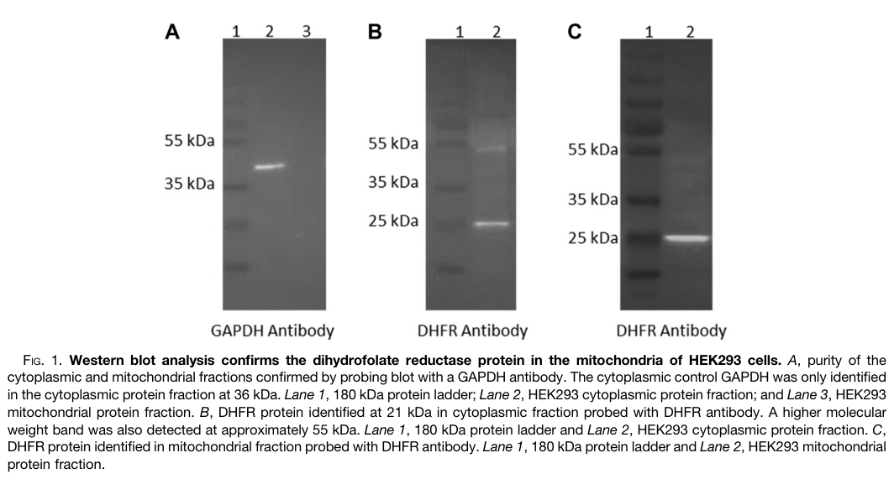

## Question

# Gene Research for Functional Annotation

## ⚠️ CRITICAL: Gene/Protein Identification Context

**BEFORE YOU BEGIN RESEARCH:** You MUST verify you are researching the CORRECT gene/protein. Gene symbols can be ambiguous, especially for less well-characterized genes from non-model organisms.

### Target Gene/Protein Identity (from UniProt):
- **UniProt Accession:** P00374
- **Protein Description:** RecName: Full=Dihydrofolate reductase {ECO:0000305}; EC=1.5.1.3 {ECO:0000269|PubMed:12096917, ECO:0000269|PubMed:15039552, ECO:0000269|PubMed:17569517, ECO:0000269|PubMed:19196009, ECO:0000269|PubMed:19478082, ECO:0000269|PubMed:21876184, ECO:0000269|PubMed:9719595};
- **Gene Information:** Name=DHFR {ECO:0000312|HGNC:HGNC:2861};
- **Organism (full):** Homo sapiens (Human).
- **Protein Family:** Belongs to the dihydrofolate reductase family.
- **Key Domains:** DHFR. (IPR012259); DHFR-like_dom_sf. (IPR024072); DHFR_CS. (IPR017925); DHFR_dom. (IPR001796); DHFR_1 (PF00186)

### MANDATORY VERIFICATION STEPS:

1. **Check if the gene symbol "DHFR" matches the protein description above**
2. **Verify the organism is correct:** Homo sapiens (Human).
3. **Check if protein family/domains align with what you find in literature**
4. **If you find literature for a DIFFERENT gene with the same or similar symbol, STOP**

### If Gene Symbol is Ambiguous or You Cannot Find Relevant Literature:

**DO NOT PROCEED WITH RESEARCH ON A DIFFERENT GENE.** Instead:
- State clearly: "The gene symbol 'DHFR' is ambiguous or literature is limited for this specific protein"
- Explain what you found (e.g., "Found extensive literature on a different gene with the same symbol in a different organism")
- Describe the protein based ONLY on the UniProt information provided above
- Suggest that the protein function can be inferred from domain/family information

### Research Target:

Please provide a comprehensive research report on the gene **DHFR** (gene ID: DHFR, UniProt: P00374) in human.

The research report should be a detailed narrative explaining the function, biological processes, and localization of the gene product. Citations should be given for all claims.

You should prioritize authoritative reviews and primary scientific literature when conducting research. You can supplement
this with annotations you find in gene/protein databases, but these can be outdated or inaccurate.

We are specifically interested in the primary function of the gene - for enzymes, what reaction is catalyzed, and what is the substrate specificity? For transporters, what is the substrate? For structural proteins or adapters, what is the broader structural role? For signaling molecules, what is the role in the pathway.

We are interested in where in or outside the cell the gene product carries out its function.

We are also interested in the signaling or biochemical pathways in which the gene functions. We are less interested in broad pleiotropic effects, except where these elucidate the precise role.

Include evidence where possible. We are interested in both experimental evidence as well as inference from structure, evolution, or bioinformatic analysis. Precise studies should be prioritized over high-throughput, where available.

## Output

Question: You are an expert researcher providing comprehensive, well-cited information.

Provide detailed information focusing on:
1. Key concepts and definitions with current understanding
2. Recent developments and latest research (prioritize 2023-2024 sources)
3. Current applications and real-world implementations
4. Expert opinions and analysis from authoritative sources
5. Relevant statistics and data from recent studies

Format as a comprehensive research report with proper citations. Include URLs and publication dates where available.
Always prioritize recent, authoritative sources and provide specific citations for all major claims.

# Gene Research for Functional Annotation

## ⚠️ CRITICAL: Gene/Protein Identification Context

**BEFORE YOU BEGIN RESEARCH:** You MUST verify you are researching the CORRECT gene/protein. Gene symbols can be ambiguous, especially for less well-characterized genes from non-model organisms.

### Target Gene/Protein Identity (from UniProt):
- **UniProt Accession:** P00374
- **Protein Description:** RecName: Full=Dihydrofolate reductase {ECO:0000305}; EC=1.5.1.3 {ECO:0000269|PubMed:12096917, ECO:0000269|PubMed:15039552, ECO:0000269|PubMed:17569517, ECO:0000269|PubMed:19196009, ECO:0000269|PubMed:19478082, ECO:0000269|PubMed:21876184, ECO:0000269|PubMed:9719595};
- **Gene Information:** Name=DHFR {ECO:0000312|HGNC:HGNC:2861};
- **Organism (full):** Homo sapiens (Human).
- **Protein Family:** Belongs to the dihydrofolate reductase family.
- **Key Domains:** DHFR. (IPR012259); DHFR-like_dom_sf. (IPR024072); DHFR_CS. (IPR017925); DHFR_dom. (IPR001796); DHFR_1 (PF00186)

### MANDATORY VERIFICATION STEPS:

1. **Check if the gene symbol "DHFR" matches the protein description above**
2. **Verify the organism is correct:** Homo sapiens (Human).
3. **Check if protein family/domains align with what you find in literature**
4. **If you find literature for a DIFFERENT gene with the same or similar symbol, STOP**

### If Gene Symbol is Ambiguous or You Cannot Find Relevant Literature:

**DO NOT PROCEED WITH RESEARCH ON A DIFFERENT GENE.** Instead:
- State clearly: "The gene symbol 'DHFR' is ambiguous or literature is limited for this specific protein"
- Explain what you found (e.g., "Found extensive literature on a different gene with the same symbol in a different organism")
- Describe the protein based ONLY on the UniProt information provided above
- Suggest that the protein function can be inferred from domain/family information

### Research Target:

Please provide a comprehensive research report on the gene **DHFR** (gene ID: DHFR, UniProt: P00374) in human.

The research report should be a detailed narrative explaining the function, biological processes, and localization of the gene product. Citations should be given for all claims.

You should prioritize authoritative reviews and primary scientific literature when conducting research. You can supplement
this with annotations you find in gene/protein databases, but these can be outdated or inaccurate.

We are specifically interested in the primary function of the gene - for enzymes, what reaction is catalyzed, and what is the substrate specificity? For transporters, what is the substrate? For structural proteins or adapters, what is the broader structural role? For signaling molecules, what is the role in the pathway.

We are interested in where in or outside the cell the gene product carries out its function.

We are also interested in the signaling or biochemical pathways in which the gene functions. We are less interested in broad pleiotropic effects, except where these elucidate the precise role.

Include evidence where possible. We are interested in both experimental evidence as well as inference from structure, evolution, or bioinformatic analysis. Precise studies should be prioritized over high-throughput, where available.

# Functional annotation report: human DHFR (UniProt P00374)

## Identity and primary function

**Identity verified.** The supplied accession P00374 identifies *Homo sapiens* DHFR, the chromosome-5 gene encoding a 187-amino-acid dihydrofolate reductase (EC 1.5.1.3). The gene name, enzyme description, and supplied DHFR-family/InterPro/Pfam domains agree with the human gene literature. **DHFR2**, formerly **DHFRL1**, is a separate, closely related chromosome-3 gene; neither its historical mitochondrial annotation nor results for microbial DHFRs should be assigned automatically to P00374. Human DHFR is also distinct from MTHFR, which acts at a different step of folate metabolism. (krajinovic2018dhfr(dihydrofolatereductase) pages 1-2, bookey2024thedifferentialtranslation pages 1-4, cario2011dihydrofolatereductasedeficiency pages 5-6)

DHFR’s primary reaction is **NADPH-dependent regeneration of tetrahydrofolate (THF) from 7,8-dihydrofolate (DHF)**: DHF + NADPH + H⁺ → THF + NADP⁺. This is folate-cofactor recycling, not a direct transfer of a one-carbon group. DHFR can additionally reduce fully oxidized **synthetic folic acid** first to DHF and then to THF. Folic acid is therefore a substrate, but it should not be confused with DHF, the substrate continuously generated during endogenous thymidylate synthesis. (bailey2009theextremelyslow pages 2-3, xiu2020therolesof pages 4-5, drago2025dhfr2rnadirectly pages 1-2)

**Substrate specificity is unusually consequential in humans.** Bailey and Ayling measured THF formation by HPLC in extracts from six human livers. With DHF, activity ranged from **5.4 to 26 nmol/min/g wet liver** (mean **16.3**). In the liver with the greatest measurable folic-acid activity, the rates were **26.1 nmol/min/g with DHF versus 0.02 nmol/min/g with folic acid**—approximately **1,300-fold** different under the comparison conditions. Estimated substrate *K*m values were **0.05 µM for DHF** and **0.5 µM for folic acid**. These are measurements in liver extracts, not universal catalytic constants for every human tissue; nevertheless, they directly establish that folic-acid reduction is much slower and that DHFR activity varies among individuals. (bailey2009theextremelyslow pages 2-3, bailey2009theextremelyslow pages 3-4)

## Biochemical pathway and sites of action

DHFR participates in **folate-mediated one-carbon metabolism**. SHMT transfers a carbon from serine to THF to make 5,10-methylene-THF. Thymidylate synthase (**TYMS**) uses that cofactor to convert **dUMP to dTMP**, producing **DHF**; DHFR then reduces DHF back to THF so another cycle can proceed. DHFR is thus indispensable to sustained *de novo* thymidylate production but **does not itself methylate dUMP**. Reduced folates also support 10-formyl-THF-dependent *de novo* purine synthesis and, through 5-methyl-THF and the methionine cycle, S-adenosylmethionine-dependent methylation. These are downstream uses of the folates DHFR helps maintain, **not additional reactions catalyzed by DHFR**. (xiu2020therolesof pages 4-5, field2016mthfd1regulatesnuclear pages 1-3, lee2024cyclingbackto pages 1-2, dekhne2020therapeutictargetingof pages 3-6, xiu2020therolesof pages 3-4)

Human DHFR functions principally in the **cytosolic folate pool** and also in a **nuclear thymidylate-synthesis assembly**. At the G1/S transition and after DNA damage, DHFR, TYMS, SHMT1, and MTHFD1 undergo SUMO-associated nuclear recruitment. Experiments with isolated S-phase nuclei demonstrate local dTMP synthesis from serine- or formate-derived one-carbon units; the enzyme assembly associates with nuclear lamins and replication-associated proteins. This localizes DHFR-mediated folate recycling near the DNA synthesis it supports. Mitochondrial production and export of formate can supply carbon to the cytosolic/nuclear pathway, but that formate-production reaction is not catalyzed by DHFR. (chon2017targetingnuclearthymidylate pages 8-9, dekhne2020therapeutictargetingof pages 3-6, xiu2020therolesof pages 6-6)

**Mitochondrial localization warrants an updated interpretation.** An influential 2011 study demonstrated folate-dependent dTMP synthesis in purified mammalian mitochondria and attributed its reductase component to the related DHFRL1/DHFR2 protein. In contrast, a **2024** study of purified human HEK293 mitochondria measured reductase activity of **14.88 nmol/min/mg** and identified **five peptides unique to canonical DHFR** (approximately 30% sequence coverage), but no DHFR2-specific peptide in its mitochondrial analysis. Its fractionation blot showed DHFR-reactive signal in mitochondria while the cytosolic marker GAPDH was confined to the cytosolic fraction; the peptide evidence, rather than the potentially cross-reactive antibody alone, distinguishes the paralogs. The strongest conclusion is that **P00374-derived DHFR contributes mitochondrial reductase activity in the human cells tested**—not that identical contributions have been established in every tissue. The same study detected limited evidence of DHFR2 protein in embryonic heart, leaving room for developmental exceptions. (anderson2011identificationofa pages 1-2, bookey2024thedifferentialtranslation pages 7-8, bookey2024thedifferentialtranslation pages 12-13, bookey2024thedifferentialtranslation media a47d6abf)

The following synthesis separates the directly catalyzed reaction from its compartment-specific pathway context.

| Location | Direct DHFR chemistry/function | Evidence/qualification |
|---|---|---|
| Cytosol | Canonical chromosome-5 DHFR uses NADPH to reduce 7,8-dihydrofolate (DHF) to tetrahydrofolate (THF), replenishing reduced folate for one-carbon metabolism. It can also reduce synthetic dietary folic acid (FA) first to DHF and then to THF; FA is an ancillary, nonphysiological substrate rather than the principal endogenous substrate. | Human-liver assays measured a DHF Km of approximately 0.05 µM. In the highest-activity liver tested, THF formation from FA was 0.02 versus 26.1 nmol/min/g from DHF—about 1,300-fold slower—despite an FA Km of approximately 0.5 µM (bailey2009theextremelyslow pages 2-3, bailey2009theextremelyslow pages 3-4). DHFR inhibition consequently limits reduced-folate pools and downstream nucleotide synthesis (lee2024cyclingbackto pages 1-2). |
| Nucleus | At the G1/S boundary and after DNA damage, DHFR joins SHMT1, TYMS and MTHFD1 in the nuclear de novo thymidylate-synthesis complex. TYMS converts dUMP and 5,10-methylene-THF to dTMP and DHF; DHFR then reduces DHF back to THF for continued cycling near DNA-replication sites. | Isolated S-phase nuclei synthesize dTMP from serine or formate. SUMO-dependent nuclear import, association with PCNA and nuclear lamins, and SHMT1-mediated scaffolding support a localized replication-coupled pathway rather than passive diffusion of cytosolic dTMP (chon2017targetingnuclearthymidylate pages 8-9). |
| Mitochondria | Canonical DHFR can supply mitochondrial reductase activity that regenerates THF for local folate-dependent metabolism, including de novo dTMP synthesis. | In purified HEK293 mitochondrial fractions, a 2024 study measured DHFR activity of 14.88 nmol/min/mg and identified five peptides unique to canonical DHFR (~30% sequence coverage), but no DHFR2-specific peptide (bookey2024thedifferentialtranslation pages 7-8). Earlier recombinant/knockdown work attributed mitochondrial activity to the distinct chromosome-3 paralog DHFR2/DHFRL1 (anderson2011identificationofa pages 1-2); newer targeted proteomics generally did not detect endogenous DHFR2 protein in adult cells or tissues, although one DHFR2-specific peptide was reported in embryonic heart, so rare developmental expression remains possible (bookey2024thedifferentialtranslation pages 12-13). These findings establish canonical DHFR in the tested HEK293 mitochondria but should not be generalized uncritically to every human tissue or developmental stage. |

*Table: Direct chemistry and localization evidence for canonical human chromosome-5 DHFR (P00374), separated from the DHFR2/DHFRL1 paralog. The table highlights strong cytosolic and nuclear evidence and the revised, appropriately qualified mitochondrial attribution.*

## Recent findings and functional interpretation

The **2024 mitochondrial proteomics result** is important because earlier recombinant-protein and knockdown experiments had supported a distinct mitochondrial DHFR2 enzyme, whereas discrimination between endogenous DHFR and DHFR2 is difficult: their predicted proteins share approximately **92% sequence identity**. In **2025**, experiments in HepG2 cells found no detectable endogenous DHFR2-specific protein in most tested conditions. Removing DHFR2 reduced canonical **DHFR mRNA/protein and measured reductase activity by approximately 46%**, with changes in other one-carbon enzymes and folate metabolites. The authors propose that DHFR2 **RNA** regulates DHFR expression; the precise regulatory mechanism and its generality across tissues remain unresolved. A DHFR2-knockout phenotype therefore should not, by itself, be interpreted as evidence that the DHFR2 protein supplies the measured mitochondrial enzyme activity. (bookey2024thedifferentialtranslation pages 1-4, drago2025dhfr2rnadirectly pages 13-14, drago2025dhfr2rnadirectly pages 8-9)

A **2024 expert review** by Lee, Vousden, and Hennequart places this reaction within compartmentalized cancer-cell folate metabolism. Their interpretation distinguishes the direct target—DHFR-mediated replenishment of reduced folate—from consequences elsewhere in the network, including limitations on nucleotide production and altered mitochondrial one-carbon handling. DHFR is best annotated as a **folate-recycling oxidoreductase**, rather than as a signaling protein or as the enzyme responsible for every downstream effect of methotrexate. (lee2024cyclingbackto pages 1-2)

## Human evidence and real-world applications

**Inherited loss of function provides strong physiological validation.** In three siblings homozygous for human **DHFR c.458A>T (p.Asp153Val)**, patient lymphoblastoid cells had **less than 10% of control DHFR activity** and markedly reduced binding of labeled methotrexate; DHFR protein was reduced despite preserved mRNA. Patients developed megaloblastic anemia and cerebral folate deficiency with neurological disease, even though plasma folate could be normal. **Folinic acid**, a reduced folate, corrected hematological abnormalities, normalized cerebrospinal-fluid folate, and improved neurological symptoms. The concordance of genotype, cellular enzyme defect, tissue-specific folate depletion, and reduced-folate rescue demonstrates the importance of DHFR-mediated intracellular folate maintenance. (cario2011dihydrofolatereductasedeficiency pages 3-5, cario2011dihydrofolatereductasedeficiency pages 1-2, cario2011dihydrofolatereductasedeficiency pages 2-3)

**DHFR is an established human drug target.** Methotrexate inhibits the reductase, limiting regeneration of folates needed for thymidylate and purine synthesis; it is used in cancer treatment and inflammatory disease. Reduced-folate rescue with folinic acid also illustrates how bypassing a requirement for folic-acid/DHF reduction can restore folate-dependent processes in appropriate clinical settings. Mechanisms and outcomes of methotrexate therapy depend on drug exposure and other folate-pathway effects, so they should not all be attributed solely to inhibition of one DHFR reaction. (drago2025dhfr2rnadirectly pages 1-2, chon2017targetingnuclearthymidylate pages 4-6, lee2024cyclingbackto pages 1-2)

A **2024** study of progressively methotrexate-resistant human HT-29-derived cancer cells found that amplification and increased expression of **DHFR** emerged at later resistance stages, first in chromosomal homogeneously staining regions and subsequently prominently in extrachromosomal DNA. Copy-number gain in the chromosome-5 region containing DHFR correlated with increasing methotrexate selection concentration (**Pearson *r* = 0.86; *P* < 0.05**). This is a cell-line model of acquired resistance, not an estimate of how frequently the mechanism occurs in patients. (meng2024dynamicgenomicchanges pages 6-7, meng2024dynamicgenomicchanges pages 6-6)

## Selected sources and dates

- Bookey *et al.*, **March 2024**, *Molecular & Cellular Proteomics*: human DHFR-versus-DHFR2 mitochondrial proteomics. https://doi.org/10.1016/j.mcpro.2024.100718 (bookey2024thedifferentialtranslation pages 1-4, bookey2024thedifferentialtranslation pages 7-8)
- Lee, Vousden & Hennequart, **May 2024**, *Nature Cancer*: expert synthesis of compartmentalized folate metabolism. https://doi.org/10.1038/s43018-024-00739-8 (lee2024cyclingbackto pages 1-2)
- Meng *et al.*, **April 2024**, *British Journal of Cancer*: evolution of DHFR amplification during methotrexate resistance. https://doi.org/10.1038/s41416-024-02664-0 (meng2024dynamicgenomicchanges pages 6-7, meng2024dynamicgenomicchanges pages 6-6)
- Drago *et al.*, **February 2025**, *The FASEB Journal*: evidence for DHFR2-RNA-associated regulation of DHFR. https://doi.org/10.1096/fj.202401039rr (drago2025dhfr2rnadirectly pages 1-2, drago2025dhfr2rnadirectly pages 8-9)
- Bailey & Ayling, **September 2009**, *PNAS*: direct human-liver substrate/activity measurements. https://doi.org/10.1073/pnas.0902072106 (bailey2009theextremelyslow pages 2-3, bailey2009theextremelyslow pages 3-4)
- Cario *et al.*, **February 2011**, *American Journal of Human Genetics*: inherited DHFR deficiency and folinic-acid response. https://doi.org/10.1016/j.ajhg.2011.01.007 (cario2011dihydrofolatereductasedeficiency pages 3-5, cario2011dihydrofolatereductasedeficiency pages 1-2)
- Chon, Stover & Field, **February 2017**, *Molecular Aspects of Medicine*: nuclear thymidylate-synthesis mechanism. https://doi.org/10.1016/j.mam.2016.11.005 (chon2017targetingnuclearthymidylate pages 8-9)

References

1. (krajinovic2018dhfr(dihydrofolatereductase) pages 1-2): Maja Krajinovic, Rachid Abaji, and Bahram Sharif-Askari. Dhfr (dihydrofolate reductase). Atlas of genetics and cytogenetics in oncology and haematology, Mar 2018. URL: https://doi.org/10.4267/2042/66069, doi:10.4267/2042/66069. This article has 2 citations and is from a peer-reviewed journal.

2. (bookey2024thedifferentialtranslation pages 1-4): Niamh Bookey, Paola Drago, Kit-Yi Leung, Linda Hughes, Aoife MacCooey, Mari Ozaki, Michael Henry, Sandra C.P. De Castro, Ivan Doykov, Wendy E. Heywood, Kevin Mills, Michelle M. Murphy, Pere Cavallé-Busquets, Susan Campbell, Denise Burtenshaw, Paula Meleady, Paul A. Cahill, Nicholas D.E. Greene, and Anne Parle-McDermott. The differential translation capabilities of the human dhfr2 gene indicates a developmental and tissue-specific endogenous protein of low abundance. Molecular &amp; Cellular Proteomics, 23:100718, Mar 2024. URL: https://doi.org/10.1016/j.mcpro.2024.100718, doi:10.1016/j.mcpro.2024.100718. This article has 3 citations and is from a domain leading peer-reviewed journal.

3. (cario2011dihydrofolatereductasedeficiency pages 5-6): Holger Cario, Desirée E.C. Smith, Henk Blom, Nenad Blau, Harald Bode, Karlheinz Holzmann, Ulrich Pannicke, Karl-Peter Hopfner, Eva-Maria Rump, Zuleya Ayric, Elisabeth Kohne, Klaus-Michael Debatin, Yvo Smulders, and Klaus Schwarz. Dihydrofolate reductase deficiency due to a homozygous dhfr mutation causes megaloblastic anemia and cerebral folate deficiency leading to severe neurologic disease. American journal of human genetics, 88 2:226-31, Feb 2011. URL: https://doi.org/10.1016/j.ajhg.2011.01.007, doi:10.1016/j.ajhg.2011.01.007. This article has 167 citations and is from a highest quality peer-reviewed journal.

4. (bailey2009theextremelyslow pages 2-3): Steven W. Bailey and June E. Ayling. The extremely slow and variable activity of dihydrofolate reductase in human liver and its implications for high folic acid intake. Proceedings of the National Academy of Sciences, 106:15424-15429, Sep 2009. URL: https://doi.org/10.1073/pnas.0902072106, doi:10.1073/pnas.0902072106. This article has 586 citations and is from a highest quality peer-reviewed journal.

5. (xiu2020therolesof pages 4-5): Yuwen Xiu and Martha S Field. The roles of mitochondrial folate metabolism in supporting mitochondrial dna synthesis, oxidative phosphorylation, and cellular function. Current Developments in Nutrition, 4:nzaa153, Oct 2020. URL: https://doi.org/10.1093/cdn/nzaa153, doi:10.1093/cdn/nzaa153. This article has 79 citations and is from a peer-reviewed journal.

6. (drago2025dhfr2rnadirectly pages 1-2): Paola Drago, Niamh Bookey, Kit‐Yi Leung, Michael Henry, Paula Meleady, Nicholas D. E. Greene, and Anne Parle‐McDermott. Dhfr2 rna directly regulates dihydrofolate reductase and its expression level impacts folate one carbon metabolism. The FASEB Journal, Feb 2025. URL: https://doi.org/10.1096/fj.202401039rr, doi:10.1096/fj.202401039rr. This article has 6 citations.

7. (bailey2009theextremelyslow pages 3-4): Steven W. Bailey and June E. Ayling. The extremely slow and variable activity of dihydrofolate reductase in human liver and its implications for high folic acid intake. Proceedings of the National Academy of Sciences, 106:15424-15429, Sep 2009. URL: https://doi.org/10.1073/pnas.0902072106, doi:10.1073/pnas.0902072106. This article has 586 citations and is from a highest quality peer-reviewed journal.

8. (field2016mthfd1regulatesnuclear pages 1-3): Martha S. Field, Elena Kamynina, and Patrick J. Stover. Mthfd1 regulates nuclear de novo thymidylate biosynthesis and genome stability. Biochimie, 126:27-30, Jul 2016. URL: https://doi.org/10.1016/j.biochi.2016.02.001, doi:10.1016/j.biochi.2016.02.001. This article has 49 citations and is from a peer-reviewed journal.

9. (lee2024cyclingbackto pages 1-2): Younghwan Lee, Karen H. Vousden, and Marc Hennequart. Cycling back to folate metabolism in cancer. Nature cancer, 5:701-715, May 2024. URL: https://doi.org/10.1038/s43018-024-00739-8, doi:10.1038/s43018-024-00739-8. This article has 68 citations and is from a highest quality peer-reviewed journal.

10. (dekhne2020therapeutictargetingof pages 3-6): Aamod S. Dekhne, Zhanjun Hou, Aleem Gangjee, and Larry H. Matherly. Therapeutic targeting of mitochondrial one-carbon metabolism in cancer. Molecular Cancer Therapeutics, 19:2245-2255, Nov 2020. URL: https://doi.org/10.1158/1535-7163.mct-20-0423, doi:10.1158/1535-7163.mct-20-0423. This article has 89 citations and is from a peer-reviewed journal.

11. (xiu2020therolesof pages 3-4): Yuwen Xiu and Martha S Field. The roles of mitochondrial folate metabolism in supporting mitochondrial dna synthesis, oxidative phosphorylation, and cellular function. Current Developments in Nutrition, 4:nzaa153, Oct 2020. URL: https://doi.org/10.1093/cdn/nzaa153, doi:10.1093/cdn/nzaa153. This article has 79 citations and is from a peer-reviewed journal.

12. (chon2017targetingnuclearthymidylate pages 8-9): James Chon, Patrick J. Stover, and Martha S. Field. Targeting nuclear thymidylate biosynthesis. Molecular aspects of medicine, 53:48-56, Feb 2017. URL: https://doi.org/10.1016/j.mam.2016.11.005, doi:10.1016/j.mam.2016.11.005. This article has 99 citations and is from a highest quality peer-reviewed journal.

13. (xiu2020therolesof pages 6-6): Yuwen Xiu and Martha S Field. The roles of mitochondrial folate metabolism in supporting mitochondrial dna synthesis, oxidative phosphorylation, and cellular function. Current Developments in Nutrition, 4:nzaa153, Oct 2020. URL: https://doi.org/10.1093/cdn/nzaa153, doi:10.1093/cdn/nzaa153. This article has 79 citations and is from a peer-reviewed journal.

14. (anderson2011identificationofa pages 1-2): Donald D. Anderson, Cynthia M. Quintero, and Patrick J. Stover. Identification of a de novo thymidylate biosynthesis pathway in mammalian mitochondria. Proceedings of the National Academy of Sciences, 108:15163-15168, Aug 2011. URL: https://doi.org/10.1073/pnas.1103623108, doi:10.1073/pnas.1103623108. This article has 246 citations and is from a highest quality peer-reviewed journal.

15. (bookey2024thedifferentialtranslation pages 7-8): Niamh Bookey, Paola Drago, Kit-Yi Leung, Linda Hughes, Aoife MacCooey, Mari Ozaki, Michael Henry, Sandra C.P. De Castro, Ivan Doykov, Wendy E. Heywood, Kevin Mills, Michelle M. Murphy, Pere Cavallé-Busquets, Susan Campbell, Denise Burtenshaw, Paula Meleady, Paul A. Cahill, Nicholas D.E. Greene, and Anne Parle-McDermott. The differential translation capabilities of the human dhfr2 gene indicates a developmental and tissue-specific endogenous protein of low abundance. Molecular &amp; Cellular Proteomics, 23:100718, Mar 2024. URL: https://doi.org/10.1016/j.mcpro.2024.100718, doi:10.1016/j.mcpro.2024.100718. This article has 3 citations and is from a domain leading peer-reviewed journal.

16. (bookey2024thedifferentialtranslation pages 12-13): Niamh Bookey, Paola Drago, Kit-Yi Leung, Linda Hughes, Aoife MacCooey, Mari Ozaki, Michael Henry, Sandra C.P. De Castro, Ivan Doykov, Wendy E. Heywood, Kevin Mills, Michelle M. Murphy, Pere Cavallé-Busquets, Susan Campbell, Denise Burtenshaw, Paula Meleady, Paul A. Cahill, Nicholas D.E. Greene, and Anne Parle-McDermott. The differential translation capabilities of the human dhfr2 gene indicates a developmental and tissue-specific endogenous protein of low abundance. Molecular &amp; Cellular Proteomics, 23:100718, Mar 2024. URL: https://doi.org/10.1016/j.mcpro.2024.100718, doi:10.1016/j.mcpro.2024.100718. This article has 3 citations and is from a domain leading peer-reviewed journal.

17. (bookey2024thedifferentialtranslation media a47d6abf): Niamh Bookey, Paola Drago, Kit-Yi Leung, Linda Hughes, Aoife MacCooey, Mari Ozaki, Michael Henry, Sandra C.P. De Castro, Ivan Doykov, Wendy E. Heywood, Kevin Mills, Michelle M. Murphy, Pere Cavallé-Busquets, Susan Campbell, Denise Burtenshaw, Paula Meleady, Paul A. Cahill, Nicholas D.E. Greene, and Anne Parle-McDermott. The differential translation capabilities of the human dhfr2 gene indicates a developmental and tissue-specific endogenous protein of low abundance. Molecular &amp; Cellular Proteomics, 23:100718, Mar 2024. URL: https://doi.org/10.1016/j.mcpro.2024.100718, doi:10.1016/j.mcpro.2024.100718. This article has 3 citations and is from a domain leading peer-reviewed journal.

18. (drago2025dhfr2rnadirectly pages 13-14): Paola Drago, Niamh Bookey, Kit‐Yi Leung, Michael Henry, Paula Meleady, Nicholas D. E. Greene, and Anne Parle‐McDermott. Dhfr2 rna directly regulates dihydrofolate reductase and its expression level impacts folate one carbon metabolism. The FASEB Journal, Feb 2025. URL: https://doi.org/10.1096/fj.202401039rr, doi:10.1096/fj.202401039rr. This article has 6 citations.

19. (drago2025dhfr2rnadirectly pages 8-9): Paola Drago, Niamh Bookey, Kit‐Yi Leung, Michael Henry, Paula Meleady, Nicholas D. E. Greene, and Anne Parle‐McDermott. Dhfr2 rna directly regulates dihydrofolate reductase and its expression level impacts folate one carbon metabolism. The FASEB Journal, Feb 2025. URL: https://doi.org/10.1096/fj.202401039rr, doi:10.1096/fj.202401039rr. This article has 6 citations.

20. (cario2011dihydrofolatereductasedeficiency pages 3-5): Holger Cario, Desirée E.C. Smith, Henk Blom, Nenad Blau, Harald Bode, Karlheinz Holzmann, Ulrich Pannicke, Karl-Peter Hopfner, Eva-Maria Rump, Zuleya Ayric, Elisabeth Kohne, Klaus-Michael Debatin, Yvo Smulders, and Klaus Schwarz. Dihydrofolate reductase deficiency due to a homozygous dhfr mutation causes megaloblastic anemia and cerebral folate deficiency leading to severe neurologic disease. American journal of human genetics, 88 2:226-31, Feb 2011. URL: https://doi.org/10.1016/j.ajhg.2011.01.007, doi:10.1016/j.ajhg.2011.01.007. This article has 167 citations and is from a highest quality peer-reviewed journal.

21. (cario2011dihydrofolatereductasedeficiency pages 1-2): Holger Cario, Desirée E.C. Smith, Henk Blom, Nenad Blau, Harald Bode, Karlheinz Holzmann, Ulrich Pannicke, Karl-Peter Hopfner, Eva-Maria Rump, Zuleya Ayric, Elisabeth Kohne, Klaus-Michael Debatin, Yvo Smulders, and Klaus Schwarz. Dihydrofolate reductase deficiency due to a homozygous dhfr mutation causes megaloblastic anemia and cerebral folate deficiency leading to severe neurologic disease. American journal of human genetics, 88 2:226-31, Feb 2011. URL: https://doi.org/10.1016/j.ajhg.2011.01.007, doi:10.1016/j.ajhg.2011.01.007. This article has 167 citations and is from a highest quality peer-reviewed journal.

22. (cario2011dihydrofolatereductasedeficiency pages 2-3): Holger Cario, Desirée E.C. Smith, Henk Blom, Nenad Blau, Harald Bode, Karlheinz Holzmann, Ulrich Pannicke, Karl-Peter Hopfner, Eva-Maria Rump, Zuleya Ayric, Elisabeth Kohne, Klaus-Michael Debatin, Yvo Smulders, and Klaus Schwarz. Dihydrofolate reductase deficiency due to a homozygous dhfr mutation causes megaloblastic anemia and cerebral folate deficiency leading to severe neurologic disease. American journal of human genetics, 88 2:226-31, Feb 2011. URL: https://doi.org/10.1016/j.ajhg.2011.01.007, doi:10.1016/j.ajhg.2011.01.007. This article has 167 citations and is from a highest quality peer-reviewed journal.

23. (chon2017targetingnuclearthymidylate pages 4-6): James Chon, Patrick J. Stover, and Martha S. Field. Targeting nuclear thymidylate biosynthesis. Molecular aspects of medicine, 53:48-56, Feb 2017. URL: https://doi.org/10.1016/j.mam.2016.11.005, doi:10.1016/j.mam.2016.11.005. This article has 99 citations and is from a highest quality peer-reviewed journal.

24. (meng2024dynamicgenomicchanges pages 6-7): Xiang-Ning Meng, Jin-Fa Ma, Yang-He Liu, Si-Qing Li, Xu Wang, Jing Zhu, Meng-Di Cai, Hui-Shu Zhang, Tiantian Song, Shukai Xing, Li-Qing Hou, Huan Guo, Xiao-Bo Cui, Jiang Han, Peng Liu, Guo-Hua Ji, Wen-Jing Sun, Jing-Cui Yu, and Song-Bin Fu. Dynamic genomic changes in methotrexate-resistant human cancer cell lines beyond dhfr amplification suggest potential new targets for preventing drug resistance. British Journal of Cancer, 130:1819-1827, Apr 2024. URL: https://doi.org/10.1038/s41416-024-02664-0, doi:10.1038/s41416-024-02664-0. This article has 21 citations and is from a domain leading peer-reviewed journal.

25. (meng2024dynamicgenomicchanges pages 6-6): Xiang-Ning Meng, Jin-Fa Ma, Yang-He Liu, Si-Qing Li, Xu Wang, Jing Zhu, Meng-Di Cai, Hui-Shu Zhang, Tiantian Song, Shukai Xing, Li-Qing Hou, Huan Guo, Xiao-Bo Cui, Jiang Han, Peng Liu, Guo-Hua Ji, Wen-Jing Sun, Jing-Cui Yu, and Song-Bin Fu. Dynamic genomic changes in methotrexate-resistant human cancer cell lines beyond dhfr amplification suggest potential new targets for preventing drug resistance. British Journal of Cancer, 130:1819-1827, Apr 2024. URL: https://doi.org/10.1038/s41416-024-02664-0, doi:10.1038/s41416-024-02664-0. This article has 21 citations and is from a domain leading peer-reviewed journal.

## Artifacts

- [Edison artifact artifact-00](DHFR-deep-research-falcon_artifacts/artifact-00.md)

## Citations

1. lee2024cyclingbackto pages 1-2
2. chon2017targetingnuclearthymidylate pages 8-9
3. bookey2024thedifferentialtranslation pages 7-8
4. anderson2011identificationofa pages 1-2
5. bookey2024thedifferentialtranslation pages 12-13
6. bookey2024thedifferentialtranslation pages 1-4
7. cario2011dihydrofolatereductasedeficiency pages 5-6
8. bailey2009theextremelyslow pages 2-3
9. xiu2020therolesof pages 4-5
10. bailey2009theextremelyslow pages 3-4
11. dekhne2020therapeutictargetingof pages 3-6
12. xiu2020therolesof pages 3-4
13. xiu2020therolesof pages 6-6
14. cario2011dihydrofolatereductasedeficiency pages 3-5
15. cario2011dihydrofolatereductasedeficiency pages 1-2
16. cario2011dihydrofolatereductasedeficiency pages 2-3
17. chon2017targetingnuclearthymidylate pages 4-6
18. meng2024dynamicgenomicchanges pages 6-7
19. meng2024dynamicgenomicchanges pages 6-6
20. https://doi.org/10.1016/j.mcpro.2024.100718
21. https://doi.org/10.1038/s43018-024-00739-8
22. https://doi.org/10.1038/s41416-024-02664-0
23. https://doi.org/10.1096/fj.202401039rr
24. https://doi.org/10.1073/pnas.0902072106
25. https://doi.org/10.1016/j.ajhg.2011.01.007
26. https://doi.org/10.1016/j.mam.2016.11.005
27. https://doi.org/10.4267/2042/66069,
28. https://doi.org/10.1016/j.mcpro.2024.100718,
29. https://doi.org/10.1016/j.ajhg.2011.01.007,
30. https://doi.org/10.1073/pnas.0902072106,
31. https://doi.org/10.1093/cdn/nzaa153,
32. https://doi.org/10.1096/fj.202401039rr,
33. https://doi.org/10.1016/j.biochi.2016.02.001,
34. https://doi.org/10.1038/s43018-024-00739-8,
35. https://doi.org/10.1158/1535-7163.mct-20-0423,
36. https://doi.org/10.1016/j.mam.2016.11.005,
37. https://doi.org/10.1073/pnas.1103623108,
38. https://doi.org/10.1038/s41416-024-02664-0,