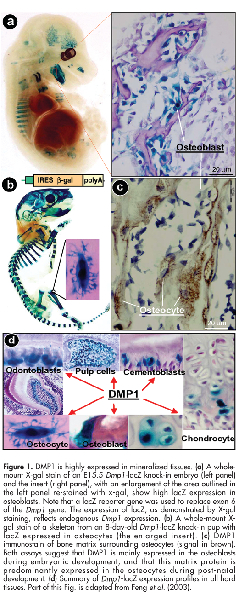

## Question

# Gene Research for Functional Annotation

## ⚠️ CRITICAL: Gene/Protein Identification Context

**BEFORE YOU BEGIN RESEARCH:** You MUST verify you are researching the CORRECT gene/protein. Gene symbols can be ambiguous, especially for less well-characterized genes from non-model organisms.

### Target Gene/Protein Identity (from UniProt):
- **UniProt Accession:** Q13316
- **Protein Description:** RecName: Full=Dentin matrix acidic phosphoprotein 1; Short=DMP-1; Short=Dentin matrix protein 1; Flags: Precursor;
- **Gene Information:** Name=DMP1;
- **Organism (full):** Homo sapiens (Human).
- **Protein Family:** Not specified in UniProt
- **Key Domains:** DMP1. (IPR009889); DMP1 (PF07263)

### MANDATORY VERIFICATION STEPS:

1. **Check if the gene symbol "DMP1" matches the protein description above**
2. **Verify the organism is correct:** Homo sapiens (Human).
3. **Check if protein family/domains align with what you find in literature**
4. **If you find literature for a DIFFERENT gene with the same or similar symbol, STOP**

### If Gene Symbol is Ambiguous or You Cannot Find Relevant Literature:

**DO NOT PROCEED WITH RESEARCH ON A DIFFERENT GENE.** Instead:
- State clearly: "The gene symbol 'DMP1' is ambiguous or literature is limited for this specific protein"
- Explain what you found (e.g., "Found extensive literature on a different gene with the same symbol in a different organism")
- Describe the protein based ONLY on the UniProt information provided above
- Suggest that the protein function can be inferred from domain/family information

### Research Target:

Please provide a comprehensive research report on the gene **DMP1** (gene ID: DMP1, UniProt: Q13316) in human.

The research report should be a detailed narrative explaining the function, biological processes, and localization of the gene product. Citations should be given for all claims.

You should prioritize authoritative reviews and primary scientific literature when conducting research. You can supplement
this with annotations you find in gene/protein databases, but these can be outdated or inaccurate.

We are specifically interested in the primary function of the gene - for enzymes, what reaction is catalyzed, and what is the substrate specificity? For transporters, what is the substrate? For structural proteins or adapters, what is the broader structural role? For signaling molecules, what is the role in the pathway.

We are interested in where in or outside the cell the gene product carries out its function.

We are also interested in the signaling or biochemical pathways in which the gene functions. We are less interested in broad pleiotropic effects, except where these elucidate the precise role.

Include evidence where possible. We are interested in both experimental evidence as well as inference from structure, evolution, or bioinformatic analysis. Precise studies should be prioritized over high-throughput, where available.

## Output

Question: You are an expert researcher providing comprehensive, well-cited information.

Provide detailed information focusing on:
1. Key concepts and definitions with current understanding
2. Recent developments and latest research (prioritize 2023-2024 sources)
3. Current applications and real-world implementations
4. Expert opinions and analysis from authoritative sources
5. Relevant statistics and data from recent studies

Format as a comprehensive research report with proper citations. Include URLs and publication dates where available.
Always prioritize recent, authoritative sources and provide specific citations for all major claims.

# Gene Research for Functional Annotation

## ⚠️ CRITICAL: Gene/Protein Identification Context

**BEFORE YOU BEGIN RESEARCH:** You MUST verify you are researching the CORRECT gene/protein. Gene symbols can be ambiguous, especially for less well-characterized genes from non-model organisms.

### Target Gene/Protein Identity (from UniProt):
- **UniProt Accession:** Q13316
- **Protein Description:** RecName: Full=Dentin matrix acidic phosphoprotein 1; Short=DMP-1; Short=Dentin matrix protein 1; Flags: Precursor;
- **Gene Information:** Name=DMP1;
- **Organism (full):** Homo sapiens (Human).
- **Protein Family:** Not specified in UniProt
- **Key Domains:** DMP1. (IPR009889); DMP1 (PF07263)

### MANDATORY VERIFICATION STEPS:

1. **Check if the gene symbol "DMP1" matches the protein description above**
2. **Verify the organism is correct:** Homo sapiens (Human).
3. **Check if protein family/domains align with what you find in literature**
4. **If you find literature for a DIFFERENT gene with the same or similar symbol, STOP**

### If Gene Symbol is Ambiguous or You Cannot Find Relevant Literature:

**DO NOT PROCEED WITH RESEARCH ON A DIFFERENT GENE.** Instead:
- State clearly: "The gene symbol 'DMP1' is ambiguous or literature is limited for this specific protein"
- Explain what you found (e.g., "Found extensive literature on a different gene with the same symbol in a different organism")
- Describe the protein based ONLY on the UniProt information provided above
- Suggest that the protein function can be inferred from domain/family information

### Research Target:

Please provide a comprehensive research report on the gene **DMP1** (gene ID: DMP1, UniProt: Q13316) in human.

The research report should be a detailed narrative explaining the function, biological processes, and localization of the gene product. Citations should be given for all claims.

You should prioritize authoritative reviews and primary scientific literature when conducting research. You can supplement
this with annotations you find in gene/protein databases, but these can be outdated or inaccurate.

We are specifically interested in the primary function of the gene - for enzymes, what reaction is catalyzed, and what is the substrate specificity? For transporters, what is the substrate? For structural proteins or adapters, what is the broader structural role? For signaling molecules, what is the role in the pathway.

We are interested in where in or outside the cell the gene product carries out its function.

We are also interested in the signaling or biochemical pathways in which the gene functions. We are less interested in broad pleiotropic effects, except where these elucidate the precise role.

Include evidence where possible. We are interested in both experimental evidence as well as inference from structure, evolution, or bioinformatic analysis. Precise studies should be prioritized over high-throughput, where available.

# Human DMP1: functional-annotation research report

## Identity and principal function

**Identity verified.** Human **DMP1**, *dentin matrix acidic phosphoprotein 1* (UniProt [Q13316](https://www.uniprot.org/uniprotkb/Q13316/entry); Ensembl ENSG00000152592), encodes dentin matrix protein 1. The accession–species–protein correspondence is independently listed in a protein review, and human genetics identifies DMP1 as a mineralized-tissue matrix protein. Its annotated DMP1 domain (InterPro IPR009889; Pfam PF07263) is consistent with, but does not by itself establish, its function as a SIBLING-family extracellular phosphoprotein. **DMP1 is not DSPP**—the gene encoding the distinct dentin proteins DSP and DPP—and *Dmp1-Cre* denotes a mouse experimental driver, not DMP1 protein activity. (grzybowska2018calciumbindingproteinswith pages 5-7, whyte2020hypophosphatemicosteosclerosishyperostosis pages 5-12, qin2007dentinmatrixprotein pages 4-5)

**Functional conclusion:** DMP1 is a *secreted, noncollagenous regulator of bone and tooth matrix mineralization* that also helps restrain production of the phosphate-wasting hormone FGF23 by osteocytes. It is **not** known as an enzyme catalyzing a mineralization reaction, a phosphate transporter, or the circulating phosphaturic hormone itself. Its best-supported direct biochemical interactions involve calcium/mineral surfaces, type-I-collagen-containing matrix, and, through its RGD motif, integrins. The exact molecular link between extracellular DMP1 and suppression of osteocytic FGF23 remains unresolved. (grzybowska2018calciumbindingproteinswith pages 5-7, george2008phosphorylatedproteinsand pages 12-14, liu2021dentinesialophosphoproteinsignal pages 8-11, michigami2023paracrineandendocrine pages 4-5, yamazaki2022osteocytesandthe pages 3-5)

The following summary distinguishes direct biochemical evidence, animal-model mechanisms, and human clinical observations.

| Evidence tier | DMP1 function / interpretation | Evidence model and strength | Key sources |
|---|---|---|---|
| **Identity and localization — high confidence** | Human **DMP1 (UniProt Q13316)** is a secreted, acidic, intrinsically disordered **SIBLING-family extracellular-matrix phosphoprotein**, distinct from DSPP. It is produced chiefly by postnatal osteocytes and odontoblasts and deposited around osteocytes and in bone, dentin, predentin, and cementum. | Human protein annotation plus tissue immunostaining and developmental reporter studies; strong for identity and mineralized-matrix localization, although much spatial evidence derives from rodents. | 2007, [10.1177/154405910708601202](https://doi.org/10.1177/154405910708601202); 2018, [10.3390/biom8020042](https://doi.org/10.3390/biom8020042) (qin2007dentinmatrixprotein pages 4-5, grzybowska2018calciumbindingproteinswith pages 5-7, qin2007dentinmatrixprotein media e6eba9f7) |
| **Processed matrix mineralization — moderate-to-high mechanistic confidence** | Secreted DMP1 is a precursor processed by **BMP1/tolloid-like metalloproteinases** at X–Asp bonds into approximately **37-kDa N-terminal** and **57-kDa C-terminal** products. Native full-length, highly phosphorylated DMP1 inhibited hydroxyapatite formation in a cell-free system, whereas the highly phosphorylated 57-kDa fragment nucleated mineral; the N-terminal region can inhibit nucleation. Thus activity depends on cleavage, phosphorylation, concentration, collagen context, and assay conditions—not a simple universal “mineralization promoter” label. | Biochemical isolation, proteolysis studies, and controlled cell-free hydroxyapatite assays; strong for processing and context-dependent activity, but principally rat/bovine proteins rather than native human DMP1. | 2004, [10.1074/jbc.M314114200](https://doi.org/10.1074/jbc.M314114200); 2007, [10.1177/154405910708601202](https://doi.org/10.1177/154405910708601202) (qin2007dentinmatrixprotein pages 4-5, tartaix2004invitroeffects pages 1-1, tartaix2004invitroeffects pages 1-2) |
| **Osteocyte–FGF23 bone–kidney axis — high causal confidence; mechanism incomplete** | DMP1 acts locally in osteocytes as a **negative regulator of FGF23 production** and supports osteocyte maturation. DMP1 loss enhances osteocytic FGFR signaling and raises FGF23; circulating FGF23—not DMP1—then signals through renal FGFR–αKlotho complexes, reduces proximal-tubule phosphate reabsorption and 1,25-dihydroxyvitamin-D production, and causes phosphate wasting. DMP1 is therefore neither the phosphaturic hormone nor a renal phosphate transporter. | Human loss-of-function genetics plus Dmp1-null mouse/rabbit phenotypes; strong for pathway direction and disease causality, but the molecular connection from extracellular DMP1 loss to FGFR activation remains unresolved. | 2006, [10.1038/ng1868](https://doi.org/10.1038/ng1868); 2022, [10.3389/fendo.2022.1005189](https://doi.org/10.3389/fendo.2022.1005189); 2023, [10.1297/cpe.2022-0053](https://doi.org/10.1297/cpe.2022-0053) (whyte2020hypophosphatemicosteosclerosishyperostosis pages 26-30, michigami2023paracrineandendocrine pages 4-5, yamazaki2022osteocytesandthe pages 3-5, michigami2023paracrineandendocrine pages 5-6) |
| **Human ARHR1 and therapeutic boundary — disease link high; treatment evidence very low** | Biallelic DMP1 loss causes **autosomal-recessive hypophosphatemic rickets type 1 (ARHR1)**. A 2024 patient with homozygous p.Tyr374* had serum phosphate **0.71 mmol/L**, TmP/GFR **2.18 mg/dL**, and FGF23 **127 RU/mL**; a laboratory-normal FGF23 can still be physiologically inappropriate during hypophosphatemia. Conventional phosphate plus active vitamin D remains used. Burosumab evidence specific to DMP1-ARHR1 is limited to **two reported adults** with biochemical and symptomatic improvement and is not equivalent to the much larger PHEX-XLH trial evidence; no DMP1-specific trial was identified. | Human pedigrees and case reports strongly establish disease causality; therapeutic evidence is uncontrolled, extremely small, and insufficient for broad efficacy claims. | 2022, [10.1210/clinem/dgac433](https://doi.org/10.1210/clinem/dgac433); 2024, [10.1016/j.bonr.2024.101753](https://doi.org/10.1016/j.bonr.2024.101753); 2024, [10.3389/fendo.2024.1383681](https://doi.org/10.3389/fendo.2024.1383681) (chaturvedi2024lessonslearnedfrom pages 5-6, chaturvedi2024lessonslearnedfrom pages 7-8, baroncelli2024diagnosistreatmentand pages 15-16, fukumoto2021fgf23relatedhypophosphatemicricketsosteomalacia pages 3-5, chaturvedi2024lessonslearnedfrom pages 4-5) |

*Table: This table separates established human DMP1 biology from model-derived mechanisms and very limited therapeutic evidence. It also clarifies that DMP1 regulates osteocytic FGF23 rather than functioning as FGF23 itself or as a renal phosphate transporter.*

## Where DMP1 acts: osteocyte and dental extracellular matrix

Osteoblast-lineage cells make DMP1 during skeletal development, while osteocytes are a major postnatal source; odontoblasts and cementocytes also produce it. The protein accumulates in **mineralized extracellular matrix**, notably around osteocytes and their processes, and in dentin and cementum. Rodent developmental reporter staining and protein immunostaining demonstrate the shift from embryonic osteoblast expression toward postnatal osteocytes and show DMP1 protein in the matrix surrounding osteocytes. Reporter expression identifies *producing cells*; matrix immunostaining identifies a principal *site of protein action*. Reports of expression in other tissues do not establish that those sites are central to its mineralization or phosphate-homeostasis function. (qin2007dentinmatrixprotein pages 4-5, qin2007dentinmatrixprotein media e6eba9f7, tartaix2004invitroeffects pages 1-1)

DMP1 belongs to the **SIBLING** family—*small integrin-binding ligand, N-linked glycoproteins*—of secreted, acidic, extensively modified matrix proteins. Its serine-, aspartate- and glutamate-rich sequences, phosphorylation and calcium-binding properties fit a flexible mineral-surface organizer rather than a rigid load-bearing collagen fibril. Biochemical work also reports type I collagen binding; its RGD-containing region can support integrin-dependent attachment. These properties support a role in coordinating mineral deposition with the organic matrix and nearby cells, without proving that each interaction is indispensable in human bone. (whyte2020hypophosphatemicosteosclerosishyperostosis pages 5-12, grzybowska2018calciumbindingproteinswith pages 5-7, george2008phosphorylatedproteinsand pages 12-14, liu2021dentinesialophosphoproteinsignal pages 8-11)

## Molecular mechanism: processing changes mineral-regulatory activity

DMP1 is synthesized as a **precursor** and proteolytically processed; studies of bone and dentin matrix identify approximately **37-kDa N-terminal** and **57-kDa C-terminal** products, with relatively little intact precursor detected in native extracellular matrix. BMP1/tolloid-like metalloproteinases can process DMP1. The mapped cluster of cleavage bonds, including a prominent Ser180–Asp181 site, comes from **rat DMP1**; these rodent residue numbers should not be presented as verified human Q13316 cleavage coordinates. Phosphorylation differs between fragments, and some N-terminal products are additionally modified as proteoglycans. DMP1 is a **substrate** of the processing proteases, not itself the protease. (qin2007dentinmatrixprotein pages 4-5, qin2007dentinmatrixprotein pages 8-9)

The strongest direct functional evidence is **context-dependent**, rather than a claim that every form of DMP1 always nucleates apatite. In controlled cell-free hydroxyapatite assays, unphosphorylated recombinant DMP1 promoted nucleation; recombinant protein phosphorylated *in vitro* had little detectable effect; more extensively phosphorylated, full-length DMP1 made in marrow stromal cells **inhibited** formation and growth; and the naturally derived, heavily phosphorylated **57-kDa C-terminal fragment promoted nucleation**. The cellular full-length preparation carried approximately **29.7 phosphates per molecule**, while the tested C-terminal fragment carried approximately **42**. Protein source, phosphorylation, cleavage, concentration and collagen context therefore matter. These were biochemical experiments using predominantly **rat/bovine-derived proteins**, not measurements of universal activity of native human Q13316 in vivo. (tartaix2004invitroeffects pages 1-1, tartaix2004invitroeffects pages 4-5, tartaix2004invitroeffects pages 1-2, qin2007dentinmatrixprotein pages 4-5)

Animal deletion-and-rescue evidence places those biochemical effects in a tissue context. Dmp1-deficient mice have disorganized osteocyte-associated mineralization and defective dentin; a review of the underlying experiments reports approximately **threefold lower dentin apposition**, and re-expression improved mineralization and dentinal-tubule defects. Such models support DMP1-dependent osteocyte maturation and orderly *propagation* of mineral through matrix, alongside direct crystal-regulatory activity; they do not establish a single exclusive biochemical action for every DMP1 fragment. (qin2007dentinmatrixprotein pages 6-8, qin2007dentinmatrixprotein pages 4-5)

## Pathway: an osteocyte-to-kidney phosphate-control axis

Human biallelic DMP1 loss of function causes **autosomal-recessive hypophosphatemic rickets type 1 (ARHR1)**. The original 2006 human study identified homozygous DMP1 variants and reported clearly elevated **intact FGF23 in two of four affected individuals**. Dmp1-null animal models subsequently linked deficiency to increased osteocytic *Fgf23* expression, impaired osteocyte maturation and skeletal mineralization. Together these findings strongly establish DMP1 as a local **negative regulator of osteocyte FGF23 production**, even though elevated measured FGF23 is not obligatory in every individual or with every assay. (whyte2020hypophosphatemicosteosclerosishyperostosis pages 26-30, qin2007dentinmatrixprotein pages 6-8, michigami2023paracrineandendocrine pages 4-5, yamazaki2022osteocytesandthe pages 3-5)

The pathway can be summarized as **loss of osteocytic DMP1 → excessive bioactive FGF23 signaling → renal phosphate wasting and reduced active-vitamin-D production → insufficient phosphate for skeletal mineralization**. FGF23, after reaching the kidney, acts through FGF receptors with the **αKlotho** co-receptor; **DMP1 does not directly carry phosphate across the renal tubule**. Animal studies implicate increased **FGFR signaling within DMP1-deficient osteocytes** upstream of FGF23 overproduction, but exactly how the DMP1-containing matrix controls that signal has not been conclusively identified. The local matrix defect and systemic hypophosphatemia can both contribute to skeletal disease. (michigami2023paracrineandendocrine pages 4-5, yamazaki2022osteocytesandthe pages 3-5, michigami2023paracrineandendocrine pages 5-6, fukumoto2021fgf23relatedhypophosphatemicricketsosteomalacia pages 3-5)

## Recent research and clinical implementation, 2023–2024

**2023—human-cell pathway study.** Guirado and colleagues introduced **full-length human DMP1** into cultured dental pulp cells from patients with **PHEX-associated X-linked hypophosphatemia (XLH)**, *not* from patients with DMP1-ARHR1. During induced odontogenic differentiation, XLH cells showed increased Wnt-related transcripts including **WIF1, SOST and DKK3** and the ligands **WNT5A and WNT16**; DMP1 expression reversed or transiently reduced several of these responses. WNT5A and WNT16 should not be conflated with the direct Wnt antagonists WIF1 or SOST. β-Catenin measurements were context-dependent and do **not** establish that DMP1 directly activates canonical Wnt signaling in vivo. This is a useful *human-cell mechanistic hypothesis*, not clinical evidence for DMP1 replacement therapy or proof that Wnt regulation supersedes DMP1’s matrix and FGF23 functions. Guirado *et al.*, *International Journal of Oral Science* (February 2023), [doi:10.1038/s41368-022-00214-z](https://doi.org/10.1038/s41368-022-00214-z). (guirado2023wntpathwayinhibitors pages 3-3, guirado2023wntpathwayinhibitors pages 3-4, guirado2023wntpathwayinhibitors pages 2-3)

**2024—genetically confirmed clinical example.** In an eight-person hereditary-rickets case series, **one** 17-year-old patient had homozygous **DMP1 c.1122T>G, p.Tyr374\*** and persistent skeletal deformity despite conventional treatment. Reported serum phosphate was **0.71 mmol/L** (reference **0.80–1.50**), and tubular maximum phosphate reabsorption per GFR (**TmP/GFR**) was **2.18 mg/dL** (reference **2.60–3.80**). Reported FGF23 was **127 RU/mL** (laboratory reference **<230**). The *RU/mL* result should **not** be equated with an intact-FGF23 concentration in *pg/mL*: C-terminal and intact assays can measure different molecular species, and a laboratory-normal FGF23 can be physiologically inappropriate when phosphate is low. This **single case** illustrates diagnostic testing and phenotype, not disease prevalence or treatment efficacy. Chaturvedi *et al.*, *Bone Reports* (online **21 March 2024**), [doi:10.1016/j.bonr.2024.101753](https://doi.org/10.1016/j.bonr.2024.101753). (chaturvedi2024lessonslearnedfrom pages 4-5, chaturvedi2024lessonslearnedfrom pages 5-6, fukumoto2021fgf23relatedhypophosphatemicricketsosteomalacia pages 3-5)

**Current management and limits of evidence.** Establishing the genotype matters because DMP1-ARHR1, PHEX-XLH, ENPP1-associated disease and renal transporter disorders need different interpretation. Measurement of serum phosphate, renal phosphate handling and appropriately interpreted FGF23, followed by molecular testing, underpins clinical diagnosis. Oral phosphate plus an active vitamin-D preparation has been used for ARHR1, with response and adverse effects requiring monitoring. A **2024 pediatric endocrine position statement** describes improvement after the FGF23-neutralizing antibody **burosumab in two reported adults with ARHR1**, including phosphate normalization and improvement of pseudofracture and symptoms; the underlying report is Bai *et al.*, *Journal of Clinical Endocrinology & Metabolism* (2022), [doi:10.1210/clinem/dgac433](https://doi.org/10.1210/clinem/dgac433). In the 2024 DMP1 case above, burosumab was **considered, not administered**, and the authors stated that it was not approved for patients with DMP1 mutations in their setting. Results of burosumab trials in **PHEX-XLH must not be assigned to DMP1-ARHR1**. Baroncelli *et al.*, *Frontiers in Endocrinology* (April 2024), [doi:10.3389/fendo.2024.1383681](https://doi.org/10.3389/fendo.2024.1383681). (chaturvedi2024lessonslearnedfrom pages 5-6, baroncelli2024diagnosistreatmentand pages 12-13, baroncelli2024diagnosistreatmentand pages 15-16, chaturvedi2024lessonslearnedfrom pages 7-8)

**Assessment.** The high-confidence annotation is a **processed extracellular bone-and-dentin matrix phosphoprotein that regulates mineral organization and restrains osteocytic FGF23**. Direct fragment-dependent mineral effects are experimentally demonstrated but chiefly with nonhuman material; the precise DMP1-to-FGFR signaling connection and effectiveness of DMP1-specific therapies remain less certain. (tartaix2004invitroeffects pages 1-1, michigami2023paracrineandendocrine pages 4-5, yamazaki2022osteocytesandthe pages 3-5, baroncelli2024diagnosistreatmentand pages 15-16)

References

1. (grzybowska2018calciumbindingproteinswith pages 5-7): Ewa A. Grzybowska. Calcium-binding proteins with disordered structure and their role in secretion, storage, and cellular signaling. Biomolecules, 8:42, Jun 2018. URL: https://doi.org/10.3390/biom8020042, doi:10.3390/biom8020042. This article has 60 citations.

2. (whyte2020hypophosphatemicosteosclerosishyperostosis pages 5-12): Michael P. Whyte, S. Deepak Amalnath, William H. McAlister, Marc D. McKee, Deborah J. Veis, Margaret Huskey, Shenghui Duan, Vinieth N. Bijanki, Suhas Alur, and Steven Mumm. Hypophosphatemic osteosclerosis, hyperostosis, and enthesopathy associated with novel homozygous mutations of dmp1 encoding dentin matrix protein 1 and spp1 encoding osteopontin: the first digenic sibling protein osteopathy? Bone, 132:115190, Mar 2020. URL: https://doi.org/10.1016/j.bone.2019.115190, doi:10.1016/j.bone.2019.115190. This article has 25 citations and is from a domain leading peer-reviewed journal.

3. (qin2007dentinmatrixprotein pages 4-5): C. Qin, R. D'Souza, and Jian Q. Feng. Dentin matrix protein 1 (dmp1): new and important roles for biomineralization and phosphate homeostasis. Journal of Dental Research, 86:1134-1141, Dec 2007. URL: https://doi.org/10.1177/154405910708601202, doi:10.1177/154405910708601202. This article has 306 citations and is from a highest quality peer-reviewed journal.

4. (george2008phosphorylatedproteinsand pages 12-14): A. George and A. Veis. Phosphorylated proteins and control over apatite nulcleation, crystal growth and inhibition. Chemical reviews, 108:4670-4693, Oct 2008. URL: https://doi.org/10.1021/cr0782729, doi:10.1021/cr0782729. This article has 917 citations and is from a highest quality peer-reviewed journal.

5. (liu2021dentinesialophosphoproteinsignal pages 8-11): Mengxing Liu, W. Li, X. Xia, F. Wang, M. Macdougall, and S. Chen. Dentine sialophosphoprotein signal in dentineogenesis and dentine regeneration. European cells & materials, 42:43-62, Jul 2021. URL: https://doi.org/10.22203/ecm.v042a04, doi:10.22203/ecm.v042a04. This article has 55 citations and is from a peer-reviewed journal.

6. (michigami2023paracrineandendocrine pages 4-5): Toshimi Michigami. Paracrine and endocrine functions of osteocytes. Clinical Pediatric Endocrinology, 32:1-10, Jan 2023. URL: https://doi.org/10.1297/cpe.2022-0053, doi:10.1297/cpe.2022-0053. This article has 15 citations and is from a peer-reviewed journal.

7. (yamazaki2022osteocytesandthe pages 3-5): Miwa Yamazaki and Toshimi Michigami. Osteocytes and the pathogenesis of hypophosphatemic rickets. Frontiers in Endocrinology, Sep 2022. URL: https://doi.org/10.3389/fendo.2022.1005189, doi:10.3389/fendo.2022.1005189. This article has 32 citations.

8. (qin2007dentinmatrixprotein media e6eba9f7): C. Qin, R. D'Souza, and Jian Q. Feng. Dentin matrix protein 1 (dmp1): new and important roles for biomineralization and phosphate homeostasis. Journal of Dental Research, 86:1134-1141, Dec 2007. URL: https://doi.org/10.1177/154405910708601202, doi:10.1177/154405910708601202. This article has 306 citations and is from a highest quality peer-reviewed journal.

9. (tartaix2004invitroeffects pages 1-1): Philippe H. Tartaix, Marie Doulaverakis, Anne George, Larry W. Fisher, William T. Butler, Chunlin Qin, Erdjan Salih, Melin Tan, Yukiji Fujimoto, Lyudmila Spevak, and Adele L. Boskey. In vitro effects of dentin matrix protein-1 on hydroxyapatite formation provide insights into in vivo functions*. Journal of Biological Chemistry, 279:18115-18120, Apr 2004. URL: https://doi.org/10.1074/jbc.m314114200, doi:10.1074/jbc.m314114200. This article has 230 citations and is from a domain leading peer-reviewed journal.

10. (tartaix2004invitroeffects pages 1-2): Philippe H. Tartaix, Marie Doulaverakis, Anne George, Larry W. Fisher, William T. Butler, Chunlin Qin, Erdjan Salih, Melin Tan, Yukiji Fujimoto, Lyudmila Spevak, and Adele L. Boskey. In vitro effects of dentin matrix protein-1 on hydroxyapatite formation provide insights into in vivo functions*. Journal of Biological Chemistry, 279:18115-18120, Apr 2004. URL: https://doi.org/10.1074/jbc.m314114200, doi:10.1074/jbc.m314114200. This article has 230 citations and is from a domain leading peer-reviewed journal.

11. (whyte2020hypophosphatemicosteosclerosishyperostosis pages 26-30): Michael P. Whyte, S. Deepak Amalnath, William H. McAlister, Marc D. McKee, Deborah J. Veis, Margaret Huskey, Shenghui Duan, Vinieth N. Bijanki, Suhas Alur, and Steven Mumm. Hypophosphatemic osteosclerosis, hyperostosis, and enthesopathy associated with novel homozygous mutations of dmp1 encoding dentin matrix protein 1 and spp1 encoding osteopontin: the first digenic sibling protein osteopathy? Bone, 132:115190, Mar 2020. URL: https://doi.org/10.1016/j.bone.2019.115190, doi:10.1016/j.bone.2019.115190. This article has 25 citations and is from a domain leading peer-reviewed journal.

12. (michigami2023paracrineandendocrine pages 5-6): Toshimi Michigami. Paracrine and endocrine functions of osteocytes. Clinical Pediatric Endocrinology, 32:1-10, Jan 2023. URL: https://doi.org/10.1297/cpe.2022-0053, doi:10.1297/cpe.2022-0053. This article has 15 citations and is from a peer-reviewed journal.

13. (chaturvedi2024lessonslearnedfrom pages 5-6): Deepti Chaturvedi, Taif EmadEldin Mehasi, Assia Benbrahim, Lubna ElDeeb, and Asma Deeb. Lessons learned from the real-world diagnosis and management of hereditary hypophosphatemic rickets. Bone Reports, 21:101753, Jun 2024. URL: https://doi.org/10.1016/j.bonr.2024.101753, doi:10.1016/j.bonr.2024.101753. This article has 3 citations and is from a peer-reviewed journal.

14. (chaturvedi2024lessonslearnedfrom pages 7-8): Deepti Chaturvedi, Taif EmadEldin Mehasi, Assia Benbrahim, Lubna ElDeeb, and Asma Deeb. Lessons learned from the real-world diagnosis and management of hereditary hypophosphatemic rickets. Bone Reports, 21:101753, Jun 2024. URL: https://doi.org/10.1016/j.bonr.2024.101753, doi:10.1016/j.bonr.2024.101753. This article has 3 citations and is from a peer-reviewed journal.

15. (baroncelli2024diagnosistreatmentand pages 15-16): Giampiero I. Baroncelli, Pasquale Comberiati, Tommaso Aversa, Federico Baronio, Alessandra Cassio, Mariangela Chiarito, Mirna Cosci o di Coscio, Luisa De Sanctis, Natascia Di Iorgi, Maria Felicia Faienza, Danilo Fintini, Roberto Franceschi, Mila Kalapurackal, Silvia Longhi, Michela Mariani, Marco Pitea, Andrea Secco, Daniele Tessaris, Francesco Vierucci, Malgorzata Wasniewska, Giovanna Weber, and Stefano Mora. Diagnosis, treatment, and management of rickets: a position statement from the bone and mineral metabolism group of the italian society of pediatric endocrinology and diabetology. Frontiers in Endocrinology, Apr 2024. URL: https://doi.org/10.3389/fendo.2024.1383681, doi:10.3389/fendo.2024.1383681. This article has 40 citations.

16. (fukumoto2021fgf23relatedhypophosphatemicricketsosteomalacia pages 3-5): Seiji Fukumoto. Fgf23-related hypophosphatemic rickets/osteomalacia: diagnosis and new treatment. Journal of Molecular Endocrinology, 66:R57-R65, Feb 2021. URL: https://doi.org/10.1530/jme-20-0089, doi:10.1530/jme-20-0089. This article has 108 citations and is from a peer-reviewed journal.

17. (chaturvedi2024lessonslearnedfrom pages 4-5): Deepti Chaturvedi, Taif EmadEldin Mehasi, Assia Benbrahim, Lubna ElDeeb, and Asma Deeb. Lessons learned from the real-world diagnosis and management of hereditary hypophosphatemic rickets. Bone Reports, 21:101753, Jun 2024. URL: https://doi.org/10.1016/j.bonr.2024.101753, doi:10.1016/j.bonr.2024.101753. This article has 3 citations and is from a peer-reviewed journal.

18. (qin2007dentinmatrixprotein pages 8-9): C. Qin, R. D'Souza, and Jian Q. Feng. Dentin matrix protein 1 (dmp1): new and important roles for biomineralization and phosphate homeostasis. Journal of Dental Research, 86:1134-1141, Dec 2007. URL: https://doi.org/10.1177/154405910708601202, doi:10.1177/154405910708601202. This article has 306 citations and is from a highest quality peer-reviewed journal.

19. (tartaix2004invitroeffects pages 4-5): Philippe H. Tartaix, Marie Doulaverakis, Anne George, Larry W. Fisher, William T. Butler, Chunlin Qin, Erdjan Salih, Melin Tan, Yukiji Fujimoto, Lyudmila Spevak, and Adele L. Boskey. In vitro effects of dentin matrix protein-1 on hydroxyapatite formation provide insights into in vivo functions*. Journal of Biological Chemistry, 279:18115-18120, Apr 2004. URL: https://doi.org/10.1074/jbc.m314114200, doi:10.1074/jbc.m314114200. This article has 230 citations and is from a domain leading peer-reviewed journal.

20. (qin2007dentinmatrixprotein pages 6-8): C. Qin, R. D'Souza, and Jian Q. Feng. Dentin matrix protein 1 (dmp1): new and important roles for biomineralization and phosphate homeostasis. Journal of Dental Research, 86:1134-1141, Dec 2007. URL: https://doi.org/10.1177/154405910708601202, doi:10.1177/154405910708601202. This article has 306 citations and is from a highest quality peer-reviewed journal.

21. (guirado2023wntpathwayinhibitors pages 3-3): Elizabeth Guirado, Cassandra Villani, Adrienn Petho, Yinghua Chen, Mark Maienschein-Cline, Zhengdeng Lei, Nina Los, and Anne George. Wnt pathway inhibitors are upregulated in xlh dental pulp cells in response to odontogenic differentiation. International Journal of Oral Science, Feb 2023. URL: https://doi.org/10.1038/s41368-022-00214-z, doi:10.1038/s41368-022-00214-z. This article has 6 citations and is from a highest quality peer-reviewed journal.

22. (guirado2023wntpathwayinhibitors pages 3-4): Elizabeth Guirado, Cassandra Villani, Adrienn Petho, Yinghua Chen, Mark Maienschein-Cline, Zhengdeng Lei, Nina Los, and Anne George. Wnt pathway inhibitors are upregulated in xlh dental pulp cells in response to odontogenic differentiation. International Journal of Oral Science, Feb 2023. URL: https://doi.org/10.1038/s41368-022-00214-z, doi:10.1038/s41368-022-00214-z. This article has 6 citations and is from a highest quality peer-reviewed journal.

23. (guirado2023wntpathwayinhibitors pages 2-3): Elizabeth Guirado, Cassandra Villani, Adrienn Petho, Yinghua Chen, Mark Maienschein-Cline, Zhengdeng Lei, Nina Los, and Anne George. Wnt pathway inhibitors are upregulated in xlh dental pulp cells in response to odontogenic differentiation. International Journal of Oral Science, Feb 2023. URL: https://doi.org/10.1038/s41368-022-00214-z, doi:10.1038/s41368-022-00214-z. This article has 6 citations and is from a highest quality peer-reviewed journal.

24. (baroncelli2024diagnosistreatmentand pages 12-13): Giampiero I. Baroncelli, Pasquale Comberiati, Tommaso Aversa, Federico Baronio, Alessandra Cassio, Mariangela Chiarito, Mirna Cosci o di Coscio, Luisa De Sanctis, Natascia Di Iorgi, Maria Felicia Faienza, Danilo Fintini, Roberto Franceschi, Mila Kalapurackal, Silvia Longhi, Michela Mariani, Marco Pitea, Andrea Secco, Daniele Tessaris, Francesco Vierucci, Malgorzata Wasniewska, Giovanna Weber, and Stefano Mora. Diagnosis, treatment, and management of rickets: a position statement from the bone and mineral metabolism group of the italian society of pediatric endocrinology and diabetology. Frontiers in Endocrinology, Apr 2024. URL: https://doi.org/10.3389/fendo.2024.1383681, doi:10.3389/fendo.2024.1383681. This article has 40 citations.

## Artifacts

- [Edison artifact artifact-00](DMP1-deep-research-falcon_artifacts/artifact-00.md)

## Citations

1. grzybowska2018calciumbindingproteinswith pages 5-7
2. whyte2020hypophosphatemicosteosclerosishyperostosis pages 5-12
3. qin2007dentinmatrixprotein pages 4-5
4. george2008phosphorylatedproteinsand pages 12-14
5. liu2021dentinesialophosphoproteinsignal pages 8-11
6. michigami2023paracrineandendocrine pages 4-5
7. yamazaki2022osteocytesandthe pages 3-5
8. tartaix2004invitroeffects pages 1-1
9. tartaix2004invitroeffects pages 1-2
10. whyte2020hypophosphatemicosteosclerosishyperostosis pages 26-30
11. michigami2023paracrineandendocrine pages 5-6
12. chaturvedi2024lessonslearnedfrom pages 5-6
13. chaturvedi2024lessonslearnedfrom pages 7-8
14. baroncelli2024diagnosistreatmentand pages 15-16
15. chaturvedi2024lessonslearnedfrom pages 4-5
16. qin2007dentinmatrixprotein pages 8-9
17. tartaix2004invitroeffects pages 4-5
18. qin2007dentinmatrixprotein pages 6-8
19. guirado2023wntpathwayinhibitors pages 3-3
20. guirado2023wntpathwayinhibitors pages 3-4
21. guirado2023wntpathwayinhibitors pages 2-3
22. baroncelli2024diagnosistreatmentand pages 12-13
23. Q13316
24. 10.1177/154405910708601202
25. 10.3390/biom8020042
26. 10.1074/jbc.M314114200
27. 10.1038/ng1868
28. 10.3389/fendo.2022.1005189
29. 10.1297/cpe.2022-0053
30. 10.1210/clinem/dgac433
31. 10.1016/j.bonr.2024.101753
32. 10.3389/fendo.2024.1383681
33. doi:10.1038/s41368-022-00214-z
34. doi:10.1016/j.bonr.2024.101753
35. doi:10.1210/clinem/dgac433
36. doi:10.3389/fendo.2024.1383681
37. https://www.uniprot.org/uniprotkb/Q13316/entry
38. https://doi.org/10.1177/154405910708601202
39. https://doi.org/10.3390/biom8020042
40. https://doi.org/10.1074/jbc.M314114200
41. https://doi.org/10.1038/ng1868
42. https://doi.org/10.3389/fendo.2022.1005189
43. https://doi.org/10.1297/cpe.2022-0053
44. https://doi.org/10.1210/clinem/dgac433
45. https://doi.org/10.1016/j.bonr.2024.101753
46. https://doi.org/10.3389/fendo.2024.1383681
47. https://doi.org/10.1038/s41368-022-00214-z
48. https://doi.org/10.3390/biom8020042,
49. https://doi.org/10.1016/j.bone.2019.115190,
50. https://doi.org/10.1177/154405910708601202,
51. https://doi.org/10.1021/cr0782729,
52. https://doi.org/10.22203/ecm.v042a04,
53. https://doi.org/10.1297/cpe.2022-0053,
54. https://doi.org/10.3389/fendo.2022.1005189,
55. https://doi.org/10.1074/jbc.m314114200,
56. https://doi.org/10.1016/j.bonr.2024.101753,
57. https://doi.org/10.3389/fendo.2024.1383681,
58. https://doi.org/10.1530/jme-20-0089,
59. https://doi.org/10.1038/s41368-022-00214-z,