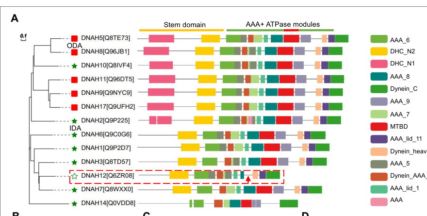
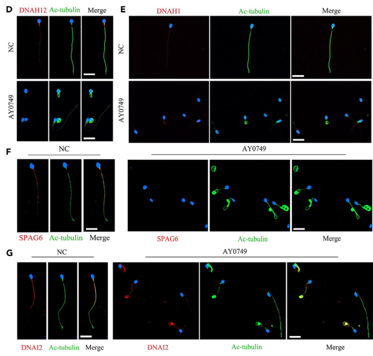

## Question

# Gene Research for Functional Annotation

## ⚠️ CRITICAL: Gene/Protein Identification Context

**BEFORE YOU BEGIN RESEARCH:** You MUST verify you are researching the CORRECT gene/protein. Gene symbols can be ambiguous, especially for less well-characterized genes from non-model organisms.

### Target Gene/Protein Identity (from UniProt):
- **UniProt Accession:** Q6ZR08
- **Protein Description:** RecName: Full=Dynein axonemal heavy chain 12; AltName: Full=Axonemal beta dynein heavy chain 12; AltName: Full=Axonemal dynein heavy chain 12-like protein; AltName: Full=Axonemal dynein heavy chain 7-like protein; AltName: Full=Ciliary dynein heavy chain 12; AltName: Full=Dynein axonemal heavy chain 7-like; AltName: Full=Dynein heavy chain domain-containing protein 2;
- **Gene Information:** Name=DNAH12; Synonyms=DHC3, DLP12, DNAH12L, DNAH7L, DNAHC3, DNHD2, HDHC3, HL19;
- **Organism (full):** Homo sapiens (Human).
- **Protein Family:** Belongs to the dynein heavy chain family. .
- **Key Domains:** AAA+_ATPase. (IPR003593); AAA_lid_11. (IPR041658); AAA_lid_11_sf. (IPR042219); DHC. (IPR026983); Dhc_AAA. (IPR035699)

### MANDATORY VERIFICATION STEPS:

1. **Check if the gene symbol "DNAH12" matches the protein description above**
2. **Verify the organism is correct:** Homo sapiens (Human).
3. **Check if protein family/domains align with what you find in literature**
4. **If you find literature for a DIFFERENT gene with the same or similar symbol, STOP**

### If Gene Symbol is Ambiguous or You Cannot Find Relevant Literature:

**DO NOT PROCEED WITH RESEARCH ON A DIFFERENT GENE.** Instead:
- State clearly: "The gene symbol 'DNAH12' is ambiguous or literature is limited for this specific protein"
- Explain what you found (e.g., "Found extensive literature on a different gene with the same symbol in a different organism")
- Describe the protein based ONLY on the UniProt information provided above
- Suggest that the protein function can be inferred from domain/family information

### Research Target:

Please provide a comprehensive research report on the gene **DNAH12** (gene ID: DNAH12, UniProt: Q6ZR08) in human.

The research report should be a detailed narrative explaining the function, biological processes, and localization of the gene product. Citations should be given for all claims.

You should prioritize authoritative reviews and primary scientific literature when conducting research. You can supplement
this with annotations you find in gene/protein databases, but these can be outdated or inaccurate.

We are specifically interested in the primary function of the gene - for enzymes, what reaction is catalyzed, and what is the substrate specificity? For transporters, what is the substrate? For structural proteins or adapters, what is the broader structural role? For signaling molecules, what is the role in the pathway.

We are interested in where in or outside the cell the gene product carries out its function.

We are also interested in the signaling or biochemical pathways in which the gene functions. We are less interested in broad pleiotropic effects, except where these elucidate the precise role.

Include evidence where possible. We are interested in both experimental evidence as well as inference from structure, evolution, or bioinformatic analysis. Precise studies should be prioritized over high-throughput, where available.

## Output

Question: You are an expert researcher providing comprehensive, well-cited information.

Provide detailed information focusing on:
1. Key concepts and definitions with current understanding
2. Recent developments and latest research (prioritize 2023-2024 sources)
3. Current applications and real-world implementations
4. Expert opinions and analysis from authoritative sources
5. Relevant statistics and data from recent studies

Format as a comprehensive research report with proper citations. Include URLs and publication dates where available.
Always prioritize recent, authoritative sources and provide specific citations for all major claims.

# Gene Research for Functional Annotation

## ⚠️ CRITICAL: Gene/Protein Identification Context

**BEFORE YOU BEGIN RESEARCH:** You MUST verify you are researching the CORRECT gene/protein. Gene symbols can be ambiguous, especially for less well-characterized genes from non-model organisms.

### Target Gene/Protein Identity (from UniProt):
- **UniProt Accession:** Q6ZR08
- **Protein Description:** RecName: Full=Dynein axonemal heavy chain 12; AltName: Full=Axonemal beta dynein heavy chain 12; AltName: Full=Axonemal dynein heavy chain 12-like protein; AltName: Full=Axonemal dynein heavy chain 7-like protein; AltName: Full=Ciliary dynein heavy chain 12; AltName: Full=Dynein axonemal heavy chain 7-like; AltName: Full=Dynein heavy chain domain-containing protein 2;
- **Gene Information:** Name=DNAH12; Synonyms=DHC3, DLP12, DNAH12L, DNAH7L, DNAHC3, DNHD2, HDHC3, HL19;
- **Organism (full):** Homo sapiens (Human).
- **Protein Family:** Belongs to the dynein heavy chain family. .
- **Key Domains:** AAA+_ATPase. (IPR003593); AAA_lid_11. (IPR041658); AAA_lid_11_sf. (IPR042219); DHC. (IPR026983); Dhc_AAA. (IPR035699)

### MANDATORY VERIFICATION STEPS:

1. **Check if the gene symbol "DNAH12" matches the protein description above**
2. **Verify the organism is correct:** Homo sapiens (Human).
3. **Check if protein family/domains align with what you find in literature**
4. **If you find literature for a DIFFERENT gene with the same or similar symbol, STOP**

### If Gene Symbol is Ambiguous or You Cannot Find Relevant Literature:

**DO NOT PROCEED WITH RESEARCH ON A DIFFERENT GENE.** Instead:
- State clearly: "The gene symbol 'DNAH12' is ambiguous or literature is limited for this specific protein"
- Explain what you found (e.g., "Found extensive literature on a different gene with the same symbol in a different organism")
- Describe the protein based ONLY on the UniProt information provided above
- Suggest that the protein function can be inferred from domain/family information

### Research Target:

Please provide a comprehensive research report on the gene **DNAH12** (gene ID: DNAH12, UniProt: Q6ZR08) in human.

The research report should be a detailed narrative explaining the function, biological processes, and localization of the gene product. Citations should be given for all claims.

You should prioritize authoritative reviews and primary scientific literature when conducting research. You can supplement
this with annotations you find in gene/protein databases, but these can be outdated or inaccurate.

We are specifically interested in the primary function of the gene - for enzymes, what reaction is catalyzed, and what is the substrate specificity? For transporters, what is the substrate? For structural proteins or adapters, what is the broader structural role? For signaling molecules, what is the role in the pathway.

We are interested in where in or outside the cell the gene product carries out its function.

We are also interested in the signaling or biochemical pathways in which the gene functions. We are less interested in broad pleiotropic effects, except where these elucidate the precise role.

Include evidence where possible. We are interested in both experimental evidence as well as inference from structure, evolution, or bioinformatic analysis. Precise studies should be prioritized over high-throughput, where available.

# Human DNAH12 (UniProt Q6ZR08): functional annotation and evidence

## Identity and principal conclusion

The target is **human DNAH12**, dynein axonemal heavy chain 12, also called **DHC3**—not the distinct gene *DNAH3*. The supplied UniProt accession is [Q6ZR08](https://www.uniprot.org/uniprotkb/Q6ZR08/entry); the primary literature independently identifies human DNAH12/DHC3 as an axonemal-dynein-family protein. Its reported AAA+ dynein domains accord with that assignment, but, unusually, sequence/domain analysis finds **no conventional microtubule-binding domain (MTBD)**. The Q6ZR08 accession and additional synonyms in the question are supplied identification information; the papers examined do not independently map every synonym to that accession. (yang2025deficiencyindnah12 pages 2-3, yang2025deficiencyindnah12 pages 13-15, yang2025deficiencyindnah12 media 210abf3e)

**Best-supported primary function:** DNAH12 helps build and maintain the **inner dynein arm (IDA) machinery of the sperm flagellar axoneme**, particularly by enabling localization of DNALI1 and DNAH1 during sperm development. This is an experimentally supported *assembly/recruitment role*, not proof that isolated DNAH12 itself generates force. Sperm lacking functional DNAH12 have defective IDAs, frequently lose the central microtubule pair, and move poorly or not at all. (yang2025deficiencyindnah12 pages 15-16, yang2025deficiencyindnah12 pages 16-18, yang2025deficiencyindnah12 pages 8-10, yang2025deficiencyindnah12 pages 5-6)

The following comparison distinguishes direct DNAH12 findings from indirect support:

| Evidence/study | DNAH12-specific observation | Interpretation/limit |
|---|---|---|
| **Wu et al., February 2023**, *Cell Death & Disease* — [DOI](https://doi.org/10.1038/s41419-023-05653-y) | Immunoprecipitation–mass spectrometry of human sperm identified DNAH12 and DNAH1 as candidate DNALI1-associated proteins. DNAH12 remained detectable in DNALI1-mutant sperm, although DNAH1 and DNAH7 were lost. (wu2023dnali1deficiencycauses pages 3-5, wu2023dnali1deficiencycauses pages 5-8) | Supports an IDA assembly relationship and a hierarchy in which DNAH12 localization does not require DNALI1. Candidate association by IP–MS did not establish direct DNAH12–DNALI1 binding or assign DNAH12 to a native dynein subtype. |
| **Geng et al., 19 July 2024**, *iScience* — [DOI](https://doi.org/10.1016/j.isci.2024.110366) | Biallelic DNAH12 variants occurred in **3/1,532 (0.2%)** infertile Chinese men. In patient AY0749, flagellar DNAH12 was absent and SPAG6 was largely lost, whereas DNAH1 and DNAI2 were preserved; sperm showed severe asthenozoospermia and central-pair loss. (geng2024furtherevidencefrom pages 7-9, geng2024furtherevidencefrom pages 2-4) | Human genetics and sperm localization support a causal flagellar role, especially in central-pair integrity. Only three cases were found and only one underwent detailed structural and protein analysis; preservation of DNAH1 differs from later patients. |
| **Yang et al., eLife reviewed preprint 27 August 2024; version of record 27 March 2025** — [DOI](https://doi.org/10.7554/eLife.100350) | Screening **796** infertile men identified recessive DNAH12 variants in six unrelated families. Patient sperm and two mouse models showed DNAH12 loss, impaired IDAs and central-pair loss. Mouse-testis reciprocal co-IP demonstrated association with DNALI1 and DNAH1; DNAH12 loss prevented their flagellar recruitment. Tracheal ciliary motility and ultrastructure were not detectably affected. (yang2025deficiencyindnah12 pages 13-15, yang2025deficiencyindnah12 pages 15-16, yang2025deficiencyindnah12 pages 1-2, yang2025deficiencyindnah12 pages 12-13, yang2025deficiencyindnah12 pages 2-3) | Strongest mechanistic evidence that DNAH12 acts upstream in sperm-flagellar IDA assembly. The respiratory-cilia conclusion rests mainly on mouse observations and absence of reported PCD in affected humans; it does not exclude subtle or tissue-specific ciliary effects. |
| **Hu et al., January 2025**, *Cell Communication and Signaling* — [DOI](https://doi.org/10.1186/s12964-025-02043-z) | IQUB-associated radial-spoke-1 loss reduced DNAH12 and DNAH7 in human patient and knockout-mouse sperm, placing these IDA proteins near RS1. (hu2025iqubmutationinduces pages 8-12) | Independent but indirect support for DNAH12 coupling to the radial-spoke–IDA neighborhood. IQUB—not DNAH12—was perturbed, and the study did not demonstrate direct binding or uniquely assign DNAH12 to a specific dynein species. |

*Table: Four primary studies define DNAH12 as a sperm-flagellar inner-dynein-arm assembly factor while highlighting unresolved questions about direct motor activity, exact dynein-subtype assignment, and respiratory-cilia relevance.*

## Molecular activity and pathway

Axonemal dynein arms normally use ATP-dependent activity to produce the microtubule sliding that underlies ciliary or flagellar bending; IDAs are particularly important for shaping bends. DNAH12 belongs to this protein family and contains predicted AAA+ ATPase modules and an N-terminal **stem** implicated in protein association. Accordingly, **ATP is the plausible biochemical substrate of a putative DNAH12 ATPase**. However, the cited gene-specific studies do **not** demonstrate purified DNAH12 ATP hydrolysis, a measured catalytic rate, ATP-dependent microtubule movement, or substrate specificity. Its missing MTBD makes it especially inappropriate to annotate DNAH12 as an independently demonstrated, conventional microtubule-walking motor. The established function is association with, and assembly of, the motile axoneme; its precise catalytic contribution remains unresolved. (yang2025deficiencyindnah12 pages 13-15, yang2025deficiencyindnah12 pages 1-2, yang2025deficiencyindnah12 pages 18-19, yang2025deficiencyindnah12 media 210abf3e)

The strongest mechanistic study used mouse-testis immunoprecipitation/mass spectrometry and **reciprocal co-immunoprecipitation** to associate DNAH12 with the IDA proteins **DNALI1 and DNAH1**. An expressed DNAH12 stem fragment—amino acids 1–1212 of the construct studied—also co-immunoprecipitated with DNALI1. In *Dnah12*-null spermatids, DNALI1 and DNAH1 were detectable in round cells but were poorly recruited to elongating flagella; their levels and flagellar signals were reduced in affected sperm. Conversely, DNAH12 remained visible in sperm from a man with a *DNAH1* mutation, supporting an **asymmetric recruitment hierarchy** in which DNAH12 localization can precede DNAH1/DNALI1. Co-immunoprecipitation establishes association, but not necessarily direct contact between every pair in the native complex. (yang2025deficiencyindnah12 pages 13-15, yang2025deficiencyindnah12 pages 15-16, yang2025deficiencyindnah12 pages 16-18)

DNAH12-associated testis fractions also contained the radial-spoke-head-associated proteins **RSPH1, RSPH9 and DNAJB13**; the investigators reported confirmatory association assays, reduced signals after *Dnah12* deletion, and loss of flagellar RSPH1 staining. A connection between DNAH12-dependent radial-spoke organization and **central-pair stability** is therefore plausible, but whether DNAH12 directly stabilizes the central pair—and its exact position within a native IDA subtype—has not been established. A separate 2025 *IQUB* radial-spoke-1-deficiency study found reduced sperm DNAH12 and DNAH7, offering indirect evidence of proximity between these systems rather than proof of direct DNAH12–IQUB binding. (yang2025deficiencyindnah12 pages 16-18, yang2025deficiencyindnah12 pages 18-19, hu2025iqubmutationinduces pages 8-12)

## Where DNAH12 acts

**Established protein location:** immunofluorescence places DNAH12 **along the flagellum of human sperm**, and control sperm show a DNAH12 immunoblot band. These signals were absent in sperm from studied men with biallelic *DNAH12* variants. In mice, DNAH12 appears in the developing male germ-cell/flagellar system; testicular DNAH12 protein was detected from approximately postnatal day 21 onward. These findings locate the demonstrated function in the **axoneme of a cell-surface sperm flagellum**, not in an extracellular soluble compartment or a defined signaling organelle. (geng2024furtherevidencefrom pages 7-9, yang2025deficiencyindnah12 pages 2-3, yang2025deficiencyindnah12 pages 5-6, geng2024furtherevidencefrom media 101e6ff4)

Expression is broader than the demonstrated phenotype: mouse studies detected DNAH12 transcript or protein in **testis, trachea, lung and oviduct**. Nevertheless, the examined *Dnah12*-deficient mice had no obvious tracheal motility or ciliary-ultrastructure defect; oviductal and tracheal DNALI1/DNAH1 abundance and localization were largely maintained. Affected men were not reported to have characteristic primary-ciliary-dyskinesia symptoms. Thus, **a requirement in sperm flagella is well supported, while an indispensable function in airway or oviductal cilia is not**. Normal results in the tissues and assays examined do not rule out subtle, context-dependent ciliary functions. (yang2025deficiencyindnah12 pages 15-16, yang2025deficiencyindnah12 pages 12-13, yang2025deficiencyindnah12 pages 16-18, yang2025deficiencyindnah12 pages 2-3)

DNAH12 acts in the **motile-axoneme/flagellogenesis pathway**, specifically IDA incorporation and axonemal organization. The radial-spoke/central-pair relationship is a developing mechanistic hypothesis, not evidence that DNAH12 is a conventional soluble signaling enzyme. (yang2025deficiencyindnah12 pages 1-2, yang2025deficiencyindnah12 pages 16-18, yang2025deficiencyindnah12 pages 18-19)

## Human genetics, experimental phenotypes and real-world use

In [Geng and colleagues, *iScience*, **19 July 2024**](https://doi.org/10.1016/j.isci.2024.110366), biallelic *DNAH12* variants were identified in **3 of 1,532 infertile Chinese men (approximately 0.2% of that selected cohort)**. The three had severe impaired sperm motility; two showed multiple flagellar-morphology abnormalities. In the deeply examined patient AY0749, DNAH12 flagellar staining was absent, central-pair structures and the central-pair-associated marker SPAG6 were depleted, but **DNAH1 and the outer-arm marker DNAI2 remained detectable**. *Dnah12*-knockout male mice were infertile, with reduced sperm numbers and immotile, malformed sperm. The 0.2% figure is a **cohort detection frequency**, not a population prevalence. (geng2024furtherevidencefrom pages 7-9, geng2024furtherevidencefrom pages 9-11, geng2024furtherevidencefrom media 101e6ff4, geng2024furtherevidencefrom pages 2-4)

In [Yang and colleagues, *eLife*](https://doi.org/10.7554/eLife.100350)—a **reviewed preprint posted in August 2024 and version of record published 27 March 2025**—screening involved **796 infertile patients** and identified affected men from **six unrelated families** with recessive *DNAH12* variants. Patient sperm had reduced motility, abnormal heads and tails, deficient DNAH12 staining, IDA abnormalities and central-pair loss. Two engineered mouse models reinforced causality: in the null model, caudal-epididymal sperm were **100% immotile** and sperm per epididymis fell to approximately **2% of control**. Reduced DNAH1 and DNALI1 flagellar staining in this series supports their recruitment dependence, but **does not erase Geng’s contrasting observation of retained DNAH1 in one patient**; variant-, sample- or assay-dependent differences remain to be resolved. (yang2025deficiencyindnah12 pages 1-2, yang2025deficiencyindnah12 pages 18-19, yang2025deficiencyindnah12 pages 8-10, yang2025deficiencyindnah12 pages 2-3, yang2025deficiencyindnah12 pages 5-6)

**Current clinical application is genetic diagnosis/counseling and assisted reproduction**, rather than a DNAH12-directed drug. Testing *DNAH12* can help evaluate otherwise unexplained severe asthenozoospermia or asthenoteratozoospermia, especially with flagellar abnormalities; segregation, variant interpretation and the wider infertility genotype must still be considered. In Geng’s small series, intracytoplasmic sperm injection (**ICSI**) led to **one live birth**; a second transferred pregnancy **ended in miscarriage**; embryos from the third couple **had not yet been transferred**. Reporting all three as successful live births would therefore be incorrect. ICSI also produced embryos from *Dnah12*-deficient mouse sperm. These are encouraging individual outcomes, not an established success rate or randomized comparison. (geng2024furtherevidencefrom pages 7-9, geng2024furtherevidencefrom pages 9-11, geng2024furtherevidencefrom media c7273657, geng2024furtherevidencefrom pages 11-13)

## Evidence limits and interpretation

The functional annotation is strongest for **DNAH12-dependent sperm-IDA recruitment and axoneme integrity**. Important unresolved questions are DNAH12’s direct ATPase activity, precise native dynein-subtype placement, why loss of an IDA-associated protein also disrupts the central pair and sperm-head development, and whether its non-sperm expression has a measurable physiological function. Protein-length descriptions differ across the primary reports—for example, one examines a **3,092-residue** construct, whereas another describes a **predicted 3,960-residue** protein—so domain boundaries or variant effects should be tied to a specified transcript/protein isoform rather than transferred unquestioningly to UniProt Q6ZR08. These uncertainties do not affect the independently observed human and mouse infertility phenotype. (yang2025deficiencyindnah12 pages 15-16, geng2024furtherevidencefrom pages 9-11, yang2025deficiencyindnah12 pages 18-19, geng2024furtherevidencefrom pages 11-13)

**Key sources and dates:** [Wu et al., *Cell Death & Disease*, February 2023](https://doi.org/10.1038/s41419-023-05653-y); [Geng et al., *iScience*, 19 July 2024](https://doi.org/10.1016/j.isci.2024.110366); [Yang et al., *eLife*, reviewed preprint 2024, version of record 27 March 2025](https://doi.org/10.7554/eLife.100350); [Hu et al., *Cell Communication and Signaling*, January 2025](https://doi.org/10.1186/s12964-025-02043-z). (yang2025deficiencyindnah12 pages 1-2, geng2024furtherevidencefrom pages 1-2, wu2023dnali1deficiencycauses pages 3-5, hu2025iqubmutationinduces pages 8-12)

References

1. (yang2025deficiencyindnah12 pages 2-3): Menglei Yang, Hafiz Muhammad Jafar Hussain, Manan Khan, Zubair Muhammad, Jianteng Zhou, Ao Ma, Xiongheng Huang, Jingwei Ye, Min Chen, Aoran Zhi, Tao Liu, Ranjha Khan, Asim Ali, Wasim Shah, Aurang Zeb, Nisar Ahmad, Huan Zhang, Bo Xu, Hui Ma, Qinghua Shi, and Baolu Shi. Deficiency in dnah12 causes male infertility by impairing dnah1 and dnali1 recruitment in humans and mice. ArXiv, Feb 2025. URL: https://doi.org/10.7554/elife.100350, doi:10.7554/elife.100350. This article has 28 citations.

2. (yang2025deficiencyindnah12 pages 13-15): Menglei Yang, Hafiz Muhammad Jafar Hussain, Manan Khan, Zubair Muhammad, Jianteng Zhou, Ao Ma, Xiongheng Huang, Jingwei Ye, Min Chen, Aoran Zhi, Tao Liu, Ranjha Khan, Asim Ali, Wasim Shah, Aurang Zeb, Nisar Ahmad, Huan Zhang, Bo Xu, Hui Ma, Qinghua Shi, and Baolu Shi. Deficiency in dnah12 causes male infertility by impairing dnah1 and dnali1 recruitment in humans and mice. ArXiv, Feb 2025. URL: https://doi.org/10.7554/elife.100350, doi:10.7554/elife.100350. This article has 28 citations.

3. (yang2025deficiencyindnah12 media 210abf3e): Menglei Yang, Hafiz Muhammad Jafar Hussain, Manan Khan, Zubair Muhammad, Jianteng Zhou, Ao Ma, Xiongheng Huang, Jingwei Ye, Min Chen, Aoran Zhi, Tao Liu, Ranjha Khan, Asim Ali, Wasim Shah, Aurang Zeb, Nisar Ahmad, Huan Zhang, Bo Xu, Hui Ma, Qinghua Shi, and Baolu Shi. Deficiency in dnah12 causes male infertility by impairing dnah1 and dnali1 recruitment in humans and mice. ArXiv, Feb 2025. URL: https://doi.org/10.7554/elife.100350, doi:10.7554/elife.100350. This article has 28 citations.

4. (yang2025deficiencyindnah12 pages 15-16): Menglei Yang, Hafiz Muhammad Jafar Hussain, Manan Khan, Zubair Muhammad, Jianteng Zhou, Ao Ma, Xiongheng Huang, Jingwei Ye, Min Chen, Aoran Zhi, Tao Liu, Ranjha Khan, Asim Ali, Wasim Shah, Aurang Zeb, Nisar Ahmad, Huan Zhang, Bo Xu, Hui Ma, Qinghua Shi, and Baolu Shi. Deficiency in dnah12 causes male infertility by impairing dnah1 and dnali1 recruitment in humans and mice. ArXiv, Feb 2025. URL: https://doi.org/10.7554/elife.100350, doi:10.7554/elife.100350. This article has 28 citations.

5. (yang2025deficiencyindnah12 pages 16-18): Menglei Yang, Hafiz Muhammad Jafar Hussain, Manan Khan, Zubair Muhammad, Jianteng Zhou, Ao Ma, Xiongheng Huang, Jingwei Ye, Min Chen, Aoran Zhi, Tao Liu, Ranjha Khan, Asim Ali, Wasim Shah, Aurang Zeb, Nisar Ahmad, Huan Zhang, Bo Xu, Hui Ma, Qinghua Shi, and Baolu Shi. Deficiency in dnah12 causes male infertility by impairing dnah1 and dnali1 recruitment in humans and mice. ArXiv, Feb 2025. URL: https://doi.org/10.7554/elife.100350, doi:10.7554/elife.100350. This article has 28 citations.

6. (yang2025deficiencyindnah12 pages 8-10): Menglei Yang, Hafiz Muhammad Jafar Hussain, Manan Khan, Zubair Muhammad, Jianteng Zhou, Ao Ma, Xiongheng Huang, Jingwei Ye, Min Chen, Aoran Zhi, Tao Liu, Ranjha Khan, Asim Ali, Wasim Shah, Aurang Zeb, Nisar Ahmad, Huan Zhang, Bo Xu, Hui Ma, Qinghua Shi, and Baolu Shi. Deficiency in dnah12 causes male infertility by impairing dnah1 and dnali1 recruitment in humans and mice. ArXiv, Feb 2025. URL: https://doi.org/10.7554/elife.100350, doi:10.7554/elife.100350. This article has 28 citations.

7. (yang2025deficiencyindnah12 pages 5-6): Menglei Yang, Hafiz Muhammad Jafar Hussain, Manan Khan, Zubair Muhammad, Jianteng Zhou, Ao Ma, Xiongheng Huang, Jingwei Ye, Min Chen, Aoran Zhi, Tao Liu, Ranjha Khan, Asim Ali, Wasim Shah, Aurang Zeb, Nisar Ahmad, Huan Zhang, Bo Xu, Hui Ma, Qinghua Shi, and Baolu Shi. Deficiency in dnah12 causes male infertility by impairing dnah1 and dnali1 recruitment in humans and mice. ArXiv, Feb 2025. URL: https://doi.org/10.7554/elife.100350, doi:10.7554/elife.100350. This article has 28 citations.

8. (wu2023dnali1deficiencycauses pages 3-5): Huan Wu, Yiyuan Liu, Yuqian Li, Kuokuo Li, Chuan Xu, Yang Gao, Ming-Rong Lv, Rui Guo, Yu-Ping Xu, P. Zhou, Zhao-Lian Wei, Rong Hua, Xiao-Jin He, and Yu-xia Cao. Dnali1 deficiency causes male infertility with severe asthenozoospermia in humans and mice by disrupting the assembly of the flagellar inner dynein arms and fibrous sheath. Cell Death &amp; Disease, Feb 2023. URL: https://doi.org/10.1038/s41419-023-05653-y, doi:10.1038/s41419-023-05653-y. This article has 62 citations and is from a peer-reviewed journal.

9. (wu2023dnali1deficiencycauses pages 5-8): Huan Wu, Yiyuan Liu, Yuqian Li, Kuokuo Li, Chuan Xu, Yang Gao, Ming-Rong Lv, Rui Guo, Yu-Ping Xu, P. Zhou, Zhao-Lian Wei, Rong Hua, Xiao-Jin He, and Yu-xia Cao. Dnali1 deficiency causes male infertility with severe asthenozoospermia in humans and mice by disrupting the assembly of the flagellar inner dynein arms and fibrous sheath. Cell Death &amp; Disease, Feb 2023. URL: https://doi.org/10.1038/s41419-023-05653-y, doi:10.1038/s41419-023-05653-y. This article has 62 citations and is from a peer-reviewed journal.

10. (geng2024furtherevidencefrom pages 7-9): Hao Geng, Kai Wang, Dan Liang, Xiaoqing Ni, Hui Yu, Dongdong Tang, Mingrong Lv, Huan Wu, Kuokuo Li, Qunshan Shen, Yang Gao, Chuan Xu, Ping Zhou, Zhaolian Wei, Yunxia Cao, Yanwei Sha, Xiaoyu Yang, and Xiaojin He. Further evidence from dnah12 supports favorable fertility outcomes of infertile males with dynein axonemal heavy chain gene family variants. iScience, 27:110366, Jul 2024. URL: https://doi.org/10.1016/j.isci.2024.110366, doi:10.1016/j.isci.2024.110366. This article has 17 citations and is from a peer-reviewed journal.

11. (geng2024furtherevidencefrom pages 2-4): Hao Geng, Kai Wang, Dan Liang, Xiaoqing Ni, Hui Yu, Dongdong Tang, Mingrong Lv, Huan Wu, Kuokuo Li, Qunshan Shen, Yang Gao, Chuan Xu, Ping Zhou, Zhaolian Wei, Yunxia Cao, Yanwei Sha, Xiaoyu Yang, and Xiaojin He. Further evidence from dnah12 supports favorable fertility outcomes of infertile males with dynein axonemal heavy chain gene family variants. iScience, 27:110366, Jul 2024. URL: https://doi.org/10.1016/j.isci.2024.110366, doi:10.1016/j.isci.2024.110366. This article has 17 citations and is from a peer-reviewed journal.

12. (yang2025deficiencyindnah12 pages 1-2): Menglei Yang, Hafiz Muhammad Jafar Hussain, Manan Khan, Zubair Muhammad, Jianteng Zhou, Ao Ma, Xiongheng Huang, Jingwei Ye, Min Chen, Aoran Zhi, Tao Liu, Ranjha Khan, Asim Ali, Wasim Shah, Aurang Zeb, Nisar Ahmad, Huan Zhang, Bo Xu, Hui Ma, Qinghua Shi, and Baolu Shi. Deficiency in dnah12 causes male infertility by impairing dnah1 and dnali1 recruitment in humans and mice. ArXiv, Feb 2025. URL: https://doi.org/10.7554/elife.100350, doi:10.7554/elife.100350. This article has 28 citations.

13. (yang2025deficiencyindnah12 pages 12-13): Menglei Yang, Hafiz Muhammad Jafar Hussain, Manan Khan, Zubair Muhammad, Jianteng Zhou, Ao Ma, Xiongheng Huang, Jingwei Ye, Min Chen, Aoran Zhi, Tao Liu, Ranjha Khan, Asim Ali, Wasim Shah, Aurang Zeb, Nisar Ahmad, Huan Zhang, Bo Xu, Hui Ma, Qinghua Shi, and Baolu Shi. Deficiency in dnah12 causes male infertility by impairing dnah1 and dnali1 recruitment in humans and mice. ArXiv, Feb 2025. URL: https://doi.org/10.7554/elife.100350, doi:10.7554/elife.100350. This article has 28 citations.

14. (hu2025iqubmutationinduces pages 8-12): Tingwenyi Hu, Xiangrong Tang, Tiechao Ruan, Shunhua Long, Guicen Liu, Jing Ma, Xueqi Li, Ruoxuan Zhang, Guoning Huang, Ying Shen, and Tingting Lin. Iqub mutation induces radial spoke 1 deficiency causing asthenozoospermia with normal sperm morphology in humans and mice. Cell Communication and Signaling : CCS, Jan 2025. URL: https://doi.org/10.1186/s12964-025-02043-z, doi:10.1186/s12964-025-02043-z. This article has 13 citations.

15. (yang2025deficiencyindnah12 pages 18-19): Menglei Yang, Hafiz Muhammad Jafar Hussain, Manan Khan, Zubair Muhammad, Jianteng Zhou, Ao Ma, Xiongheng Huang, Jingwei Ye, Min Chen, Aoran Zhi, Tao Liu, Ranjha Khan, Asim Ali, Wasim Shah, Aurang Zeb, Nisar Ahmad, Huan Zhang, Bo Xu, Hui Ma, Qinghua Shi, and Baolu Shi. Deficiency in dnah12 causes male infertility by impairing dnah1 and dnali1 recruitment in humans and mice. ArXiv, Feb 2025. URL: https://doi.org/10.7554/elife.100350, doi:10.7554/elife.100350. This article has 28 citations.

16. (geng2024furtherevidencefrom media 101e6ff4): Hao Geng, Kai Wang, Dan Liang, Xiaoqing Ni, Hui Yu, Dongdong Tang, Mingrong Lv, Huan Wu, Kuokuo Li, Qunshan Shen, Yang Gao, Chuan Xu, Ping Zhou, Zhaolian Wei, Yunxia Cao, Yanwei Sha, Xiaoyu Yang, and Xiaojin He. Further evidence from dnah12 supports favorable fertility outcomes of infertile males with dynein axonemal heavy chain gene family variants. iScience, 27:110366, Jul 2024. URL: https://doi.org/10.1016/j.isci.2024.110366, doi:10.1016/j.isci.2024.110366. This article has 17 citations and is from a peer-reviewed journal.

17. (geng2024furtherevidencefrom pages 9-11): Hao Geng, Kai Wang, Dan Liang, Xiaoqing Ni, Hui Yu, Dongdong Tang, Mingrong Lv, Huan Wu, Kuokuo Li, Qunshan Shen, Yang Gao, Chuan Xu, Ping Zhou, Zhaolian Wei, Yunxia Cao, Yanwei Sha, Xiaoyu Yang, and Xiaojin He. Further evidence from dnah12 supports favorable fertility outcomes of infertile males with dynein axonemal heavy chain gene family variants. iScience, 27:110366, Jul 2024. URL: https://doi.org/10.1016/j.isci.2024.110366, doi:10.1016/j.isci.2024.110366. This article has 17 citations and is from a peer-reviewed journal.

18. (geng2024furtherevidencefrom media c7273657): Hao Geng, Kai Wang, Dan Liang, Xiaoqing Ni, Hui Yu, Dongdong Tang, Mingrong Lv, Huan Wu, Kuokuo Li, Qunshan Shen, Yang Gao, Chuan Xu, Ping Zhou, Zhaolian Wei, Yunxia Cao, Yanwei Sha, Xiaoyu Yang, and Xiaojin He. Further evidence from dnah12 supports favorable fertility outcomes of infertile males with dynein axonemal heavy chain gene family variants. iScience, 27:110366, Jul 2024. URL: https://doi.org/10.1016/j.isci.2024.110366, doi:10.1016/j.isci.2024.110366. This article has 17 citations and is from a peer-reviewed journal.

19. (geng2024furtherevidencefrom pages 11-13): Hao Geng, Kai Wang, Dan Liang, Xiaoqing Ni, Hui Yu, Dongdong Tang, Mingrong Lv, Huan Wu, Kuokuo Li, Qunshan Shen, Yang Gao, Chuan Xu, Ping Zhou, Zhaolian Wei, Yunxia Cao, Yanwei Sha, Xiaoyu Yang, and Xiaojin He. Further evidence from dnah12 supports favorable fertility outcomes of infertile males with dynein axonemal heavy chain gene family variants. iScience, 27:110366, Jul 2024. URL: https://doi.org/10.1016/j.isci.2024.110366, doi:10.1016/j.isci.2024.110366. This article has 17 citations and is from a peer-reviewed journal.

20. (geng2024furtherevidencefrom pages 1-2): Hao Geng, Kai Wang, Dan Liang, Xiaoqing Ni, Hui Yu, Dongdong Tang, Mingrong Lv, Huan Wu, Kuokuo Li, Qunshan Shen, Yang Gao, Chuan Xu, Ping Zhou, Zhaolian Wei, Yunxia Cao, Yanwei Sha, Xiaoyu Yang, and Xiaojin He. Further evidence from dnah12 supports favorable fertility outcomes of infertile males with dynein axonemal heavy chain gene family variants. iScience, 27:110366, Jul 2024. URL: https://doi.org/10.1016/j.isci.2024.110366, doi:10.1016/j.isci.2024.110366. This article has 17 citations and is from a peer-reviewed journal.

## Artifacts

- [Edison artifact artifact-00](DNAH12-deep-research-falcon_artifacts/artifact-00.md)

## Citations

1. hu2025iqubmutationinduces pages 8-12
2. geng2024furtherevidencefrom pages 7-9
3. geng2024furtherevidencefrom pages 2-4
4. geng2024furtherevidencefrom pages 9-11
5. geng2024furtherevidencefrom pages 11-13
6. geng2024furtherevidencefrom pages 1-2
7. Q6ZR08
8. DOI
9. Geng and colleagues, *iScience*, **19 July 2024**
10. Yang and colleagues, *eLife*
11. Wu et al., *Cell Death & Disease*, February 2023
12. Geng et al., *iScience*, 19 July 2024
13. Yang et al., *eLife*, reviewed preprint 2024, version of record 27 March 2025
14. Hu et al., *Cell Communication and Signaling*, January 2025
15. https://www.uniprot.org/uniprotkb/Q6ZR08/entry
16. https://doi.org/10.1038/s41419-023-05653-y
17. https://doi.org/10.1016/j.isci.2024.110366
18. https://doi.org/10.7554/eLife.100350
19. https://doi.org/10.1186/s12964-025-02043-z
20. https://doi.org/10.7554/elife.100350,
21. https://doi.org/10.1038/s41419-023-05653-y,
22. https://doi.org/10.1016/j.isci.2024.110366,
23. https://doi.org/10.1186/s12964-025-02043-z,