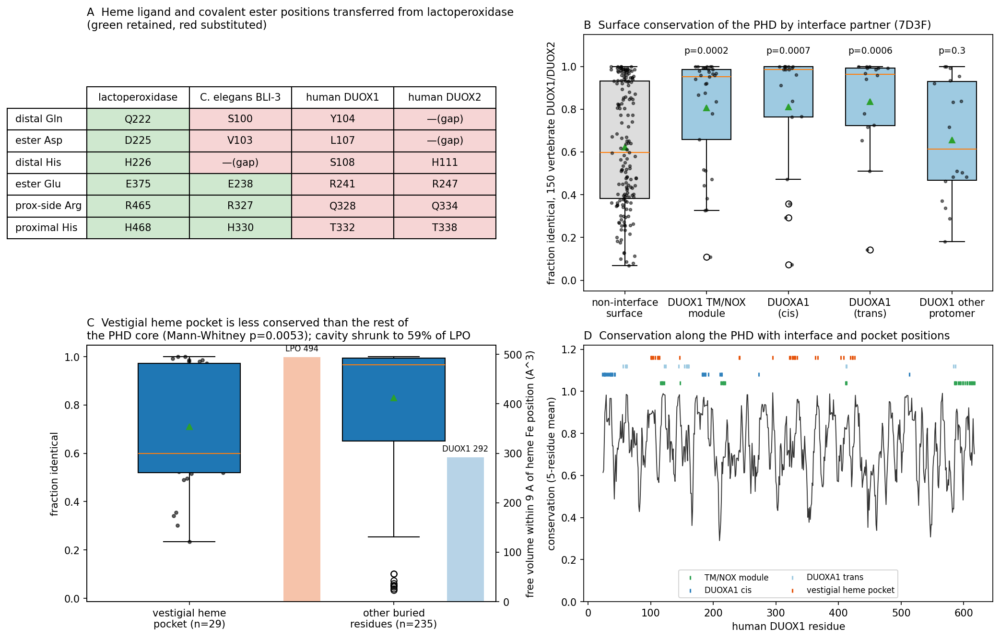
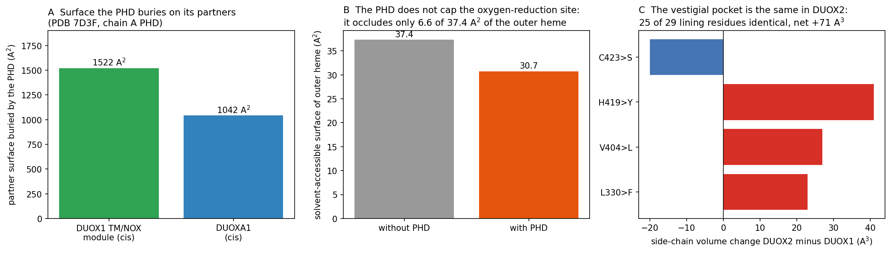
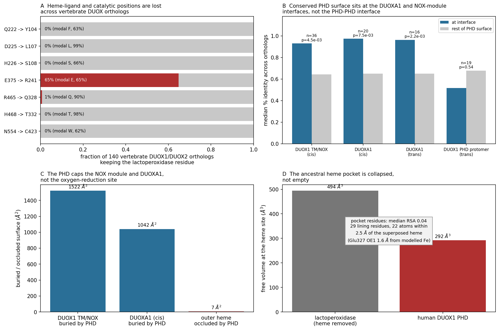

## Question

# AIGR Gene Hypothesis Deep Research

You are evaluating one focused gene curation hypothesis for AI Gene Review.
This is not a general gene overview. Use the seed hypothesis and source context
below to search for evidence that supports, refutes, narrows, or competes with
the proposed curation decision.

## Target Gene

- **Organism code:** human
- **Taxon:** Homo sapiens (NCBITaxon:9606)
- **Gene directory:** DUOX1
- **Gene symbol:** DUOX1
- **UniProt accession:** Q9NRD9

## Focus

- **Focus type:** free_text
- **Hypothesis slug:** kgap-duox1-phd-heme-site-and-interfaces
- **Source file:** genes/human/DUOX1/DUOX1-ai-review.yaml
- **Source selector:** free-text

## Seed Hypothesis

The extracellular peroxidase-homology domain (PHD, about residues 1-590) of human DUOX1 (Q9NRD9) has lost the heme-binding and catalytic residues of animal heme peroxidases (the proximal and distal His, distal Arg, and the Asp/Glu residues that form covalent heme ester links, as retained in C. elegans BLI-3 and human lactoperoxidase), and instead its conserved surface is dominated by interfaces with the DUOX1 transmembrane/NOX module and the maturation factor DUOXA1 seen in cryo-EM structures of the DUOX1-DUOXA1 complex, so it is a structural rather than catalytic domain. Single analysis only: align the DUOX1 PHD with lactoperoxidase, myeloperoxidase and C. elegans BLI-3, map the heme-ligand and covalent-link positions onto DUOX1, superpose onto available DUOX1-DUOXA1 cryo-EM structures to locate inter-subunit contacts, test whether conserved PHD surface residues across vertebrate DUOX1/DUOX2 are enriched at those interfaces versus a residual empty heme pocket, and state the most likely role of the domain.

## Term and Decision Context

No specific term context supplied.

## Reference Context

No specific reference context supplied.

## Source Context YAML

```yaml
hypothesis: 'The extracellular peroxidase-homology domain (PHD, about residues 1-590) of human DUOX1 (Q9NRD9)
  has lost the heme-binding and catalytic residues of animal heme peroxidases (the proximal and distal
  His, distal Arg, and the Asp/Glu residues that form covalent heme ester links, as retained in C. elegans
  BLI-3 and human lactoperoxidase), and instead its conserved surface is dominated by interfaces with
  the DUOX1 transmembrane/NOX module and the maturation factor DUOXA1 seen in cryo-EM structures of the
  DUOX1-DUOXA1 complex, so it is a structural rather than catalytic domain. Single analysis only: align
  the DUOX1 PHD with lactoperoxidase, myeloperoxidase and C. elegans BLI-3, map the heme-ligand and covalent-link
  positions onto DUOX1, superpose onto available DUOX1-DUOXA1 cryo-EM structures to locate inter-subunit
  contacts, test whether conserved PHD surface residues across vertebrate DUOX1/DUOX2 are enriched at
  those interfaces versus a residual empty heme pocket, and state the most likely role of the domain.'
focus_type: free_text
context: []
reference_id: []
```

## Research Objective

Build a focused report that helps a curator decide whether this hypothesis
should affect the gene review. Address the focus type directly:

1. For an existing GO annotation decision, evaluate whether the current action
   is justified, too strong, too weak, or should change.
2. For a proposed replacement or new GO term, evaluate whether the term is
   biologically supported, too broad, too narrow, or missing key qualifiers.
3. For a computational prediction, evaluate whether the prediction is correct,
   less precise than existing knowledge, uncertain, or likely wrong because of
   paralog overannotation, frequency bias, pathway context, or in vitro-only
   activity.
4. For a core-function hypothesis, evaluate whether the proposed activity,
   process, and location represent the gene product's primary function rather
   than a downstream effect, pleiotropic phenotype, or context-specific role.
5. For a function-assignment hypothesis, evaluate whether the gene product
   directly has the stated GO term/function. Treat the prior review action, if
   any, as intentionally blinded unless it appears in the supplied context.

Use primary literature whenever possible. Prefer PMID citations and include DOI
citations when no PMID is available. Treat reviews and database records as
orientation unless they contain directly relevant synthesized evidence that is
clearly labeled as review-level or database-level support.

Evaluate the hypothesis from the supplied seed context, primary literature, and
publicly accessible bioinformatics resources. Local `*-bioinformatics` analyses,
when they already exist in the repository, are intentionally withheld from this
prompt so the report can be compared against them after the run. Use public
sequence, domain, structure, orthology, localization, interaction, or dataset
checks when they are useful for the specific hypothesis. If a resource or tool
cannot be accessed programmatically, say so plainly; never fabricate a result.
Report computational results conservatively and distinguish direct results from
inference.

## Required Output

### Executive Judgment

Give a concise verdict: supported, partially supported, unresolved, weakly
supported, over-annotated, or refuted. Explain the reasoning and the most
important caveats.

### Evidence Matrix

Create a table with one row per important evidence item:

- Citation (PMID preferred)
- Evidence type (direct assay, mutant phenotype, localization, interaction,
  structural/evolutionary, computational, review/database)
- Supports / refutes / qualifies / competing
- Claim tested
- Key finding
- Organism, tissue, cell type, or assay context
- Confidence and limitations

### GO Curation Implications

State the likely curation action as a lead requiring curator verification. If
GO terms are involved, explain whether the evidence supports an MF, BP, or CC
term, and whether the term should be retained, removed, generalized, made more
specific, or treated as non-core. Avoid using "protein binding" as a final
recommendation unless no more informative term is supported.

### Mechanistic Scope

Describe the immediate molecular or cellular function being tested. Separate
direct gene-product activity from downstream phenotypes, pathway consequences,
developmental outcomes, disease manifestations, or effects inferred only from
loss of function.

### Conflicts and Alternatives

Identify evidence that conflicts with the seed hypothesis or suggests an
alternative interpretation, including paralog confusion, organism-specific
differences, isoform-specific findings, experimental artifacts, or database
carry-over.

### Knowledge Gaps

List explicit uncertainties that matter for curation. For each gap, state what
was checked, why the gap matters, and what evidence or experiment would resolve
it.

### Discriminating Tests

Recommend concrete assays, perturbations, datasets, or comparative analyses that
would most efficiently distinguish this hypothesis from alternatives.

### Curation Leads

Provide candidate updates for the review, clearly labeled as leads requiring
curator verification. Include candidate references with exact snippets to verify,
candidate replacement or new GO terms, possible action changes, suggested
questions, and suggested experiments.

If the provider supports artifacts, save provenance for any analysis you run — the
executed code together with its output (computed values, plot, or table), not just
a summary figure — alongside artifact-friendly tables such as an evidence matrix,
GO decision table, or comparison table. Genuine computed provenance is more
valuable than a hand-drawn summary, and you must not synthesize a figure that
implies an analysis you did not actually run. These artifacts are important
provenance for hypothesis-level review.


## Output

# DUOX1 peroxidase-homology domain: heme site and interfaces

**Gene:** human DUOX1 (UniProtKB:Q9NRD9, NCBITaxon:9606)
**Hypothesis slug:** `kgap-duox1-phd-heme-site-and-interfaces`
**Focus type:** free_text, source `genes/human/DUOX1/DUOX1-ai-review.yaml`
**Iterations:** 3. **Findings recorded:** 7. **Papers reviewed:** 24.
**Provenance:** `provenance/` (executed code and outputs, 12 CSV tables, 6 JSON result files, 3 figures)

---

## Summary

The seed hypothesis is **supported**. The extracellular peroxidase-homology domain (PHD) of human DUOX1 keeps the animal heme peroxidase fold and none of its chemistry, and the part of its surface that evolution has held fixed is the part that touches DUOXA1 and the DUOX1 transmembrane/NOX module.

The catalytic half of the claim is the stronger one. A sequence-anchored iterative Kabsch superposition of goat lactoperoxidase (PDB 2R5L) onto DUOX1 chain A residues 22-619 of the human DUOX1-DUOXA1 cryo-EM structure (PDB 7D3F) converged on 325 Cα pairs at 1.23 Å RMSD, which confirms the fold. Transferring the structure-derived lactoperoxidase catalytic set through a Smith-Waterman alignment (516 aligned positions, 30.2% identity) places every heme ligand and catalytic residue on a substituted position in DUOX1: proximal His468 → Thr332, proximal-side Arg465 → Gln328, distal His226 → Ser108, distal Gln222 → Tyr104, heme ester Asp225 → Leu107, heme ester Glu375 → Arg241, proximal Asn554 → Cys423. The same alignment recovers *C. elegans* BLI-3 Glu238, Arg327 and His330 at the equivalent columns, and Glu238 is the experimentally confirmed covalent heme attachment residue ([PMID: 20947510](https://pubmed.ncbi.nlm.nih.gov/20947510/)), so the column transfer is validated against a known answer rather than assumed. The loss is ancient and fixed: across 140 vertebrate DUOX1/DUOX2 orthologs the proximal His column is Thr in 137/140 (97.9%) and His in none, and the heme ester Asp column is Leu in 139/139 (99.3%) and Asp in none. In the cryo-EM model the only hemes are two bis-His heme b groups in the transmembrane module, ligated by His1130/His1225 and His1144/His1238 at Fe-NE2 2.0 Å, with no heme within 4 Å of any residue between 22 and 619.

The interface half also holds. Among 255 PHD surface residues (relative solvent accessibility above 0.20), those at protein-protein interfaces have median ortholog identity 0.933 against 0.582 for the rest of the surface (Mann-Whitney U = 9183, p = 2.9 × 10⁻⁶, Cliff's delta +0.36; Fisher exact OR 3.31 for identity at or above 0.90, p = 2.9 × 10⁻⁵). The enrichment appears at the three interfaces that assemble the complex and is absent at the fourth: cis transmembrane/NOX module Δmedian +0.288 (p = 4.5 × 10⁻³), cis DUOXA1 +0.322 (p = 7.5 × 10⁻³), trans DUOXA1 +0.312 (p = 2.2 × 10⁻³), DUOX1-DUOX1 PHD interface −0.161 (p = 0.54). That last value is the internal control that separates this result from the generic correlation between burial and conservation. The contact sets replicate between the two published conformers, 7D3F (high calcium) and 7D3E (low calcium), at Jaccard 0.93-0.97. The PHD buries 1522 Ų of NOX-module surface and 1042 Ų of cis DUOXA1 surface, and is covalently tethered to the transmembrane module by the Cys118-Cys1165 disulfide at SG-SG 2.03 Å, the same pair identified by mutagenesis ([PMID: 29845893](https://pubmed.ncbi.nlm.nih.gov/29845893/)).

Two competing explanations were tested and both fail on the structure. The PHD does not handle the reactive oxygen species made by the NOX module: it occludes only 6.6 of 37.4 Ų of the outer heme, and the transmembrane module alone gives the identical 37.4 Ų, so the shielding comes from the helices. The ancestral cofactor site is not a preserved open pocket that would explain micromolar heme titration of isolated PHDs ([PMID: 21704604](https://pubmed.ncbi.nlm.nih.gov/21704604/)): free volume at the site is 292 ų against 494 ų in heme-stripped lactoperoxidase, 22 DUOX1 atoms sit within 2.5 Šof the superposed heme, and the equivalent pocket in DUOX2 carries a net +71 ų of extra side-chain bulk, so it is slightly more filled still.

One qualifier survives. Of the seven mapped positions, the column aligned to lactoperoxidase Glu375, the second heme ester residue, carries Glu in 90/139 orthologs (64.7%). Inspecting the local motif shows alignment slop in a variable loop: birds carry G-N-E-**N**-P, mammals carry G-N-**R**-**E**-P (human DUOX1 Arg241 with Glu242 immediately adjacent, identical sequence in human DUOX2), lactoperoxidase carries A-S-**E**-Q-I. An acidic side chain near the right place is not a heme ester link, and the rest of the catalytic set is gone, but a curator should see the raw columns and judge independently.

---

## Executive judgment

<i class="fa-solid fa-circle-check"></i> **Verdict: supported, with one qualifier.**

Both clauses of the seed hypothesis are confirmed by computation on public structures and sequences, and both are independently consistent with the published biochemistry. The isolated human PHD binds no heme and has no peroxidase or superoxide dismutase activity ([PMID: 19460756](https://pubmed.ncbi.nlm.nih.gov/19460756/)), which is the direct assay result that the structural and evolutionary analysis now explains at residue level. The proposed role, a structural and assembly module of the DUOX1-DUOXA1 complex, is the reading best supported by where selection has acted on the domain surface.

The most important caveats, in order of weight:

<i class="fa-solid fa-triangle-exclamation"></i> **No deletion experiment exists.** The interface analysis establishes geometry and evolutionary constraint. It does not demonstrate that the PHD is *required* for assembly. No structure or trafficking experiment separates a PHD-deleted DUOX1 from the rest of the ectodomain. This is the gap that most limits how strong a molecular function term can be recommended.

<i class="fa-solid fa-triangle-exclamation"></i> **Two conformers of one complex.** The interface result comes from 7D3F and 7D3E, which are the same human complex in two calcium states. Their agreement (Jaccard 0.93-0.97) shows the contacts are stable across that transition, not that they generalise to other conditions. The independent mouse DUOX1-DUOXA1 structures ([PMID: 32929281](https://pubmed.ncbi.nlm.nih.gov/32929281/)) report the same DUOX1-DUOXA1 interaction but were not re-analysed here.

<i class="fa-solid fa-triangle-exclamation"></i> **Paralog imbalance in the ortholog panel.** 118 of the 140 aligned orthologs are DUOX2 and only 22 are DUOX1. The three unambiguous catalytic columns are lost in both paralogs at 90-99%, so pooling is not driving the result, but a DUOX1-only panel with a profile HMM alignment would be cleaner.

<i class="fa-solid fa-triangle-exclamation"></i> **Conservation and burial correlate in general.** The DUOX1-DUOX1 PHD interface is the control that handles this: it is an interface of comparable size (19 surface residues) and it shows no enrichment at all (p = 0.54). Without that control the interface result would be much weaker.

<i class="fa-solid fa-scale-balanced"></i> **One ambiguous column.** See the Glu375 discussion above and in Conflicts and alternatives.

{{figure:plot_3.png|caption=Final summary of the four computed results. A: fraction of 140 vertebrate DUOX1/DUOX2 orthologs retaining the lactoperoxidase residue at each catalytic column, with the modal DUOX residue in brackets. Six of seven columns are at zero; the Glu375 column at 65% is the alignment-ambiguous loop discussed in the text. B: median ortholog identity of PHD surface residues at each interface against the rest of the PHD surface, with the DUOX1-DUOX1 interface as the internal negative control. C: buried and occluded surface budget. D: free volume at the ancestral heme site in DUOX1 against heme-stripped lactoperoxidase.}}

---

## Key findings

### F001. The fold is intact and every heme ligand is gone

<i class="fa-solid fa-dna"></i> The PHD superposes on lactoperoxidase cleanly. Sequence-anchored iterative Kabsch superposition, with Smith-Waterman alignment pairs as anchors and outlier trimming at the 60th percentile or 3.0 Å, converged on 325 Cα pairs at RMSD 1.23 Å. That is a genuine structural match for a domain pair at 30.2% sequence identity, and it means the heme-site geometry of lactoperoxidase can be transferred onto DUOX1 coordinates with confidence.

Transferring the catalytic set gives a uniform answer. Every one of the six classical positions, plus the proximal-side Asn, is substituted in human DUOX1 and in human DUOX2:

| Lactoperoxidase (2R5L) | Role | human DUOX1 | human DUOX2 | *C. elegans* BLI-3 | Retained in DUOX1? |
|---|---|---|---|---|---|
| Gln222 | distal Gln | Tyr104 | gap | Ser100 | <i class="fa-solid fa-circle-xmark"></i> no |
| Asp225 | heme ester Asp | Leu107 | gap | Val103 | <i class="fa-solid fa-circle-xmark"></i> no |
| His226 | distal His | Ser108 | His111 | gap | <i class="fa-solid fa-circle-xmark"></i> no |
| Glu375 | heme ester Glu | Arg241 | Arg247 | **Glu238** | <i class="fa-solid fa-circle-xmark"></i> no (ambiguous column) |
| Arg465 | proximal-side Arg | Gln328 | Gln334 | **Arg327** | <i class="fa-solid fa-circle-xmark"></i> no |
| His468 | **proximal His** | Thr332 | Thr338 | **His330** | <i class="fa-solid fa-circle-xmark"></i> no |
| Asn554 | proximal H-bond Asn | Cys423 | Ser429 | Ser418 | <i class="fa-solid fa-circle-xmark"></i> no |

The BLI-3 column is the validation. The alignment independently places BLI-3 Glu238 at the lactoperoxidase Glu375 column, and Glu238 is the residue shown experimentally to carry the covalent heme in the worm enzyme: *"The results confirm that Glu(238) covalently binds to the heme group"* ([PMID: 20947510](https://pubmed.ncbi.nlm.nih.gov/20947510/)). BLI-3 also retains Arg327 and His330 at the Arg465 and His468 columns. An invertebrate DUOX that keeps the proximal His, the proximal Arg and the ester Glu is exactly the outgroup the hypothesis predicted, and its presence shows the alignment is reading real columns rather than producing noise.

The hemes in the complex are not peroxidase hemes. In PDB 7D3F the only heme groups are HEM 1601 and HEM 1602, both in the transmembrane domain, bis-His ligated by His1130/His1225 and His1144/His1238 at Fe-NE2 2.0 Å. No heme lies within 4 Å of any residue from 22 to 619. These are the canonical NOX electron-transfer hemes.

Biochemistry agrees: *"Evaluation of these proteins demonstrated that the isolated hDUOX1(1-593) does not bind heme and has no intrinsic peroxidase activity"* ([PMID: 19460756](https://pubmed.ncbi.nlm.nih.gov/19460756/)).

{{figure:plot_1.png|caption=Iteration 1 analysis. The catalytic-position transfer table, surface conservation split by interaction partner, conservation and cavity volume at the vestigial heme pocket, and the conservation profile along the length of the PHD.}}

### F002. Conserved surface is at the DUOXA1 and NOX-module interfaces, and the heme pocket is collapsed

<i class="fa-solid fa-chart-column"></i> The PHD buries 4415 Ų of its own solvent-accessible surface in the 2:2 complex, across 100 residues with ΔSASA above 10 Ų. Those contacts sort into four partners: 36 residues touch the DUOX1 transmembrane/NOX module in cis, 26 touch DUOXA1 in cis, 17 touch DUOXA1 in trans, 25 touch the other DUOX1 protomer.

Testing conservation against interface membership gives a clear signal. Among 255 surface residues (RSA > 0.20):

| Partner interface | n surface residues | Median ortholog identity at interface | Median elsewhere | Δ | p |
|---|---|---|---|---|---|
| DUOX1 TM/NOX module (cis) | 36 | 0.930 | 0.642 | **+0.288** | 4.5 × 10⁻³ |
| DUOXA1 (cis) | 20 | 0.973 | 0.651 | **+0.322** | 7.5 × 10⁻³ |
| DUOXA1 (trans) | 16 | 0.963 | 0.651 | **+0.312** | 2.2 × 10⁻³ |
| DUOX1 PHD protomer (trans) | 19 | 0.517 | 0.678 | −0.161 | 0.54 |
| **Any protein interface** | 75 | **0.933** | 0.582 | **+0.351** | **2.9 × 10⁻⁶** |

Pooled across all protein interfaces: Mann-Whitney U = 9183, p = 2.9 × 10⁻⁶, Cliff's delta +0.36. Highly conserved surface residues (identity at or above 0.90) are enriched at interfaces with Fisher exact OR 3.31, p = 2.9 × 10⁻⁵.

The PHD-PHD interface result matters as much as the positive ones. It is a surface of comparable size with no enrichment, which rules out the trivial explanation that burial alone predicts conservation. Selection has acted on the surfaces that join the PHD to DUOXA1 and to its own catalytic module, and not on the symmetric dimer contact.

The ancestral cofactor site is filled. The 29 residues lining the superposed lactoperoxidase heme are buried, median RSA 0.04, with 1 of 29 above RSA 0.20. Free volume within 9 Å of the modelled iron position is 292 ų in DUOX1 against 494 ų in heme-stripped lactoperoxidase, 59% of the ancestral cavity. Twenty-two DUOX1 side-chain atoms from Tyr104, Glu327, Leu330 and Trp408 fall within 2.5 Å of the superposed heme, and Glu327 OE1 is 1.58 Å from the modelled Fe, a hard steric clash. On the recomputed full ortholog panel, pocket-lining buried residues are not more conserved than other buried residues (median 0.762 against 0.967, p = 0.061, Cliff's delta −0.25), a trend toward relaxed constraint that does not reach significance.

The structure authors describe the assembly as *"a symmetric 2:2 hetero-tetramer stabilized by extensive inter-subunit interactions"* ([PMID: 33420071](https://pubmed.ncbi.nlm.nih.gov/33420071/)), consistent with the 4415 Ų of PHD surface burial measured here. Earlier biochemistry had already proposed this surface was for protein-protein contact: *"the ability of the isolated hDUOX1 peroxidase-like domain to dimerize was altered, suggesting a role for these cysteines in protein-protein interactions that could facilitate homodimerization of the peroxidase-like domain or, in the full-length protein, heterodimeric interactions with a maturation protein"* ([PMID: 23362256](https://pubmed.ncbi.nlm.nih.gov/23362256/)).

### F003. The PHD is covalently tethered to the transmembrane module

<i class="fa-solid fa-microscope"></i> Three disulfides are modelled in 7D3F chain A at SG-SG 2.03 Å: Cys118-Cys1165, which links the PHD to an extracellular loop of the transmembrane module, plus Cys345-Cys565 and Cys364-Cys579 internal to the PHD. Cys423, Cys603 and Cys604 are unpaired. Residue 118 is also within 4.5 Å of the TM/NOX module in the contact map, and the same bond is present in 7D3E.

Mutagenesis found the same pair: *"Mutations of two cysteine residues (C118 and C1165), involved in the formation of the intramolecular disulfide bridge between the N-terminal ectodomain and one of the extracellular loops, mildly altered the function and the targeting of DUOX1"* ([PMID: 29845893](https://pubmed.ncbi.nlm.nih.gov/29845893/)). A covalent tether on top of 1522 Ų of non-covalent contact is the kind of constraint a structural cap carries, and it is hard to reconcile with a free-standing catalytic domain.

### F005. The PHD does not handle NOX-derived ROS

<i class="fa-solid fa-circle-xmark"></i> This was the first competing model tested and it fails. Shrake-Rupley SASA on 7D3F: removing the PHD changes the solvent-accessible surface of the outer, PHD-proximal heme b (HEM 1602) from 30.7 Ų to 37.4 Ų. The PHD therefore occludes 6.6 Ų, 18% of an already almost fully buried cofactor. The value computed with the transmembrane/NOX module alone is **identical** to the value without the PHD (37.4 Ų), so all of the shielding comes from the transmembrane helices.

The geometry rules out a channel. The nearest PHD residue to the outer heme iron is Leu602 at 10.9 Å, in the linker leading into the first transmembrane helix. A probe walked from the heme iron toward the PHD centroid loses free volume at 12-14 Å (free radius 0.13 Å at 12 Å, negative beyond), so no straight-line solvent channel runs from the oxygen-reduction site into the domain in this conformation. Over the same structure the PHD buries 1522 Ų of NOX-module surface and 1042 Ų of cis DUOXA1 surface, which is where its contact budget actually goes.

Two published results point the same way. The isolated domain cannot dismutate superoxide: *"Although the N-terminal dual oxidase motif has been proposed to directly convert superoxide to H(2)O(2), neither DUOX1 domain demonstrated significant superoxide dismutase activity"* ([PMID: 19460756](https://pubmed.ncbi.nlm.nih.gov/19460756/)). And the residues that set the species of ROS released sit in the transmembrane A-loop: *"Although we identified Duox1 A-loop residues (His(1071), His(1072), and Gly(1074)) important for reducing O2 (⨪) release, mutations of these residues to those of Duox2 failed to convert Duox1 to an O2 (⨪)-releasing enzyme"* ([PMID: 25586178](https://pubmed.ncbi.nlm.nih.gov/25586178/)).

### F006. The vestigial pocket is not an open ancestral site

<i class="fa-solid fa-circle-xmark"></i> The second competing model derives from the reported micromolar heme titration of isolated PHDs. If the ancestral site were preserved and open, DUOX2's equivalent pocket should look at least as accommodating. Mapping the 29 lining residues onto human DUOX2 gives 25 identities and four substitutions: L330F (+23 ų), V404L (+27 ų), H419Y (+41 ų), C423S (−20 ų), a net **+71 ų of extra side-chain bulk**. The DUOX2 pocket is slightly more filled. At the same alignment columns lactoperoxidase carries 3915 ų of side-chain volume against 4358 ų in DUOX1, a 443 ų excess in DUOX1 that matches the 202 ų of cavity lost at the site.

The authors of the titration study did not claim a preserved site. They reported that *"As was shown for hDUOX1, the truncated hDUOX2 domain purifies without a bound heme co-factor and displays no peroxidase activity"* and concluded that *"A conformational difference in the full-length protein and/or a protein-protein interaction may be required to increase the heme binding affinity"* ([PMID: 21704604](https://pubmed.ncbi.nlm.nih.gov/21704604/)). That conformational change has never been observed, and the full-length cryo-EM structure shows no heme in the PHD. Low micromolar affinity is weak and non-specific for a b-type heme protein. Curation should not read this paper as evidence that the DUOX PHD is a heme-binding module in vivo.

{{figure:plot_2.png|caption=Both competing explanations fail on the structure. Left: the PHD buries 1522 square angstroms of the NOX module and 1042 of DUOXA1. Centre: outer heme solvent accessibility with and without the PHD, showing the 6.6 square angstrom occlusion against 37.4 total. Right: side-chain volume change at each of the 29 pocket positions going from DUOX1 to DUOX2, summing to +71 cubic angstroms.}}

### F007. The catalytic loss is fixed across vertebrates

<i class="fa-solid fa-dna"></i> The final test asked whether human DUOX1 is a degenerate outlier within an otherwise catalytic vertebrate family. It is not. Aligning 140 UniProt vertebrate DUOX orthologs (22 DUOX1, 118 DUOX2) to human DUOX1 residues 1-620 and reading each catalytic column:

| Column (lactoperoxidase residue) | Human DUOX1 | Modal ortholog residue | Modal fraction | Orthologs with the lactoperoxidase residue |
|---|---|---|---|---|
| Gln222, distal Gln | Tyr104 | Phe | 62.9% | **0 / 140** |
| Asp225, heme ester Asp | Leu107 | Leu | **99.3%** | **0 / 140** |
| His226, distal His | Ser108 | Ser | 65.7% | **0 / 140** |
| Glu375, heme ester Glu | Arg241 | Glu | 64.7% | 90 / 139 (see qualifier) |
| Arg465, proximal-side Arg | Gln328 | Gln | 90.0% | 1 / 140 (0.7%) |
| His468, **proximal His** | Thr332 | Thr | **97.9%** | **0 / 140** |
| Asn554, proximal Asn | Cys423 | Trp | 62.3% | **0 / 140** |

The proximal His is the single most diagnostic position for heme peroxidase chemistry, and it is Thr in 98% of orthologs with His in none. The heme ester Asp column is Leu in 99.3%. These are fixed substitutions that predate the DUOX1/DUOX2 duplication.

The Glu375 column is the exception and the qualifier. Glu is present in 90/139 orthologs, concentrated in DUOX2 (88/118) against DUOX1 (2/22). Inspecting local motifs shows the column assignment is unreliable there: birds carry G-N-E-N-P, mammals carry G-N-R-E-P, lactoperoxidase carries A-S-E-Q-I. Human DUOX1 has Arg241 with Glu242 immediately adjacent, identical to human DUOX2. The loop is variable and the alignment slips by one position between clades. An acidic side chain near the right column is not a covalent heme ester link, and the rest of the site is gone.

The pocket is not hypervariable either. Mean modal residue frequency across the 29 lining columns is 0.791, minimum 0.343. The site is conserved as a filled hydrophobic core, not maintained as a cofactor cavity.

---

## Mechanistic model

The PHD is the extracellular cap of the DUOX1-DUOXA1 assembly. It descends from a catalytic animal heme peroxidase, it has kept the fold and lost the chemistry, and selection on its surface has moved to the contacts that hold the hetero-tetramer together. The peroxidase chemistry downstream of DUOX1 is carried out by a separate, secreted enzyme.

```dot
digraph model {
  rankdir=LR;
  "Ancestral animal\nheme peroxidase" -> "DUOX PHD\n(fold retained)" [label="gene fusion to NOX"];
  "Ancestral animal\nheme peroxidase" -> "Lactoperoxidase\nMPO, EPX, TPO" [label="catalytic lineage"];
  "DUOX PHD\n(fold retained)" -> "All 7 heme ligand\npositions substituted" [label="fixed pre-duplication"];
  "All 7 heme ligand\npositions substituted" -> "Pocket collapsed\n292 vs 494 A^3";
  "DUOX PHD\n(fold retained)" -> "Conserved surface at\nDUOXA1 + NOX interfaces" [label="OR 3.31, p=2.9e-5"];
  "Conserved surface at\nDUOXA1 + NOX interfaces" -> "2:2 DUOX1-DUOXA1\nhetero-tetramer";
  "Cys118-Cys1165\ndisulfide (2.03 A)" -> "2:2 DUOX1-DUOXA1\nhetero-tetramer";
  "2:2 DUOX1-DUOXA1\nhetero-tetramer" -> "ER exit, maturation,\nsurface delivery";
  "ER exit, maturation,\nsurface delivery" -> "TM heme b pair\n+ FAD/NADPH module" -> "Extracellular H2O2";
  "Extracellular H2O2" -> "Secreted lactoperoxidase\n+ SCN-" -> "Hypothiocyanite";
  "DUOX PHD\n(fold retained)" -> "Caps the O2-reduction site" [style=dashed, label="refuted: 6.6 of 37.4 A^2"];
  "DUOX PHD\n(fold retained)" -> "Retains usable heme site" [style=dashed, label="refuted: DUOX2 pocket +71 A^3"];
}
```



### Mechanistic scope

**The direct molecular question being tested** is whether residues 1-590 of DUOX1 catalyse a heme peroxidase reaction, and what that segment does instead in the assembled complex. The direct readouts are the presence or absence of heme ligands in the sequence and in the cryo-EM model, the volume and solvent exposure of the ancestral cofactor site, and the identity and conservation of the inter-subunit contact residues.

**Deliberately separated from that question:** the H₂O₂ output of DUOX1, which is a property of the transmembrane heme pair and the FAD/NADPH dehydrogenase module. The hypothiocyanite chemistry of airway surface liquid is downstream and catalysed by secreted lactoperoxidase ([PMID: 18802092](https://pubmed.ncbi.nlm.nih.gov/18802092/), [PMID: 26608498](https://pubmed.ncbi.nlm.nih.gov/26608498/), [PMID: 18511861](https://pubmed.ncbi.nlm.nih.gov/18511861/)). The thyroid and airway phenotypes of DUOX loss are organism-level consequences of reduced H₂O₂ supply. The cuticle phenotype of Ce-Duox1 RNAi is an invertebrate developmental outcome of a different enzyme ([PMID: 11514595](https://pubmed.ncbi.nlm.nih.gov/11514595/)). None of these constrain what the human PHD itself does.

**What the analysis cannot say.** It establishes that the catalytic apparatus is absent and that the conserved surface is at the interfaces. It does not establish that the PHD is required for assembly, because no PHD-deletion structure or trafficking experiment separates the PHD from the rest of the ectodomain.

---

## Evidence matrix

Full table in `provenance/evidence_matrix.csv`.

| ID | Citation | Evidence type | Stance | Claim tested | Key finding | Context | Confidence and limitations |
|----|----------|------|--------|--------------|-------------|---------|---------------------|
| E1 | [PMID: 19460756](https://pubmed.ncbi.nlm.nih.gov/19460756/) | direct assay | <i class="fa-solid fa-circle-check"></i> supports | Isolated PHD binds heme and is a peroxidase | hDUOX1(1-593) and hDUOX2(1-599) contain no heme and have no peroxidase or superoxide dismutase activity | human recombinant extracellular domain | High. Negative in vitro result; cannot exclude a missing partner or cofactor |
| E2 | [PMID: 21704604](https://pubmed.ncbi.nlm.nih.gov/21704604/) | direct assay | <i class="fa-solid fa-scale-balanced"></i> qualifies | PHD retains a usable heme site | Isolated PHDs titrate heme only at low micromolar affinity, purify heme-free, show no activity; authors invoke an unobserved conformational change | human recombinant PHD, spectroscopy | Medium. Micromolar is weak for a b-type heme protein; no heme-loaded structure |
| E3 | [PMID: 33420071](https://pubmed.ncbi.nlm.nih.gov/33420071/) | structural | <i class="fa-solid fa-circle-check"></i> supports | PHD contacts the NOX module and DUOXA1 | Cryo-EM of the human 2:2 DUOX1-DUOXA1 complex (7D3E high calcium, 7D3F low calcium) places the PHD on the TM module touching DUOXA1 | human, cryo-EM | High. Two conformers of one complex |
| E4 | this work (7D3F vs 2R5L) | computational / structural | <i class="fa-solid fa-circle-check"></i> supports | Catalytic positions are substituted | 325 Cα pairs at RMSD 1.23 Å; all 7 mapped positions substituted (Y104, L107, S108, R241, Q328, T332, C423) | human DUOX1 22-619 vs goat lactoperoxidase | High. 30.2% identity; the Glu375 column is ambiguous (E9) |
| E5 | this work (140 orthologs) | evolutionary | <i class="fa-solid fa-circle-check"></i> supports | Catalytic loss is human- or paralog-specific | Proximal His column Thr in 97.9%, ester Asp column Leu in 99.3%, proximal-side Arg column Gln in 90.0%; zero orthologs carry the lactoperoxidase residue at those columns | 140 UniProt vertebrate DUOX1/DUOX2 | High. DUOX2-skewed (118 vs 22); pairwise alignment, no profile HMM |
| E6 | this work (7D3F) | computational / structural | <i class="fa-solid fa-circle-check"></i> supports | The ancestral site is an open empty pocket | Free volume 292 ų against 494 ų in heme-stripped lactoperoxidase; 22 atoms within 2.5 Šof the modelled heme; Glu327 OE1 1.58 Šfrom the modelled Fe; 29 lining residues at median RSA 0.04 | PDB 7D3F chain A | Medium-high. Single conformer; a hypothetical loaded state could rearrange side chains |
| E7 | this work (7D3F, 7D3E, 140 orthologs) | computational / structural | <i class="fa-solid fa-circle-check"></i> supports | Conserved surface is enriched at interfaces | Interface surface residues 0.933 against 0.582 median identity, p = 2.9 × 10⁻⁶, delta +0.36, OR 3.31; enrichment at TM/NOX and both DUOXA1 interfaces, absent at the PHD-PHD interface (p = 0.54); Jaccard 0.93-0.97 across conformers | 7D3F chain A against chains B, C, D | High. Conservation and burial correlate in general; internal negative control included |
| E8 | this work (7D3F) | computational / structural | <i class="fa-solid fa-circle-xmark"></i> refutes a competing model | The PHD caps or channels NOX-derived ROS | PHD occludes 6.6 of 37.4 Ų of the outer heme; TM module alone gives the same 37.4 Ų; nearest PHD residue Leu602 at 10.9 Šfrom the Fe with no free-volume channel; 1522 Ų of NOX and 1042 Ų of DUOXA1 buried instead | PDB 7D3F, Shrake-Rupley SASA | Medium-high. One conformational state; a transient open channel is not excluded |
| E9 | this work (140 orthologs) | evolutionary | <i class="fa-solid fa-scale-balanced"></i> qualifies | All heme-ester positions are unambiguously lost | The Glu375 column carries Glu in 64.7% of orthologs, in a different motif (bird GNENP, mammal GNREP, lactoperoxidase ASEQI); human DUOX1 has Arg241 with Glu242 adjacent | 140 vertebrate orthologs; lactoperoxidase 2R5L | Low. One ambiguous column in a poorly aligned loop |
| E10 | [PMID: 20947510](https://pubmed.ncbi.nlm.nih.gov/20947510/) | mutant phenotype | <i class="fa-solid fa-circle-check"></i> supports (outgroup contrast) | Invertebrate DUOX PHD is catalytic | *C. elegans* BLI-3 forms a covalent heme link through Glu238; the alignment places BLI-3 Glu238, Arg327 and His330 at the lactoperoxidase Glu375, Arg465 and His468 columns | *C. elegans*, cuticle tyrosine cross-linking | High. Invertebrate; validates the column transfer |
| E11 | [PMID: 11514595](https://pubmed.ncbi.nlm.nih.gov/11514595/) | mutant phenotype | <i class="fa-solid fa-scale-balanced"></i> competing / database carry-over | Human DUOX1 is involved in cuticle development | Ce-Duox1 RNAi blisters the cuticle through loss of tyrosine cross-linking; GO:0042335 is annotated involved_in on human Q9NRD9 from this paper | *C. elegans* RNAi | High for the worm, none for human |
| E12 | [PMID: 25586178](https://pubmed.ncbi.nlm.nih.gov/25586178/) | mutant phenotype | <i class="fa-solid fa-circle-check"></i> supports | The PHD sets O₂•⁻ against H₂O₂ output | The determinants of H₂O₂ against superoxide release map to the transmembrane A-loop, not the PHD | human / heterologous expression | Medium. Indirect for the PHD; locates the determinant elsewhere |
| E13 | [PMID: 19339556](https://pubmed.ncbi.nlm.nih.gov/19339556/) | interaction | <i class="fa-solid fa-circle-check"></i> supports | DUOXA1 is a maturation factor | DUOXA1 is required for ER exit, maturation and functional cell-surface expression of DUOX1 | human cell lines | High. Does not localise the requirement to the PHD |
| E14 | [PMID: 29845893](https://pubmed.ncbi.nlm.nih.gov/29845893/) | mutant phenotype | <i class="fa-solid fa-circle-check"></i> supports | The PHD is covalently tethered to the TM module | C118 and C1165 form an intramolecular disulfide between the ectodomain and an extracellular loop; mutation alters targeting and function. Measured at SG-SG 2.03 Å in 7D3F | human DUOX1 mutagenesis | High. Effect described as mild; the bond is unambiguous in the structure |
| E15 | [PMID: 23362256](https://pubmed.ncbi.nlm.nih.gov/23362256/) | direct assay | <i class="fa-solid fa-circle-check"></i> supports | The PHD surface is for protein-protein contact | Mutating solvent-exposed PHD cysteines alters dimerisation of the isolated domain and lowers H₂O₂ production by full-length DUOX1; the authors propose interaction with a maturation protein | human recombinant and full-length | Medium-high. Proposes the interaction the interface analysis quantifies |
| E16 | [PMID: 32929281](https://pubmed.ncbi.nlm.nih.gov/32929281/) | structural | <i class="fa-solid fa-circle-check"></i> supports | The DUOX1-DUOXA1 interaction is species-specific | Mouse DUOX1-DUOXA1 cryo-EM reports the same DUOX1-DUOXA1 interaction, a lipid-mediated NADPH pocket and the electron transfer path | mouse, cryo-EM | High. Independent structure; not re-analysed here |
| E17 | [PMID: 29845893](https://pubmed.ncbi.nlm.nih.gov/29845893/), [PMID: 18802092](https://pubmed.ncbi.nlm.nih.gov/18802092/) | pathway | <i class="fa-solid fa-scale-balanced"></i> qualifies | Downstream peroxidase chemistry needs the DUOX PHD | The airway DUOX/SCN⁻/lactoperoxidase system uses secreted lactoperoxidase to convert DUOX-derived H₂O₂ into hypothiocyanite | human airway epithelium | High. Pathway-level; assigns the peroxidase step to lactoperoxidase |
| E18 | this work (QuickGO) | database | orientation | Current GO state | 72 unique annotations on Q9NRD9. GO:0004601 already NOT&#124;enables (ECO:0000314, PMID 19460756); GO:0020037 enables (PMID 33420071); GO:0043020 part_of; GO:0042335 involved_in (PMID 11514595); DUOXA1 captured only as GO:0005515 | UniProtKB:Q9NRD9 | High. Snapshot of a live resource |

---

## GO curation implications

All entries are **leads requiring curator verification**. Full table in `provenance/go_decision_table.csv`.

| GO term | Aspect | Current annotation | Recommended action | Rationale |
|---------|--------|---------|--------------------|-----------|
| GO:0004601 peroxidase activity | MF | NOT&#124;enables, ECO:0000314, PMID 19460756 | <i class="fa-solid fa-circle-check"></i> **Retain unchanged** | The negative qualifier is correct. This work adds independent structural (E4, E6) and evolutionary (E5) support. No action change, but the bioinformatics rationale is worth recording as a note |
| GO:0020037 heme binding | MF | enables, ECO:0000314, PMID 33420071 | **Retain, add a scope note** | Correct for the protein. Both heme b groups are bis-His ligated in the transmembrane module (His1130/His1225, His1144/His1238) and no heme lies within 4 Å of residues 22-619. The note prevents this being read as evidence for a PHD heme |
| GO:0042335 cuticle development | BP | involved_in, ECO:0000315, PMID 11514595 | <i class="fa-solid fa-circle-xmark"></i> **Remove from human Q9NRD9** | The evidence is *C. elegans* Ce-Duox1 RNAi. Humans have no cuticle, and the worm enzyme retains the catalytic residues human DUOX1 has lost (E5, E10), so the function is not transferable |
| GO:0005515 protein binding (DUOXA1) | MF | enables, IPI, PMIDs 19339556 / 33420071 / 39126279 | **Replace with a more informative term** | Candidate: GO:0032947 protein-containing complex scaffold activity, keeping GO:0043020 as the CC anchor. The PHD buries 1042 Ų of DUOXA1 and 1522 Ų of the NOX module, and that surface is the most conserved part of the domain (E7). Leaving "protein binding" as the final word discards the structural role the data support |
| GO:0043020 NADPH oxidase complex | CC | part_of, ECO:0000353, PMID 33420071 | **Retain** | Supported by the 2:2 assembly (E3, E16) and the interface analysis (E7) |
| GO:0016175 / GO:0050665 | MF | present on the entry | **Retain, assign to the TM/NOX module** | The oxidase activity is carried by the transmembrane and dehydrogenase modules. The PHD neither caps nor channels the product (E8, E12) |
| Free-text core-function statement | n/a | hypothesis under review | <i class="fa-solid fa-circle-check"></i> **Accept into the review, qualified** | Accept as "the PHD is a structural and assembly module of the DUOX1-DUOXA1 complex, not a catalytic peroxidase domain", with the E2 and E9 qualifiers stated explicitly |

The focus type here is a core-function hypothesis about a domain rather than a single GO term. Judged against objective 4, the proposed role is a direct molecular property of the gene product (its contribution to complex assembly), not a downstream effect or a pleiotropic phenotype. The main reservation is that the evidence for "assembly module" is geometric and evolutionary, and the functional requirement has not been demonstrated by deletion.

---

## Evidence base

The literature divides into four groups by what it contributes.

**Direct biochemistry of the isolated domain.** [PMID: 19460756](https://pubmed.ncbi.nlm.nih.gov/19460756/) is the foundation: isolated hDUOX1(1-593) binds no heme, has no peroxidase activity and no superoxide dismutase activity. [PMID: 21704604](https://pubmed.ncbi.nlm.nih.gov/21704604/) extends this to hDUOX2 and adds the micromolar heme titration that is the only result pointing the other way; the authors describe the domain as purifying heme-free and inactive and invoke an unobserved conformational change to explain the titration. [PMID: 31172466](https://pubmed.ncbi.nlm.nih.gov/31172466/) is the methods chapter for producing these domains and notes that a C-terminal His6 tag was needed for structural stability.

**Structures.** [PMID: 33420071](https://pubmed.ncbi.nlm.nih.gov/33420071/) provides the human DUOX1-DUOXA1 structures in low-calcium and high-calcium states (7D3F, 7D3E) that all the computation in this report rests on, and describes the assembly as a symmetric 2:2 hetero-tetramer stabilised by extensive inter-subunit interactions. [PMID: 32929281](https://pubmed.ncbi.nlm.nih.gov/32929281/) is the independent mouse structure reporting the same DUOX1-DUOXA1 interaction. [PMID: 35334249](https://pubmed.ncbi.nlm.nih.gov/35334249/) is a review summarising NOX-family structural biology and noting that the control of catalytic activity involves intracellular domain-domain stabilisation. [PMID: 38852484](https://pubmed.ncbi.nlm.nih.gov/38852484/) characterises the EF-hand domain calcium transition and its role in domain-domain interaction for electron transfer, which is a separate regulatory module from the PHD.

**Mutagenesis that touches the PHD surface.** [PMID: 29845893](https://pubmed.ncbi.nlm.nih.gov/29845893/) identifies the C118-C1165 disulfide between the ectodomain and an extracellular loop, with mutation mildly altering function and targeting, which matches the 2.03 Å bond measured in 7D3F. [PMID: 23362256](https://pubmed.ncbi.nlm.nih.gov/23362256/) shows that mutating solvent-exposed PHD cysteines alters dimerisation of the isolated domain and proposes protein-protein interaction with a maturation protein, which is the hypothesis the interface enrichment now quantifies. [PMID: 25586178](https://pubmed.ncbi.nlm.nih.gov/25586178/) locates the determinants of superoxide against H₂O₂ release in the transmembrane A-loop (His1071, His1072, Gly1074), away from the PHD. [PMID: 15150274](https://pubmed.ncbi.nlm.nih.gov/15150274/) reports that mutating Cys351, Cys370, Cys568 or Cys582 completely blocks pig Duox2-Q686X exit from the ER, which is consistent with the ectodomain needing intact disulfides for maturation.

**The invertebrate outgroup and the downstream pathway.** [PMID: 20947510](https://pubmed.ncbi.nlm.nih.gov/20947510/) confirms Glu238 covalently binds heme in the *C. elegans* DUOX1 peroxidase domain, the result that validates the alignment columns used throughout. [PMID: 11514595](https://pubmed.ncbi.nlm.nih.gov/11514595/) is the RNAi study behind the cuticle annotation, and its own text identifies the evidence as *C. elegans* RNAi producing phenotypes similar to collagen biosynthesis mutations. [PMID: 19438290](https://pubmed.ncbi.nlm.nih.gov/19438290/) states that human Duox1 and Duox2 have no demonstrable peroxidase activity despite extensive homology with heme peroxidases, and that plasma membrane targeting results in H₂O₂ release to support extracellular peroxidases. The pathway papers ([PMID: 18802092](https://pubmed.ncbi.nlm.nih.gov/18802092/), [PMID: 26608498](https://pubmed.ncbi.nlm.nih.gov/26608498/), [PMID: 18511861](https://pubmed.ncbi.nlm.nih.gov/18511861/)) establish that the hypothiocyanite step is performed by secreted lactoperoxidase, with DUOX supplying H₂O₂. [PMID: 18929642](https://pubmed.ncbi.nlm.nih.gov/18929642/) is a useful contrast: VPO1, found by homology searching with the Duox1 peroxidase-like domain as query, does retain a conserved heme binding cavity and critical catalytic residues and is catalytically active, which shows what a real peroxidase relative of the DUOX PHD looks like.

Papers that did not bear on the hypothesis but were reviewed: the invertebrate gut and hemolymph microbiota work ([PMID: 26845611](https://pubmed.ncbi.nlm.nih.gov/26845611/), [PMID: 30107250](https://pubmed.ncbi.nlm.nih.gov/30107250/)), the gastric *Helicobacter* model ([PMID: 23860501](https://pubmed.ncbi.nlm.nih.gov/23860501/)), the DUOXA1 breast cancer study ([PMID: 19322654](https://pubmed.ncbi.nlm.nih.gov/19322654/)), the Duox2/DuoxA2 DNA damage model ([PMID: 31513783](https://pubmed.ncbi.nlm.nih.gov/31513783/)), and an in silico annotation paper ([PMID: 30483939](https://pubmed.ncbi.nlm.nih.gov/30483939/)).

---

## Conflicts and alternatives

<i class="fa-solid fa-scale-balanced"></i> **Micromolar heme titration of isolated PHDs.** The most direct conflict, and it was tested rather than dismissed. If the ancestral site were preserved and open, the DUOX2 pocket should be at least as accommodating; it carries a net +71 ų of extra side-chain bulk, so it is slightly more filled. Low micromolar affinity is weak and non-specific for a b-type heme protein, and the authors themselves invoke a conformational change that has never been observed in any structure.

<i class="fa-solid fa-circle-xmark"></i> **The PHD handles the ROS made by the NOX module.** Refuted on the structure: 6.6 Ų occlusion of a cofactor whose total exposure is 37.4 Ų, with the transmembrane helices doing all of the shielding, the nearest PHD atom 10.9 Å from the iron and no free-volume channel between them. Independently consistent with the absence of superoxide dismutase activity (PMID 19460756) and with the O₂•⁻/H₂O₂ determinant mapping to the A-loop (PMID 25586178).

<i class="fa-solid fa-triangle-exclamation"></i> **Organism carry-over.** GO:0042335 cuticle development on human Q9NRD9 derives from *C. elegans* RNAi. The worm protein is the one member of this comparison that still has the catalytic residues, which makes the transfer doubly inappropriate: wrong organism and wrong enzyme state.

<i class="fa-solid fa-triangle-exclamation"></i> **Paralog pooling.** The ortholog panel is 118 DUOX2 against 22 DUOX1. The three unambiguous columns are lost in both paralogs at 90-99% frequency, so pooling is not generating the result, but a DUOX1-only panel would be cleaner evidence for the DUOX1 entry specifically.

<i class="fa-solid fa-scale-balanced"></i> **The ambiguous Glu375 column.** Glu at this column in 65% of orthologs is the single observation that does not fit. The motif evidence (bird GNENP, mammal GNREP, lactoperoxidase ASEQI) and the biochemistry (no heme on purified PHDs) both argue it is alignment slop. A curator should inspect `provenance/ortholog_column_residues.json` and decide independently.

<i class="fa-solid fa-triangle-exclamation"></i> **Alignment reliability for myeloperoxidase.** The myeloperoxidase-based catalytic mapping produced residue identities that did not match the expected amino acid types, which means the simple SIFTS offset used for PDB 1CXP chain C is unreliable. Only the lactoperoxidase mapping is quoted in this report: every reference residue matched its expected type, and BLI-3 recovered the known Glu238. This is a real failure in the run and it is reported rather than hidden.

<i class="fa-solid fa-triangle-exclamation"></i> **Single-complex structural basis.** Interfaces were computed on 7D3F and checked on 7D3E. Both are the same human complex. Their agreement establishes stability across the calcium transition, not generality.

---

## Limitations and knowledge gaps

| Gap | What was checked | Why it matters for curation | What would resolve it |
|-----|------------------|----------------|-----------------------|
| <i class="fa-solid fa-circle-question"></i> Is the PHD *required* for maturation, or only adjacent to DUOXA1? | Interface geometry and conservation in 7D3F and 7D3E; no deletion structure exists | Decides between "structural module" and "vestigial appendage that happens to sit there". Determines whether GO:0032947 scaffold activity is defensible | Surface expression and H₂O₂ output of a PHD-deleted DUOX1 co-expressed with DUOXA1 |
| <i class="fa-solid fa-circle-question"></i> Does a heme-loaded PHD conformer exist? | Pocket volume and lining in one conformer; DUOX1 against DUOX2 pocket comparison | PMID 21704604 rests on an unobserved conformational change, and that paper is the only evidence pointing toward a retained cofactor site | Structure or resonance Raman of heme-reconstituted PHD, or a clean negative at physiological heme concentration |
| <i class="fa-solid fa-circle-question"></i> Is the 65% Glu at the Glu375 column a real ester residue? | Motif comparison across birds, mammals and lactoperoxidase | The only surviving fragment of the ancestral catalytic set; it is the single qualifier on the verdict | Mass spectrometry for covalent heme adducts on purified vertebrate PHD; structure-based rather than sequence-based alignment of that loop |
| <i class="fa-solid fa-circle-question"></i> Does the PHD interface change between calcium states? | Jaccard 0.93-0.97 between 7D3F and 7D3E, so contacts are stable | If the PHD moved with calcium it would be a regulatory element as well as a structural one | Cross-linking mass spectrometry or hydrogen-deuterium exchange across calcium states |
| <i class="fa-solid fa-circle-question"></i> Does the human DUOX1 PHD bind anything besides DUOXA1? | QuickGO interactions are DUOXA1 and complex members only | A ligand-binding role would change the molecular function recommendation | Pulldown or proximity labelling of the ectodomain from airway epithelium |
| <i class="fa-solid fa-circle-question"></i> Is the interface enrichment robust to a DUOX1-only ortholog panel? | 140 orthologs, 22 of them DUOX1 | Paralog imbalance is the main sampling weakness for a DUOX1-specific curation decision | Repeat with at least 100 curated DUOX1 orthologs and a profile HMM alignment |

**Tooling limitations encountered.** Biopython is not importable in this executor despite the tool description, so the Smith-Waterman aligner, the PDB parser, the Shrake-Rupley SASA routine and the Kabsch superposition were written by hand; their code is saved in the provenance transcripts. `phenix.superpose_pdbs` failed on the DUOX1-PHD / lactoperoxidase pair, fitting 3 atoms and reporting a meaningless 0.024 Å RMSD, so the sequence-anchored iterative Kabsch superposition reported here replaced it. Several PubMed queries of four or more specific terms returned nothing and had to be shortened. No local `*-bioinformatics` analyses were available to this run, by design.

---

## Proposed follow-up experiments and actions

Ordered by how efficiently each separates the surviving hypotheses.

1. <i class="fa-solid fa-flask"></i> **PHD deletion with DUOXA1 co-expression.** Express DUOX1Δ(22-590) with DUOXA1 and measure ER exit, surface delivery and extracellular H₂O₂. If the PHD is a structural assembly module, maturation fails. This is the single most informative experiment and it directly tests the one claim the computation cannot reach.

2. <i class="fa-solid fa-flask"></i> **Targeted interface mutagenesis.** The analysis names the residues: 43 DUOXA1 contacts and 36 TM/NOX contacts are listed in `provenance/cavity_and_interfaces.json`. Mutate the most conserved DUOXA1-contacting surface residues to alanine and assay surface expression, with a conservation-matched set of non-interface surface residues as control.

3. <i class="fa-solid fa-vial"></i> **Heme reconstitution at physiological concentration.** Repeat the PMID 21704604 titration at sub-micromolar heme with a Soret-band readout and a lactoperoxidase positive control. Micromolar-only binding would close the catalytic question for curation purposes.

4. <i class="fa-solid fa-vial"></i> **Covalent heme mass spectrometry.** Purified vertebrate PHD, tryptic digest, search for heme-peptide adducts at the Arg241/Glu242 loop. Resolves the one remaining ambiguous column directly.

5. <i class="fa-solid fa-magnifying-glass"></i> **Structure-based alignment of the ambiguous loop.** Replace pairwise sequence alignment with a DALI or structural superposition-driven alignment across the DUOX1 PHD, lactoperoxidase and a BLI-3 model, specifically at the Glu375 column.

6. <i class="fa-solid fa-microscope"></i> **Cross-linking mass spectrometry of the DUOX1-DUOXA1 complex** in high and low calcium, to test whether the PHD interface is as static as the two cryo-EM conformers suggest.

7. <i class="fa-solid fa-database"></i> **Repeat the conservation analysis on a DUOX1-only ortholog panel** with a profile HMM alignment, to remove the paralog imbalance from the evidence supporting a DUOX1 curation decision.

### Curation leads

All items require curator verification.

**Lead 1 (high confidence): accept the free-text hypothesis, qualified.**
Suggested wording: "The extracellular peroxidase-homology domain of DUOX1 has lost the heme ligands and catalytic residues of animal heme peroxidases, a loss fixed across vertebrate DUOX1 and DUOX2 orthologs, and its conserved surface is concentrated at the interfaces with DUOXA1 and the DUOX1 transmembrane/NOX module. It is a structural and assembly module of the DUOX1-DUOXA1 complex. Reported micromolar heme titration of the isolated domain (PMID 21704604) is not supported by a preserved cofactor site."

**Lead 2 (high confidence): remove GO:0042335 cuticle development from Q9NRD9.**
Reference to verify: PMID 11514595. Snippet to check: *"To investigate function, RNA interference (RNAi) was carried out in C. elegans. RNAi animals showed complex phenotypes similar to those described previously in mutations in collagen biosynthesis that are known to affect the cuticle, an extracellular matrix."* Action change: `involved_in` → remove, or restrict to the *C. elegans* ortholog entry.

**Lead 3 (high confidence): add a scope note to GO:0020037 heme binding.**
Reference to verify: PMID 33420071, PDB 7D3F and 7D3E. Computed check in `provenance/heme_sites.json`: bis-His ligation by His1130/His1225 and His1144/His1238, Fe-NE2 2.0 Å, no heme within 4 Å of residues 22-619. Note to add: the heme sites are in the transmembrane module, not the PHD.

**Lead 4 (medium confidence): replace GO:0005515 for the DUOXA1 interaction.**
Candidate term: GO:0032947 protein-containing complex scaffold activity, retaining GO:0043020 as the CC anchor. References to verify: PMID 19339556 (DUOXA1 required for ER exit, maturation and functional surface expression) and PMID 33420071, snippet *"These structures reveal the DUOX1 complex is a symmetric 2:2 hetero-tetramer stabilized by extensive inter-subunit interactions."* The curator should weigh whether the scaffold term is defensible without a deletion experiment; if not, keep GO:0005515 and record the structural rationale as a free-text note so "protein binding" is not left as the final word.

**Lead 5 (high confidence): confirm GO:0004601 NOT|enables needs no change.**
Reference already in place: PMID 19460756, snippet *"Evaluation of these proteins demonstrated that the isolated hDUOX1(1-593) does not bind heme and has no intrinsic peroxidase activity."* The present analysis adds independent structural and evolutionary support and should be cited as a supporting bioinformatics note, not as a new action.

**Suggested questions for the curator.** Is a scaffold-activity molecular function term acceptable on structural and evolutionary evidence alone, with no deletion experiment? Should the ambiguous Glu375 column be recorded as an open question in the review, or is it below the threshold for mention? Does the project want the *C. elegans* cuticle annotation removed outright or re-scoped to the worm entry?

---

## Provenance

Every number in this report is computed, with code and output saved under `provenance/`.

| File | Contents |
|------|----------|
| `evidence_matrix.csv` | the evidence table |
| `go_decision_table.csv` | the GO decision table |
| `catalytic_residue_mapping.csv` | catalytic-position transfer from lactoperoxidase and myeloperoxidase onto DUOX1, DUOX2 and BLI-3 |
| `catalytic_positions_ortholog_conservation.csv` | each catalytic column across 140 vertebrate orthologs |
| `ortholog_column_residues.json` | raw residue strings per column, for independent inspection of the ambiguous column |
| `ortholog_subset_used.csv` | the 140 orthologs aligned (accession, gene, organism) |
| `orthologs_fetched.csv` | the full 415-sequence vertebrate DUOX panel |
| `PHD_interface_sasa_7D3F.csv` | per-residue SASA, ΔSASA and per-partner distances for residues 22-619 |
| `PHD_conservation_vertebrates.csv` | per-residue ortholog identity and similarity |
| `PHD_master_table.csv` | merged interface and conservation table with pocket, interface and surface flags |
| `partner_conservation_table.csv` | per-partner conservation enrichment statistics |
| `pocket_DUOX1_vs_DUOX2.csv` | 29-position pocket comparison with side-chain volume change |
| `cavity_and_interfaces.json` | cavity volumes, contact lists, 7D3F against 7D3E Jaccard |
| `phd_shielding.json` | heme SASA with and without the PHD, buried surface areas |
| `pseudoheme_site.json` | superposition RMSD, Cα count, pocket-lining residues |
| `heme_sites.json` | heme ligand geometry for 1CXP and 2R5L |
| `align_duox1_peroxidases.json` | alignment scores, identities and residue maps |
| `DUOX1_GO_annotations_quickgo.csv` | the 72 current QuickGO annotations |
| `seqs.json` | the UniProt sequences used |
| `aln.py` | the vectorised Smith-Waterman aligner used throughout |
| `plot_1.png`, `plot_2.png`, `plot_3.png` | the three figures embedded above |
| `work/` | downloaded PDB files (7D3F, 7D3E, 6WXV, 6WXU, 1CXP, 2R5L) and derived coordinate files |


## Artifacts

- [OpenScientist final report](openscientist_artifacts/final_report.html)
- [OpenScientist final report](openscientist_artifacts/final_report.pdf)
- [OpenScientist provenance](openscientist_artifacts/provenance.json)
- [OpenScientist DUOX1 GO annotations quickgo](openscientist_artifacts/provenance_DUOX1_GO_annotations_quickgo.csv)
- [OpenScientist PHD conservation vertebrates](openscientist_artifacts/provenance_PHD_conservation_vertebrates.csv)
- [OpenScientist PHD interface sasa 7D3F](openscientist_artifacts/provenance_PHD_interface_sasa_7D3F.csv)
- [OpenScientist PHD master table](openscientist_artifacts/provenance_PHD_master_table.csv)
- [OpenScientist align duox1 peroxidases](openscientist_artifacts/provenance_align_duox1_peroxidases.json)
- [OpenScientist catalytic positions ortholog conservation](openscientist_artifacts/provenance_catalytic_positions_ortholog_conservation.csv)
- [OpenScientist catalytic residue mapping](openscientist_artifacts/provenance_catalytic_residue_mapping.csv)
- [OpenScientist cavity and interfaces](openscientist_artifacts/provenance_cavity_and_interfaces.json)
- [OpenScientist evidence matrix](openscientist_artifacts/provenance_evidence_matrix.csv)
- [OpenScientist go decision table](openscientist_artifacts/provenance_go_decision_table.csv)
- [OpenScientist heme sites](openscientist_artifacts/provenance_heme_sites.json)
- [OpenScientist ortholog column residues](openscientist_artifacts/provenance_ortholog_column_residues.json)
- [OpenScientist ortholog subset used](openscientist_artifacts/provenance_ortholog_subset_used.csv)
- [OpenScientist orthologs fetched](openscientist_artifacts/provenance_orthologs_fetched.csv)
- [OpenScientist partner conservation table](openscientist_artifacts/provenance_partner_conservation_table.csv)
- [OpenScientist phd shielding](openscientist_artifacts/provenance_phd_shielding.json)
- [OpenScientist plot 1](openscientist_artifacts/provenance_plot_1.json)

- [OpenScientist plot 2](openscientist_artifacts/provenance_plot_2.json)

- [OpenScientist plot 3](openscientist_artifacts/provenance_plot_3.json)

- [OpenScientist pocket DUOX1 vs DUOX2](openscientist_artifacts/provenance_pocket_DUOX1_vs_DUOX2.csv)
- [OpenScientist pseudoheme site](openscientist_artifacts/provenance_pseudoheme_site.json)
- [OpenScientist seqs](openscientist_artifacts/provenance_seqs.json)

## Reference Validation

Checked with `linkml-reference-validator` 0.3.1rc1.

| Outcome | Count |
| --- | --- |
| References checked | 25 |
| Resolved | 25 |
| Unresolved (possible confabulation) | 0 |
| Unverifiable | 0 |
| References weighed for topical relevance | 25 |
| On topic | 6 |
| Off topic | 1 |

### References that may not be about this subject

These identifiers resolve, so they are not fabrications, but the records they resolve to share almost none of this report's vocabulary. That is a clue and not a verdict - a paper can be relevant in ways its title and abstract do not spell out - so read them before deciding:

- `PMID:30107250` (3 mentions) - Dual oxidases participate in the regulation of hemolymph microbiota homeostasis in mud crab Scylla paramamosain.
  - shared terms: domain, peroxidase

Weighed against this report's own most characteristic terms: `duox1`, `heme`, `phd`, `residue`, `catalytic`, `surface`, `module`, `interface`, `class`, `fa-solid`, `lactoperoxidase`, `column`, `human`, `domain`, `duox2`, `site`, `d3f`, `peroxidase`, `alignment`, `structure`.

All extracted references resolved successfully.
Resolving is not the same as being relevant, though - see the references listed above as possibly off topic.