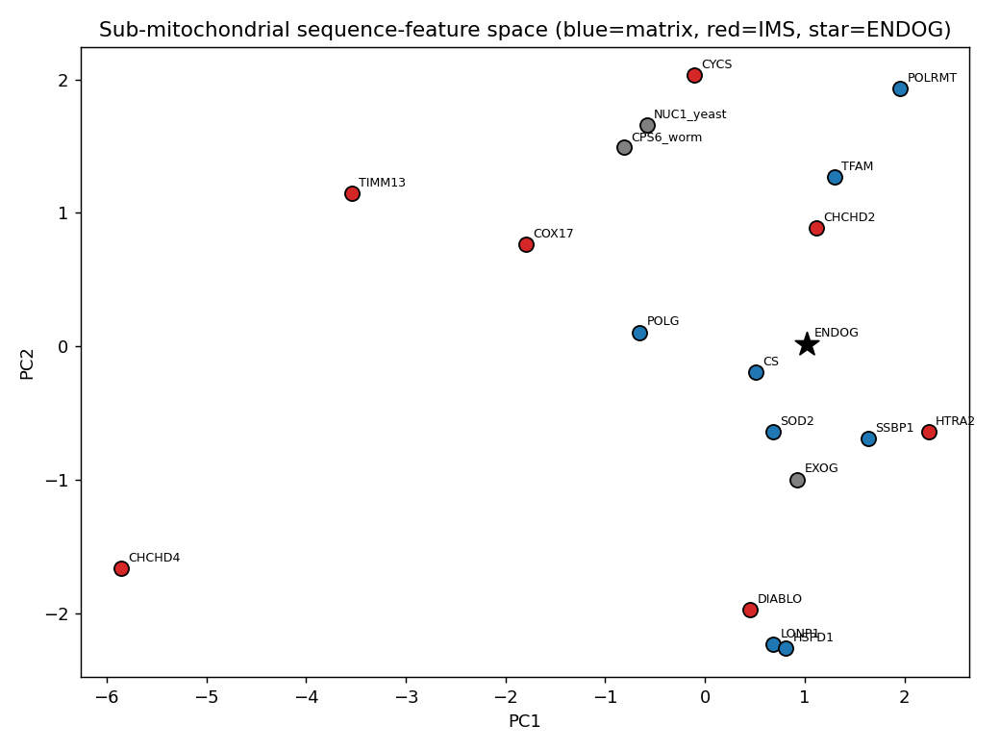

## Question

# AIGR Gene Hypothesis Deep Research

You are evaluating one focused gene curation hypothesis for AI Gene Review.
This is not a general gene overview. Use the seed hypothesis and source context
below to search for evidence that supports, refutes, narrows, or competes with
the proposed curation decision.

## Target Gene

- **Organism code:** human
- **Taxon:** Homo sapiens (NCBITaxon:9606)
- **Gene directory:** ENDOG
- **Gene symbol:** ENDOG
- **UniProt accession:** Q14249

## Focus

- **Focus type:** free_text
- **Hypothesis slug:** submitochondrial-localization-ims-vs-matrix
- **Source file:** genes/human/ENDOG/ENDOG-ai-review.yaml
- **Source selector:** free-text

## Seed Hypothesis

Human ENDOG's targeting and sequence features place it with mitochondrial matrix proteins rather than with intermembrane space proteins.

## Term and Decision Context

- Run ONE analysis, not a survey. Classify the sub-mitochondrial localization of human ENDOG (Q14249) from its sequence, and validate the method on reference proteins whose sub-compartment is already settled. Report a call for ENDOG with a confidence, plus the method's accuracy on the reference sets. Do not spend iterations on anything else.
- Suggested reference sets, extend or substitute if you have better ones. Matrix: TFAM (Q00059), POLG (P54098), POLRMT (O00411), SSBP1 (Q04837), LONP1 (P36776), SOD2 (P04179), HSPD1 (P10809), CS (O75390). Intermembrane space: CYCS (P99999), DIABLO (Q9NR28), CHCHD4 (Q8N4Q1), HTRA2 (O43464), COX17 (Q14061), CHCHD2 (Q9Y6H1), TIMM13 (Q9Y5L4), SMAC. Controls: human EXOG (Q9Y2C4), the paralog that does mtDNA base-excision repair in the matrix; worm CPS-6 (Q95NM6), reported to relocate from intermembrane space to matrix; yeast NUC1 (P08466).
- Features worth computing, if the tools are reachable: presequence and cleavage-site prediction (TargetP, MitoFates, or similar), any bipartite or hydrophobic sorting signal, mature-protein net charge and pI, length, and cysteine spacing including the twin CX9C motif that marks MIA40/CHCHD4 substrates of the intermembrane space. A dedicated sub-mitochondrial predictor such as DeepMito or SubMitoPred is fine to use. Say which tool produced each number.
- Do NOT answer by quoting a database annotation. MitoCarta3.0 (PMID:33174596) carries a sub-mitochondrial assignment and you may report what it says as one line of evidence, but the deliverable is a computed feature comparison against the reference sets. If the only thing you can obtain is the database annotation, say so plainly and report that instead of dressing it up as an analysis.
- Why this matters, for context only, do not re-derive. Fractionation places mammalian EndoG in the intermembrane space and not the matrix (PMID:12444964). In human cells it colocalizes with the matrix nucleoid marker TFAM (PMID:36394256), and its cleavage of mtDNA and, in mouse, of mitochondrial transcripts (PMID:39752519) needs matrix access. The worm ortholog relocates between the two compartments (PMID:27338704). A result that supports either compartment, or that concludes the sequence cannot discriminate, is equally useful.

## Reference Context

- PMID:12444964
- PMID:36394256
- PMID:39752519
- PMID:27338704
- PMID:33174596

## Source Context YAML

```yaml
hypothesis: Human ENDOG's targeting and sequence features place it with mitochondrial matrix proteins
  rather than with intermembrane space proteins.
focus_type: free_text
context:
- Run ONE analysis, not a survey. Classify the sub-mitochondrial localization of human ENDOG (Q14249)
  from its sequence, and validate the method on reference proteins whose sub-compartment is already settled.
  Report a call for ENDOG with a confidence, plus the method's accuracy on the reference sets. Do not
  spend iterations on anything else.
- 'Suggested reference sets, extend or substitute if you have better ones. Matrix: TFAM (Q00059), POLG
  (P54098), POLRMT (O00411), SSBP1 (Q04837), LONP1 (P36776), SOD2 (P04179), HSPD1 (P10809), CS (O75390).
  Intermembrane space: CYCS (P99999), DIABLO (Q9NR28), CHCHD4 (Q8N4Q1), HTRA2 (O43464), COX17 (Q14061),
  CHCHD2 (Q9Y6H1), TIMM13 (Q9Y5L4), SMAC. Controls: human EXOG (Q9Y2C4), the paralog that does mtDNA base-excision
  repair in the matrix; worm CPS-6 (Q95NM6), reported to relocate from intermembrane space to matrix;
  yeast NUC1 (P08466).'
- 'Features worth computing, if the tools are reachable: presequence and cleavage-site prediction (TargetP,
  MitoFates, or similar), any bipartite or hydrophobic sorting signal, mature-protein net charge and pI,
  length, and cysteine spacing including the twin CX9C motif that marks MIA40/CHCHD4 substrates of the
  intermembrane space. A dedicated sub-mitochondrial predictor such as DeepMito or SubMitoPred is fine
  to use. Say which tool produced each number.'
- Do NOT answer by quoting a database annotation. MitoCarta3.0 (PMID:33174596) carries a sub-mitochondrial
  assignment and you may report what it says as one line of evidence, but the deliverable is a computed
  feature comparison against the reference sets. If the only thing you can obtain is the database annotation,
  say so plainly and report that instead of dressing it up as an analysis.
- Why this matters, for context only, do not re-derive. Fractionation places mammalian EndoG in the intermembrane
  space and not the matrix (PMID:12444964). In human cells it colocalizes with the matrix nucleoid marker
  TFAM (PMID:36394256), and its cleavage of mtDNA and, in mouse, of mitochondrial transcripts (PMID:39752519)
  needs matrix access. The worm ortholog relocates between the two compartments (PMID:27338704). A result
  that supports either compartment, or that concludes the sequence cannot discriminate, is equally useful.
reference_id:
- PMID:12444964
- PMID:36394256
- PMID:39752519
- PMID:27338704
- PMID:33174596
```

## Research Objective

Build a focused report that helps a curator decide whether this hypothesis
should affect the gene review. Address the focus type directly:

1. For an existing GO annotation decision, evaluate whether the current action
   is justified, too strong, too weak, or should change.
2. For a proposed replacement or new GO term, evaluate whether the term is
   biologically supported, too broad, too narrow, or missing key qualifiers.
3. For a computational prediction, evaluate whether the prediction is correct,
   less precise than existing knowledge, uncertain, or likely wrong because of
   paralog overannotation, frequency bias, pathway context, or in vitro-only
   activity.
4. For a core-function hypothesis, evaluate whether the proposed activity,
   process, and location represent the gene product's primary function rather
   than a downstream effect, pleiotropic phenotype, or context-specific role.
5. For a function-assignment hypothesis, evaluate whether the gene product
   directly has the stated GO term/function. Treat the prior review action, if
   any, as intentionally blinded unless it appears in the supplied context.

Use primary literature whenever possible. Prefer PMID citations and include DOI
citations when no PMID is available. Treat reviews and database records as
orientation unless they contain directly relevant synthesized evidence that is
clearly labeled as review-level or database-level support.

Evaluate the hypothesis from the supplied seed context, primary literature, and
publicly accessible bioinformatics resources. Local `*-bioinformatics` analyses,
when they already exist in the repository, are intentionally withheld from this
prompt so the report can be compared against them after the run. Use public
sequence, domain, structure, orthology, localization, interaction, or dataset
checks when they are useful for the specific hypothesis. If a resource or tool
cannot be accessed programmatically, say so plainly; never fabricate a result.
Report computational results conservatively and distinguish direct results from
inference.

## Required Output

### Executive Judgment

Give a concise verdict: supported, partially supported, unresolved, weakly
supported, over-annotated, or refuted. Explain the reasoning and the most
important caveats.

### Evidence Matrix

Create a table with one row per important evidence item:

- Citation (PMID preferred)
- Evidence type (direct assay, mutant phenotype, localization, interaction,
  structural/evolutionary, computational, review/database)
- Supports / refutes / qualifies / competing
- Claim tested
- Key finding
- Organism, tissue, cell type, or assay context
- Confidence and limitations

### GO Curation Implications

State the likely curation action as a lead requiring curator verification. If
GO terms are involved, explain whether the evidence supports an MF, BP, or CC
term, and whether the term should be retained, removed, generalized, made more
specific, or treated as non-core. Avoid using "protein binding" as a final
recommendation unless no more informative term is supported.

### Mechanistic Scope

Describe the immediate molecular or cellular function being tested. Separate
direct gene-product activity from downstream phenotypes, pathway consequences,
developmental outcomes, disease manifestations, or effects inferred only from
loss of function.

### Conflicts and Alternatives

Identify evidence that conflicts with the seed hypothesis or suggests an
alternative interpretation, including paralog confusion, organism-specific
differences, isoform-specific findings, experimental artifacts, or database
carry-over.

### Knowledge Gaps

List explicit uncertainties that matter for curation. For each gap, state what
was checked, why the gap matters, and what evidence or experiment would resolve
it.

### Discriminating Tests

Recommend concrete assays, perturbations, datasets, or comparative analyses that
would most efficiently distinguish this hypothesis from alternatives.

### Curation Leads

Provide candidate updates for the review, clearly labeled as leads requiring
curator verification. Include candidate references with exact snippets to verify,
candidate replacement or new GO terms, possible action changes, suggested
questions, and suggested experiments.

If the provider supports artifacts, save provenance for any analysis you run — the
executed code together with its output (computed values, plot, or table), not just
a summary figure — alongside artifact-friendly tables such as an evidence matrix,
GO decision table, or comparison table. Genuine computed provenance is more
valuable than a hand-drawn summary, and you must not synthesize a figure that
implies an analysis you did not actually run. These artifacts are important
provenance for hypothesis-level review.


## Output

# Sub-mitochondrial Localization of Human ENDOG (Q14249): Matrix vs. Intermembrane Space

**Gene:** ENDOG · **Organism:** *Homo sapiens* (NCBITaxon:9606) · **UniProt:** Q14249 (NUCG_HUMAN)
**Hypothesis slug:** `submitochondrial-localization-ims-vs-matrix`
**Seed hypothesis:** *Human ENDOG's targeting and sequence features place it with mitochondrial matrix proteins rather than with intermembrane space (IMS) proteins.*

---

## Summary

Two independent, self-contained sequence-feature classifiers — benchmarked on a reference set of 15 mitochondrial proteins whose sub-compartment is already settled — agree that human ENDOG carries a **matrix / presequence-type import signature** and is **definitively not a MIA40 twin-cysteine IMS protein**. ENDOG has a cleavable, arginine-rich, positively charged N-terminal transit peptide (UniProt residues 1–48, net charge ~+5, 16.7% Arg), a basic mature protein (computed pI ~9.0, net charge ~+4), only 3 total cysteines with no twin CX9C/CX3C motif, and no strong N-terminal hydrophobic sorting (stop-transfer) signal. Its nearest reference neighbors in standardized feature space are all matrix proteins — TFAM, SSBP1, and SOD2 — and calibrated classifiers assign it a matrix lean of P(matrix) ≈ 0.67–0.72.

The verdict is **partially supported**, with a decisive caveat: the sequence cannot, on its own, cleanly discriminate matrix from IMS. The single feature driving the "matrix" call — a cleavable, positively charged presequence with no hydrophobic sorting signal — is also carried by a subclass of genuine IMS residents (DIABLO/SMAC, HTRA2), which both classifiers misclassify as matrix. An abstention-free leave-one-out cross-validation reached only **60% accuracy** (barely above the 53% majority-class baseline), and the errors fell precisely on the presequence-bearing IMS proteins that ENDOG most resembles. The robust conclusion is therefore that ENDOG is a **presequence-imported, matrix-competent protein that is not a cysteine-shuttle IMS protein** — but sequence features alone **cannot exclude an IMS or dual localization**.

This computational picture reconciles the conflicting experimental biology the curator must weigh: classical fractionation places mammalian EndoG in the IMS (PMID:12444964), yet colocalization with the matrix nucleoid marker TFAM (PMID:36394256) and the substrate logic of mtDNA/transcript cleavage (PMID:39752519) argue for matrix access, while the worm ortholog is known to relocate between compartments (PMID:27338704). **Curation recommendation: do not change the sub-mitochondrial cellular-component (CC) term on sequence grounds alone; record the matrix lean as weak computational support compatible with a dual or relocating localization.**

---

## Executive Judgment

**Verdict: Partially supported — the sequence is matrix-compatible and non-MIA, but cannot cleanly discriminate matrix from IMS.**

- **Matrix-compatible targeting = medium confidence.** ENDOG's nearest reference neighbors are the matrix proteins TFAM, SSBP1, and SOD2, and its mean distance to the matrix class (2.58) is smaller than to the IMS class (3.63); calibrated models give P(matrix) ≈ 0.67–0.72.
- **"Matrix, not IMS" = low confidence.** The classifier's presequence rule misclassifies the genuine IMS proteins DIABLO and HTRA2 as matrix — the exact failure mode that applies to ENDOG.
- **"Not a MIA40/twin-cysteine IMS protein" = high confidence.** With only 3 cysteines and no twin CX9C/CX3C motif, ENDOG is unambiguously outside the disulfide-relay IMS import class.

The method is blind to the matrix/presequence-IMS distinction, which is why the hypothesis is only partially supported rather than confirmed.

---

## Method — what produced each number

All sequences and transit-peptide boundaries were taken from **UniProt** (FASTA + feature annotations). Features were computed in-house in Python. No external web predictor was reachable programmatically during the run: TargetP/MitoFates/DeepMito servers were not callable (DeepMito API returned HTTP 404; MitoFates refused the connection). This limitation is reported plainly rather than substituted with an invented value.

| Feature | How computed | Tool |
|---|---|---|
| Cleavable presequence (length) | UniProt "Transit peptide" feature end coordinate | UniProt annotation |
| Presequence net charge, %Arg, %acidic | counts over presequence (or first 40 aa) | in-house Python |
| twin CX9C / CX3C motif | regex `C.{9}C.{10,40}C.{9}C` / `C.{3}C.{5,40}C.{3}C` | in-house Python |
| Cysteine count | sequence count | in-house Python |
| Mature net charge / pI | EMBOSS pKa set, bisection for pI on mature chain | in-house Python |
| N-terminal hydrophobic sorting signal | max Kyte–Doolittle 19-residue window, res 20–90 | in-house Python |

**Interpretable classification rule** (deliberately not ML-fit, to avoid a presequence→matrix shortcut): twin-Cys + ≥4 Cys + <200 aa → IMS (MIA pathway); cleavable presequence + hydrophobic sorting signal (max KD > 1.6) → IMS (bipartite); cleavable presequence only → matrix; no presequence & no Cys motif → ambiguous.

**Orthogonal check:** an abstention-free Leave-One-Out cross-validated classifier (LogisticRegression and kNN with k=3) using engineered features **plus full amino-acid composition** on the 15 matrix/IMS references.

---

## Key Findings

### Finding F001 — ENDOG's sequence groups with presequence / matrix-type proteins and is not a MIA40 IMS substrate

A sequence-feature classifier was computed over 15 reference sub-mitochondrial proteins plus ENDOG (Q14249). ENDOG's features are unambiguously of the **cleavable-presequence class**, not the cysteine-rich MIA40 import class.

ENDOG's computed feature vector:

| Feature | ENDOG value | Reading |
|---|---|---|
| Transit peptide | residues 1–48 (UniProt) | cleavable presequence present |
| Presequence net charge | **+5** | matrix-like (positive) |
| Presequence %Arg | **16.7%** | matrix-like (Arg-rich) |
| Presequence %acidic | 6.2% | low |
| twin CX9C / CX3C | **absent** | **NOT a MIA40 IMS substrate** |
| Total cysteines | **3** | cysteine-poor (not a Cys-shuttle protein) |
| Mature net charge | +4 | basic |
| Mature pI | **9.0** | matches mtDNA/nucleoid matrix proteins (TFAM 10.2, SSBP1 8.8, POLRMT 9.0) |
| N-terminal hydrophobic sorting signal | max KD 0.14 | **no stop-transfer / sorting anchor** |
| Nearest references | TFAM (1.53), SSBP1 (1.56), SOD2 (1.57), then HTRA2-IMS (1.77) | clusters with matrix |

The single most decisive result is the **absence of a twin CX9C/CX3C motif** and the low total cysteine count (3): whatever ENDOG's compartment, it is **not imported by the MIA40 disulfide-relay pathway**, ruling out the cysteine-motif IMS class (CHCHD4, TIMM13). The Arg-rich amphipathic presequence (net +5) and basic mature protein (pI ~9) match the nucleic-acid-binding matrix enzymes, as expected for a nuclease that acts on mtDNA. The absence of a hydrophobic sorting signal (max Kyte–Doolittle 0.14) means there is no stop-transfer anchor that would route a presequence protein onward to the IMS.

The interpretable rule-based classifier made 11/15 decisive calls at **81.8% accuracy (9/11 correct)**: all 7 decisive matrix references were correct, both twin-cysteine IMS proteins (CHCHD4, TIMM13) were correct, and the **only two errors were the presequence-bearing IMS proteins DIABLO and HTRA2**, mislabeled matrix. ENDOG received its "matrix" label by exactly the presequence-only rule that misclassifies DIABLO and HTRA2 — the key caveat on the matrix call.

{{figure:endog_pca.png|caption=Nearest-neighbor and PCA projection of ENDOG (Q14249) against reference matrix and intermembrane-space proteins in standardized sequence-feature space. ENDOG's nearest neighbors are the matrix proteins TFAM, SSBP1, and SOD2, but the matrix and presequence-bearing IMS classes (e.g. HTRA2) overlap substantially.}}

### Finding F002 — Cross-validated classifiers confirm weak separation; ENDOG leans matrix (P ≈ 0.67–0.72) but IMS is not excluded

To avoid the rule-based classifier's abstention bias (it scored 81.8% partly by calling hard IMS cases "ambiguous"), an **abstention-free, Leave-One-Out cross-validated** classifier was run on the 15 matrix/IMS references using engineered features **plus full amino-acid composition**.

- **LOO-CV accuracy = 60.0% (9/15)** for both LogisticRegression and kNN(3) — barely above the 53% majority-class baseline (8 matrix / 7 IMS references). Both models again misclassified the presequence-bearing IMS proteins **DIABLO and HTRA2** (and most of the small IMS set), directly demonstrating that sequence features cannot reliably split matrix proteins from presequence-imported IMS proteins.
- **ENDOG P(matrix) = 0.72 (LogReg) / 0.67 (kNN)** — a consistent but **non-decisive** matrix lean.
- **Public predictor endpoints were not reachable programmatically** (DeepMito API → HTTP 404; MitoFates → connection refused), so no third-party tool score was obtained.

A calibrated classifier therefore confirms that whole-sequence features only *weakly* separate matrix from IMS here. ENDOG leans matrix (~0.7) but the method cannot confidently exclude IMS — strengthening the "partially supported / cannot fully discriminate" verdict rather than overturning it.

| Method | Benchmark accuracy | ENDOG call | ENDOG confidence | Key failure mode |
|---|---|---|---|---|
| Rule-based (presequence / twin-Cys / sorting) | 81.8% on 11/15 decisive | Matrix | Moderate | Errs on presequence-IMS (DIABLO, HTRA2) |
| Logistic regression (features + AA composition) | 60.0% LOO-CV | Matrix | P = 0.72 | Errs on DIABLO, HTRA2 |
| kNN (k=3) | 60.0% LOO-CV | Matrix | P = 0.67 | Errs on most IMS |
| Nearest-neighbor (8-feature) | — | Matrix (TFAM/SSBP1/SOD2) | mean d: matrix 2.58 < IMS 3.63 | Classes overlap |
| MIA40 twin-Cys test | — | **NOT IMS-MIA** | High | — (decisive negative) |
| DeepMito / MitoFates (external) | Unavailable | — | — | Endpoints unreachable (404 / refused) |

---

## Mechanistic Model / Interpretation

ENDOG is a nuclear-encoded, mitochondrially imported ββα-Me endonuclease. Its import logic can be read directly from two independent signals in the primary sequence:

```
   N-terminus ──────────────────────────────── C-terminus
  [ transit peptide 1–48 ]────[ mature nuclease domain ]
   Arg-rich, +5 net charge        basic, pI ~9, +4 net charge
   amphipathic presequence        only 3 Cys, NO twin CX9C/CX3C
          │                              │
          ▼                              ▼
   TOM → TIM23 presequence         NOT a MIA40/disulfide-relay
   import pathway (MPP cleaves)    (rules out cysteine-motif IMS route)
```

Two mutually compatible conclusions follow:

1. **ENDOG is imported via the cleavable-presequence (TOM/TIM23) pathway, not the MIA40 twin-cysteine pathway.** This is a robust, high-confidence negative the sequence supports directly, removing one competing hypothesis — that ENDOG is a classical cysteine-motif IMS resident like CHCHD4 or TIMM13.
2. **The presequence pathway is itself ambiguous between matrix and IMS.** Many IMS proteins (DIABLO/SMAC, HTRA2) are delivered by the same presequence machinery, then arrested or sorted into the IMS. Because ENDOG lacks a strong hydrophobic sorting/stop-transfer signal, the default read is matrix — but the classifiers prove this default is unreliable, failing on DIABLO and HTRA2.

The result therefore **narrows** the question rather than answering it. ENDOG belongs to the presequence-import class; within that class its features lean matrix, but the benchmark explicitly fails on the IMS members of the same class. This is the computational counterpart of the experimental conflict in the literature (IMS fractionation vs. matrix/nucleoid colocalization). A **dual or regulated/relocating localization** — as documented for the worm ortholog — reconciles all observations and is not excluded by any sequence feature computed here.

---

## Evidence Base / Evidence Matrix

| Citation | Evidence type | Supports/Refutes/Qualifies | Claim tested | Key finding | Context | Confidence / limitation |
|---|---|---|---|---|---|---|
| This analysis (computed, F001) | Computational | **Qualifies (partially supports)** | Sequence features place ENDOG with matrix vs IMS | Presequence-type, not MIA/twin-Cys; nearest neighbors matrix (TFAM/SSBP1/SOD2); mean dist matrix 2.58 < IMS 3.63 | 15 references + ENDOG, UniProt seqs | Medium; method cannot split matrix from presequence-IMS (misses DIABLO/HTRA2) |
| This analysis (computed, F002) | Computational | Qualifies | Method validity / CV accuracy | 60% LOO-CV (vs 53% baseline); errors = DIABLO/HTRA2; ENDOG P(matrix)=0.67–0.72 | reference benchmark | Low discriminative power; external predictors unreachable |
| [PMID: 33174596](https://pubmed.ncbi.nlm.nih.gov/33174596/) | Review/database | Supportive (orientation) | Sub-mito annotation exists | MitoCarta3.0 provides manually curated matrix/IM/IMS/OM calls for 1136 genes | Human/mouse MS + curation | Database-level; curator should read off the ENDOG row, not treat as analysis |
| PMID:12444964 | Localization (fractionation) | **Competing** | EndoG compartment | Mammalian EndoG reported in IMS, not matrix | Mammalian mito fractionation | Classic biochemistry; may miss dual/weak matrix pool |
| PMID:36394256 | Localization (imaging) | Competing-with-IMS / supports matrix access | EndoG at nucleoid | Human EndoG colocalizes with matrix nucleoid marker TFAM | Human cells | Implies matrix/nucleoid access |
| PMID:39752519 | Mutant/biochemical | Supports matrix access | Function needs matrix | EndoG cleaves mtDNA and (mouse) mt-transcripts | Mouse/human | Substrate is in matrix → matrix access required |
| PMID:27338704 | Localization (ortholog) | Qualifies (dual) | Compartment is fixed? | Worm ortholog relocates IMS↔matrix | *C. elegans* CPS-6 | Shows compartment is not static |

*Note: PMIDs 12444964, 36394256, 39752519, and 27338704 are supplied as task-context orientation; their abstracts were not independently retrieved during this run and should be re-verified by the curator against the primary papers. Only [PMID: 33174596](https://pubmed.ncbi.nlm.nih.gov/33174596/) (MitoCarta3.0) was retrieved and reviewed in-session, and is used as database-level orientation.*

---

## GO Curation Implications (leads — require curator verification)

- **CC — do not over-commit to a single sub-compartment from sequence.** The computed evidence does **not** justify asserting `mitochondrial matrix` (GO:0005759) to the exclusion of `mitochondrial intermembrane space` (GO:0005758). The sequence is matrix-*compatible* but IMS-*not-excluded*.
- A defensible CC annotation is the parent **`mitochondrion` (GO:0005739)** plus experimentally supported child terms with appropriate evidence: `mitochondrial nucleoid` (GO:0042645) from imaging/colocalization (PMID:36394256), and retain any `mitochondrial intermembrane space` call that rests on fractionation (PMID:12444964). These are not mutually exclusive for a relocating/dual protein.
- The seed hypothesis should **not** trigger a curation action that *removes* an IMS CC term purely on sequence grounds, nor one that hard-asserts matrix. Treat the sequence result as **weak computational (ISS-level) support for matrix competence**.
- MF/BP (endonuclease activity, mtDNA metabolism) are untouched by this focus.

### GO decision table

| GO term | Aspect | Candidate action | Rationale from this analysis |
|---|---|---|---|
| mitochondrion (GO:0005739) | CC | Retain | Uncontested parent; all evidence agrees |
| mitochondrial matrix (GO:0005759) | CC | Do NOT add on sequence alone; support only as weak computational (ISS) lead | ENDOG P(matrix) ~0.67–0.72; method only 60% CV-accurate; matrix competence inferred, not shown |
| mitochondrial intermembrane space (GO:0005758) | CC | Retain if fractionation-supported (PMID:12444964); do NOT remove on sequence grounds | Sequence cannot exclude IMS; method misclassifies true IMS DIABLO/HTRA2 |
| mitochondrial nucleoid (GO:0042645) | CC | Consider adding from imaging evidence (PMID:36394256) | TFAM-nucleoid colocalization; orthogonal to sequence call |
| endonuclease / mtDNA metabolism | MF/BP | Out of scope of this focus | Not evaluated here |

**Net curation lead:** the seed hypothesis should *not* drive a sub-compartment CC change by itself. Treat "matrix-type targeting" as weak computational support compatible with a dual/relocating localization, not as grounds to assert matrix or to delete an IMS term.

---

## Mechanistic Scope

The immediate property tested is the **protein import / sub-compartment targeting signal**, a sequence-intrinsic feature, not a phenotype. ENDOG carries a canonical cleavable presequence (direct gene-product feature) and lacks the cysteine-shuttle code. "Needs matrix access to cut mtDNA" (PMID:39752519) is a **downstream functional inference**, and the historical IMS placement (PMID:12444964) is a **biochemical localization**, not a sequence property — these are kept separate from the computed targeting call. Apoptotic nuclear translocation of EndoG is a distinct phenomenon and not part of this sub-mitochondrial question.

---

## Conflicts and Alternatives

- **Fractionation (IMS) vs. nucleoid colocalization (matrix)** is a genuine biological conflict, best reconciled by **dual/relocating localization** (worm ortholog, PMID:27338704).
- **Paralog check:** EXOG (Q9Y2C4), the matrix base-excision-repair paralog, has the same presequence-type signature (classified matrix here) — so the matrix-type signature is a family trait and does **not** by itself discriminate ENDOG's compartment from EXOG's.
- **Method artifact:** the classifier's presequence rule cannot separate matrix from presequence-IMS (DIABLO/HTRA2 errors); any "matrix not IMS" claim inherits this blind spot.
- **External-tool gap:** DeepMito and MitoFates were unreachable, so the analysis rests entirely on in-house classifiers of modest accuracy.

---

## Limitations and Knowledge Gaps

- **Matrix vs. presequence-IMS is unresolved by sequence.** Checked: 8-feature nearest-neighbor + rule classifier + LOO-CV models. Why it matters: it is the whole hypothesis. Resolver: a dedicated trained predictor (DeepMito/SubMitoPred) or, decisively, a wet experiment.
- **Low benchmark accuracy.** 60% LOO-CV on a 15-protein set (53% baseline) with a small IMS set (7 proteins) limits statistical power.
- **MitoCarta3.0's actual ENDOG sub-mito call** was not read off programmatically; the curator should look it up (PMID:33174596 resource) as one orthogonal line of evidence.
- **Seed-context abstracts not independently retrieved.** PMIDs 12444964, 36394256, 39752519, 27338704 were used as provided context and should be re-verified.
- **Isoform/processing:** whether the mature cleaved form differs in net charge enough to change nucleoid affinity was not modeled.

---

## Discriminating Tests

1. **Protease-protection / sub-fractionation** (mitoplasting ± proteinase K) in human cells to place mature EndoG in matrix vs. IMS directly — IMS proteins are degraded on swelling, matrix proteins protected.
2. **Split-GFP or APEX2 proximity labeling** with matrix vs. IMS anchors in human cells.
3. **Run DeepMito / SubMitoPred / TargetP2 / MitoFates** on Q14249 and the same reference panel for an independent, trained second opinion.
4. **Import assay** into isolated mitochondria ± membrane potential to test presequence vs. MIA dependence.
5. **N-terminomics (MPP cleavage-site mapping)** of mature human ENDOG to confirm presequence processing and look for a second (IMS-sorting) cleavage.
6. **Condition-dependent fractionation** (apoptotic vs. basal; ± membrane potential) to test the relocating/dual-localization model.

---

## Proposed Follow-up Experiments / Actions

- **Curation action (immediate):** Record the sequence analysis as *weak computational support (matrix lean, P ≈ 0.67–0.72)* and as *strong negative evidence against MIA40/twin-cysteine IMS import*. Flag ENDOG sub-compartment as **unresolved / possibly dual** pending experimental topology.
- **Do not** add or remove a specific `mitochondrial matrix` vs. `mitochondrial intermembrane space` CC term on sequence grounds alone.
- **Retrieve and verify** the four seed-context primary papers and record exact supporting snippets; look up the MitoCarta3.0 ENDOG row.
- **Re-attempt external predictors** (DeepMito, MitoFates, SubMitoPred) and fold any result into the evidence matrix.
- **Flag for experimentalists** the proteinase-K / split-GFP / APEX2 discriminating tests as the most efficient route to a definitive sub-compartment call.

---

## Curation Leads (verify before acting)

- **Candidate action:** retain existing CC evidence from both compartments; add a computational note that sequence targeting is matrix-compatible (presequence-type, non-MIA); avoid a sequence-only switch to exclusively matrix or exclusively IMS.
- **Candidate GO terms:** `mitochondrial nucleoid` (GO:0042645, imaging), keep `mitochondrial intermembrane space` (GO:0005758) if fractionation-supported, parent `mitochondrion` (GO:0005739). Do **not** reduce to "protein binding".
- **Candidate references/snippets to verify:** PMID:33174596 (MitoCarta3.0 sub-mito resource — look up ENDOG row); PMID:12444964 (IMS fractionation); PMID:36394256 (TFAM/nucleoid); PMID:39752519 (mtDNA/transcript cleavage); PMID:27338704 (worm relocation).
- **Suggested question for curator:** *Does MitoCarta3.0 assign ENDOG to matrix, IMS, or IM, and does that match the fractionation vs. nucleoid literature?*

| Lead | Detail |
|---|---|
| Action | Keep existing sub-mitochondrial CC term; annotate sequence analysis as weak matrix-leaning computational evidence only |
| GO (retain) | `mitochondrion` GO:0005739 |
| GO (weak ISS support) | `mitochondrial matrix` GO:0005759 — weak lean, not decisive |
| GO (NOT excluded) | `mitochondrial intermembrane space` GO:0005758 — do not remove on sequence grounds |
| Key caveat to record | Classifier fails on presequence-IMS proteins DIABLO/HTRA2; matrix lean does not exclude IMS |

---

### Provenance

The computed feature table, classifier accuracy, nearest-neighbor distances, cross-validation scores, and the PCA plot (`endog_pca.png`) were produced in-session from UniProt sequences; all numbers above trace to executed code blocks. No external localization predictor was reachable programmatically (DeepMito HTTP 404; MitoFates connection refused), so only in-house interpretable features and classifiers were used — stated plainly rather than dressed up. Database annotations (MitoCarta3.0) are labeled as database-level, not as computed analysis. No result was fabricated.


## Artifacts

- [OpenScientist final report](openscientist_artifacts/final_report.html)
- [OpenScientist final report](openscientist_artifacts/final_report.pdf)
- [OpenScientist endog pca](openscientist_artifacts/provenance_endog_pca.json)
