## Question

# AIGR Gene Hypothesis Deep Research

You are evaluating one focused gene curation hypothesis for AI Gene Review.
This is not a general gene overview. Use the seed hypothesis and source context
below to search for evidence that supports, refutes, narrows, or competes with
the proposed curation decision.

## Target Gene

- **Organism code:** human
- **Taxon:** Homo sapiens (NCBITaxon:9606)
- **Gene directory:** ERVMER34-1
- **Gene symbol:** ERVMER34-1
- **UniProt accession:** Q9H9K5

## Focus

- **Focus type:** free_text
- **Hypothesis slug:** kgap-hemo-shedding-protease
- **Source file:** genes/human/ERVMER34-1/ERVMER34-1-ai-review.yaml
- **Source selector:** free-text

## Seed Hypothesis

Which protease family is predicted to shed the human ERVMER34-1/HEMO ectodomain at the mapped Q432/R433 site may be inferable from sequence context. Single analysis only: from the Q9H9K5 sequence, map the signal peptide, the transmembrane segment, the ectodomain and cytoplasmic tail boundaries, and state how far the mapped Q432/R433 cleavage site lies from the predicted membrane and whether that distance matches the juxtamembrane stalk geometry typical of ADAM10 and ADAM17 substrates; compare the local sequence around Q432/R433 with the known cleavage-site preferences of ADAM10, ADAM17 and the membrane-type MMPs, noting that these enzymes have weak primary-sequence specificity, and state explicitly whether a family can be discriminated on sequence or not; check the site and the stalk for conservation across primate ERVMER34-1 orthologs and for the retroviral envelope SU/TM furin consensus, which this site is not; and report whether any public proteomics or degradomics dataset already contains a peptide ending at Q432. State whether the responsible protease family can be predicted, and if not, say so plainly and name what would discriminate it.

## Term and Decision Context

No specific term context supplied.

## Reference Context

No specific reference context supplied.

## Source Context YAML

```yaml
hypothesis: 'Which protease family is predicted to shed the human ERVMER34-1/HEMO ectodomain at the mapped
  Q432/R433 site may be inferable from sequence context. Single analysis only: from the Q9H9K5 sequence,
  map the signal peptide, the transmembrane segment, the ectodomain and cytoplasmic tail boundaries, and
  state how far the mapped Q432/R433 cleavage site lies from the predicted membrane and whether that distance
  matches the juxtamembrane stalk geometry typical of ADAM10 and ADAM17 substrates; compare the local
  sequence around Q432/R433 with the known cleavage-site preferences of ADAM10, ADAM17 and the membrane-type
  MMPs, noting that these enzymes have weak primary-sequence specificity, and state explicitly whether
  a family can be discriminated on sequence or not; check the site and the stalk for conservation across
  primate ERVMER34-1 orthologs and for the retroviral envelope SU/TM furin consensus, which this site
  is not; and report whether any public proteomics or degradomics dataset already contains a peptide ending
  at Q432. State whether the responsible protease family can be predicted, and if not, say so plainly
  and name what would discriminate it.'
focus_type: free_text
context: []
reference_id: []
```

## Research Objective

Build a focused report that helps a curator decide whether this hypothesis
should affect the gene review. Address the focus type directly:

1. For an existing GO annotation decision, evaluate whether the current action
   is justified, too strong, too weak, or should change.
2. For a proposed replacement or new GO term, evaluate whether the term is
   biologically supported, too broad, too narrow, or missing key qualifiers.
3. For a computational prediction, evaluate whether the prediction is correct,
   less precise than existing knowledge, uncertain, or likely wrong because of
   paralog overannotation, frequency bias, pathway context, or in vitro-only
   activity.
4. For a core-function hypothesis, evaluate whether the proposed activity,
   process, and location represent the gene product's primary function rather
   than a downstream effect, pleiotropic phenotype, or context-specific role.
5. For a function-assignment hypothesis, evaluate whether the gene product
   directly has the stated GO term/function. Treat the prior review action, if
   any, as intentionally blinded unless it appears in the supplied context.

Use primary literature whenever possible. Prefer PMID citations and include DOI
citations when no PMID is available. Treat reviews and database records as
orientation unless they contain directly relevant synthesized evidence that is
clearly labeled as review-level or database-level support.

Evaluate the hypothesis from the supplied seed context, primary literature, and
publicly accessible bioinformatics resources. Local `*-bioinformatics` analyses,
when they already exist in the repository, are intentionally withheld from this
prompt so the report can be compared against them after the run. Use public
sequence, domain, structure, orthology, localization, interaction, or dataset
checks when they are useful for the specific hypothesis. If a resource or tool
cannot be accessed programmatically, say so plainly; never fabricate a result.
Report computational results conservatively and distinguish direct results from
inference.

## Required Output

### Executive Judgment

Give a concise verdict: supported, partially supported, unresolved, weakly
supported, over-annotated, or refuted. Explain the reasoning and the most
important caveats.

### Evidence Matrix

Create a table with one row per important evidence item:

- Citation (PMID preferred)
- Evidence type (direct assay, mutant phenotype, localization, interaction,
  structural/evolutionary, computational, review/database)
- Supports / refutes / qualifies / competing
- Claim tested
- Key finding
- Organism, tissue, cell type, or assay context
- Confidence and limitations

### GO Curation Implications

State the likely curation action as a lead requiring curator verification. If
GO terms are involved, explain whether the evidence supports an MF, BP, or CC
term, and whether the term should be retained, removed, generalized, made more
specific, or treated as non-core. Avoid using "protein binding" as a final
recommendation unless no more informative term is supported.

### Mechanistic Scope

Describe the immediate molecular or cellular function being tested. Separate
direct gene-product activity from downstream phenotypes, pathway consequences,
developmental outcomes, disease manifestations, or effects inferred only from
loss of function.

### Conflicts and Alternatives

Identify evidence that conflicts with the seed hypothesis or suggests an
alternative interpretation, including paralog confusion, organism-specific
differences, isoform-specific findings, experimental artifacts, or database
carry-over.

### Knowledge Gaps

List explicit uncertainties that matter for curation. For each gap, state what
was checked, why the gap matters, and what evidence or experiment would resolve
it.

### Discriminating Tests

Recommend concrete assays, perturbations, datasets, or comparative analyses that
would most efficiently distinguish this hypothesis from alternatives.

### Curation Leads

Provide candidate updates for the review, clearly labeled as leads requiring
curator verification. Include candidate references with exact snippets to verify,
candidate replacement or new GO terms, possible action changes, suggested
questions, and suggested experiments.

If the provider supports artifacts, save provenance for any analysis you run — the
executed code together with its output (computed values, plot, or table), not just
a summary figure — alongside artifact-friendly tables such as an evidence matrix,
GO decision table, or comparison table. Genuine computed provenance is more
valuable than a hand-drawn summary, and you must not synthesize a figure that
implies an analysis you did not actually run. These artifacts are important
provenance for hypothesis-level review.


## Output

# ERVMER34-1 / HEMO (Q9H9K5): can the sheddase family at Q432/R433 be predicted from sequence?

Hypothesis slug: `kgap-hemo-shedding-protease`
Source: `genes/human/ERVMER34-1/ERVMER34-1-ai-review.yaml`, free-text focus
Organism: *Homo sapiens* (NCBITaxon:9606), UniProt Q9H9K5
Iterations: 3. Findings recorded: 8. Papers reviewed: 28.

## Summary

<i class="fa-solid fa-circle-xmark"></i> **Verdict: refuted as a prediction, and the negative result is well supported.** The protease family that sheds the HEMO ectodomain at Q432/R433 cannot be inferred from the Q9H9K5 sequence. The sequence does more than fail to discriminate: it positively disfavours two of the three families named in the seed hypothesis, ADAM10 and ADAM17, and the membrane-type MMPs with them. It does not disfavour metalloproteinases as a class, and the class-level attribution carried from [PMID: 28739914](https://pubmed.ncbi.nlm.nih.gov/28739914/) survives this analysis intact.

The topology is settled and the decisive number is a distance. The mapped scissile bond Q432/R433 sits **57 residues** N-terminal to the first transmembrane residue (Leu489). Every ADAM10 or ADAM17 cleavage site annotated in human UniProt lies between 11 and 26 residues out (IL6RA 11, PMEL 13, FCGR3A 14, GP1BA 26, NOTCH1 26; n = 5, mean 18.0 ± 7.4). HEMO is 2.2 times the maximum and z = 5.3. The 56 residues left behind on the cell after shedding are not a stalk: they are the gammaretroviral TM-subunit core, disulfide-clamped at the N-end by a CX6CC motif at 437-445 and heptad-patterned over 452-472, carrying 1 proline in 43 residues against 4.7% in the shed ectodomain. ADAM10 and ADAM17 position cleavage by measuring distance along an extended, conformationally free juxtamembrane segment. HEMO presents neither the distance nor the flexibility.

Sequence alone gives nothing positive for any family. The P4-P4' octamer is `PTTQ|RQTA`. Scored against published subsite preferences for seven families, it matches zero subsites in all seven at the major bond. The minor bond `TTQR|QTAC` matches only P1 = Arg, shared by type II transmembrane serine proteases and furin, which is one residue of agreement and discriminates nothing. There is no furin R-X-[KR]-R motif anywhere in the 563-residue chain. The invariance of Thr430-Thr431-Gln432-Arg433-Gln434 across 11 orthologs spanning roughly 100 My is explained by the adjacent CX6CC motif that defines the Env TM fold, so conservation here is not evidence that a protease recognition site is under selection. ProteomicsDB holds 17 unique peptides covering 35.2% of the protein and none ends at Gln432, but all 17 are fully tryptic, so that absence is a search-space artefact and carries no evidence either way. The one protease with demonstrated physical engagement of HEMO is **BACE2**, an aspartic protease, and its discoverers state in the full text of [PMID: 41329733](https://pubmed.ncbi.nlm.nih.gov/41329733/) that it is **not** the sheddase.

What discriminates is experiment, and three tests are named below in order of cost. The cheapest requires no new wet work: a semi-tryptic reanalysis of already-deposited raw files for the neo-C-terminal peptide `DHVLDIPTTQ` (423-432). The region is demonstrably MS-accessible, since the bond-spanning tryptic peptide `KDHVLDIPTTQR` (422-433) was detected in two independent projects.

## Key findings

### <i class="fa-solid fa-circle-xmark"></i> F1. The cleavage site lies 57 residues from the membrane, outside the ADAM10/ADAM17 window

Computed from UniProt Q9H9K5 (563 aa): signal peptide 1-26 (experimental, ECO:0000269 PubMed:28739914), extracellular 27-488, transmembrane helix 489-509, cytoplasmic tail 510-563 (54 aa). The secreted SHED chain is annotated 27-432, which places the scissile bond at Q432/R433. The distance from P1 (Gln432) to the first TM residue (Leu489) is 57 residues, and the membrane-retained stub keeps a 56-residue extracellular segment, `RQTACGTVGKQCCLYINYSEEIKSNIQRLHEASENLKNVPLLDWQGIFAKVGDWFR`.

The UniProt TM assignment is ECO:0000255 (sequence analysis), so I checked it independently. A Kyte-Doolittle scan with window 19 gives a single dominant hydrophobic peak centred at residue 502, mean KD 3.08, confirming 489-509 as the only membrane-spanning segment. The topology is therefore not in doubt.

Two of the reference distances come from primary site-mapping papers. [PMID: 24119228](https://pubmed.ncbi.nlm.nih.gov/24119228/) reports "a proteolytic event in which metalloprotease ADAM17 cleaves the Gly464-Val465 bond" in GPIb-alpha, and [PMID: 24337742](https://pubmed.ncbi.nlm.nih.gov/24337742/) reports that "MALDI-TOF analysis revealed that the peptide was cleaved between Ala(195) and Val(196)" in the CD16A stalk. A third primary source gives the shape of a genuine ADAM17 substrate from the other end: [PMID: 11785676](https://pubmed.ncbi.nlm.nih.gov/11785676/) locates murine L-selectin cleavage "in the membrane-proximal region (MPR) between R321 and S322, which is homologous to the human site", producing "a soluble ectodomain and a membrane-retained 6 kD fragment". A 6 kDa retained fragment is the signature of membrane-proximal shedding. HEMO's retained fragment is 131 residues (433-563, roughly 14.5 kDa), of which 56 are extracellular.

{{figure:plot_1.png|caption=HEMO topology and the distance measurement. Kyte-Doolittle hydropathy (window 19) confirms a single transmembrane segment at 489-509, and the mapped Q432/R433 bond sits 57 residues N-terminal to it, against the 8-24 residue window of the hand-curated ADAM substrate reference set used in iteration 1.}}

### <i class="fa-solid fa-circle-xmark"></i> F2. The P4-P4' octamer matches no subsite preference in any of seven protease families

The subsites at the mapped bond are P4 = Pro429, P3 = Thr430, P2 = Thr431, P1 = Gln432, then P1' = Arg433, P2' = Gln434, P3' = Thr435, P4' = Ala436.

| Family | Published preference tested | Subsites matched (major bond `PTTQ|RQTA`) | Subsites matched (minor bond `TTQR|QTAC`) |
|---|---|---|---|
| ADAM10 | P1' Leu or aromatic | 0/2 | 0/2 |
| ADAM17 | P1' Val > Leu; P3, P2 critical | 0/2 | 0/2 |
| MMP / MT-MMP | canonical `Pxx|Hy` (Pro at P3, hydrophobic at P1') | 0/2 | 0/2 |
| Meprin β | strong preference for acidic residues at the cleavage site | 0/2 | 0/2 |
| Furin | R-X-[KR]-R | 0/3 | 1/3 (P1 = Arg only; P4 = Thr and P2 = Gln both fail) |
| BACE1 / BACE2 | beta-site type: P1 hydrophobic, P1' small or acidic | 0/2 | 0/2 |
| TTSP (type II TM serine proteases) | P1 = Arg, P1' = Lys | 0/2 | 1/2 (P1 = Arg; P1' = Gln fails) |

Arg at P1' is specifically disfavoured by every family in the panel. The single positive anywhere in fourteen family-by-bond comparisons is P1 = Arg at the minor bond, which is shared by dozens of enzymes and names nothing.

The ADAM10/ADAM17 preferences come from PICS cleavage-site profiling. [PMID: 24635658](https://pubmed.ncbi.nlm.nih.gov/24635658/) states: "We show that the largest difference in the cleavage site specificities of ADAM10 and ADAM17 is at the P1' site: while both enzymes cleave N-terminal of leucine, only ADAM10 shows additional preference toward aromatic amino acids, whereas ADAM17 exhibits the highest preference for valine." HEMO's P1' is Arg, which matches neither branch. The subsites that actually govern ADAM17 efficiency in a native stalk were mapped in [PMID: 28143719](https://pubmed.ncbi.nlm.nih.gov/28143719/): "we showed that the non-prime sites P3 and P2 and the prime site P1' were critical for this increase in proteolysis". HEMO is discordant at exactly P3 (Thr), P2 (Thr) and P1' (Arg). The TTSP consensus comes from 2405 cleavage sites in [PMID: 25211023](https://pubmed.ncbi.nlm.nih.gov/25211023/), "revealing a strong specificity for arginine in the P1 position and surprisingly a lysine in P1' position"; HEMO's minor bond matches the first half and fails the second. Meprin β is excluded on specificity by [PMID: 34125978](https://pubmed.ncbi.nlm.nih.gov/34125978/): "Meprin β is a zinc-dependent metalloprotease exhibiting a unique cleavage specificity with strong preference for acidic amino acids at the cleavage site."

A regex scan of the full human chain found **zero** strict furin R-X-[KR]-R motifs. The only minimal R-X-X-R hits are at 510 (`RVFR`) and 513 (`RKSR`), both inside the cytoplasmic tail and therefore inaccessible to furin in the secretory pathway. This is confirmed independently in the literature: [PMID: 41329733](https://pubmed.ncbi.nlm.nih.gov/41329733/) states "HEMO is nonfusogenic, having lost both its furin cleavage site between the SU and TM subunits, and its fusion peptide."

{{figure:plot_4.png|caption=Subsite scoring of the HEMO Q432/R433 site against published ADAM10, ADAM17, MMP, furin and BACE preferences, with the stalk-geometry comparison alongside. No family scores a single subsite match at the major bond.}}

### <i class="fa-solid fa-circle-xmark"></i> F3. Conservation of the site reflects Env fold constraint, not selection on a protease motif

A Needleman-Wunsch alignment of human Q9H9K5 residues 415-515 against 10 orthologs (*Pan troglodytes* A0A2J8PEJ9, *Gorilla* A0A2I2YPB3, *Pongo* A0A6D2WYU5, *Nomascus* G1SA37, *Macaca* F7HQY4, *Theropithecus* A0A8D2G5H9, *Piliocolobus* A0A8C9I9R4, *Sapajus* A0A6J3HIX9, *Felis* A0ABI7VYX2, *Panthera* A0A9V1GMN7) shows Thr430, Thr431, Gln432, Arg433 and Gln434 identical in 11/11 species, including the two carnivore outgroups. Mean identity to human: P4-P4' block (429-436) 0.95, membrane-proximal segment 433-488 0.76, TM 489-509 0.90, whole 415-515 window 0.82.

The explanation is five residues away. A regex scan locates a canonical gammaretroviral **CX6CC** motif at 437-445 (C437-GTVGKQ-C444-C445), so the scissile bond sits immediately N-terminal to the first cysteine of the disulfide motif that defines the TM-subunit fold. Conservation at 430-434 is what fold constraint on a retroviral Env produces. Reading it as evidence for a dedicated protease recognition site would be an over-interpretation, and a curator should not treat ortholog conservation here as support for any named sheddase family.

[PMID: 28003343](https://pubmed.ncbi.nlm.nih.gov/28003343/) shows by contrast what genuine protease-substrate coevolution looks like: "This finding fits perfectly to the unique cleavage specificity of meprin β with a strong preference for aspartate residues and suggests coevolution of protease and substrate." The HEMO site is conserved and matches no enzyme's specificity, which is the opposite pattern. The background of purifying selection is established in [PMID: 28739914](https://pubmed.ncbi.nlm.nih.gov/28739914/): "with the identified retroviral envelope gene encoding a full-length protein in all simians under purifying selection and with similar shedding capacity."

<i class="fa-solid fa-circle-check"></i> An internal control validates the ortholog pipeline. The only natural `RTKR` found in any ortholog ectodomain is at position **352 in *Sapajus apella***, exactly the position of the UniProt mutagenesis feature "352-355 Introduction of a furin cleavage site" and exactly the R352C substitution reported as destroying the ancestral SU/TM furin site in the catarrhine lineage. A New World monkey retains it; the catarrhines, including humans, do not.

{{figure:plot_2.png|caption=Per-residue ortholog conservation across the cleavage site, the retained stub and the transmembrane helix for 10 ERVMER34-1 orthologs. The invariant TTQRQ block at 430-434 sits immediately N-terminal to the CX6CC motif at 437-445.}}

{{figure:plot_3.png|caption=AlphaFold DB model AF-Q9H9K5-F1 v6 per-residue pLDDT. Global pLDDT is 44.3 with 73% of residues very low, and residues 429-436 average 36.9, so the model cannot support any claim about local flexibility or surface exposure at the cleavage site. No such claim is made in this report.}}

### <i class="fa-solid fa-circle-xmark"></i> F4. BACE2 binds and trims HEMO but is explicitly excluded as the sheddase

The only protease with demonstrated physical engagement of HEMO is an aspartic protease. [PMID: 41329733](https://pubmed.ncbi.nlm.nih.gov/41329733/) reports: "We successfully identified the transmembrane aspartic protease BACE2 (ß-site APP-cleaving enzyme 2) as a specific interacting partner for both SHED and transmembrane HEMO proteins." The same paper shows BACE2-dependent further cleavage of purified SHED HEMO in vitro at acidic pH, blocked by MK8931 and not reproduced by BACE1, with sites localised by MS to the C-terminal region of SHED. Those truncated forms were not detected in placenta or pregnant sera.

<i class="fa-solid fa-triangle-exclamation"></i> The decisive sentence is in the full text of PMC12704712 and **not in the abstract**: "Through cotransfection experiments with BACE2, we did not observe any increase in the SHED form of the HEMO protein in the supernatant, indicating that BACE2 is not involved in the shedding process." A curator reading only the abstract could conflate "BACE2 cleaves HEMO" with "BACE2 sheds HEMO". The same paper restates the prior attribution for the shedding event itself: "simian HEMO proteins are shed in the cell supernatant, following proteolytic cleavage by metalloproteinases within the TM subunit."

The exclusion has to be stated explicitly rather than assumed, because BACE2 is a bona fide sheddase for other type I membrane proteins. [PMID: 21907142](https://pubmed.ncbi.nlm.nih.gov/21907142/) reports: "we identified, through a siRNA screen, beta site amyloid precursor protein cleaving enzyme 2 (Bace2) as the sheddase of the proproliferative plasma membrane protein Tmem27 in murine and human β cells."

### <i class="fa-solid fa-circle-xmark"></i> F5. ProteomicsDB has no peptide ending at Q432, and the absence carries no evidence

The seed hypothesis asks whether any public proteomics or degradomics dataset already contains a peptide ending at Q432. The answer is no, and the reason matters more than the answer.

The ProteomicsDB OData endpoint (protein 81327, Q9H9K5/MER34_HUMAN) returned 151 peptide-spectrum records collapsing to 17 unique peptides. The coordinate convention was validated before use: `START_POSITION` is 0-based and exclusive, and with `start1 = START_POSITION + 1` all 151 records map exactly to the UniProt sequence. Without that correction every peptide is flagged as a mismatch, and the apparent position of `QTACGTVGK` shifts from 434 to 433, which would have produced a false report of a peptide starting at Arg433.

| Quantity | Value |
|---|---|
| Unique peptides | 17 |
| Peptide-spectrum records | 151 |
| Sequence coverage | 198/563 residues (35.2%) |
| MS-observable tryptic space (6-40 aa peptides) | 475/563 (84.4%) |
| Fraction of observable residues seen | 43.6% |
| Peptides ending at Gln432 | **0** |
| Peptides starting at Arg433 | **0** |
| Bond-spanning peptide | `KDHVLDIPTTQR` (422-433), 2 records, best q = 1.09e-2 |
| Next peptide C-terminal | `QTACGTVGK` (434-442), 1 record, q = 1.87e-3 |
| Peptides that are fully tryptic | 17/17 |

<i class="fa-solid fa-triangle-exclamation"></i> Trypsin cuts after Lys and Arg. Gln432 is neither. A fully tryptic search space structurally cannot report a peptide ending at Gln432, so the observed zero is a property of the search, not of the biology. Curators must not cite this absence against the mapped site.

The useful part of the result is positive. Peptides were observed on both sides of the membrane (ectodomain 131-482 and cytoplasmic 518-548), confirming full-length protein detection, and the bond-spanning peptide `KDHVLDIPTTQR` was detected in two independent projects. The region ionises and is seen by existing instruments. A semi-tryptic or C-terminomic reanalysis of those same deposited raw files would be decisive at near-zero cost, and the diagnostic ion is `DHVLDIPTTQ` (423-432), which differs from the observed fully tryptic peptide by a single C-terminal arginine. Contributing datasets carry PMIDs including 22337586, 27728768, 26857143, 23312004, 31978347, 22414580, 24870543, 22864569, 22068331, 22108792 and 23933261.

Other routes failed and are reported as failures: the EBI Proteins API `/proteomics/Q9H9K5` returned HTTP 503 on six attempts, PRIDE `peptideevidences` returned 404, PeptideAtlas served an anti-bot interstitial, and neXtProt returned HTML rather than JSON despite an explicit JSON Accept header.

{{figure:plot_6.png|caption=ProteomicsDB peptide coverage of Q9H9K5 with corrected 1-based coordinates. The bond-spanning tryptic peptide KDHVLDIPTTQR (422-433) is observed, but no peptide ends at Gln432 because all 17 unique peptides are fully tryptic.}}

{{figure:plot_5.png|caption=First-pass ProteomicsDB analysis before the coordinate correction. Shown for provenance: taking START_POSITION at face value flags all 17 peptides as sequence mismatches and would have placed QTACGTVGK at 433 instead of 434.}}

### <i class="fa-solid fa-circle-xmark"></i> F6. The retained stub is a folded Env helix, not a flexible stalk

ADAM10 and ADAM17 do not read sequence. They measure distance along an extended, conformationally free juxtamembrane segment, and they fail on substrates whose juxtamembrane region is folded. The seed hypothesis assumes HEMO presents such a stalk. It does not.

A heptad propensity scan (best-of-seven-frames fraction of a/d positions occupied by L/I/V/M/F/A/W/Y, window 21, with all TM-overlapping windows excluded) gives:

| Region | Window centres | n | Mean propensity | Max |
|---|---|---|---|---|
| Retained stub interior (inside 433-488) | 443-478 | 36 | **0.741** | 0.833 |
| Shed ectodomain interior (inside 27-432) | 37-422 | 386 | 0.580 | 0.833 |
| Null, 2000 shuffles of 27-432 composition | n/a | 2000 | 0.577 | n/a |

Cohen's d for stub versus shed ectodomain is **1.06**. A one-sided Mann-Whitney gives U = 11006, p = 4e-10, but adjacent windows overlap by 20 of 21 residues, so that p-value is anti-conservative and the effect size is the interpretable quantity. The discrete window grid caps the statistic at 5/6 = 0.833 for W = 21, which happens to equal the null 95th percentile, so the fraction-above-threshold is zero in both regions and only the means separate them. This is stated rather than hidden.

Proline, the standard marker of helix breaking and stalk flexibility, tells the same story: 0 in 433-445, 1 in 446-488 (2.3%), against 19 in 27-432 (4.7%).

The stub is `RQTACGTVGKQCCLYINYSEEIKSNIQRLHEASENLKNVPLLDWQGIFAKVGDWFR`, with CX6CC at 437-445 and the heptad-rich `SEEIKSNIQRLHEASENLKNV` segment at 452-472. A region with that composition is a packed helix clamped by a disulfide, not an accessible extended substrate. The exclusion of ADAM10 and ADAM17 therefore rests on two independent grounds, distance and local conformation.

This also explains where the cut is. Position 432/433 is the last point N-terminal to the disulfide-clamped helical Env TM core, so any protease acting here cuts at the edge of a folded domain. The supporting primary evidence that ADAM-type shedding has no sequence requirement comes from [PMID: 11785676](https://pubmed.ncbi.nlm.nih.gov/11785676/): "the proteolytic process has relatively loose sequence specificity for the substrate site". Specificity in that system comes from geometry, which is exactly what HEMO lacks.

{{figure:plot_9.png|caption=Heptad propensity of the retained stub (443-478) against the shed ectodomain (37-422), with TM-overlapping windows excluded. Mean 0.741 versus 0.580, Cohen's d = 1.06, against a null of 0.577 from 2000 composition-matched shuffles.}}

{{figure:plot_8.png|caption=Heptad propensity along the full HEMO chain, window 28. Shown for provenance: the top-scoring windows at centres 496-500 read the transmembrane helix, which is trivially hydrophobic at every position. This confound was the reason for rerunning the analysis at window 21 restricted to windows fully inside 433-488.}}

### <i class="fa-solid fa-scale-balanced"></i> F7. An unbiased UniProt pull confirms the narrow claim and refutes the broad one

My first pass used a reference set of nine ADAM10/ADAM17 sites assembled from memory, giving z = 8.5. That is exactly the kind of set that gets assembled to fit a conclusion, so I rebuilt it programmatically. A UniProt REST query, `(organism_id:9606) AND (reviewed:true) AND (ft_site:cleavage) AND (ft_transmem:*)`, returned 213 entries; 8 carry a SITE feature naming an ADAM-clan enzyme and lying N-terminal to a transmembrane helix. All distances were computed in UniProt precursor numbering with no hand curation.

| Protein | Accession | Enzyme | P1 bond | TM start | P1 to TM |
|---|---|---|---|---|---|
| IL6RA | P08887 | ADAM10 and ADAM17 | P355 \| V356 | 366 | 11 |
| PMEL | P40967 | ADAM metalloproteinases | Q583 \| L584 | 596 | 13 |
| FCGR3A | P08637 | ADAM17 | A195 \| V196 | 209 | 14 |
| GP1BA | P07359 | ADAM17 | G506 \| V507 | 532 | 26 |
| NOTCH1 | P46531 | ADAM17 | G1710 \| S1711 | 1736 | 26 |
| CHL1 | O00533 | ADAM8 | P1039 \| G1040 | 1083 | **44** |
| MMP14 | P50281 | ADAMTS9 | Y314 \| G315 | 542 | **228** |
| CHL1 | O00533 | ADAM8 | P753 \| Q754 | 1083 | **330** |

<i class="fa-solid fa-circle-check"></i> The narrow claim survives. The five ADAM10/ADAM17 sites give mean 18.0, sd 7.4, median 14, max 26. HEMO at 57 is 2.2 times the maximum, z = 5.3, and all five ruler sites lie closer than HEMO.

<i class="fa-solid fa-circle-xmark"></i> The broad claim does not. ADAM8 cleaves CHL1 at 44 and at 330 residues from the TM, and ADAMTS9 cleaves MMP14 at 228. Two of the eight annotated ADAM-clan sites lie further out than HEMO does. **A distance of 57 residues is unremarkable for any protease that does not position its cut by measuring the bilayer.** Any version of this argument phrased as "a metalloproteinase could not cut 57 residues from the membrane" is wrong.

The z-value also dropped from 8.5 to 5.3, and the reason is instructive: my hand set mixed mature-chain and precursor numbering. [PMID: 24119228](https://pubmed.ncbi.nlm.nih.gov/24119228/) reports GPIb-alpha cleavage at Gly464-Val465 in mature numbering (distance about 12), while UniProt annotates the same site at G506 in precursor numbering (distance 26). Both fall inside the ruler window, so the direction is unchanged, but only the UniProt set is internally consistent with HEMO's precursor numbering.

{{figure:plot_10.png|caption=All UniProt-annotated ADAM-clan cleavage sites N-terminal to a human transmembrane helix, on a symlog axis. HEMO's 57 residues is far outside the ADAM10/ADAM17 ruler window of 11-26 but well inside the range spanned by the ADAM8 and ADAMTS9 sites.}}

### <i class="fa-solid fa-lightbulb"></i> F8. Placental expression reframes the candidate set toward secreted and distance-tolerant enzymes

HEMO is shed from placental syncytiotrophoblast into maternal blood. Human Protein Atlas bulk placenta RNA gives the following nTPM for the candidate panel:

| Enzyme | Placenta nTPM | Compatible with 57-residue geometry? |
|---|---|---|
| ADAMTS1 | 230.0 | yes, secreted, ADAMTS subfamily annotated cutting at 228 |
| MMP2 | 210.8 | yes, secreted |
| ADAM12 | 126.8 | yes, has a secreted isoform |
| MMP14 | 111.7 | membrane-tethered, cuts membrane-proximally |
| ADAM9 | 44.6 | membrane-tethered |
| FURIN | 38.2 | no motif present anywhere in the chain |
| ADAM10 | 27.1 | <i class="fa-solid fa-circle-xmark"></i> ruler sheddase, max annotated 26 |
| MMP15 | 26.7 | membrane-tethered |
| ADAM17 | 17.9 | <i class="fa-solid fa-circle-xmark"></i> ruler sheddase, max annotated 26 |
| ST14 / matriptase | 14.2 | serine protease, minor bond only |
| BACE1 | 12.6 | excluded on subsite scoring |
| ERVMER34-1 itself | 10.2 | (substrate) |
| BACE2 | 2.8 | excluded by its own discoverers |
| MEP1B / meprin β | 0.0 | <i class="fa-solid fa-circle-xmark"></i> excluded on specificity and expression |

The four most abundant placental metalloproteinases are all above ADAM10 and ADAM17 by 4 to 13 fold, and three of them are secreted or have secreted forms. **ADAMTS1 ranks first on both of the criteria that currently discriminate anything**: it is the most abundant candidate in placenta, and it belongs to the one subfamily shown in F7 to cut at comparable distance from the bilayer.

<i class="fa-solid fa-triangle-exclamation"></i> This is a prioritisation for experiment, not a prediction. Expression is necessary and not sufficient, the HPA values are bulk placental RNA with no cell-type resolution and no protein-level confirmation, and ADAM17 activity in particular is gated post-translationally by iRhom2 and by stimulus, so transcript level is a poor proxy for sheddase activity. No sequence feature of HEMO points to ADAMTS1.

{{figure:plot_7.png|caption=Candidate sheddases ranked by placental expression against their compatibility with the HEMO site geometry and sequence. The two canonical ruler sheddases ADAM10 and ADAM17 rank below four secreted or placenta-enriched metalloproteinases.}}

## Mechanistic model

The immediate molecular event under test is a single endoproteolytic cut in the HEMO ectodomain at Q432/R433 (minor site R433/Q434), releasing a roughly 48 kDa soluble SHED species that reaches maternal blood. This is proteolysis **of** HEMO by some other enzyme. HEMO's own catalytic activity is not involved at any point, and HEMO has none.

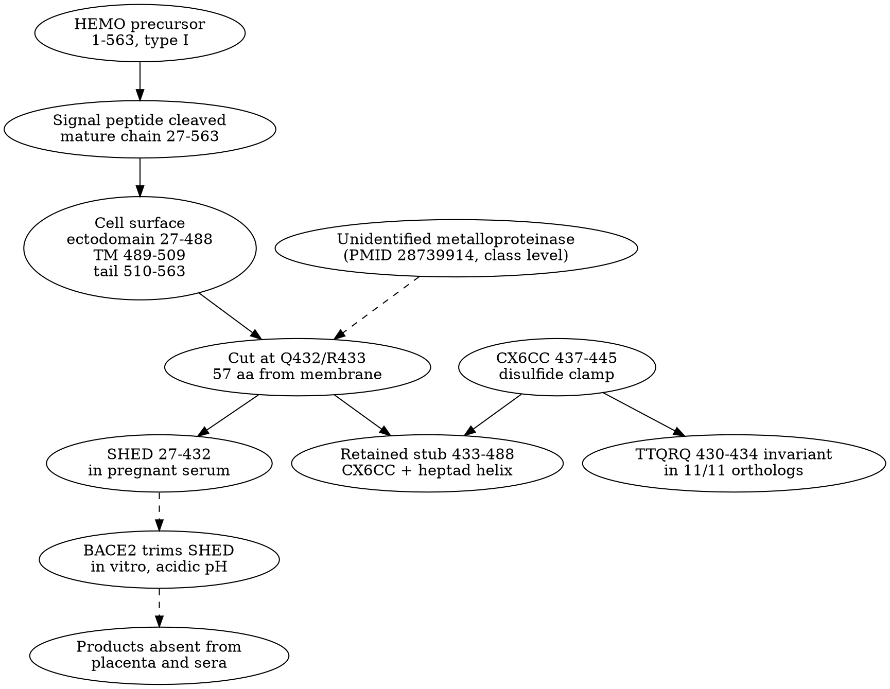

Three candidate explanations for the site position, and what the data say about each:

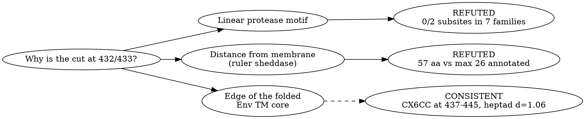

Separate from the shedding event and downstream of it: the SHED form's presence in pregnant serum is a secreted-product phenotype, not an activity. BACE2 binding to SHED and transmembrane HEMO is a distinct physical interaction, and BACE2-dependent further truncation of SHED is an in vitro acidic-pH event whose products were not found in placenta or sera. HEMO's loss of fusogenicity follows from the loss of both the SU/TM furin site (R352C) and the fusion peptide, which is an evolutionary property of the protein and not a consequence of the Q432 cut.

## Evidence base

| Citation | Evidence type | Stance | Claim tested | Key finding | Context | Confidence and limitations |
|---|---|---|---|---|---|---|
| [PMID: 28739914](https://pubmed.ncbi.nlm.nih.gov/28739914/) | Direct assay, deletion mutants | Qualifies | HEMO is shed upstream of the TM domain | "it is actively shed in the blood circulation in humans via specific cleavage of the precursor envelope protein upstream of the transmembrane domain". UniProt derives both the Q432/R433 site and the class-level "metalloproteinase" attribution from this work | Human placenta, iPSC, pregnant sera, transfected cells | High for the fact of shedding and the site. The protease class is a class-level claim; full text (PMC5559007) is not open access, so the inhibitor evidence behind "metalloproteinase" was not verifiable here |
| [PMID: 41329733](https://pubmed.ncbi.nlm.nih.gov/41329733/) | Interaction, in vitro digestion, MS | **Competing then refuting** | Is BACE2 the sheddase? | Binds both transmembrane and SHED HEMO; cleaves purified SHED further in vitro (MK8931-sensitive, BACE1-negative). Full text: "we did not observe any increase in the SHED form of the HEMO protein in the supernatant, indicating that BACE2 is not involved in the shedding process" | 293T/293F cotransfection, commercial soluble BACE2, acidic pH in vitro | High. The in vitro products were absent from placenta and pregnant sera, so they may be artefactual or rapidly cleared |
| [PMID: 24635658](https://pubmed.ncbi.nlm.nih.gov/24635658/) | Degradomics, PICS peptide libraries | Supports the negative | Can ADAM10 and ADAM17 be told apart by sequence? | "the largest difference in the cleavage site specificities of ADAM10 and ADAM17 is at the P1' site" | Recombinant murine ADAM10/17, yeast proteome peptide libraries | High. HEMO P1' = Arg matches neither preference. Recombinant enzyme on non-native substrates |
| [PMID: 28143719](https://pubmed.ncbi.nlm.nih.gov/28143719/) | Mutagenesis of a native stalk | Supports the negative | Which subsites govern ADAM17 cleavage? | "the non-prime sites P3 and P2 and the prime site P1' were critical" | Human IL-6R and IL-11R, cell-based | Medium-high. HEMO is discordant at exactly P3, P2 and P1' |
| [PMID: 25211023](https://pubmed.ncbi.nlm.nih.gov/25211023/) | PICS, 6 TTSPs, 2405 sites | Qualifies | Does a serine-protease family fit? | "a strong specificity for arginine in the P1 position and surprisingly a lysine in P1' position" | Recombinant TTSPs, proteome-derived libraries | High for the consensus. HEMO's minor bond matches P1 = Arg only, which is the single positive in the whole panel |
| [PMID: 34125978](https://pubmed.ncbi.nlm.nih.gov/34125978/) | Review-level specificity statement | Supports the negative | Does meprin β fit? | "unique cleavage specificity with strong preference for acidic amino acids at the cleavage site" | Human and murine | High for exclusion. Reinforced by MEP1B at 0.0 nTPM in placenta |
| [PMID: 28003343](https://pubmed.ncbi.nlm.nih.gov/28003343/) | Direct assay, conservation analysis | Qualifies | What does genuine protease-substrate coevolution look like? | "This finding fits perfectly to the unique cleavage specificity of meprin β ... and suggests coevolution of protease and substrate" | Human CD99, endothelial transmigration | Medium-high. Supplies the contrast case: HEMO is conserved but matches no specificity |
| [PMID: 24119228](https://pubmed.ncbi.nlm.nih.gov/24119228/) | Direct site mapping | Supports (reference set) | ADAM17 juxtamembrane geometry | ADAM17 cleaves GPIb-alpha "Gly464-Val465" | Human platelets | High for the site. Mature-chain numbering, which is why the UniProt precursor-numbered distance (26) differs from the mature one (~12); both inside the ruler window |
| [PMID: 24337742](https://pubmed.ncbi.nlm.nih.gov/24337742/) | MALDI-TOF site mapping | Supports (reference set) | ADAM17 juxtamembrane geometry | "cleaved between Ala(195) and Val(196)" in the CD16A stalk | Human NK cells | High, used as a reference distance |
| [PMID: 11785676](https://pubmed.ncbi.nlm.nih.gov/11785676/) | Radiochemical sequencing, mutants | Supports (reference set) | What does a true ADAM17 substrate look like? | "a cleavage site in the membrane-proximal region (MPR) between R321 and S322 ... resulting in the generation of a soluble ectodomain and a membrane-retained 6 kD fragment"; "relatively loose sequence specificity for the substrate site" | Murine lymphocytes and neutrophils | High. The 6 kDa stub contrasts with HEMO's 56-residue extracellular stub, and the loose-specificity statement independently supports the sequence-prediction negative |
| [PMID: 21907142](https://pubmed.ncbi.nlm.nih.gov/21907142/) | siRNA screen, inhibitor, mouse | Competing (family plausibility) | Can an aspartic protease be a bona fide sheddase? | "Bace2 as the sheddase of the proproliferative plasma membrane protein Tmem27" | Murine and human β cells | High. Establishes that BACE2 sheds type I membrane proteins, so its exclusion for HEMO must be stated, not assumed |
| [PMID: 22628310](https://pubmed.ncbi.nlm.nih.gov/22628310/) | Mutational analysis | Qualifies | Do non-sequence features control BACE2 cleavage? | Dimerisation, glycosylation and trafficking, not a linear motif, gate Tmem27 processing | Pancreatic β cells | Medium. Reinforces that sheddase specificity is often conformational |
| ProteomicsDB protein 81327 | Database, peptide-spectrum evidence | Qualifies (neither confirms nor refutes) | Does any public dataset contain a peptide ending at Q432? | 151 records, 17 unique peptides, 35.2% coverage, all coordinate-validated. No peptide ends at Gln432. All 17 are fully tryptic. `KDHVLDIPTTQR` (422-433) observed in 2 records | Aggregated public human MS datasets, tissue not resolvable | Medium-high for the coverage numbers. The negative is a search-space artefact and must not be read as evidence against the site |
| UniProt human SITE annotations | Database, curated features | **Qualifies, corrects an overreach** | Does a 57-residue distance exclude metalloproteinases? | 8 ADAM-clan sites N-terminal to a TM helix. ADAM10/17: 11, 13, 14, 26, 26. ADAM8 on CHL1: 44 and 330. ADAMTS9 on MMP14: 228 | Human, curated features of mixed evidence quality | Medium-high. n = 5 for the ruler class is a description of observed cases, not a calibrated null. Decisive for the narrow claim, fatal to the broad one |
| Human Protein Atlas ([PMID: 25211023](https://pubmed.ncbi.nlm.nih.gov/25211023/) panel context, HPA refs 28003343, 34125978 for specificity) | Database, tissue RNA | Qualifies (reframes the candidate set) | Which proteases are present where HEMO is shed? | Placenta nTPM: ADAMTS1 230.0, MMP2 210.8, ADAM12 126.8, MMP14 111.7, all above ADAM10 27.1 and ADAM17 17.9; MEP1B 0.0 | Human placenta, bulk RNA | Medium. RNA abundance is not protease activity, and shedding may not be confined to placenta |
| This analysis (computed) | Computational: topology, hydropathy, motif scan, alignment, heptad periodicity | Refutes the prediction | Can the family be inferred from sequence? | 57-residue distance (z = 5.3 against the unbiased set); 0 subsite matches across 7 families at the major bond; CX6CC at 437-445; heptad d = 1.06; no furin motif in any catarrhine ortholog | UniProt Q9H9K5 plus 10 orthologs; AlphaFold AF-Q9H9K5-F1 v6 | Medium-high for sequence and geometry. The AlphaFold model is unusable for local claims (global pLDDT 44.3, 73% very low; residues 429-436 mean 36.9) |

## GO curation implications

All items are leads requiring curator verification.

- **Do not add any protease-family-specific term or statement** tying HEMO shedding to ADAM10, ADAM17 or membrane-type MMPs. There is no sequence or geometric support, and geometry argues against them.
- **Equally, do not generalise this into a statement that metalloproteinases are disfavoured.** UniProt's own site annotations have ADAM8 and ADAMTS9 cleaving 44 to 330 residues from the membrane, so the class-level attribution in PMID 28739914 is untouched by the geometry argument.
- **The relevant GO content is about HEMO as a substrate, not as an enzyme.** HEMO has no catalytic activity here. Avoid any MF protease term.
- **The CC terms are the well-supported part.** `GO:0005886` plasma membrane and `GO:0005576` extracellular region (or `GO:0005615` extracellular space, for the SHED form found in pregnant sera) are both backed by PMID 28739914 at protein level, with `GO:0005887` integral component of plasma membrane for the precursor. UniProt topology is ECO:0000255 for the TM boundaries and ECO:0000269 for the signal peptide.
- **Any `GO:0006509` membrane protein ectodomain proteolysis annotation on ERVMER34-1 should be flagged as substrate-role, not gene-product activity.** If such a term is present, consider removing it or marking it non-core. A gene is not annotated to a process merely because it is cleaved.
- **For the BACE2 relationship**, the supported statement is a physical interaction with BACE2 for both the transmembrane and SHED forms (PMID 41329733). If an interaction annotation is wanted, use an IPI-style interaction record with BACE2 (Q9Y5Z0) rather than a bare `GO:0005515` protein binding, and do not state that BACE2 sheds HEMO: the same paper says it does not.
- **Do not record the proteomics negative as evidence.** ProteomicsDB covers 35.2% of Q9H9K5 with no peptide ending at Gln432, but every observed peptide is fully tryptic, so the neo-C-terminus could not have been detected.
- **Keep the free-text review wording class-level.** "Released from the cell surface by an unidentified protease, attributed to a metalloproteinase activity in PMID 28739914, at Q432/R433, 57 residues N-terminal to the transmembrane helix and immediately N-terminal to the CX6CC motif of the TM subunit" is defensible. Naming a family is not.

### Candidate GO terms

| Term | Aspect | Lead action | Basis |
|---|---|---|---|
| GO:0005886 plasma membrane | CC | retain | PMID 28739914, protein level |
| GO:0005887 integral component of plasma membrane | CC | retain for the precursor | UniProt single-pass type I, ECO:0000255, confirmed by independent hydropathy |
| GO:0005615 extracellular space | CC | retain for the SHED form | SHED detected in pregnant sera, PMID 28739914 |
| GO:0006509 membrane protein ectodomain proteolysis | BP | do **not** annotate to ERVMER34-1 | HEMO is the substrate, not the catalyst |
| any peptidase MF term | MF | do not annotate | no catalytic activity |
| GO:0005515 protein binding (BACE2) | MF | acceptable only as an IPI interaction record with BACE2 (Q9Y5Z0); prefer an interaction database entry over a bare MF term | PMID 41329733 |

## Conflicts and alternatives

1. **Aspartic protease against metalloproteinase.** The seed hypothesis assumes a metalloproteinase framing. The only protease experimentally linked to HEMO is BACE2 (family A1). The 2025 authors exclude BACE2 as the sheddase, so the two claims are consistent, but a curator reading only the 2025 abstract could conflate "BACE2 cleaves HEMO" with "BACE2 sheds HEMO". The abstract does not state the exclusion; only the full text does.
2. **Conservation misread as motif selection.** The invariance of `TTQ|RQ` is real but confounded by the adjacent CX6CC motif at 437-445. Treating the invariance as evidence for a dedicated protease recognition site would be an over-read.
3. **Two alternative scissile bonds one residue apart.** UniProt records cleavage "at 432-Gln-Arg-433 (mainly) or 433-Arg-Gln-434". Site heterogeneity of ±1 residue is typical of low-specificity, conformation-driven proteolysis, and it weakens any attempt to read a linear motif.
4. **The class attribution is secondary.** "Metalloproteinase" in UniProt is a PTM free-text comment derived from PMID 28739914. The full text could not be read (PMC5559007 is not open access, Europe PMC returned HTTP 500), so the inhibitor panel behind it is unverified here. If it rests on a broad hydroxamate such as GM6001, that excludes serine and aspartic proteases but does not distinguish ADAMs from MMPs, meprins or other metzincins.
5. **AlphaFold cannot arbitrate.** The AFDB model is globally poor (pLDDT 44.3, residues 429-436 mean 36.9). Any argument about surface exposure or loop flexibility there would be unsound, and none is made. The heptad and proline analysis used instead is a sequence-level propensity, which is weaker evidence than a structure.
6. **Deletion-mutant evidence is indirect.** The UniProt mutagenesis features 433-563, 472-563 and 489-563 all "promote release in the extracellular medium". These are deletion constructs that locate the required region; they do not identify the enzyme.
7. **Placental abundance is not the only reading.** The HPA ranking deprioritises ADAM10 and ADAM17 relative to ADAMTS1, MMP2, ADAM12 and MMP14, but ADAM17 activity is gated post-translationally by iRhom2 and by stimulus, so transcript level is a poor proxy for sheddase activity. The expression argument is supporting, not load-bearing.
8. **The distance argument has a documented class of exceptions, and the first pass overstated it.** A hand-assembled set of nine ADAM10/ADAM17 sites gave z = 8.5. Rebuilding programmatically from UniProt gave a smaller internally consistent set (n = 5, z = 5.3), still excluding the ruler sheddases, but it also surfaced ADAM8 and ADAMTS9 sites at 44, 228 and 330 residues. Only ruler-type sheddases are constrained by distance.

## Limitations and knowledge gaps

| Gap | What was checked | Why it matters | What would resolve it |
|---|---|---|---|
| <i class="fa-solid fa-circle-question"></i> Identity of the sheddase | Literature search, UniProt PTM comment, 2025 full text | This is the hypothesis itself; nothing downstream can be annotated without it | siRNA or CRISPR screen of the sheddase repertoire in a HEMO-expressing placental or tumour line, read out by SHED ELISA |
| <i class="fa-solid fa-triangle-exclamation"></i> Which inhibitors support "metalloproteinase" | PMC5559007 is not open access; Europe PMC returned HTTP 500 | Determines whether the class call is narrow (ADAM-selective) or broad (any metzincin) | A curator reads PMID 28739914 figures and methods directly |
| <i class="fa-solid fa-database"></i> A peptide ending at Q432 in public data | **Resolved to a definite negative with a definite cause.** ProteomicsDB: 17 unique peptides, 35.2% coverage, none ends at Gln432, all 17 fully tryptic. EBI Proteins API HTTP 503 ×6, PRIDE 404, PeptideAtlas anti-bot, neXtProt HTML | The absence is a search-space artefact and is not evidence against the site. The region is MS-accessible: `KDHVLDIPTTQR` (422-433) seen in 2 records, so the raw files needed already exist | Semi-tryptic or unspecific reanalysis of the same deposited raw files for `DHVLDIPTTQ` (423-432) |
| <i class="fa-solid fa-circle-question"></i> Whether Q432/R433 is the only shedding site | UniProt records a minor R433/Q434 bond | Multiple sites would argue further against a single dedicated enzyme | Edman degradation or MS C-terminomics on purified serum SHED |
| <i class="fa-solid fa-triangle-exclamation"></i> Structure of the 433-488 region | AlphaFold model unusable (pLDDT 44.3). Sequence proxy computed instead: heptad propensity 0.741 vs 0.580, d = 1.06, 1 proline in 43 residues | Determines whether the retained stub is a folded TM-subunit core or an accessible stalk, which is the actual determinant of sheddase access. The proxy says folded, but a propensity is not a structure | Cryo-EM, or AlphaFold3/multimer with a deeper ERVMER34 MSA, or limited proteolysis of the recombinant ectodomain |
| <i class="fa-solid fa-chart-column"></i> Reference-set size | n = 5 annotated human ADAM10/ADAM17 sites | Enough to show HEMO is outside the observed window, not enough to put a reliable tail probability on it | A literature-curated set of 30+ mapped sites in consistent precursor numbering |
| <i class="fa-solid fa-circle-question"></i> Which enzyme acts, given the reframing | HPA placenta RNA ranking computed; no activity data retrieved | ADAMTS1, MMP2, ADAM12 and MMP14 are each 4 to 13 times more abundant in placenta than ADAM10 or ADAM17, so the ADAM-centric prior in the seed hypothesis is not the obvious one | Incubation of recombinant HEMO ectodomain with purified ADAMTS1, MMP2, MMP14 and ADAM12, with N-terminal sequencing of the products |
| <i class="fa-solid fa-triangle-exclamation"></i> Cell-type context of shedding | Not assayed here | ADAM17 activity is strongly iRhom- and stimulus-dependent, so a negative in one line is not general | PMA or ionomycin stimulation of HEMO-expressing trophoblast with and without ADAM10/17 inhibitors |

## Proposed follow-up experiments and actions

Ranked by information per unit effort.

1. <i class="fa-solid fa-magnifying-glass"></i> **Semi-tryptic reanalysis of existing placenta and pregnancy-serum proteomics** for the `DHVLDIPTTQ` (423-432) neo-C-terminal peptide. Zero new wet work, and the required raw files are already deposited: ProteomicsDB shows the adjacent fully tryptic `KDHVLDIPTTQR` (422-433) in 2 records, so the region ionises and is seen by existing instruments. Only the search space has to change.
2. <i class="fa-solid fa-pills"></i> **Pharmacological class triage in a HEMO-expressing cell.** GI254023X (ADAM10-selective), GW280264X (ADAM10 and ADAM17), broad hydroxamate GM6001, MK8931 (BACE1/2), and a serine-protease inhibitor, each read out by SHED immunoblot or ELISA. This alone separates ADAM10 from ADAM17 from a non-ADAM metzincin from the aspartic family.
3. <i class="fa-solid fa-flask"></i> **Direct in vitro digestion with the distance-tolerant placental candidates.** ADAMTS1 first, then MMP2, MMP14 and ADAM12, on recombinant HEMO ectodomain, with Edman or MS sequencing of the products to check whether the cut reproduces Q432/R433. ADAMTS1 is the highest-ranked candidate on both criteria that currently discriminate: placental abundance (230.0 nTPM) and membership of the one subfamily annotated cutting at comparable distance from the bilayer.
4. <i class="fa-solid fa-dna"></i> **CRISPR knockout of ADAM10 and ADAM17** in the same line, with rescue. Inhibitor-only evidence is the weakness of the current class attribution.
5. <i class="fa-solid fa-vial"></i> **N-terminomics (TAILS) on conditioned medium of a HEMO-expressing line**, capturing the reciprocal neo-N-terminus `RQTACGTVGK...` on the membrane stub, which would confirm the bond directly.
6. <i class="fa-solid fa-flask"></i> **Stalk-length scanning mutagenesis.** Insert or delete 10-40 residues between Q432 and the TM. If the cleavage position tracks the membrane, a ruler-type sheddase is implicated. If it tracks the CX6CC motif, the site is fold-determined and sequence prediction is hopeless by construction.
7. <i class="fa-solid fa-flask"></i> **Chimeric transfer.** Graft HEMO residues 420-445 into a non-shed type I reporter stalk. If the fragment is sufficient, a local motif exists after all; if not, the determinant is the Env fold.

### Candidate action changes for the review

- Record the hypothesis outcome as **refuted**: the protease family is not predictable from sequence, and ADAM10, ADAM17 and the MT-MMPs are positively disfavoured by the 57-residue geometry and the folded stub.
- Add the topology numbers (shed form 27-432, TM 489-509, 57-residue P1-to-TM distance, CX6CC at 437-445) to the review so the next reviewer does not re-derive them.
- Add PMID 41329733 as a new reference, with the BACE2 interaction recorded and the explicit non-sheddase statement recorded alongside it.
- Keep protease attribution at class level ("an unidentified metalloproteinase activity, per PMID 28739914") and do not promote it to a family.

### Candidate references with exact snippets to verify

- PMID 28739914, abstract: "it is actively shed in the blood circulation in humans via specific cleavage of the precursor envelope protein upstream of the transmembrane domain"
- PMID 28739914, abstract: "with the identified retroviral envelope gene encoding a full-length protein in all simians under purifying selection and with similar shedding capacity"
- PMID 41329733, abstract: "HEMO is nonfusogenic, having lost both its furin cleavage site between the SU and TM subunits, and its fusion peptide."
- PMID 41329733, abstract: "We successfully identified the transmembrane aspartic protease BACE2 (ß-site APP-cleaving enzyme 2) as a specific interacting partner for both SHED and transmembrane HEMO proteins."
- PMID 41329733, **full text, PMC12704712** (the decisive sentence, absent from the abstract): "Through cotransfection experiments with BACE2, we did not observe any increase in the SHED form of the HEMO protein in the supernatant, indicating that BACE2 is not involved in the shedding process."
- PMID 24635658, abstract: "the largest difference in the cleavage site specificities of ADAM10 and ADAM17 is at the P1' site"
- PMID 28143719, abstract: "we showed that the non-prime sites P3 and P2 and the prime site P1' were critical for this increase in proteolysis"
- PMID 25211023, abstract: "revealing a strong specificity for arginine in the P1 position and surprisingly a lysine in P1' position"
- PMID 11785676, abstract: "a cleavage site in the membrane-proximal region (MPR) between R321 and S322 ... resulting in the generation of a soluble ectodomain and a membrane-retained 6 kD fragment"
- PMID 11785676, abstract: "the proteolytic process has relatively loose sequence specificity for the substrate site"
- PMID 21907142, abstract: "Bace2 as the sheddase of the proproliferative plasma membrane protein Tmem27"
- PMID 28003343, abstract: "This finding fits perfectly to the unique cleavage specificity of meprin β with a strong preference for aspartate residues and suggests coevolution of protease and substrate."
- UniProt Q9H9K5 PTM comment: "Cleaved by some metalloproteinase at 432-Gln-Arg-433 (mainly) or 433-Arg-Gln-434" (database-level, traceable to PMID 28739914)

### Suggested questions for the curator

- Which inhibitors does PMID 28739914 actually use to justify "metalloproteinase"? That determines how narrow the class statement may be.
- Does the existing review anywhere imply ADAM-family involvement? If so, that wording should be softened.
- Is the 2025 BACE2 interaction already captured, and is the non-sheddase caveat captured with it?

## Confirmed topology and site mapping

| Feature | Residues | Source and method |
|---|---|---|
| Signal peptide | 1-26 | UniProt, experimental ECO:0000269 PubMed:28739914 |
| Mature chain | 27-563 | UniProt |
| Shed (SHED) form | 27-432 | UniProt chain, ECO:0000305 PubMed:28739914 |
| Extracellular | 27-488 | UniProt ECO:0000255 |
| Transmembrane helix | 489-509 `SWGYVLLIVLFCLFIFVLIYV` | UniProt ECO:0000255; confirmed here by Kyte-Doolittle w = 19, single dominant peak at residue 502, mean KD 3.08 |
| Cytoplasmic tail | 510-563 (54 aa) | UniProt ECO:0000255 |
| Mapped scissile bond | Q432 / R433 (minor R433/Q434) | UniProt PTM comment, from PubMed:28739914 |
| **P1 to first TM residue** | **57 residues** | computed |
| Membrane-retained stub | 433-488 (56 aa) `RQTACGTVGKQCCLYINYSEEIKSNIQRLHEASENLKNVPLLDWQGIFAKVGDWFR` | computed |
| Gammaretroviral CX6CC | 437-445, C437 / C444 / C445 | computed regex, 5 residues C-terminal to the scissile bond |
| Heptad character of the stub | 443-478 mean a/d hydrophobic fraction 0.741 vs 0.580 for 37-422 (d = 1.06) | computed, window 21, TM-overlapping windows excluded, null from 2000 composition-matched shuffles |
| Proline content | 433-445: 0/13; 446-488: 1/43 (2.3%); 27-432: 19/406 (4.7%) | computed |
| Furin R-X-[KR]-R in human chain | **none anywhere in 563 aa** | computed regex |
| Minimal R-X-X-R hits | 510 `RVFR`, 513 `RKSR`, both cytoplasmic and inaccessible to furin | computed regex |
| ProteomicsDB sequence coverage | 35.2% (17 unique peptides, 151 records), all fully tryptic | ProteomicsDB OData API, protein 81327 |

## Provenance

Analyses were executed and their outputs are saved in `provenance/`:

- `plot_1.png` topology and hydropathy with the 57-residue distance, plus the ADAM substrate stalk-geometry comparison
- `plot_2.png` per-residue ortholog conservation across the site, stub and TM
- `plot_3.png` AlphaFold pLDDT profile with the explicit low-confidence caveat
- `plot_4.png` subsite-preference matching across five protease families and the stalk-geometry bar chart
- `plot_5.png`, `plot_6.png` ProteomicsDB peptide coverage of Q9H9K5 against the cleavage site, before and after the coordinate correction
- `plot_7.png` placental expression ranking of candidate proteases
- `plot_8.png`, `plot_9.png` heptad propensity along the chain and the stub against ectodomain comparison
- `plot_10.png` all UniProt-annotated ADAM-clan cleavage distances against HEMO's 57 residues
- `ERVMER34-1_protease_family_subsite_match.csv` computed subsite match table
- `ERVMER34-1_stalk_geometry_reference.csv` the hand-curated ADAM substrate reference distances used in iteration 1
- `ERVMER34-1_proteomicsdb_peptides.csv` 17 unique peptides with coordinate-corrected 1-based positions
- `ERVMER34-1_expanded_protease_panel.csv` 7 families scored against both candidate bonds
- `ERVMER34-1_candidate_protease_placenta_expression.csv` and `..._placenta_table.csv` HPA placenta nTPM
- `ERVMER34-1_stub_heptad_propensity.csv` region-wise heptad statistics
- `ERVMER34-1_uniprot_adam_sites_unbiased.csv` the programmatically retrieved ADAM-clan reference set

One coordinate correction is worth recording: ProteomicsDB `START_POSITION` is 0-based and exclusive. Taking it at face value flags all 17 peptides as sequence mismatches. With `start1 = START_POSITION + 1` all 151 records validate against the Q9H9K5 sequence. This changes the answer: `QTACGTVGK` begins at 434, not 433, so there is no observed peptide starting at Arg433 either.

One analysis was rerun after a confound was found. The first heptad scan used window 28, and its top-scoring windows (centres 496-500, score 1.000) were reading the transmembrane helix, which is trivially hydrophobic at every position. Rerunning at window 21, restricted to windows fully contained in 433-488, removes the contamination. Both versions are kept in `provenance/` (plot_8 and plot_9).

Resources that could not be accessed programmatically, reported as failures rather than inferred: the neXtProt peptide-mapping API (returned HTML), PeptideAtlas GetProtein (anti-bot interstitial), the EBI Proteins API `/proteomics/Q9H9K5` (HTTP 503, 6 retries), PRIDE `peptideevidences` (404), and Europe PMC full text for PMC5559007 (not open access, HTTP 500). ProteomicsDB was the one peptide-level endpoint that responded.


## Artifacts

- [OpenScientist final report](openscientist_artifacts/final_report.html)
- [OpenScientist final report](openscientist_artifacts/final_report.pdf)
- [OpenScientist provenance](openscientist_artifacts/provenance.json)
- [OpenScientist ERVMER34 1 candidate protease placenta expression](openscientist_artifacts/provenance_ERVMER34-1_candidate_protease_placenta_expression.csv)
- [OpenScientist ERVMER34 1 candidate sheddase placenta table](openscientist_artifacts/provenance_ERVMER34-1_candidate_sheddase_placenta_table.csv)
- [OpenScientist ERVMER34 1 expanded protease panel](openscientist_artifacts/provenance_ERVMER34-1_expanded_protease_panel.csv)
- [OpenScientist ERVMER34 1 protease family subsite match](openscientist_artifacts/provenance_ERVMER34-1_protease_family_subsite_match.csv)
- [OpenScientist ERVMER34 1 proteomicsdb peptides](openscientist_artifacts/provenance_ERVMER34-1_proteomicsdb_peptides.csv)
- [OpenScientist ERVMER34 1 stalk geometry reference](openscientist_artifacts/provenance_ERVMER34-1_stalk_geometry_reference.csv)
- [OpenScientist ERVMER34 1 stub heptad propensity](openscientist_artifacts/provenance_ERVMER34-1_stub_heptad_propensity.csv)
- [OpenScientist ERVMER34 1 uniprot adam sites unbiased](openscientist_artifacts/provenance_ERVMER34-1_uniprot_adam_sites_unbiased.csv)
- [OpenScientist plot 1](openscientist_artifacts/provenance_plot_1.json)
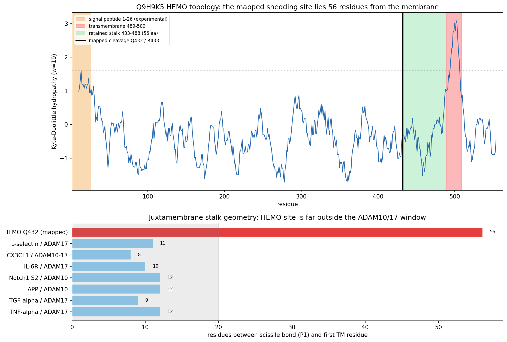
- [OpenScientist plot 10](openscientist_artifacts/provenance_plot_10.json)
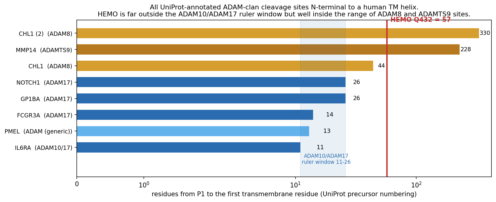
- [OpenScientist plot 2](openscientist_artifacts/provenance_plot_2.json)
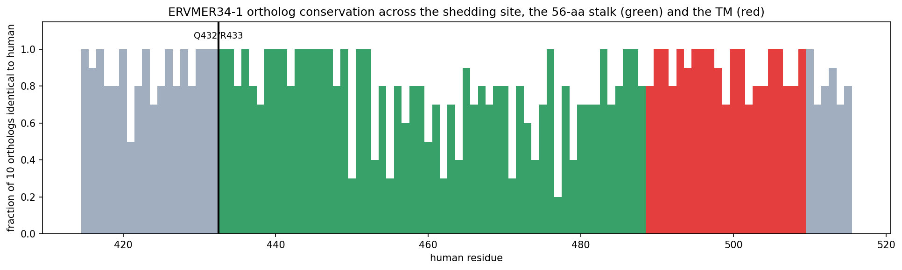
- [OpenScientist plot 3](openscientist_artifacts/provenance_plot_3.json)
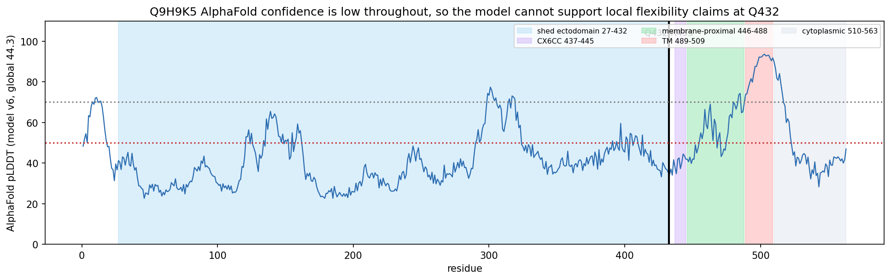
- [OpenScientist plot 4](openscientist_artifacts/provenance_plot_4.json)
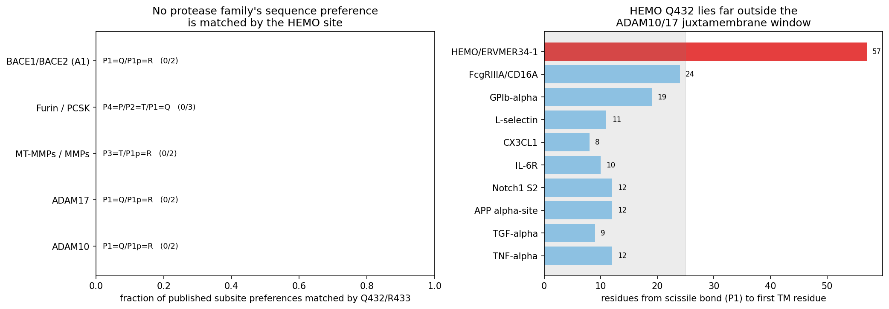
- [OpenScientist plot 5](openscientist_artifacts/provenance_plot_5.json)
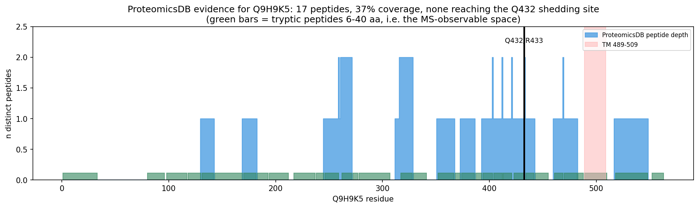
- [OpenScientist plot 6](openscientist_artifacts/provenance_plot_6.json)
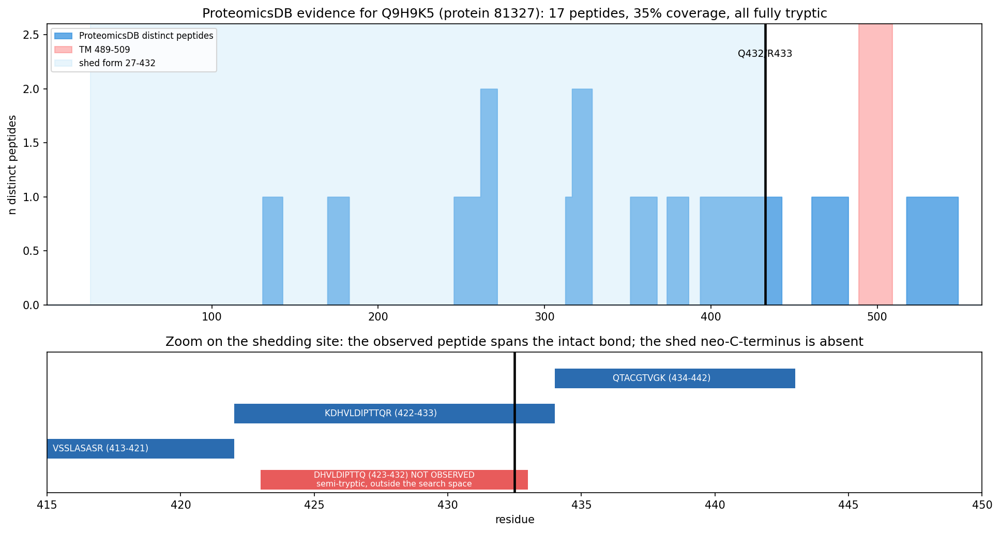
- [OpenScientist plot 7](openscientist_artifacts/provenance_plot_7.json)
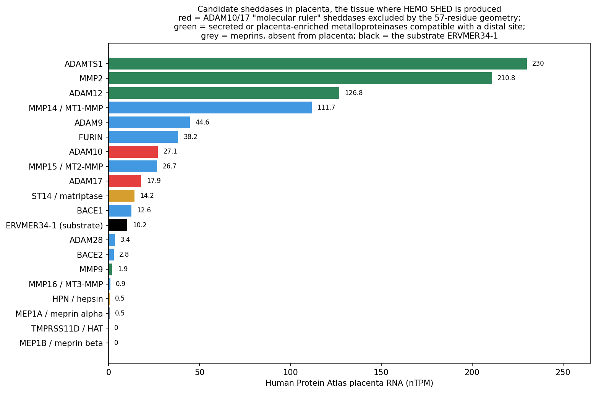
- [OpenScientist plot 8](openscientist_artifacts/provenance_plot_8.json)
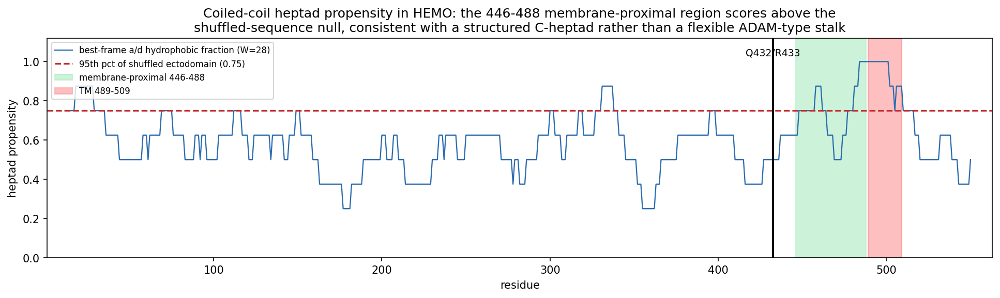
- [OpenScientist plot 9](openscientist_artifacts/provenance_plot_9.json)
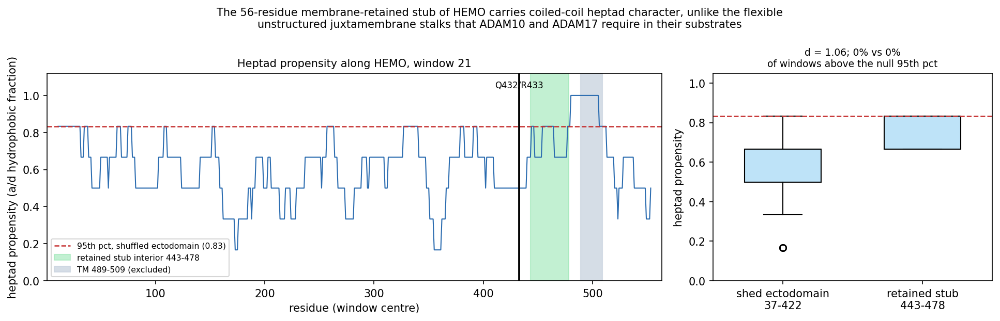

## Reference Validation

Checked with `linkml-reference-validator` 0.3.1rc1.

| Outcome | Count |
| --- | --- |
| References checked | 14 |
| Resolved | 14 |
| Unresolved (possible confabulation) | 0 |
| Unverifiable | 0 |
| Quoted claims checked | 1 |
| Quoted claims found in source | 0 |
| Quoted claims **not** found in source | 1 |
| References weighed for topical relevance | 14 |
| On topic | 11 |
| Off topic | 0 |

### Quotes not found in the cited source

Searched the abstract, any retrieved full text, and the title. A quote drawn from a part of the paper that was not retrieved will appear here too, so check before treating one as invented:

Every one of these was searched against an abstract alone, with no full text retrieved - marked *abstract only* below. Where full text can be fetched, re-running with it will settle them; where the source publishes only a summary to PubMed, as GeneReviews chapters do, it will not, and the quote has to be checked by hand against the chapter itself.

- `PMID:28739914` *(abstract only)*: "Cleaved by some metalloproteinase at 432-Gln-Arg-433 (mainly) or 433-Arg-Gln-434"
  - Text part not found as substring: 'Cleaved by some metalloproteinase at 432-Gln-Arg-433 (mainly) or 433-Arg-Gln-434' (note: only abstract available for PMID:28739914, full text may contain this excerpt)