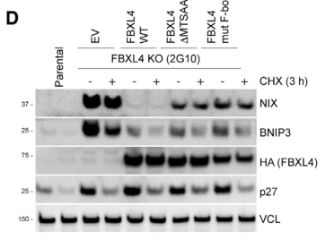

## Question

# Gene Research for Functional Annotation

## ⚠️ CRITICAL: Gene/Protein Identification Context

**BEFORE YOU BEGIN RESEARCH:** You MUST verify you are researching the CORRECT gene/protein. Gene symbols can be ambiguous, especially for less well-characterized genes from non-model organisms.

### Target Gene/Protein Identity (from UniProt):
- **UniProt Accession:** Q9UKA2
- **Protein Description:** RecName: Full=F-box/LRR-repeat protein 4; AltName: Full=F-box and leucine-rich repeat protein 4; AltName: Full=F-box protein FBL4/FBL5;
- **Gene Information:** Name=FBXL4; Synonyms=FBL4, FBL5;
- **Organism (full):** Homo sapiens (Human).
- **Protein Family:** Not specified in UniProt
- **Key Domains:** F-box-like_dom_sf. (IPR036047); F-box_dom. (IPR001810); FBXL15_LRR. (IPR057207); Leu-rich_rpt_Cys-con_subtyp. (IPR006553); LRR_dom_sf. (IPR032675)

### MANDATORY VERIFICATION STEPS:

1. **Check if the gene symbol "FBXL4" matches the protein description above**
2. **Verify the organism is correct:** Homo sapiens (Human).
3. **Check if protein family/domains align with what you find in literature**
4. **If you find literature for a DIFFERENT gene with the same or similar symbol, STOP**

### If Gene Symbol is Ambiguous or You Cannot Find Relevant Literature:

**DO NOT PROCEED WITH RESEARCH ON A DIFFERENT GENE.** Instead:
- State clearly: "The gene symbol 'FBXL4' is ambiguous or literature is limited for this specific protein"
- Explain what you found (e.g., "Found extensive literature on a different gene with the same symbol in a different organism")
- Describe the protein based ONLY on the UniProt information provided above
- Suggest that the protein function can be inferred from domain/family information

### Research Target:

Please provide a comprehensive research report on the gene **FBXL4** (gene ID: FBXL4, UniProt: Q9UKA2) in human.

The research report should be a detailed narrative explaining the function, biological processes, and localization of the gene product. Citations should be given for all claims.

You should prioritize authoritative reviews and primary scientific literature when conducting research. You can supplement
this with annotations you find in gene/protein databases, but these can be outdated or inaccurate.

We are specifically interested in the primary function of the gene - for enzymes, what reaction is catalyzed, and what is the substrate specificity? For transporters, what is the substrate? For structural proteins or adapters, what is the broader structural role? For signaling molecules, what is the role in the pathway.

We are interested in where in or outside the cell the gene product carries out its function.

We are also interested in the signaling or biochemical pathways in which the gene functions. We are less interested in broad pleiotropic effects, except where these elucidate the precise role.

Include evidence where possible. We are interested in both experimental evidence as well as inference from structure, evolution, or bioinformatic analysis. Precise studies should be prioritized over high-throughput, where available.

## Output

Question: You are an expert researcher providing comprehensive, well-cited information.

Provide detailed information focusing on:
1. Key concepts and definitions with current understanding
2. Recent developments and latest research (prioritize 2023-2024 sources)
3. Current applications and real-world implementations
4. Expert opinions and analysis from authoritative sources
5. Relevant statistics and data from recent studies

Format as a comprehensive research report with proper citations. Include URLs and publication dates where available.
Always prioritize recent, authoritative sources and provide specific citations for all major claims.

# Gene Research for Functional Annotation

## ⚠️ CRITICAL: Gene/Protein Identification Context

**BEFORE YOU BEGIN RESEARCH:** You MUST verify you are researching the CORRECT gene/protein. Gene symbols can be ambiguous, especially for less well-characterized genes from non-model organisms.

### Target Gene/Protein Identity (from UniProt):
- **UniProt Accession:** Q9UKA2
- **Protein Description:** RecName: Full=F-box/LRR-repeat protein 4; AltName: Full=F-box and leucine-rich repeat protein 4; AltName: Full=F-box protein FBL4/FBL5;
- **Gene Information:** Name=FBXL4; Synonyms=FBL4, FBL5;
- **Organism (full):** Homo sapiens (Human).
- **Protein Family:** Not specified in UniProt
- **Key Domains:** F-box-like_dom_sf. (IPR036047); F-box_dom. (IPR001810); FBXL15_LRR. (IPR057207); Leu-rich_rpt_Cys-con_subtyp. (IPR006553); LRR_dom_sf. (IPR032675)

### MANDATORY VERIFICATION STEPS:

1. **Check if the gene symbol "FBXL4" matches the protein description above**
2. **Verify the organism is correct:** Homo sapiens (Human).
3. **Check if protein family/domains align with what you find in literature**
4. **If you find literature for a DIFFERENT gene with the same or similar symbol, STOP**

### If Gene Symbol is Ambiguous or You Cannot Find Relevant Literature:

**DO NOT PROCEED WITH RESEARCH ON A DIFFERENT GENE.** Instead:
- State clearly: "The gene symbol 'FBXL4' is ambiguous or literature is limited for this specific protein"
- Explain what you found (e.g., "Found extensive literature on a different gene with the same symbol in a different organism")
- Describe the protein based ONLY on the UniProt information provided above
- Suggest that the protein function can be inferred from domain/family information

### Research Target:

Please provide a comprehensive research report on the gene **FBXL4** (gene ID: FBXL4, UniProt: Q9UKA2) in human.

The research report should be a detailed narrative explaining the function, biological processes, and localization of the gene product. Citations should be given for all claims.

You should prioritize authoritative reviews and primary scientific literature when conducting research. You can supplement
this with annotations you find in gene/protein databases, but these can be outdated or inaccurate.

We are specifically interested in the primary function of the gene - for enzymes, what reaction is catalyzed, and what is the substrate specificity? For transporters, what is the substrate? For structural proteins or adapters, what is the broader structural role? For signaling molecules, what is the role in the pathway.

We are interested in where in or outside the cell the gene product carries out its function.

We are also interested in the signaling or biochemical pathways in which the gene functions. We are less interested in broad pleiotropic effects, except where these elucidate the precise role.

Include evidence where possible. We are interested in both experimental evidence as well as inference from structure, evolution, or bioinformatic analysis. Precise studies should be prioritized over high-throughput, where available.

# Human FBXL4 (UniProt Q9UKA2): functional annotation research report

## Identity and principal conclusion

**Identity verified.** The target is human **FBXL4**, F-box/leucine-rich-repeat protein 4 (also called FBL4/FBL5), corresponding to UniProt **Q9UKA2**. An FBXL-family analysis explicitly identifies FBXL4_HUMAN as Q9UKA2, and the protein architecture reported in human studies—an F-box domain and C-terminal leucine-rich repeats—matches the supplied annotation. The mechanistic studies below concern this protein, not a similarly named F-box family member or a nonhuman gene. (mason2020thefbxlfamily pages 4-5, nguyen‐dien2023fbxl4suppressesmitophagy pages 8-9)

**Primary function:** FBXL4 is the mitochondria-associated, substrate-recruiting F-box subunit of an **SCF ubiquitin E3-ligase complex**. Its established protein substrates are **BNIP3 and BNIP3L/NIX** (BNIP3L and NIX are two names for the *same* receptor). By promoting their ubiquitination and proteasomal turnover, FBXL4 limits inappropriate receptor-mediated mitophagy and helps preserve mitochondrial content. FBXL4 is **not** established as an mtDNA-replication enzyme; mtDNA depletion is a consequence of disturbed mitochondrial homeostasis rather than evidence that FBXL4 catalyzes DNA synthesis. Four independent studies published in 2023 converged on receptor turnover as its central characterized function. (nguyen‐dien2023fbxl4suppressesmitophagy pages 1-2, nguyen‐dien2023fbxl4suppressesmitophagy pages 6-8, chen2023fbxl4mutationscause pages 1-10, niemi2024coordinatingbnip3nixmediatedmitophagy pages 3-4, alsina2020fbxl4deficiencyincreases pages 1-2)

The following evidence summary distinguishes directly observed effects from unresolved structural or localization questions. (niemi2024coordinatingbnip3nixmediatedmitophagy pages 3-4, nguyen‐dien2023fbxl4suppressesmitophagy pages 9-10)

| Molecular feature | Strongest directly observed finding | Evidence / limitation | Specific source |
|---|---|---|---|
| **Identity and domains** | Human **FBXL4 is UniProt Q9UKA2**, an FBXL-family protein with an F-box, a C-terminal **12-repeat leucine-rich-repeat (LRR) domain**, and a distinctive N-terminal beta-sheet/discoidin-like fold. | Confirms the requested human protein and domain architecture. The LRR region is the putative substrate-recognition region, but the exact FBXL4-BNIP3/NIX interface remains unresolved. (mason2020thefbxlfamily pages 4-5, nguyen‐dien2023fbxl4suppressesmitophagy pages 8-9, nguyen‐dien2023fbxl4suppressesmitophagy pages 9-10) | Mason and Laman, 2020, [doi:10.1098/rsob.200319](https://doi.org/10.1098/rsob.200319); Nguyen-Dien et al., 2023, [doi:10.15252/embj.2022112767](https://doi.org/10.15252/embj.2022112767) |
| **Submitochondrial localization** | Current functional evidence places FBXL4 predominantly on the **mitochondrial outer membrane**, colocalizing with TOM20 rather than inner-membrane TIM50; mitochondrial targeting is necessary for receptor turnover. | A 2013 protease-protection and fractionation study instead assigned FBXL4 to the soluble intermembrane space. The discrepancy remains unresolved; later outer-membrane localization better fits direct regulation of outer-membrane BNIP3/NIX. (nguyen‐dien2023fbxl4suppressesmitophagy pages 4-6, xiaowu2013mutationsinfbxl4 pages 9-11, nguyen‐dien2023fbxl4suppressesmitophagy media 10dd6b9b) | Gai et al., 2013, [doi:10.1016/j.ajhg.2013.07.016](https://doi.org/10.1016/j.ajhg.2013.07.016); Nguyen-Dien et al., 2023, [doi:10.15252/embj.2022112767](https://doi.org/10.15252/embj.2022112767) |
| **SCF E3-ligase role** | FBXL4 is the substrate-recruiting F-box component of mitochondrial **SCF-FBXL4**: its F-box engages **SKP1-CUL1**, while CUL1-RBX1 supplies the catalytic ubiquitin-transfer scaffold. Deleting or mutating the F-box prevents BNIP3/NIX turnover. | FBXL4 is not a stand-alone enzyme; ubiquitin transfer requires the assembled SCF complex and an E2 enzyme. Patient variants Arg482Trp and Gly568Ala bind SKP1/CUL1 less efficiently. (nguyen‐dien2023fbxl4suppressesmitophagy pages 2-4, nguyen‐dien2023fbxl4suppressesmitophagy pages 4-6, nguyen‐dien2023fbxl4suppressesmitophagy pages 9-10) | Nguyen-Dien et al., 2023, [doi:10.15252/embj.2022112767](https://doi.org/10.15252/embj.2022112767) |
| **Validated protein substrates** | The established substrates are the homologous outer-membrane mitophagy receptors **BNIP3** and **NIX, encoded by BNIP3L**. FBXL4-dependent polyubiquitylation destabilizes both through the ubiquitin-proteasome pathway. | BNIP3L and NIX name the same protein, not separate substrates. Exact ubiquitin-chain architecture and a minimal FBXL4-binding degron remain uncertain; NIX Lys154 lies within one stability-sensitive region but is not established as the sole acceptor site. (nguyen‐dien2023fbxl4suppressesmitophagy pages 6-8, elcocks2023fbxl4ubiquitinligase pages 4-5, nguyen‐dien2023fbxl4suppressesmitophagy pages 9-10, niemi2024coordinatingbnip3nixmediatedmitophagy pages 4-5) | Elcocks et al., 2023, [doi:10.15252/embj.2022112799](https://doi.org/10.15252/embj.2022112799); Nguyen-Dien et al., 2023, [doi:10.15252/embj.2022112767](https://doi.org/10.15252/embj.2022112767) |
| **Primary biological function** | By continuously limiting BNIP3/NIX abundance, SCF-FBXL4 suppresses inappropriate **basal receptor-mediated mitophagy** and preserves mitochondrial mass, mtDNA-containing organelles, and oxidative-phosphorylation capacity. | Receptor accumulation is necessary but may not be sufficient for every mitochondrion to undergo mitophagy, implying additional spatial or signaling controls. In RPE1 cells, NIX depletion alone restored basal mitophagy, whereas other models required combined BNIP3/NIX suppression. (nguyen‐dien2023fbxl4suppressesmitophagy pages 6-8, elcocks2023fbxl4deficiencypromotes pages 7-9, nguyen‐dien2023fbxl4suppressesmitophagy pages 9-10) | Elcocks et al., 2023, [doi:10.15252/embj.2022112799](https://doi.org/10.15252/embj.2022112799); Nguyen-Dien et al., 2023, [doi:10.15252/embj.2022112767](https://doi.org/10.15252/embj.2022112767) |
| **Quantitative loss-of-function phenotype** | In two independently generated **RPE1 FBXL4-knockout pools**, BNIP3 protein increased approximately **3-4-fold** and NIX approximately **5-7-fold**, with elevated basal mitophagy but no corresponding transcript increase. | These fold changes are specific to the reported RPE1 experiments and should not be generalized across tissues, cell types, or patients. (elcocks2023fbxl4ubiquitinligase pages 4-5) | Elcocks et al., 2023, [doi:10.15252/embj.2022112799](https://doi.org/10.15252/embj.2022112799) |
| **PPTC7 cofactor, 2024 refinement** | An outer-membrane pool of **PPTC7** bridges BNIP3/NIX to FBXL4 and promotes receptor turnover without being required for SKP1-CUL1 assembly. Interface mutants disrupt receptor degradation and mitophagy suppression. | EMBO Reports showed that catalytically impaired PPTC7-D290N still supported turnover, favoring a scaffold role. A separate 2024 study found that an intact catalytic motif was required in its assays but did not directly distinguish loss of catalysis from altered binding, so catalytic involvement remains context-sensitive. (nguyendien2024pptc7antagonizesmitophagy pages 8-10, nguyendien2024pptc7antagonizesmitophagy pages 5-6, wei2024duallocalizedpptc7limits pages 1-2, wei2024duallocalizedpptc7limits pages 4-6) | Nguyen-Dien et al., 2024, [doi:10.1038/s44319-024-00181-y](https://doi.org/10.1038/s44319-024-00181-y); Wei et al., 2024, [doi:10.26508/lsa.202402765](https://doi.org/10.26508/lsa.202402765) |
| **Patient-cell evidence** | In fibroblasts homozygous for **FBXL4 p.Arg435Ter**, wild-type FBXL4 restored endogenous NIX ubiquitylation, lowered BNIP3/NIX, increased MT-CO2, and shifted fragmented mitochondria toward a tubular network; combined BNIP3/NIX depletion reduced excessive mitophagy. | Strong disease-cell rescue supports causality, although fibroblasts may not reproduce neuronal or muscle-specific disease severity. (nguyen‐dien2023fbxl4suppressesmitophagy pages 8-9, nguyen‐dien2023fbxl4suppressesmitophagy pages 9-10) | Nguyen-Dien et al., 2023, [doi:10.15252/embj.2022112767](https://doi.org/10.15252/embj.2022112767) |
| **Mouse and neural-model relevance** | Fbxl4-null or patient-variant knock-in mice show receptor accumulation, excessive mitophagy, mitochondrial-protein loss, metabolic dysfunction, and predominant perinatal mortality; patient-derived iPSC cortical neurons also show abnormal BNIP3/NIX-associated mitophagy. | These models support the disease mechanism, but precise receptor-knockout survival percentages reported initially in a preprint are not treated here as established peer-reviewed statistics. (niemi2024coordinatingbnip3nixmediatedmitophagy pages 3-4, chen2023fbxl4mutationscause pages 1-10, alsina2020fbxl4deficiencyincreases pages 1-2) | Chen et al., 2023, [doi:10.1038/s41418-023-01205-1](https://doi.org/10.1038/s41418-023-01205-1); Alsina et al., 2020, [doi:10.15252/emmm.201911659](https://doi.org/10.15252/emmm.201911659) |

*Table: Compact evidence table verifying human FBXL4 Q9UKA2 and summarizing its domain architecture, mitochondrial localization, SCF-dependent BNIP3/NIX turnover, PPTC7 cofactor mechanism, quantitative cellular phenotype, and disease-model relevance.*

## Molecular mechanism and substrate specificity

An SCF complex comprises **SKP1, CUL1, RBX1 and a substrate-selecting F-box protein**. FBXL4's F-box supports association with the SCF machinery; its leucine-rich-repeat region is a plausible protein-recognition surface, but the exact FBXL4–BNIP3/NIX binding interface has **not** been conclusively established. The 2023 structural description also identifies a distinctive N-terminal, predicted discoidin-like fold and **12 C-terminal LRRs**. FBXL4 supplies substrate selection and positioning: ubiquitin transfer is performed by the *assembled* E3 system with its E2 partner, not by an isolated catalytic active site on FBXL4. (nguyen‐dien2023fbxl4suppressesmitophagy pages 8-9, nguyen‐dien2023fbxl4suppressesmitophagy pages 2-4, nguyen‐dien2023fbxl4suppressesmitophagy pages 9-10)

The strongest substrate evidence combines **physical proximity or interaction, loss-of-function, biochemical ubiquitination assays, protein-stability measurements and rescue**. FBXL4 associates with BNIP3 and NIX; deleting FBXL4 prolongs both receptors' half-lives and reduces their detectable polyubiquitination. Restoring FBXL4 lowers receptor abundance, whereas removing its mitochondrial-targeting sequence or disrupting its F-box prevents efficient turnover. These observations establish BNIP3 and NIX as substrates of the **SCF^FBXL4 pathway**, with proteasomal degradation of the *receptors* restraining subsequent lysosomal degradation of *mitochondria*. A precise ubiquitin-chain linkage, unique ubiquitinated lysine and minimal FBXL4-binding degron should not be assumed from these data. (nguyen‐dien2023fbxl4suppressesmitophagy pages 6-8, elcocks2023fbxl4ubiquitinligase pages 4-5, nguyen‐dien2023fbxl4suppressesmitophagy pages 4-6, nguyen‐dien2023fbxl4suppressesmitophagy pages 9-10, niemi2024coordinatingbnip3nixmediatedmitophagy pages 4-5)

This mechanism is distinct from **VHL–HIF1α signaling**: VHL limits hypoxia-induced *transcription* of BNIP3/NIX through HIF1α, whereas FBXL4 controls the abundance of the already-produced receptor *proteins*. In FBXL4-deficient RPE1 cells, receptor transcripts did not increase despite marked protein accumulation. BNIP3/NIX expose LC3-interacting regions to recruit autophagic machinery to mitochondria; consequently, increased receptor stability can increase mitophagic flux even without an imposed mitochondrial-damage stimulus. Nevertheless, receptor accumulation does not necessarily cause *every* mitochondrion to be cleared, indicating additional spatial or activation controls. (nguyen‐dien2023fbxl4suppressesmitophagy pages 1-2, nguyen‐dien2023fbxl4suppressesmitophagy pages 9-10, niemi2024coordinatingbnip3nixmediatedmitophagy pages 4-5, elcocks2023fbxl4ubiquitinligase pages 4-5)

## Where FBXL4 functions

The best-supported **current functional localization** is the **mitochondrial outer membrane**, where FBXL4 can regulate the outer-membrane proteins BNIP3 and NIX. In a 2023 microscopy experiment, tagged FBXL4 tracked the outer-membrane marker TOM20 rather than the inner-membrane marker TIM50; loss of its mitochondrial-targeting sequence also abolished efficient receptor turnover. Relevant cropped experimental panels of that study's Figure 2 show localization alongside the targeting-sequence/F-box and ubiquitination experiments. (nguyen‐dien2023fbxl4suppressesmitophagy pages 4-6, nguyen‐dien2023fbxl4suppressesmitophagy media 10dd6b9b, nguyen‐dien2023fbxl4suppressesmitophagy media 7e76a6bf)

**Localization caveat:** Gai and colleagues' original **2013** fractionation and protease-protection experiments instead concluded that FBXL4 was likely a *soluble intermembrane-space* protein: it was protected from trypsin in intact mitochondria but became accessible after outer-membrane permeabilization. Later membrane-localization evidence conflicts with that assignment. Thus outer-membrane localization is the operational model best supported for BNIP3/NIX regulation, while the discrepancy between preparations and assays should be acknowledged rather than treated as resolved. The retrieved evidence does not establish a second, independent nuclear or extracellular function for FBXL4. (xiaowu2013mutationsinfbxl4 pages 9-11, nguyen‐dien2023fbxl4suppressesmitophagy pages 4-6, nguyen‐dien2023fbxl4suppressesmitophagy pages 9-10)

## Recent developments: the PPTC7-dependent recognition step

A **2024** advance placed **PPTC7** between the mitophagy receptors and FBXL4. Although PPTC7 has a mitochondrial-matrix phosphatase pool, a fraction associates with the **outer membrane** and binds BNIP3/NIX and FBXL4. Genetic epistasis and binding experiments indicate that this pool facilitates receptor recruitment to SCF^FBXL4; PPTC7 is **not** required simply to assemble FBXL4 with SKP1/CUL1. Interface-guided mutagenesis identified functionally important contacts, including FBXL4 **Met71 and Arg544**: substitutions that weaken the FBXL4–PPTC7 interaction impair receptor turnover. These findings refine the substrate-recognition model without proving that every receptor contacts FBXL4 directly through one defined LRR degron. (nguyendien2024pptc7antagonizesmitophagy pages 8-10, nguyendien2024pptc7antagonizesmitophagy pages 5-6, nguyendien2024pptc7antagonizesmitophagy pages 3-5)

The evidence favors a **scaffolding function for PPTC7 in this specific turnover reaction**: a catalytically impaired PPTC7 **D290N** mutant retained receptor binding and supported receptor turnover despite lacking measurable BNIP3 dephosphorylation in the reported assays. There is an important qualification: a different 2024 study found that an *intact PPTC7 catalytic motif* was needed to suppress receptor accumulation in its overexpression assays. Active-site substitutions can also disrupt **receptor binding**, so loss of function with such a mutant alone does not establish that dephosphorylation is required. The extent to which PPTC7 phosphatase activity contributes under particular physiological conditions remains unsettled; this uncertainty does **not** change FBXL4's established SCF substrate-recruitment role. (nguyendien2024pptc7antagonizesmitophagy pages 22-24, nguyendien2024pptc7antagonizesmitophagy pages 8-10, wei2024duallocalizedpptc7limits pages 1-2, wei2024duallocalizedpptc7limits pages 4-6)

## Functional and disease evidence, including quantitative results

In **two independently generated human RPE1 FBXL4-knockout cell pools**, BNIP3 protein rose approximately **3–4-fold** and NIX approximately **5–7-fold**, accompanied by greater basal mitophagy without corresponding increases in their transcripts. In that cellular context, **NIX depletion alone**, but not BNIP3 depletion alone, was sufficient to return elevated mitophagy toward control levels; this identifies a context-dependent dominant *functional mediator*, not an exclusive FBXL4 substrate. Other cell systems show a contribution from **both** receptors, including reduced mitophagy after combined BNIP3/NIX depletion. These fold changes describe the specific RPE1 experiments and are not patient- or population-level estimates. (nguyen‐dien2023fbxl4suppressesmitophagy pages 6-8, elcocks2023fbxl4deficiencypromotes pages 7-9, elcocks2023fbxl4ubiquitinligase pages 4-5)

In fibroblasts from an affected person homozygous for **FBXL4 p.Arg435Ter**, introducing wild-type FBXL4 restored detectable endogenous NIX ubiquitination, reduced BNIP3/NIX, increased the mitochondrial protein MT-CO2 and shifted the mitochondrial network from fragmented toward tubular. Depleting both receptors also reduced excessive mitophagy in these patient cells. Patient-associated FBXL4 variants such as **Arg482Trp** and **Gly568Ala** retained mitochondrial localization in the tested system but showed deficient SKP1/CUL1 association and poorer receptor turnover, linking disease variants to a specific molecular defect rather than merely altered expression. (nguyen‐dien2023fbxl4suppressesmitophagy pages 8-9, nguyen‐dien2023fbxl4suppressesmitophagy pages 9-10)

Biallelic FBXL4 pathogenic variants cause **encephalomyopathic mitochondrial DNA depletion syndrome 13 (MTDPS13)**, associated with early-onset lactic acidemia, hypotonia, neurodevelopmental impairment and oxidative-phosphorylation deficiency. Earlier work demonstrated excessive lysosomal removal of mitochondria and reduced mitochondrial proteins in FBXL4-deficient patient cells and mice; later receptor-focused work explains how defective BNIP3/NIX turnover can drive that phenotype. A 2023 study additionally found excessive mitophagy in **patient-derived cortical-neuron models** and an FBXL4-variant mouse model. The 2024 expert synthesis emphasizes that FBXL4-deficient mouse models show predominantly **perinatal mortality** and decreased mitochondrial content, consistent with unusually harmful unchecked mitophagy during development. These model findings do not establish that all disease manifestations arise solely through mitophagy. (chen2023fbxl4mutationscause pages 1-10, niemi2024coordinatingbnip3nixmediatedmitophagy pages 3-4, xiaowu2013mutationsinfbxl4 pages 2-3, alsina2020fbxl4deficiencyincreases pages 1-2)

## Applications, interpretation and remaining questions

**Established real-world use is molecular diagnosis**, not a mechanism-based approved treatment: sequencing FBXL4 in suspected recessive mitochondrial disease can identify MTDPS13 and inform family counseling. A 2025 case report describes prenatal identification of compound-heterozygous FBXL4 variants by trio exome sequencing alongside fetal imaging; as a case report, it does not establish screening sensitivity or treatment benefit. Mechanistic assays of SCF assembly, receptor turnover and mitophagy offer experimental ways to investigate individual variants. (nguyen‐dien2023fbxl4suppressesmitophagy pages 9-10, zhai2025prenataldiagnosisof pages 1-2)

**Therapy remains investigational.** Dichloroacetate improved phenotypes in FBXL4-deficient animal and fibroblast models in a 2022 preclinical study, but was proposed as a candidate for human testing, not as a proven FBXL4-directed treatment. A **2026** peer-reviewed study reports that pharmacological **AMPK activation** suppressed excessive mitophagy and recovered functional mitochondrial content in FBXL4-deficient cells, patient fibroblasts and a chemically induced mouse model; this intervenes downstream in the pathway and does not restore FBXL4-dependent receptor ubiquitination. These findings provide therapeutic hypotheses, **not demonstrated clinical efficacy** in people with MTDPS13. (bishnu2026activationofampk pages 1-2, lavorato2022dichloroacetateimprovesmitochondrial pages 1-2)

**Key unresolved questions** are how FBXL4 activity is regulated on individual mitochondria, precisely how its receptor-recognition surface and PPTC7 select substrates, how the 2013 intermembrane-space assignment relates to later outer-membrane results, and whether effects beyond BNIP3/NIX turnover are important in particular tissues. This is why FBXL4 is best annotated as a **mitochondrial SCF substrate-recruiting regulator of basal mitophagy**, rather than simply a generic “mtDNA maintenance protein,” a standalone ubiquitin-transfer enzyme or a mitochondrial DNA polymerase. (niemi2024coordinatingbnip3nixmediatedmitophagy pages 3-4, nguyen‐dien2023fbxl4suppressesmitophagy pages 9-10, niemi2024coordinatingbnip3nixmediatedmitophagy pages 4-5, xiaowu2013mutationsinfbxl4 pages 9-11)

### Selected primary sources and authoritative synthesis

- Nguyen-Dien *et al.* **10 May 2023**, *The EMBO Journal*: “FBXL4 suppresses mitophagy by restricting the accumulation of NIX and BNIP3 mitophagy receptors.” https://doi.org/10.15252/embj.2022112767. (nguyen‐dien2023fbxl4suppressesmitophagy pages 1-2)
- Elcocks *et al.* **April 2023**, *The EMBO Journal*: “FBXL4 ubiquitin ligase deficiency promotes mitophagy by elevating NIX levels.” https://doi.org/10.15252/embj.2022112799. (elcocks2023fbxl4ubiquitinligase pages 1-2, elcocks2023fbxl4ubiquitinligase pages 4-5)
- Chen *et al.* **August 2023**, *Cell Death & Differentiation*: “FBXL4 mutations cause excessive mitophagy via BNIP3/BNIP3L accumulation leading to mitochondrial DNA depletion syndrome.” https://doi.org/10.1038/s41418-023-01205-1. (chen2023fbxl4mutationscause pages 1-10)
- Nguyen-Dien *et al.* **July 2024**, *EMBO Reports*: “PPTC7 antagonizes mitophagy by promoting BNIP3 and NIX degradation via SCF^FBXL4.” https://doi.org/10.1038/s44319-024-00181-y. (nguyendien2024pptc7antagonizesmitophagy pages 8-10, nguyendien2024pptc7antagonizesmitophagy pages 1-3)
- Niemi and Friedman, **October 2024**, *Biochemical Society Transactions*: “Coordinating BNIP3/NIX-mediated mitophagy in space and time.” https://doi.org/10.1042/BST20221364. (niemi2024coordinatingbnip3nixmediatedmitophagy pages 3-4, niemi2024coordinatingbnip3nixmediatedmitophagy pages 4-5)
- Gai *et al.* **5 September 2013**, *American Journal of Human Genetics*: “Mutations in FBXL4, encoding a mitochondrial protein, cause early-onset mitochondrial encephalomyopathy.” https://doi.org/10.1016/j.ajhg.2013.07.016. (xiaowu2013mutationsinfbxl4 pages 2-3, xiaowu2013mutationsinfbxl4 pages 9-11)
- Alsina *et al.* **June 2020**, *EMBO Molecular Medicine*: “FBXL4 deficiency increases mitochondrial removal by autophagy.” https://doi.org/10.15252/emmm.201911659. (alsina2020fbxl4deficiencyincreases pages 1-2)

References

1. (mason2020thefbxlfamily pages 4-5): Bethany Mason and Heike Laman. The fbxl family of f-box proteins: variations on a theme. Open Biology, Nov 2020. URL: https://doi.org/10.1098/rsob.200319, doi:10.1098/rsob.200319. This article has 55 citations and is from a peer-reviewed journal.

2. (nguyen‐dien2023fbxl4suppressesmitophagy pages 8-9): Giang Thanh Nguyen‐Dien, Keri‐Lyn Kozul, Yi Cui, Brendan Townsend, Prajakta Gosavi Kulkarni, Soo Siang Ooi, Antonio Marzio, Nissa Carrodus, Steven Zuryn, Michele Pagano, Robert G Parton, Michael Lazarou, S Sean Millard, Robert W Taylor, Brett M Collins, Mathew JK Jones, and Julia K Pagan. <scp>fbxl4</scp> suppresses mitophagy by restricting the accumulation of <scp>nix</scp> and <scp>bnip3</scp> mitophagy receptors. The EMBO Journal, May 2023. URL: https://doi.org/10.15252/embj.2022112767, doi:10.15252/embj.2022112767. This article has 103 citations.

3. (nguyen‐dien2023fbxl4suppressesmitophagy pages 1-2): Giang Thanh Nguyen‐Dien, Keri‐Lyn Kozul, Yi Cui, Brendan Townsend, Prajakta Gosavi Kulkarni, Soo Siang Ooi, Antonio Marzio, Nissa Carrodus, Steven Zuryn, Michele Pagano, Robert G Parton, Michael Lazarou, S Sean Millard, Robert W Taylor, Brett M Collins, Mathew JK Jones, and Julia K Pagan. <scp>fbxl4</scp> suppresses mitophagy by restricting the accumulation of <scp>nix</scp> and <scp>bnip3</scp> mitophagy receptors. The EMBO Journal, May 2023. URL: https://doi.org/10.15252/embj.2022112767, doi:10.15252/embj.2022112767. This article has 103 citations.

4. (nguyen‐dien2023fbxl4suppressesmitophagy pages 6-8): Giang Thanh Nguyen‐Dien, Keri‐Lyn Kozul, Yi Cui, Brendan Townsend, Prajakta Gosavi Kulkarni, Soo Siang Ooi, Antonio Marzio, Nissa Carrodus, Steven Zuryn, Michele Pagano, Robert G Parton, Michael Lazarou, S Sean Millard, Robert W Taylor, Brett M Collins, Mathew JK Jones, and Julia K Pagan. <scp>fbxl4</scp> suppresses mitophagy by restricting the accumulation of <scp>nix</scp> and <scp>bnip3</scp> mitophagy receptors. The EMBO Journal, May 2023. URL: https://doi.org/10.15252/embj.2022112767, doi:10.15252/embj.2022112767. This article has 103 citations.

5. (chen2023fbxl4mutationscause pages 1-10): Yingji Chen, Dongyue Jiao, Yang Liu, Xiayun Xu, Yilin Wang, Xiaona Luo, Hexige Saiyin, Yao Li, Kun Gao, Yucai Chen, Shi-Min Zhao, Lixiang Ma, and Chenji Wang. Fbxl4 mutations cause excessive mitophagy via bnip3/bnip3l accumulation leading to mitochondrial dna depletion syndrome. Cell Death & Differentiation, 30:2351-2363, Aug 2023. URL: https://doi.org/10.1038/s41418-023-01205-1, doi:10.1038/s41418-023-01205-1. This article has 63 citations and is from a domain leading peer-reviewed journal.

6. (niemi2024coordinatingbnip3nixmediatedmitophagy pages 3-4): Natalie M. Niemi and Jonathan R. Friedman. Coordinating bnip3/nix-mediated mitophagy in space and time. Biochemical Society Transactions, 52:1969-1979, Oct 2024. URL: https://doi.org/10.1042/bst20221364, doi:10.1042/bst20221364. This article has 43 citations and is from a peer-reviewed journal.

7. (alsina2020fbxl4deficiencyincreases pages 1-2): David Alsina, Oleksandr Lytovchenko, Aleksandra Schab, Ilian Atanassov, Florian A Schober, Min Jiang, Camilla Koolmeister, Anna Wedell, Robert W Taylor, Anna Wredenberg, and Nils‐Göran Larsson. Fbxl4 deficiency increases mitochondrial removal by autophagy. EMBO Molecular Medicine, Jun 2020. URL: https://doi.org/10.15252/emmm.201911659, doi:10.15252/emmm.201911659. This article has 80 citations and is from a highest quality peer-reviewed journal.

8. (nguyen‐dien2023fbxl4suppressesmitophagy pages 9-10): Giang Thanh Nguyen‐Dien, Keri‐Lyn Kozul, Yi Cui, Brendan Townsend, Prajakta Gosavi Kulkarni, Soo Siang Ooi, Antonio Marzio, Nissa Carrodus, Steven Zuryn, Michele Pagano, Robert G Parton, Michael Lazarou, S Sean Millard, Robert W Taylor, Brett M Collins, Mathew JK Jones, and Julia K Pagan. <scp>fbxl4</scp> suppresses mitophagy by restricting the accumulation of <scp>nix</scp> and <scp>bnip3</scp> mitophagy receptors. The EMBO Journal, May 2023. URL: https://doi.org/10.15252/embj.2022112767, doi:10.15252/embj.2022112767. This article has 103 citations.

9. (nguyen‐dien2023fbxl4suppressesmitophagy pages 4-6): Giang Thanh Nguyen‐Dien, Keri‐Lyn Kozul, Yi Cui, Brendan Townsend, Prajakta Gosavi Kulkarni, Soo Siang Ooi, Antonio Marzio, Nissa Carrodus, Steven Zuryn, Michele Pagano, Robert G Parton, Michael Lazarou, S Sean Millard, Robert W Taylor, Brett M Collins, Mathew JK Jones, and Julia K Pagan. <scp>fbxl4</scp> suppresses mitophagy by restricting the accumulation of <scp>nix</scp> and <scp>bnip3</scp> mitophagy receptors. The EMBO Journal, May 2023. URL: https://doi.org/10.15252/embj.2022112767, doi:10.15252/embj.2022112767. This article has 103 citations.

10. (xiaowu2013mutationsinfbxl4 pages 9-11): Xiaowu Gai, Daniele Ghezzi, Mark A Johnson, Caroline A Biagosch, Hanan E Shamseldin, Tobias B Haack, Aurelio Reyes, Mai Tsukikawa, Claire A Sheldon, Satish Srinivasan, Matteo Gorza, Laura S Kremer, Thomas Wieland, Tim M Strom, Erzsebet Polyak, Emily Place, Mark Consugar, Julian Ostrovsky, Sara Vidoni, Alan J Robinson, Lee-Jun Wong, Neal Sondheimer, Mustafa A Salih, Emtethal Al-Jishi, Christopher P Raab, Charles Bean, Francesca Furlan, Rossella Parini, Costanza Lamperti, Johannes A Mayr, Vassiliki Konstantopoulou, Martina Huemer, Eric A Pierce, Thomas Meitinger, Peter Freisinger, Wolfgang Sperl, Holger Prokisch, Fowzan S Alkuraya, Marni J Falk, and Massimo Zeviani. Mutations in fbxl4, encoding a mitochondrial protein, cause early-onset mitochondrial encephalomyopathy. American journal of human genetics, 93 3:482-95, Sep 2013. URL: https://doi.org/10.1016/j.ajhg.2013.07.016, doi:10.1016/j.ajhg.2013.07.016. This article has 202 citations and is from a highest quality peer-reviewed journal.

11. (nguyen‐dien2023fbxl4suppressesmitophagy media 10dd6b9b): Giang Thanh Nguyen‐Dien, Keri‐Lyn Kozul, Yi Cui, Brendan Townsend, Prajakta Gosavi Kulkarni, Soo Siang Ooi, Antonio Marzio, Nissa Carrodus, Steven Zuryn, Michele Pagano, Robert G Parton, Michael Lazarou, S Sean Millard, Robert W Taylor, Brett M Collins, Mathew JK Jones, and Julia K Pagan. <scp>fbxl4</scp> suppresses mitophagy by restricting the accumulation of <scp>nix</scp> and <scp>bnip3</scp> mitophagy receptors. The EMBO Journal, May 2023. URL: https://doi.org/10.15252/embj.2022112767, doi:10.15252/embj.2022112767. This article has 103 citations.

12. (nguyen‐dien2023fbxl4suppressesmitophagy pages 2-4): Giang Thanh Nguyen‐Dien, Keri‐Lyn Kozul, Yi Cui, Brendan Townsend, Prajakta Gosavi Kulkarni, Soo Siang Ooi, Antonio Marzio, Nissa Carrodus, Steven Zuryn, Michele Pagano, Robert G Parton, Michael Lazarou, S Sean Millard, Robert W Taylor, Brett M Collins, Mathew JK Jones, and Julia K Pagan. <scp>fbxl4</scp> suppresses mitophagy by restricting the accumulation of <scp>nix</scp> and <scp>bnip3</scp> mitophagy receptors. The EMBO Journal, May 2023. URL: https://doi.org/10.15252/embj.2022112767, doi:10.15252/embj.2022112767. This article has 103 citations.

13. (elcocks2023fbxl4ubiquitinligase pages 4-5): Hannah Elcocks, Ailbhe J Brazel, Katy R McCarron, Manuel Kaulich, Koraljka Husnjak, Heather Mortiboys, Michael J Clague, and Sylvie Urbé. Fbxl4 ubiquitin ligase deficiency promotes mitophagy by elevating nix levels. The EMBO Journal, Apr 2023. URL: https://doi.org/10.15252/embj.2022112799, doi:10.15252/embj.2022112799. This article has 78 citations.

14. (niemi2024coordinatingbnip3nixmediatedmitophagy pages 4-5): Natalie M. Niemi and Jonathan R. Friedman. Coordinating bnip3/nix-mediated mitophagy in space and time. Biochemical Society Transactions, 52:1969-1979, Oct 2024. URL: https://doi.org/10.1042/bst20221364, doi:10.1042/bst20221364. This article has 43 citations and is from a peer-reviewed journal.

15. (elcocks2023fbxl4deficiencypromotes pages 7-9): Hannah Elcocks, Ailbhe J. Brazel, Katy R. McCarron, Manuel Kaulich, Koraljka Husnjak, Heather Mortiboys, Michael J. Clague, and Sylvie Urbé. Fbxl4 deficiency promotes mitophagy by elevating nix. bioRxiv, Apr 2023. URL: https://doi.org/10.1101/2022.10.11.511735, doi:10.1101/2022.10.11.511735. This article has 7 citations.

16. (nguyendien2024pptc7antagonizesmitophagy pages 8-10): Giang Thanh Nguyen-Dien, Brendan Townsend, Prajakta Gosavi Kulkarni, Keri-Lyn Kozul, Soo Siang Ooi, Denaye N Eldershaw, Saroja Weeratunga, Meihan Liu, Mathew JK Jones, S Sean Millard, Dominic CH Ng, Michele Pagano, Alexis Bonfim-Melo, Tobias Schneider, David Komander, Michael Lazarou, Brett M Collins, and Julia K Pagan. Pptc7 antagonizes mitophagy by promoting bnip3 and nix degradation via scffbxl4. EMBO Reports, 25:3324-3347, Jul 2024. URL: https://doi.org/10.1038/s44319-024-00181-y, doi:10.1038/s44319-024-00181-y. This article has 34 citations and is from a highest quality peer-reviewed journal.

17. (nguyendien2024pptc7antagonizesmitophagy pages 5-6): Giang Thanh Nguyen-Dien, Brendan Townsend, Prajakta Gosavi Kulkarni, Keri-Lyn Kozul, Soo Siang Ooi, Denaye N Eldershaw, Saroja Weeratunga, Meihan Liu, Mathew JK Jones, S Sean Millard, Dominic CH Ng, Michele Pagano, Alexis Bonfim-Melo, Tobias Schneider, David Komander, Michael Lazarou, Brett M Collins, and Julia K Pagan. Pptc7 antagonizes mitophagy by promoting bnip3 and nix degradation via scffbxl4. EMBO Reports, 25:3324-3347, Jul 2024. URL: https://doi.org/10.1038/s44319-024-00181-y, doi:10.1038/s44319-024-00181-y. This article has 34 citations and is from a highest quality peer-reviewed journal.

18. (wei2024duallocalizedpptc7limits pages 1-2): Lianjie Wei, Mehmet Oguz Gok, Jordyn D Svoboda, Keri-Lyn Kozul, Merima Forny, Jonathan R Friedman, and Natalie M Niemi. Dual-localized pptc7 limits mitophagy through proximal and dynamic interactions with bnip3 and nix. Life Science Alliance, 7:e202402765, Jul 2024. URL: https://doi.org/10.26508/lsa.202402765, doi:10.26508/lsa.202402765. This article has 24 citations and is from a peer-reviewed journal.

19. (wei2024duallocalizedpptc7limits pages 4-6): Lianjie Wei, Mehmet Oguz Gok, Jordyn D Svoboda, Keri-Lyn Kozul, Merima Forny, Jonathan R Friedman, and Natalie M Niemi. Dual-localized pptc7 limits mitophagy through proximal and dynamic interactions with bnip3 and nix. Life Science Alliance, 7:e202402765, Jul 2024. URL: https://doi.org/10.26508/lsa.202402765, doi:10.26508/lsa.202402765. This article has 24 citations and is from a peer-reviewed journal.

20. (nguyen‐dien2023fbxl4suppressesmitophagy media 7e76a6bf): Giang Thanh Nguyen‐Dien, Keri‐Lyn Kozul, Yi Cui, Brendan Townsend, Prajakta Gosavi Kulkarni, Soo Siang Ooi, Antonio Marzio, Nissa Carrodus, Steven Zuryn, Michele Pagano, Robert G Parton, Michael Lazarou, S Sean Millard, Robert W Taylor, Brett M Collins, Mathew JK Jones, and Julia K Pagan. <scp>fbxl4</scp> suppresses mitophagy by restricting the accumulation of <scp>nix</scp> and <scp>bnip3</scp> mitophagy receptors. The EMBO Journal, May 2023. URL: https://doi.org/10.15252/embj.2022112767, doi:10.15252/embj.2022112767. This article has 103 citations.

21. (nguyendien2024pptc7antagonizesmitophagy pages 3-5): Giang Thanh Nguyen-Dien, Brendan Townsend, Prajakta Gosavi Kulkarni, Keri-Lyn Kozul, Soo Siang Ooi, Denaye N Eldershaw, Saroja Weeratunga, Meihan Liu, Mathew JK Jones, S Sean Millard, Dominic CH Ng, Michele Pagano, Alexis Bonfim-Melo, Tobias Schneider, David Komander, Michael Lazarou, Brett M Collins, and Julia K Pagan. Pptc7 antagonizes mitophagy by promoting bnip3 and nix degradation via scffbxl4. EMBO Reports, 25:3324-3347, Jul 2024. URL: https://doi.org/10.1038/s44319-024-00181-y, doi:10.1038/s44319-024-00181-y. This article has 34 citations and is from a highest quality peer-reviewed journal.

22. (nguyendien2024pptc7antagonizesmitophagy pages 22-24): Giang Thanh Nguyen-Dien, Brendan Townsend, Prajakta Gosavi Kulkarni, Keri-Lyn Kozul, Soo Siang Ooi, Denaye N Eldershaw, Saroja Weeratunga, Meihan Liu, Mathew JK Jones, S Sean Millard, Dominic CH Ng, Michele Pagano, Alexis Bonfim-Melo, Tobias Schneider, David Komander, Michael Lazarou, Brett M Collins, and Julia K Pagan. Pptc7 antagonizes mitophagy by promoting bnip3 and nix degradation via scffbxl4. EMBO Reports, 25:3324-3347, Jul 2024. URL: https://doi.org/10.1038/s44319-024-00181-y, doi:10.1038/s44319-024-00181-y. This article has 34 citations and is from a highest quality peer-reviewed journal.

23. (xiaowu2013mutationsinfbxl4 pages 2-3): Xiaowu Gai, Daniele Ghezzi, Mark A Johnson, Caroline A Biagosch, Hanan E Shamseldin, Tobias B Haack, Aurelio Reyes, Mai Tsukikawa, Claire A Sheldon, Satish Srinivasan, Matteo Gorza, Laura S Kremer, Thomas Wieland, Tim M Strom, Erzsebet Polyak, Emily Place, Mark Consugar, Julian Ostrovsky, Sara Vidoni, Alan J Robinson, Lee-Jun Wong, Neal Sondheimer, Mustafa A Salih, Emtethal Al-Jishi, Christopher P Raab, Charles Bean, Francesca Furlan, Rossella Parini, Costanza Lamperti, Johannes A Mayr, Vassiliki Konstantopoulou, Martina Huemer, Eric A Pierce, Thomas Meitinger, Peter Freisinger, Wolfgang Sperl, Holger Prokisch, Fowzan S Alkuraya, Marni J Falk, and Massimo Zeviani. Mutations in fbxl4, encoding a mitochondrial protein, cause early-onset mitochondrial encephalomyopathy. American journal of human genetics, 93 3:482-95, Sep 2013. URL: https://doi.org/10.1016/j.ajhg.2013.07.016, doi:10.1016/j.ajhg.2013.07.016. This article has 202 citations and is from a highest quality peer-reviewed journal.

24. (zhai2025prenataldiagnosisof pages 1-2): Yujia Zhai, Jing Chen, Shuo Yang, He Wang, Yuanyuan Xiao, and Shanling Liu. Prenatal diagnosis of a compound heterozygous variation in the fbxl4 gene by trio-wes and imaging monitoring: a case report. Frontiers in Genetics, Apr 2025. URL: https://doi.org/10.3389/fgene.2025.1539288, doi:10.3389/fgene.2025.1539288. This article has 0 citations and is from a peer-reviewed journal.

25. (bishnu2026activationofampk pages 1-2): Aniketh Bishnu, Juan Zapata-Muñoz, Robert W. Taylor, Kei Sakamoto, and Ian G. Ganley. Activation of ampk as a therapeutic strategy for fbxl4-related mitochondrial dna depletion syndrome. EMBO Molecular Medicine, 18:3109-3136, Jun 2026. URL: https://doi.org/10.1038/s44321-026-00471-z, doi:10.1038/s44321-026-00471-z. This article has 1 citations and is from a highest quality peer-reviewed journal.

26. (lavorato2022dichloroacetateimprovesmitochondrial pages 1-2): Manuela Lavorato, Eiko Nakamaru-Ogiso, Neal D. Mathew, Elizabeth Herman, Nina Shah, Suraiya Haroon, Rui Xiao, Christoph Seiler, and Marni J. Falk. Dichloroacetate improves mitochondrial function, physiology, and morphology in fbxl4 disease models. JCI Insight, Aug 2022. URL: https://doi.org/10.1172/jci.insight.156346, doi:10.1172/jci.insight.156346. This article has 19 citations and is from a domain leading peer-reviewed journal.

27. (elcocks2023fbxl4ubiquitinligase pages 1-2): Hannah Elcocks, Ailbhe J Brazel, Katy R McCarron, Manuel Kaulich, Koraljka Husnjak, Heather Mortiboys, Michael J Clague, and Sylvie Urbé. Fbxl4 ubiquitin ligase deficiency promotes mitophagy by elevating nix levels. The EMBO Journal, Apr 2023. URL: https://doi.org/10.15252/embj.2022112799, doi:10.15252/embj.2022112799. This article has 78 citations.

28. (nguyendien2024pptc7antagonizesmitophagy pages 1-3): Giang Thanh Nguyen-Dien, Brendan Townsend, Prajakta Gosavi Kulkarni, Keri-Lyn Kozul, Soo Siang Ooi, Denaye N Eldershaw, Saroja Weeratunga, Meihan Liu, Mathew JK Jones, S Sean Millard, Dominic CH Ng, Michele Pagano, Alexis Bonfim-Melo, Tobias Schneider, David Komander, Michael Lazarou, Brett M Collins, and Julia K Pagan. Pptc7 antagonizes mitophagy by promoting bnip3 and nix degradation via scffbxl4. EMBO Reports, 25:3324-3347, Jul 2024. URL: https://doi.org/10.1038/s44319-024-00181-y, doi:10.1038/s44319-024-00181-y. This article has 34 citations and is from a highest quality peer-reviewed journal.

## Artifacts

- [Edison artifact artifact-00](FBXL4-deep-research-falcon_artifacts/artifact-00.md)

## Citations

1. mason2020thefbxlfamily pages 4-5
2. zhai2025prenataldiagnosisof pages 1-2
3. bishnu2026activationofampk pages 1-2
4. lavorato2022dichloroacetateimprovesmitochondrial pages 1-2
5. doi:10.1098/rsob.200319
6. doi:10.15252/embj.2022112767
7. doi:10.1016/j.ajhg.2013.07.016
8. doi:10.15252/embj.2022112799
9. doi:10.1038/s44319-024-00181-y
10. doi:10.26508/lsa.202402765
11. doi:10.1038/s41418-023-01205-1
12. doi:10.15252/emmm.201911659
13. https://doi.org/10.1098/rsob.200319
14. https://doi.org/10.15252/embj.2022112767
15. https://doi.org/10.1016/j.ajhg.2013.07.016
16. https://doi.org/10.15252/embj.2022112799
17. https://doi.org/10.1038/s44319-024-00181-y
18. https://doi.org/10.26508/lsa.202402765
19. https://doi.org/10.1038/s41418-023-01205-1
20. https://doi.org/10.15252/emmm.201911659
21. https://doi.org/10.15252/embj.2022112767.
22. https://doi.org/10.15252/embj.2022112799.
23. https://doi.org/10.1038/s41418-023-01205-1.
24. https://doi.org/10.1038/s44319-024-00181-y.
25. https://doi.org/10.1042/BST20221364.
26. https://doi.org/10.1016/j.ajhg.2013.07.016.
27. https://doi.org/10.15252/emmm.201911659.
28. https://doi.org/10.1098/rsob.200319,
29. https://doi.org/10.15252/embj.2022112767,
30. https://doi.org/10.1038/s41418-023-01205-1,
31. https://doi.org/10.1042/bst20221364,
32. https://doi.org/10.15252/emmm.201911659,
33. https://doi.org/10.1016/j.ajhg.2013.07.016,
34. https://doi.org/10.15252/embj.2022112799,
35. https://doi.org/10.1101/2022.10.11.511735,
36. https://doi.org/10.1038/s44319-024-00181-y,
37. https://doi.org/10.26508/lsa.202402765,
38. https://doi.org/10.3389/fgene.2025.1539288,
39. https://doi.org/10.1038/s44321-026-00471-z,
40. https://doi.org/10.1172/jci.insight.156346,